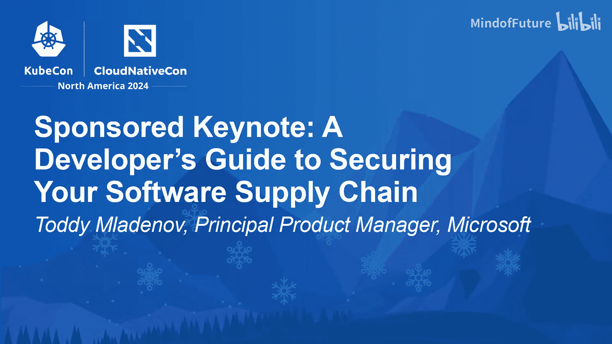
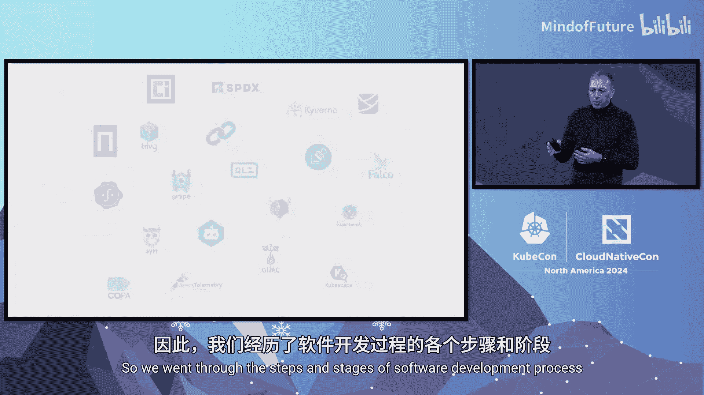

# 【CloudNative】KubeCon+云原生峰会2024-p13-P13-A-Developer’s-Guide-to-Securing-Your-Software-Supply-Chain---Toddy-Mladenov--BV1E9wPegEH6_p13-

Hello， cutecom。

It's great to be here。And also， I'm honored to be part of this amazing lineup of keynotes。Once again。

 my name is Toddy Moroff， and at Microsoft， I lead the initiative to secure the supply chain for all cloud native work worlds。

It's a fascinating topic， and I'm very honored actually， to be here and present it to you。

 So let's dive in。😊，If you follow the cybersecurity news， you have seen those articles。

Those are just a few of the most prominent software supply chain attacks that happened in the past few years。

While many are still financially motivated， the highlighted ones are with most nefarious ghost。

The question we need to ask ourselves is。Why do bad actors think such attacks will succeed。

Let's look at the steps we as developers take to get our applications from source to production。

Today， we go to registries like Docker Hb and find images。

We go to public package managers and choose library to help us with our development。

But we end up with this。Images in libraries that we have absolutely no control over。

Are included in our builds。Even worse， we deploy them directly to our production clusters。

This is what the bad actors want us to do， but we can make it harder for them。

We at Microsoft look at the software supply chain in different stages。

The first one is to acquire bits and pieces that help us speed up our development process。

Those can be software from open source， can be vendors decays， can be even internal binaries。

But before we acquire those， we need to make sure that they come from trusted sources。

Using signing technologies like Notary Project and Sixtor allow us to verify the authenticity and integrity of any software supply chain artifact。

But that signature is enough。Identities can be compromised。

That is why we should build an internal catalog of approved artifacts and not allow random posts from the Internet。

Using O C I compliant registries like Azure container registry allow us to do much more than just storing container images。

We can store any supply chain artifact we want。But， more importantly。

We cannot add metadata to drive our supply chain workforce。For example， we at Microsoft。

 we annotate container images with end metadata。And if we don't allow those images to be used if they are outdated。

We can also scan images for vulnerabilities in malware， or generate as bombs。

We can even use Project Co to patch images daily while waiting for the upstream project to provide updates。

Now it is time to build our application and put all the pieces together。

But building the bin is not enough。We should generate as bombs。

 not only because governments require it。We also need to get into the practice to build other attestations。

 like in total built provenance。But before we build。

 we should make sure that we scan our code with tools like code Q L and manage dependencies we depend about。

Did you know that the Pendabot can now update image references in Docker files。

 helm charts and Kubernetes deployment values。You can give it a try at Azure Devops。

Our application is ready to deploy。 But how do we ensure that we follow good deployment practices and deploy compliant workloads to our clusters。

Using admission controllers like OPA Gatekeeper with Ratify or Kiverno ensures that our work quotes are compliant from the get go。

And finally， we have our application running。Having a way to find misconfigurations or suspicious activities at runtime is essential for the security of our application。

Tools like Falco， Cuub Ecap and Cube Bench allow us to keep our clusters secure and compliant with security benchmarks。

There is more， though。We talk about observability in other areas。

 but we very rarely talk about observability of the software supply chain。

We need to have end to end visibility of what is happening in our supply chain to make sure we keep it secure。

Last week， Open Telemetry announced that they will add capabilities to observe the CICD pipelines。

This is a great example of how we can bring the observability to the left。We've heard about Guac。

We at Microsoft cooperate with the Guac community to enable developers to build dependency graphs and understand how their applications are composed。

😊，We should also use industry frameworks like salsa to ensure we follow best practices throughout our development process。

And don't forget to implement zero trust approach by ensuring that we trust software artifacts that come from previous stages。

So we went through those steps and stages of software development process。

 We saw a lot of projects available for us to choose from。

It may seem overwhelming， but this should not stop us to take the first step and secure our supply chain。

If you want to see how you can integrate some of those tools to have a smooth experience in your supply chain。

 come to the Azure boat。We can give you a demo， or we can just chat about that。

You can also use the link on the screen to learn more about how Microsoft thinks about securing the software supply chain。

And if you want to improve the experience of any of those tools。

 just pick one and join the community。 Here are a couple of projects that we recommend you look at。

So go ahead， take the first step and secure your software supply chain。Thank you。

 And enjoy the confidence。