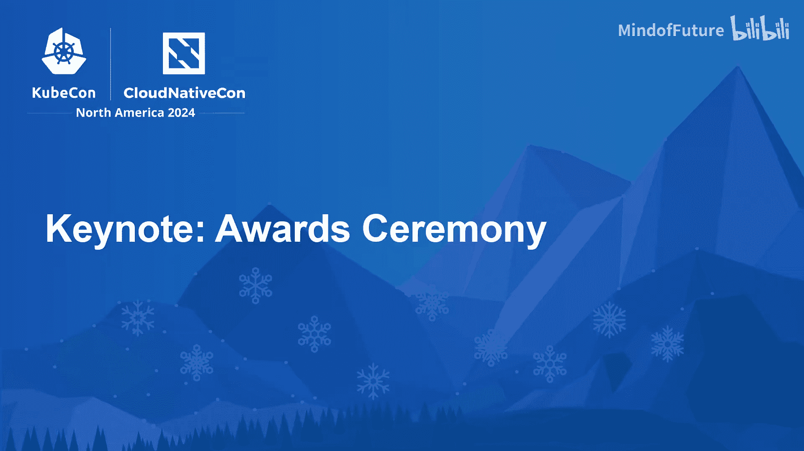
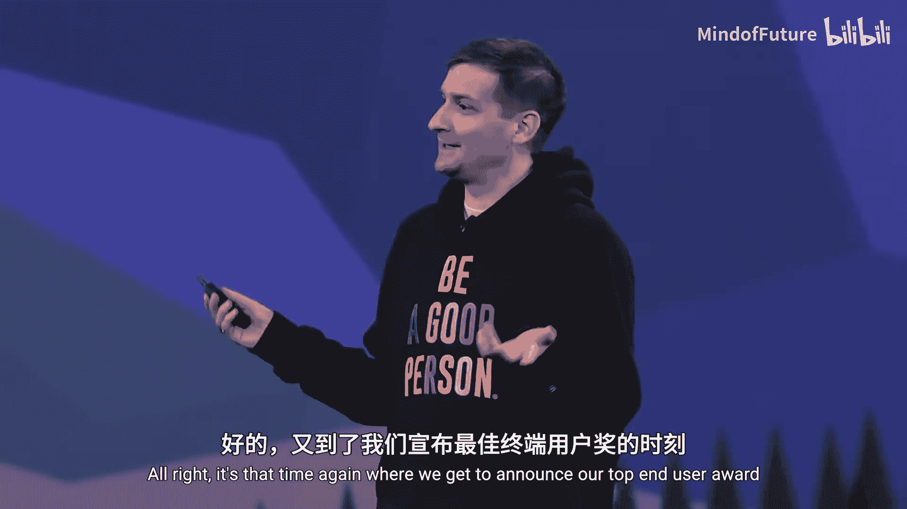
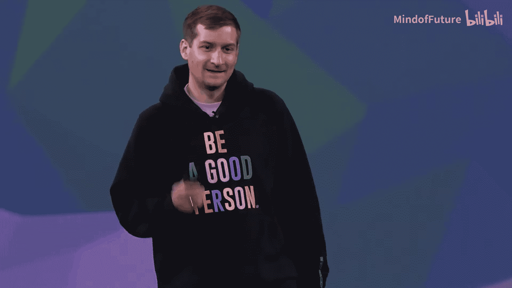
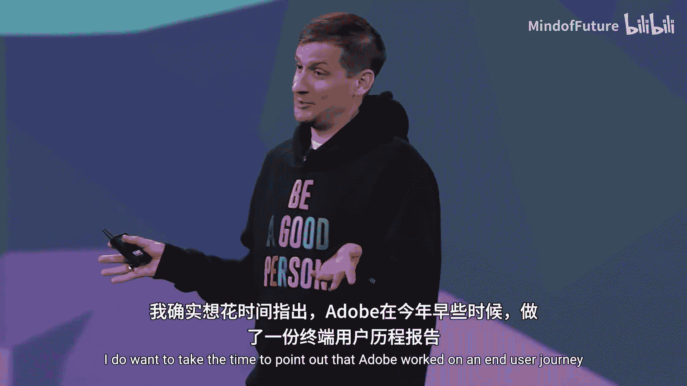

# 【CloudNative】KubeCon+云原生峰会2024-p16-P16-Awards-Ceremony--BV1E9wPegEH6_p16-

All right， it's that time again where we get to announce our top end user award。

 The way that these awards work is that our community submits organizations that are CNCF members based on contributions to the community and things that they have done。

😊。

So。We had three end users as part of this submission process leading up to this Cubecon。

Coming in third place。A place where many of you have earned your Ph PhD in the Internet。

I'd like to celebrate Reddit。They support millions of daily active users。

 process billions of page views monthly， and they provided us wonderful insights to things like the Piday outage。

 both things that might not go so well and their successes at the same time。

 really big thank you to Reddit on that front for being a great place to share。

 to learn and to laugh。😊，Coming in second place。It's Capital One。

Capital One was one of the first major US banks to fully transition to the cloud and providing us projects like Cloud custodian and ways that we can stay tidy within our ecosystem。

Now。Without further ado。Winner of this Cuubecon's top end user award。Is Adobe。

Far beyond allowing us the ability to print to PDF。

 Adobe has been a wonderful actor within our community。 Dave， thank you so much。

 It's been wonderful to have you as part of this community。 The ecosystem。 Thank you。

 Taylor Would you like to say some words。 Yeah， yeah， I would。 thank you very much。

 I just want to say first， I humbly accept this award on behalf of everybody at Adobe know it's an incredible honor and a privilege for us to receive this from such an esteemed organization and community。

 at Adobe。 Our mission is to help the world change the world through digital experiences。

 and I have the privilege of serving as the lead for the developer platforms team。

 and our own mission is to help Adobe developers to write better software faster。😊，And the tools。

 the expertise， the capabilities that come from this vibrant CNCF community。

Really are at the center of everything that we do to serve developers at Adobe。

 whether it's Kubernetes or Argo or backstage or Prometheus or Otel or Envoy and so many others， you。

 all of these technologies are at the core of how we deliver on that mission。So， you know。

 I really want to thank also my own team and the team and developer platforms who have contributed to the CNCF community。

 you know it's been an incredible journey for us with over 5000 contributions across 70 plus developers and 46 different projects across the CNCF community。

 and I'm extremely proud of the engagement that we have with the community。 And then finally。

 I just want to thank everybody here and everybody in the global CNCF community for everything that you do to enable us to deliver on that mission and make the life better for developers at Adobe。

 We are all standing on the shoulders of giants and many of you are those giants。

 So thank you very much。😊，Thank you， thank you。

I do want to take the time to point out that Adobe worked on an end user journey report earlier this year。

 They released it in summer。 I know many of you were enjoying the wonderful weather and warmer times。

 I encourage you to take a look at this。 end user journey reports are more of the story behind the why。

 certain organizations came to the CNCF。 What they're doing within open source and capturing that intent。

 So take another picture。 will last longer。 Check it out。 Let us know what you think。😊。

And thank you so much。I'm really looking forward to our next Cecon in London。

 The puns are already brewing。 I can't leave well enough alone。

 I can't wait to spill the tea with you in London when I'm up here next。😊，Thanks everybody。

 See you soon。Hello， hello， everyone， it's nice to be back on stage for what I think is my favorite part of Kubecon。

 recognizing individuals that have kind of gone。Above and beyond their normal roles in our community。

 And as I mentioned yesterday， we truly have one of the largest open source communities in the world。

 We have over a quarter million， know contributors worldwide contributing to over 200 plus you projects。

And you know， this may be a little bit cheesy， but you know we kind of have this saying within you CNncCF staff that you know truly the most valuable and most important project we have in CNncCF is the community that we have all built together over the years so without you know further。

do let's kind of get into the community awards here。

 so we have some new ones this year which I'll mentioned。

 but we always generally start out with our first award which is our kind of top top committer and top maintainer so you know of the kind of 200 plus projects out there that are in the CNCF there are about a little over a thousand maintainers here that support and work on these projects and many of you are in the audience right now and so before I kind of get into the fun awards here I'd like to kind of have any maintainers in the audience kind of like stand up and all of us just truly clap and recognize the work they do because previously to David's point like you know we are standing on top of the shoulders of giants and the maintainers are definitely a big part of that so any maintainers please stand up and let's give them a big kind ofla for all the amazing work that they do。

Awesome。Awesome， thank you so much for all your amazing work。

All right let's get to it so commiters maintainers kind of lifeblood of CNCF they do amazing work working on a variety of our projects。

 we have previous award winners here I've bumped into a lot of you already amazing amazing folks and you know this year the existing maintainers have know voted for。

😊，You know， this year's top maintainer， and I'm happy to announce that this year Joe Stringer has one that he could stand and we'll go clap it Hey。

 thanks you。Thank you， Joe， for all all the amazing you know， work that you do。 So thank you。

 We'll have all the awards backstage for you to pick up。😊，Okay。

Moving on so you know open source is truly more than just you know code right so you know we have this kind of notion of we accept contributions you know from anyone and you know documentation is truly important you good documentationments for good projects and this year I'm happy to announce that we have two new top documentarium or we affectionately name this Aureem Ipsom award here because we kind of like to be funny。

 but I like to congratulate Kumming and Haifeng Yao as a top documentarians this time around so please stand and recognize。

Damn hoop， there is。呃。Thank you so much。All right， next up， so we have CNCF。

 we have such a wide variety of projects and you different special interest groups。

 CNCF has technical advisory groups and these are kind of folks that work on specific areas whether it's storage。

 networking， contributor strategy and you we kicked off this award for the first time last year and Catherine Beganinni won last year but。

This year， I'm happy to kind of give the Taggy Award to Nancy To if she could stand up and Will Hopper。

 thank you so much for all the work。You do。Thank you。Keep going。

So you know one of the awards we created has been a few years ago is this notion of the Choppedwood Carrie Water Award and you know this was basically created to represent basically all the work that happens behind the scenes in a project a lot of people you work on fancy features know nice UI bits but what about things that help you know improve build times。

 kind of all the dirty behind the scene stuff that truly make a project work and so we created this award to kind of represent the people that do all these amazing things throughout our community and you kind of look at all the amazing previous award winners here and many。

 many of them are in the audience。 It's quite an amazing list of folks this year we have some new ones to add to the Chowood and Carrie Water category So without further let's go mention them So Stean Schinsky。

 Ali O James Sperin， Prianka Sago， Sania Pananvara and William Roso so thank you so much for all。

Amazing work that。How you do。Thank you。All right， let's get going。

So this year we have a new kind of one time special award that we're doing called Lift and Shi so some of you may not be aware。

 but the Kubernetes project kind of over the years has gone through a lot of infrastructure work to kind of improve to make sure that it's truly a community manage and run build process know lots of improvements to make sure that you know the CDN distributing all the binaries runs on multiple providers this was an incredibly hercuing effort over the years to kind of get this done and I'm happy to announce that this finally happen and there was a huge cast of characters of all this so I really want to recognize many。

 many folks that were involved in this so Li and shift there's a lot of folks here that will get the stand up and I'll try to name them all here so Tim Hawkin。

Erin Cririckenberg， Ben Elder， Arno， Dis， Man Alili， Rickysdiski， Michelle Shepherderson， Coryelske。

 Tque Marco， Justin Santao Barbara Cobaagner， Caleb Woodwine， Hpie， and Linus Arvar。

 so Sle Stan congratulates the folks for the amazing work。Thank you for all your work there。

So you know this year we're kind of a year of anniversaries right Kubernetes turn 10。

 we're getting older or CNCF is turning nine and you know we were talking a little bit about。

 you know maybe it's time we truly start recognizing you folks with kind of a lifetime achievement award。

 I we' were old enough now that hey， maybe we should go have a lifetime achievement award and start recognizing folks that have been with the community for an extremely long time and have an oversize impact in their project and wider communities。

So the first year we're doing this and I'm kind of happy it's always fun to kind of like create awards behind the scenes with the staff。

 It's like the fun part of the job in my opinion。 so I want to kind of announce the first time we're doing this and the first winner of this award is sure is a recognizable figure for some of you。

 but I'm gonna invite him on stage in about a second。

 So Tim Hawkin for an amazing amount work we're in areas areas， Come on stage Tim。I love to。

Tim is one of the first people I've met when I kind of came in his community and I'd love to congratulate you on the amazing work you've done you have an oversized impact for sure across not only Kubernetes。

 but CNF we want to say some things it's been 10 years plus so I did not have this on my bingo card for the week I'm humbled。

 I'm surprised and shocked to be up here。 thank you all。

 thank you to the foundation for keeping this thing running。U。

None of this would be possible without the hundreds of co maintainers and Sig leads and chairs and people who。

 who run the project。 I just， you know， do my little thing and have a great time。😊。

But it's the community that really makes things go。 and the thousands of contributors， thousands。

 tens of thousands of contributors who make this project exciting and excellent and something that we have。

 I don't even know how many people here to talk about。

 I will say thank you to my leadership at Google who has given us a lot of room to maneuver and freedom and trust and thank you that wouldn't be possible without their belief in us and doing this project。

😊，This has been the most fun that I've had in my career， and I hope that it will keep going。

 I hope to be here again in 10 years to。 I won't give away the code name。

 but we've already invented it。😊，Thank you so much， Tim。

 and thank you for all the work amazing stuff you do， truly one of the nicest people。

The Ks committee。 So that's going to wrap up the awards and truly thank you to all the contributors in the audience and you everyone has been so helpful over the years and I hope this kind of continued tradition of helping folks out。

 introducing new folks to the community and welcoming them continue。

 So thank you all for contributing to CNncCF projects and being part of this lovely community。

 and thank you to all our lovely award winners today and as a reminder when all these keynes are done today goes shuffle backstage and will kind of get you your hardware。

 So thank you all and' get on with the show。😊。