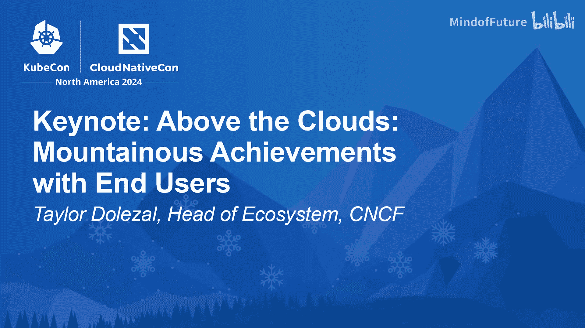

# 【CloudNative】KubeCon+云原生峰会2024-p18-P18-Above-the-Clouds--Mountainous-Achievements-with-End-Users---Taylor-Dolezal--BV1E9wPegEH6_p18-

Welcome， everyone。

Salt Lake City， a place so far above sea level that objectively we are above the clouds。

We're going meta as we're looking down at the wonderful things happening within our ecosystem。😊。

Now it's a little chilly here I've noticed， as I've been walking through the hallway track。

 I've noticed that people are wearing more layers than the OSI model。That's seven layers。

 That's a networking joke。Okay， come back to the fire with me， get warm。Today。

 I want to tell you some stories。 I want to ask you some questions。

 and then we'll get to more stories。Later。If you've gotten a chance to take a look at the skyline of this city。

 you'll see some mountains。 It's really hard to miss。When you take a look at those mountains。

And you really let it hit you。 It's something that affects you down to your core。

 Somethings so immense。Maybe you're one of those people that looks to that pinnacle and says。

 I want to climb that thing。 I want to go on an adventure。

But when you think through how you actually make that happen。

 it's not something that takes 10 minutes， right， It's something that's going to take planning。

 probably want to bring water， the right tools。Probably don't want to go alone。

First question that I have for you today is。What was your first mountain in this ecosystem。

Is it something that you're facing today？Is it something that you're going through in your job right now。

 Are you trying to solve a problem that might not make sense。My first mountain。

 hands down was Kubernetes。I was working in healthcare and Cleveland， containerizing。

 trying to make the right decisions with Ruion rails or go。 and it was。Not straightforward。

 It was quite a bit of a climb。As I took a look at the tech news and heard all of these orchestration wars and runtime。

 I I， I was lucky because we， I had a team that I worked with that was really good at communicating。

😊，But we always wondered， are we abiding by best practices， Are we doing the right thing。

It wasn't made clear to me until I went to a meetup and got to see Kubernetes for the first time。

As I was preparing these slides， I didn't realize， but the first time I heard about Kubernetes was actually on a boat。

 So if that's not a sign， I don't know what is， It's forever made waves in and wakes within my career。

And it's nice to find the answer， right。But。When you're trying to summit those mountains in life。

Even if you can see the peak in the distance。All that matters when you're in the thick of it。

 the grit， the grime， the rock， the snow， the ice is the next step。It's always， its。

 it can be difficult to see what's next without trying to understand what's around you。At the CCF。

 the foundation provides a place for us to be able to share all of this knowledge that we find as we make our climbs。

😊，Leading up to this cube con。We asked some questions about gaps。

 We wanted to understand what's still difficult， Where is their friction。

 What's going on within this ecosystem。 What are the common pain points that we face。

One of the biggest things that people cited was security。

 It's not enough just to have those features and things available to you。

 It's a conversation about configuration， right， What used to work several years ago does not continue to work as we scale。

Complexity is yet another thing， trying to figure out this interoperability， all of these tools。

 how to stitch them together and how to apply them to all of these environments that you work with within your organizations and on your teams。

Now， if you've been paying attention to the CNCF landscape， there's a lot of tools。

 There's a lot of projects。But trying to figure out which is the right one and how to layer them together。

Again， it's， it can be difficult。When you're trying to summon a mountain， you'll probably use a map。

 and a compass things to help guide your journey when。The next step might not make sense。

Knowledge is a gift that we all get to experience on our own。

 but its true value is realized when we're able to share that widely with one another to have critical conversations and really explore these things。

 So my next question， how do we summit together。Got a surprise for you。After three years of waiting。

 we have another tool for you to help figure out your landscape and your journey。

We're bringing back the CNCF tech radar。I'm stoked。But yes， yes。In this edition。

 we go through multi cluster workloads， AI， M， L batch。And I put some highlights here， please。

 please， please take a picture， check this out。 I want to hear your thoughts。

 I want to hear what are the other pitfalls and things that we can take a look at next as we navigate all of this。

So as you reach the top of the summit。The inspiring， fun。

 maybe scary truth is that that just means more summits。 At the end of the road。

 there's always more roads to travel。😊，And we have things for you， like case studies， data， research。

 education， training。 There's plenty of things to take a look at。Next up。

 I would like to invite our end user tab chair and vice chair to share some more surprises about things that they have for you as you try to navigate these mountains that you walk through。

 With that， I'd like to invite Hendrik and Aloda。😊，Get up here。Hi everyone， good morning。

 how are you。Hope everybody iss doing well。 And thank you for joining in today。

 On the second day of Qcon。 I'm Aza Sharma， and I chair the end user Technical Advisory board。

 which is also known as the tab。😊，And I am super happy to have be speaking to all of you today with Heri。

😊，H。 my name is Henry Blakeles from Intuit， and I'm the vice chair of the tab。

And we are excited to share the work that we have been doing to strengthen the connection between the end users and the CNCF ecosystem today。

😊，So the the end user tab represents the voice of enterprise users in the CNCF ecosystem。

 So we're a group of technical leaders from organizations across various industries that all actively use cloud native technologies。

Our mission is to advocate for end user needs and provide technical guidance to the CNCF community from an end user viewpoint。

 And we work closely with the T SC project maintainers and the broader CCF community。So this year。

 we have kind of， as we kickstar the work of the tab。

 we have organized our work around three working groups and those three working groups specifically are working around publishing。

 collecting and publishing reference architectures。

 working on establishing guidelines for what is important for project health visibility for end users。

 as well as getting project feedback from end users to projects。

So one of the challenges that many end users face is navigating the complex cloud native landscape and how to change that into something that they can run in production。

 So we've had a working group LED by Sergio Pejon and Gar Hens that have created a hub with real world production implementations and use cases。

 So this is a place where end users can go to find reference architectures。

 best practices and tips and tricks of what has worked and what hasn't for other companies in similar situations。

I think again， we'll talk a little bit more about reference architectures a bit later。

 but I wanted to talk a bit more about project health visibility and what we have done there。

 We have been working closely with the T OC to evaluate project health and understand the parameters of what is important for them when they are doing their evaluations。

 The second is developing metrics that matter to end users and documenting that。

 and the focus areas for some of the metrics that we have worked on are release stability and cadence。

 documentation quality， production readiness metrics。

 which are important to all of us and security response。

 We've been collaborating also with the LF teams who are working on metrics tool chains on project health scorecards。

😊，So another thing that the tab is， is working on is increasing collaboration between end users and maintainers。

And we've had a working group LED by Chad Bowdoin and Joseph Sandoval that' has been working on creating more structured channels for feedback between end users and our projects。

So we work on implementing standardized feedback templates that will help us focus on creating actionable。

 constructive feedback between the projects and the end users。

 And this will help us build a stronger and mutual beneficial collaboration between end users and maintainers。

😊，So I want to reiterate， you know what we have really achieved in  F024。

 and we are very proud of it， because， you know， we came together initially as a T group this year and have had an excellent team to work with。

 We have established that reference architectures are valuable to all of our end users。

 and we have very proudly， contributions coming in from Alis as well as Adobe。

 And if you are looking for them we will be sharing the URL。 shortly。

 the second area that we have really made good progress on is enhanced project health visibility through LFF insights integration。

 And last but not least， which is very important to us is getting more end users involved growing end user participation in technical discussions。

😊，Yes， we've done a lot of exciting stuff this year。

 We have a lot of really good end users that have helped us through the year。

 but we want more of you to join us。 And there are multiple ways you can join the conversation and help out the end user community。

 theyre a working group。 you can participate in。 you can work with us to submit your reference architecture to the helper creating and there are also other ways of participating in end user of feedback sessions。

 So please let us know that you're interested by following the QR code that flashed by the screen。

 So I click too fast。 but we have the QR code up again later。

 So I think that you know as we go forward into 2025。 there's just about know month and a half left。

 of this year， we will be continuing to work on reference architecture coverage well be launching new project health metrics。

 So keep a look out for those。 well be also working。😊，On scaling the end user feedback programs。

 And there will be， you know， again， blog posts and announcements that we'll be making around that and technical collaboration with the T O C and continuing to engage more with project maintainers。

😊，And last but not least， which is our， you know， major focus this year。

 will be also on growing and continuing to grow any user participation。😊，All right。

 And there is that QR code again。 exactlyactly。 the Q QR code is back。

 So please take a picture and join the conversation。 You know。

 please join in for working group participation。 If you have a reference architecture that you'd like to contribute。

 which is related to any parts of this NCF landscape， please don't be shy and give us your feedback。

😊，Thanks everyone， thank you。