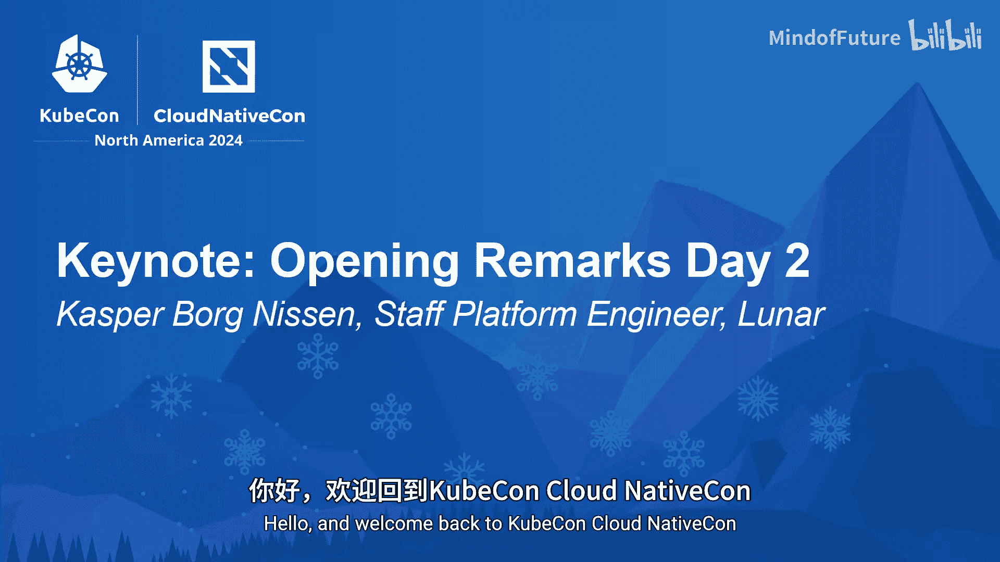
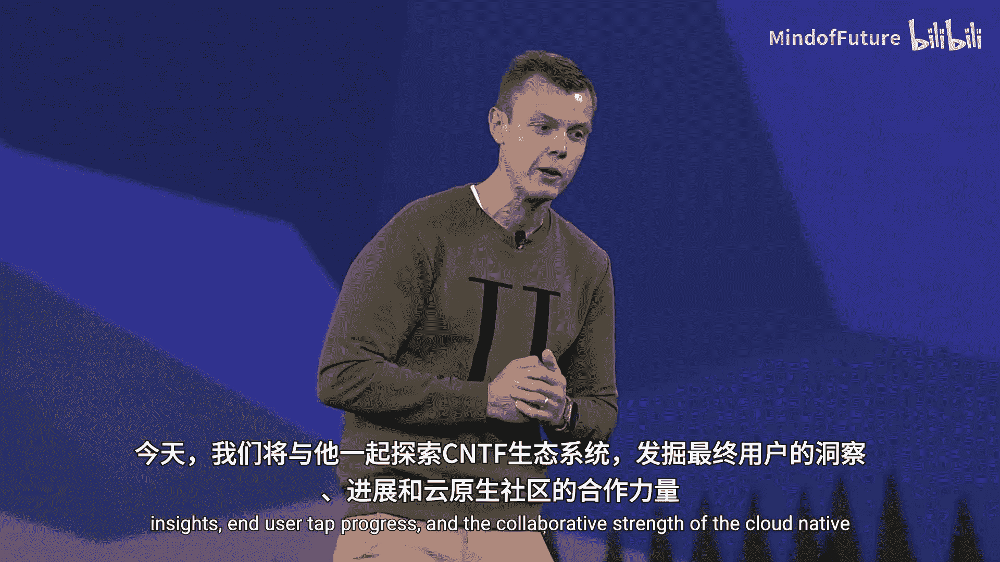
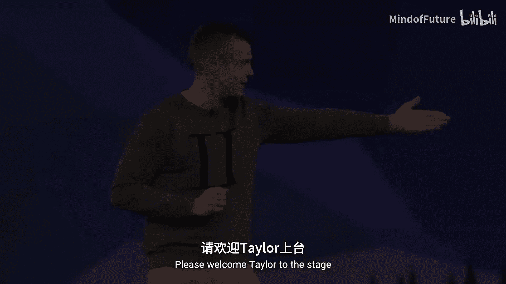

# 【CloudNative】KubeCon+云原生峰会2024-p19-P19-Opening-Remarks-Day-2---Kasper-Borg-Nissen,-Staff-Platform-Engineer,-Lunar--BV1E9wPegEH6_p19-

Hello and welcome back to Qecon， Cloud nativeativecon。

 I hope you all had an amazing time at Ke Crroll and Cloud native F last night。

 And I imagine you were very excited to get started with our next set of amazing keynotes。😊。

With that said， oh， sorry。So， today。Re啊。Pauluse， okay， we're do it again。So with that said。

 I would like to introduce our first keynote speaker of the day。

 Head of ecosystem and chief fund officer Taylor Dolool。 Today。

 we'll join him on a journey through the CTF ecosystem to uncover end user insights。

 end user tap progress and the collaborative strength of the cloud native community。

 Please welcome Taylor to the stage。😊。

