# 【CloudNative】KubeCon+云原生峰会2024-p21-P21-Engineering-a-Kubernetes-Operator--Lessons-Learned-from-Versions-1-to-5---An--BV1E9wPegEH6_p21-

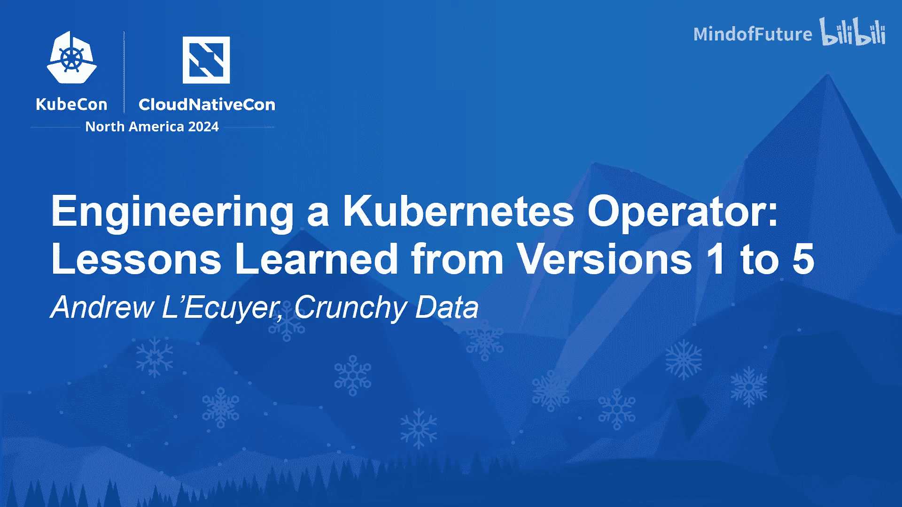

It'sSo great to be here with you today in Salt Lake City for Cecon， North America。

I'm really excited to be here today talking about Kubernetes operators。

And some of my own experience had crunchy data， engineering and operator for PostCres。

I've got quite a lot of content to cover today， so let's get started。

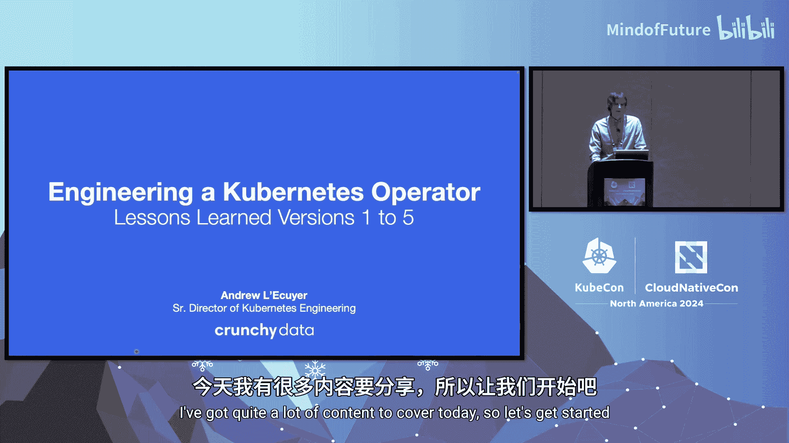

First， a quick note about myself。 My name is Andrew Le Kere。

 and I'm the senior director of Kubernetes Engineing at Cruruny Data。At crunchruny data。

 our motto is Postgres anywhere， we have a fully managed cloud。We support bare metal and VMs。

And of course， we have crunchy Postgres for Kubernetes， which I'll be talking about today。

In this talk， I'll be covering lessons learned from crunchy data's experience building five versions of a Postgrez operator for Kubernetes。

And to do this， I will highlight three key areas of the operator architecture。High availability。

 upgrades and disaster recovery。So why do we need operators？

Operators not only help to manage the complexity of deploying and managing an application。

But they also reduce toil and invite new communities to take part in the Kubernetes ecosystem。

And in 2017， crunchy data recognized that operators could reduce the operational complexity of running Postgres。

At first， it was simply a matter of containerizing Postgres， but once we were containerized。

 we needed to orchestrate。And to properly orchestrate， especially in the areas of high availability。

 upgrades and disaster recovery。We wanted an operator。

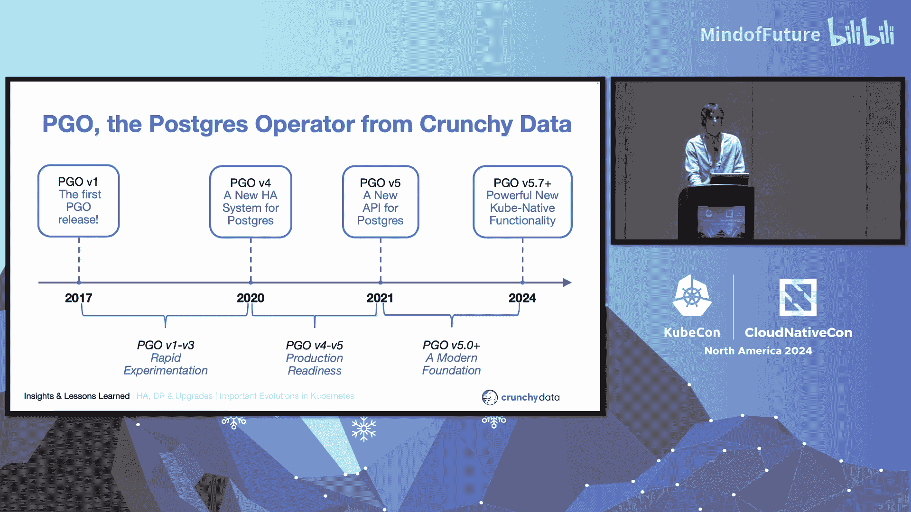

So let's quickly rewind back to 2017 and the first PO release。Pco version 1 was released on March 27。

 2017。And Kubernetes's version 1。6 was released just one day later。As we all know。

 we're now up to Kubernetes version 1。31 with version 1。32 due out next month。

And safe to say quite a lot has changed over seven years and 25 releases of Kubernetes。

Frameworks for operators were limited。As with support for stateful applications within Kubernetes。

So let's dive into the PeO architecture and talk about high availability or HA。

 starting with the definition。Any application will experience failures or crashes during its operation。

By making an application highly available， we ensure it remains available for use。

Which means quickly recovering from issues when they do occur or even better preventing those issues from occurring in the first place。

So from a Postgreds perspective。This means ensuring the database， and therefore。

 the user's data remains accessible。

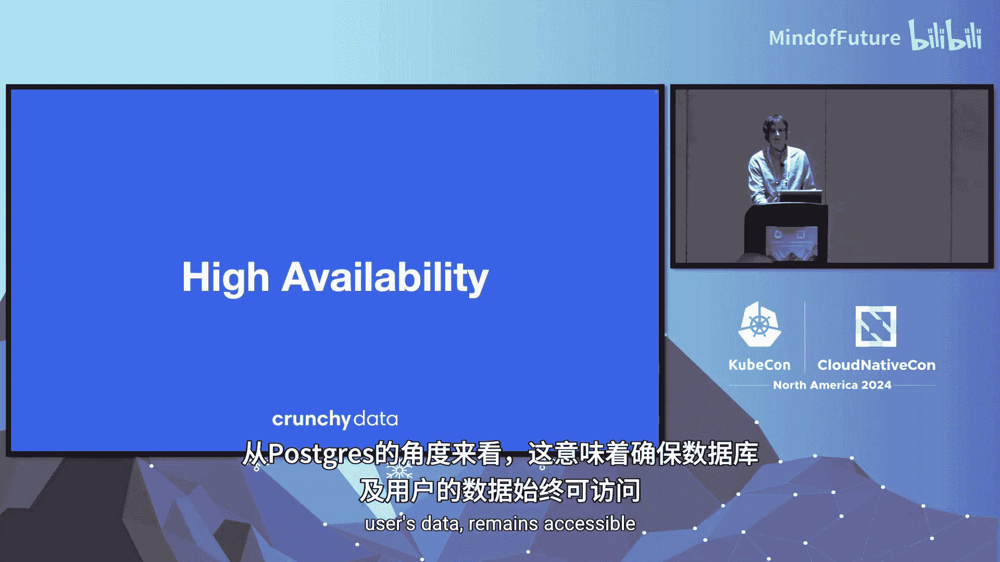

In the early days of the operator， we realized there are two types of high availability to consider。

Availability of the operator and availability of the database。

And we also determined that availability of the database was the top priority。Well。

 it might be frustrating to be unable to deploy a new Postgrez cluster if the operator crashes。

 it's even worse if users are unable to access their data。

And when it came to the high availability of Postgres。

We had to decide whether we take a mature Postgres H A solution from within the Postgres ecosystem and get it to running Kubernetes。

Or we could build our own custom solution using the operator。And in versions1 through three of Pgo。

 we had a custom solution for Postgrel's high availability built into the operator。

So as you can see here， the operator is responsible for ensuring the database remains available。

By leveraging Kubernetes capabilities such as readiness probes。

 Pigo could detect failures within a Postgres cluster and react accordingly。For instance。

 promoting a replica when the primary database crashes。However， by simply looking at this diagram。

 I'm sure many of you are also sensing some issues。First， there is only a single pego。

 which means we have a single point of failure。So if PO goes down。

We lose HA capabilities for all of our Postgres databases。And this isn't the only issue。

All operators also use a queuing mechanism to capture and respond to events in the Kubernetes cluster。

As you can imagine， this could be problematic if many databases crash at the same time。

Because the last thing you want if your database crashes is to have to wait behind 10 other databases before the HA system takes action。

And while these issues didn't manifest in major ways in the early days of PeO。

Where Postgres deployments were typically smaller in scale。

 as users made their first steps into Kubernetes for stateful deployments。

These cracks grew as users began to deploy postres at scale。So in these early versions of PO。

 we learned another solution was needed to support Postgreds deployments at scale。So in PiO V4。

 we pivoted to a battle tested solution within the Postgres ecosystem called Petroy。

This provided the decentralized architecture needed to mitigate the issues seen operating at scale with our original architecture。

And fortunately， by this time， the amazing Petroney team was already hard at work adding Kubernetes native capabilities to Petroney itself。

And with Petroney handling Postgrels high availability。

 we could address high availability of the operator。

Evolutions within the operator ecosystem made this easy。

By switching to the controller runtime project in recent versions of PiO。

 a set of libraries for building Kubernetes operators。

 adding high availability was reduced to a configuration change。

So we learn that evolutions within the Postcras and Kubernetes ecosystems。

 specifically with Petroney and the controller runtime projects。

We're key to enabling the HA solution we needed for both the operator and the database。All right。

 so let's see what this looks like in action， starting with Postgres high availability。In this demo。

 I'll introduce chaos into a running Postgrez cluster while highlighting how Petroy ensures our database remains available。

This includes scaling down the operator， deleting the current primary pod and deleting the entire data directory for the primary Postgres instance。

On the left hand side of the screen here is a running Postgres cluster。

 which is comprised of a primary and a single replica。

 You can also see the pod for the Pgo deployment at the bottom。

Below the Postgres cluster a row count is displayed， and once I kick off this video。

 a client will start inserting data into a table， causing the row count to increase。

This will simulate the minimal impact to a Postgres client as chaos is introduced and the HA system takes action。

Over on the right hand side of the screen， you'll see Petroney managing leader election for the Postgrez cluster via an endpoints resource。

Ptroni uses annotations in the endpoint's resource to track leader election details。

 which are also displayed。And what is really cool about this solution is that by using the endpoints resource。

 Petroti can update both the leader lock。😊，As well as the IP address pointing to the Postgres primary database all at the same time。

So not only will you want to keep an eye out for the various leader election details。

 but also keep on an eye out for the various network details within the endpoint resource as well。

So let's kick off the video。So the first thing you will see me do here is scale down and remove the operator。

 which due to our decentralized architecture with Petroney， will have no impact on the client。

 So there you can see we just got rid of our Pgo pod， and our client is happily inserting。

So next I will delete the current primary pod， which will result in a promotion of our replica。

So when this occurs， you will see the various leader election details。

 as well as the IP address for the endpoints updated to reflect the new primary。And finally。

 I will delete the entire Postgres data directory for the newly promoted primary。

 This will cause Petroni once again to promote the current replica。😊。

And looking at the ongoing insert， you can see the minimal impact of the client inserting data。

 so we're going to wipe out our entire data directory here。

 we can see our client is paused here for a moment before Petroney is going to quickly take action。

 promote our replica， there we go and our inserts continue。Okay。

 so this next demo is going to follow a similar script to the last one。

 Only this time will'll be demonstrating high availability of the operator。

This demo starts with no operator pods， as you can see here， in attempts to initiate a restore。

And because the operator isn't running， the restore will not be initiated。

Even though Petroy ensures Postgres remains available。

 we also want PO to be highly available to ensure other critical functionality， in this case。

 an in place restore is still available in the event that the operator crashes。So from there。

 I'll scale Pgo back up， only this time adding two replicas。And as I do that。

 one of the Pgo replicas will grab the leader lock using this lease object shown on the top right hand side of the screen。

Additionally， you'll see the restore initiate within our cluster。And from there， once again。

 I'll add some chaos only this time focusing on the operator by deleting the Pigo replica that currently holds a leader lock。

 this will initiate a new leader election process for the operator。So once again。

 keep an eye on those details within the lease object。And like the previous video。

 you can also see the impact of the client inserting data into the database。For instance。

 we expect the inserts to fail during the restore， but they will be uninterrupted by the chaos introduced to Pego itself。

The restore and reinitialization of the cluster will also see minimal impacts。Finally。

 the demo will end with PO detecting that the database is running out of storage base and auto growing the database persistent volume to prevent that from occurring。

So we'll end with an example of preventing a failure before it occurs。

 So be sure to keep an eye on the PVC details shown here on the right。All right。

 so now let's kick off the video。Like I said， the first thing you'll see me attempt to do here is initiate a restore。

 which is done by annotating the custom resource for the Postgres cluster。However。

 because the operator isn't running， the restore isn't initiated。

 so we're going to add our annotation here。But no restore will be initiated。So next。

 I will turn the operator back on by scaling the operator deployment back up。 only this time。

 I'll add two replicas。And when I do that， you'll see the first Pigo pod grab the leader lock using the lease object while the in place restore then initiates。

Next， I'll delete the Pgo pod that currently holds a leader lock。

 triggering a new leader election process for the operator。At this point。

 the second pego pod here will grab the leader lock。And finally。

 looking at the PVC details over here on the right。

 you can see that once the client reconnected and started inserting data following the restorestore。

 Pigo resized the PVC from 1 GB to2 GB to prevent the database from running out of space。😊。

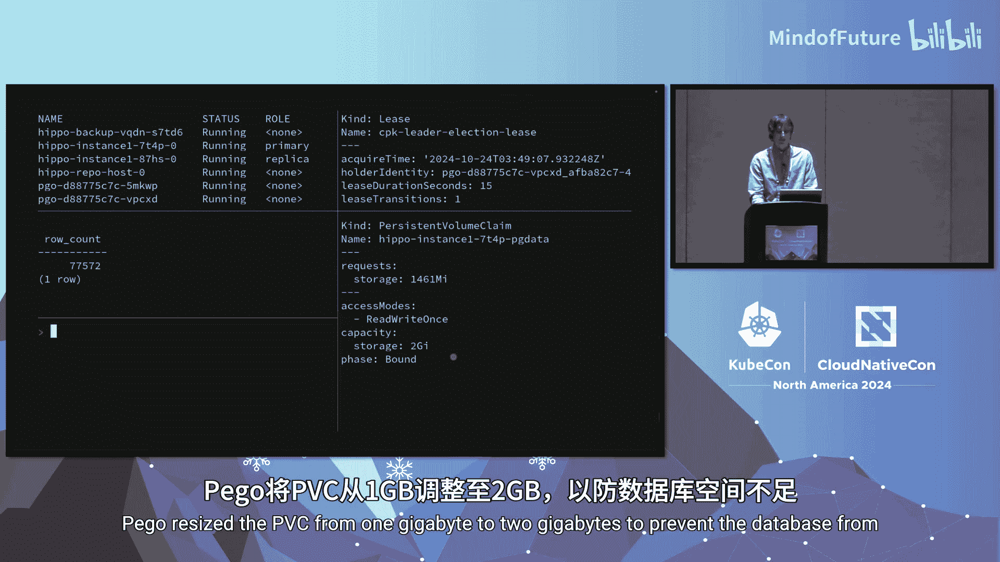

So here is a diagram depicting what you just saw at the end of the previous demo。

Pgo's ability to automatically increase the size of a volume in the event that it is running out of space。

This is a great example of another lesson learned while implementing H A within Pigo。

 which is emphasizing prevention over preparedness。😊，In other words。

 while we want to be prepared for an eventual failure。

 it's even better if we can prevent that failure in the first place。

And by leveraging Kubernetes volume expansion capabilities。

 we can prevent one of the most common errors we see managing databases。

 which is running out of storage space。Alright， so next up is upgrades。

This includes major and minor upgrades of Postgres。

 as well as major and minor upgrades of the operator。In Pego versions 1 through3。

 the operator did not tackle upgrades directly。 It was a manual process。

And with Petroney handling database high availability。

 we had freed up development time to focus on new features。

One of those features was a fully automated rolling update strategy that could roll out Postgred's Min version upgrades。

And for Pgo， by avoiding breaking changes within our own APIs。

 Pgo upgrades could also be rolled out via the same strategy。Posgred's major version upgrades。

 however， were different。Since the use of invalid upgrade configurations or images could result in serious downtime。

 while compatibility issues could also break existing database clients。

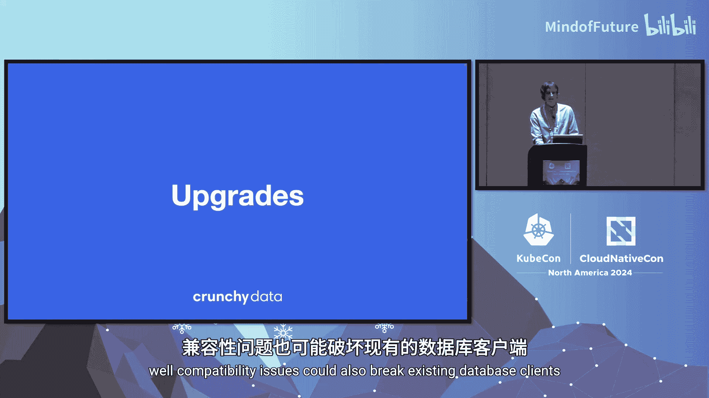

So when looking at these various types of upgrades。

 we had to determine where it made sense to either fully automate an upgrade。

Or where it made sense for the operator to navigate the user through an upgrade。

So on the left here is Pego's rolling update strategy。

And on the right is the Postgres major version upgrade strategy。

PO's fully automated rolling update process handles the majority of changes a user would need to apply on a day to day basis。

PO can be upgraded。Postgres can be reconfigured and updated to new minor versions。

Or the pod spec for the Postgrez database can be modified， for instance。

 to add a custom sidecar all through a single consistent rolling update process。

On the right is the Postgres major version upgrade process。

The use of status and conditions within the Postgres major version upgrade API navigates the user through these steps with sufficient transparency to empower the user to fully automate the process。

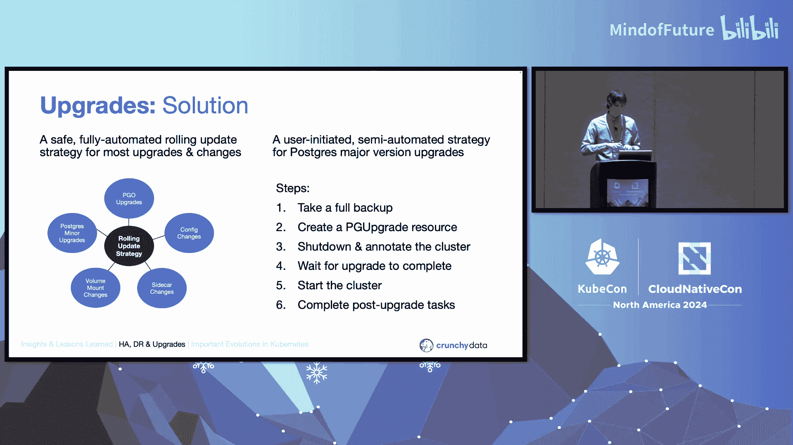

So this video will demonstrate the PO rolling update process。

This will be done by making a configuration change to Postgres that requires a database restart。

Mounting a key tab file for Kibos authentication， as well as performing an upgrade of Pigo。

And during the upgrade of PO， not only will the operator be upgraded。

 but a minor version upgrade will be rolled out to Postgres as well。On the top left。

 you can see the Postgres cluster that we'll be rolling changes out to。And once again。

 a client will continuously insert data as changes are rolled out。

 and the version of Postgres is also shown here to demonstrate the successful rollout of a minor Postgres version upgrade。

🤧。On the top right， you will see when a restart is needed for each instance following the configuration change。

And the panel underneath shows a live view of the Postgrez configuration。

 allowing you to see that configuration changed directly within a Postgres pub。Finally。

 the panel at the bottom right hand side of the screen shows a live view of the Etsy Postgres directory within a Postgres pod。

 A key tab file will appear here once I reconfigure the cluster for Kiboos authentication。😊。

So let's kick off this video。And the first thing you'll see me do here is change the Mac connection setting for the Postgres database from 100。

 as you see here to 200。So we're going to patch in that configuration change。And as I do that。

 you'll see， we'll get some pending restarts here for each Postgre instance。

 which are quickly cleared by Pigo。 There's our first one。 Pego just rolled out that restart。

And we'll see another one here in a second for our second instance。 Now， Pigos rolled that out。

 So next， a secret will be bounded containing a file needed to enable Kboos authentication。

And once this change is rolled out， you'll see a Kibo's key tabab file appear in the Etsy Postgres directory。

So there's our key tabab file。And finally， I will upgrade Pigo from version 5。6 to version 5。 7。

And once I do this， a minor version upgrade of Postgres will be rolled out as well。

 So you will see that Postgres has changed from version 16。3 to 16。4。

So this next video demonstrates a Postgred's major version upgrade of the same cluster shown in the previous video。

It will demonstrate a major version upgrade from Postgres 16 to Postgreds 17 using Pgo's PG upgradegrade API。

You'll want to pay attention to the status and conditions displayed for the PG upgrade resource。

 as will be shown on the right hand side of the screen。As you will see。

 the status and conditions will safely navigate me through a successful upgrade。

So let's start this video。And the first thing I will do here is create the PG upgrade resource to upgrade our hipIpo cluster here from Postgres 16 to Postgres 17。

And once I do that， the first condition is displayed that shows that the upgrade cannot proceed until the Postgres cluster is shut down。

So next， we'll shut it down。And once I do this， a new condition will be displayed。

 indicating that the Postgres cluster needs to be annotated for the upgrade to proceed。

 This is how Pgo allows those managing the Postgres database to indicate that they're ready for a major upgrade。

😊，So now I will annotate the Postgres cluster。And as I do that， some upgrade jobs are run。

And two new and we can see that our upgrade is progressing by looking at our condition here。

 And next， the upgrade will complete at which point two conditions are displayed。

 One show showing that the upgrade is no longer progressing and the others showing that the upgrade completed successfully。

And finally， we'll turn the Postgres cluster back on at which point our client will reconnect。

 and we can see that we are now on Postgres version 17 and our inserts continuenuum。

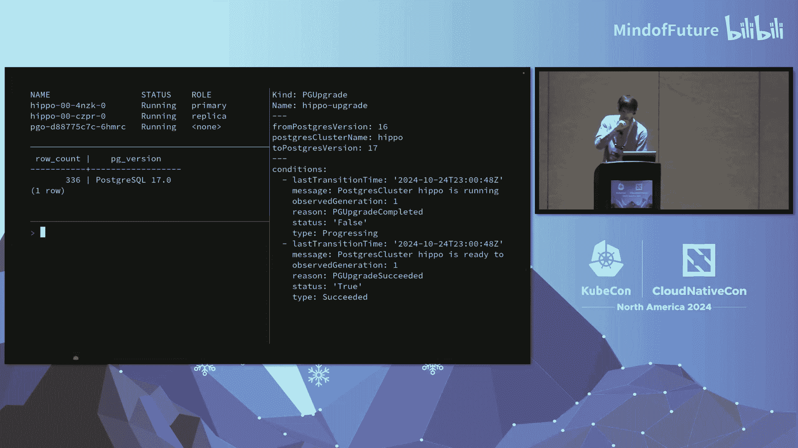

All right， so now on to disaster recovery or DR。Any system has the potential to experience a disaster at some point。

 This could be anything from a natural disaster that takes out your data center to data corruption。

And when this occurs， you want to have a process in place that allows you to quickly recover。

This is what disaster recovery is all about， establishing and exercising processes and technical solutions to ensure your critical applications continue to operate。

For Postgres， this means ensuring users and applications can access critical data according to the recovery time objectives or RTOs。

And by RTO， I'm referring to the amount of time the database can be offline before it is recovered。

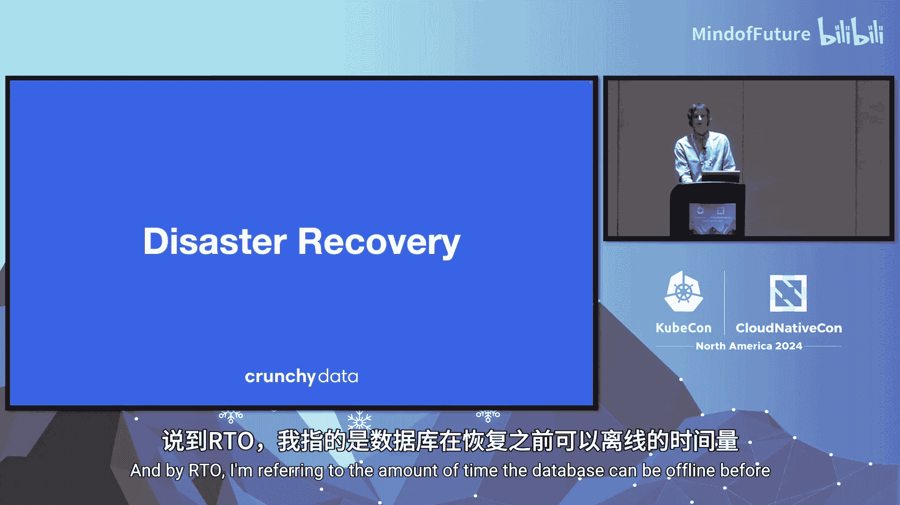

Cruny data's experience in disaster recovery told us that an effective DR strategy was more than simply creating backups。

It was really the recovery scenarios that mattered。In other words。

 backups hold little value if we can't use them to meet our recovery objectives。

And because our recovery scenarios might involve crossing the boundary of a single Kubernetes cluster or cloud environment。

 we also realized that our D R strategy would be critical to enabling another important capability within Pigo。

 which is data mobility。😊，This means providing users with quick and easy access to their data。

 where they need it。So this left us with an important decision。

Use a tried and true disaster recovery solution within the Postgres ecosystem that can meet our recovery needs。

Or do we build a solution around Kubernetes Kubernetes native capabilities， For instance。

 the ability to create volume snapshots via the Kubernetes API to meet this need。Additionally。

 we didn't want our decision。 for instance， if we did select a Postgres native solution to blind us from embracing solutions from the Kubernetes community。

And if we did adopt a Kubernetes solution， we needed to use it in a way that recognized the specific needs of our application。

 in this case， Postgres。And finally， while we might be able to build custom layers on top of existing solutions to give us the D R features we needed。

😊，It would be even better to work with the maintainers of those solutions。

 to build in those missing features。So this diagram depicts the current architecture for disaster recovery within Piga。

In the middle of the screen is the heart of our DR solution。

 A DR solution within the Postgres ecosystem called PG backre。

This is where we can attach different types of storage for managing our backups。

 whether local persistent volumes within the Kubernetes cluster or various types of cloud storage。

And in the demo on the next slide， I'll highlight various aspects of this architecture。

This includes using multiple types of storage for backups。

 allowing easy access to data to create things like standby clusters and clones。Additionally。

 I'll show how Kubernetes volume snapshots can be used with PG backre to further reduce the amount of time to create those clones。

Okay， so this demo starts with an Noprem cluster， as shown on the top left hand side of the screen that has two backup repositories defined。

This includes a local PVC based repo， as well as a repo within a GCS bucket。

 as shown here on the right hand side of the screen。

And the first thing I will do is create a backup of the onprem cluster in the GCS bucket。After that。

 I will create what Pigo calls a standby cluster in the GKE environment。

Showone up up in the top right here。This means I will now have a Postgres cluster in GKE that is replicating from my onprem cluster all using PG backre。

From there， I will shut down the onprem cluster and promote the G K E cluster。

 This means the G K E cluster will now accept rights。

PVC details on the right hand side of the screen will switch to the GKE cluster。

 and a new panel will be displayed on the bottom right hand side of the screen。

 This panel will show the volume snapshot that is safely created for the GKE cluster using PG backrest and Kubernetes volume snapshots。

😊，And finally， I will create a clone of that GKE cluster using the volume snapapshot。

So let's start the video。And like I said， we'll start with a nonprem backup to our GCS bucket。

 which will quickly complete。And next， I will create a standby cluster in the G K E environment。

 which is quickly bootstrapped using the backup to G C S that just completed。😊。

Once that comes online here。We'll then shut down the onprem cluster。

 followed by promoting the GKE cluster。And once the G K E cluster is promoted。

 you'll see some additional activity as it becomes the new primary。

 This includes the creation of a local backup， as well as a volume snapshot。

 which will be shown on the bottom right hand side of the screen。😊。

So we can see that we have our volume snapshot here， which is about to be ready to use。 And finally。

 I create a clone which is quickly bootstrapped due to the use of that volume snapshot。😊，So there。

 we just submitted our。Command to create the clone， and we'll see once Kubernetes schedules that job。

 everything will quickly bootstrap， and that is thanks to the use of that volume snapshot。

And this last command here is just looking at some of the PVC details for this clone we just created to show that it is indeed using that snapshot that was just created as shown on the bottom right hand side of the screen。

And of course， we saw that that cluster did come up very quickly once it was scheduled by Kubernetes。

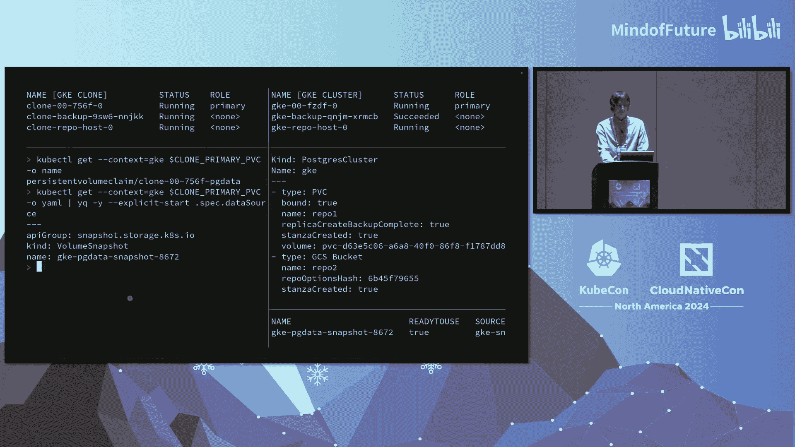

So now that we've covered high availability upgrades and disaster recovery in detail。

Let's review and summarize both the current solution within Pgo for each。

 as well as the important lessons learned implementing these solutions。

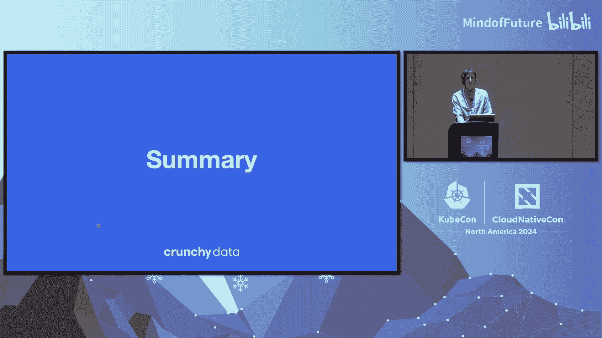

Starting with high availability， what was the solution we settled on within Pigo？

We have pettroney being used for Postgres high availability。

 and the controller runtime project is being used for operator high availability。

And Kubernetes volume expansion is being used to autogrow disks。

And the lessons we learned are as follow。First， a decentralized architecture allows us to scale。

 By using Petroy， we now have a decentralized architecture that allows us to operate and manage highly available postgres clusters at scale。

Next， we need to fight the not invented hear syndrome and embrace existing solutions within the community。

Well， as operator developers， it was a great exercise to see how Kubernetes features could be utilized to build our own HA solutions。

 We ultimately determined that existing battle tested solutions for HA would give us the robust HA capabilities we're looking for。

😊，And finally， we learn that prevention is better than preparedness。

While having HA solutions to protect us in the event of a failure is great。

 the ability to leverage Kubernetes volume expansion capabilities to prevent a common issue in the database world running out of storage space is even better。

😊，Now， on to upgrades， starting with the current solution implemented within Pgo to enable simple and seamless upgrades。

A safe rolling update strategy is utilized for configuration changes。

 minor Postgres version upgrades， and PO upgrades。And a new API has been created for Postgred's major version upgrades that uses status and conditions to empower users to successfully navigate the upgrade process。

And these are the lessons we learned while implementing this solution。First。

 manage risk associated with upgrade automation and only update。

 or it only automate when risks can be mitigated。And when we can't automate。

 empower the user to orchestrate and automate using status and conditions。And finally。

 our solution and lessons learned for a comprehensive disaster recovery solution within Pigo。

 starting with the solution。😊，We use PG backres for multicloud， backup and restore functionality。

 as well as to provide data mobility。Additionally， Kubernetes volume snapshots are used to support recovery time objectives。

And the lessons we learned are as follows。First， focus on recovery rather than backups。

While backups are important， they only matter if they support your recovery objectives。Next。

 a robust D R solution can enable data mobility by having backups in the places you need them。

 including across cloud and Kubernetes cluster boundaries。

 Not only do you add redundancy to your backups， but you can provision the databases you need where you need them。

😊，And finally， use Postgres native solutions to to safely utilize Kubernetes native solutions。😊。

For us， the combination of P G backrest and Kubernetes volume snapshots allows us to create snapshots that are free of corruption and other issues。

So we learned to pay attention to all of the communities in which we operate when establishing a D R solution for Pego。

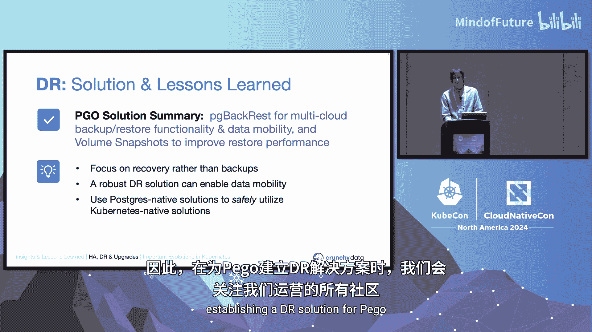

Okay， so as I wrap things up this morning。I'd like to conclude with just a few final thoughts around operator development。

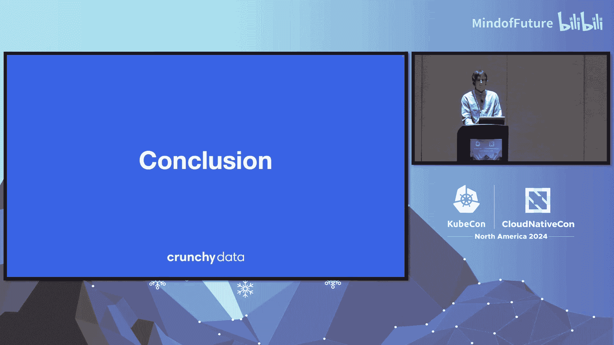

Many of you might have contemplated creating an operator for your own application。

While there isn't an easy answer as to whether an operator is right for you。

 I can say that not that an operator is a great fit for Postgrez。

If you're struggling with managing the complexity of your application in some of the ways I discuss today。

Or if that complexity is resulting in a frustrating experience for your users。

Then an operator is worth considering。And since operators are comprised of the same building blocks as the core Kubernetes APIs。

 they also provide practical experience and knowledge that can be applied to the development of Kubernetes itself。

To provide an example， this knowledge helped crunchy data participate in a community solution for using huge pages when running Postgreds in Kubernetes。

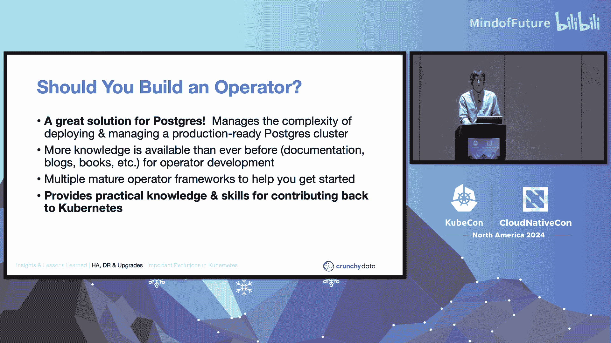

So as I conclude today， I will end with a final timeline showing just how far things have come within Kubernetes since 2017。

 especially as pertains to operator development。Kubernetes is now a mature and stable platform for all types of applications。

 stateful applications included。And I truly believe there's never been a time。

 a better time to build an operator。Alright， so thank you so much for joining me this morning。

 And please come find me at the crunchruny Data booth to continue the conversation regarding any of the topics covered today。

 I'd love to hear about your own operator experiences and the lessons you've learned  building your own operator solution。

 So thanks again。 And I hope everyone enjoys the rest of your time here in Salt Lake City。😊。

And with the time we do have left， I， I'm happy to field some questions if there are any。2， okay。

Thank you for the talk。 That was a very interesting postg talk。

Do you have anything to show about the operator， which is DK you used。

What challenges you faced between when you started the project a long time ago and nowadays。

What changed in the operator frameworks。Yeah， I mean a lot has evolved in that sense since those early days。

 I mean， I can still remember coming aboard crunchy data to work on our operator back in 2017 with just a blog post or two。

 I think a section of a book that helped me get started。 know again， a lot of the frameworks。

 I think most of us are very familiar with for operator development these days。

 know Q buildder operator SD the operator SDK。 we're still in the infancy or didn't even exist。

 So a lot has changed in that regard。 you know I mean。

 today there is just such a wealth of knowledge around operator development in general。

 including within the Kubernetes documentation itself， countless blog posts。

 there's mature frameworks， it's just so easy to get started today。Excuse me， compared to how it was。

 you know back in 2017。 So so yeah， not to mention just how many operators are out there in the wild these days。

 So if you're looking for a reference， you know， operator for some sort of application you're creating whether it's stateless。

 stateful， whatever it might be。 chances are there's another operator out there that's similar that you can reference。

 So it's like night and day as far as I'm concerned。

 know kind of having seen those early days of operator development to where we're at today。

 And again， that's why I think it's such a great time now to get involved in operator development。

 because there is just such a wealth of knowledge out there。 It's such an healthy ecosystem。

 great frameworks， great knowledge， great projects out there。 So yeah。

 just some great evolutions in that area for sure， since those early days。😊，Anything else？是是。

I'm just going to add the crunchy data booths at the P8s at that right hand side of the。Expo area。

 if you're walking in， you go to the right， you go to the back， so come talk to us。

 we' love talking about postre。Thank you for your talk。 was really， really interesting。

 In the first demo， you showed us that you are able to do an automatic failover。

 even when the operator is down， that's a great technical achievement， in my opinion。 And later。

 you said that operator has to be。😊，Inten is just as part as the whole Kubernetes API。

 So my question is。Which scenario are you thinking about。

 Why the operator should be down at the same time where an automatic failover will happen。I'm sorry。

 I had a little trouble catching that。 Oh， so did。I was saying why the operator should be down at the same time when an automatic failover should happen。

Which is the scenario you are thinking about。catchcha。II apologize， havent。一样。Yeah。Yeah。

 both at the same time。Oh like what if both are lost at the same time So so with Petroy。

 you know Petroney could actually continue to operate。

 even if you lose access to the Kubernetes API temporarily。

 So Petroney has a very cool feature in it called faila mode it's something we do see as you know we work with a lot of different customers。

 a lot of different Kubernetes distributions and you you did see that Kubernetes is using that endpoint resource right to manage leader election。

 of course， if FD is unhealthy or the Kubernetes API is unhealthy。

 that could be problematic for even Petroney to do what it needs to do but there is another feature within Petroney。

 they call it failafe mode because you didn't see it in these demos directly but the different pettroes running in all your Postgres instance pods。

 they also have their own rest APIs where they're talking to each other over the network。

 So even if there is temporary loss of access to the Kubernetes API。It has the ability to reach out。

 talk to the other pettros and continue to operate。

 you know despite that temporary loss to the Kubernetes API。 So yeah。

 it's one of those things where always you know know working with clusters or our customers to try to make sure you know their Kubernetes environments are healthy so we don't have to rely on that but there is kind of again a fail safe mechanism in there to prevent that even in the event that you do lose your Kubernetes API temporarily Yeah okay see thank you sure thing。

Yeah， I have a question about our grades。So I saw basically you showed how upgrade。

 major upgrades are done。 and I see it primarily as an imperative。Way of doing upgrades。

 Is there a declarative way of doing major upgrades， And in that case， how rolled back， for example。

It can be handled。 I'm sorry I think I was having a little trouble hearing。 I apologize。No。

 probably it's because of my languages。I was saying that you should measure upgrades。

But I saw primarily there way， you should an imperative way of major upgrades for Posts。

So I'm asking if there's a declarative way because we develop another operator and the challenge is to do it in a declarative way。

 if you have addressed that， and how do you see， for example， rolled back。

To be handled in case the major upgrade fails， for example， thinking of extensions like Pogi or。

 we're relying on our DR solution in that scenario。

 So we do recommend the user creates a backup before they ever initiate the major upgrade grade process。

 those status and conditions will tell you， as you're navigating through the major upgrade if something does go wrong。

 So if you do end up in a bad state， our solution there is to use your disaster recovery process。

 use that backup that we did tell you that I didn't show that in the demo specifically。

 but you might have noticed that that was the first step when I was highlighting our major upgrade process was to create a backup。

 and that is the solution in that scenario。 So if something does go wrong。

 we want to make sure you can revert back to where you were in in that scenario。

 But what's your experience， for example， in case of thousand ofpog clusters to be upgraded。

In terms of major vision。How you know， how do you cope with that scale， for example， I mean。

 based on your experience。Gotcha， you know， I mean， most of our experience with customers， you know。

 I think we're not typically seeing that many major major upgrades occurring concurrently at the same time。

 know， it's a lot less often that these things occur。

 So it is something that's usually a little more tightly controlled， scheduled。

 manage that sort of thing。 But I will say we are seeing customers who are starting to leverage our API to do things in terms of major upgrades at larger scale。

 because what those status and conditions allow you to do if you are comfortable know。

 with performing a major upgrade。 You're comfortable with managing， mitigating the risks。

 you know what extensions you have there， you know it's going to work。

 you can fully orchestrate that process because know you're basically just waiting for certain status and conditions to occur to tell you what to do next。

 So what we're seeing a lot of our customers starting to do now is they get more comfortable with major upgrades。

 And honestly， I think the major upgrade API in general is allowing our。😊。

Customers and users to get more comfortable with the process in general。

 So as they go through this with a few clusters and realize， you know。

 that they're comfortable mitigating those risks， they are starting to automate more and more of that。

 So we are seeing customers who are writing kind you could call it a script or whatever you around our API that basically is watching as the API。

 you know， gives you those different status and conditions and then triggering the next phase of the upgrade process。

 And because of that， we are now seeing more and more customers starting to do more major upgrades more regularly at a larger scale。

 So， I think a lot of what this API is providing users I think I mentioned the word empowering right it gives them visibility into the upgrade process。

 It allows them to understand the risks associated with it。

 how to come back from something of something doesn't go wrong。

 But as they get more comfortable with it， know， they can automate more and more and do it at a larger scale。

 Yeah， thank you。😊，Thanks for the talk thank you。Hey， I just want to say。

 I thought the demos were a really great way to demonstrate like。In a small package。

 exactly what could go wrong and how it's recovering from that。

 I'm just wondering if you have like particular strategies used for automated testing to make sure that the operator is working not only for like the parts implemented。

 but also the fact that it's like interoperating with a bunch of other solutions。Gotcha。

 you're just asking about test automating testing around Yeah just like what test strategies are you using I'm sorry what test strategies are you using just to test our own operator itself in terms of development work we're doing and things like that we're using a few different frameworks to do automated testing one of the big projects we're using is something called cuddle。

 which you might be familiar with， which is a it's a framework that allows you to declaratively you know define what you want the API to produce and then kind of assert that what is created represents that so that is a big part of our testing strategy these days I highly encourage everyone to check out that project if you're interested in testing your operator we do use the controller runtime project and within that we're using some of the testing capabilities baked into that as well firing up fake API servers and things like that just to you know make sure。

When someone spits you gives us a spec for a Postgres cluster。

 we're generating all the resources that are expected to be generated as a result of that。

 you know you can imagine one Postgres cluster spec that gets generated could result in multiple stateful sets。

 config map， secret services， you know a whole host of different resources。

 so I'd say between those two strategies you know with the controller runtime and then cuddle that's where we're capturing。

 you know that's what allows us to exercise a lot of that functionality。

 yeah to verify you know the operator is。You， reconciling what it should。Awesome， thank you。

 sure thing。All right。I think that's it。All right， thank you so much， I appreciate it， thank you。

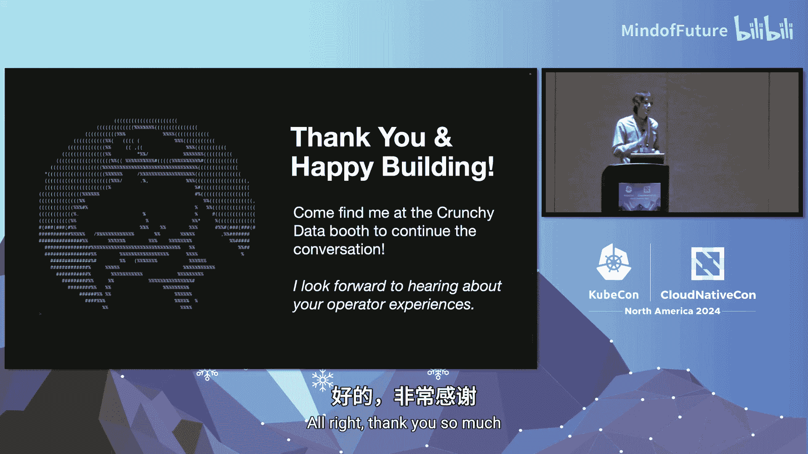