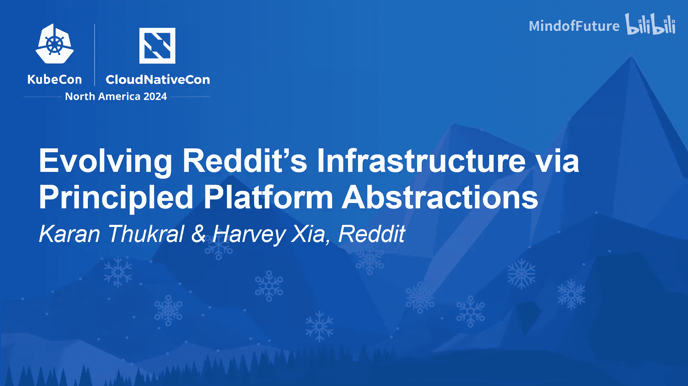
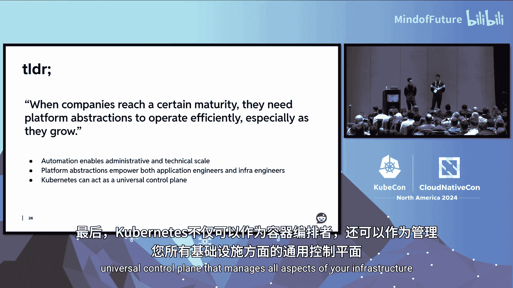

# 【CloudNative】KubeCon+云原生峰会2024-p22-P22-Evolving-Reddit’s-Infrastructure-via-Principled-Platform-Abstractions---Kara--BV1E9wPegEH6_p22-

Hello， everyone。 Thank you so much for joining us today。

 I hope everyone's been having a great Cue con so far。 My name is Car Trowrow。

 I work on the Comp infrastructure team I Redit， and my name is Harvey Shaw。

 and I also work on the compute infrastructure team。😊。

Before I get into the talk， I just want to know the slides have been uploaded so in case anybody wants to follow along that way too。

So today we're going to dive into a retrospective about how Reddit infrastructure has evolved over the past few years。

 but particularly leaning into platform extractions and automation backed by a Kubernetes control plan。

A quick overview for the agenda for today， we're going to start this off by talking about the state of Reddit infrastructure back in 2022。

 which prompted most of this investment。We're going to then dive into the foundational principles that we use to build our platform。

What we learned from it， what hopefully you can take away and kind of where we're headed。

We should have time for questions Steeward at the end of it， but in case we don't have the time。

 both Harvey and I he will hang around in the hallway in case anybody wants to like chat。

So before I get into the kind of the meat of the talk， I want to pitch a thesis statement。

 so it does it help connect the content together。We believe that when companies reach a certain maturity。

 they need platform abstractions to grow efficiently， especially as they grow， sorry。

 operate efficiently， especially as they grow， and Redit was at this inflection point in 2022。

So throughout 2022， it was a big change for Reddit。

 Reddit was growing quite significantly internally as an organization and externally as a product。

 We were working towards an IPO and starting to expand our serving act to be multiregional with the end goal of being global expansion。

The global expansion was built for better resiliency and reliability。

 but also to improve the user experience for our international users。嗯。

We're also investing pretty heavily into our ads in ML stack and continue today。

 which is a pretty common theme across the rest of the tech industry as well。

 and this came with its own set of scaling challenges。

We ended 2022 with about a seven to one ratio of application engineers to infrastructure engineers。

 and we started 2022 and ended the year with about 20 Kubernetes clusters， all largely unique。

 but all in the same cloud and same region。In order to understand the pitfalls of our infrastructure or legacy infrastructure。

 I want to use the most basic examples。And this is a namespace。 Every application I readdit。

 like most companies， needs a namespace to run in Kubernetes。

So I'm going to take on the persona of an app engineer。For me to especially start a new application。

 the first process was creating a namespace。I had to either pick between a helm chart or a customization file。

 but app engineers at Reddit are not expected to be Kubernetes experts。

 This meant all of this tooling is extremely complex and unfamiliar and not part of the day to day。

 and its usually toils them for them。So usually a pull request would come up。

 most of it copy pasted from different parts or cargoult it。

 and this eventually would then then get blocked by an In engineer review due to our SLA。

 this could take up to 24 hours。Since most of these reviews are manual。

 offering we would like let bugs through， which would cause a failure in deploys。

None of this abstraction， none of this complexity was abstracted away from the user。

 which meant if C I failed， this would require an app engineer again。 sorry。

 Instructure engineer again to help debug it。 And this entire process would start all over again。

 So a namespace could take almost entire week just to get a namespace out because of time zones and differences too。

This led to huge inconsistencies of how name spaces were managed across Kubernet or Reddit。

And we couldn't have a reason about the source of the namespace。

 whether it was actually being used or not， which LED to us having to disable all destructive actions on namespaces because they were dangerous。

 especially in the automated fashion。This LED to a lot of cr being left behind as we migrated from monolithic applications to smaller and smaller microservices。

 Besides just being annoying or in an incident， making it harder to reason about these namespaces。

 it also just added costs since a lot of these resources kind of kept running in Kubernetes。

 despite the applications being dead。I'm going to hand this over to Harvey to talk more about our legacy Kubernetes lessons。

So the world was painful for infrastructure engineers as well。

 The screenshots on this slide show are documentation for creating a new opinionated Kubernetes cluster。

It includes configuring the network， provisioning hardware from cloud vendors。

 installing the control plane and installing over 20 cluster addons like Prometheus and cluster Autoscalealar。

This monster of a procedure is over 100 steps long。

 It takes our most experienced engineers over 30 active hours to complete。

 and that usually translates to about a week's worth of wall time when you factor in PR reviews and the small mistakes that invariably occur。

We upgraded our clusters by manually invoking Q8M on existing control plane machines。

 somewhat dangerous practice， and decommissioning these clusters had no standard procedure because over time our clusters had drifted and become specialized and bespoke undocumented。

 sometimes uncodified ways。So to decommission a cluster entirely。

 you would take an engineer an expensive archaeology hunt to find all of the different infrastructure they have to decommission。

Why did our clusters become so specialized？One primary reason was we had no good way to manage configuration across the fleet。

 The anti pattern that we fell back on was to copy and paste a manifest once per cluster。

And you can imagine that these would bend drifts over time。

Sometimes they drifted so much that we call the infrastructure haunted。 And by that。

 we mean it's very hard for any engineer to reason with confidence about how the cluster ought to behave or does behave。

Making all lifecycl operations extremely dangerous。

 and we had a big outage on March 14th of 2022 for this very reason when upgrading a core serving cluster。

So zooming out， our infrastructure in 2022 was characterized by a self reinforcing cycle of inefficiency。

We infrastructure engineers tried our best to support application engineers through expensive white glove processes。

Our own internal workflows are also mostly manual。Our infrastructure lacked standardization to the point of being haunted。

But at the same time， our company was growing， operating at high scale。

 putting additional computational strain onto our machines and operational strain onto our staff。

But because of how labor intensive our processes were， our infrastructure。

 engineering capacity was dominated by keeping the lights on type work。

And the other portion of our time was spent fixing outages， which in total。

Put us in a reactive firefighting mindset。That made it really hard to imagine。

 plan or build for a more sustainable future。So how do we escape this cycle？

We turn to the concept of platform abstractions。What is a principal platform abstraction？

An abstraction is something that hides underlying complexity。

 and it separates the concerns of the user from the concerns of the underlying implementation。

The sign of a good abstraction is if it's expressed in concepts or vocabulary that does not require the user to have knowledge of the underlying domain。

By platform， we mean an ecosystem of composable tools that empower users to build off of。

The user experience of the platform is a first class concern。It should be safe and reliable。

 free of foot gunns and equipped with safeguards for known corner cases， and it should be scalable。

We use the term principle to mean opinionated。So we have a specific target persona in mind for who's using the tool and it's implemented using what the platform authors deem to be best practices。

 And all of this is context specific to your company。

We also use the term principle to imply standardized。

 so every single problem has exactly one solution。We implement these platform abstractions using declarative APIs backed by Kubernetes control processes so the interfaces are defined as custom resources。

 we follow standard Kubernetes resource model conventions with the desired state and the spec and the observed state reported through the status。

These custom resources actuate Kubernetes controllers that implement their APIs by mutating the actual state towards the desired。

And the implementations often involve orchestrating underlying software。

 whether that be Kubernetes native APIs like deployments and pods or third party open source software。

 which I'll talk more about in a few slides。First， a quick detour。

 You might wonder why we chose Kubernetes controllers over traditional infrastructure as code。

There are trade offs with each approach。 So with IAC has some strengths。嗯。

There it's a very cheap upfront engineering cost because you're not building and maintaining code。

 You have your engineers write declarative config， and they choose when to apply that change。

 So it's a very simple mental model as well， really easy to reason about。

 It also gives your engineers a high degree of control。

There are some significant shortcomings and keep in mind that I'm speaking in generalizations。

 so not every point may apply to particular IACC software。But generally speaking。

 I can't model arbitrary business logic with IAC。So， for example。

 I can't model a workflow where I provision a T L S certificate from a CerRT authority。

 upload it to Amazon C manager， and then attach it to a load balancer。

 I'd probably need a few steps in between。I also can't easily write code to fill in these business logic gaps because。

 again， generally speaking， IAC is not programmatically consumable。

 which makes sense when you think that it's considering the fact that it's built for human operation。

IAC does not behave dynamically， so in my example， I can't rely on IEC to automatically renew expiring certificates。

Out of manual or scheduled actuation， it does not mutate the system。

We call this actuation model fire and forget because it tends to result in state drifts。

 which is undesirable because it increases the likelihood that your system is in an incorrect state。

So we chose Kubernetes controllers because we wanted our infrastructure to be self healing。

 We wanted the actual state to always match the intended state， or at least。Be consistent。

 be eventually consistent in matching the intended state。

We want our platform APIs to be extremely simple in configuration surface area。

 but extremely powerful in functionality， and this necessitates that our authors have the ability to implement arbitrary logic。

 including the full life cyclee management from creation through upgrades to decommissioning。😊，嗯。

And last， but important point， in the case that we have primitives that are reusable for other platforms。

 we wanted these APIs to be programmatically consumable。

There are significant shortcomings or drawbacks。 This is a much more expensive engineering cost because we're talking about building and maintaining production grade automation。

 It's a lot harder than writing IAC。嗯。It's a much more complex mental model because these are continuously actuaing processes。

 so sometimes it can be hard to trace why a particular mutation was made at a given time。

And the last but most important point， haywire automation can do a lot more damage to your stack than a bad IAC applied。

 so that has to be kept in mind。But on the whole， we found this trade off to be worth it。So earlier。

 I said that a big source of toil and complexity for our engineers was managing configuration across the fleet。

We solve this today with an approach that gives our engineers single pan of glass control through multi cluster APIs。

 managing a single place。 So there are two types of clusters in our fleet。

 There's the orchestration cluster。 It's the brain。It decides how every other cluster behaves。

 and it generates configuration for them。Then we have the workload clusters。

 These are replaceable cattle that host our applications。

 and they provide our company with a bulk of compute power。

 They pull their configuration from the orchestration cluster。So then on top of this architecture。

 we can build multi cluster APIs。 Each of our workload clusters is backed by its own custom resource。

These are labeled with properties like their operational phase of their testing。

 staging or production clusters， their geographical region， and their backing cloud vendor。

Then we have a federation CRD that selects groups of these clusters using Kubernetes label selectors。

And then the multi clusterluster API is bind to the federation objects as a way to express apply my configuration to this set of clusters。

 So in this example on this slide， we have a federation that selects all of the test clusters and a multi cluster names multi cluster names to be its abstraction that applies Kubernetes namespace to each of these clusters。

One of the most powerful properties of this approach is that the cluster targeting is dynamic。

 So in this example， if I were to spin up a new cluster labeled with phase equals tests。

 that namespace would automatically get created inside of it。

So this has saved our engineers a ton of time， it means that we can stamp out new clusters with well definedfin properties and all of the applicable configuration automatically flows into that cluster without additional manual work。

Like with any centralized architecture， this one carries some risk。

 namely that the orchestration cluster is a single point of failure。So far。

 we've managed this risk by ensuring that the system fails static。

 meaning that if there's a network partition between the org cluster and the workload clusters or if the orchestration cluster goes hard down entirely。

 all that happens is the workload clusters can't receive changes to their configuration。

 but because they've pulled a local copy of all of their directives。

 they're able to continually self-heal what they have。quick note about third party software。

 So these three open source projects are foundational primitives。

We use flux CDD for synchronization between source control and our clusters。

 It does this in a self healing fashion。We use crossplane as a Kubernetes API into cloudvent APIs。

 and that allows us to orchestrate arbitrary cloud resources。And cluster API does the heavy lifting。

 gives us a declarative API into the management of control planes。

The note that I want to make here is we don't tightly couple to the APIs of this underlying software。

They are each intermediateted by our own custom resources， which act as API modes。

 so if we ever change our mind about the underlying implementation。

 we want to swap projects or we want to implement our own system。

 we are free to do so without incurring a prohibitive migration cost。

I'll pass this back to Qurran to talk about our new approach for managing Kubernetes namespaces。

Thanks， Harri， yeah， so if you go back to what this actually looks like in the real world and we're going to revisit the two case studies we had prior。

So Kubernetes Naspace， again， a core tenant of our platform。

 every application needs it now instead of needing to switch between helm or customize。

 a user simply has to create a custom resource called Reddit Naspace。

And target it to a group of clusters。 This is core to our multi clusterluster platform。

 as Harvey mentioned， but it's also to future proof ourselves。

 So we start thinking about these clusters as cattle， not necessarily pets。So in this case。

 you can see the example under Federation reps， it targets all production clusters。

Once this is applied to our orchestration cluster， each worker cluster that actually gets targeted by this namespace is able to pull a local copy of this and actuate on it to create the namespaces。

 arbitrary resources like RBAC permissions that are required。

 and we're also able to use this opportunity to interact and integrate with either third-party software like Slack or Pagerduty to create automatic alerting。

 or our internal deploy system to create the correct permissions。

A couple of things I'm going to call out here for like the simplicity and opinionated nature。

 Kubernetes ourrb is super powerful， but also extremely complex for people who don't necessarily understand it。

In this situation， a user doesn't have to know what explicit Kubernetes resources they need access to upfront。

 We only give them two real options。 They can either be an operator which gives them read write access or a reader。

 which gives them read only access。 This helps the user from abstracting away the complexity。

 but it's also helps our infrastructure teams to scope down these permissions to make sure we stay secure and are compliant with all our requirements。

Similarly to our Kubernetes clusters now， instead of the 100 plus steps that we had to take manually and would take a full week。

 we make a couple of pull requests with aatic cluster CR that actually creates the Kubernetes cluster as Harvey mentioned。

 we do rely pretty heavily on cluster API to spin up the control plane。

 but another thing I want to call out that the modes have given us the opportunity to is simplifying the interface cluster API is extremely powerful but because it has to support a wide variety of use cases。

 it also has a lot of configuration that can change。In this case。

 the simplicity has forced us to only expose a certain number of configurations where clusters can deviate prevent this prevents clusters from deviating too far and becoming haunted like they had in the past。

ThisAlso， once the control building actually comes up。

 our automation takes the raw Kubernetes cluster into becoming a reddded shaped Kubernetes cluster。

 this is what we call it internally， all that essentially means it has all the prerequisites and dependencies that we require for a cluster to be able to accept and host redded applications。

This one click provisioning in our traditional IACE method， which was primary terraform。

 was extremely infeasible due to the strict ordering requirements。😊。

The simplicity has also helped reduce the amount of mental load required on an infrastructure engineer spinning up these clusters。

 even though they understand all of these flags and Kubernetes intimately。

 they don't have to think as much when they're actually spinning a brand new cluster。

So these are two good examples of what the compute team I already it built as our initial platform abstractions。

 but in order to fully lean into this automation future。

 we didn't just want to make platform abstractions ourselves。

 we wanted to enable the rest of our infrastructure organization to do the same。

So this is where we built the Achilles SDK。So the caseSK has built up top of controller runtime。

 which most of you would know is extremely impactful project and has simplified building Kubernetes controllers。

 particularly when compared to go。The infrastructure organization at Reddit did not have a lot of prior experience or expertise with Kubernetes controllers。

 so we wanted to take control at runtime and push the abstraction model one led further。

We wanted to enable our infrastructure engineers to be able to focus on just building the business logic without having to become underlying Kubernetes experts and trying to take some of that complexity that we want to take away from our end users or app developers。

 also away from our infrastructure developers。So the central feature of this SDK is representing the entire reconciliation loop as a finite stick machine。

Now， for those of you who have experience a control runtime。

 you would know essentially you have one giant reconciled function that you write all of your logic in。

 as controllers get more complex， this function can get extremely complicated and monolithic。

 which makes it harder to reason about and debug。We found that by having finite states and their transitions associated with it for our reconciliation logic made it easy to reason about debug。

And extend， all of which were essential for our productionization。

I'll also quickly hit on whygi chose a name Achilles， if anybody's into Greek mythology。

 they probably know where I'm going with it， but the name was essentially a reminder for us to remind us that what we were building was extremely powerful。

 but if we weren't careful， could be extremely destructive。

We didn't want the automation to become Merchilles he。Because as Harvey mentioned。

 we' rely a lot on a third party software like flux and Crossplay and more。

 we also wanted to share what we built with the wider ecosystem。So as of earlier this week。

 Achilles SDK has been open sourced。 you can either access it through the QR code or there's an associatedsoci block post from R slash Reddit edgech。

We want to continue to build the SDK in the open while it stays in the bedrock of our automation going forward。

So if you look at a very simplified example of what a Kubernetes controller written with the Achilles SDK looks like。

In this case， the entire reconciliation loop is two independent states。

 one which creates a confiig map and the other which creates a secret。

The transitions can only happen in state zero to state one。

 and the SDK is responsible for ensuring there's no cyclical dependencies。

I want to use this example to highlight two more features of the SDK。One of them。

 we've simplified the interface to interacting with the API server。

For people who are not super familiar with the Kubernetes primitives。

 we wanted to simplify when they needed to create child resources。

 so instead of a user in this case you can create a config map。

 making sure the owner references are correctly set up so that they can actually have automatic cleanup of child resources。

All they have to do is provide it to an output desired set。

 and the SDK reconciles it to make sure the desired and the actual state actually match。

If you look at the status in this case， the SDK automatically tracks all child resources。

 one thing we found with automation， especially as a goods more complicated。

 and our dependency trees get larger， it becomes really hard to reason about what resource belongs to which other resource。

Besides child resource tracking， the SDK also tracks a state condition per FSN state。

This has allowed a significant amount of view into what state the given automation is at any given point and reason about it。

 especially during incidents。ForNow， for a more concrete example。

 this is not the entire reconciliation loop of our atic cluster， Reggan Salar。

 but a condensed version of it。One thetic cluster CR is created on our orchestration cluster。

 and automation takes over。 it's able to spin up the underlying resources or dependencies it needs。

 like our networking stack， which includes the VPC， subnets， transit gateways and more。

Then it transitions into spinning of the Kubernetes control plane。

Most of that is heavily done by clusterster API。At this point， we have a raw Kubernetes clusters。

 which can technically host applications， but it's still not redit shape。

This is where our automation takes over for Reddit specific logic。

 and this will be different for different companies。In our case， we install our workload agents。

 we install our dependencies like Walt， flux， keep2 IM， and more。

And once this entire loop is finished， the cluster is marked ready， and at this point。

 the cluster is ready to accept an arbitrary reddit application。Now。

 in our traditional terraform setup， each of these boxes was like one or more likely tens of steps that had to be done by hand。

Plus built and managed by this automation are in the serving path of road。com today。

So we started this talk with where we were in 2022。 Now I want to come back to where we are today。

Priinciipal platform abstracts have helped us move to a better world。The work here isn't done。

 but we are already starting to see some of the results of it。For an app engineer。

 the user experience has been significantly improving， especially for as a Kubernetes as an example。

 or Kubernet namespace as an example， because the underlying domain complexity has been hit in the way。

This has made our entire platform much more self serviceable and scalable。

For an infrastructure engineer， this reduces the cognitive complexity。

 the amount of toil that we had from number of just namespace pull requests。

 and it's also made our system much safer due to the fewer amount of even touch pointss。

The other part I would go to call out for the opinion and nature of these platform abstractions have also helped like force conformity。

 not just in Kubernetes clusters， but also our application stacks itself。

 which make them easier to reason about。So as of today。

 developers have enabled to sell service as manage Kubernetes namespaces as an example。

 and there's over1000 of them across 35 plus Kubernetes clusters。

 and these clusters and namespaces are growing on a per quarter basis。

The turn up time for a new cluster is less than two hours。

 upgrade time is probably even on the order of an hour， depending on the size of the cluster。

We've been able to tackle much more challenging problems like global expansion while maintaining about a 10 to one ratio。

Technically， we've been able to do much more challenging problems with fewer people because of the amount of investment we did over the past few years。

 it's allowed us much more dedicated engineering time to be able to focus on proactively tackling these problems rather than having to reactly firefight it。

Similarly with the Achilles SDK， the time to MVP for somebody who's never rid in a controller is less than two weeks。

 which has been a huge success for us。 This includes proper N to end testing with our own development environment and proper unit testing and end tests。

We started the year with about four Kubernetes controllers in production。

 mostly written by the compute team， and we're up to 12 and still counting。

These manage like core structure tenantets of our infrastructure， including our clusters。

 our Ingress taxs， databases like Redis， Cassandra， Walt， and much more。

I'm going to hand the selector Harvey to wrap this up here。

so the year is 2024 and the work is far from done， but investing in platform abstractions has already paid off。

Self service interfaces have replaced a lion's share of our former white glove processes。

A lot of our heavy internal workflows have been replaced by automation。The company is still growing。

 but on the infrastructure side， we find ourselves with the space and time to seriously ask questions like how do we enable the product's growth into new countries。

 how do we reduce P99 latencies across the stack？And how do we supply services with automatic failover group？

These are the kinds of questions that we as infrastructure engineers want to spend our time asking。

 and they point at the kinds of impactful problems that we want to spend our time solving。

So throughout this presentation， we've argued the virtues of automation， but to be clear。

 we think that it ought to be used with good reason。

 There are some cases where automation does not make sense。 And to start with。

 you can automate something if there's no pattern。So the first question to ask is。

 are the use cases or solutions converged or able to be converged？

We like to think about this with the 80，20 heuristic。

 So if you've got 80% of the use cases that are consolidated。

 you have a likely target for automation， the remaining 20% can be handled with white glove processes or break class interfaces。

But given the expense of building automation， the primary decision point is a question of return on investment。

 So calculate the expected cost of a given process。Take the number of engineering hours。

 multiply by its frequency of use。 This will cover both use cases that are infrequently executed。

 but when they are executed， extremely time consuming。 So for us。

 this was managing opinionated clusters。On the other end of the spectrum。

 it will cover use cases that are very easy to execute for a human。

 but extremely invoked extremely commonly。 So this was managing namespaces。

 which come and go as often as services。Calculate that cost and compare it with the estimated investment into automation and ask if that will save your team time in the long term。

So to wrap this up， when companies reach a certain maturity。

 they need platform abstractions to operate efficiently， especially as they grow。

And to recap the key takeaways， automation brings operational efficiency that allows your infrastructure teams to support your company through periods of high growth and high scale。

Platform abstractions enable a separation of concerns between your engineering personas。

 allowing your application engineers and infrastructure engineers to each do what they do best。

And lastly， Kubernetes can act not only as a container orchestrator。

 but as a universal control plane that manages all aspects of your infrastructure。

And with that， I want to thank the audience and move on to questions。Justing哎。嗯。

I see a lot of what you guys are doing is something that we're doing in our organization。

 we've abstracted cluster scheduling， namespaces。We do a lot of get off self serviceability。

 so namespaces are。Sell service through Git repo， and we're talking thousands of namespaces。

 and we extract everything that's there。 What I'm curious is have you guys started thinking about the。

Like more of the front end IDP， like is that something you're already thinking about。

 because I find that for us， even though thousands of namespaces are managed through a single Git repo。

 users can do it themselves， we have a bot that will validate and approve those PRs。

There's still little teams that will be like， I don't want to write Yal。

 I don't want to you know I'm curious are you guys already thinking about that or you're not you know not there yet Yeah that's a great question。

We try to catch as many errors at the C at CI time as we can。

 so that constrains how much time is wasted down the line。We're not quite there yet with the IDP。

Most the interface that we have for end users is a Giops interface and they are writing Yaml we just try to keep the CRDs as simple as possible。

 but when we look at the future， we do want to think about an approach where maybe you have a dynamic form because the amount of information that our application engineers are working through when they're filling out a piece of Yaml it's going to grow and it's going become a lot of cognitive load So I think it is in our future plans。

 I'm not sure if that's like a fiveytime prize or like a one to two year。

 but yeah the CRDs will get more complicated even for the abstracted versions for app engineers。

 Yeah we the same we have we're looking for that dynamic aspect because you can in an IDp backstage you can template out like a CRD resource definition but then as you add parameters you have to go back and update the template So being able to pull it from the CRD from the API I think it's the path forward I'm curious to see who else can come up with that Yeah I would agree with you Thank you。

Hey， you mentioned that with this model， the pain could potentially be much greater when things do go wrong。

 You even mentioned that you like named the SDK Achilles to remind yourss of that。

 Can you talk about some of your experience with that， you know， have things gone wrong。

 What did that look like when you， you know， let an automation。Handle you know major challenges。

Yeah I can totally hit on that so we've had a few incidents where due to a bug making it through where the human interaction it's caused essential like cascading delete of a bunch of resources。

 the most recent one was it essentially deleted our flux deployment on the cluster which inherently deleted all its CRDs and its children which caused a cascading delete of our CA cluster that was running under there。

😊，So there is like that point of it and it got triggered from this F gun that we had as a bug that was never tested from probably a couple years ago。

 so what we've been trying to do is besides just heavily testing these edge cases is trying to build in as many of these safeguards into certain spots automation is great but there's certain things that I think the manual toilet of it is worth removing the efficiencies so one thing we added was essentially disabled pruning on CRDs at the top level for a lot of the core components like flux。

We're essentially never going to end up deleting flux， but if the automation does go， hey。

 why are we're going to make sure we can protect ourselves from it。

We've also had namespace deletions happen。 Yeah， that， I think。

 just conveying a healthy sense of paranoia for the engineers that are building these platforms。

 like always reason about what is the worst thing that can happen。

Have an out of band process that prevents bad code from doing haywired deletes。 So one thing。

 for example， on our cluster CRD， we have。We have a chiberno policy that prevents the deletion of that it rejects a delete request unless there's a special annotation on the customer resource that says。

 I've confirmed that I want to delete this。So just adding a bit of extra friction to those delete steps can go a long way。

Hey， great talk。 you mentioned like in 2022， there was too much white love。To get things deployed。

 so can you share any like the tactics or like Kpis you shared with like your lead 5 team to get even to temporarily remove the engineers doing the white glove stuff to get them to focus on building this tool。

 right。Kpis as in how to just the notion that if if。

 if it takes 10 like love engineers to keep the current process done and we got to pull half of them off to build this new abstraction。

 How do you sort of just communicate that。 Yeah， like how do you build the airplane while you're flying it at the same time。

 Yeah， great question。It was tough。 I think that it's a combination of careful communication and framing to your stakeholders。

 like this is an existential threat。 We cannot keep up if we don't do this。

 And also it was just it was a bit of a hard time。 It was crunch time。

 We had to manage both the white glove processes。 while also just committing time。 and really。

 I think the conviction that we had no other choice。

 but to build a platform that could automate a way and allow us to be more efficient。

 It was the conviction that carried us through。Any inflection point。I think start small。

 pick low hanging fruits。 So namespaces were an ease a quick way for us to prove the value of automation to our stakeholders。

 So where we， we might get， I don't know，5 to 10 PR requests a week that takes away。 I don't know。

 some number of hours quickly ship the namespace abstraction。

 Have it target some new set of clusters and just show this has cut down our PR percentage by this much。

And yeah， and then you can move on to the higher hanging fruit that takes more investment。Hello。

 good talk， our company went through kind of a similar process and I had two main questions。

 one you use the term fedederation， did you all ever use a tool calledCubFed by nutrientut？Yeah。

 we we heard it at the time。 I don't think we ended up using it。

 I don't know how much the evaluation of it。 Yeah， we evaluated QFed。

 The problem for us was that it was a little bit too generic。

 And because of how generic it was the the machinery was a little bit clunky。You had to embed。

 if I recall correctly， you're embedding your customer resource inside of the cute F CRDs pretty much and that it wasn't the best model for us。

 we wanted something a bit simpler。Okay， okay， so first question and then my second question is for actual deployments like deploying out plots or guess deployment objects。

 do you expect your customers to write the full yaml themselves or do you have helm charts because you mentioned to use flux so you probably have helm releases are they creating helm charts themselves or do you provide a set of helm charts that say hey if you want state sets here if you want stateless sets here if you want whatever here what do you all do Yeah。

 so we did depre helm charts generally for services because of the added complex we do hit our legacy approach。

 which is still kind of ongoing is essentially using StarLk but nowm moving towards a Python not Pyon we're moving towards like a gobased models so we have different infrastructure organizations that own different parts essentially building simpler interfaces for the user and they're able to go using this generator just have the basic deployment for the most simplest of use cases they probably don't even need to write much。

so we're trying to move more towards that abstraction so they don't even know it's like Yaml necessarily at the end of the day and we can use type strongly type languages to add extra validation add commit time rather than CI time Okay thank you。

Hey， my first question was， did you turn off prune， looks like you did， that's good。

 my actual question was so you have each cluster running its own VPC is it。

So you have like you the expectations is you are going to have like if it is 100 to 10 clusters。

 you are going to have 10 VPs。 Yeah right now we do have our current design philosophy is one to one。

 one cluster one VPC so we can use the VPC as a network isolation primitive。

But that is a changeable opinion。O， cool。 Thank you。Yeah。

 my question was on the multicluster namespace， the binding for the federation。

 is that immutable or can that change and then also on your workloads。

 can you migrate a workload from one cluster to another， Yes。

 it can change The semantics are you can it's a list of refs to federation objects。

 Each federation object is a set of clusters and then we take the set union of all of those clusters So this allows us if a workload wants to migrate to a new set of clusters。

 they can either update the federation or they can add on a new federation So we're kind of flexible in how we model this。

Hi， how did you decide where to draw the line between whether the app engineers get abstracted for them and what they should be familiar with from the underlying platform that they work on top？

That's a good question， I think it somewhat comes down to an organizational difference too depending on the company。

 but for us it was anybody who was building end user applications for Red。

com essentially working on Reddit。com is considered like an app engineer and anybody who's building the actual underlying platform or infrastructure tooling kind of moves to the other side of it the way our expectation liess for an app engineer。

 they still need to understand the enough basics of Kubernetes during an incident to be able to debug it。

But we're trying to move away and abstract away as much as as we can。

 A lot of this is like a legacy approach。 His， different departments own their own Kubernetes clusters。

 which is why they also became extremely haunted and they all ran slightly differently。

 But now we're trying to claw back that control a little bit and make us like better UX for the platform。

 Yeah， and I'll add on to that。 It's a tough question and it can also be a moving target。

 I think we approach it kind of like a user researcher would。 So we take all the existing use cases。

 We survey them。And then we as the domain experts， make a determination about which of these use cases are valid。

 which ones are invalid， and then that will inform the initial MVP， And then as the API evolves。

 we might have power users that emerge that want more control over their Kubernetes manifest because they have that expertise and they need that control at those points in time at those junctures。

 we can make a decision to add a break glass interface for those power users or we can just say。

By our policy， we won't allow you to do that。 so it's always it's a moving target and it's always a negotiation between you and your users。

 and the important thing is to have that discussion and feedback loop。Thank you， thank you。

The great talk， lots of similar challenges for us， I was curious about the changes for your platform team's skill set wise。

 right， it sounds like the white glove service， firefighting， lots of terraform， other cloud API use。

Switching over to a more development focused role。 Did you have to bring developers in。

 Did you kind of have everybody on your infrastructure team start， you know， branching out。

 How did you kind of segment that so you could shift rules。 Great question。

 It's a combination of both。 I think that。The nice thing about having people who are very ops focused is they have the domain expertise。

 So if you approach it from either side， take a pure software engineer or a pure Devops engineer。

 they each have gaps。For building a platform， you need to merge both skill sets in a graceful way。

 And so a lot of our Devops engineers picked up software engineering skill sets and a lot of our software engineers picked up the domain expertise and having。

 the understanding between the two personas and like merging them into one was really key for our success。

 And the SDK was one of those。😊，One thing that helped bridge that gap because writing controllers and controller runtime is extremely complicated。

 Like everyone runs in the same pitfalls， but having the SDK there。

 we were able to avoid a lot of the same annoying pitfalls that you may run into and we don't want people to have to deal with those。

Great， thank you。Hi， I was curious， how do you guys perform cluster upgrades is that handled through the orchestration cluster and what about like deprecated APIs upgrading addons and that type of stuff？

Yeah， I can quickly answer that and then we can take the conversation in the hallway。

 So the way currently it's handled for all the new clusters is still per cluster bases we're still doing in place upgrades。

 we do want to migrate towards potentially exploring more entirely replacing clusters historically our clusters have been pets not cattle so they've all had to be done in place we rely pretty heavily on the cluster API primitives to be able to do the upgrade of the control pan which allows progressively replacing each control plane node which works super well we've had to had some extra logic added into it because you can run into a race condition where the workers start upgrading before the control planes fully completed causing it to break but yeah we're still doing in place upgrades we're hoping to move away from it over time thank you。

I think both Tarivin and I were just going to be in the hallway， so we' were more happier chat。

 just being told。Thank you so much， everyone。