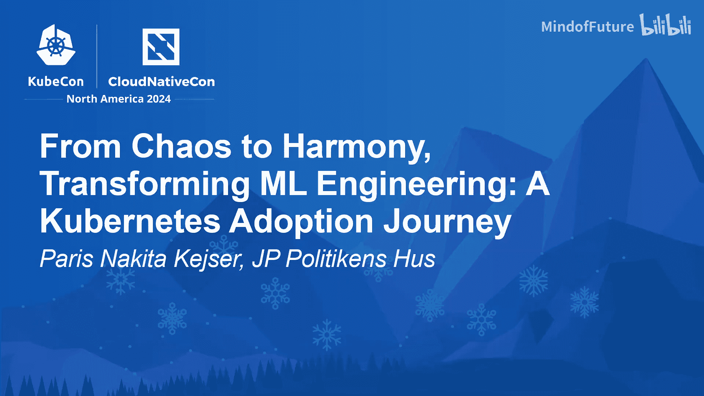
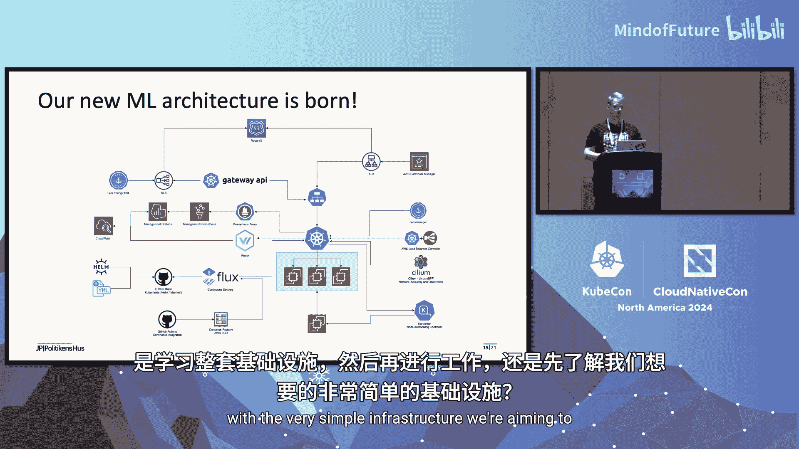
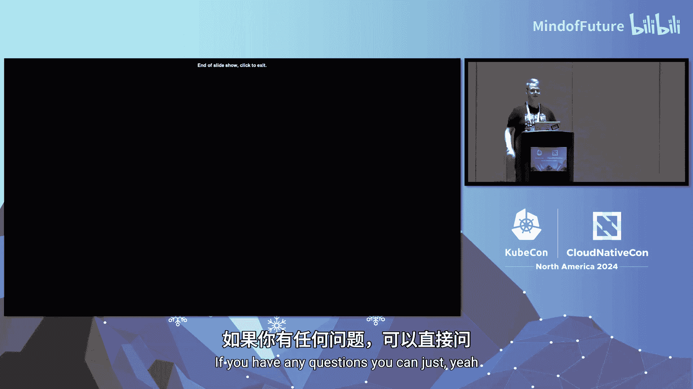
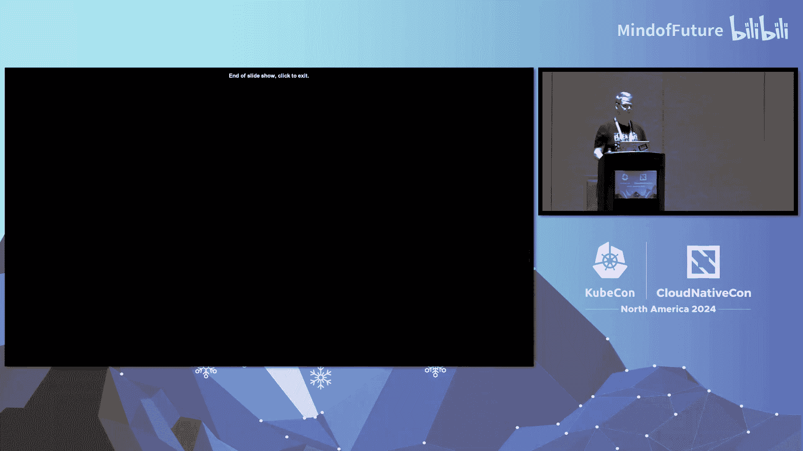
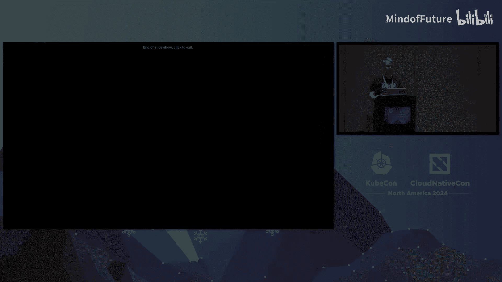

# 【CloudNative】KubeCon+云原生峰会2024-p23-P23-From-Chaos-to-Harmony,-Transforming-ML-Engineering--A-Kubernetes-Adoption-Jo--BV1E9wPegEH6_p23-

Thank you everyone， to be here today。 And I will tell you the story about how we and the JP Pos media group are adopting Kubernetes to the AI team。

It's all started in a department where I've been a part of。 It's called Ex blood。

Ex the Blood is one of the last media news media in Denmark。

 We have more than one and a half million of unique readers every single month。Back in February 2021。

 we realized we need to focus more on machine learning。

And we also also need to build a platform to delivering more relevant content and。To our readers。

For using。A custom。Building a recommend systems。To make this happen。

 we had a team of four M specialists。I'm trying again。To make this happening。

 we have a team of4 M specialists who would be the primary user of this platform。

And we also had tour。Infrastructure engineers to build this platform based on what M specialist needed。

We were involved in a research project in Denmark， and we needed this platform to support prototyping of different machine learnings and models。

The platform should to help us to test， train and serve their model very quickly。

Because the team was small， we did not have a monster research before we started the project。

We had to use the internal knowledge we already had and used the knowledge in the。

 in the best way we could。It was important。 We make this platform simple。

So it's become easy for the em specialist to train the models。

It also is important we have the easy way to automatically serve the models and service。

And replacing the the current running version with the new one。

M specialist should be unable to create prototyping of the models and will be able to use in different frameworks like。

Pyths and Tensorflow。 It's important ML specialist keep up the normallyly workflow and not changing anything because we don't want to。

To be locked on a sink framework at that point。El specialists be should be able to set up their own model to training。

And choosing the way they want to deploy it。It's important that we do not getting blocked by the infrastructure team。

Since we didn't have the a test environment right now。

 it was really important for the ML specialist to spot any kind of issues very quickly if the model failed。

When it said training， all gets swift。I mean， we didn't have months to to do the research before we started。

 So we want a full control over the machine learning。platformlaform。 And we wanted to very fast。

We also want to save time on potential errors and security risks。

 so we decided to use the management resources。In that way。

 our infrastructure engineers could avoid the midnight panic attack。 You know。

 it's not a very fun to debug a production environment where you're half asleep and you're sitting near your PMs。

The chaos is started out with a clear version of what we had in the mind。 But over the time。

 its infrastructure become the more complex and more difficult to manage。

And it become much more challenging for the new team to understand what is going on and how to use the platform。

Change that should be very simple and fast to deploy。

 Be into the very long terms of complicated processes and updates become very challenging。

The freedom we we appreciate from the beginning is starting to fade。

Since we only had two infrastructure engineers on the team。

 we need to rely more on the management's resources and accept the tradeoff we faced。

Our ML specialist faced strict limitations on how they could train the model and deploy them。

This result in even small issues could become a very big challenge to fix。

It was a challenge to test new software that wasn related to the model。

 One example could be if the model should require some kind of software。When your training。

That's kind of flexibility。 We could not do that， so。To change our email platform。

 we need to understand。How the cloud provides resources。

 infrastructurera as code and how the resources are connected together。

You had to understand the platform design and the truly process before you making any any changes to avoid any kind of breaking it。

When using a cloud cloud provider， there's always overhead when selecting compute resource because you you cannot choose the exact amount of a processor and memory you need。

 You must need to accept the instance type， the best fit fits you need。

It result in waste of unused resource resources。That will give you a higher cloud cost and more carbon waste。

We learned a lot from the first version of our platform。

 Our ML specialist noticed several valuable things with this platform。 It worked well enough。

 even if the platform bust really perfect。Limiting the M specialist across the infrastructure and setting clear guidelines on how to use the platform wasn't a huge help。

It speed up the workflow， allowing them to focus on the development without any need to learn the entire infrastructure。

Having full control over M platform has been a great benefit。

It allow us to quickly identify and manage potential errors very fast。

As well as assistance with the troubleshooting， if needed from the infrastructure team。

Our ML specialist appreciate how everything of us integrated smoothly。

 including different frameworks and coding standups。This allow us to move quickly。

 deploy their model faster， enable prototyping and for the team and better way of working。

But we need to rethink that the way we're building the ML platform， focus on what we needed。

 need most and where we potential to streamline things for better support。

 the M specialists and engineers。We chose to build a new platform based on the existing platform's experience。

 not because the exist platform didn't work， but because it did fully meet up the new requirement we got。

We still need to focus on， to have the stable platform。

 So it's not requiring too much attention from the infrastructure team。

In delays could slow down the M workflow。 And that's something we we couldn't accept。

We want to focus on the strengths of the existing ML platform and fix the challenges we have faced。

So it's meet the new feature requirements。Our team is getting bigger， new needs has come up。

 and we want to more user friendly platform that doesn't require requiring PhD to succeed your daily work。

Focus on the first three point。 as was clear， our team need more flexibility than the existing platform have。

 like faster deployment cycles and simpler deployment process。

So what have we learned to try one more time？Wild we lot。While we fix some challenges。

 we didn't fix the main problem， like test tools， improving software testing， faster deployments。

 And we still have some issues when we when we are onboarding new members。

Even even with a new approach， we still have focus。

We still have focus to have a stable platform by continuing to use use the the management resources。

We didn't get the full flexibility we want it， but it become easier for the M。

 L engineers and specialists to do the daily work。We did not fix the problem by choosing their own tools and letting them test the new software。

Because because we took the configuration method from the exist version。

 was there wasn't much to change here， we used salesmate， the general file configuration。

 and that require every single developer need to read the documentation。

 we yeah basically don't exist。Its mean a wrong syn text in the yammal field。

Will easily lead to the problems。One day we got the information about we become a full AI unit to the entire company。

And that's about 1700 employees across。Across different companies inside JP Po Chi's Media Group in Denmark。

 we knew from that day， we had to rethink a full strategy previously in the X blood。

 we had around 220 employees to support。 We are now growinging to the 15 people and now have the responsibility to support 1700 employees。

We quickly understand the value of the new the， and we discussed。

The current situation outlined the next steps and setting the direction to the team to support new reality。

So it's time to start to step up and rethink everything and ask。

 should we try one more time to build it from scratch again or should we use existing ML product out there？

Or what benefit did we get is we choose Kubernetes。Trying to the build。

 build and maintain the completely new M metal platform。Would cry a lot of extra resources。

And it will， and we were pretty unsure about we get the。

The freedom be and flexibility we really want for the M L specialists。

 So we really decide not to try that again。There are many tools out there to help M specialists。

 we spend a lot of time to test the different products out there like ML flow and Meterflow。

 We got the major concern about become wind locked。

To empower the M L specialist with the freedom of to use Kubernetes。

To empower the ML specialist with the freedom， Can you hear me。To the freedom to the use Kubernetes。

 they will get access to the any tool they need， this approach builds some trust and show how we believe the skills and decisions and not to need to enforce the strict rules。

If we had to choose an exist ML platform， I would not to be here to share the journey to you today。

 So surprised we did not choose the existing ML platforms out there and why not。

We have compared the effort and benefits and found that using the exist platform can lead to different challenges out there rather than the benefits we got based on the test we do。

We face problems when we opt an exist platform that we didn't truly。

Control we got unexpected updates that disrupt our workflow。Of M specialist。

 the little big frustration。And it looked like some vendors out there was more interesting to get the selling the。

 the enterprise license rather than help the community edition with the， with the box after updates。

It was often difficult to understand what's happening。

 because we have the limited flexibility and transparency in the whole process。

New employees find it difficult to learn how to work if they don't know the the application。

 and it's adding more unwanted complexity to already check stack。Which we' are trying to reduce。

Our shoes of Kubernetes are not because it's cheaper。

 more because it's provide exactly what we need and what we' are really missing。

We got a simple way to allocate the resources we need。

 like the processor and memory to reduce the cost and the carbon waste。

We can now streamline our development process， helping them too fast identify and fix the problems。

Kubernetes allow the ML specialists to try out different softwares and frameworks without breaking anything that are already running。

 so it's allowed them to quickly test new ideas without waiting for the whole infrastructure team。

Because we now have the standardized process and have a clear documentation。

 our ML specialists can quickly learn the environment they need from。

This making the onboarding very fast and helped them to work on project faster and lowering the learning curve。

We have a streamlining process and cuttinging down the complexity。

 we aim to allow the ML specialist to concentrate on development testing instead of getting stocked in the E infrastructure。

After our transition to Kubernetes as the primary infrastructure for the ML team。

 we got much more than we have expected， which has become very important of the part of the operation we do today。

Using the GithPS transcripts across our infrastructure allow the ML specialist to release new software quickly without the worrying about disrupting exist applications。

It become easy to， to depog from locks and understand the outcome or reason of。For the failure。

 without any frustration。If we run out of the resources。

 the Kubernetes would automatically scaling up and down based on what the resources in need。

Previously a large amount of work was done locally and sending for testing。

 then we're waiting probably weeks for feedback and from other employees before it's getting to deploy for the production。

We have now a process that process is the ML specialist can now run the entire workflow at their own。

We have now a much better ob with metrics， so both the specialists and infrastructure engineers can receive the feedback much faster。

With Kubernetes， we now have the great freedom to use zero trust。

 and it feels easier to maintain a more secure infrastructure。

Thanks to Githubs Pris that allow allowing everyone on the team to have access to the manifest manifest files。

 that's making it completely transparent and。Of what you expect。

So it's time to show the infrastructure we have on Kubernetes today。

 and you're probably wondering about， should the ML specialist learn。诶。

Learn the entire infrastructure before they come doing the work。 what happening with the。

 with the very simple infrastructure we， we aiming to。

As you can see， we are having highlighting the the area about what the M specialist basically needs to focus on。

And， and what did。IF on to get the work done and nothing else。

They need to understand the basic of Kubernetes manifest。

And rely on the existing health chairs for sharing use。

It's allowing them to learn over time and save a lot of time for those that are new for Kubernetes and making the adoption very quickly。

All aspects outside the orange box are mentioned by the Inra team to ensure the operation do not disrupt the ML team。

It's time to show the text stack。 So we're using inside the Kubernetes rather than just showing you simple logos。

 I will explain a little bit about why we have chosen it。About the automation。

We have use in flux in a place where we completely well it's complete the Giops process。

 so we can say the Gi repository is a single source of truth。

ML specialists can easily use the pred health charts for the task。

 and they can request new ones if needed。All of our infrastructure is fully disabled for the team on GitHub。

Security and networking。To improve the security between the node and the partss with the encryption enabled。

We have using the ascium。To to control that。 And we use it for the network policy， too。

To provide automated SSL certifications， we have used chart Man with integrated well with the Celllium and the Gateway API。

By using the Gateway API we have opened up for more options。

 including the ability to work with layer 4 network traffic。

 together with Celium and not only the layer 7 as default。

This general give us more control over the network traffic and allow us to use the traffic mirroring。

Between different parts， if needed。And on AS， AWS network load balancer。

 it's much cheaper than if you use the application load balancer， I think it's around three times。

 three to four times cheaper。We use the AWS load balancer to automatically create networks。

 network and application load balancer with this asium and Gateway API。

It's a very common approach when you are hosted on Eus and AWS。Obsability。

We have picked pro to collect matrix from the cluster and applications and models。

 This enable us to trigger alerts。Based on the matrix outcome， if there is the error and training。

If there's an error in a training or serving。Or if we just need a。More resource for the cluster。

We use Kaana as a Dboard tool integrated with the Promes to display important data。

 and now it's visible for both the infrastructure team and for the ML team with the same matrix。

We have chosen to use vector from Datadog as the log collector。

 which send logs from Kubernetes to CloudWatch on AWS。There other metals out there to do the same。

But we found it relatively easy to set up and allow to change the log endpoints， if needed later。F。

 the primary focus was to ensure that the locks from the node not getting loosed。

WhenWhen you update the node and rebuildoting。And， the other approach is。

 we need all the M specialists to get a lock reable so they don't need to keep detail tool。

To observe the networking networking security and the traffic flow， we are use Hubble。

Whi's just come with theyelium。This enables us to get a clean network traffic view when you just enable it。

And then we have the scalability。When the node running out of the resources。

 we use Kaensa as the on node outscaler， we have just defined some rules that's allowing the the。

The notes to scaling up and down inside the AWS。We usually use the Kubernetes matrix API to collect matrix from the system。

 which can be used both for the possibilityusibility and for the scaling purpose。

We are using the build HP for Kubernetes foruber for parts outscaling。

 We are using that to scale partss up and down based on the CPU memory or cost matrix。

EIt's have been a very good day today。It's draining me a lot of energy。

 So I was just sending a message out， and。I'm a pretty nervous here。 So thank you for staying here。

 And thanks。😊，If you have any questions， you can just yeah。

Since this stack was in AWS， did you encounter any scale。Like a cap issues in terms of。

I think the sound should be a little higher because I'm very hard to hear you。Yeah。

 I was asking if there was any cap issues for any resources。Like you are using AWS， right， yeah？

And how did you manage。We we， we don't have a gap。 And that we。

 when we're scaling the notes up and down， we use cappena。 So you need to。To connect your。

 your resources inside the Kubernetes with your resources in， in AWS。

 And I think it's scaled with a half minutes and something like that。 it's very quick。

哦，Thank you。

