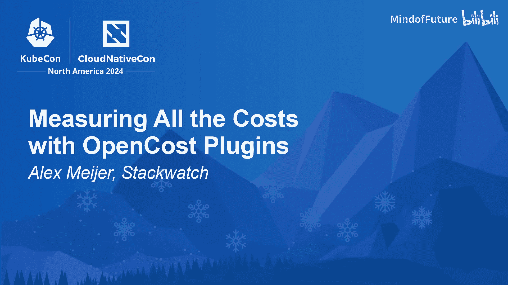
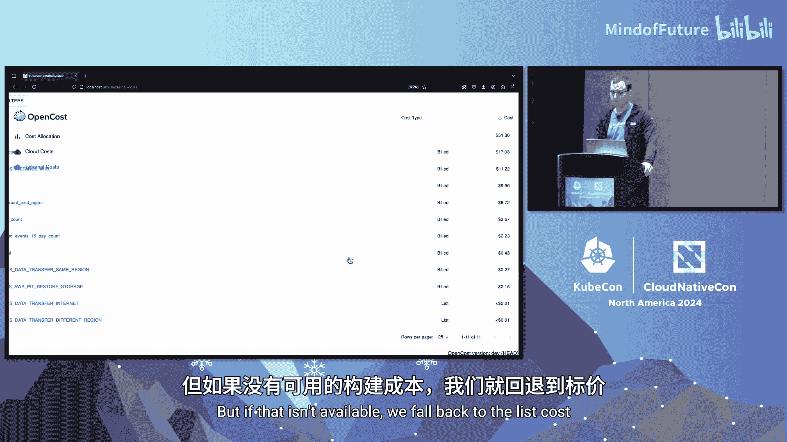
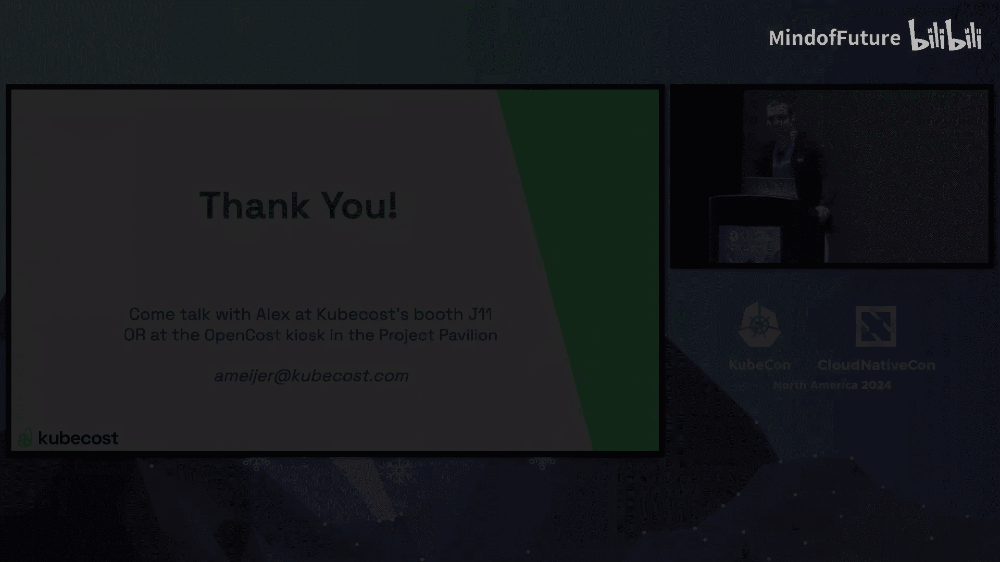

# 【CloudNative】KubeCon+云原生峰会2024-p24-P24-Measuring-All-the-Costs-with-OpenCost-Plugins---Alex-Meijer,-Stackwatch--BV1E9wPegEH6_p24-

Welcome， thanks for coming。 My name is Alex Meyer， and I'm a software engineer at CuCot。

 but here this afternoon in my capacity as an open cost maintainer and a maintainer of the Open cost plugins Project。

I was very excited to talk to you about open costs and some really exciting recent developments。

First， we'll take a quick look at open cost pass， where it is today and where we're going at a high level。

We'll sort then sort of dig into the substance of the presentation， which is open class plugins。

Specifically how we use the focus spec a lot more on that later。

We'll touch quickly on plugin functionality and delivery。

 How plugins work peek under the hood a little bit。 A demo， of course。

 And then we'll end the session with， with some road mapping and sort of goal setting here。

But before we begin， I couldn't resist the urge to sort of give my perspective on Kubernetes at 10 years in the spirit of the festivities here。

 I've been working with Kate since early 2017。 So， you know， not there from the beginning。

 but you know， haveve seen a lot of changes And you know my biggest takeaway is that Kubernetes really doesn't have to prove itself anymore。

 right And this is sort of what we're seeing and a lot of the other you know talks and things like that。

 where you know， I don't know about y'all， but like for me。

 I'm not getting what is Kubernetes so much when I tell people what I work with and what I do。

 And that's awesome right， And you know， various surveys Cf survey that I cited is like 89% penetration。

 most companies at least the one surveyed or at least evaluating or using Kates in production And you know。

 because it saves a lot of companies， a lot of money and accelerates them。

 especially in the beginning， I remember the organization that I was with when I first discovered Kubernetes。

 right， we saw an order of magnitude reduction in our compute cost。But then what happened， Well。

 we took the savings and we grew right as an industry and as individual companies， right， So I mean。

 come on 10 years ago， we could never imagine the things we're doing here。 So all of a sudden。

 we find our apps are getting expensive once more， right， And I sort of take an opinion here。

 And this is the Gartner hyp cycle， for those of you who aren't familiar with it。

 And are we in the trough of disillusionment or some way in or out of that， right。

 because all of a sudden， these new technologies are costing us a lot of money， right。

 I just summarize it as a way of， welcome today， too， right， we are firmly， firmly in day 2 here。

And we have people asking you know what can we do about that。 So enter open costs， right。

 It's not necessarily a new new project， right our initial commit was in early 2019。 And you know。

 sort of I've broken this up into the top of the timeline is sort of social or milestone events in the bottom is sort of more technical stuff So like we introduced a helm chart right and cloud costs more recently。

 open costs is now powered some of the cost functionality of Aks plugins， which we'll talk about。

 And you know what I love is the time it took for us to go from 3000 to 5000 stars is a lot shorter than 1000 to 3000 So you know and you can see sort of on the right side of my timeline here things feel like they're picking up which is super exciting which brings us to today as a time that I got this stat。

 we were at 5200 stars that was probably out of date an hour or two after I got it and our big news。

 of course for those of you who missed it is we got。Promoted a few weeks ago to incubation status。

 And know， so we're very excited about that。Open costs today has three main facets， if you will。

 Our bread and butter is Kubernetes costs， right， stuff like namespace costs， pod costs。

 etc ce et cetera。 And more recently， cloud provider costs you integrate with your cloud provider。

 and we provide those costs to you as well。 Our topic for today。

 which is most exciting to me these days is any costs you can imagine。

 right through open cost plugins you can access all these costs through know a powerful rest API and in fact。

 anecdotally， I think most of our users do leverage the API first right。

 It's a very powerful data collection layer。 And what we're sort of finding is happening is we're developing a really rich ecosystem of exporters into various formats。

 plugins that are being developed new data formats right。

 and sort of new ways of doing business using this completely free and open source tool。

So sort of what is our high level vision for what we want out of open costs as a whole project right。

 we would love to become the open standard for visualizing all of your cloud native spend right and when I say cloud native。

 I mean the technologies open costs has a large user base that's onprem so you don't have to be on the Internet to leverage this you can be air gap whatever you run it and with the angle of like bringing vendors and customers together right our cloud native vendors they don't want you to be surprised by your bill right they want you to get so much value out of that and feel confident in spending more and doing wilder things and the same thing the customers don't want to be surprised by bills。

 they don't want to think oh this service is expensive or or we can't use this anymore So we want to bring these two parties together and who honestly motives are fundamentally aligned but give them an open platform to which we can all sort of measure our costs and make sure we're getting a good value for a resource。

So。Eventually， right， the idea is to become a single pane of glass。

 right to what extent that is and what that looks like。

 we are looking to our community to help us set that vision， right。

 but we want it to be in one place， at least at one point。

 right if it gets brought off into different B tools， wherever。 That's awesome。

 but we want to be that layer， right， for those of you who know， you know， cost and usage reports。

 right， we want to be your cur for the Internet。 And you know， regardless of the type of talk cost。

Provide that for you for those of you who are sort of in the Finops world， I'm sorry。

 I won't beatep this to death here。 but like there's this idea of unit economics， right。

 where the nirvana of Finops practices are that you don't look at your infrastructure like a cost center or something that is painful or you want to avoid。

 right， you want to look at it that hey， for every $1 that I invest in my infrastructure。

 I get $2 in revenue out of or you know profit or whatever， right。

 And so that is when you really unlock the power and and sort of is the endgame for what we're trying to enable our users with。

So back to our sort of main topic of plugins right。

 this is an effort that began at the beginning of 2024。

 and it's basically a community drivenn effort that we call measuring all the costs。 right。

 This is a fundamental acknowledgement that we cannot build as the maintainers or contributors。

 We cannot measure every cost that there is in the ecosystem， right， there are just there's too many。

 It's always growing and changing And so you know we could do Kubernetes。

 certainly because that's a sort of homogenous thing cloud costs too， to an extent， right。

 there are a few major players that we can get most of the capture most of the market with。

 we don't stand a chance with thirdpart costs。So from this get go。

 we knew that we needed to harness the power of the community。 So the idea is that， you know。

 for your organization， if you have one outside cost that's driving most of your spend。You invest。

 hopefully a limited amount of engineering time in developing a plug for that cost。

 contributed upstream， and then sort of in reciprocity， others contribute and， you know。

 maybe you can leverage their work， right， And we begin to congregate all these costs。

 So from the get go， this was truly an exercise in open source design。

So our biggest challenge that we identified in this paradigm， right that was the interface， right。

 And you know， as we all know here， interfaces are always an important part of software development。

 But in general， right， if it's an internal project。

 you can all gather around a table and hash things out。 And if there are questions。

 you can ask your colleagues questions。We don't really have that here。 right。

 We're in the paradigm of we're all in different locations all over the world in different companies。

 right， So having a good interface is， frankly， an existential risk here， right， and again。

 back to this idea of harnessing the community power。

 like if we required everyone here to be an expert and open cost to contribute。

 we would be doomed right， And not the least of which we would certainly get in like architectural arguments right。

 and people would have to become go experts and all that sort of thing ideally， right。

 then it's a black box。 You write the plugins。 you process the costs that you care about。

 you don't worry about the rest， right You let the underlying infrastructure sort of homogenize that and handle aggregation and everything like that。

So， you know， this idea has been brewing cube costs and in the open cost maintainers meetings for for some time。

 right， But we had this this existential problem of well， you know， we don't。

 we don't know the list of costs that everyone would want to to implement， right。

 and how can we you know， how can we predict in the future with any certainty of what people would want。

 right， and with any sort of reusability。And so fortunately， recently。

 we learned about the focus spec。 So this was released， I believe， earlier this year， focuscus 1。

0 spec。 And what focus stands for is the Fops， open cost and usage specification。😊。

So this is a working group in the Finops Foundation， right， which is also a。

Linux Foundation organization， So a sibling to the CNCF。

And focus has their mission statement as focus aims to establish a community driven specification for consumption based billing data。

 And that's great， right， Like that is， you know， very powerful and helps many reasons。

 not just for our own and open cost， right， I think primarily the Fops folks focus is to enable their。

😊，Finopps practitioners right in their orgs to have a unified set of billing data to run the Fops lifecycl。

 And again， that's a sort of a Finops foundation term where it's like you're constantly evaluating and optimizing your costs。

 right， And this specification serves as the input to that process。

If I had to describe it in a few words， right， it is a set of billing fields that can describe an arbitrary cost。

 And for our specific needs， right， we were elated because， hey， we have our path forward， right。

 we have our interface。 We do not have to guess ourselves， what people are looking for。

 And why are we so excited about this。 Well， the focus spec is maintained by a dedicated working group。

 right of many organizations that I sort of cited briefly on my last slide， right。

 Some of the largest companies in the world have people that are either dedicated part or full time to maintaining this spec。

 right。And another benefit for us again， as open source maintainers， right。

 the focus fields are all extremely well documented。

 right we we simply don't have the bandwidth to you know explain in great detail because we honestly we aren't entire experts ourselves about what is in every single field of this spec。

 So this sort of allows people to teach themselves about what is in the interface fields。

 And I have an example here that I took from the focus spec web page here that's just an example of like build cost one of our more important fields。

 and it has a extensive description hyperlinks to specific terms so that contributors can teach themselves what is going on here。

 what we're looking for and you know， of course， typing always important extensive type interface。

 and finally， but certainly not least important is versioning right So this organization will handle the version。

 This is a living spec。 It's not this thing。It's going to rot in an open cost branch。

 if no one loves it on our team， it's its own living thing， and we can sort of follow in their wake。

 if you will。So it's not perfect， right， I have here all the focus fields。 And there are 43 of them。

 right， And I put this here because， you know， to just give you the impression of like， oh， well。

 that's a lot to do。 right， If I want to contribute to open cost。 And you know。

 it's a pretty typical product of design by a working group， right。

 works well enough for everybody but it's not specific to any one vendor。

 So they have to sort of take the superet right of all the fields。

 this presents a challenge right bringing us back to our paradigm in our use case of， look。

 we're asking basically people as acts of professional service to implement。These fields， right。

 And it's our job as the designers to make this as unintimidating and， you know。

 and easy for people to use， right， are what we are specifically trying to avoid。 So saying sure。

 I'll write a plug。And then they get halfway down the list。 It's like， oh， I don't have a cost for。

 you know， commitment discount。 I D。 Guess I can't contribute it right， And they abandon it。 right。

 That is a categorical failure on the designer's part。So how do we address this， Well。

 we basically split the focus spec in two， and we have two main components。

 what we call the core interface and then the extended interface。 These are proto buff fields， right。

 and we define them in proto buff and essentially our core interfaces is what we build the center of our experience around。

 right， These are the highest impact focus fields。 your major cost your labels， account name。

 stuff like that that we can generally expect most like online Saas services to provide right。

 And this helps us that we can you know cut down our UX design to this sort of core set of fields。

The these core custom costs have a pointer in the protobu structure now that points to the item on the right。

 which is the extended cost。 So these are the less commonly available fields。

 things like committed discounts， right， like that only makes sense in certain context， right。

 charge frequency skew price Ids， right， like we don't see these so often。 now， of course。

 if your cost supplier implements the focus spec than you will have these。

 But that is very much the exception at this time。And the key thing here is both of these interfaces combine to fully me the focus 1。

0 spec。Just a sequence diagram here on how plugins themselves work。

 Basically the open cost custom cost ingeer at left here gets a list of all the plugins。

Then for each plugin that is configured and installed。

 it sends a custom cost request protobuff object， which contains essentially two things。

 The window that we are looking for costs for。And then the resolution that we are asking for cost for。

 And again， we don't expect all plugins to be able to support both of our daily and hourly resolutions。

 So we you know， again do a best effort。 that's sent over GRPC via a tool called Go plugin。

 It's a go package that from hashicorp。 and the power of this is that using GRPC and go plugin is that you can actually write your plugins in any language that you'd like as long as it supports GRPC and can be executed。

 Of course， right So that means that you know all of our plugins right now or and go。

 that is not a constraint， right if certain API client is only available in another language Ru or something like that's great right we again。

Trying to meet people where they are and make this easy to contribute to， right。

 So the plugin gets this request from open cost and says， okay， you know。

 it wants these three days worth of costs at this resolution。

 It makes vendor specific requests right again。 That's sort of the substance of what the plugin implementer builds。

And then it forms that data as best as it can into focus objects。 And that。

 then that's sent back over GRPC and。Ingeest it into open cost。 And then we provide that again。

 as part of our core APIs and everything like that。

So the sort of one last thing to hit on here in terms of architecture is the delivery method， right。

 So when you're compiling a go plugin， theres a substantial amount of boiler plate right that goes into a go binary。

 And we are finding that the plugins themselves approach the size of the open cost go binary。

 So it's not really a scalable solution， especially if we're trying to encourage many plugins to be built to ship everyone with open costs。

 right， we would be looking at very large containers very quickly。

So the way we work around this is in Github， when you merge your plugin， it's compiled for you know。

 three architectures， arm， AM M D， and then Mac O S and push to Github releases， right。

When you boot your open cost po and it detects that you are trying to use plugins。

 it boots in a knit container that either。Thatch is a specific version from Github。

 If you want a specific version， otherwise， the latest。That's stored in an empty empty dir volume。

 And then it's ready and to be consumed by open cost itself。 So we。

 we rely on the init container to handle things like architecture， version and， you know。

 to follow whatever Internet sort of things to， to deliver the poium。So that being said， let's go。

 let's see it in action。 So here I have an open cost installation running on。

 on our dev cluster at Cubecast and just。By way of a quick tour here， right。

 This is our cost allocation view。 So these these are all namespace costs， right。

 So I wna zoom in a bit actually， but we have you know per namespace costs here and know we support a whole bunch of different Kubernetes agregations。

 Again， those of you who are using open costs。 nothing this is openco spread and But。

 you've been using this for a while， a little bit newer are our cloud costs。 Okay。

 so these were introduced about a year ago。 and this integrates with multiple cloud provider。

 So here we have an AWs and a GCP connection basically this UI features drill down。

 So where you can start to dig into other costs。 and you some of our your costs are related to Kubernetes。

 compute engine Kubernetes engine obviously， but there's stuff like cloud SL。

 which doesn't have anything to do directly with your Kubernetes costs here。 But again。

 we are just trying to centralize as many of your business costs as we can in one location。Right。

And again， you drill down far enough， right， You get to our maximum resolution， which is item。

 which is what we call item。 And then you can view sort of per item cloud costs here。Again。

 this isn't new。 I just am giving this as a quick refresher for those of you who haven't seen this or haven't enabled this feature。

 What is new for this talk is external costs， right。

 So this U I and the updated API are available as of open cost 1。 1，13， which was released last week。

And what we have here is we have three plugins。 So these are。

 our released plugins that I'll be downloading today， which are Datadog。

 which is our reference reference implementation and our oldest plugin。Mgo D B。

 which was contributed by a member of the community。 So Sajet， if you're watching， thank you。

 And the open AI plug， which is what we built as part of our work。For this talk。

So we do feature drill down here as well。 So if I drill down into open AI， we go into account name。

 which we use the name of the AI API token right which I just call personal。

 we then drill down into resource type again， not terribly interesting because open AI sells one type of resource right。

 which is AI models basically but here when we're at sort of maximum drill down。

 we get a little bit more interesting of a view which is where we can see different model costs。

 So what I'm driving this demo with is similar to open AI's developer documentation。

 I'm just asking open AI to write me a Haiku every 30 seconds with two different models right。

And so looking at this， right， it's pretty interesting to see the difference between the two models。

 right， Like again， these are firing API requests for the exact same prompt at the exact same frequency。

 We can see that their mini model is significantly cheaper than their G 40 model， right， And again。

 this is somewhat of a contrived example。 But if your organization had a large spend with open AI And you see something like this。

 It's like， well， you know， maybe we want to investigate G 40 mini since the full blown model is such a significantly part part of our spend。

So the maximum， when you click the maximum drill down here， we basically。

 and I'm gonna zoom back out a bit。 we print all of our sort of core focus fields here as our detail view。

 if you will。 So we have our cost and then we have our usage， which is number of tokens consumed。

 that's low and hard to see。 But we have our AI tokens consumed。 and then。

 we put a dimension on the unit， right。Backing out a little bit。

 we can view all of our costs sort of aggregated together， right and I'm not aggregating by provider。

 We call it domain。 This is just by the resource name， right。

 I'll give another zoom in so we can see。We could sort of start to see the power of this where。

 you know， between the three plugins。 This is a data dog cost， right， This is a Mongo Db Atlas cost。

 And this is an open AI cost altogether in the same sort of view， right， And you can， you know。

 sort the costs and everything like that。 So you can begin to start to see where your biggest cost drivers are across everything that your organization consumes not just cases or cloud providers。

 right， And you know， we。We support a bunch of different types of costs。

 So this is another thing that's probably worth calling out as。

We have a concept called the cost type。 And what that is， is it can be either build or list costs。

 right， And we display both of them together and what we call a blended view。 And this is， again。

 this is us trying to make it as easy as possible and as frictionless as possible to contribute here。

Some APIs only provide usage and a list price。 Some APIs only provide a build cost， right。

 We don't want someone to feel like they would not be making a good contribution if they didn't support one or the other。

 So by default， we have this blended view， right， which is the algorithm is if we have the build cost available。

 we take that in since that generally incorporates any， you know， discounts or volume discounts。

 stuff like that。 But if that isn't available， we fall back to the list cost and we display those together。

 right， So some of these are lists。 Some of these are builded。 we appreciate that this， you know。

 isn't what everyone is looking for。 So you can， of course， always just filter out to the。

Build costs。 So now we only have build costs in this view。 And likewise。

 we only have list costs otherwise in this view， right， So if you're only looking for that， you can。

work around this functionality。One last thing that I would love to point out is and I'm we're gonna aggregate by provider again。

 what we do is open cost continually gets the last seven days of costs on a rolling window。

 This is because similar to cloud provider， write a cloud provider won't fully reconcile its costs until generally 48 hours after they are incurred incorporating discounts and everything like that。

 these thirdparty services are no different Datadog， for example。

 says it can take up to 72 hours for them to get you all your costs。

 So rather than just say what was yesterday's costs and move on。

 we get we get continually the last seven days costs。 So sort of as we zoom out in this view， right。

 we converge as a week comes to the actual incurred costs。So， you know what's coming next， right。

 Call to action。 And I apologize。 the AI started to fail on me here。

 and the skin color is all different on my little pig here。 But if you are using， you know。

 a Saas cost that's driving a large part of your spend and you want to see it in open cost。You know。

 we'd love， we'd love for you to contribute that， right。

 You don't need to know a single thing about how open cost works。 You don't know how to program。

 You don't need to know how to program and go。 And， you know， we， we would love your plugs。

 and we would love to work with you to you know， build this community driven effort to measure all of the costs。

Cube cost is sort of sweetening the pot here for the first 10 plugins that are submitted will get 1000 from my employer and a box of open cost swag when we do merge your plug。

 And again， by way of encouragement this open AI plug took me about two days to build。

 granted that I have worked a lot in this space， But it took me a day to learn how the APIs work。

 So again， Leo， if you're watching， thank you for the help there。

 and then another day of implementation and testing of the plugin。So it's not this huge。

 onerous task。I do like to think that some of our design decisions have born fruit here and。

 you know， definitely encourage the group to。嗯。Have a go at it， right？Sort of as we wind down here。

 I just wanted to set the roadmap for the pluginins project specifically right our first stage was sort of plug launch right and that is basically everything that was demo today。

 We have our reference plugin implementation， which is Datadog and we've also have an integration test harness So we continually on a nightly build hit all of these third party providers and alert when one of them go out of sync right because that's a big problem for third parties is know they will update their APIs at any time as third parties are want to do。

Where I think we are right now in the life cycle is called what we call ecosystem enrichment， right。

 And this goes back to our call to action is we have a number of plugins that we're targeting here。

 And， you know， we're sort of asking the community to help us build these and you know。

 looking at building some more ourselves， right， So we're we're trying to get breadth at this point。

Next step for us is supply chain improvement， things like plug signatures。

 right that's been supply chain security has been a big topic。 And you know， we。

 we want to be part of that as well。 The idea of an open cost heavy version has been floated for folks in air gap environments。

 maybe where it's a bigger container that does have all the plugins。

 right that is totally a valid use case so that all the plugins are just there and ready to be consumed。

Right now， all the plugins released together。 So independent plugin versioning is definitely going to become necessary before too long。

 And then we would love to institute an L T S support program for our plugins as well。

Looking a little further into the future。We want to use this plug data to， again。

 provide our community with a more unified cost experience， right。So focus， of course。

 was designed for the cloud providers themselves， right。

 So like our cloud costs could be merged with these with these plugins， right。

 and that would be cool to have each provider be a plugin。

 That would be a lot lower friction2 to onboarding new cloud providers， right。

 because we support four cloud providers now there are a lot more than that， eventually， right。

 then you unify all of your costs。 whether it's an E C2 instance or datadog costs。

 You sort of get this single pane of glass。😊，And then finally， looking further in the future。

 we've sort of reserved this advanced aggregation。Maybe using extended attributes to tease out new insights and things for people based on extended focus attributes or even more of the core ones。

 But we're sort of holding back on that one because we need to。You know。

 see get feedback from the community and see what people like and don't like about it。

Just to finish up here， you know， I hope I've demonstrated that open cost is gaining momentum， right。

 like people want to save on costs。And， you know， we're getting a lot of traction。

 We want to build on this successful track record with open cost plugins。

 which is the newest element of open cost。 We've painstakingly designed this to make your contribution as easy as possible。

 as we talked about， we have support for open AI， Mongo and Datadog right， And you know。

 just a quick note for any of those using Cu costs， right as a downstream project of open costs。

 We do read in the open data that is being collected through plugins。

 And that's available in Cu costs。I guess I personally expect to see more focus in my life。

 I certainly hope to see more focus costs in in my life as time goes on and as this standard sort of gains traction。

And。Yeah， you know， we're definitely excited for what the future holds。I want to thank everyone。

 you know， time for questions， I think， a little bit time。 Otherwise， I will be at the Cu cost booth。

 and I would love to talk to you about it。Thank you。

