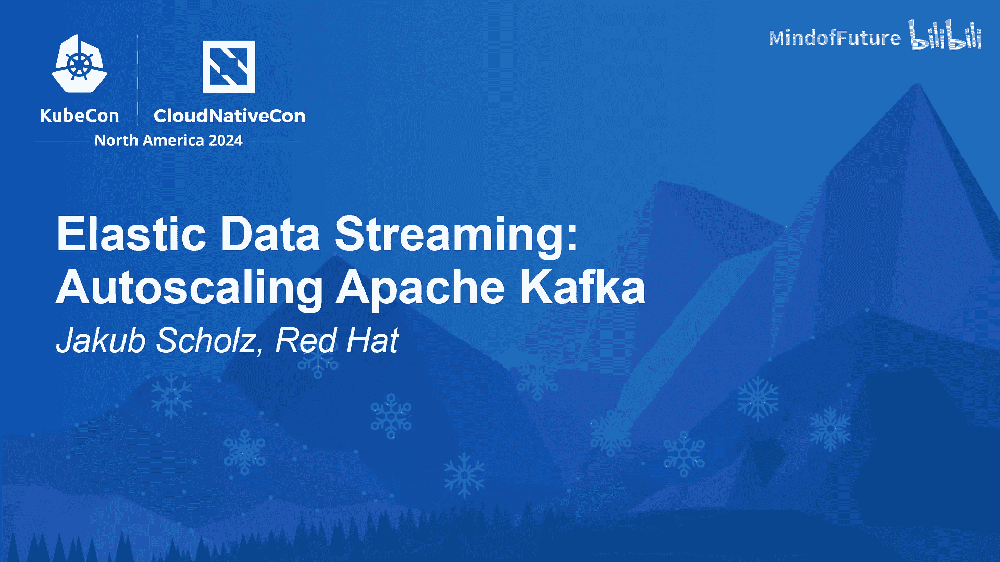
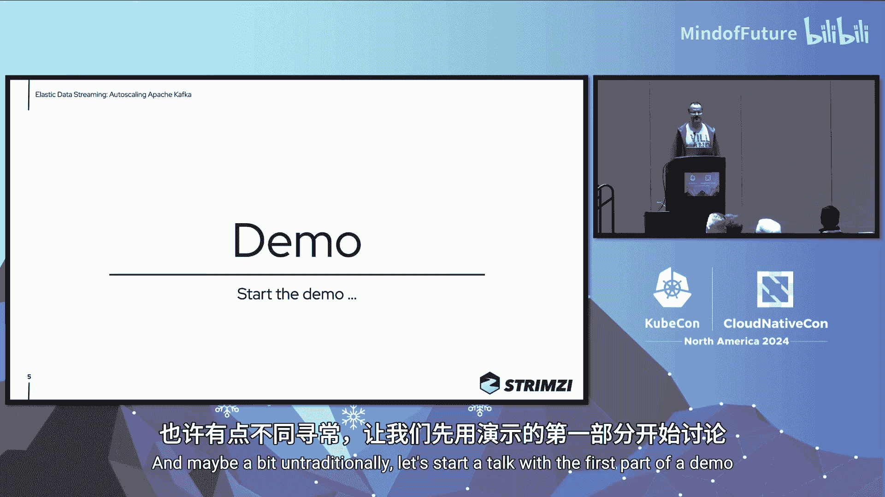
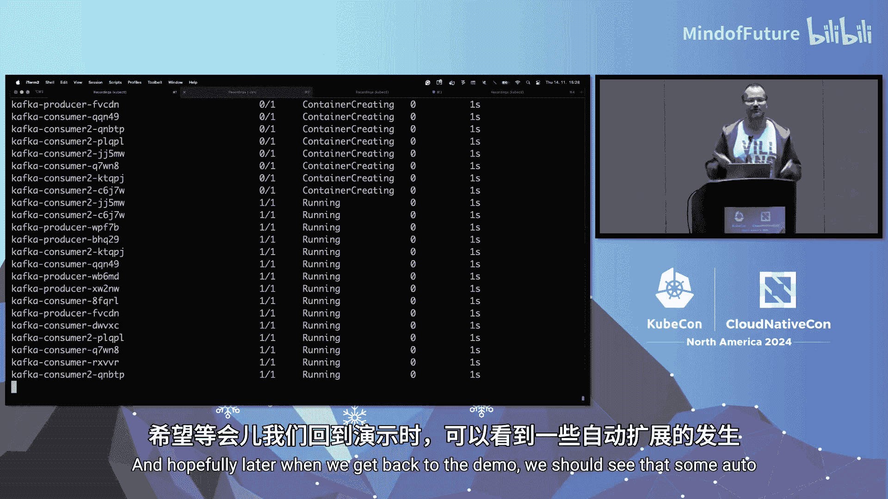

# 【CloudNative】KubeCon+云原生峰会2024-p25-P25-Elastic-Data-Streaming--Autoscaling-Apache-Kafka---Jakub-Scholz,-Red-Hat--BV1E9wPegEH6_p25-

Okay， so welcome to my talk about auto scaling Apache Kaafka。 My name is Jacob Schultz。

 I work as an engineer at Redhead。😊。

And I'm also a maintainer of the Strimsey project， and occasionally。

 I'm also Apache Kafka contributor。If you don't know what streamsy。

 then Sts is CNNCF incubating project， which focus on running Apache K con Kubernetes。 so we provide。

Operators for running all the different server components of Apache Kafka。

 but we also have operators for managing things such as users， topics， connectors。

 and we have some other smaller tools to make it easier to use Kafka on Cu。Yeah。

 maybe on the beginning， we can touch on why auto scaling Apache Kaafka brokers might be interesting。

 why it might matter well。Kafka is quite often a pretty big workload。

 which is taking quite a lot of resources so yeah if it managed to auto scale it in some effective and efficient way。

 maybe we can save some costs， maybe we can save some energy be a bit more green or something like that so that's why we looked into it。

And maybe untraditionally， let's start a talk with the first part of a demo。

So here in my。Kubernetes cluster， I have already a Kafka cluster deployed。

 So what we can see here is that。Right now I have your three brokers， 10。

11 and 12 remember that for later。I'm not using zookeeper anymore。

 I'm using this craft thing which is new in Kafka so I have these free controllers as well to manage the Qroom and so on and then I have these additional tools which streams use cruise control is for cluster rebalancing it's a tool from LinkedIn then this entity operator that's what I mentioned for managing users and topics and this Kafka exporter is just for some additional metrics and then yeah this is the main streamy operator which is actually running this cluster and so what I'm going to do right now in the beginning。

😊，Its。I'm going to deploy。My load。So these just create some Kubernetes jobs which will create a bunch of pots and yeah they will start producing a load of messages and consuming the load of messages and yeah hopefully later when we get back to the demo。

 we should see that some autocal happened and yeah if not then yeah something didn't work。

So in the meantime， while it's hopefully out of scaling， we can get back to the， to the slide and。

We can talk a bit more about the difference between scalability and elasticity because quite often when you mention Kafka and for a lot of people who work with it。

 scalability is the first thing which comes to people's mind so why do we need to talk about how to autoscale it if it's so scalable but there's a difference between scalability and elasticity right and the scalability in which Kafka really excels is this kind of thing where you start maybe the free brokers in your cluster when you start your project or company。

😊，You usually start with free for the availability and reliability。

 but then you get the first customers， you may be onboard new services， new users。

 so yeah you can grow the cluster。And if you are still doing well。

 if you are becoming the new LinkedIn， Facebook， whatever。

 then you can grow even more and more and more， and actually Kafka can really scale well and having tens of brokers or even hundreds。

 it's not necessarily something what's impossible。😊，But when we talk about elasticity。

 we talk a bit more about kind of this reaction to the immediate demand。

 So some advertisement somewhere showed or someone wrote about your project on Reddit or hacker news and suddenly for a few minutes。

 you start getting in a whole bunch of new users So you need to scale the cluster up。

 But then after a few minutes you are the old news you know how it goes these days。

 So yeah you need to scale down again because you don't need really the performance。

 So so that's more the elasticity and that's usually where the auto scaling fits a bit more to kind of react to the immediate demand which you might have from the applications using something like Kafka。

And。To be honest， the scalability part， the kind of more midterm。

 longterm scalability to grow with your company with your project， Kafka does that very well。

 the LSDC party part， that's not so so simple and so easy and yeah so that's what we try to improve inStimsy and yeah pretty much this talk is the journey which we took to get there。

So the first thing， if you want to do some auto scalinging on Kubernetes。

 then yeah the first thing what you need to do is you need to have your scale subresource now if you use deployment or stateful set that has that kind of built in from Kubernetes but if you are operator like Stimsy and you have the custom resources it's something but you need to have supported in the custom resource and in your operator and is the scale subresource which basically allows Kubernetes to kind of scale the resource without really understanding the internal structure of the custom resource so thanks to that you can do something like Kubca scale Kafka output pool brokers to five replicas and Kubernetes will know exactly whats to do all to the Kafka output pool resource it something Stimsy came up with and it has nothing to do with Kubernetes itself and this is also where you plug in the horizon。

Po autoscalealar， which is the kind of basic Kubernetes resource which you can use to autoscale things based on some metric。

 get them up， increase the number of replicas or down to decrease the number of replicas。

So this was the first thing which we did in Simsy， and yeah， it got us one step forward。

 so it got us to something like this so we can now scale the cluster。

But if we start with something like free node Kaafka cluster。

 which is some partition replicas assigned to the free node， then yeah when the scaling happens。

 new node is added to the cluster。But it's it。 It's empty。

And that's because in Kafka all the partition replicas they are assigned to one of the brokers and if you just add more brokers to the cluster。

 that doesn't necessarily mean that they will move around right so you edit the note sometimes that's fine for this kind of long-term scaling that's fine because you will maybe onboard new services。

 new applications add new topics and this will be created on the new node so over the time they will fill in but for the auto of scaling。

 this doesn't really help。Similarly， what happens when you scale down the cluster。

 So let's now imagine we have a four node cluster， which doesn't have the four node empty。

 but it's already in use。 and's we are pretty underutilized。 So let's scale it down to three brokers。

 Well， it's not that simple， right， because the broker number4。

 which we would maybe try to scale down， it holds the data。 And if you will just delete the pot。

 then。We would lose the data， right。 Now， maybe it would just break the availability of your cluster。

 Maybe it would actually cause some data loss for some data。

 which wouldn't be replicated on the other node， but you can't do it that simply。

So that's why in Stmsy， we created something what we called auto rebalancing。

And it's a feature of the Stsy operator， which Under Ho uses the cruise control tool。

 And basically when you do some scaling and if you enable this autoer rebalancing。

 because it it's obtained right now， then Sty will automatically use cruise control and trigger rebalance to shift the data around within your your Kaafka cluster。

 And similarly， it scaled down before it actually removes the node。

 it will first start the rebalance to kind of remove the data from the node。

 which will be scaled down and only once it's really empty， it will be actually deleted。😊。

So did we improve that， do we have now a proper auto scaling well kind of。

 so what happens now with the enabled auto rebalancing is that yeah when you start with the free node。

And the auto scaling happens。 then the new node is added to the cluster。

 and then the rebalancing happens and it shifts some of the data to the new node。

 And that looks great， right， we have now new new node， which has some data。

 the cluster is nicely balanced over So that looks like success。 Similarlyly。

 when we would now scale down then basically what streamsy would do is it would first move the data to one of the remaining node。

😊，And only then it would actually scale down the， the empty node and remove it。 So that that again。

 looks。Pretty good now。The question is， what's really happening there under the surface of this？

Now the reality might be that when you start with the free brokers， each of them has， for example。

 four terabytes of data stored in the brokers now there are surely many Kafka clusters which have a lot less data stored in each broker。

 but there are also many clusters which have way more than four terabytes stored in each broker so yeah it's kind of an example but it's not completely unrealistic。

Now， when we add the new broker to the cluster。It starts with an empty storage， so it has zero。

And then the rebalance happens， and it kind of roughly equals it out。 So now。

 instead of three brokers with four TBs and one empty， we have four brokers with three  TBtes each。

And what it really means is that we basically had to shift three  TB of data around from the old nodes。

To the new node， and。It works， but obviously， moving three terabytes of data around means you need some network resources because you need to shift this over network。

You need some storage I O because you need to read it from the disks。Then on the new node。

 you need to write it to the disk。 You need some CPU because we have encryption shortly and all these things around and。

Most of all， you also need time because moving three terabytes of data is not something what happens within few seconds as the animation on the slide happened。

 right。And the same would happen if you scale it down。 So， yeah， this is not perfect。Yeah， it works。

 but it's kind of， let's try to improve it。And the thing which comes to help here is something called tiered storage。

 so it's a relatively new feature in Kafka but you might know it from other applications and as well。

 and it basically means that kind of you use different tiers。

 different levels of storage in your Kafka cluster and some of the data which are maybe not that important。

 not that often accessed not that fresh， they will be uploaded into the other tier of the storage and locally you would keep mainly the data which are important which are often accessed again and again or which are just received from the producers。

And typically the other tier of the storage which you add would be something like Amazon AWSS free storage or other types of object storage or some NFS storage which kind of they typically are cheaper then the block storage used directly by the brokers they typically allow you for much higher capacity then the block storage。

 but also in most cases kind of the downside of them is that they often have bigger latency and things like that so it's kind of a tradeoff but if we use the tiered storage to have less data on the brokers。

Then we need to shift less data than we do the rebalancing， right。So。Now。

 if we would apply the tiered storage to the cluster of which we had before now。

 suddenly we don't need to have four terytes of data on each of the brokers。

 maybe we have only 400 gigabytes of the data on each of the brokers。

 and then the rest is somewhere in the cloud and Amazon as free storage。

So what happens now when we scale the cluster is we add the new node。

 the new node is again edit with empty storage， we do the rubbalans and now after the rubbalan each of the nodes is only 300 gigytes of the storage and yeah it might be still a lot。

But it's 10 times less than we had before right， so it will cost you 10 times less resources on the networking on the storage。

 but also roughly 10 times less time。 so yeah that's kind of the next piece which allows us to improve how quickly the cluster scales and how quickly it can kind of happen。

So let's try to get back to the。

To the console and see if something happened。And what I can see here is。That here。

It created the broker number 14。And here we created a broker number 14。

 So if you remember from the beginning， we had brokers， 10， 11 and 12， three of them。

 So now we have 13 and 14， we have five of them。And then it also needs to restart the cruise control because cruise control needs to understand what's the cluster configuration。

 how many nodes does it have， what's the storage， so right now kind of the way to update the configuration by rolling the cruise control but so that's why you see it there as well。

But if yout go。Somewhere else， then this is basically looking for the horizontal pot autoscalealar。

And。This is where we started， right， there was。Pretty much no load on the cluster。

This was the first part of the demo where I fired up the load and started increasing it。And then。

Yeah， this is where the horizontal port autoto scaler so that it needs to scale up the Kafka cluster and it kind of first move it to four node。

 then move it to five node， and that's the 13 and 14 which we saw being added。

And then when I go here so this is the auto rebalancing which was triggered by StmZ so here on the beginning I have kind of a template which just tells Sty and cruise control what are the default rules with which it calculate how the data will be now spread across the cluster and then thised brokers rebalance is basically what happened after after the scale up when it started shifting the data around in the cluster so it's now ready which means that it completed。

 so let me。Check。Let me try to exec into one of the pots， and list the。Topics。

It's a demo so I don't have it completely secure so that's why I don't see any certificates and users and so on。

 But if I go here， for example， to the load test topic which is used by the jobs generating the load you can see so this one is still on the original node 101112 this one is already on the note 14 so one replica was moved。

 this is 13，13，14，13， so we can see how the different partition replicas of the Kafka cluster are now not only on the old brokers but are now using the new brokers as well so。

Yeah， nice， I'm glad the demo worked and we saw the out scaling。And the。

Now let me show you how I actually deployed it and later I will share the link to the Gitthub there I have the YaMl files。

 but basically，This is these are StmsZ custom resources which I use to deploy this cluster。

 so this is just the normal Kafka custom resource of StMZ。

 I specify here a custom image which I want to use because the tiered storage plugins are currently not shipped in the default streamZ image so this is a custom image where I just edit the plugin for it。

 but otherwise it's just using the last trimmZ releasease 044。And。

Then here in this section I actually configure a tiered storage so it's using the tiered storage plugin from Ivan。

 and in my case I'm using the NFS storage as the tiered storage so yeah I just configure kind of where the volume is mounted and I tell it to use the fire system storage plugin。

And。Then this is another important part， so this is the configuration of autoer rebalancing where I enable this feature in streammsis so I can enable it separately for adding brokers when scaling up or for removing brokers for scaling down and I can also specify this template which says what are the algorithms I want to use to kind of rebalance the data。

 which is optional if you want to use the default， you don't need to specify it。

And then here have the Kafka North pool。 so this is demand for the craft controllers。

 we are not scaling those。 you don't need to autoscale those。Normally yout don't really touch these。

 They are just free。Notes， but this is the notebook pull for the Kaafka brokers and this is what we are actually auto of scaling in the demo so these are the actual brokers and the important part here is that here I kind of mount the additional NFS volume which is used as the tiered storage so that it's available in the brokers and can be used to offload the data and then finally this is just the Kafka rebalance which I used as a template so I just give it the rules that it should try to kind of optimize for all of these distributions of replica leaders disk usage CPU usage and so on。

So that's how I deploy the Kafka cluster。呃。This is just the topic I used for the for the low test。

 So what's important is it has 100 partition。 It has a replication factor free。 And then， of course。

 I had to enable the tiered storage for this topic。And then。

Last but not least this is the horizontal put autoscale Rimo so I basically tell you that I want to scale this Kafka notebook pool name broker in this demo I want to scale it between3 and five replicas and really for demo purposes I'm just using the CPU utilization as the metric to scale it on and I configure it to target 90% average utilization and then I have to configure some kind of stabilization windows and kind of timings and I will get in a minute to more wide its important。

So that's kind of the demo just for the sake of fun。Stop the load now。

And maybe later after the talk on the hallway， we should be able to see that it actually scaled down again。

So back to the demo， this is where you can find the。The Yas。

 which I use there on just redirects to GiHub， the Github URL is too long。

 the slides are also on the schedule so you can find it there。As well。

And so the autocaling worked really， but。Between the first part of the demo when I started the load and when I actually checked the result。

 it took roughly 10 minutes and it normally doesn't need the full 10 minutes。

 but yeah in the demo you can expect that it roughly takes several minutes after scaling happens to finish the rebalance and so on Now this might differ for every user it depends how big your cluster is how many data as it have how much per。

 So now in the demo maybe you saw it in in the files I， for example。

 had pretty small cluster with just like two gigs of Ram for node and little bit of CPU I think the storage which was there it was roughly 100 gigte of storage per broker including the tiered storage it wasn't the biggest cluster it wasn't the biggest load if you do it。

With a。More better sized cluster。 You would typically have more data， so it would take a bit longer。

 but you would have more resources there so that would take it again faster。

 So with the bigger cluster， it was roughly the same， but。

Yeah it might differ depending on your cluster， but yeah there are still some challenges which make this not perfect。

 the time is one of them so if it takes several minutes to scale up it means that yeah maybe you should not wait for when you have millions of users forming your application because they saw it somewhere。

Maybe it will need some time。One thing to keep in mind is that the scaling is expensive right so what actually happens when you scale up or scale down is that the rebalance starts booming around the data and that costs you the resources so that's why it's important to properly configure these timings of the horizontal port autotoscalealar because for example if the horizontal port autotoscalealar would see that the cluster is underutilized and would scale it down then the first thing which happens is that。

The load goes immediately up because it starts moving the data around。

 So you want to avoid that the horizontal pot autoscalealr now immediately says， oh， wait。

 the load is up again。 Let's scale it up and kind of place this， this game up and down， right。

 So that's why it's important to kind of have these stabilization windows and so on configured。

For the proper time， which it takes to do the scaling， to avoid this kind of going up and down。

 And similarly， if you do the auto scaling， then it's good to kind of do the auto scaling。

 when you still have some performance space there and not wait then the cluster is already under heavy load because you will actually need some additional load to shift the data around and get the use of the new node。

 So so that's something that's quite important。😊，Other challenge is that。

Starting the new pod that's fast。 What takes several minutes is moving the data around and that's not easy to address obviously one of the solutions would be to have separation of the storage and the compute nodes to basically use tiered storage for everything because then you actually don't have any local data to move and you can just auto ofscale and there are messaging systems or streaming platforms which do this but the thing is using only the tiered storage using only something like S3 object storage it works in some use cases。

 but it doesn't work in many other use cases so it might help someone but it's not the general solution for everything and in fact in the demo I quite heavily relied on the tiered storage but the tiered storage itself is something that might work for you but might not work for you if your cluster storage is full of some data use for some model training or model validation and the data kind of consumed again and again and。

and again， and you store it somewhere in Amazon S3。

 it suddenly might not be that cheap anymore because you actually pay for the request and for the data so yeah it's important how much data you have and how well the tiered storage really fits。

Your your use cases。Another thing to consider is what's the right metric to do the scaling on Now。

 for the simplicity， I use the。Use the CPU utilization， but Kafka has various different metrics。

 for example， which cover utilization of different thread pools it's using internally and so on。

 so yeah， I didn't really go into the detail and to be honest more on the tmsy side of things than on the Kaafka side of things so maybe some of these metrics would kind of work better in different configurations in different clusters。

And one can obviously think whether we should have some autoscaler like for the Kafka consumers。

 Qedda has support for auto scaling them where it kind of takes into account how is your topic configured how many partitions does it have how many parallel consumers you can actually have and obviously right now here for the auto scaling。

 we don't have anything like that， and if you would have the free brokers and all your load will be concentrated into free partitions。

Then adding fourth or fifth note doesn't really help with it if you have the load like I had it spread over 100 partitions。

 then it's kind of easy to spread it over the new nodes。And。

The final kind of issue to consider is whether your cluster actually has free capacity for the autocal right Kafka is often pretty big workload。

 it's often 6400 gigs of RA 10 CPUs per broker and it's not unusual when you actually try to scale it you might not have capacity in your cluster to actually start the spot on now if you run on premise。

 you simply might need to have the servers there， if you run in some cloud environments then yeah the cluster autoscalers for Kubernetes might help it is something like carpenter for example。

 but what really happens when you use that right so the horizontal put autoscale scales the Kafka cluster streams disease the scale up it creates the new pot。

 the newpot doesn't have anywhere to run so it gets into the pending mode。

The cluster autoscaler will see that there's pending pot so it will get the new host provisioned。

 it will have to get it ready then once it's ready。

 the pot can actually start there and the rebalance can happen once it's running so it actually works。

 It's not like it's a block but the scaling up which was already quite long because of moving the data is now even longer because maybe you need to wait for the new worker node to be provisioned for the new brokers too。

😊，To run on。That said， I don't really want to end on a kind of negative note with a problem。

 so I think。It was quite useful thing with it， you can really scale the Kafka cluster。

 you just need to keep in mind to scale early and it's probably still a bit more suitable for this kind of mid or long-term scaling to kind of for example。

 scale down your cluster for weekends or for nights if kind of your company or your applications follow this pattern of working hours and。

I think the thing to consider is also that sizing Kafka is pretty hard and from my experience there are plenty of very。

 very oversized Kafka clusters where someone simply didn't want to take the risk that the cluster would be too small and yeah maybe that's the thing where the auto scaling can help as well because it might give you a bit more confidence to start with a smaller cluster and have it grow rather than overproion everything。

And yeah， now， if you would be interested to how toscale your Kafka cluster。

 then definitely let us know and help us kind of continue this journey， find us the right metrics。

 improve things even more so yeah you can let us know on all the different streammy channels。呃。

If you are interested more in streams in general than tomorrow we will have a maintainer Trek talk where we will cover more the general things and otherwise we are always looking for new contributors so if you would be interested。

 then yeah you can definitely join us。And that's it。

 And I think we should have a few minutes for questions if there are any。

I think you should go to the mic so that it's on the record。My question is。

 when the topic rebalance happens between the the newly added node。

 will the consumers see any like experience in each errors and slowness when that topic gets moved over to the new node。

Yeah， so yeah， the consumers， so it depends which partition you are consuming。

 but if the leader for your partition replica will be one of those things which are moved as part of the rebalance。

 the consumers will see it。Now normally they should be able to just kind of find the new leader and just continue where they left。

 but yeah it's a good point it's definitely kind of a disruption which happens on the consumers as well as on the producers when the auto scaling is happening okay thank you。

Yeah， kind of same thing as him that So did you see any the data ordering issue。

 So if the autoscale increased to autoscale and the data moves from one cluster to another。

Is the ordering of the data maintained。Or when auto scale down and the transer is not to but picked up anything yet and get a move back right the ordering of data in the partitions is maintained so what happens is the autocal doesn't change the number of partitions or anything like that it basically just takes the partition and moves it to the new node and the way it's done it basically first create。

 first keeps the original replicas， creates a new one。

 waits for the data to be copied and then basically kind of switch over and deletes one of the old replicas but the ordering should be fine thank you。

Any other questions？If not， then yeah， thanks for joining。 And hopefully it was useful。

