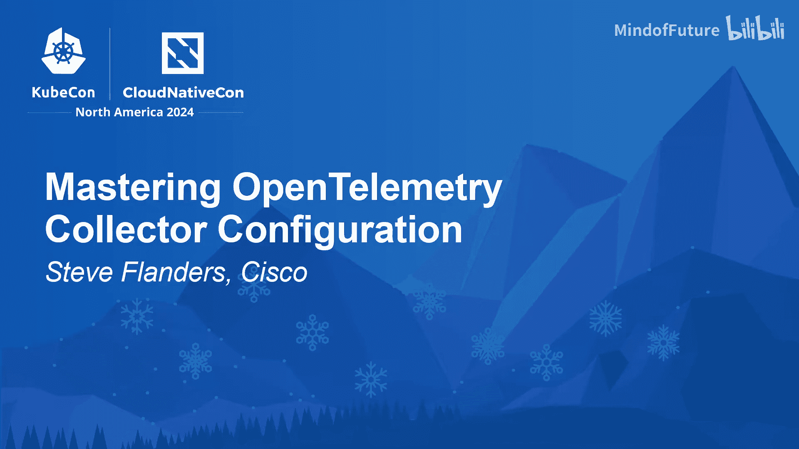
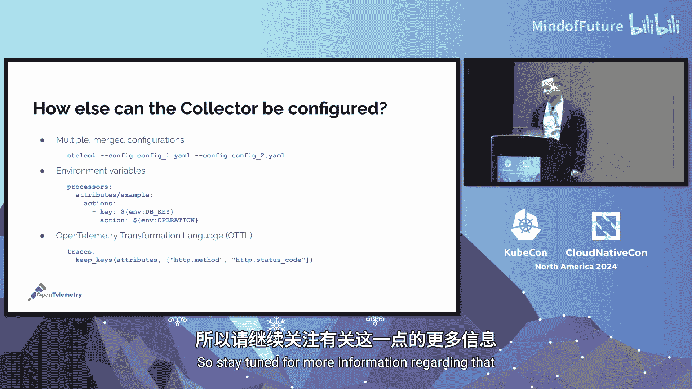

# 【CloudNative】KubeCon+云原生峰会2024-p26-P26-Mastering-OpenTelemetry-Collector-Configuration---Steve-Flanders,-Cisco--BV1E9wPegEH6_p26-

For those who don't know me， my name is Steve Flanders。

 I am a senior director of engineering at Splunk， which was recently acquired by Cisco。

 So I'm not sure which one I'm supposed to say， but I still call myself a Splunkker' been involved with the openCensus。

 which is kind of the precursor Project to Open symmetrymmetry there was open census and open tracing and now open symmetrymmetry since the very beginning。

ve been involved in the Observability space for over a decade now。

 was at VMware working on a logging product。 I joined as part of a founding team at a company called omnisition at Splunk acquired。

 It's now the Splunk AM product and at Splunk， I've been responsible for the Splunk Infrastructure Monit Product。

 which was the Sign effects acquisitionition。 So I've been working with traces Metrics and logs for a very long time。

 And then very recently， and in fact， last week， I released a book called Mastering Open Cmmetry and Observability。

 hopefully you will take a look at it。

So let's start quick with a poll。 I mean， I think we're at Cucons。

 I think there's going to be a lot of hands here。 But how many people have heard of open symmetrytry。

Okay， great。 How many people are using open symmetrymetry。

How many people are using open telemetry in production。We've come a long way。 so many people。

 in fact， earlier is having some conversations with some folks that were talking about the collector。

 which I thought was great， right， So I'm going start with a little bit of basics。

 who has not used the open open telemetry before。 Anyone， There we go。 Yeah， there's a few hands。

 that's expected。 So I'm gonna start with a quick introduction of the project。

 But I'm gonna spend most of my time today talking about one specific component。

 And that is called the collector。😊，So let's start at the very high level。 What is open telemetry。

 Basically， it is an open standard that makes it possible to generate。

 collect and process telemetry data。 You might have heard of the three pillars of observability。

 traces， metrics and logs， open telemetry provides a standard for that。

 but it supports even more than those three pillars。

 you have things like client instrumentation or profiling synthetic data and the like。

 So the project is really focused on all telemetry data that you would care about in your environment。

 whether that's within an application， even end user device like a browser or a mobile device。

 at any language that you care about all of that would be covered。

 but open telemetry does not provide a backend for that data。 Instead。

 it is vendor agnostic and allows you to send that data wherever you want。

 whether that's an open source project， your own homegrown homeb home constructed item or like a vendor。

 for example， cloud provider or some service provider， something that extent。 very， very flexible。

Now， how it does this is first， it defines a standard that's called the specification。

 The specification basically defines the rules of like what must happen， what should happen。

 what could happen in terms of generating this symmetrytry data for any signal that it supports signal is the term that they use for this symmetrymetry data。

 So a metric is a signal。 trace is a signal log as a signal There's different types of them。

 And then the project enables like context and correlation across these different signal types。

 And there's lot of value in that。 Now， you may be wondering， like， well。

 why does this matter why would you need a standard for this， because prior， there wasn't one。

 And so basically any backend that you use would provide its own instrumentation。

 and that may or may not have the capabilities or the integrations that you care about There security aspects。

 Opera concerns and changing it， especially from a customer and user perspective was very。

 very difficult。 Now you can instrument or add data collection components from open telemetry。

 And you can use that across vendors across open source。Tools that you have， which makes it very。

 very powerful。So on top of this specification， there's basically two reference implementations。

 There are what known as instrumentation libraries。 These actually go within your your code itself。

 You can do that through things like automatic instrumentation or manual instrumentation。

 And then you have basically a collector component。

 You can think of it like an agent or a gateway or a pipeline that basically exists that will receive this telemetry data。

 process it in some way。 and then send it wherever you want it to go。

 I could spend all day just talking about the project。 There's really a lot to it。

 But as I mentioned， I'm gonna focus a lot on this data collection part today。Now。

 why does open symmetry matter。 Well， first， of it has an open standard。

 That's great because now we have kind of one way of doing things。

 one kind of terminology that we can follow。 But it also provides the ability of kind being vendor agnostic。

 if you're no longer tied to a particular vendor when you're using instrumentation or data collection pieces。

 This gives you of data portability and data control。 you choose what to do with your telemetry data。

 You choose how much to generate。 you choose where to send it。 you have full control of it now。

 And that's very， very powerful。 So if you want to have a data lake locally。

 if you want to run like open source tools within your environment， you can。

 you want to send that to some like managed provider or a Saas solution， you can。

 if you want to send them to both like a local and， you can。 It's very。

 very powerful from end user perspective to help you achieve observability。 Now， of course。

 we're at Qcon。 So open symmetrytry is part of a CN。 But it's actually a very active project。

 In fact， it's the second most active one in all of CNncCf behind only Kubernetes。

 and this actually think show。😊，That it's a real problem that needs to be solved。

 and the community is great。 It it has a very large ecosystem。

 and you see collaboration across vendors， cloud providers and then users， which I think is amazing。

 right， because working together， that's how you get the best observability possibility at the end of the day。

😊，And what you will see is that basically， every major vendor or cloud provider supports and contributes to open telemetry today。

 And many end users have already either contributed or adopted it as well in their environments。

 And again， it's really for this flexibility that it provides。 Now， you can have one way of doing it。

 and it supports other open standards that are out there。

 So it's meant to be flexible and extensible as the observability market kind of grows and evolves。

 So will the open telemetry project along with it。Alright。

 so I mentioned most of this talk is on the collector。

 besides it for kind of introductory information。 What is the collector。 Basically。

 it's a binary that exists that allows you to receive， process and export data visually。

 kind of internally， it looks something like this。 It's not a complete picture。

 It's kind of a simplification of it。 But you have this notion of basically receiving data kind of getting it into the collector。

 And there's different ways to do this。 You can kind of use push or pull mechanisms。 For example。

 if you're familiar with Prometheus， you would usually scrape an endpoint to get metric data that would be kind of a pull mechanism versus if you've used distributed tracing before it's often that the application will push the trace data to an agent or to an end point。

 that would be a push mechanism。Now， once you receive this data。

 you may actually want to do something with it。 Just generating it may not be sufficient。

 For example， maybe you want to process it in some way。

 You want to filter what is actually sent to an endpoint。

 You want to redact sensitive information that might exist in there。

 Maybe you want to do some sort of aggregation or sampling or what have you。

 All that happens within the internals of the collector itself。

 And then eventually you want to export it。 You want to send it to some destination。

 The collector is usually not the final spot for it。 You could persist it to a disk if you want to。

 But that's not all that valuable because at the end of the day， you want actually query that data。

 You want to get like dashboards and kind of visualizations or alerts from it。 And again。

 open telemetry doesn't provide backend。 instead， it plugs into available backends that are in the market today。

Al right， now in terms of reference architectures， there's two primary ways to deploy the collector today。

 The modes are called agent mode， which basically means it runs as close to the application as possible。

 That might be a binary along with your application。

 that might be a sidecar could be a da set and that it runs on like every single host in Kubernetes。

 for example， But basically it's very close to the app itself。

 The benefits of this mode are that you're basically offloading responsibility from the application as quickly as possible。

 You have it generate the telemetry data， but you don't have it do any of the processing。 Now。

 the benefits of that are kind of twofold。 One is you're not introducing additional load within your application that consumes more CPU memory resources in general。

 And second， you can now have the collector， which is a single binary。

 handle all the processing in a generic way。 Otherwise。

 you have to have those processing capabilities in every single language that you have in your environment。

 because the application instrumentation is going to be language specific at the end of the day。

 So some nuances to that in terms of configuration or even knowing。

Like language specific semantic conventions。Now， the other way that you can deploy the collector is as a gateway or as a service。

 This basically would sit in some sort of network boundary。

 Maybe this is like a data center or region or realm or whatever your terminology is。

 And in this mode， it's usually clustered。 So you have more than one instance of the collector and you have usually a load balancer in front of it So you can support a whole bunch of load coming in an agent mode。

 you have one instance， It runs right alongside the application So if you're doing like a data set you're gonna to have one per host。

 You would not cluster it in in that way， because it's using certain ports on that host。

 you would have port conflicts。 It doesn't actually work in gateway mode。

 you have to have a cluster of these， or you usually have a cluster of these because you want to have things like high availability or maybe you're supporting a large number of applications or host in your environment。

 So just the pure scale of it requires more than one instance。

Both the agent and the collector can send data wherever you want it to。

 So you don't have to use like both here。't you can choose either one。 And at the end of the day。

 everything in hotel is optional。 So you can also choose not to use the collector。 If you wanted to。

 you can actually have the application， the hotel library， for example， send directly to a backend。

 if that is if that solves your business needs at the end of the day。

 So really flexibility and choice every step of the way depending on your requirements。 personally。

 I think the collector is kind of a great component because it offloads a lot of responsibilities and can get you into a vendor agnostic state a lot faster。

 don't even have to change your application instrumentation。

 if you're already instrumented to your apps。 let's say it's not hoteltel based as long as it's a format that the hotel collector can receive it will handle all the translations for you So you could receive in one format。

 let's say you receive in Prometheus format and you can export in a different format。

 So if you want to send an OtP， for example， which is open telemeries protocol。

 All those translations happen within the collector automatically。 That's what makes it。

Agnostic at the end of the day。Now there's a couple specific things I want to drill into。

 This will become more relevant as we get into the demo。 but I mentioned it's a single binary。

 that binary is written ingo。 It's a compiled language。

 So the good news is it supports major operating systems and you could just pull down that binary if you want to use it。

 There are other ways you could deploy as well， I mean。

 we're at Kubcon I'm sure lots of you are using Docker containers or some sort of container engine you may even be using Kubernetes。

 All of that is fully supported Open telemetry is kind born into the cloud native error。

 which is great。 So it has native support for all these different environments。

 and there is packaging for this built into to open telemetry community。

 So if you look at the documentation。 you'll find that theres Docker images that you can readily pull down and they are usually customized for what you're using。

 So in the case of like Kubernetes， which you'll see soon is that there's actually packaging where only pulls in the components necessary to support Kubernetes。

 you could add more if you wanted to。 But the goal is to give you native support for it easily。

 And again， everything is extensible。 So if you。😊，Right for own packaging。

 it's actually possible to do that， as well。Now， there's one notion in open symmetrytry that you may have heard of。

 It's called distributions。 Open symmetrymetry natively has three。

 basically three primary types of distributions for the collector today。

 but anyone can have a distribution of open symmetrymetry if they want to。

 That could be an end user that could be a vendor that could be another open source project。

 So the project itself has three。 they're typically called core cantri in Kubernetes。

 it's core basically has the core capabilities that are required to use it with just pure Otel。 So。

 for example， I mentioned that open symmetrymetry has its own protocol called O TLP。 As a result。

 the collector has an O TLP receiver and an O TLP exporter。 because that's necessary for the project。

 that would be in the core repository it's core to the open telemetry project。

 Contri is where everything that's not core to the project or maybe is a little bit more nuance。

 Maybe it's only applicable to a subset of environments。 It would live and contri。

 So if you have something let's say I want to send data to an endpoint like zipkin or yeager。

Go be in the con repository it's not core to open symmetrymetry。

 but it is a capability that some amount of end users are going to care about and want at the end of the day。

 Now， the， the reason why I'm mentioning core versus contri is because that'll be necessary to actually configure the collector coming up。

 That's why I want to make sure to cover it。 And the case of Kubernetes， again， as I mentioned。

 this just packages the applicable components， the receivers， processors。

 exporters that you need to support a Kubernetes environment。Now。

 there is a tool available called OCB， which allows you to build your own distribution。

 So if there are like certain components。 you want to pull out a contri。

 You don't want every single component that exists in Contri。 You only want a subset。

 you can actually build a manifest file and create your own distributions。

 And what you will see is that a lot of cloud providers and vendors and open source projects have their own distributions to right So a distribution is not a fork。

 So if a distribution is done， right， It's basically pulling in the open symmetrymetry components that are necessary。

 in order to support a specific environment。 Most vendors today have their own distribution。

 usually theyre only pulling in the components that are relevant to them。 maybe they have their own。

 for example， vendor specific exporter that would be in their distribution。

 if you're not using that vendor。 You don't need that exporter。

 Many vendors are actually moving to the open Cmetry format。 So hopefully in the future。

 it'll all just be native O TLP but not all are there today。 So that's one particular example。

 or maybe there's some like specific thing that a vendor supports。 That's not。

Likeable to other environments or what have you， Maybe that could be in a distribution as well。

 Ideally， distribution should not be custom and that they contain things that are not eventually going to make it into the open Ctry project。

 because that would be vendor lock in again， It doesn't actually preclude the problem of， hey。

 I've instrumented once。 So I have one data collector。 And now I can collect everything。 So ideally。

 it should be the same config that hoteltel provides。 And it's possible maybe some。

 some third party has developed something that they haven't been able to get upstream yet。

 Maybe they temporarily have that under distribution。

 But long term everything within a distribution should be available in upstream。Al right。

 let's talk a little bit about open symmetrymetry configuration。

 And I've mentioned several of these already， right。

 But there's basically five major components to the collector receivers getting data in processors。

 we talked about those exporters。 There's two more So one is called extensions。

 These are usually things that do not touch the telemetry data themselves but provide some sort of capability that you might want。

 So， for example， if you want to have like health check capabilities for the collector。

 That's an extension。 but extensions can actually enrich things like receivers and exporters。

 Let's say I want to have some way of like authenticating a receiver or an exporter that would live it as an extension。

 Let's say I want to have things like service discovery that would be an extension。

 And so the extension could be called by a receiver or an exporter。

 but an extension itself doesn't typically touch the telemetry data。

 It provides some additional capabilities on top of it。

And then the newest type of component is what's known as a connector。

 A connector is unique in that it is both a receiver and an exporter。

And so what a connector does is in open symmetrytry。 you build what are called pipelines。

 So I define like receivers， how I get data in processors， what I want to do with that data。

 exporters， how I get that data out。 That would be a pipeline。

 I can have multiple of these pipelines。 But after I run that flow。

 let's say I get to the exporter step。 Maybe I want to reprocess it again。

 I want to do something else with the data。 That's where a connector comes in。 So for example。

 let's say I process something and I get some metric out the other end that I care about。

 And I want to do something with that metric。 I could create a connector that says okay。

 I'm gonna export into the connector。 And I'm going reproces it in a new receiver。

 which is the same connector。 and I'm gonna do a different thing with that output at the end of the day。

 So's a bunch of different use cases for this， but it's a little bit more advanced。

 I'm not gonna talk too much about it。 but you should know that that is available components as well。

How was the Oto collector configured， Yml， How many people like Yaml。Oh， wow， a lot。

 How many people don't like Yaml。 Yeah， I'm with all of you。 I've never liked Yaml。

 So everything's Yaml base。 You're in Kubernetes。 Everything's yaml base。 So I mean。

 you're gonna be very， very familiar with it at the end of the day。 But the nice thing is。

 if you understand the components in the structure of the collector。

 you kind of understand how the configuration of Yaml works。 right。

 So like every component I mentioned， that's a top level construct and the Yaml config。

 You can see receivers here， right， you can see processors， exporters， very， very simple。

 And then for every single receiver， a receiver has a name。 for example。

 you can see a host metrics receiver here。 And then every single component can have some amount of configuration。

 And of course， that is documented somewhere。 you need to go find that documentation。

 But then you you specify the right amount of configuration for it。 and that component will work。😊。

Now， there's a couple things to note about the collector configuration specifically。

 It's really a two step process。 So step 1 is you must define the components that you want to use and configure them the way that you want them to be configured。

 So if you want receivers， processors， exporters， you have to have a section for those and you must properly configure it。

 But just putting it in the configurefig。 just this top level that you can see highlighted here。

 That does not enable it。 It has only defined it and configured it。 to enable it。

 You must add it to a service pipeline。 That's the second step。So you can see at the bottom here。

 it says service pipelines。 Those pipelines are telemetry specific。

 So you can see metrics and traces listed here。 but logs and other other data types that also show up。

 And then for metrics， you can see it defines which receivers it's going to call。 And clearly。

 this receiver must support metrics。 Otherwise， the config would fail。

 and then exporters you have to specify the ones that you want。

 So configuration here is really a twostep process。 If you only define it。

 if you define it outside of a service pipeline。 Like。

 let's say I had this host metrics receiver up here。 but it wasn't listed in any of these pipelines。

's kind of useless。 It's not actually doing anything， it's just in the config。

 So note that you have to do kind of both parts。Now， how do I find all these configuration options。

 Gitthubreadme pages， So going back to this core versus contrib thing。

 let's say that I care about a specific receiver config。

 I would have to know whether it's in the core repository or the contri。 Here I'm in contri。

 I'd have to go to whatever component I care about here I'm in receivers。

 Maybe you want processors or exporters。 And then I'd have to go find the config or the component that I'm trying to configure。

In that component。 So here I'm looking at the O TL P receiver。 There's a readme file。

 and that readme file has a configuration with Yml examples on what's required to get started and all the configuration options that exist there。

 So this is a great reference to make sure that you're configuring it properly at the end of the day。

 You will have to check to see if it's in core or contri。😊，Now， once you know the configuration。

 you have to specify that to the collector at the end of the day。 The collector is binary。

 So here you can see multiple different examples。 One is taking the Otel call binary and passing a config flag。

 and I pass a Yal file。 and you can actually pass more than one。 And you can actually combine these。

 So it can get very complicated depending on how you want to do this。

 Those config files could be statically defined， or dynamically generated。 for example。

 you can pass environmental variables into the Yal file if you want to。

 and there is something an open symmetrymetry that makes it a little bit more sQL like it's called the open symmetrymetry transformation language or O T Tl。

 And this is another way of specifying configuration。 A lot of O T Tl is still in the alpha state。

 So I'm not gonna to talk too much about it。 but I do think it's a very cool project and something to take a look at。

 And I think in the future， many of the processors。

 if not the entire Ol config will be based on O T TL。

 So stay tuned for more information regarding that。😊。

Alright， so let's do a quick demo on how to kind of get this working for an environment。

 So I have downloaded the binary to my system。 I'm on an O S X system here。 So I have Darwin Ar 64。

 And in here， it basically just has the contrib repository。

 So I'm not using core I'm using contri because it has a lot more cool components。

 And so if I just want to run this。 I would just say， start the binary， right， now。

 it's not going to work because by default， there is no config that I specified to it。

 So it doesn't start。 It basically says， you need to provide a configuration。

 So let's go ahead and build something。😊，So as I mentioned。

 we have to have components that we care about。 So I'm gonna want receivers。 I can say OtP， again。

 open symmetrymetry protocol。 and I can say host metrics。 Let's use that as an example。

 and host metrics as this notion of scrapers。 Scers are things like CPU memory disk。

 things that I care about。 and let's say I want to enable the memory scraper。 So a very。

 very basic configuration here。 And then I will define exporters and to make it very， very simple。

 I'm going to use the debug exporter， which basically logs the output to the console So I'm not actually sending it anywhere specific。

 but of course， you could send this to y or Prometheus or elastic or whatever you care about any backend。

 all those configurations are going be kind of specific to your environment。

 Now all I need to specify as receivers and exporters， processors are technically optional。

 So this is a valid config at the end of the day。 But I have only define them and configured them。

 I still have to build my service pipelines。 And so here， let's say I want to have metrics1。

 And I have to。Again， define the order in which I want these to happen。 So I'm gonna to say。

 let's enable the host metrics receiver and let's send that data to the debug exporter。 So， I mean。

 very， very basic config at the at the end of the day here。

 I'm not actually doing anything with the data， I'm just taking it in。

 and I'm sending it back out on the other end。 Now， first question might be， is this config valid。

Answer is actually no， but you don't know when you're typing in Yal。

 but it turns out that open symmetry has this validate command， which is pretty cool。 So basically。

 it will validate the config file that you have and make sure that it is actually containing what you what you need。

 So here it's gonna to come back and say this is not valid right， I looked at this。

 and it says that the exporter is an invalid key for the service pipeline metrics。 Okay。

 so that's because it's export Trs plural matters here。 I have a syntax error。😊，Now。

 the reason why I'm showing you this validate command is because I don't see a lot of people use it。

 If you were to push this to production and you don't run the validate command。

 the collector didn't start， as you saw， right， That means it crashed。 Well。

 let's say that you had a working collector config。 You made a modification。

 you push that to production。 You don't run the validate command。

 you would bring down the collector and you'd start losing telemetry data。 It's not great， right。

 So you should always validate before you actually deploy this。 Otherwise you' run into problems。

 Okay， so we fix the first typo。 Now it's saying， hey。

 there's something wrong with the O TLP receiver。 right。

 It says that it needs to specify some sort of protocol。 Well。

 maybe it's my first time using the O TP receiver。 So I know nothing about it。

 So let's go ahead and go find the open symmetrymetry receiver。

 So I'm in the core repository receiver O T P。 There's a read me。 It says， well。

 if you define an O TLP receiver。 you must define protocols and you can choose G PC or TP or both。

 Well， I didn't do that。 So again， I have an invalid。Like configuration。

 So if things are not working on your collector， go check the readme files。 They're very。

 very helpful。 If you see a documentation problem in the readme。

 please file an issue or submit a PR to kind of fix it。

 But the readme file is a great way to see if you're doing things correctly。

 So I can say protocols here。 And I could protocols。 and I could say something like H T TP。

 And now let's run it one more time and see if we are valid。 And no error this time。 Great。

 I at least have a valid config。 Now it's valid。 but remember， I have O T O P defined here。

 I didn't define it in a pipeline。 O TLP is not actually being enabled。 So it's kind of useless。

 But it is valid config。 Like the collector will start。

 It's not gonna crash on me So we have kind of our first step。😊，So let's go ahead and run this。

 I can say， run it with the config file。 And now it will start。

 And it is actually logging information that is very， very relevant。 For example。

 it tells you what is actually being configured in these info messages。 And if something was wrong。

 it would actually show warnings and errors in the logs。

 So I highly recommend that you look at the logs as well。

 This is a great way to see if things are working as you expect at the end of the day。😊，Now。

 the most important line is actually this last one， which basically says， hey。

 I actually collected some metrics and three data points， actually。

 And I sent it to the debug exporter。 Now， you can't actually see that here because it's not being。

 it's just being summarized as to what's being generated。 Let's make this a little bit easier to。

 to see。 So we can say verbosity。Thebug and just rerun this。 And then oop。Yeah， unknown metrics。

 vervasity， Oh details。 Yes， my bad details。 See， this is why you need to go check the config。呃。Go。

 and so now that summarized line becomes an actual output that I can read。

 So I configured the metric scraper for memory， and you can see it created some metrics for me， used。

 free and inactive。 And you can see the value of those data points as well。😊。

So if I were to send this to Prometheus， it should receive this data。

 or if I expose to Prometheus endpoint， it could be scraped by a Prometheus server。 So， again。

 very easy to get started。 But this is pretty basic， right。

 Like no one is probably going to have just one receiver， one exporter。 At the very least。

 you're going to have processors。 So let's talk about processors because they're kind of important and unique here。

So first， there's something known as the batch processor。 And second。

 there's one called the memory limiter。 I'm gonna to call these out explicitly because it's a little bit buried in the documentation。

 If you look， go to the I'm open telemetry I O docs collector。 if you go to the configuration。

 it will tell you how to like configuration。 So you can see passing the config flag It's showing you different ways of passing environmental variables。

 It tells you about receivers， processors and exporters。 we can go to processors。

 and there's a link here that says processors are optional。 although some are recommended。

 That's interesting。 Let's click that。 And it tells you actually that you should have the memory limiter first。

 and the batch close to the end and some other specific ones in between。 Well。

 you have the manually configure this。 So if you didn't read the documentation。

 you might not be aware of this。 But by default， open symmetrymetry doesn't batch。

 So every single like telemetry thing that's being generated will just export immediately。 Well。

 at scale， that's not ideal。 You kind of want to batch this stuff up。 It can process very， very well。

 you want to limits。😊，The resource use or network connections that you're making。

 The memory limiter is actually also very important。 If you don't configure the memory limiter。

 then the collector can eventually consume all the memory and then crash because it's out of memory。

 So setting the limiter in place is very important for production environments。 Otherwise， again。

 the collector could be in some sort of crash loop state and you'll be dropping teletry data。

 So I highly recommend configuring both。 the batch processor actually has a default con that's pretty s。

 So you don't typically have to specify more options。 In the case of the memory limiter。

 you have to specify how often you want it to check maybe like 5 seconds。

 and you need to specify at least some sort of limit。 So I'm gonna to specify like a 400 MBby limit。

 And then again， that's only to find it and configured it。 if I want it to actually be enabled。

 I have to put it into a pipeline。 So I would have to say memory limiter because it recommends putting that first and then batch。

So that actually brings up another excellent point， which is processors。

 That list is executed in the order in which you define it。 So the memory limiter is being run first。

 the batch processor is being run second。 If I switch the order。 It happens in this。

 the different order。 So the processors are the only ones with the order that you define it in the configuration matter。

 It's not true for receivers or exporters。 It's only true for processors。 So keep that in mind。So。

 okay， did that first step should be validate the config。 Let's make sure it's actually valid。

 There are no errors。 Great。 Then I can just rerun it。 And this is the exact same test。

 I didn't actually change the telemetry data。 So the output's gonna be the same other than the values and the timests have changed。

 But like it's behaving the exact same way。 But now I have a more production like config。

 I'm configuring things that are recommended by the open telemetry project。One final thing。

 Let's add one more that's actually a little bit more interesting。

 I'm going add the resource detector。I'm going probably forget the config here detectors and system。

 So this is going to check the system an attempt to add more metadata。

 I hope it is called resource detector。 I'm going find out in a second。

 And I want to add it between these two。 So resource detector。

And let's see how I did in terms of configuration。 Nope resource detector processors。

 What's it called。 I forgot。我也是。Dettector。1， yeah。Resource detect。Oh， thank you。 Oh。

 whichs is a typo， thanks。Its prettyty close。Still isn't like me。Resource detector。Thank you。

 Thank you。Resource detection。So close，'s beenen a long day。No underscore。Really， no not on score。

I tested this before and I've already forgotten， so this is why checking the documentation is important。

And。He， thanks， folks。Config。 So this is only going do one thing。

 It's going to still generate the used free and inactive。 But if you scroll up。

 you're actually gonna see that it now contains some more metadata that it didn't contain than before。

 that metadata is the host name and the O S type of my system。 Now。

 the resource detection processor can do a lot more than this。 It's a very basic example。

 And it can hook into things like Kubernetes or your docker Da set or anything like that and collect that metadata too。

 But this is enriching this limit data。 And honestly。

 this is very important because that's how you do problem isolation and kind of root cause detection at the end of the day。

 You want to know why memory is high or where exactly in your environment is happening。

 That's where things like resource detection can be helpful。Now。

 a final example would be like showing you how to do like crud metadata operations， create， remove。

 update， delete type things。 You can do that to any of the metadata that's attached here。

 For example， if there was some like personally identifying information or something that you didn't want to like send to a backend to an exporter。

 You could actually redact that information or hash it。

 If you wanted to enrich this from the collector。 Let's say I want to add a tag for everything that comes through the collector。

 You can do that as well through processors。 So again， pretty easy to get started。

 but you have to know that syntax and even I made a mistake here live。

 right Like you have to check the readmes for this。 The hotel documentation， I think is pretty rich。

 So definitely take a look， they have different examples that kind of get you started。

 But all those receivers processors exporters， they're in the Github repo today。

 they are not fully up on the doc site。 Hopefully that will be fixed at some point here very。

 very soon。Okay， so wrapping up here。

I have a link to kind of everything that I kind of showed here。

 so you can kind of review this afterwards。 I'll share the links on on the schedule site so you can kind of see it。

 And then finally， thanks so much。 Hopefully you found this kind of useful。

 Hopefully you'll take a look at the book。 I actually have a few copies。

 We can do that for like people that have questions。 and there is a promo code。

 if for people that are go to Ccon if you're interested。 So thank you very much。😊。

👏And I have a couple。Couple minutes for questions。 If you could use the microphones。

 it would be great。Hello， so from the some of the other talks that we heard is like。

 if you wanna get metrics at the full resolution while sampling traces。

 we need to run a layered collector。 Is that what you would recommend where we need to run like collector in。

Multiple layers， if you wantan to。Resolve matrix while just sampling traces。

 So you're sampling traces， but you want all the metrics。 Is that correct。 Yeah， with 100% fertility。

 Yeah， So there there is a connector for this that will give you the red metrics out of the data。

 And then if you're using something like tail sampling， you' have to use like a routing。

 you have to every single trace every span within the same trace， the same collector instance。

 So if you're using the collector and agent mode。 it actually has a way of routing to dynamically based on the trace I to the same instance。

 Do you have to enable that in agent mode。 And then within the collector。

 you have to enable the connector that would actually do the metrics for you。 if you wanted to。

 you could separate the metrics and the traces into different collector clusters。

 that's really only necessary at high scale。 or if you really care about one telemetry type over the other。

 and you don't want to have noisy neighbor problems。 for simplicity sake。

 I would say doing it in the same collector instance is probably fine for most use cases。

 But at massive scale or for some corner cases， you may need to break that out。😊，Thanks。Yes。

So stupid question is there any ways to debu logic what youre like hey want to make sure this thing is working properly how do see more thes depends on which part you care about So for example if you how thes are pages show thes see the pipeline to make sure it's like looking the way that you think that it is there are even sites like bin where you can take a Ya file and upload it and it will visually show you what your configuration looks like So if that's。

Problem， there are ways to do it。 But if it is like， hey， I've configured it a certain way。

 And I'm not seeing the output I expect。 or like the data is being dropped somewhere。

 The debug exporter is one of the easiest ways， I'd say there was another one。

 I'm not sure if it's still there called the tap exporter。

 And there was a way of tapping a pipeline to see data between it。

 I'm not sure if that's still there。 But personally。

 I use the debug exporter often when I'm having issues like that。 Thank you。

But I have a question about largescale use cases of open telemetry。

 Oftentimes it's advised and monitoring systems to push aggregations to the edge as much as possible。

 are there either any stateful or stateless aggregation capabilities currently in the collector and are there plans to add those sorts of capabilities in the future Yeah。

 so actually having some of this conversation earlier。

 So I talked a lot about the Yamel and fg of the collector。

 but not necessarily operational aspects of it in general。

 my recommendation would be if you can run the collector stateless。 It's in your best interest。

 It's way easier。 you can just add another instance behind the load balancer。

 It scales linearly life is good。 But of course， there are use cases where that's not possible。

 You're doing tailbased sampling。 It's really not possible because you have to make sure all the spans for a trace end up on the same collector instance。

 that's stateful at the end of the day。 There are stateful aspects of the collector。 For example。

 there's there's storage exporters that you can configure。Or processors that you can configure。

 And those are stateful at the end of the day。 So one use case might be。

 I want to make sure that I don't drop telemetry data。

 So if the collector like restarts or something， I need to retry that data。

 you could use the storage extension here to like store that data locally and have it basically checkpoint。

 pick it back up when the collector comes back online and then export it back out。

 you were talking about aggregation， there are aggregation use cases where that's also necessary at the end of the day。

 if you're doing like histogram or certain like dynamic things where you want to aggregate things up before you send it out。

 where possible， I would say do it in memory because if you lose it it's probably not the end of the world。

 but for some use cases like logs or like compliant environments losing that data is a compliance violation。

 you would have to use something stateful in the collector to make it work。 But yes。

 there are definitely stateful aspects that you can configure if you can avoid it。

 I would say avoid it， if you think something is missing please file an enhancement request and just say。

 hey， I need this capability， the community is very。

 very active and definitely help you with that as well。Yes， yeah。

 this isn't really a configuration question， per se。

 but just kind of the rationale behind using Otel versus other tooling。

 My company we already using fluent bit and Prometheus to get logs and metrics from everything。

 we've had some internal meetings about whether to start using Otel But it kind of confusing talking to some of the senior devs trying to figure out why adding one more tool to what we're already doing what would be the advantages of Otel over some of the other stuff we're already using。

 So look if what you have is working and it meet your business requirements。

 there's no reason to change So if you're happy with fluent bit in Prometheus no problem So it depends I would say on what are your use cases and what are you trying to solve for one use case that Otel can help with is being vendor agnostic So let's say you want to switch off a Prometheus or for whatever reason you want to switch off a fluent bit。

 if you have Otel， you can now point it to something else if you wanted to Don't have that requirements。

 Don't change It's fine。 So it really comes down to what are you trying to solve I would say if you're using a vendor's proprietary instrumentation or data collection。

There's a lot of value to moving to something like hoteltel because now you're not locked into that vendor。

 You want to send the data somewhere else， you easily can。 If you want to switch vendors。

 you can easily do it。 You're talking about open source tooling。

Otel supports fluent bits like they natively integrate。

 You can have fluent bits said to the collector if you want。

 So like there's no need to replace what's already working in your environment。

 If there's some value you get out of hoteltel that you might not be getting from fluent bit。

 maybe that could be a reason for you。 If that's not the case。 keep going。

 you're already using open source tooling。 So I don't want to get into like a religious war on which open source tool to work。

 they're all great， right， Like， if it's meeting your use cases and you're not locked into a vendor solution。

 maybe there's not a lot of value being provided。Thanks， we're at time。

 So I'm happy to take additional questions。 I can follow people out。

 But think I'm going to get kicked out。 So thank you so much。😊。

