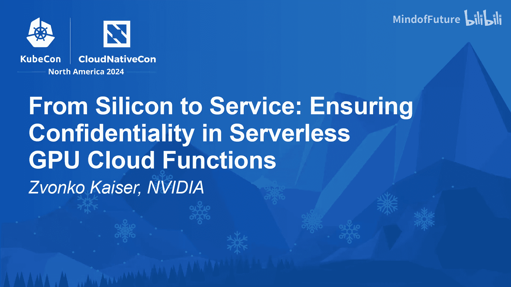

# 【CloudNative】KubeCon+云原生峰会2024-p27-P27-From-Silicon-to-Service--Ensuring-Confidentiality-in-Serverless-GPU-Cloud-Fu--BV1E9wPegEH6_p27-

Thanks everyone for coming， my name is Swka Kaiser， I'm with NviDdia in the Cloud native team。

 my main responsibilities are CAA in confidential containers。

 and today I want to talk about a topic from Silic into service。

 the full stack ensuring confidentiality in So GPU Cloud functions。

So who has been in？Cubcon， EU in Paris may have seen my talk on confidential containers with GPU and regular Ms。

 So just to recap what we've done in this space right I talked about the role to confidential computing what we've done in this space why we've chosen CAA for implementing confidential compute with the GPUus on Kubernetes。

 explained a little bit about the GPU enables stack the virtualization reference architecture。

 what we need to take care about to enable advanced use cases like GPU RDMA or GS how we implemented confidential containers and then as an example how we can run regular Ms with confidential containers I linked the recordings so I've em interested on the lowlevel details what we've done in this space go check it out。

Today， I want to expand on the use cases that we are doing with confidential containers and role of the working groups that we established in the upstream community。

So one of the working groups is our confidential containers use case， working group。

 different companies from IBM， Redha NviDdia， Intel IMD are involved in all of this。

 and we identified three major use cases that we want to enable and push forward upstream number one is federated learning。

 which includes。8 data clean rooms。 So we have different peers and integration cell are working in one。

Confidential environment， so we need to share this environment and provide a data clean room for multiple personas。

 which also ties into multiparty computing right it's not only a single node where we're running a confidential container' multiple notess and we need to take care of that The other big topic is of course。

 if you're running a confidential environment。Everything needs to be trusted。

 be it your built pipeline， your CICD pipeline， so we have several members of our community there working on the supply chain security right all things related to asBOs provenance。

 CicCD and repeatability of bills and at the station of bills and deliverables that we are having in the enclave or a confidential environment and of course generative AI Re LLMs Nims。

 how to properly deploy them， how to properly secure them So essentially all of those use cases is the one thing in common。

 we have different parties running in the enclave and we need to make sure that we are providing a clean room。

 a confidential clean room for all of those parties involved a link also a document of the upstream community so you can read up on those use cases with some slides and presentation of that。

嗯。Anybody working in a confidential。Computing use case notes Reds architecture。

 So we have a dedicated。Working group that is mainly focused on at the station trustee is our atest stationation pipeline in confidential containers currently most of the conventional environments are kind of concentrated on oneNot and doing the attestationation at the beginning of the run。

 but you have workloads that are running maybe for weeks or for months and one thing we are looking into it is doing things like periodic at aest station runs so if you have a lot of node coming in and coming out。

 all those at a station entities needs to be at testested and verified and also we want to disable replay a text。

 example if you have a confidential storage， you want to may have a periodic run to verified that your confidential storage is still in the state that you're expecting it。

And then I said before， we have multiple persona support。 Imagine a。

A cloud provider is providing the infrastructure， then you have the model owner is providing the third party model。

 and then you have the user who is maybe having X images using this model and every of those personas needs to be attested against each other and needs to be verified。

So this is also a big topic in our trustee working group how to accomplish this and then we have things like composite attestation support So if you imagine you have a lot of atestation entities coming in and out of your confidential environment you want to make sure that you're not getting any race conditions and that those atestation of those entities are being done in a proper manner and in the right time because there are some timing attacks especially on the hot level where you have different policies and attestation runs so what we are thinking is sort how we can composite all those attestation entities maybe in one report are we doing like around robin atestation runs and stuff like that so those are the questions that we try to answer and how to do it properly and then of course another big topic is runtime integrity。

Systems can change during the runtime， and we w to catch that。 And if everything breaks。

 we want to have。A signal or some alert that something has changed。As I said before。

 most of the environments are single note， We need order to take care about a global state at a station。

 So the global state about multiple nodes， multiple clusters。

 or maybe even multiple availability zones， right So you have a global state and you need to attest your complete global state and of course。

 identity management。 you need to know who is coming in into your secure enclaves who is coming out。

 So you always need a proper identity of your H devices， of your peers。

 of your node of everything that's coming in and coming out of your secure enclave。

And really the main focus of confidential containers is like the lift and shift strategy that we have right。

 run or killed without any modifications。We have support for the major hardware T， speed SP TDX。

 RCCA， Rik5 COVI is coming and IBMC， we can run on any infrastructure be it on-prem CSP or hybrid。

 and on also any model of deployment， beat serverless or managed Kubernetes。

 we are trying to enable all of those use caseses with confidential containers meaning a pretty good lift and shift strategy so that you can run your container as a traditional containers a QA container or if you wish as a confidential container。

All the work before。That we've seen with CMMs is or confidential VMs or Ts or enclaves is。

Making those enclaves more secure。 But one thing we left out of sight is the host and。

And a big topic that we are currently working on is full sta at。

 So what you essentially want to do is。You want to protect your complete environment and your silicon from the silicon up to the container right if we are looking at various attacks that we currently have like PK fail where most many of the bio or femaleMA vendors are shipping untrusted keys meaning your secure boot is broken。

 your measured boot is broken so essentially your UFI is already broken and then on top of that we are running a kernel and your kernel is broken because we don't have proper measured boot。

 and then on top of that in the operating system since the UFI is broken kernel is broken。

 your operating system is as well broken right so you have the ahoo attacks is for example a attack on CVMs where you can disrupt Ts with malicious notification which is interrupt overfling so you can create a attack on CVMs if your horses host is not protected right。

I know there are a lot of EBPF tools around there and they are trying to protect the host。

 but the problem with that or any other tool that's running on your Linux system is they are trying to ensure the integrity of the runtime on which they are depending on right so you have a cyclic dependency。

You cannot， cannot protect the very same runtime that you're running in because。If it's broken。

 you are broken。 So an E BPF is more of a observability tool than a security tool。So。Just to。

To give you an impression， even if E BPF and all those tools are working， could go。

It's a Austria meematician。 He， I don't know if you guys are familiar with the incompleteness theorem。

 but a sufficiently complex formal system。 There are propositions and axioms in this system that you cannot be proven true or false。

 and that's the same that we can apply on the runtime， right。

You have tools in your runtime and any attempt to approve the integrity of the runtime environment within itself creates a circular dependency as noted right and this makes it impossible to establish absolute trust without relying on an external or a higher levell verification。

 So you cannot attest yourself。 that's the point。 And EBPF tries to attest itself。

 it tries to attest the host and that's not working mathematically。

 even if it's working mathematically， theres still propositions， then you do that， you cannot prove。

O。How， how it does。For example， the CSP are doing the verification of how they are protecting their runtime。

 So as I said before， it needs to be a out ofbox solution。 right， if you， as an example。

 I'm taking here AWs nitro。 So if you look at AWS nitro。

 they are running those nitro cards out of the host right the host does not have any control about the nitro cardss。

 the flow is from the E2 control plane to the nitro cards and from the nitro cardss。

 theyre imagining the nitro hypervisor and essentially all the instances that you have on the host。

 So there's no back channel。 the nitro hypervisor cannot talk to the nitro cards and the nitro cards cannot talk to the E2 plane。

 So there's no way back to really to the most power instances here。 and。

I also showed it here the A6s and Aproms， right， so the other thing is how can we protect all the AIs because a malicious attacker could reprogram our EEProms and your As6s are running a faulty code。

What Nitro does is they have a service processor， and they can hold a CPU in reset。

 And during this reset， the management Nitro card is。Is attesting and measuring all the AE pros。

And every Asic has on the I speed s bus。 They have a hook there where can they measure their Eprom and the fumur。

 and they can verify it with gold measurements they have。

 So everything that's loaded from the Eprom is checked by the nittroco。

 So they're protecting the Asics。And then on top of it they have a TPM meaning they can protect the loaded hypervisor and the CPU is holding reset until all those fimr kernel host kernel host guess as nitro hypervisor。

 all the components are really verified， and it's always the same pattern right and in its station。

 you measure something and compare it to expected values。

 the host has no access to all of those functionalities， it's all out of bound。

 as I said before it needs to be out of bound Ohio higher privileged entity to verify that the host running is that the host is running in a genuine and an expected state。

So this is on the cloud right， but if you're looking on Onprem。

 if you're interested how to do this on Onprem， there's a company called Ouxide Comps。

 they are essentially doing the very same thing， they have a service processor that can hold a CPUU in reset。

 they have a root of trust and you need a root of trust。

 you need to start trusting some entity and the root of trust is holding like all the keys and endorsement keys to protect other secrets and。

As I said， service processor holds this CPU in reset until all the measurements and done until all film is checked and measured and at testeded and only then the CPU is released and the CPU can then run on the host。

 create a hypervisor and do all the other things that we need。

 they have some more features like secure your secret storage which is completely offloaded from the host so you don't sharing any secrets on the house so any brokerload running on the host will not have access to any secrets。

With this auto band management and additional route of trust， we kind of have。

Green lights on the A6s on the E pros， we have now measured measured Boot。

 secure boot with UFI and kernel， all backed up by the TPM。

 but still we didn't solve anything on the house because measured boot stops when you have your Linux prompt running right so what can we do additionally on the operating system to prevent us like as mentioned here from the attacks。

The one thing is runtime integrity of the operating system。

 So there are tools like the emverty and Fs verity。

 So essentially those tools are building a miracle tree。 is those are essentially hasshes of hasshes。

 So in the end， you have a hash or a fingerprint of your operating system of your file system。

That you can。Compared to expected value。 and then we have the integrity measurement。

 architecture of Linux and EVM。 those essentially are also signed files。

 cryptography measured files and metadata that you can again compare to some expected values and then there are approaches like a immutable operating system Red at core a to core so that you're just preventing。

Have our own that you preventing。Accidental rights to your user petition and stuff like that。

 And then。one problem we have。With KVM and。Plus， VM Ms。

 beat it Q A cloud Hyvisor or or other V Ms that are running is that they are sharing the very same kernel。

 right， that's the same。Same problems we have with containers。

 That's why we are doing the sandboxing at the first place。

 A breakout can still create a denial service on the other VMs。 So if you're in a host。

 you can attack those other VMs。 if you're running a confidential container， data still encrypted。

 but you can still kill off all those Qim or like a kill all Qim and then all the VMs are gone。

 So that's the problem。 And that's what we are looking also upstream is to run CA and confidential containers with a type1 hypervisor why do we need an operating system。

 why do we need a full blown operating system running underneath our VM We just need the VM management。

The the challenge that we have on CSP they're providing onCM。 So to run k of traditional campaigners。

 we kind and need nest utilizationization， but we also don't need it。

 nest ferization can introduce a lot of problems， security issues， performance issues。

So one way how to solve that is to remove nest digtization。

 so everybody who is familiar with Zen Zen had this primary VM and the secondary VM and the primary VM was managing all those user VMs on the same L1 levels。

 so they do not have any nest digtization。It's a simple and more simplified architecture。

 It flattens the virtualization hierarchy。 So all VMs are running as L1 guests。

 dont have we don't need any L2 guests， more performance。 We have more security gains。 And of course。

 we have reduce resource usage on the right side， this is just an example。

 how could you accomplish this with the Acon Hyvisor。 This is some modern type1 hypervisor。

Similar model to then， you have a service V M， which is doing all the resource management。

 and you have then0 on the same level， the use of V Ms。

And and Frida turtles is the reference to the Ttle project。

 which introduced the concept of nest virtualization in Cabia。Right， and one。

 one implementation of this secondary V pattern is confidential containers piePos。Essentially。

 you have a primary VM， which is the broken note on a CSP instance， right， and the pod is。

Is run in a own CSP VM instance。 right， We are not doing the nest ferilization inside of the worker node。

 We have this peer VM， which is run as an own CSP instance。

 So we have decoupled the worker node from the workload and。You can even with this model。

 you can even completely decouple the control plane from your work node。

 you could help run your control plane on Prem and have your worker node on the CSP and your workload on the CSP running so you can decouple your workload from the work node and you can completely decouple it from your control plane。

Wwhichch enables us to run confidential containers also as a hybrid cloud， right。

 you can run your pod onprem with the local VM that you're running and then burst out to the CSPs with peerPods。

 all completely transparent lift and shift， they only interfaces the pod like in Kubernetes。

 you just change the runtime class from peerPods to local VM or CA container。Right。

 so we have taken care of the A6 UFI kernel operating system。 Yeah。

 I'm still having the operating system like it's red， because if your CVM is misconfigured。

 you have SSH access to them。Overbering system can still go into your CM， right， so。Fret model。

 what we're looking also is， yeah， we do not trust the guest as well because the competition container runs inside of the ST M。

 essentially， the gasT M is only used to spin up the container to handle the life cycle of the container。

 So we essentially don't need。A sophisticated or full blownown operating system in the VM as well and all those artifacts that are running in the CVM like the Fmware gas kernel and guestF are coming from the host。

 So if you have a malicious source he could provide malicious artifacts for your CVM so you're running malicious code in there again。

 on the guest we can do the runtime integrity as well the very same tools that I mentioned before DMMware DFS verity。

 I am EVM immutable o and。But one big topic is， you know。If you're doing like the secure route。

 you have measurements。 You have a TPM where you can store。

Your own proia measurements in a hardware enclave， if you are doing it in the guess。

 how we are protecting those measurements， because they could be manipulated and the attestation report could give you wrong measurements outside to the attestation or to the remote attestation entities。

嗯。Those runtime measurements can be protected attest station inside of the CVM。

 there are report fields in atest station report which you can extend TDX has a RTMR which is a runtime measurement register。

 which is essentially a TPM PCR register where you can extend hasss。

But one thing the community was looking into is how can we leverage VTPMs， VTPs in a guest。

 Obviously we cannot pass through a VTPM from the host。Because we do not trust El。

 and we would need to have a。We need to protect if we are pass a VTPM。

 it need to be a software implementation because you cannot visualize a hardware TPM。嗯。And。

If you are pass a virtualized CPM from the house， you need to protect it somewhere。

 you would need to run this as well in in a confidential enclave to protect it from the host from other tenants that you're running。

 So one idea the community has there are。High privilege。Fware running inside of the CMs。

 One is coconut SVSM and Microsoft recently announced open HCL。

 which is a high privilege Fware running in a special VM level。 So if you look at S， S can run。

Can run applications inside of a Cm on different VM privilege levels。

 and they're on privilege level 0。 We are running this custom， which can emulate a VTPM。

 Privi level 1 would run the kernel and privilege level 2 would run the operating system and as higher you go。

 you have less and less privileges。 So level 2 cannot access level 1。

 and level1 cannot access level 2。 So that VTPm is protected from the kernel and from from the user space。

 VTPms inside of CBms are stateless。 We are not saving， we are not saving any state。

 But one topic is really， how do you manufacture TPM inside of a CVM because usually a hardware TPM is。

Manufactured with the endorsement key when it's built into the server。

And with VTPM's you this to do on the fly。 So if you're instant your VTPM。

 you're creating a endorsement key， you can bound this to the attestation report of the CPU and you have the certificate chain up to the CPU vendor。

 So you prove that your endorsement key is valid And from there。

 you can derive storage keys and all the other TPM related stuff that you would do。

There are some discussions upstream because some of the folks do not think that the TPM is the right interface to protect measurements inside of a CVM。

 so there' are some discussions going on on the kernel side on the user space side。

 also in our community and convention containers how to protect those measurements correctly because said TDX RTMR。

 S&P does not have something like that， CCA is doing it completely different and all other other incs are having their own implementation。

Right， as I said before， the guess VM is just a deployment vehicle。

We don't really need a full blown operating system running there for the confidential container use case。

What you're working on is on guest kernel harding， you know just stripping down all the options that we do not need。

 a digitalized guestFS only have the libraries and some of the binaries that we need to lifecycle the container。

 we are not running a full blown operating system， also FiMA hardingab disabling features and parts that we do not need。

And then we have the container payload， right one thing。

You could imagine since we don't have any tools in the guestFs。

 an attacker could use the container as a payload because the container is saved in the PM and use those tools that are deployed by a container inside of the VM。

 how we are protecting against this is using a selins on E armor so that no container context can execute anything in the host context so you protecting the guest VM from running a container payload binary。

 So essentially we want to create a void for the attacker without the possibility to enumerate anything or any electro movement。

As you see， I have still a question mark on a container， right， We can sign the container。

Vify that the container is coming from a re that they' expecting of。

 but how do we know what the container is deploying， right well what are the tools in there。

 what are the packages that you're running in there。And this is where as bombs comes into play。

 right， we need an inventory of all those components that are running in our stack。

 We want to know if we need to react on a C or a bug fix， be it the container。

 be it the guestF or be in the operating system。So we are keeping track of the inventory。

 what is running on our stack， and we are verifying all the signature of the S bombs of the containers of the Pmberg gas kernels。

' all files that are needed there are signed and need to be attested。So essentially。

 what we want to do is verify all signature as bomb certificates via， via remote atestation。

We need to build We need to build a chain of trust from the silicon up to the container as bomb。

 And only if all those parts are green， verified and tested， we can say， okay。

 we are running a trusted stack。How we are doing at the station again。

 trustee is our theest station pipeline。 we are extending trustee to support all of these use cases that I currently explained here。

The problem with CSP at the station is that they are attesting themselves。Right， so。

That's the problem。 Usually you want to attest the environment where you're running as a vocal owner。

And that's where a trustee comes into place so you can deploy trustee on your trusted infrastructure and then at your confidential containers workloads and VTPM quotes and the S bombs and the signature of all the complete stack。

Right， and measure and test every layer。 Trust only what you verify。But this comes then。

To cloud functions and why we are doing like the full sta station， running serverless。

Because the cloud functions are running our shared。

 abstracted infrastructure where the underlying layers are hidden， but crucial to security， right。

 those points of use are from the cloud function provider。

 the function as a service provider or from the workload。

Owner who is looking at that we have opaque layers we don't know anything about the hardware。

 we want to make sure that the hardware hypervis operating system。

 all the artifacts that we are deploying are in a state that the user expects it and vice versa so that the user also expect that all the tools and artifacts and layers are protected so that multitenencies is kind of possible because we want to all protect from of other tenencies on the very same very same hardware Re are shared right we have potential for data leakage malicious inferencing being out of service between tenants。

All the vulnerabilities in hardware or humor can impact function without the knowledge of the user who is running the cloud function or the infrastructure owner。

Right， and the last point is really。If we， if the runtime or operating system or other layers are unmeasured。

They can be tempered with impacting function integrity， data security。 So measure everything。

 verify everything， Attest to everything。 make sure that every layer of your stack is attested and verifiable。

Yeah， what's the last slide。Any questions？That's on our， on our roadmap Yeah。 updateate。 Yeah。

 that's a good， good point。 You need， if you find a C or buck。

 you need to update the guest kernel or the guest F S or any other parts of your finger on the on the for the CM。

 yeah。Hello， you mentioned that one avenue for securing this would be。

The gas kernel wouldn't need to be a full blown kernel。

 If we're running cloud functions with arbitrary workloads。 don't we need。 Yeah。

 you're hard to understand。 I don't know why the mic is so。When， when we're running the guest Colel。

 you mentioned one avenue for securing would be。To run something less than that。

 just run CAta agent for example。 Yeah， the CAta agent is running Yeah， but in the guest kernel。

 we don't need support like for all the file system。

 we don't need support for all the gazillion options that we have。

 It's really a stripped down guest kernel with 20 to 30 options enabled。

 wouldn't the workload need a full blown like Linux kernel for the workload。

I'm making a his call in my function container image， right？Well。

 we need to define what the full blown kernel is。 No， it does not need all the options。

 So we are stripping down。 So yeah， we are testing all the workloads that are running on it。

But we are disabling options that we don't really need。Gotcha。

 that'd be something in our contract that we say this is what we support。Right。

 so it's always the cisco interface between the workload and the kernel that you need to fortify right still so a vertical can still break out out of the container right。

 but then you are on on the gasVM and that's where you're saying。

 okay create a void if you are only on a type 1 hypervis if you have a guest kernel。

 which only has some libraries and some binaries， you don't have a shell。

 you don't have any L you cannot enumerate anything。

 there's not much a attacker can do only what I mentioned before having the container dropping down the payload to have more tools。

 but then we are protecting with a Linux so that the container context cannot be run with the gasVM context。

Thank you。Yeah， one more question。 So you mentioned that during that you do at a station against CSP。

Yeah， but I think if I'm not mistaken， it's possible to run attestation against the chip manufacturer。

啊。Can you say it again， It'， it's really hard to understand And， Mike， I don't know what's happening。

I think its if I'm not mistaken， it's possible to do attestation against the chip manufacturer。

 like if you have Intel chip， then you can att testest against the service rank in Intel right if you have SGI chip for example Yeah so is that possible to mitigate that if you。

Using attestation against the chip manufacturer and not CSP。That doesn't make sense Well， yeah。

 you're asking against the CPU manufacturer。 Yeah， yeah， that's what we are doing。 Yeah， so we are。

 we are testing against the CPU if you're running S against A M， right。

 and we are using the A certificate change right on the CP， you can do that， right。

 You can use trustee on a CP to at testest their A CPU。

 You don't need to use the CP at the station services because in the end。

 you don't know what what they are running and how they are doing it。Hi。

 so this might be a very naive question，In GCP， if we are running serverless functions。

 how do we do the attestation with trustee， Like how does that work。that's a good question。

 My main focus is onprem， where we have control over everything。

 That's a completely different discussion with CP。 right， I cannot answer that。 Thank you。Well。

 at least once you have your CVM， you can attest all those things that you're running in the CVM。

 right， your workloads or your runtime measurements that you're doing。

 you can still do your runtime integrity on the CVM。

 you are responsible for the operating system right after that CVM bootss up。

 you are responsible for those stuff and you can attest those other stuff but on the underlying parts。

 that's a CP thing So you need to think about you can attest the CPUU right without the CP。

Any other questions？Once， twice。Thank you all for listening。

