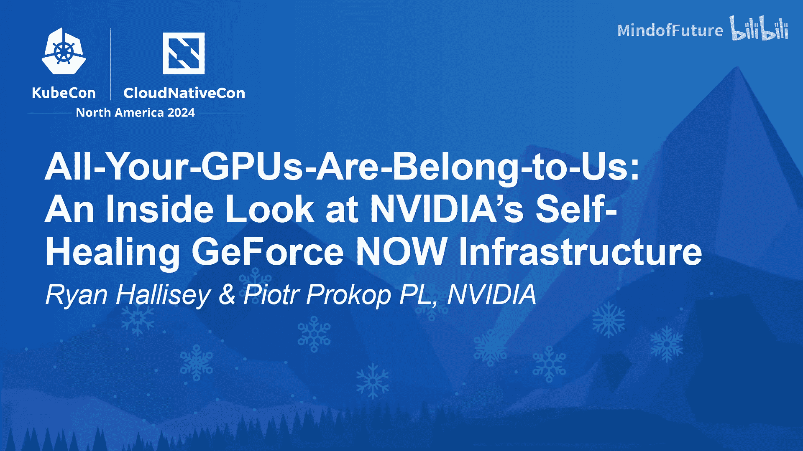

# 【CloudNative】KubeCon+云原生峰会2024-p28-P28-All-Your-GPUs-Are-Belong-to-Us--An-Inside-Look-at-NVIDIAs-Self-Healin...-R.--BV1E9wPegEH6_p28-

This is all your GPUs are belong to us。

I am Ryan Hallloey， and this is Piotto Praop。We work at NVIDdia。And we're going to be talking about。

How we maintain Gfor now， the Gfor now infrastructure。Okay， so if you don't know about G First now。

 if you're not familiar with it， a little intro to it， but we do in video with GE now。

 we have a service where we offer you to play games in the cloud and we can stream it to your device and so how does this look at infrastructure。

 So we take GPUs， we put them in our data centers。And you as an end user， can open up your device。

 you can go to the Gforce now client and open up your steam library， start playing your game。

 and the graphics for that game be will be rendered on a GPU in the cloud。And。

Those graphics could stream back over the network to your device。

So that's a little bit of how it works these data centers。

 these clusters our fleet is a bunch of as all all Kubernetes or mostly Kubernetes。

 the one we're going to be talking about is we have about 40 plus Kubernetes clusters that we run。

 which is about 30，000 plus nodes， it might even be more than that now。

And we run a lot of these workloads in VMs。 So we use Qvert a lot。 And these。

 these workloads are Windows guests。And we so it makes so we run Windows gas， we attach GPUs to them。

 and you we render graphics and stream them to end users。 and we're about 60。

000 plus GPUus across our data centers geolocated all over the world。Okay。

 so what's our philosophy when， when I say maintaining the fleet， like doing maintenance。

 What's our philosophy at Nvidia。 So I'm gonna give you an analogy。If。If you need two requirements。

 if you wanted to build a race car， first requirements is you really want to build a fast car， right。

The second requirement is you need to be able to do。And repair your car on the racetrack。

The second requirement is equally as important as the first。And so， with。Kubernetes in production。

 It's really important that we keep that in mind that we run a really good service。

 We run a service that's always available for us。 and one that we can repair while it's run us in production。

Okay， so what does that mean like maintaining the fleet， like what are all the steps。

 the things that we do when we want to maintain this infrastructure， Well we do a ton of things。

 we always want to make sure our GPs are up to date， just new GPus that are coming out all the time。

 And we have we want to get them in our data centers。

 We want to make them the best hardware available for our users。

 And so we're constantly taking GPUs and' we're making them available in different ways。

 and so we want to get these GPus and make them get them into our infrastructure。

We're doing Kubnetes upgrade， right， There lots of reasons to do Kubernetes upgrade。

 right We Cs is is obviously one that's really important， but。I mean， features， right。

 we participate in the community， we build， you know we we build on top of Kubernetes and we we contribute to it and there's so many features coming out that are so important even nowadays we talk about D。

 so important with how we allocate devices and really influential with how we want to use Kubernetes。

And then also really important new features like list streams， consistent cache reads。

 all this stuff like so important for scalability that we really care about when， and we。

 so we need to get these new versions of Kubernetes。 We need to get them into our data centers。

 and we need to get them as soon as we can。So what else we do driver upgrades。

 it's such a critical thing like anyone who's got GPUs here。

 you're probably upgrading your drivers on our regular cadence。

 we do as well we pay close attention to that， we want to make sure we put in a lot of effort in to make sure we have the latest drivers in our data centers。

We weren on bare metal， so we're running VMs on bare metals。We do OS upgrade， right， We do every。

 which includes so many things。 I mean， the package management to everything from the host canfig all of those steps all kind of rolled up together and takes a lot of work you bio upgrade。

 right， A lot of things， a lot of things that people do， right， we do， we do that as well。

 And then remediation， right， so important。 you know， we keep our， our cluster is healthy。

And then the list kind of goes on。 and actually， there's probably many more of it。

You can't talk too long about it。Okay， so。We have this problem where we want to maintain our fleets。

So we put our heads together， and we thought to ourselves， well， how do we do this， How， How can we。

How can we do this with our existing requirements？Well， so。

I wrote down a few goals like when we are thinking about this solution versus you know we want we to want to upgrade our infrastructure without impacting users right it almost goes without being said。

 but it really does need to be emphasized like we don't want to impact our users like someone's playing a game it's not cool that we we interfere with that。

 So we really emphasize that。 we want a scalable solution right， we have so many data centers。

 so many nodes， so many GPUs。 It's really important that we're achieving the right amount of scale and we're doing maintenance。

And then we want to support any current and future infrastructure upgrades。 right。

 This is like a casting a really wide net because we have no idea of all the different infrastructure upgrades and stuff that we w to do in the future。

 But the point is， like we want to be agnostic。 We want to be ready for anything that we might want to do。

And lastly， we want to enable automation， it's so critical at our scale and all our operations that we have to do。

 we really want to scale by automating more。And so when looking at trying to solve this problem。

 we also have a few non goals。 and I think these are。Also really important。 We。

 we don't want to re implementple or replace Cu CTL drain， I think。

It's like does a good job for what it， what it does。 and people like it。

 right And and the second one is that we don't want to create an Nvidia only solution。

 And so the kind of way I would summarize those two non goals is like。

 we want to use what the community does and does well and we want to leverage that。

 And so if you're using a solution and the community， the whole point is like。

You'd be able to keep using it， too， because that's how we'd feel like we like， you know。

 cube cube C drain。 We want to keep using it， too。 So the whole idea is we can leverage those things。

 And whatever solution we come up with would be anyone would be able to leverage that， too。😊，Okay。

 so。We。We kind of put our heads together。 We， we took our requirements。

 And what we figured is that we needed some sort of maintenance API。We figured that。

That the missing piece was that we needed a way to track maintenance and， and essentially。

 this maintenance API would be， we needed a bunch of states。

And those states would describe a maintenance。Right， and， and so。

We can put that behind an API at a CRD in Kubernetes， we can extend the API。

 and our thesis is that if we can accurately define all of the different states that a maintenance would go through。

 then we should be able to create a bunch of powerful tooling around it。

So we needed to test this thesis。 So these were the。The requirements that we came up。

 these are the different states that we that came to mind that we believe that every maintenance will go through。

 in some form。Okay， so the first one scheduling a drain right we're all familiar with this。

 this is like me saying okay， I'm going to a node and like okay。

 it's time to evacuate like you know please leave the note right we do this in lots of different ways。

 but you know that's always our first step when we want to get to that node and do maintenance on it。

The second step start the drain。 and this can mean a lot of things。 like I said。

 keep CTtL drain is like that sounds good。 a lot of people use it。 but if you use it a lot。

 I'm sure there's some people who out there who know the corner cases of it。

 especially if you have one replica and you have and you can't scale down and you'll get blocked when you try to do cube CTTL drain there's like all these concepts that come in define a drain and so you might need a different solution and so however you define drain the whole point is is that what we want to do with this state requirement is that you need to actually execute on the drain。

 you start it and and you actually go and complete this drain。

 So essentially what that means is you you can define essentially all the different tools and methods as you can do to get there。

 but you do need to get there to a point where the node is drained。

RightWe can't really do maintenance on something that has active workloads that defeats our purpose。

Okay， so the fourth requirement。Its actually starting the maintenance right， This is where the。

 you know， the fun starts。 So we get to a point now where we can actually。Take this node。

 or take this。You know， this hardware， whatever is we want to do and upgrade it or mediamediate it or fix it whatever it is without actually worrying about impacting end users。

And so you know， this state you can imagine is very much up to the end user。

 it's going to be like there's so many different maintenances and different techniques you can use in our clusters。

 we use cube spray， like if we want to upgrade Kubernetes。But I mean。

 everyone uses different tools for。Upd Kubernetes。 And then we also have very unique sets of hardware and topologies and and upgrades and maintenances that we do。

 So again， it's like very much up to the end user to define exactly what that means。

 But you're always gonna to have to do that step。And then next。

 we have to complete a maintenance or have a fork in the road here and fail a maintenance。 right。

 We need to exit ramps when in any situations where things don't quite go the way we expect。

And then you next we do validating the maintenance this kind of thing like think of you know we run tests。

 we want to make sure that some assumptions are met before we move on and I think it's really important about that with validating you can it's really powerful to define what your assumptions are when you complete your maintenance right we do a lot of we make with our testing we test like the node is healthy before we return it to the cluster。

 but you could really do anything you could say， okay was this maintenance successful right like in Kubernetes that would be like looking at the node and seeing you know the version that the Cbit is reporting on the API。

But there's like so many ways you can do that。 So there's a lot of ways you can you can approach that and and it's really valuable with to make those assumptions。

 And so completing or failing a validation， what's really interesting is that that for。

 that other path where we fail validation。Like we could do a whole Q contact on failing validation or getting a node that we can't bring back in production。

 Like I'm sure we've probably all seen this like where we've got to a point where there's a node it just fails and we don't know what to do。

 and know we've done all different things to try and bring it back。

 and we've retry our maintenance operations， we retry validation And we have no idea like what's wrong And someone like in the data center pulled out the ethernet cable or something。

 know like we have no idea like it's hard to detect these things sometimes And And so what do we do like what's really valuable is that these off ramps can bring into a place where。

It's almost like detection。 Like we've， we've determined that this node can't work， right，'ve。

 we've probably gone through this process like four times fifth pass through or10th pass through validation。

 It still fails。 We should probably have a person look at it。 So anyway。

 that's a whole talk that we could talk about。 We have like so many cases where we come across these things like these edge cases where we we basically bring in people to go look at and figure out what's going on with the node or the GPU or these other sort of accelerators。

Okay， and then finally， returning to production。Finally， like， we're done。 like。

 this would be the last step。 Like， we've completed our maintenance。

 We've validated the notess healthy。 The the maintenance was complete。

 So you can kind of get a sense just to summarize like what these8 is。😊。

These steps are going to be the steps you're always going to go through when you wanted to do maintenance in some form。

 So what do we do like I said， we wanted to build an API。 So we did what we did that。

 we built an API and we called it notify maintenance API the name notify combined with maintenance kind of has a meaning in that we want to send out a lot of notifications with maintenance maintenance is kind of interesting and that like everyone wants to know about it it's really important And so that's one of the other focuses that we have and I'll get to that in just a minute but just to give you an example like to at the requirements that we had for doing maintenance you can see like some of the states that you always will go through like scheduling a drain we just created a state for that we called it maintenance schedule。

Starting a drain。 we created a state for that。 we call it made and started。And then last one。

 like returning to production， right， that's maintenance complete。

 So you get a sense like we created this finite state machine goes through a bunch of steps。

 and we haven't this these canonical APIs， these canonical states for representing maintenance。

 We can do lots of powerful things with that。 So that's we're gonna。

We're gonna talk about just a second。 So this is just an example of what this looks like。

 It's actually pretty simple API。 We not too much to it。 We have a few fields in the spec。

 The additional mes channel。 This is kind of the notified part of notified maintenance， where。

We want to get the word out that， that maintenance is going on。

 And so we actually send our messages like for example， like this is a CRD。

 This is a CR and you have in it。Or with with， with it the Ks events， right， if we change the state。

 we'll get all these different events sent to all the watchers。

So we have all this event system built in Kubernetes with our focus with actually notifying lots of people。

 we also want to send the events outside of that structure right because like human beings。

 we don't really watch Kubernetes objects and like monitor their states。

 It's not really a great system。 I mean I know everyone loves you know Cue cutttle watch。

 but I don't like sitting in my laptop in three in the morning doing that。

 So I would much rather get some sort of notification in another way。

 And so that's what we do is like these additional message channels we send them out。

 we send to people well send them to slackck they get all over the place。

 we actually use pub subsystems like SNS and but you can really use anything like Ram Q and eventually fan out these messages all over different all over different places outside。

Of Kubernetes。Okay， in the second field， maintenance I， essentially like you can see here V bio is 0。

42 B。 like what does that mean， Well kind of like what we want to do is we want to like version our upgrades。

 We want to describe our upgrades and what we're doing。AndPart these should be like UIDs。

 and so all the CRs associated with Vbis， 042B should all have the same maintenance ID。

 and they'll all have different CRs and different representations or a description of maintenance。

This one is V bio 042 B， and it's on node 003 B， right。

 We could have another one that's on node 004 B。 So these these kinds of things are。

 we should see a lot of them。 And then in the aggregate。

 it describes exactly what we're doing with maintenance inside of inside of a cluster。

And then another one， a maintenance type， this one's kind of cool because two types of maintenances planned and unplanned。

 I'll have a diagram with that in just a second， but really important field。

 planned is like premeditated maintenance operations that you want to do unplanned is things that suddenly go wrong that need to be fixed。

And that has a big deal for understanding whether actually a maintenance should be scheduled or treated differently。

 like unplanned maintenance if something's wrong， we kind of want to fix the node versus planned like maybe it's not a good time to accept this Kubernetes upgrade when the node's broken。

So you kind of get a sense like how that。How that can how we can use that And then the last two in status。

 you know we have the maintenance status。 This is just our our this is our representation of our state machine。

 And then the last one SL expires one thing that's really important with doing maintenances is that you really have to have this agreement with the end user that if you want to remove a workload they can't just run indefinitely。

 So we we have to have some sort of agreement here and understanding that these workloads that should at some point expire。

 And so that's kind of a way to signal that we can have a timestamp to that we agree upon you know some later date that these workload should be moved。

Okay， so let's talk more about the notified part of this。Really。

 what we're doing with this notify maintenance API is we're trying to coordinate maintenance between operators right we write controllers。

 we write operators， We have a bunch of states and we want to use those as a conduit to communicate we we can write a bunch of automation to do maintenance for us。

 but it's really important to include humans like I was saying we want to get people involved。

 they really care about maintenances and if it's like any devops people out there like you know that when failures occur like end up as incidents and those incidents get reported to your phone over pager duty or something and and you probably want to figure out what's going on And and so a lot of times we want to actually before you get that page。

 we probably would like to know that okay someone was actually doing maintenance in that zone It's not really an incident So it's really important to get the word around about the stuff like I said we basically we do is we send these over to SNS whenever we do these state transitions but you can。

use really any system， any message bust for this and we fan out to all different sources and then we we actually format our messages for different end users like humans。

 we probably don't want like Yaml when we get a message we probably would just like a string summarizing what's happening。

So we do stuff like that。Okay， so here's a look at what it actually when this comes together， so。

This picture is a look at just inside a single cluster when you have the notify maintenance API what you get so with notify maintenance API you have bunch states。

 we have this understanding of the meaning of a maintenance that represented in state and what we get is these orange boxes surrounding it and these are the ecosystem that is really important for doing maintenance and these kinds of things are really specific to end users so we have our own implementations of of these things and probably anyone that's doing maintenance would have their own implementation of this as well so just give you a brief overview what they are。

 like a maintenance schedule scheduler is the components that would move us between different states a notify maintenance right from like if we scheduled a maintenance or if we're in drain state you know if the node's drained we would move between these kinds of things and then we have another controller like a drain controller or drain operator that understands the right way。

Drain right it could just be a cube CTL drain or I mean there's other kinds of complex things like with coververt you may want to live migrate right it's all these complex things that you could do so that's where you'd want to implement that。

And then the last one， less orange box on the right sides of the maintenance controller。

 That's essentially saying that we want a controller that actually actively does the maintenance。

 So that would be something like。Like Kubernet is upgrade or upgrading the bios， whatever it is。

 like it upgrade the OS， anything， like we can write。

 we can get to the state representation where we say， okay， it's time to do maintenance。

 the controller can spring into action and actually do the maintenance。

And then then the bottom picture is like how we kind of spray these events around。Okay。

 so that's how it looks like today， that's something we implemented now in video clusters。

This is kind of what we want to move to tomorrow and this is like the large kind of like the end gameme for us and coordinating fleet maintenance is what I call it。

 And really what we're doing here is we're we're shifting the user left where instead of just creating CRs inside of data center instead of Kubernetes cluster we actually want to look outside of the Kubernetes cluster we want to at the fleet level we want to say。

 okay I want to do a maintenance on a data center in New York City and a data center in Florida and a data center in Los Angeles and and then this fleet scheduler component。

 this fleet maintenance component says okay it's a great time to do maintenance right now in Florida So all we do is go into the zone and say create a bunch of CRs and then inside the zone。

 we have the scheduler component it's going see these and say it's a good time to do maintenance on node1 Note 7 and note 10 and it would work through the zone So we can kind of see how the hierarchy of this you can build this this。

This hierarchical system， and that's what we're actually looking to do now。

Okay so for I'm gonna hand over to Po2 in just a second the Po is going to talk about unplanned maintenance and this is gonna be like the real world use of like of this like one of the big gains。

 We actually have quite a few but unplanned maintenance is a really cool one unplanned maintenance is like I said it's operations that go wrong in the data center and we need to we need to fix them。

 We need to fix these nodes and this is a big win for us that we were able to automate that process and work with notified maintenance to schedule these things safely so that we can remediate and fix nodes。

Hello， so at the beginning， I would like to tell what I understand about An maintenance。

 So in our case can be anything like hardware failure。 for example。

 GPU fail of the bus or software crashes， which sometimes is also a symptom of bad hardware。

 and the more GPs you have in your data center， the more failures you have。

 And instead of fighting with it， we just accept that failures and we incorporate the ongoing maintenance like as a part of our daily operations。

 So yeah， I want to show you first， how it look in the past。 So we have perfectly fine。

 healthy current cluster with GPU notes and something goes wrong。

 we can see that the capacity goes down。 And in the past we just had to have some on call engineer go to the node。

 diagnose it go through our round books， signature errors， everything And when successfully。

 hopefully successfully。K the issue。 Then he can remediate it， like run some comments on the note。

 also through run books， etc cetera。 And then when everything went fine。

 he could return the node to the cluster。 So it。Take it took a lot of engineering hours for us to sustain this model。

 And some of the failures。 we didn't even notice them。

 And it was like permanently affecting our capacity。 So we wanted to solve it somehow。

 And this is how we integrate with notify maintenance。

 We just took Ryan picture and remove the human on the left from it and run some automation。

 basically， we have a， I would say three layers in that first one。

 very important one is the detection layer。 So yeah， so currently。

 we use note condition as an API to show that the node failed。

 we use note condition because there is one cool open source project。

 which is called node problem detector and also uses this API。 So we just。😊，Start with it。

 And you can see that it's kinda expressive API。 You can see what's wrong with the cluster。

 what's wrong with the node。 But the longer we use it， we see some shortcomings。

 But it's like with every new Kubernnetes project you start building from the API are present that are there。

 And then when you start to add new features。 You see that maybe it can be extended。

 or maybe it can be replaced。 So let's take an example of a hardware failure Yeah。 We have like。

 for example，2 GP PUs on the node and。😊，1 failed。 So how will we express that with GPU failed。 Yeah。

 in our case， we just put it in the message field。 and then we have like some res or other things in the other layers of our stack。

 But we could probably make it a bit better for our operators。 So maybe D can fix it in the future。

 I know we will hear a lot of DNA during this callcon。 Yeah， but maybe， maybe we can use it。

 So we have we know， we are not only using no problem detector as our detection demos。

 We also have our custom GPU problem detector， which is the part of our device plug。 So it's like。😊。

for us is the perfect place to put this detection as it has all the power for the GPU。

 It has all the knowledge about it。 so it can very quickly and precisely says what's going on what's wrong with the GPU on the node。

 So yeah， when we have the detection。 And we say that node failed。

 Then we use another cool open source project， which is called node Hetra operator and basically it has its own config。

 and it like compares the node condition on the host with its config。 And when it see that okay。

 I know this node condition， and it means that the note is broken， it triggers specified remediation。

 and triggering remediation is just creating another Kubernetes custom resource。

 So another operator can take it and fix it。 So as you will see in like two slides our remediation engine is also like escalating remediation。

 So if the first one failed and go to the。😊，Second one， if the second one fail， go the third one。

 so on， so on， so on。 And until we say， okay， it's unfixable。

 Someone has to manually while you do it， cause the machine。I cannot do it。

 So this is the customer resource that we use。 It's it's called node health check。

 And you can see that for for the selector match expression， we tell node health check operator。

 take a look at all the GPU node make sure that they are not currently being the other maintenance control is not acting upon it。

 like， for example， someone is upgrading Kubernetes on it etc。

 And when you see that the GPU DP device failure node condition on the node for two minutes。

 create node remediation template object。 And the node remediation template object。

 well just instruct our operator to run those remediation on the host。

 And as you can see this is like an escalating one， our remediation engine。 So， for。

 let's take an example， GP fill the fill the bus。 So in the peak times。

 we only care about the capacity。 So the simplest solution is just。Good the note。 Maybe it will help。

 maybe not。 but definitely we'll have more notes in the cluster for our customers。

 And then sometimes it happens that rebo is stuck。 So maybe we should re like escalate it。 Then。

 for example， IP PMMI power cycle can help or not。 And if it didn't help。 we just say， okay。

 this note is like definitely broken。 Someone has to take a look at it。So this is how we do it。

And yeah， I wanted to mention validation because we always say right unit test， etc cea。

 But we never say you have to also run them。 So， yeah， you should also run them definitely。

 because sometimes our code was remeding in the note and it says remediation was successful。

 But the validation says otherwise。 So even simple sanity check is something you should do。

 check if there are all the GP that we expect on the host before returning into the production。😊。

And yeah， some gotcha。 So we implemented all of this。 It was pretty nice for some time。

 And then we've seen like， okay， but one given note is being remediated every 30 minutes。

 like for a week。 and maybe it's not a perfect solution because it's still not able to operate any our operating customer workload。

 Yeah， so we did some quick fix。 We created an alert as you can see。

 we use a note helps operator a prim metrics。 and we just say， okay。

 if this note was being remediated more than two times in 90 minutes interval we should alert or like for example。

 just stop remiating this note we have more than just this one alert specified in different interval。

 but I just wanted to show you the example of it。😊，And yeah， the summary。 So， yeah。

 we just did some summary with Ryan this week。 And it seems like we are doing like on average。

 about 19 remediation per day per 1000 notes。So in our scale， it's a lot。

 It's like almost 1000 remediaations per day。 And what's the best about that is that our developers are not being paged anymore about that。

 And we are just fixing those notes or remediaing the notes automatically。

 And our developers can do anything。 like anything is better than just fixing the node。

 going through books， etc。😊，EYeah， right now， I will hand over to Ryan。Okay。

 so the work we talked about here， the notify maintenance API。 we've actually open sourced it。

 It's under the project on the left with that QR code。 It's called Pca。

 You can check it out if you're curious， you want to try it like I said， it's a state machine。

 it's a way to it has a bunch of canonical states for defining maintenance so you can use it to build a bunch of controllers like we described around it so that you can do maintenance in a similar way。

So you know what's next like we open source this you know we really want to collaborate more with the community you know that was kind of one of our requirements with this and kind of I left this as a question but you know start a working group I mean I think like if there's a lot of interest about this in the community。

I would love to start a working group and start discussing this topic and I think it would be interesting and really crosscutting across a bunch of SIGs and working groups。

 when you look at like the number of accelerators we're putting in our data centers today and we're really just increasing the entropy of our data centers and this is just leading to more challenges and challenges with doing maintenance and even like figuring out like what's going on with some of the problems and so that kind of thing really leads us to like look at different solutions where we need to we have our devices and we need we need to report them up to Kubernetes like all that kind of stuff is really important detecting issues that we can even do something with them So all that stuff is it's really interesting to us like we want to keep our capacity online's so expensive all these different accelerators。

 we want to make sure they're in use all the time as much as possible。

And so one of the resources there is a kept for this that is in the community for node maintenance and's something that we're interested in and we'll be participating in so it's I think there is some interest out there。

 but if you are really interested in talking about node maintenance and come find us。

 we definitely are interested in continue to talk about this more。Okay， and and that's it。 Thank you。

Yeah。Oh， do if you have， if you have any questions to step up to the mic and ask away。

 we've got two minutes。Hey， how's it going， Can you hear me？ Yeahep。

 okay does your maintenance controller take into account multiple node drains？

 Do you have logic or are you thinking about putting logic in。

 It seems like the number the quantity of nodes you have。

 you probably need to do more than one at a time。 Yeah， so that's a great question。

 So that's really important because we have to take that into account because we want to keep capacity online。

 One of our requirements is we don't want to interrupt on users So that also means that we're going be getting new workloads constantly。

 So that's our assumption。 So we can't just take capacity down forever。

 So we need to be careful to look at what is going on in the cluster， how many nodes are unschedable。

 How many are under maintenance， how many are under unplanned maintenance or broken or remediated right So that's something that we built into our controller to figure out the right thing to do whether it's the right time to do maintenance。

Cool， thank you。 You're welcome。Yeah， a quick question for for plant we can hear you。

Can you hear me now Yeah， for plant maintenance， how do you guys communicate that with the customers？

 And if if there is a workload running， do you just replace it restarted from beginning or is there any protocol to。

Checkpoint and restart from the same point。On the new machine。Okay， so your question is。

 if we were interrupt a workload， do we have like a checkpoint so that we could return to where it was if we were to bring it back online So right now with with the Gfor now workloads。

 we don't we don't really checkpoint them doesn't mean like we can't do that。

 we actually we could I don't know if we've had too much of a use case for it。

 but the thing that I would say that's important about your question is like if we were to take on like AI workloads for example。

 that'd be like a really important thing to do like when we're going to load large language models into onto a node like it's really important that we just。

You know， we can checkpoint them and don't return to where they were。

 So it's something that we could do。 It's something we could just have to incorporate into。

 you know how we handle maintenance。 Yeah， I think that notify maintenance object can be also used by tenants to actively watch for ongoing maintenances on the node。

 we can also like find out those to the tenant It up up to how you define your API with tenants Yeah And which object can they watch。

 And if they even have like Kubernes access to the node like the Kubernetes API。Hi。

 I have a question。 What is the primary motivation to use C Ds as part of the state to basically。

 that's how you operate and for the state transitions， right。

 So have you ever explored other options like using a centralized or distributed database or maybe annotations on the note。

 So kind of cure the the decision behind the behind that。So I missed some of the question。

 Was it that what was the decision to use CRDs， Is that we said， right Yeah， okay。

So the reason was because we wanted to， we really wanted a Kubernetes native solution。

 I that was really important to us and we also wanted to I mean this is a common pattern in Kubernetes like we can define a state machine and expose it behind custom resource definition。

 So we wanted we really just wanted to follow the same pattern and beside there's such rich ecosystem and Kubernetes for controllers and listwa and so we really wanted to leverage all of that in our ecosystem for implementing that。

 So like I showed those orange boxes on the screen。 those are all controllers。

 Those are native operators and Kubernetes。 So we get all that logic of essentially listwa and events for free get through the API server and N。

 So it really solved a bunch of problems for us。 we didn't have to worry about a lot of those things。

 So it made it easier for us to get started and make it effective。Thank you。Can you hear me， Hello。

 So can you guys speak a bit to how you guys are actually making workload aware decisions on when you should approve maintenance。

 right， you're like approving maintenance on I'm assuming on behalf of workloads。

 Can you speak a bit to like what kind of intelligence you guys are using， I it just PDB。

 Are you doing some like actual checks with the workloads。 Like I know you're actually inform it。

 you said you'd actually inform the workloads or fan out the message。

 Can you speak a bit more to this。Yeah， so we this is something that's like kind of ongoing。

've because it's like a really large topic。 we're actually kind of learning along the way as we're doing this。

 now that we've gotten to point where we can do maintenances and data centers。

 So a lot of what we're looking at doing now is like when I give the example scheduling maintenance of the fleet level is we have all these regional data centers right。

 And you can imagine that that and maybe this is for many out here。

 like there's certain seasonality patterns to your usage。

 And sos this is just one example where we could look at the seasonality data and we could say， okay。

 well， data center in Florida right now is under low usage So it's like really good time to do maintenance there。

 whereas then LAX it's under high usage。 So we really shouldn't。

Take the opportunity to do maintenance。 We could， but you know， it might be a little slower。

 So there's these all these things we can do。 We can choose。

 pick and choose on all these different factors。 We can go by incidents， active incidents。

 regional incidents。 those are all the kind of things that we we found and we're learning that we're going be incorporating。

 So you're not necessarily looking into like what the workloads are doing。

 like it's workload agnostic at this point。 So we also do like some of our tenants has its own controllers。

 it's not like using I know replicasette or something like this。

 That's why we also has SLA and our tenant controllers are watching the notify maintenance objects and they know that they have to evacuate their workload in this amount of time。

I see。 thank you。Okay， I think we're at time， thank you very much。

