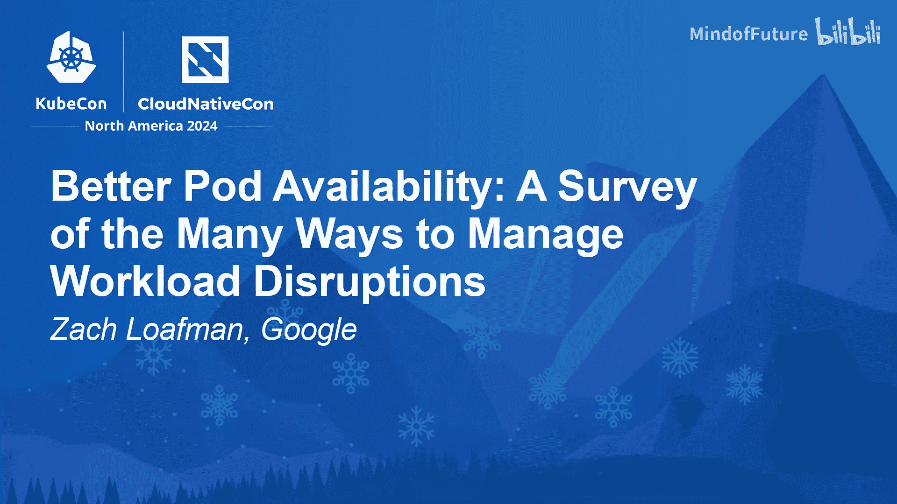

# 【CloudNative】KubeCon+云原生峰会2024-p29-P29-Better-Pod-Availability--A-Survey-of-the-Many-Ways-to-Manage-Workload-Disrup--BV1E9wPegEH6_p29-

Good afternoon。 My name is Zach Lofman and realized I was going to be talking to such a packed house。

 I'm glad to see you all here this afternoon。 Hopefully， you're not in too much of a food coma。😊。

I am a staff He at Google。 I've been working on GKE for about a decade now。

 and here I'm going to talk to you about。Better pod availability。 This is a pretty nebulous topic。

 but we're going to go over several ways to manage workload disruptions。

 many of which are familiar to you， some of which may be new。So what is part disruption。

Anything that interrupts a pod before the application exits can be considered disruption。Now。

 that's a super nebulous。That's a super nebulous。Definition。

 there are so many things that are actually in this envelope。And in fact。

 the Kubernetes documentation even has a taxonomy of these。

 splitting it up into involuntary andvoluntary disruption disruption。By the way。

 I have uploaded these slides to SCD， so if you see me putting links in here。

 you can follow those or you can just take pictures。

 most of these things are Googleable pretty quickly。嗯。So let's go through these in just broad terms。

 I loosely categorize these on the， the。Left， which is where the Kubernetes documentation calls them involuntary disruptions。

Into things like halt and catch fire events， they are hardware failure， O S failure， network failure。

 anything that just stops your pods suddenly。Another thing in that involuntary category is I also out of resource evictions。

 And we'll talk about that in just a minute。In the voluntary category。

On the other end of the spectrum are various app owner disruptions。 So you have a rollout。

 you delete the deployment， you restart the deployment， etc。And in the middle。

 there's an interesting category that's voluntary， but it really depends on your provider as to how voluntary it is。

That includes cluster administrative actions。 So this is anything that incurs a node drain。

 So evicted by upgrade， scale down， node repair。 And we're actually going to spend a chunk of time talking about this category。

So that's categorizing it into voluntary and involunt。 And a lot of that has to do with。How the pod。

 how all of the Kubernetes machinery reacts to that particular disruptor。But we can also talk about。

 is this good disruption or bad disruption。 This is， of course， a qualitative definition。

 But anything that's the pod dis interruptterruped when you want it to be interrupted is good disruption。

 Most of you are want workloads that are infinitely running， right。

 And so you can't not have disruption。 So a lot of disruption is good disruption by our very broad definition of anything that causes the application to exit。

Bad disruption。 anytime thepoli is interrupted unexpectedly by。

 by your own definitions of bad disruption。So now we can start to look at that previous taxonomy again。

And we can start to describe kind of best practices around these disruptors。For any of this broad。

 like halt and catch fire category。It's mostly driven。 It's mostly bad disruption。

 and it's mostly driven by hardware and software quality。嗯。You've had this one hammered into you。

 I am sure， but your best practice here is to design for failure。There is， you know。

 we could talk about making sure you get quality hardware and software and keeping patches up to date。

 and yada， yada。 That's a whole other talk。There are ways Kubernetes can actually help you here。

 There are things like anti affinity and topology spread constraints to make sure that you actually keep pods apart on nodes on replicated applications or apart within availability zones again。

On the other end of the spectrum。Is the。Kin of application owner disruption disruption。This is。

 I'll say mostly good disruption。 config changes in Kubernetes。Mostly good。Obviously。

 and this is the other part that has probably been hammered into you over the years。

The best practice here is things like robust change management。 So， you know。

 most of you here are probably practicing some form of getOs。

 that is a form of robust change management， especially with proper review， etctera。

There are other practices like we employ internally。

 like multiparty authorization for manual changes， so if you ever have to go slightly off of your existing patterns。

 making sure that you at least have someone looking over the shoulder，嗯。

I'm going there's actually multiple ways that Kuberes can help here。

 I'm going to talk about one big one here。I will also mention that things like the deployment rollout strategy are a great example for ways you can limit disruption during cluster administrative actions。

But one big one that Ill mentioned。Is pod disruption budget。

 because it actually interacts a lot with some of the topics we talk about later。So drilling in on。

 on PDDB。I'm sure that most of you are how many of you are familiar with PD Bs。Okay， good。

Itd be a little disturbed， if not， but PDDB specifies a disruption limit。

 so you can have it most one po down。 Two must be available。80% must be available， etctera。

In general， PDDBs are。Meant to help protect replicated apps。

 and they can be used on any scaled resource。 So it。

They are honored by most of the voluntary disruptors。 and in general， most of the disruptors。嗯。

The one case where it's a little bit best effort is actually on the next slide。

 which is the out of resource evictions。If you aren't using PDBs， you should be。

 So if you aren't familiar with the topic， go， you should probably go research。

So now we're kind of moving into the middle of this taxonomy。

Out of resource evictions are interesting。 the Kubernetes taxonomy puts them in the involuntary camp。

 and they are because you have to make decisions quickly on this。They aren't necessarily involuntary。

 though。 You might voluntarily configure your cluster for these。Again。This is a broad topic， in fact。

 I think there was even a breakout this morning talking about about evictions and tuning requests and limits。

嗯。So。Here you have to decide where your trade offs are。For example。

 if you're tuning for utmost reliability for a specific pod。

You're probably going to want to avoid over subscribing your nodes。

 which means your requests are equal to your limits around so。But in general。

 people like over subscribing their nodes， and it depends on the workload， etter。

 So if you're tuning for cost， you're going to be looking at things like pod priority。嗯。

Resource evictions。Orre one of the cases where PDB is is only honored on a best effort basis。

 And in particular， when node is running hot and has to evict something。Im。

 that's a case where PDB just isn't really honor it at all。So now kind of whittling into the middle。

啊。Is this class of clustered administrative actions。 So it's no drains in particular。嗯。

Most of these are actually driven by automation， these days。Actually。

m curious how many of you regularly take nodes out of service。On your own。

 like manually use a cube control drain。Okay。Not a ton， but。Yeah。There you go。 So right。

 most of these actions are covered by automation these days， in particular， clusterrata scalar。

 upgrades and things like node repair。😊，And I'm actually going to focus here for the rest of the talk。

 because this was a surprising area where there was a lot of divergence between providers and implementations。

嗯。And so now I'm going to talk about a particular case study。 So I came at this。

We're working on a framework called Agons。Is anyone familiar with the good news。All right， cool。

 We have a few hands。Agons is a framework for running dedicated game servers in the cloud。

For those of you who aren't familiar， the idea behind this is。You know。

 you and I want to play a FiFA match， So games we both connect to the same pod in the cloud。

 and that's what I'm trying to indicate here by these controllers connecting to a pod。

And that pod runs a simulation of the game state。Now。

 game servers are an interesting case study in disruption on Kubernetes。So。The problem here。

Is that actually， each pod is a game session with its own in memoryory state。

Its own basically simulation of the state of the game。

 and these can run as thin as a very lightweight simulation of particular players， placement。

 et ceter， to all the way to， I'm going to render a bunch of stuff and then pipeline that out。

 kind of similar to how Staier other like games in cloud would go。嗯。

And they all have direct player connections， like straight to that pod。

 There's a few exceptions to that， as well。A single game session can last from minutes， mobile games。

 etc cetera， to hours。And even even longer in the case of companies that are running like MmoOs on game servers。

 which we saw plenty of as well。There are cost and complexity trade offs and literally like game development trade offs to implementing any sort of reasonable like checkpoint restart for game servers。

And an example of what I mean there is if any of you have played popular MMOs。

 you might have seen a little intertttle pop up saying， hey。

 the number of players on this particular server is getting low， you know。

 here's a reward to migrate off this server， that's actually an example of a company that's implemented a form of disruption control in order to scale down their game server。

A lot of times they still give you something like an hour to get off the server。呃。

So this actually presents a unique challenge in the Kumeres landscape because most of the Kuberes workloads are actually not intended for just running forever。

Bad pod disruption on game servers basically just means game over。

 like you lost your connection to the game server results in a reputation loss for the company itself。

 And you know， at scale， this can result in real money losses for the game company as well。

If you run training jobs or HPC workloads， this concept may be familiar as well。

 anytime you disrupt a。trainingraining job that's on， you know， thousands of dollars per hour GPUs。

 You typically are going to be paying a fair amount of money to recover that state because there's a lot of times not robust checkpoint restore。

So as a trade off for these pods that can't fail， cluster administrators running game servers and other similar workloads。

Have a unique set of challenges， kind of going through these categories。

Any of these like halt and catch fire events。Game over， right。

 like that's just the node leaving and that any players connected to pods on that node。

The game is over。So your mitigations here are things like hardware and software quality。

 better monitoring。 You know， we heard in one of the keynotes around trying to monitor for events better and you know。

 pull nodes out earlier。嗯。For。Things like out of resource evictions， again。

Your mitigation here is to make sure that these。In state， these。

Workloads that are keeping a lot of state in memory and aren't really capable of checkpointing。

Have decent resource management。 So good resources and at good requests and limits。

And configure pod priority appropriately because these are fairly high priority workloads if they can't be evicted。

But what about these clustered administrative actions that are around automation。

So let's talk about that for a second。So why do I care about this。I care， because， as a。Google S3。

 we would actually love you all to use automation all the time if you could。

 It actually helps us as much as it helps you。 So the cluster administrative actions largely cover things that would drain the node either by automation or you know。

 as I had you show hands directly by a cluster administrator。😊，So。

I've seen a lot of cases where customers just basically disabled most automation on their system。

So why do we allow automation at all。In the case of cluster autoscalealar。You。

 you really want to allow cluster Auto Scalar to scale down your nodes。And this is especially true。

Like， we came at this looking at game servers。 and in the game。For platforms running game servers。

 it's exceedingly common for， for fleets of game servers to have diurnal cycles where they you know。

 spike at night and kind of recede in the middle of the day， depending on the time zones， obviously。

 and especially heavy weekend cycles。 You really don't want to be managing that manually。 So。

You know。For these apps that are hard to disrupt。There's an interesting tension there。Similarly。

 note upgrade， you want to keep your software up to date。And frankly， if you're not using automation。

 you're feeding your Ss to the machines。 And in the case of repair or auto scaling。

 you're probably just leaving hard money on the table。

So with that is kind of in mind for why I was looking at this in the first place。

How does no drain work in the first at all？So your automation wants to take a node out of service。

 or you want to take it out manually。The first thing we do is the first thing Kubernetes does is waits and tries to honor the pod disruption budget。

 If there's any pod that。Where evicting that pod would violate the PDDB， you know。

 it waits for that for for that period of time。And then it gracefully terminates the pod。

 honoring what's called the termination grace period seconds。

How many of you have configured termination grace period under pods before。Good， al right。

 maybe we didn't need this talk。嗯。These are both lies， though。

 depending on your provider and your configuration。

So first is a little bit of an overview of just how termination grace period works。

When Kubernetes wants to stop a pod in these voluntary eviction cases。Cubt will。

 while waiting termination grace period seconds。Run a prestop hook if there's one defined that lets you kind of do arbitrary behaviors at stop。

And then it sends a Sig term signal to the application after the prestop hook runs。

Most people are not using the prestop hook。 They're just allowing the sick term to come。

 but I wanted to include that in there。And then after the， the T GPSPS passes。

 it'll send us a kill to the pod。If it's still running。So effectively。

 termination grace period seconds acts as the cleanup period for a pod。 It defaults to 30 seconds。

 So most applications are given a。You know， decent grace period by kind of stateless web surveying standards。

Most pot evictions offer honor some grace period， which is a really weasily way of saying it works most of the time。

So now that we've actually kind of defined what this termination grace period is。

And we were looking at this case study around game servers。We can really。Kind of。

To refine our taxonomies a little more。And talk about fast yielding apps and slow yielding apps。

 And what do I mean by that。Anything？This is a somewhat arbitrary point。

 but it's actually related to an arbitrary definition。

 but it's actually related to a cluster at a scalar default。

We can kind of think of fast yielding apps as anything where the pod can be evicted in less than 10 minutes。

嗯。That seems like。a long amount of time， right， and it covers most R PCC servers， N H T TP servers。

 And it covers most stateful workloads。 And I might get a little bit of a challenge on that。

 but it's most stateful workloads that are。You know， keeping themselves or sorry。

 maintaining their state on disk， your databases， etc cetera。

 can typically checkpoint in this amount of time， usually much less。

Then we get into these like slow yielding apps， which is basically everything else。

Any workload we're losing the end memorymory state is costly in you know， hard money。

 like your training workloads， in reputation， like game servers。So session servers。

 again is we actually use to run other things like we have an internal customer using it to run voice chat。

 we have another one that's using it for live video transcoding， so for example。

 if this were streamed you know。Live through Google Cloud。

 that's actually running through a similar mechanic as a game server。

Many of the AI training jobs have this attribute to of being fairly slow yielding and kind of the HCish batch jobs as well。

So。Now that we've talked about。This notion of kind of。

Splittting our workloads up into the slow yielding and fast yielding camps。

Let's talk about why actually allowing automation is a challenge。The first is。The cloud providers。

 and I'm sorry because I was part of this， did not make it easy for you。

We all chose different mechanics for things， like upgrades。At， at Google。

GKE on a standard surge upgrade。Will呃。Basically， just disrupt your pod if the combination of the PDDB plus termination grace period lasts more than an hour。

so we chose that the upgrade operation itself has priority。EOn A K S and E K S。

 they both fail the upgrade operation after 15 minutes or 30 minutes。These are both configurable。

 And so they chose that the upgrade operation should kind of more toil towards the whoever is maintaining the upgrade in the first place。

One advice here。Is A， depending on your provider， you might just be able to bump the upgrade operation like timeouts associated with disruption。

And then， B。A lot of the cloud providers are actually starting to provide automated blue green upgrades。

 where they。You know， scale down one node pool while another scale down one set of nodes while the other set of nodes scales up。

2。With a different set of choices is the autoscalers。Cluster out of Scalr and Carpenter both。

Honor the PDB。They both honor the the termination grace period seconds to a point。

How many of you knew that cluster autoscalealar will actually just terminate your pod after 10 minutes by default。

Allright。 few hands。So this might be a surprise to you。 So you get no warning， no status。

 no annotation on the pod， anything。 Crato Scalar， if you do not change its defaults。

 will just disrupt your pod， regardless of what you set your termination grace period seconds to。

Carpenter actually uses a configurable per neutral maximum。And in both of them。

You do have a concern because like scale down has some bandwidth associated with it， too。 Like。

 obviously， if these workloads yield slowly， you're going have。Nos are kind of slow to be drained。

And they both have like a magic annotation where you can say， don't evict me ever。

So now that we've seen this， we have a few kind of best practices you can use for these slower yielding apps。

You can ensure that your app first off is ensure that your app supports SIG termm in some way。

 if you want to support automation， you need to be cooperative with the eviction system as it stands。

 you can for like legacy apps or some of the reason use a prestop hook to block SIGterm。

 but it's a little bit tricky。Tune the termination grace period seconds。

In you're in the pod specification。Tune them maximum termination grace period seconds for your auto scalr。

 So cluster auto scar and carpenter both support ways to tune that。

Tune your upgrade or look into automated blue green upgrades。 So if you have an hour long workload。

 you may need to tune that as well。嗯。And a kind of advanced case。

 But if you know what your cycles look like。You can also try to assign slower yielding apps to the same nodes。

 Typically， you want them all to kind of terminate near the same time， too。

 That is a longer conversation， but it's definitely something you can tinker with。

 if you're interested。In Guas， we actually tried to build an eviction API to make this a little easier。

 This is a little bit of an eyesore， but。The idea was we have a little tag that says it's always safe to evict or it's never safe to evict。

嗯。This translated into the goal was to translate a declared etableness into appropriate policies for a given environment。

I did this when GKA autopilot didn't yet support the Sa two evic equals false flag。

 so there was a few other machinations we needed to do Basically I wanted a way for people to be able to translate。

A go's game server specifications and have them kind of work portably between at least GKA standard and autopilot with hooks available for other clouds。

But， that's a goodez。Honestly， if you were interested in doing this on your own workloads。

You could probably do something similar with just a straight policy agent or a custom web hook to enforce policies that are appropriate for your workloads。

In particular， if your workloads all support SIig terms， So they're like， you know。

It's called digital native apps or modern apps right that know that SiGterm means I need to clean up now。

 you could probably just use the termination grace period seconds as an indicator and say。

 you know if TGPS is this， then I need to follow this set of steps and similarly。

 you know you can also then ensure that those workloads are scheduled onto node pools or clusters where that where the cluster autoscalear and upgrades are appropriately scheduled appropriately configured。

So a lot of this is kind of just a。You know， you can make this a little bit magical on your own。

Just by looking at the termination grace period suckens。

 and it's kind of a disservice that the cluster auto scalar actually just kind of violates it Willy Nilly。

 But you know， that's an example of a way to kind of get around it。And， and。

 and to make your workloads portable in case you， for instance。

 want to test out both cluster autoscalealr and carpenter。

 or you're porting between different clouds。 and you're running different things on each one。

E cetera。 So there's two biggest things you need to consider if you want to implement something like what agonez does is does the app do the right thing with Sig term。

 Otherwise， you're gonna have to do something different。

 And how long does it take after Sig term before it's safe to terminate。

 which is the T GPSPS conversation。So， takeaways。Pod disruption in Kubernetes is a series of trade offs。

It's a multivariate problem of cost， human toil， complexity of the application， etctera。

Think about the cost of disruption。 disruption is not a binary thing。

 of this app can be disruptruped or not。 disruptionrupion is。呃，诶。

Cost associated with what is the cost of disrupting this particular pod and engineer appropriately。

 So for application owners。Think about， can you introduce some sort of checkpointing or is it too expensive in complexity of resources。

 So if you do have an application like a game server， you know。

 how do you convince the game developer to allow some sort of checkpointing， introduce， you know。

During cut scenes， we reconnect to the clients stuff stuff like that。

 right for app owners and administrators with fast yielding apps， make sure to tune your PDBs。

 consider things like topology， etctera。 with slower yielding apps Also make sure to tune your your termination grace period seconds and tune your automation appropriately。

And with that， I am going to take some questions。 And just before I do。

 I will be at the Google booth from like 4 to 6 PM today。

 if you have any questions you just want to chat with me about too。So。All right。 hellello。

 I have a question。 So famously a lot of the workload operators like replica said stateful set。

 they don't use the pod eviction API。 they just go ahead and delete the pod。

 and I assume you know similarly humans can fat finger and delete pods controller can delete pods for all sorts of reasons I think the Agon' case is very interesting because the pod is essentially stateful right you don't want to disconnect people from the game server。

 I wonder has there any interest in SiG apps or any other interest groups before to look into maybe some sort of external system to consult to before allowing a pod to be evicted or deleted in the first place。

That's a super interesting question。 So the question was。

 is there a notion of like a central disruption controller to ask。

 can this paw be evicted right now or disrupted right now。I don't know of an effort like that。

 I'd be actually super interested in it。 but that is actually how some like Google systems are arranged。

 for instance， is instead of like trying to federate disruption outward。

 we try to like kind of centralize it in and say， can this thing be disrupt it so we can make like central decisions around this。

 And I think it's something worth considering。嗯。可。Any other questions？Awesome。😊，Well， thank you all。

