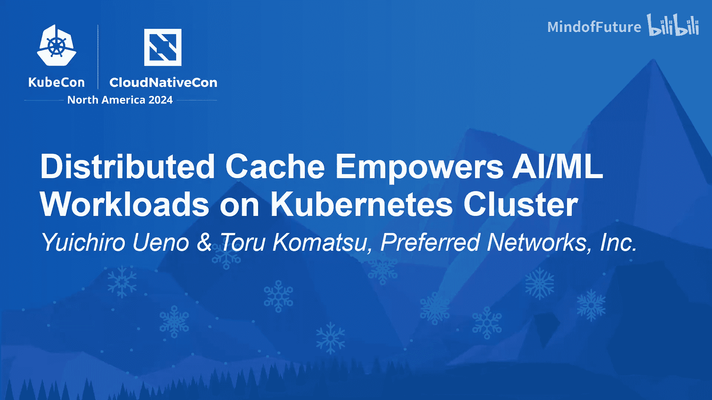
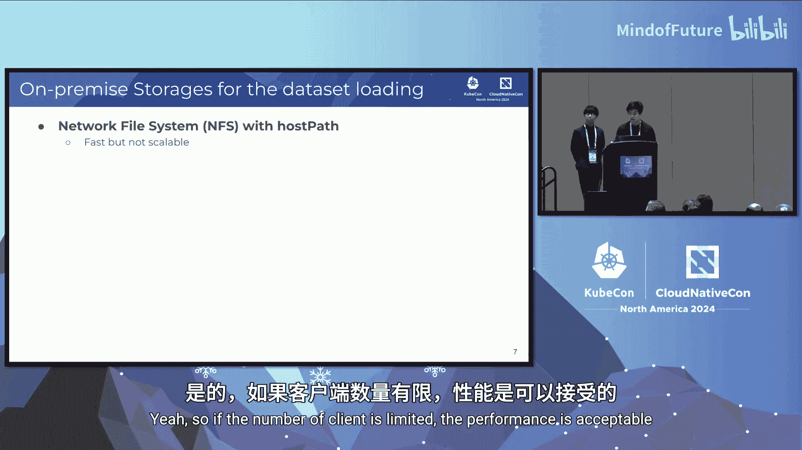

# 【CloudNative】KubeCon+云原生峰会2024-p30-P30-Distributed-Cache-Empowers-AI-ML-Workloads-on-Kubernetes-Cluster---Yuichiro--BV1E9wPegEH6_p30-

I think it's time。 So let's get started。 Thank you for being here。

 Today's session is distributed cash Ems AI M M Rro on Kubernetes G。😊。

We built a distributed caste system on Kubernetes and used it for AIMR record in our own premise。

We've uploaded our slides， so if you need， please check it。He's Yuzhou from Japan。

 He works for Pre networks， which is an AI M company in Japan。

 I'll explain our company's cluster in detail later。😊，I'm Ta withs colleagues。

 also I'm a founder of Yo CNNCF Sandboxs project and the mentor of some OSs related to CNCf。

This is today's agenda。So we first introduced background AI and M recordlo on Kernet Diser。

 Second we talked about the main topic simple cast services that is developed for AI M recordlos to solve the problem that will talk about the background。

Third， we describe the real world use guesses。Next。

 in developed con with this live techniques to achieve higher performance。 In the end。

 we conclude the attack。 Okay， next， Richard explains our background。 Yeah， thank you。 fast。

 we start the talk from artificial intelligence and machine learning workers。😊。

So let's consider the training of machine learning model that recognize a numerical visit。

We have a data set of fixtures with numbers and the training job of deep neural networks。Here。

 it is a correspond to two Kubes spots。 So Kubes spots will access the data and get the data samples。

😊，And fill the deep neuraler networks with the data samples。

So it will optimize the model then by continuing thes。

 the deep neural network will become to be able to decoize the numbers。Here。

 I'd like to look at the strategies to store the data。 So we are AI and M company with onpre cluster。

 So we need onpre solutions for that。😊，First one is the NFs。

So we can mount NFS stretch to Cubapots by using a host pass volume。NFS is fast。

 If the NF server has a fast straight drives， fast CPU。Yeah， so if the number of client is limited。

 the performance is acceptable。

However， the large number of clients access the NFS， you can easily notice the performance slowdowns。

😊，Second one is object storage。We have on premise S compatible object stretch with open source software。

 Apture zones。😊，We are using hardware disk drivees at the back end。

 so by adding a new hardware disk stripes， we can scale the performance and its capacity。Actually。

 the performance of hard disk drives are not sufficient to perform a random need of dataset。

 so it cannot be a solutions for the dataset rolling。😊，Sudly， it the no local strategiess。

So our compute node with AI accelerators has additional NM drives。

 so it is designed to use as the ephemary volumes of AI and ML workros。

 So the problem here is the workload it moves to different compute node。

 the data will be unbeachable。😊，So for example， we have two compute nodes A and B。 So firstly。

 the data set has scheduled to a compute node A。The workflow canes the data set to the node local strategies。

After that， workload may be preempted， so fortunately we have another compute node B。

 so the workload will be moved to the another node。😊，We have a cache data in compute node A。

 but we cannot access there without any service in compute node A。

 So we have to fetch the data again。 It is very time consuming。 So therefore。

 not local stretch itself helps the training， but cannot where final stretch solutions for that。Also。

 if the training requires a larger data set than its capacity， we cannot use it as a cache storage。

 so it is not scalable。😊，This is our grand design of storage for AI and ML workersro。😊。

We are going to combine object strategies and no local strategies to construct a hero switch systems。

The port will access the cloud of NM drives fast。 and if the data exists in the cloud。

 we can skip the access to the object strategies。😊，If the data does not exist in the cloud。

 we have to access the object strategies。The capacity of the strategies is scalable by adding a new how drivees to object strategies。

 and the throughput is scalable by adding a new compute node or adding a new LBM device。😊，Therefore。

 I think it is base suitable solutions for AI and ML workers。😊，So in this session。

 we'd like to introduce our Hi Str solutions on the top of cloud native technologies。😊。

So developing solutions seems difficult， but utilizing Kubernetes features like discoveries and authentications and invos features are like its load advancingcing technologies and its flexibility。

 we have developed the strategies very easily。😊，Next， well introduce our simplecast services， SES。

SDS is a simple first and shallow nothing architecture。

 since SS has a very basic HTTP getar pull interface and just returns the not local files when users fetch the data。

😊，It's incredible， simple and fast。Also， SCS is designed for cloud native。

 though SES lands on Kubernetes grass search and use a lot of Kubernetes feature to reduce our own implementation。

😊，Also， SS adopts shared ma architecture。 It's essential because this enables SS to be scable。

Another important thing to note is that SES is just cash services， not persistent storage。

In other words， there's no need to keep the data forever。

 and it's acceptable to delete the cash rate。This is how you can actually use SGS using a car command。

😊，It's easiest， it indeed。The first card store cache data offered Jpackg in SS。

 and the second one fit the data in fast cloud storage。Okay， let's take a closer look。

 First look at HV method。 Fast car uses a put to store the data。

 and the second one uses a get to fetch it。 This is a natural。😊，Next is the URL。

 the first thing youll notice is that it use HTTP and Kubernetes services， right？😊。

And if you look at the pass of URL， it is specifically the bucket and the object。 In this example。

 the bucket is project Hu， and the object is Apple。😊，Okay， next is the authentication part。

 We'll discuss this later。 Please keep in mind。 but all header is required。In this part。

 we deuce our own implementation by making good use of the Bo service account to on。

 this is the future of Kubernetes。Let's look at the path of these card command。

This is a diagram showing how users access the SS。Use the port to do something similar to the card command we。

SS has the actual data of cash as a5。As mentioned before。

 the action that the SES a does is just to be this fire。😊。

The first thing you'll notice is that there are Kubernetes services and the envoy between users ports and IS。

Before we go into more detail， let's take a closer look at SES itself。😊。

SS is made up three main components， for us is a go language application and NVME or other storage thats holds the cache data。

😊，An eoid， which always holds metadata like access times stamp or something like stuff。

Each SS application has its own SQri。In this example。

 they are four Sscallitte because they are for SS application。Of course。

 each SES is align as a pod in our cluster， they are sp it out using De set。😊，Back to this diagram。

One of the most significant features is the shell nothing architecture。😊。

Its means that nothing like LDB is shared between each SS part。Despite this。

 users can access the cache data from any network zone in order to achieve this layer 7 load balancing uses a consistent h。

😊，Again， next， this is the flow of authorization in SGS。It's similar to Quebearvaxy。😊。

If you have used it， you can understand it this smooth。First。

 a user port should mount the service account token and send out a link visit。The verifying part。

 it is SS is charge of all it uses the token Le API to verify the token。

The service account can tell as the namespace of the li source， this can be used for authentication。

Therefore， users can specify the name space that can access the bucket。Well let's define your bucket。

 You can define a bucket like this。There are two types of a bucket， public and private。

That top orange part is a bucket called public buckets， which anyone can access。

The blue part below is called private bucket and is authenticated based on Kubernetes namespace。

It's possible to list the name spaces that are allowed to access the bucket。For instance。

 project Kubernetes and the use of demogo name spaces are allowed to access the cuubbicle bracket。

It's also possible to set storage limits for each bucket in the bucket quarter field。

If the specified capacity is exceeded， the bucket will statistical delete cash data on area basis。

This fear shows how data is deleted in the IRU。Firstly， the color。 So each color represents a bucket。

They are loaded with more and more data with shiftfting that time。

The dot in the blue saga is the maximum capacity allocated for each bag。Once there。

 each bucket has no further increase in capacity， this means that LU basic data deletion had started here。

Next， we' talked about the real world use cases。We will introduce two use cases。

One youth guest is used SS as a cash for through storageage。

The motivation of developing SES has started from here。

It accelerates data loading through proof of dataset set。

The second use case is SES as a storage back for yet another cash service。Let's dive into Kesmar。

First， let's consider the data loading from object to storage like S3 or something like this。

In order to up the I O layout， we developed PFIO for our researchers。Since it's OS。

 you can check it out now。The source code in Python is a sample code to get a J file from object storage with only 10 lines of code。

Also， PFIO has a transparent cash feature。Just adding HV cache parameter to from URL function。

 P F IR automatically catch the content and get it from S S next time。If the fire is hit in SES。

The lead latency improved because we could skip getting from object stretch and put it into Ss。Next。

 let's look at K2， how to use SGS as a storage background for yet another cash service。

There are several ro fires we haven't mentioned yet。Fastly， it's the content I image。

Continent images for AI and Em workloads are larger and larger。

Our early marine content manage that's the first choice for our researchers。

It's more than 30 gigabyte。We have already viewed it， and last week。

 94% of continent major pers hit the SCS。The other the model。You know， L M is large。

Sometimes our researchers evaluate public ADLM in a hugging phase， so we have it a casual TD。

Both are both wire have characteristic like being ephial， large and hot。Normally。

 we use the latest container image so the autodated container image should be deleted。

This kept me down by SGS， the error policy。Therefore offer the combination of SES and the cash service for these files works very well。

This is an example of implementing yet another cash。Of course， S C S is used as a storage background。

Yet another cache must be implemented several features like access to origin service， access to SES。

 user interface， URL mapping from originigin key to USES， however。😊。

Storage management like cash eviction and capacity control， which is difficult to implement。

 is already implemented in SS。So lighting yet another cache is easier。So in these sections。

 we are going to talk about the deployment of simple cash service。

Here we have two questions to optimize the deployment。 One is。

 how can we optimize the network traffic between user pos and envo。

We are using Kubernetes service to discover the em port。

Here we will consider the configurations of Kubernet service and the deployment of MO。The other is。

 how can we configure your embryo to route the traffic to the IS？By considering the two questions。

 we can optimize the end and data flow from user pos to the SCS po。Okay。

 so let's start from the question one， so how can we optimize the network traffic？So fast。

 I'd like to describe our computing infrastructure where the C is running right now。😊。

So we are pre networks， AI and machine learning company。

 So we are developing machine learning models like our large language models and many solutions to the industries。

 So these activities uses our own premise computing infrastructures。😊。

So we have three Cubaban disk clusters for productions under several evaluations and staging clusters。

😊，As a total， there are more than 400 Kubernetes nodes with 30，000 CPU core。

 300 terys memory and also 2，000 GPUs for machine learning model trainingging。

So also we are developing and operating our own AI accelerator chip called MCO。

 so we are doing almost everything of AI accelerators from RTLs， both designs， server designs。

 drivers and also device plugins for Kubernetes and also graph compilers。😊。

So I like to introduce the data center network also。So our company， Prefa networks。

 uses a cross network technologyology。Cross Nearproy uses match stage switches， deep switches。

 spine switches and external super spine switches。😊。

Leaf City is the most nearest seat from the computer node。

So here we can define four network zones by each leaf stitches network zone， A， B， C， and D。

So because there are three nodes in the same device switch can communicate with a non blocking performance。

However， the communication between different zones like zone A and zone B requires a D and spine switches communications。

 So network links between leaf switches and spine switches is oversubscribed， in other words。

The upring is narrower than downings。So if the old node in a network zone try communicating to a different zones。

 congestion happens。Therefore， we have to avoid the internal zone communications as much as possible to save up links。

😊，Okay， so I have described the background。 So let's consider the network traffic from user po to en po。

😊，First， as assumptions， SCS is deployed to the old compute nodes to use all local NVM inters effectively。

😊，Also， userport may be scheduled to any nodes because all compute nodes has expensive accelerators。

 so there is no meaning of keeping the compute resource idle。😊，So where to deploy invoys。

Here we decided to deploy Mboy to all compute nodes。By doing so。

 we can deduce the network traffic between a user port and envo port。 However。

 we cannot optimize the inter zone traffic between Envoy and SCS。

Because SS has deployed through all computer nodes so we cannot optimize about In zone traffic。

SoNext， I'd like to consider the populations of Kubernetes service to reduceuseuce inter zone traffic。

😊，In other words， performa communications in a toppoji array of ways。

We have a user po and envoy po in all compute nodes。

So there are two methods to deuce the in zone traffic。One is internal traffic policy。

 and the other is a topology routineing。So let's start talk from internal traffic policies。

Internal traffic policy limits the communication to the service internally。

 so if the service the service have many envo pos as backend。

 but the internal traffic policy only lose the traffic to the port within the same node。

 so we don't have communications between compute nodes。Tこロジはルーテ，ビフフma， internal draft policiess。

Topo were routineing lose the traffic to the same zone。

 so in this case we have a3 envoy ports to lose the traffic now。

It requires communication in the same zone， but not in the different zones。Therefore。

 it seems internet traffic policy is better than toing from the perspective of networking。However。

 the viewpoint of EnBice's CPU roadbra， we have different conclusions。

Internal traffic policy doesn't rule the traffic to the other two ports， so therefore。

 if some node uses SCS heavily， we can see the high CPU usage of emvo in the node。

Since we deployed envoy as a demo set so we cannot increase the CPU resource request with a fine grain manner。

However， topoji our routine utilize a three envo back end， so the CPU lo balance is delux。😊。

Therefore， we can see more consistent latancy numbers in our topology。😊，Therefore。

 we are using top the evaluating to improve the CPU load influence of Mvoy that is a good balance of network traffic and road balancing。

😊，So next question is how can we configure the envoy to lose the traffic。

 so we'll consider the last part of data flow。So here， let's consider the load branchcing of keys。

So in S S， the key correspond to a bucket and object。So in this design。

 we want to route the traffic from MBy to SCS consistently。

So consistent means when we put the object to a fast SCS， we want to get it from the same SCS。

Otherwise， we cannot get the objects we have put it before。

The easiest way to achieve that is the introduce mapping from bucket and object to SCS backend ID。

It introduces a shared D B。 So sometimes share D B performance slows down。

 So here consider sharing yeah， blah blah， yeah this can be a solutions。

 but we want to use more simple and more scalable way。😊，So here we don't share the database。

 but that shares the functions to determine which is responsible for。

We introduce the hash functions from bucket and object to some numbers。

 Then we decide a responsible backend from the number。😊。

The simplest calculation to determine the responsible back end is just divide the hh value by the number of back ends。

 then use the reminder。The problem of that is that when the number of back end changes。

 almost everything dims。So typically， it happens during node failure and node installations。

 So we should avoid this。Consistent hushing is a method which solves this problem。

It' designed to deluuce such a de mappinging so we can expect more lower de mappinging。

 So the key count divided by the back end count is the E numbers。Enボハ2 consistent発 implementations。

One isリングハシュ。First， it prepares a dink with a responsible backend by hushing the backend information。

When access happens， it calculateics the hash shop keys。

 then search responsible backend from the dnk。Theアザマグレプ。Fch manages a set of responsible hss。

Both mappings are computed from the vac information。 so all the Android board share this mapping。😊。

Therefore， we can see the consistent mapping in all envoy ports。

Road balancing of keys is very important。The back end with a larger key responsibility。

 have several problems。So in this figure， you can see the length of arc or back end 3 is 1。

5 times longer than back end 4。😊，Therefore， back end3 is a 1。

5 times of responsibility over back end 4。So it should be avoided because it affects the performance。

So CPU usage of back end 3 is 1。5 times of back end forth。

 so it may dissolve the longer latest numbers。Also。

 the lifetime of each data in back end3 is shorter than back and forth。😊。

So more possibility of des in back end node。Here， we want to see the consistent resource usage and its lifetime。

 we need a consistent h with a consistent size of key mappings。

So let's check the load imbalance of both consistent hing algorithms In this figure a Ding hassh has a load imbalance up to a 1。

5 times， however， Magbe doesnt introduce any load imbalance。

So let's see the screenshot of object count by node。

 The screenshot is taken from our production environment。😊。

Each line correspond to a number of object per node， so as you can see when using d hash。

 you can see the multiple lines with some views。 however。

 when using a mag you can see the only single lines。But actually， there are multiple lines。

 So it means a load balance of magnetic algorithm is perfect。😊，That is why we are using mylab。Okay。

 so we have deployed IS the production environment， so let's check the performance numbers。😊。

This is our API course per second in the last 30 days。As you can see。

 the highest is 37000 of decreases per second。Also。

 this is aggregate throughput per second in the last 30 days。As you can see。

 the highest is 75 gig per second as the aggregated through traffic。😊，So as a summary。

 we achieved 37，000 dequests per second with 75 gigs per second with only 55 back end servers。

I think it is not so much number of backend servers， also this number that comes from the D world。

 not the synthetic benchmark。😊，So currently， we are serving a 268 million object。

Almost decreased to SCS is a indeed heavy， and we are continuously watching the not fund rate to expand the cash capacity in a timely manner。

So， let's conclude the talk。So we have introduced our cache， simple cache services。

 it is designed to with a shared nothing architecture to see the linear scaling。

This is easily implemented by Mboy's consistent hhing algorithms。Also。

 we are following cloud native best practice like B service and token from Kubernetes to implement authentication easily。

😊，So our system can be used as a transparent cache of object storage with PFIO or IO obion libraries。

😊，Now we are using S S in the web， like dataro and large models helpings。

So we use several optimization techniques like Java routineing and mas。

So our project is supported by cloud native Techn and our three intensive members， so that's true。

 so thank you for paying attentions。😊，非まです。If you have any feedback。

 please scan it and anyone can any questions。😊，Out of curiosity。

 is there a reason why you didn't go with a cluster file system。

 we've been doing Xscale storage for a long time and it's much more scalable than NFSs。

 I've got 80 petabytes of storage back at my cluster today and I have over 1，000 nodes which 120。

000 core。So I'm curious why you ruled that out。Thank you。そ come here。

I'm curious why you didn't use a cluster file system， not in aS。

 something like GPSFS or luster or WCCA or whatnot。

Probably a reason I'm curious why you decide not to。

I think just using a cluster or some other GPSFS like a shared file system can be a solutions。

 but I think actually I have not tried such as shared fire systems。

 but it have some difficulties to operate such a large storage clusters。

 but by applying ground native technologies to have our own Kubernetes cluster。

 we can get up strategies more easier， we think that is are more easier to use such as these solutions。

😊，Thank you ask questions。Okay， that's all。 Thank you for all being here。

