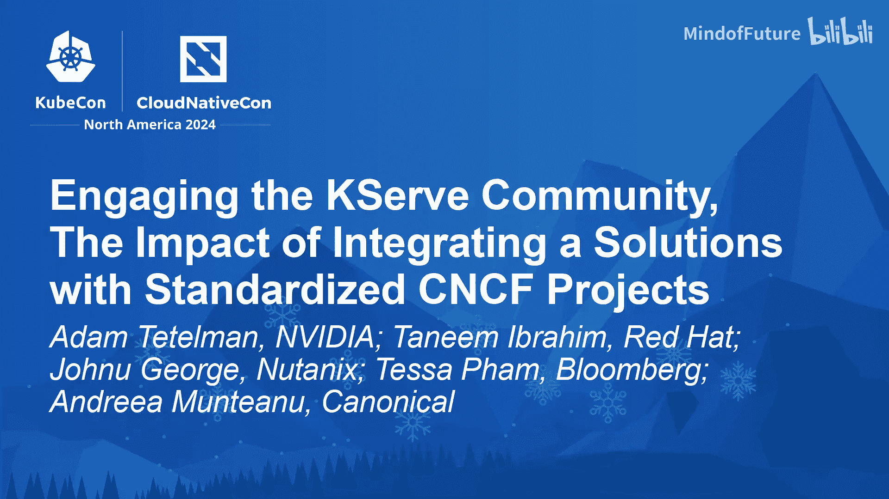

# 【CloudNative】KubeCon+云原生峰会2024-p31-P31-Engaging-the-KServe-Community,-The-Impact-of-Integrating-a-Solutions-with-St--BV1E9wPegEH6_p31-

Hey everyone， so we're going to go ahead and get started。

 so if you can find a seat there if you're coming in， we only。

Have 35 minutes here， so we've got five panelists and we're going to try to get through this quickly。

 so first we're going to do a round of introductions。And then we're going to get into the panel。

 So if anyone wants to take a minute to introduce themselves。Hello everyone I'm Tenny Mibrahim。

 I'm a Se engineering manager at Red Hat Openshiftri AI Engineing team。

 my team works in K Surf community， keyflow community。

 we also work in trustee AI and model registry so those are the aspects we are working pretty closely。

Pass it on to you yes。Hi everyone， I'm Tessa Fam， I'm a Se software engineer on the AI inference team at Bloomberg and I'm also a contributor of KSerRve。

 my team works on building out and maintaining the inference platform for Bloomberg's data scientists and engineers and our TL。

 our team lead Danson cofounded KServe back in 2019 and since then as a team we have made contributions to KSEerRve as well as integrated it into the inference platform and other internal projects and yeah。

 that's it for me。Hi everyone， I'm Jon George， technical director in New T AI ARC。

So I wear two hats in Nutanix day to day life。 I lead all AI activities within Nutans。😊。

In open source， I lead a couple of ML communities， Qflow ML Commons， if you are not aware。

 Qflow is MLOs platform on Kubernetes。I am part of the Q flow steering committee in ML Commons we co founded ML Commons Stage workinging Group。

 which is looking at the storage impact of ML workload during ML training。😊，Thank you。 I have a mic。

 So I'm And Montano， I'm AM ML product manager at Canonical， the publisher of Uuntu。

 and I work I look after our AMML portfolio， which includes Kubflow caseseserv that has already been mentioned。

 as well as a couple of other tools such as MLflow， for example。

 as well as data science stock that's designed to help developers get started very quickly on an Uuntu workstation。

😊，Y and I'm Adam Tleman， I'm a principal product architect from Nvidia。

 I haven't contributed to nearly as many projects as the other folks on the panel here。

 but I've been using all of them for many many years now so I use CuubeFlow。

 I use KSve and all of the dependent projects on it and the reason we're doing this panel is because。

NVIDdia launched a new AI application product and I thought that the best way to get it to market and get it in front of people was to make sure it worked really well on KSve and the open source project。

 so I've been working with everyone on here very closely to make that happen and this panel is sort of just a journey of what is it like to do things in the open source with the community。

That。So the first thing we want to talk about in this panel。

 sort of going off of that is what is the current state and the question I think we're going to go this way here。

 so the question for you， Andrea。What has your experience been but working with me and working with the community。

 what challenges have you faced， what accomplishments have you faced and particularly in the realm of AI。

 LLMs， JenAI， a lot of this new stuff coming out， what has the benefit been to you。

 your company and the customers that you work with？

I've been active in the open source for quite some time now and if I look back。

 the biggest challenge that I had initially was how to get started。

 especially if you want to contribute， how do you actually contribute it feels that there are a lot of very good developers but everyone has and nurse what they need to do and how to do things that was the initial challenge on how to get started to be a contributor within one community and that's something that I've noticed a lot of the Kubflow or the new joiners in Kubflow struggled with as well。

 especially since it's it's a large platform， it's not there very easy to get started with initially So it's often intimidating and that's where I think I've enjoyed working with other developers and I enjoyed working especially with people who are getting started in the ML space as well as in the open source space to lower the per year entry to help them really feel comfortable raising bug solving issues asking questions。

 improving documentation all the small。Things that you can do and furthermore， also writing projects。

 I think that having such a powerful platform as CuubeFlow without projects that can help you get started。

 build your first model， find UNLLM or run new names together with KE and KubeFlow。

 those are the things that are just lowering the brainrange and helps people get started。😊，Right。

 myself， I was part of Ca of from the very， very start。 So I'm so glad to see this community grow。😊。

Very few folks to this scale， right， And thanks to all developers， it's all started with。

Praining Tensorflow models in Qflow to serving same Tensorflow model using Tf serving。 So from that。

 it has gone to a big big framework which can do all this large language models at scale in any infrra So Im recently we announced new and press AI which has case at its core to provide a one click deployment of large language models of your choice at scale without knowing anything about underlying system So this is not possible without a project like this where it is a group work that we have done as part of the case of community So if you really think about of it is it is it's a group of blocks together right like many things coming together。

 people contribute different items。 and then it gets into a single project So all the different blocks if you really see the front facing。

😊，APpiI which is part of the open inference protocol so we for reason we have put that outside case because we wanted inference protocol to be used by other communities as well so for example right a to in VT tri and everyone uses the same inference protocol right and case of implements exactly the same right now the next area is about the inference run times where。

Users can bring any runtime of your choice and plug it into caseso without any code change be it N V name DG VLLM or any runtime of your choice without it is just by having a Yal。

 you have your runtime added to Ca And at the end， the same the whole stack can be run on any hardware be it GPus with CPUus am exaceated or MG。

 whatever it is So in a way it is it is a group project。 is its a community product。

 which can bring all these of blocks together is a code strength of ker。😊，Thanks John。

 I would like to start off by just speaking from my personal experience。

 so I made my first contribution to KasSer back in 2022 when shortly after I joined the infant team at Bloomberg and what I found from multiple PRs I've contributed to KSEve is that the whole process is pleasantly I was pleasantly surprised by how easy it was to make contributions and for the contribution to count towards like the work that I do internally and also help other people at other companies who are facing the same problems and it's super easy to just identify issues because we all are here and we all know that there are a lot of common challenges and we all try to tackle and it's very easy to raise issues and come up with your own solutions propose it to the wider caseServe community and get your PR reviewed。

 get feedback and get emerged and then the moment that you change。

and that will solve the issue for your enterprise products will solve the issue for many people out there that you don't even know So I think that is the strength of the open source community that I have experience like personally and talking about the unique benefits of being in the open source community。

 there are countless and you've got to start first by recognizing that all of this comes to us for free and this we are getting the quickest crowdsourced solution at no cost and from the wider community and that's like the very first benefit that you don't get from an enterprise product where you have to pay and is vendorized and the second thing is once you get involved in the open source community you will see that there are so many collaborations going on a lot of innovations every day people coming up with solutions。

 people coming together to discuss things。What's even cooler is that you are collaborating with people from across companies that you have never met before and you don't get the chance to work with if you just work within your company and finally just leveraging the resource of the wider community and the strength of people coming together for nothing else but wanting to find solutions to the problems that they are facing and other people are facing you will find much quicker solutions and more efficient and yet as you give back to community。

 you also get back the same so that those are the very unique benefits that anyone would get from open source be it like inference AI or anything open source but at the same time also have to recognize the challenges in this and I want to talk about challenges that are specific to AI so。

From all the challenges that we all face here with the boom of LOMs in the recent years and the models is getting bigger and bigger。

 we all want to optimize resources and time models startup time and all of that and as a community we all work together and are working on solutions and designing solutions to tackle those problems but for Kerf specifically in order to make the project great we actually have to tackle all of these areas all together and each of this area requires a lot of deep expertise and that's why every day we're working with different companies different partners and other projects to make these solutions happen so yeah that's my experience。

Thank you， Tess。So speaking of like tests was alluding to community collaboration power source right so if you think about the WG serving community that we have started recently。

 one of the big recent success is more than 250 members have joined that community so this is an umbrella project to tackle the challenges that LLM infferencing brings and how do we solve it in a cloud native way in Kubernetes working across many。

 many many companies so it's a big big happy family another interesting area out of that is is the gateway project that is our friends from Bloomberg and others have been contributing closely because one of the challenges we face with large models is also being able to route them efficiently how do you know which model you and a route to sometimes you can have SLOs cost some models may work really well with inferencing work really well with CPUU some models may work really well with GPUs and so you have different。

So excavators that you need to know and the LLM instance Gateway project that we are working closely with KSurf community together is one way to help solve that right there's all kinds of newer metrics that you have to think for from language models so if you come from traditional predictive ML model lifecycle normally you have CP request you have how many threads are being hit those are the common metrics you look at but when it comes to language models you have to think of like KVC utilization you have to think of batch size number of tokens being queued all those type of metrics are new to the space for model serving or inferencing workload right so we're using the same set of tools that are already there in Kubernetes ecosystem but we are implementing them for a new type of workload and doing it at scale and I would also say like another really cool success recently was one of the projects we have Redha have been working closely on is trust AI responsible AI concept so KSurf has an implementation。

calll explain some where you can actually hook up a explainer model to a Ksservve endpoint and actually be able to run various responsibility algorithms like line Sha。

 counterfactuals to explain that so we are working on adding those types of algorithms for large language models as well as for different types of evaluation like LM Eval so that you can actually evaluate your model really well so currently that works with VLM with KSurf together。

So that has been a really interesting project to work on because for example。

 if the models are getting bigger and bigger， but how do you know if your model is actually doing a good job like just because you have a 405 billion parameter model doesn't mean that the model is going to perform what you need for your work your work may require very domain specific tasks maybe you are a service company who has support cases and you want to do a case sumization and you may not need a model that size so L Eva like tools can help you evaluate those models for your specific use cases using LM harness toolkits so that has been a really good success story I would also say like recently the community got together on how do we support really really large models with stateful pos and working across various implementations we have looked at leader worket we have looked at stateless deployments we have looked at sitful po sets and how do we actually make sure that these models can be deployed across multiple nodes because some of these large models obviously has。

feeding one node anymore， that has been a really interesting challenge that the community collaboratively worked on to solve and the PR recently got marched as well。

Thank you for that， Yeah， and I kind of to your point， Tes， I remember。

Before I was really deeply in the community， I was using tools。

 using Kubeflow and that must have been five or six years ago when I was trying to teach people how to use DGX and do training of a Big BRT model。

And Jupiter wasn't enough because I needed to do pipelines and having。Cube flow。

 A thing I could just go to。 And it sort of did everything。

 And I was able to make a workshop in like a week that showed people how to train an LLM。

 that was back back then when， you know， LMs weren't quite as big then。

And sort of on the personal note getting into this， like getting to know all of you， it's been fun。

 it's been fun for me， I'm not just working with the folks from my company。

 but I'm working with the folks from a lot of other companies and that there's some fun to that and then there's sort of a sharing of ideas so like I see my world and what I'm doing but when I'm in the meeting with Redhead or canonical or Nutanix or Bloomberg I'm learning that you see the world in a slightly different way and all of those ways are valid and sort of sharing of ideas we end up addressing kind of I think you guys were both alluding to there's a whole lot of use cases out there and we need to solve all of them for someone and some of them I didn't realize they were problems until you showed them to me when you were going through the solutions and then I realized oh yeah caching at this layer is going to be hugely important for me in three months or six months for me but you're already two months in the solving and I sort piggyback off of it。

So it's been a big win there。I think on the product side right so Nvidia came out with Nvidia name on like March and it was like our new AI product and when we were first running and there was a Docker run and then someone realized we needed to deploy it into production and so we built a helm chart for it and then when we go to our customers they're like that's great this is a helm chart but I'm using this platform or I'm using this platform or I'm using this platform in that helm chart this in production ready。

 I care about more than just the application I care about all of these platform levell features and me the thing I'm working on is an application I don't want to have to care about those platform features I want to plug into them but I don't want to implement all of them and then lucky for me there's a whole community of people who are implementing them in different ways and my customers are already your customers so going into the caseservve community working with you to implement API standards around LLMs to implement security and some of the caching things we've been working on and then I did some work with Red hatt。

Initially we're doing the initial POC to get NiM working on KServe and Openshift AI and then it worked on Nutanix AI and then the charm Kubernetes and all of the other platforms and so it sort of just worked and now we're all benefiting from that I'm benefiting you're benefiting all of our joint customers are benefiting and so that kind of doing it with the open source community saved me a whole lot of time and then ended up being well fun and win win win for everyone so I've really enjoyed that I've really appreciated it I think it's been a good thing。

Just want to add all these building blocks that Adam was talking about were defined by community themselves。

 right It's all community ask and community features。 take It's contributed by community itself。

 Yeah， Yeah， so on Github and。😊，The fun thing is we're not done right so you talked about work group serving。

 we have that now and I looked at some of the meeting notes and there's a big list of AIs。

 there's all of these new projects that arere coming out but these projects have a new list of feature requests we have a lot of problems to solve。

And as a community， I think we need to come together because just looking around KCon。

 I hear people talking about how they're solving the same thing over and over and over again in different ways and everyone wants to come together and solve it once so we can all benefit。

So sort of with that in mind， maybe going the other direction。What？

What future things are you excited about in open source。

 are there any specific roadmap items that you'd like to talk about any challenges that you're excited and anxious about and anything maybe in like the LLM Jenningi space that you like to talk about them more importantly。

 how can people get involved， how can we help because we're all the community here so everyone in this room can be on the panel next year to talk about how they had a big win that helped everyone else？

Awesome thanks Adam it's a great question so talking about WG serving。

 we need people we have a lot of projects undertaking if you're on the CNCF Slack which I hope you all are there's WG serving channel join the channel the moment you join the channel you will see a bunch of sub working groups under the working groups from topics like LM instance Gateway LM Ca project which is basically caching of prompts there is a project around performance benchmarks so standardizing how you standardize the performance benchmarks for different LLMs and different runtimes that supports those model deployments and there's a subcommittee around security if you're interested in that area there's all kinds of fun exciting things that are happening and it can only happen back to your news point。

 if we get community to help us there's only really there's so much work there to do and so few people involved and and so scaling is gonna be critical for us to do this。

😊，What I want to see personally， maybe next year we're talking not about how we make infferencing work with caseser。

 we're talking a layer above how we' are applying agent Gen LLM frameworks。

 orchestration with caseser right because infferencing interest optimization maybe we have gotten that problem solved an extent where that's no longer a concern that we have to deal with right so in order to get there we need a lot of support。

 a lot of help from everyone in the room and spread the word， get to WG servinging channel。

 get to the caseserv channel， help us join the community so in terms of what I'm excited about roadmap wise so。

I'm really excited about another project which is not exactly directly under WG serving is's under WG batch W device is the DRA project。

 which is a dynamic resource allocator So if you're not familiar is just allows you to allocate GPUs for your pods in a claim way like how you do PVC claims for storage。

 think of that kind of same concept but for GPUs Now the fun thing or any accelerator really and the fun part about that is that you can actually utilize fractional GPU So maybe your model is like a 2 billion parameter model or 1 billion parameter model because it' a very specialized model and you may not need the entire GPU to be consumed for that right so DRA allows you to slice the GPUs in a way where you can actually allocate based on what you need the fraction you need right and then on top of that is another project that has been recently launched is the instant slice which allows you to do just in time GPU slicing。

😊，On top of the D so you have D underneath ins on top makes that provisioning for D much。

 much simpler and easier， so I'm really excited to see that because I think once we have that project get this stable status and then we have caseSve on top of it and we can work with the VLM community closely to see how we can allow the developers are using KSve today to allocate those fractional GPUs for their models that are deploying through KSve that is a really exciting project I'm looking forward to and I'm also looking forward to how the LM Gateway project revolves around I think it's going to be a massive topic for all of us once we get that figured out and how that routing works through KSve and have a abstractional layer on top。

 that would also make the inference optimization process really， really efficient。

Pass down two tests。Thanks toni， I think Taim really set the right theme for this question and speaking more specifically about KSve。

 the common theme right now that we're tackling is how to reduce cost。

 how to reduce serving cost and make it more efficient and that's what all the infant servers are OM infant servers are trying to tackle right now and there's all these buzz around GPU fraction and GPU time slicing people are trying to find different solutions and on the KSEf side。

 we do have multiple solutions that are currently underway or in progress or in design one of which is I can name a few so we can get excited for and those are new features that we'll be introducing to KSurf within probably the next year the first thing。

We want to ask these models are all the AOM models are getting bigger and bigger。

 we need to reduce the model start time， we need to reduce latency and for that we have a design proposed for model caching and it is currently in progress right now we have a couple team members from Bloomberg as well as other companies working on this and auto scalinging is another feature that the Kser community has been working very closely with KaA。

 the KaA community Kubernetes based event- drivenven autokier。

 so this is how we are leveraging all the expertise from other areas。

 other communities to come together and provide with the users out there with the best solution but yeah so KServe is working very closely with KaA to implement this autoki feature。

Yeah， and another thing too is if you were at the keynote this morning and also Tim just mentioned is the AI Gateway and is also an exciting feature that we look forward to that we want to have the A gateway that is more efficient for MM for LLM workloads yeah so those are some projects that are currently underway and we really do need people it very exciting。

 you will be working with experts from multiple different fields and yeah and it' an exciting time to be working on inference stuff right now。

And looking forward to we are also we want to tackle the challenge of prom caching a lot of people are talking about prom caching at this conference as well and that is something that we are starting to design a solution for and yeah and overall for the KSEf community so those are just some exciting features and enhancements to KSerf and infant services that we want to give you a sneak peek of but overall as a community we really hope to get more people involved in the community again it is growing community we have so many big companies that are getting involved right now we want to get even more companies involved in order to align on protocols together and all the companies to adopt these common protocols so that yeah so that everything can work for everyone and yeah it's just。

We also face challenges， for example， as different companies come together。

 we all have different priorities and if we just show up to these community meetings and talk about all the needs and requirements from yeah from everyone then we can find the right resources to work on these different work streams yeah and yeah and finally just yeah just try to get involved in open source and。

😊，Yeah， and。I knowWe have a lot of exciting projects to work on， so a lot of projects。

 it's a recurring theme here。Yes， so about the future。

 So case of is really good at all traditional predictive models。 So in for the last one year。😊。

We are trying to pivot to generate the model space， right。

 So if you really look at all the traditional models， like it is all working with the request based。

Ato scaling and request metrics。 it works really well for the traditional models。

 but in large language models due to its size， scale and architecture is not that easy because of many reasons right So if you really look at in the large language models like you get a request of 0 tokens now in the next instant you can get a request of 10000 tokens right So GPU can take like 10 milliseconds。

 So the first request， the other one can actually take seconds to minutes So the auto scaling and the other the factors which are deciding auto scaling are not that easy in the LLM world specifically in the generative world So in other words。

 we need to have tokens as the first class citizen for the large language models in the newer space So we are we are discussing internally as well like how can we integrate token based auto scaling and token based metrics for having much more。

😊，Guareed SL is for throughput latency in case of and that's one major focus and similar to the other standards that we are looking for again for a common unified metric interface right like for different runtime provide different metrics be it name VLLM so we need a unified metric interface similar to how we have in inference protocol which can decide what's the performance of runtime and how can we decide autos scaling based on that right case of community as a community we can come together and decide what is the right abstractions that we need to do even from the metrics and autos scaling part and that can work with all different runtime underneath so from a user perspective here doesn't need to know anything from he just uses the standard openI protocol sorry open inference protocol and just all things are handled by the case of internally。

😊，Thank you。 I think a lot of the interesting projects and features have been already mentioned。

 but adding to what Anim said also it's worth mentioning that it's important for us as a community to share your experience with a project or with the product。

 if you've been using caseServe Cubflow or any other tool。

 share it with us how it has been what were the blockers that you faced as well because that's how we end up coming with features with ideas with projects with roadmaps at the end of the day and one of the reasons why personally the other love coming to Cubecon is whether we talk about charm Cuubflow or caseerve or Cubeflow。

 the upstream project， I really enjoy hearing how people use it。

 whether the challenges that they have because it gives us food for thought on how can we make it better now looking at the future I think to things that we're not necessarystream mentioned yet on one hand we are gonna need to focus more on security。

 whether we talk about the security of the packages that are being used in case in general in the projects that are used for data science and machine learning。

Is one aspect that needs to be prioritized in order to be able to roll out a lot of the projects in production and then on the other hand。

 improving the user experience and lowering the barrier entry to run GenI models。

 GenI projects and LMs is going to be another one， last but not least if I go back to the security idea。

 what excites me very much is to run Kubflow and then probably K serve as well at some point in confidential computing VMs is something that is going to enable collaboration at a whole different scale between companies within the same industry which I think is exciting as well。

Adam， I think you still have some minutes as well to add some things Yeah so yeah。

 so to sort of pull that all together I know you guys mentioned a lot of the API gateways。

 new features like these are all new things and roadmas I'm excited for。

So sort of ta to that a little bit， maybe roll it back I think I'm up here because we had a win and one of the things getting here that was really difficult。

 that completely different topic， convincing people internally that open source was a good path I really had to champion Kserve as a useful platform。

 I really had to pitch to product people and engineering leaders I need to go to them and say， hey。

 this is important we need to put resources on it and I'm really looking to the future。

 seeing that we're all here， seeing that people are receptive and that now my customers have choice of platform。

 choice of models， choice of AI and it's just giving more to the community。

 I think that's a win that will make it easier for me to go back to upper leadership and saying hey let's do this more。

 it worked last time we all won together let's do it again。

And so I'm looking forward to seeing more engagements。

 I know Chris Lamb gave a keynote yesterday and I'm hoping to get more folks from my teams involved in more projects。

 which is good because the other thing I wanted to mention is there's a lot of new stuff that we need to get into the open source you mentioned confidential containers that's a hardware dependent thing and it's going require a lot of software to make work。

 I think you mentioned multinode inferencing we have the first pass of that out now but that's another hardware dependent things and there's a lot of things that my teams can work on around highper networking and high performance fabric that we can make the multinote stuff go faster。

 we can make the time slice stuff go faster so I'm excited to see and DRA that's a part of that story so I'm excited to see a lot of that stuff come together that the applications which are getting more complex。

Can get simpler to manage and more efficient。 so sort of the last thing generative AI applications are getting more complex is all of these pieces。

 we were here right with a platform where we have a single inference server doing a single model and then model mesh so we could do multiple models and mix it and now we need something completely new because now we have these generative AI applications with Ra and we're defining telemetry standards and some working groups and we're defining these new gateways and other working groups And so there's really this community。

 the working group serving community is really across a bunch of different projects and we're all trying to figure out what the problems are right now this is a great time to get involved because I think we just getting a grasp of all of the problems and we're starting to put solutions together So I think we have time for one question。

 do we want to take or does anyone on the panel we got one。😊，O。Sure。Some are。是。

Yep so the question was， what sort of skill set do you need to get involved in this sort of workg MLOs engineering。

 Python Kuta， good at one thing better than another， what do you need？If I may start。

 I think it really depends， but for example in the Kto community。

 I see a lot of students who are just very good python engineers， very enthusiastic， very curious。

 and they just get started， they learn as they go and that can be challenging but at the same time it gives you a lot of satisfaction at the same time I think understanding Kubernetes is a foundational piece that is going to lower your barrier entry when it comes to a Kserv and is going to accelerate the way you can contribute。

😊，I see Taim is is agreeing on the show。 Would you like to add something No no no。

 go for it I just want to take one example。 Some of my team members were completely new to Kubernetes and case of two years ago。

 They are currently reviewers of case of project， right。

 So it's all driven by interest and amount of effort which are putting in and case of community is welcoming everyone。

 each and everyone。😊，I would say。Having technical skills is obviously really helpful to contribute whether you're a Python developer go developer or you're an MLOps engineer but there's a lot of help we need even documentation updating if you go to the caseEve website there are a lot of new features that we have not been able to add to the documents right and that's one the first place where new user who come and use caseEve that's where they're gonna go so even if you can contribute by updating a documentation that is a massive contribution so I would say like it's all about working in the community is all about putting the time in and that's how you contribute and help so if don't feel like and I don't know go I don't know ML I mean how do I go contribute it really doesn't matter you can contribute in all kinds of ways we welcome all kinds of contributions。

Yeah I agree with that I think Kubernetes is definitely the base as long as you familiar with path and containers。

 I think you're pretty much set to go and it doesn't matter what programming language you know and a lot of people come from end users of these technologies to become contributors of open source projects so you really can't start from anywhere as long as you know what problem we're trying to solve or yeah。

 even just raise an issue， that's a contribution。😊，So yeah。

 so I think you need a passion to want to help and we'll help you learn the rest is what I just heard。

👏I think we're at time here， so thank you everyone for attending。 I hope you have a good conference。

