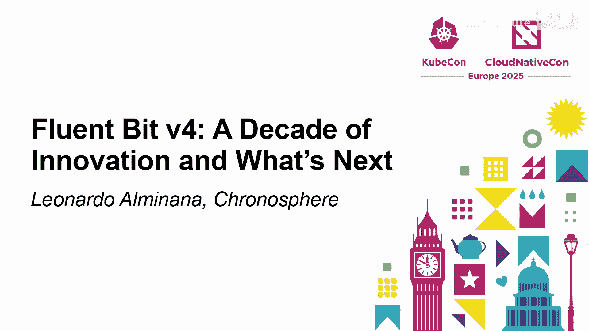
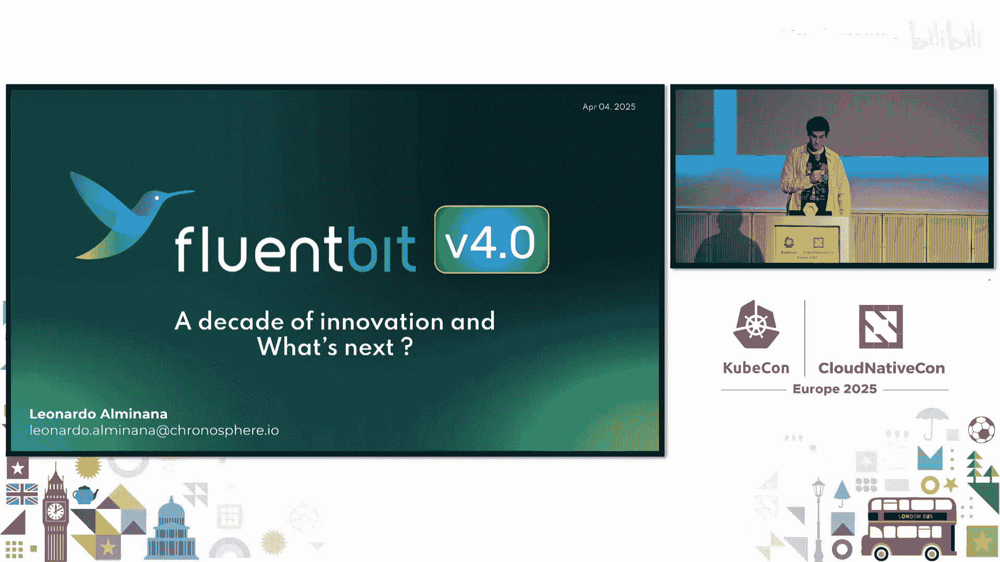
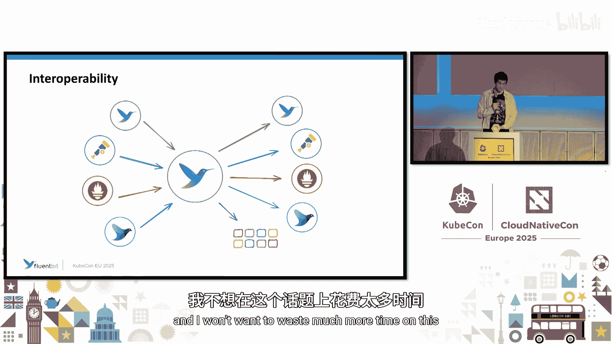
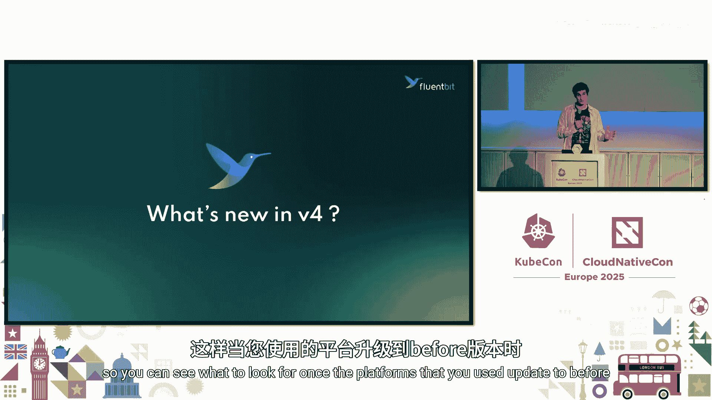

# KubeCon-+-CloudNativeCon-大会2025-｜-云原生计算-｜-可观测性-｜-Kubernetes-｜-Prometheus-p01-P01-Fluent-Bit-v4---A-Decade-of-Innovation-and-What’s-Next---Leonardo-Alminana,--BV1Cd32zDEBG_p1-

Thanks for coming to this presentation。 I'm a bit of a stickler when it comes to starting on time。

 So for those who had to wait， I hope you took the opportunity to take a picture of the of the webinar that Eduardo。

 the project leader is gonna be giving in about 20 days。 That one's gonna be pretty good。

 and it's gonna be a bit more extensive than this one。

So。These presentations can。Talk about the the history， like where we come from。

 where we are right now and where we going。The idea is to， to give up a good。

 complete picture for those of you who are not。Aware of whatful and is or where we are。

And for those who who are and are looking forward to version 4。0， we which we released on Monday。

I'm going to talk a little bit about the new features we have just introduced and the。

 the ones that we would like to introduce in the new and the near feature and the long term。

As you probably know， the telemetry。Arena has been evolving through the past 10 years， probably more。

 but the trend is that things are growing exponentially。

 we're generating more and more data and more and more types of data。A mere 10 years ago。

 we were basically just moving locks around， and nowadays we are doing everything from locks to traces to profiles。

So， things are only going to。Grow and get even more hectic， which。

Means that we need to be extra on top of things to be able to exploit that data and not just spend money storing stuff that we don't care。

I think that we all can see how the picture that we get in our heads。

 like the joke about the spare coco cow in the vacuum chamber。No， we think about logs。

 we think about metrics and traces， maybe， and we have this picture where we are going to analyze the data。

 we are going to extract value from it， and we are going to be happy。However， reality is。

Not of a k chamber。 I guess I guess that's good。But the problem is that things are usually very chaotic。

 and they are growing even more chaotic each day。 So we get the logs。 We get the metrics。

 We get the traces。 Everyone has a different standard。 Some of them have their own standards。

 Some of them can come from like the olden days。 and we need to make sense of that to be able to extract value。

 Otherwise， it's。It just doesn't make any， any， any。Any reason。And。

I think I'm not the only one who probably feels overwhelmed when when faces this situation And it's like。

 what am I supposed to do with this， right？ So we kind of looked the other way and。Let it pile up。

The problem is that we are still paying for it。And part of these of these。

 of the solution to this is actually。Making sense of some of these information or processing it in the way。

 right， We want to consume the information in a way that makes sense。 We want to。

Process it so we are not sending everything everywhere and we want to do it at lower cost because we are not like that's not what we want to pay for。

 which is why F bit is important， that's what we are trying to do。

 we're trying to have this system that you can use that does not induce a substantial cost when it comes to the processing right？

So。As I said before， we come from a very fragmented。Land。

 I'd say back back in the day when we only had just a few collectors when we were talking about logs。

All of that or most of that was beed。 So it was， it was kind of hard to。

 to get something that would do what you want， the way you want。 And that's where Fn bit comes from。

 The idea of Fem bit is to have a。A system that's vendor they're agnostic that can get everything you want。

In everywhere or two， everywhere you want it。It is very important for us to have a very wide set of integrations when it comes to both inputs and outputs so you can get data in the format that you have it。

And get it to the point that you want in the format that you that you want it so you can exploit it。

Properly。And that's something that I feel that we have achieved to be honest。

 we have a very extensive set of integrations， we have support for everything ranging from。

 obviously logs， metrics and traces， we can get them from the local system， we can get them from。

 I would say probably legacy systems， you can plug your assist log there。

 you can get it from open telemetry endpoints， you can get it from pure myththeus。

There's a lotaught there。So as I mentioned， when Flinpe was born， it was born out out of necessity。

 It was not just。Trying to reinvent the wheel in a way that we thought was the right way， right。

10 years ago。We， the， the industry needed something that was lightweight that didn't have overhead。

When it comes to CPU to memory， especially when it came to the IoT area where we didn't have a raspberry pie in every single clock right so we didn't have gigabytes of Ram。

 We had kilobytes of Ram and we didn't have eight core， maybe we had one few megahertz。So。

 that was the point。Or one of the main drivers of Phlype back in the day。Obviously。

 the Io T crase did not really live much longer。But。We found the new home with the Kubernetes。Crowd。

 right in， in Kubernetes， even though you may have some resources to spare。

 you still want something that will not raise your bill。 You want something that's fast。

 You want something that's that has a very low memory footprint。

 You seem want something that that can do what you want at the minimum cost possible。

And that's what we try to do with Flbit。 and we try to do it in a way that does not lock you into any vendors or any platforms。

 That's to me， as a maintainer。That's one of the， the main objectives to cater to the community。

 We want， we want you to be able to use flow and bit in any of the ecosystems that you have。 We want。

 we want you to be able to integrate with any of the other projects that exist。

I am of the opinion that every project has its value and its place。

 and I like to play along with them。 I don't think it's about， you know。Taking their place。

 I think it's about integrating。 I think it's about the user。

 and the user has to choose what's better for them。So Flembit is part of the fluent family， right。

 Flem bit and Fl D， they come from the same place and they are under the same umbrella。

 They are graduated under the well as part of the CNCF。

I will talk a little bit more about this later， but。It is important to。

 to know that we are trying to improve these status。 So things are clear for the user and。That's。

 that's something that's important。 To be honest， it's not my focus。

 I'm not the right person to talk about that。 I'm more of a tech guy。 So I。

 I thought I would mention it。But， maybe。That's something thatduardo will actually expand in his webinar because he is the project leader。

 right？So going back to Fl bit。We have these very wide arrangement of integrations。 You can。

 you can use Ci log。 You can do local files。 You can do Kubernetes。 Like， for example， what。

 I think one of the main use case for the Kubernetes crowd is。啊。

Setting up for a bit as a po or as a hikecar and taking the logs from the load。

And shape shaping that somewhere， but we also have the Kubernetes events plugin。

 which can allow you to get some more insight on your Kubernetes cluster。

And we also have the Conetes filter， which allows you to enrich those logs that you are capturing with information about your cluster。

 about your services， namespace， and all of that。On the other end， of course。

 you have the flexibility to store that in splunk， plastic search， Post grid， Datadog， anything。

 you can send it to Chosphere， which is the company that now sponsors flu bit。

Or you can send it to any other point。 Aure AWS。Stock driver， there's lots， there's。

I'm quite confident that there's something。For every need in here。 And if there is not。

I would like to hear from you， because that's what we。

What what we think is most important to gather to the community。

 I want to hear from you so we can improve。And extend our selection。

As I would think flu bit can run in， in a different。

Our arrangement or a wide variety of arrangements， right？ So in this case。

 we have flow and bit running in either bare metal， a container or a virtual machine。

 We have packages for the operating systems。 We have containers。And we even have a free BSD port。

 which is not Linux， but it's interesting， right， It surprised me when I saw it。

 so we have Windows installers as well。G to you。So we have a very interesting and flexible routing system Inent bit。

 I think it's one of the， one of the very strong points in bit。

 You can decide where your data is going。In a very dynamic way。

 you can even do it in runtime based on where the data is coming from。And。

I think that's one of the very strong suits of Olympic。In this example。

 we have a few instances of foam bits set up in a rather simple way。

 but then we have another one that's a little bit more spicy。And in the same way。

 we can run Flbiden as an agregator， I would say。You can run flu bit。 You。

 you do not have to collect logs， metrics or traces locally。

 You can also receive them from other systems。 You can receive them from other fluent bit instances。

Or you can receive them from any hotel compatible producers。Or even a pro use endpoint。 You know。

 maybe， you have an application that has a pro use endpoint that you need to scrape。

Or an application that produces open tele limited traces。Or even a legacy for the system that's。

That you cannot replace right， So you can use fluent bit to get all of that information in a central place where you can process it in a very agnostic place。

 It doesn't matter where your metrics are coming from。 Once they are in bit。 They are all the same。

 You can do all of the all of the same processing for metrics that come from Prometheus metrics that come from。

Open telemetry or even metrics that you have converted yourself using blocks to metric plugin。

 which I think is very cool。 Block to metrics plugin is a plugin that you can use to convert metrics that are presented in a textual format。

To a proper metrics context that you can act on and deliver to the right place。 that's。

 that's interesting。 I know how many of you are familiar with tools like I O Stat。

 But that's something that I would see as one of the use cases for this。As I said。

Interparability is one of our main focuses。 And I won't want to waste much more time on this。

So。Now I'll tell you a little bit more about what's new in bit before。

 So so you can see whats what to look for once the platforms that you use update to before or once you update to before。

We have made some improvements in the hotel processing area。 we now have trace sampling。

 that's a new plugin or processor rather that we have created that allows you to downs sampleampble the amount of traces that you get。

This new processor has two operation modes。One's called head samplingling。 And that's probabilistic。

 which means。That what you're doing is you are defining the probability of a trace。

Getting stored or discarded right in this example that I have here， I don't know if you can sorry。

 I don't know if you can see the the mouse pointer， but basically we have the spans here。

And given the 40% probability that we have set up in our processor。

You can see that a bunch of them are getting dropped， and this is what makes it to the end， right？

I think that this is interesting。 and this is something that。Could be very。

Useful when combined with the other operation mode of the trace sampling processor。

Which is the Te hamamp process。What this means is that what you're doing is you are setting up a time window。

What the processor will do when you do this is it will buffer the sps that are ingested。

Until that window expires。 and the idea of this is to ensure that you have a complete picture of the trace before making the decision on if you want to keep it or not。

 right。So let's say that you want to that you have a web store and you want to keep the traces when one transaction fails。

 right？That's something that you can do using either the open telemetry。

 the status field in the trace or maybe some of the attributes in the traces。And。In that use case。

 I would say that maybe you are most interested in storing the traces that actually give you important information when debugging a problem because you want that actionable little information as soon as possible。

To fix your problems， because time is money， right。

But you have one hopefully small percentage percentage of the traces that are related to failures。

 and you also have a larger percentage of the traces that are successes， right？And I would say that。

 in that arena。I would use。 I would combine the tray sampling the the tail trade。

The tail trace sampling mechanism to ensure that we keep 100% of the failures with the head sampling processor。

To ensure that we keep a healthy percentage of the successes because you still want to keep a pulse on how things are going right。

 but you don't want to store all of the successes because storing those costs money。And before。

 we have also。Added a new feature to processors， which is called conditional processing。

What this allows us to do is to determine if we want a piece of information to be， to be acted on。

By a processor， given a certain set of constraints。That's interesting， because， previously。

In the original pipeline model， you would have the input， the filtering stage and the output。

And of course， you could do that selection of what you wanted to process which with each filter。

Using the routing system。But the processing stack。Its meant to allow you to scale to a much higher degree。

By attaching the filters and processors directly to the input。Before before or before before。

You were not able to determine if one element of the processors stack acted on a bit of information and that was kind of a limiting factor when trying to leverage the benefits of the processors stack。

Howeverever。With this new feature of the conditional processing。Stack。

 you can have the same flexibility that you had with filters with processors。

 And the good part is that this decision on。If a piece of data is supposed to be acted on or not。

 it's not just based on the， on the tag on the routing information。

 but actually on the context of the information。 You are choosing whether you want to act on the data or not。

 based on the data itself。Another improvement that we have made is we have added some options to our TLS layer to allow you to set the minimum and maximum TLS versions that you want to allow full and bit to interact with。

Casting some specific deployments， you might want to ensure that you are not interacting with older versions to prevent downgrade attacks and such。

 or maybe even you have a corporate requirement。The same goes for。The same goes for the Cypho suit。

Maybe you want to ensure that you are not allowing your the other endpoint to force you to negotiate a weaker cipher that can be like has vulnerabilities or can be broken in any way。

 And that's the idea with this。We also have introduced a system to ingest environment to ingest files。

 the contents of files from the file system in so called environment variables in your configuration。

 This will allow you to。Not have to hardcode some secrets in your configuration or conflictf maps。

 but be able to actually deploy them on files。And I think for the Lua scripting use case。

 it's interesting because you should be able to load your LuA script from the file system using this as well。

 which should make your contact maps much， much tiier， which I like。

We have also introduced Sikh integration。 I don't know how many of you are familiar with the Zig language。

 It's one of those new languages like Ro。But I think Ro is much more focused on the security aspect。

 Si is more of a lower level system， and it's focused on on performance。As well as security。

 but more on performance itself。At the moment we only support Zig for Al plugins。

 but it's part of our roadmap to extend that to both input plugins。

 processors and filters oh and custom plugins， but I will speak about that in a second。So。

That that's about it for the present and for the future。

What we intend to do is we want to extend our integrations。

 we want to have proper idiomatic native integrations for all of the current languages。For rust。

 For z， forgo。And we want them to be fully featured we want you to be able to write your plugins using any of these languages in an idiomatic way。

And we want you to be able to write inputs， processors， filters， outputs and custom plugins。

 And I would like to make an note on this because some of you may not know what custom plugins are。

 Those are plugins that are not exactly meant to manipulate the data in the pipeline in the pipeline。

 Those are plugins that are meant to do other things like F management or maybe TlS certificate management。

's。I would like to just tell you about something that I think is really cool and I would like。

I would really love if someone from the community got involved and created a plugin like this like for example。

 to improve the way in which TLS certificates are handled， like there。

 I'm sure that youre aware that there's another project in the CNNCF called Ct Manager。

And if I'm correct， one of the trends in， in the scene is to to， to have lower longed。Yeah。

Shorter lived certificates， so I would love to see a feature in bit to integrate it with third managers to get shortli certificates on each deployment rather than having to deploy the certificates as part of the COI map。

So that， that's one of the things。 And we also want to introduce the possibility to。

Have parallel pipelines in a single flu bit installation。

But I think that if you attend the webinar that Roger is gonna give on the 24th。

 you will get a much better picture of the future than I can paint here。 So with that said。

 if you have any questions， I would love to address them and。We're done。Okay， questions， please。

Make them easy， please。Hi thank you So you talked about having a lot of noise and not necessarily wanting to ship and keep all of it in what aspect do you think Fent bit can help with that Could you please speak a little bit louder louder okay I was trying not to speak loud in what ways will you help me not ship and keep a lot of redundant data with fluid bit or do you think it will in the future。

No， well， one way would be with these new field processor for traces。

 you would use it to discard the data that you。Do not need right the conditional sampling。 Yes。

 the conditional sampling。 And when it comes to logs， you can， there are many filters for the。

 for the actual logs。 you can the parts of the logs。 You can modify them。

 You can ensure that you are not shipping any P I I。

With them in fact I would combine the conditional processing system with the content modifier processor to do that that would be one of the ways there's plenty of ways to discard what you know that you do not need。

And。And you have also， you have metrics in。 As part of the system， we have metrics。

 Maybe that can help you define。Can I have variables in the conditions， for example。

 count to 100 and then stop shipping something， something like that like thresholds？嗯。

I think you can， but。I'd like to know more about that use case so maybe you can join the fluence Slack server and we can have a conversation about that because if that's not possible at the moment。

 I would like to know so we can implement it。Thank you。 It sounds useful。Hi。

 so with the I guess new features in flu B D for it， does that make flu D a bit more redundant or。

I think it's not about the new features in before， I think it's and I always preface my answer to this question with a honest disclaimer。

 I don't like to speak ill of other projects。And I could be wrong okay but I think that flu D is more in a maintenance state and not actually innovating I don't think flu D can handle metrics or traces and I don't think they have any plans to adopt the open telemetry model or to you know keep innovating in that state so。

That's。In my opinion， that's the factor that drives the deprecation of fluid bit of Fl in favor of fluid bit。

Okay， thank you。Hi， correct me if I'm wrong， but considering the new processing and capabilities for logs。

 would you say that custom lower scripts are now discouraged， so to speak。

 because some of those operations you could have done already using those， right？

I think that there's a place and a time for everything。

LA scripts are something that you can add to your configuration with minimal overhead it won't take you long all you have to do is write the Lewis script and put it into your configuration if you want to write a custom or a plug regardless of if it's a processor or a filter an input or an output you will have to write that in the appropriate language。

And you will have to build that。 And it's， I'm not saying it's a。Very long or very long project。

 But it's going to take you longer than just writing your rule script to the configuration file。

 And in my opinion。Those lu scripts are not really a problem because those are jet compiled。

 so they are fairly fast。If I were to do that。Maybe I would start with the Lewis script and then I would take the time to write a proper plugin to do that because yes。

 of course it's gonna be faster。 I don't know if I think I didn't mention this specifically but at the moment we have a few integrations right you can write your plugins using C which probably no one once。

 you can write your plugins using go， you can write your plugins using anything that builds to WaM which means Ro for example。

 and you can build your plugins using Zig。So and scripts， of course， do what。

I swear I didn't silence you。What's me。Yeah， sir。看没有。在 was。啊，Now，ですか。いかでしの？让。

I think that if you can use the like the regular stuff， the， the building soft， the conditionals。

 that's gonna to be much faster， because that's。Yeah， of course。And I think we are done， because。

They cut our microphone。

