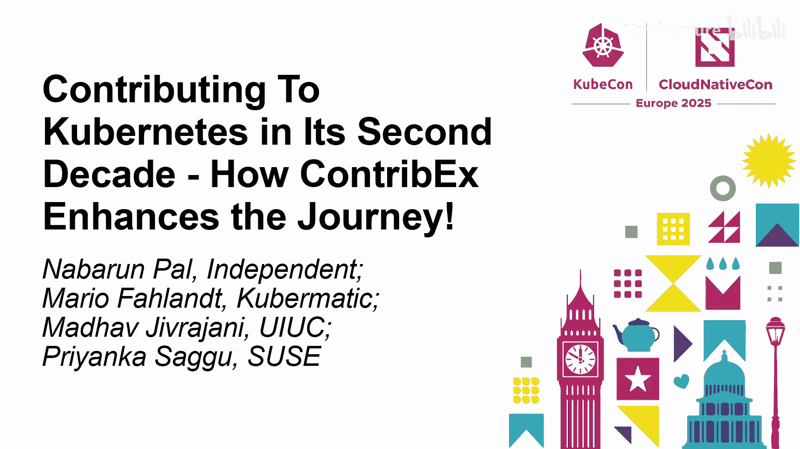
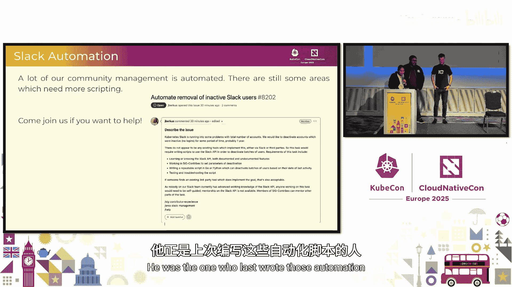
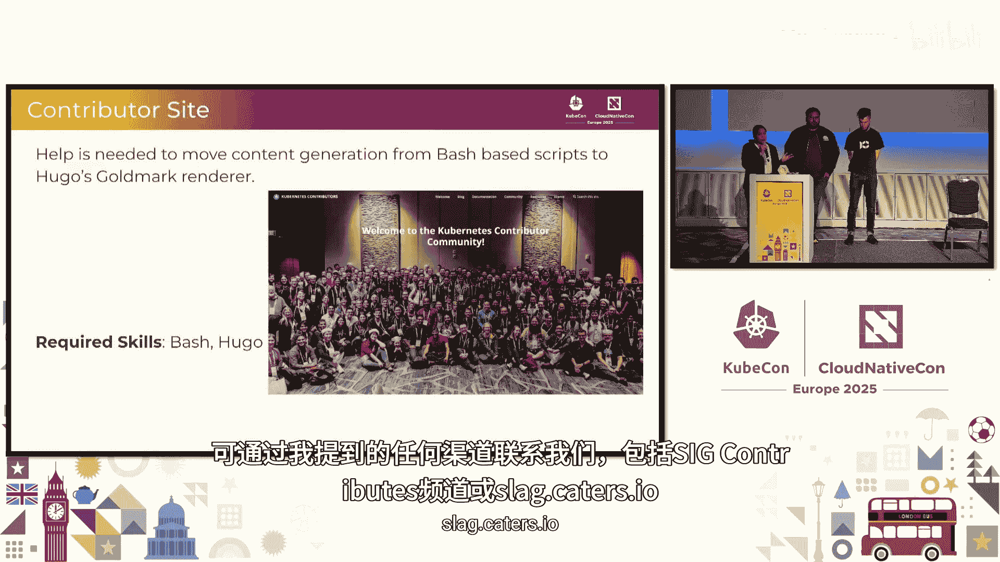
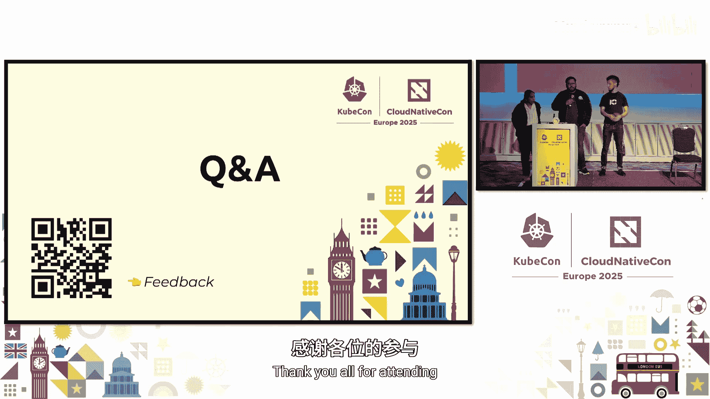

# KubeCon-+-CloudNativeCon-大会2025-｜-云原生计算-｜-可观测性-｜-Kubernetes-｜-Prometheus-p02-P02-Contributing-To-Kubernetes-in-Its...-Nabarun-Pal,-Mario-Fahlandt,-Madhav-Jiv--BV1Cd32zDEBG_p2-

Hey， everyone， Good morning to the third and the last day of the conference。

Thank you all for being here， listening to us。To talk about how we make contributing to Kubernetes easy and what we have been doing for the past decade。

What challenges have we been facing， what good things we have been doing and how do we plan to manage the Kubernetes contributor community and the processes for the next decade。

So I am Nabaron， I am one of the co chairs of S contributor experience。

 I maintain a few other areas of Kubernetes and contribute to this other C project called KCP。Yeah。

 hi， everyone。 I'm Mario。 I'm also one of the coaches of contributed experience in communities。

 and I'm also doing。😊，Finops， photo the Kubers projects and some C I CD work for all of the CNCF projects。

And hello everyone， my name is Prayankaagu， I work at Suza and I'm one of the technical leads forubernet SG contributoror experience and we do not have two people on the stage today so I'll also introduce them we have Kaslene。

 who is also one of the co chairairs for SikG Cons and Maov。

 who also is one of my fellow technical leads。Cool， thank you for introducing。So who。

 who do we make processes for？ So here we have a photo from Kubernetes Con summit， North America。

2024， where you can see a small chunk。 actually， of our whole contributor base。

 We do have a lot of contributors contributing to Kubernetes。😊，As of last week。

 we had 90 about 95000 contributors to companies at any point in time in the last 11 years of the project existing。

 It contributed over four and a half million contributions includes committee reviews everything。

 It includes all activity across the projects reports。And。

Their contributions have been held by around 8000 reviewers in the history of the project。

 and these numbers are like quite growing。 I would not be surprised if we reach like 1 hundred0 K contributors by start of next year or end of next year because the numbers are like quite rapidly increasing。

Having said that how is the community structured so the Kubernetes is a really huge project and to maintain such a project we need to have certain groups we need to have a structure so we basically have three specific kinds of groups one is in dark blue which are the special interest groups contributed experiences one of them we have in light blue working groups they are supposed to be short term groups who have a very specific goal and they have an exit criteria and they are supposed to wrap up at the end of the cycle by reaching that success criteria and the work will be folded into one of the sub projectsjects one or more of the one or more of the special interest groups sub projectsjects and then the third type of group that we have are committees they are most elected。

😊，Stteairing committee has elections every year where the entire Kubernetes community。

 the active contributors， they elect three or four members each cycle to represent the community in the steering committee。

And the steering committee essentially then we the community delegates to the steering committee the power to select members of the code of conductduct Committee the code of conductduct Committee is a group of five individuals and they also rotate like every every year with a two year term per member and we do have a product security committee So if you ever got a C report or you got a security fl。

😊，You might have gotten communications from the Product Security Committee。

 They are in charge of making sure Cs are taken care of they are making they they make sure that any kind of incoming security flaws are responsibly handled and they have a process to make sure they get in through the embargo process and the patching process so that the final product is always secure。

Amongs the six and the working groups there we kind of like logically or virtually like segregate them into three kinds like what specators groups which take care of the project level responsibilities where they maintain different aspects of the project。

 they cut across basically maintaining the project。

 like we are contributor experience than cigars release dogs testing and kda sinfrra。

Then we have the horizontal 6。They are basic basically cutting across the technical areas horizontally of the whole Kubernetes project。

 And then there are vertical6 for feature areas or very tightcod vertical areas of the project。

 And that's how essentially the community is structured。😊，There are additions。

 deletions to the groups based on requirements。 If， for example。

 like working groups serving device management， they all came up in the very recent past in the last year when。

The need ariseed of talking about such topics in the Kubernetes project。Now。

 you might wonder how you as a new contributor get into the whole ladder of becoming a maintainer so you start off being a non-mem contributor。

 you contribute to any areas of the project， you don't need to be a Github organization member to start contributing then when you have contributed。

 let's say a few P or contributor substantially you can ask the reviewers or people who have who have been working with you in your contributions to sponsor you to be a member of the org then you become a member contributor and as you keep working on areas of the project。

 you review more code you。Like add new features or work on other different areas。

 like it's not just about code。 It's also like the project management areas。

 It's also about like maintaining the infrastructure。

 You grow up the ranks to becoming a reviewer than approver than you become a sub projectject owner。

 then you become a sub project lead。 And at the end。

 if you want to take up like more management responsibilities of the special interest group itself。

 you can opt to become a S chair or at a lead or a working group lead。

 if you are leading a working group towards a certain goal。And this process takes some time as well。

 This is all based on like how people are contributing， how people are reviewing code。

 It's based on their code review quality or work quality。

 like how how many block posts are is not always the quantitative as well。

 It's very qualitative process of growing up the ladder。Now， where does sick contras fit in。

 We have talked about the community。 We have talked about growing。

 So Si contrabacks essentially is responsible for improving the experience of who contribute to the project we do that by creating maintaining programs and processes that promote the community and the members by trying to reduce any friction of contributing and often like we also try to re the programs。

 which have served their purpose and are not serving their purpose anymore。 And whenever like。

There is a new area coming up if people want like a different kind of initiative to improve the contributor health of the community。

 We do take up those programs， as well。Now， how do we do those our work is technically segregated into a few sub projectsjects to start with we have the community sub projectject。

 which owns the Kubernetes slash community reportpo and any documentation or groups associated with it。

 then we have the contributor comps。 So if you have been following our social handles or have been reading our blogs on either the Kubernetes do I blog or Kubernetes do dev blog That's the team which is shipping out all this content any sort of announcements。

 any sort of like reminders all of them go through the contributor comps。

 Then have the contributor documentation。 they essentially manage the contributor guide。

 they manage the Kubernetes do dev website for。Kubernetes contributors。

 Then we have the community management group， which maintains policies for different communication platforms like we have discuss。

 we have Slack we have Github， or the Github also has a separate sub projectject to maintain the overall configuration and the Repo health。

 well come to that later。 And then we have the devtts sub project。

 So if you want any statistics about the Kubernetes project。

 the contributions separated by the geography or the company who contributes theres the devts sub projectject who maintains that。

Elections， we talked about two specific elections。The election subpro。

 they own it tool called electo。 It's open source。 We used to use a different like property tool earlier。

 where it was a lot of friction to create elections around elections。

 Then the community decided to start a new initiative to create a。Project to actually do elections。

 So if you go to elected dev， you can see the documentation of the tool that we used to do elections。

 Then there is an event sub projectject。 So the Kubernetes contributor summit。

 which has been running for like almost a decade was being run by the events subpro。

 and now they are helping CncCf in running the maintain summits。

 I talked I talked a little briefly about the Gith management sub project。

 they are supposed to maintain the or membership process， the whole repo management thing。

 we don't own the tooling as such， but we on the configuration and any。😊。

Like any discussions around the configuration of the ho community。 Then the mentoring sub project。

 So you might have heard about programs like Gs， LF X mentorship。

 Then we have a few mentoring cohorts that we do inside the community to grow new contributors into reviewers or existing contributors into maintenance of specific areas。

All three of us are。Two of us， at least I know， we came through the whole mentoring process of becoming a lead of Si contras。

 So we started on like we were doing a few things around Si contras like Mario was doing contributor consulated areas。

 I was doing Gi management and other tech technical areas of the project Prianka was also working on Gi management and other areas of the project and we all were mentored by the previous set of leads to become the leads of Cons。

😊，Then at the end， we have the slack in for project。

 It's very I came to like when you try to join the Kubernetes Sla， there's an invite bo。

 And then we have some groups management。 This all require some amount of effort in maintaining the tooling around it。

It fortunately， the Sla API has been so stable that we did not need to change even a single line of code for the five last five years。

 And we don't have maintenance for that as well， to that extent， for now。Okay。

 so I'll give it to Mario。 Talk about the next parts。Yeah， so basically， also。

 if you know slack APII， you know what to do。So， yeah， as Na already mentioned， some history。

 So for the last9 years。 and we have now 10 years of Kubernetes or no，11 in June， in June， we get 11。

 So we can soon open our Twitter account again with the birthday。 however。

 so we have for nine years we did in the past Kubnetes contributor sums。

 Con summits is usually one day before Kubcon， or some it was at the colocated Wednesday。

 where all of the contributors of the Kubernetes project come together。 And。😊，Talked， sit down。

 had unconference sessions， had no normal sessions did socialize because， as you saw。

 we have a huge community of people that want to work together and join the Kubernetes project。

 So the problem was， this is always Kubernetes focused。 So this was only Kubernetes and Kubernetes。

It's a big project in the in the community， but it's not alone， right。

 So we have over 200 new projects inside of the CNCF。 And the idea was that we get to。Hey。

 we want to have a maintainer summit， which means that we have maintainers from all of the projects。

 which means that we have people from sandbox projects that we have people from incubating and curating projects。

 So the the higher you are in your in your life cycle of your project。

 the more people you can basically send to maintainer summits， so。😊。

We also include some other folks inside of the maintain summit， which means that。

There has a technical oversight committee， which is part of the CNCF。 It is basically the。

They make technical decisions on， on a level across projects。

 And it's always good to have their input as well。 We also have included techs。

 So technical advisory groups。 So that we have like one day where each of those different groups come together and talk about。

 hey， what do we need to do to foster our all over project environment and work together。

 And this is now the goal of the maintain summit that happened the first time in India last year。

 and the second time now in Europe on， on Monday。 And we had in。😊，On Monday。

 we had 360 maintainers from across all of the projects coming together。 And， yeah。Working on。

 on stuff。So。We also want people to understand more of the ecosystem。

 because a lot of folks just create a project。 The project becomes eventually part of the CNNC F。

 and we want to。They don't know what the CNNCF can help you with。

 And they also don't have the understanding sometimes where they fit in because they are completely new to the to the community。

 And that's also why we basically included all of those technical advisory groups and T O Cs in this so that we。

 those projects can learn。 And also that projects can learn from the other。More graduated project。

 So we had a lot of sessions done by Kubernetes maintainers to basically explain things like。Hey。

 we have social media channels in Kubernetes。 Maybe social media channels is also interesting for your project。

 So like。Educating or helping the， the smaller and the newer projects to find their place in inside this whole big ecosystem。

For it's hard to create an event for the Kubernetes community days in the past， we had。

 we had our own team that was to see And the events team in the in the。

 in our world where we basically had like part of Kuber contributor experience that just made a maintain us。

 the problem is you need to， you need to have a lot of people to run an event。

 And all of those people that is's in their free time。 And it also took like a lot of things away。

 So we basically included。😊，We now have the help of the CNCF events team。

 which is great because they help us with all of the log logistics。 We also。

 we still have volunteers in Con that do like communication to the internal project and also to help with the program committee because the Kubernetes is as the biggest project gets its own track So we have three chairs that are overseeing the whole maintain summit that are selected out of the community this year。

 It were it were two people from the Kubernetes project。

 and one person from the T O C so that we also have like from a。😊，Chair perspective。

 like the spread across the different projects。 Now。

 we are looking for new chairs for the next year because a term is always one year。

 So we start with the Kubernetes maintain summit in Europe。

 and we end with the maintain summit in the US。So we have now also a formalized CP process。

 So we go the same way like we do with the， with the。Events for C and C F。

 And the good thing is that we are now can also have sponsorships。

 So companies can actually sponsor the maintainer summit that people can come together so that we can have more maintainers on those events。

😊，We also talk briefly about how to get into Kubernetes。

 how to get into Kubernetes contributing and stuff like this。 And for this。

 we also created a new initiative， which is cool， which is called new contributor orientation。

 New contributor orientations。 goal is basically。😊。

You saw the slide that Naburun talked about with the。These are the6。 This is the community structure。

 These are our committees。 That's a lot。 That's a lot to understand。 And it's really。

 really hard for new people， like。Hey， I go to Github and look for good first issue。

 And then I look at the good first issue。 And the good first issue is not a good first issue。

 So we basically need to。Take or the goal of this new thing is that we take the hand of people who want to contribute。

And introduce them into the community and show them how it's structured and show them how they can process。

 So basically， we have now a meeting， which is every month on the third Tuesday。In two time zones。

 So we do the meeting America friendly and also Asia Pacific and European friendly so that we have like all of the folks that really can join。

 It is roughly one and a half hour。 So we have a 40。

40 minute presentation of content and 20 minutes where you can just ask questions。

 We have people from the community joining and anyone can attend。 There's no judgment。

 You don't need have you don't have have any previous knowledge about it。 Just come to the meeting。

 joinin it。And learn about a Kubernetes project。 And there we can also help you to。

Steear you towards a sick to understand what sick would be interesting for you to contribute and stuff like this。

Presentation is welcome to Kubernetes， wireless Kubernetes， community structure。

 We help you with a workflow。😊，It's we have a common Co contributor pitfalls， as I mentioned。

 good first issues are usually not good first issues。 That's a problem。 We are aware of this。

 and we basically just help you to navigate through all of this。We track statistics。We。

 we went off with a great start， and then it declined a little bit。 but this is mostly on。

 on our fault。 And I say our fault from， from a comms perspective。

 because we haven't figured out a good way yet to do like regular， constantly communications。

 But you still can see that we have a consistent intake of people。😊，That's。

 that basically join those meetings。 And we are happy if you。

 if you can join those meetings and learn about the the Kubbines project。

 and we will steer you towards it。😊，We will， we， we promise we will be better in communications to make it easy for you。

We have a repository where you can basically have a look at statistics and all of the stuff。

 just go to the Q R code。 And there you can basically find all of the information about new contributor or orientation。

 And as I said。We improve with content or we improve with comms and content。

 and we want to learn about it。 But we also have already a lot of communication that is being done。

 And Prianka will talk more about this。Yeah we are past our time， so this should be our Q andA。

 but I'll try to cover the most important part because this is where we will tell where do we need help within SG contras before I go to that these are the Kubernetes  and Kubernetes dev blogs I I'll discover cover some stats on all the things that we have been doing as part of some of the sub projectsjects under S contras and SG contras as a SG handles these two blocks one of these is handled in collaboration with Sig dogss。

 So on Kubernetes do dev in 2024 I think by the end of the year we have more now by 2024 we had 14 block posts and out of in addition to that we had Sig spotlight blog。

Sig Cons is also helping to understand about other Sigs。 And you can find out Sig spotlight for that。

And on the other one， Kubernet is that I。In collaboration with S Dog Si Cons help publishing 45 blogs in 2024。

 we have more we are in April now I'm pretty sure we are working on more and social media report I'll just quickly run through them these are our accounts。

 I'll give you a full list in one screenshot but Kubernetes on LinkedIn as of from the time Kubernetes S Cons contributor Coms to cover this handle we had about 147% growth in the new followers and about 985% growth in the post about 141 new posts Kubernetes do Kubernetes i on X these are the stats there。

And then we also now have a new handle on blue sky。Which since November 4，2024。

 have 6000 plus followers。And what I just talked about are our end user facing channels。

 we also have different handles for contributor facing channels。

 So on X we have handle K as contributors。The starts are here because we see the reds because we are moving to blue sky and so we have a replacement or equivalent account now on blue sky。

 which is Kubernetesive。Again， since November 4， in the contributor facing area。

 we have 300 followers and 300 plus followers and more。We also have。A handone masterdon。Okay。

 so this is， this is the list of all the accounts we we as Cons maintains us with the help of contributor comes up projects。

 So I'll wait for like two seconds if somebody wants to take a photo。

Or you can find them in our handout notes。We also want to thank all our amazing contributors。

 we can't thank them all on the screen so these are the few we want to highlight based on the recent very recent contributions thank you tobit Arbit is joining us as one of the new YouTube admins Erwin and Erwin helped us with Mainer summit India。

Frederico， thank you， Fredderico， I don't know if you are here in the conference。

 Thank you for all the work you are doing in helping us maintain our blogs。

 both the Kubernetes and Coubnetes do dev handle Fca。

 Thank you for all your contributions toward L W KD and S Sik is one of the people who is helping us bring our infrastructure side of our blogs。

 bring bring all that back in shape。 And thank you to Wendy for helping us with the calm side of Main our summit London。

😊，And there are more people。 So thank you to a lot of people。 Now， just wrapping up super quick。

 there are a few health wanted areas we have。 Number one is the slack automation。Now， Huon said。

 we do not have maintenanceers。We do need maintenanceers， though， so。Take a screenshot。

 a lot of communication a lot of actually absolutely everything that we do as for management of the community。

 we want it to be automated。 and this is one space where we can use help。

Who would be the right people to talk to I think you can reach out to the slackla Infr admins people and S slackla Infrra or you can just reach out to Naburun yeah he was the one who last wrote those automation okay Next up we have Eo I think we started receiving some help on the electro side。

 but roughly what we need help with is this is a ingrown community built software that we run every single year for two runs of elections。

This software is written in Python Flask， and we need help with hardening it。 We need to rework or。

Extend our testing， so。If you are interestedtrusted into the testing area and if you have your skill sets are related to Python or flask or you want to learn。

This is the project where we need a lot of help and the people who you can talk to about this would be you can ping us and seek contras on Slag。

t cater Iio or there is also an elections channel in Slag。t cater you can reach out to us here。

Next up we have contributor side， I mentioned Sik， he is one of the people who is helping us maintaining the Hugo static side generator and Doxy theme that helps us run our blogs。

 but we still are relying on one person and we can we can use a of lot of help so if somebody is interested in helping us maintaining our contributor side or learning alongside Sik feel free to just read what Syik is doing and then maybe reach out to us you can reach out to us in any of the channels I talked about SG Cons on Sla dot caterators doai or we also run bi weeklyekly meetings so you can come on any of those。

Finally，ing mentoring is one subpro where we help other people or other projects in the community run mentoring cohorts。

But we also need a structure there we I think sylvester is helping us build a lot of structure already。

 but we could use a lot of more volunteers there to help us run those cohorts so if you are into shepherding tasks or management tasks。

 this is one of the areas where we can use help。And finally those are the open health wanted areas but we always have more ad hoc stuff that is happening in the community so please hop onto to any of the biweekly meetings one happen in APEC APC time zone。

 APEC EMEA and another one is a US friendly time zone you can join any of those and you will find at least one of us on those call and many more contributors。

Yeah， so we， we do go over our sub projectss 1 by one and discuss what is going on so。

And finally this is a list of all the resources you can definitely my personal favorite as K community book market if you are new to the community。

 even if you are not new to the community， you are hoping Ss or you just want to learn what is going on K communities the resource you can open many of the directories there about specific SG specific working groups and you can see which area is owned by which particular SG and so on Slag。

k Sti again is our S organization Sla working space you can use that URL to join the community and SG Cons is the channel for Kubernetes SG contributor experience。

Cobinnetes S Cons I think there is a hyperlink there that will lead point you to the mailing list for SG contributor experience and that mailing list is the way to join or get invitations to our biweekly meetings as well and I think thats same for NC as well and it's again we truly acknowledge it's always not too easy to get started and it is frustrating it was for me and I can say it for most of my colleagues here So the only thing is you just stick around you observe other people and you follow their footstep for you make your own by observing them and if you need help SG contras is the place to ask for help if we can't help you ourselves we will make sure we find your resources or we point you to the right people and that is what NC is for or our regular biweekly meetings as well。

Once again， thank you for joining the talk and we look forward to working with you or talking to you meeting you in the community。

Open to Q And A。 Yep， thank you。If you have feedback for us， do fill in the feedback form。

 it will take you to a sketch page most likely where you can read the session and then put in some comments。

Hello， hello。Yep， any questions？YouYou mentioned death stats。 I occasionally go there just for fun。

s and and to justify my work towards my management， because it does help with that。 So a good tool。

 I know we also rely on it to track active contributors。😊，For elections， for example。

 I remember at some point there was a similar tool from the CNC F。

Are there any plans to migrate or keep， I will both keep running for a foreseeable future。

 Deathts is。Also， CNCF project just cr this project maintains the K S part of it。

 And like the graphs for the K S part。 So theres there's a global dev instance for all of the project where you can basically get the same statistics for all of the projects。

 And there is a be or there's a be website with more sta for also project health and project releases and stuff like this。

 So both will stay。 But the focus of the of both of the platforms is slightly different。

 I but I can't remember the name where is。 but it's somewhere on the CNCF website。

E insightex insights。 Yeah， there you can get more statistics on the different projects。 And yeah。

 death is like more personal and more company related stuff for like。

 if you want to have really liquidity details。I think I can add。

 we did onboard Kubernetes to LFX insights。And we did feedback like。

 this is what we use dev stats right now for one of the use cases you already mentioned is for finding out who。

 who is eligible for elections or or casting a vote。Currently。

 we do not have 101 API from APIs from LFX Ins， but that was mentioned like it was so early and we are trying to get feedback from all the projects and well work on that。

We have to follow up on that Yes， where we are in the migration or。

I did here Devaftats will be sunset if LFX In science does everything what Devafts does。

 but it is if it does， which is not the case today。Any other questions？not。

 thank you all for attending。

