# KubeCon-+-CloudNativeCon-大会2025-｜-云原生计算-｜-可观测性-｜-Kubernetes-｜-Prometheus-p03-P03-Crossplane-Intro-and-Deep-Dive---The-Cloud-Native-Control-Plane-Framework----BV1Cd32zDEBG_p3-

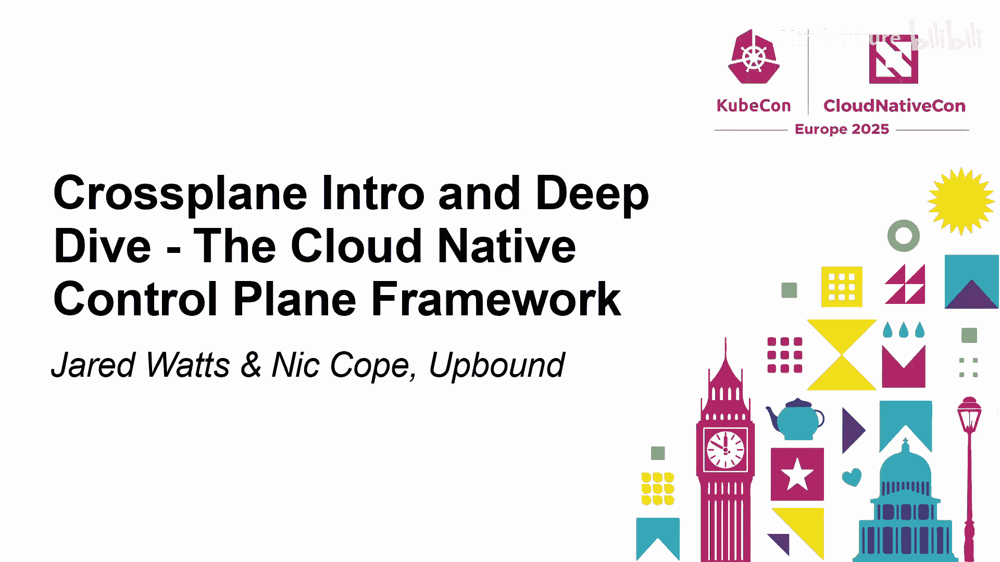

All right welcome everybody welcome welcome still people filing in I think there's more room in the back there but grateful to see all y' all's faces today so let's get this thing going this is the crossplan talk my name is Jared this is Nick we are part of the leadership of the Crossplane project we've dedicated a good chunk of our careers now to crossplan so we're obviously very excited to talk about something we're very passionate about as is usual for Ccons we have a very diverse range of like experience levels with crossplan so some people are running it in production some people have not even heard of crossplan before and they're curious about what it is so we do have to start this talk with 10 minutes of basic introductory stuff the people the more crossplane pros might be a little bored with that but I guarantee you the second half is going be quite interesting as Nick is talking about that the future of crossplan of V2 of crossplan very exciting stuff you haven't seen all right。

No。So the basics， what is crossplane so we like to think of a crossplane as a cloud native control plane you basically use it to provision and manage all of your resources you can take those resources you compose them into higher level of abstractions and with those abstractions you offer those to your developers so that they can self-service and provision and get the resources they need Kubernetes is a great control plane for containers Crossplane basically extends Kubernetes and teaches it how to manage everything else Control planes are not a new concept right Cloud providers have been running control planes and their backends for years but now Crossplane gives you the framework and the tooling that you need to build your own control plane your own platform。

So the basic building blocks here， we call these managed resources in Crossplan。

So think about all the different cloud providers out there， all the different SAS offerings。

 on premisems software， all that stuff， there's thousands and thousands of different resources and services out there。

 Crossplane aims to bring those into the Kubernetes control plane and allow you to provision and manage them from the control plane。

In practice what that looks like here with a little practical example is imagine an S3 bucket so this S3 bucket here。

 crossplane is representing it as an API object in the Kubernetes control plane。

 so just like any other API object， it's going to have a spec in some declarative configuration that you basically specify your desired state for this bucket and then cross Crossplane will go take that desired state and apply it to the real world ending up with an S3 bucket。

Just like any well behaved Kubernetes API object， they're going to have a status as well that's going to give you like the observed state of the real resource out there in the real world。

 the conditions， there's going to be events that tell the history of the life cycle。

 you know what's going on with that resource。So there're all these know thousands of resources in crossplane that are into the Kubernetes control plane are well behaved Kubernetes API objects。

 how does this work， probably like you expect， Imagine taking this bucket manifest as a user and you apply this S3 bucket manifest to the control plane to the API server。

 probably through GiOs or something like that。A there a set of controllers in Crossplane that are watching and actively reconciling these resources with the real world。

 so the S3 controller， it will see get an event from the API server。

 it'll see that somebody has a desired state of a bucket。

 it'll use the Amazon API to talk to AWS and provision that bucket out there in the real world in matching the actual state with the desired state。

So we've got the building blocks， the basic building blocks and crossplan， these managed resources。

 let's build them into an actual platform now。So the concept of composition is hugely important in Crossplane basically it allows you to take these granular resources。

 assemble them， compose them into higher level abstractions。

 and then those abstractions or what you offer to your developers so take for example if you want to compose together a GKE cluster。

 Note pool network subnet all that stuff and then you want to offer that is a very simple cluster abstraction to your developers you give them some limited configuration options and they basically are then able to provision workload clusters that are in accordance with your golden path of the platform team and all that infrastructure complex is hidden away from them so it's much easier experience to unblock your developers and get them going quickly to production all of this is know Kubernetes API right so any tool that knows Kubernetes can work with crossplane and be compatible there。

So let's do a little visual here and spoiler alert。

 this will be changing a bit for V2 when Nick gets on the stage and shows you all that but let's think about the middle of this diagram here as a platform engineer you need to define your platform API for your developers so you specify the schema the configuration knobs you want for them what is the abstraction that you're exposing to your developers underneath the covers you have to define a composition the logic what resources are you composing together and how do you compose them together in practice let's look at this example here again of say you as a platform engineer want to expose a platform API for databases to your developers so you would go through the effort of defining the schema of that API what are the configuration knobs I want to give my developers and then your developer comes along and you can see here on the left side of the screen that she's like okay I just want a small Postgres that's all I want the complexity underneath the covers is is abstracted away and hidden into your platform there。

So at runtime for this small Postgres， you you have a GCP composition for it， maybe you have Alibaba。

 maybe you have Azure or whatever， maybe you have cheap or expensive， maybe you have silver or gold。

 it doesn't matter， you could have any number of compositions that define this database abstraction。

 and then for the GCP case that's going be CloudSQL， SQL user， global address connection。

 all that sort of stuff。So that's a bit of a practical look at it。

 let's look a little bit more details about how to do this。 So to define the shape of your API。

 define your platform API， we have these what they're called composite resource definitions。

 You basically define your custom API group， You're extending Kubernetes。

 right you're giving Kubernetes a new API here， basically。 And so you can define the API group。

 the kind and then the schema， What are the configuration knobs that you want your developers to have exposed。

Then you have to write the logic。 what resources do you want to compose together you know how do you want them to happen and hugely important。

 the way we do that in Crossplane is by running a pipeline of functions that's how you compose resources together in crossplane So let's talk about functions for a bit because they're hugely important So basically in crossplane。

 you're running a pipeline of simple functions and that's how you compose resources together for all of those functions。

 you can basically use your language of choice。 there's a whole plethora of different languages that are supported now but the key part。

 the really important part here is that you just need to focus on the unique logic for your platform。

 What is your platform need to do for your team focus on just codifying that your golden past。

 your configuration that's important to you let Crossplane do everything else like managing the lifecycl of these things doing all the heavy lifting garbage collection blah。

 blah blah all that sort of stuff but you get ctifying a simple pipeline of functions Now when I say functions you might think quickly of like okay。

 I have to write。That's not true there's a whole ecosystem in crossplane of these reusable functions that the community has built and the key takeaway here is that all of these functions basically offer you a bunch of new experiences in crossplan of different variety of ways that you to to express your logic and build your platform so there's a whole spectrum of no code。

 declarative low code， full code， whatever your most comfortable with。

 use that they're not going to force you into one particular way of building your platform。

 use the language that you're most comfortable with maybe that's a high- level config language maybe that's a lower level general purpose programming language。

 it doesn't matter use what you want and then you're not stuck with just that only language。

 each function in that pipeline could be whatever language you want so you can mix them a match。

 build the platform in the way you're most comfortable with。

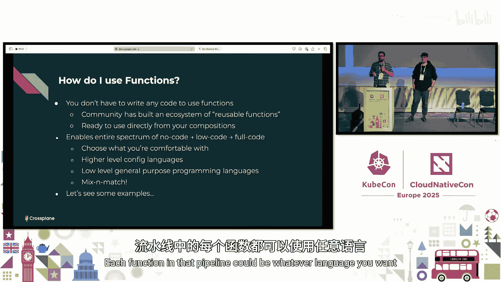

So let's look at some examples。 We're going to go through these quickly， not look at every line。

 but for example， with functions， you can do templating and define like a variable number of access keys。

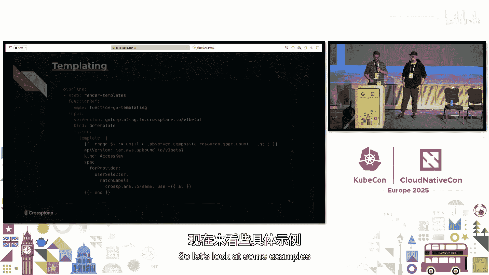

You can use Python to define this S3 bucket， if you like Python。

 you can use KCL to define like an EC2 instance for a variable number of regions。

You can use a queue to define some IM policies for a given set of iron。

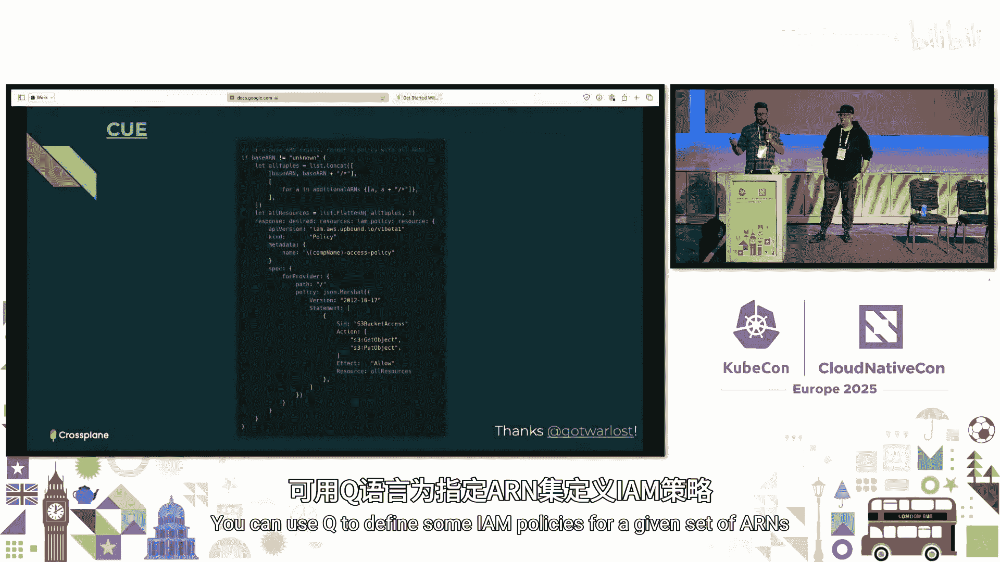

You can use pickle to make a config map， whatever there's like a whole spectrum of experiences here or drop down to a lower level programming language。

 a general purpose programming language like go， then once you're using if you want to define your platform and build your platform with general purpose programming language。

 now you can start using like the native tools of that language and unit tests and test frameworks and Liing and autocomplets intelligence tele language servers。

 all that stuff， help you define your platform as a software project。

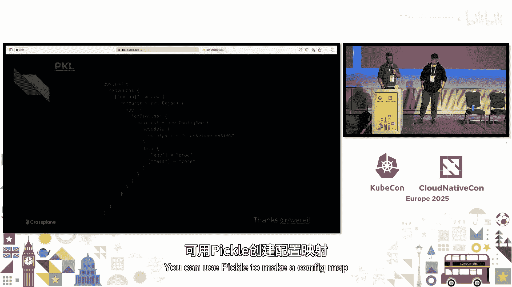

It's up to you， basically。All right， so last release in Crossplane was a 1。19。

 I think it was I was gonna say last month， but now we're in early April。

 so it was actually February I think almost li to you I'm sorry。

 but recently enough one month ago let's say and so what we're focusing on there is continuing to mature crossplane the key APIs and features that folks are using and adopting a crossplane continue to mature those so usage is now beta the claim service that applies now beta and then we also learned to from one of our mistakes as well of how we promote APIs and doing that in a safe way so you can upgrade crossplane and downgrade crossplane as well across all the versions we learned some mistakes from that and did a couple PA releases and have a good policy in place so that works really well and a couple of the things we worked on is basically making crossplane more useful and more scenarios so some host network scenarios that were in high demand from the community work now being able to use private repositories with the crossplane CLI just making it generally more useful for people。

And then last slide for me， next release 1。20 is going to be in early May so just about a month away。

 so roadmap for that and ongoing as well so the change logs feature in Crossplane we've had it in runtime for a couple releases but we haven't actually rolleded it out to the providers yet and I think that's a really important feature because basically lets you have like an audit log of everything Crossplan is doing to all of your resources。

 why it's doing it when it's doing it， how it's doing it where it's doing it。

 all that stuff that'll be available in all the providers so I think that's really important。

 we're obviously going to continue maturing the important features。

 the key feature is an API is that everyone's using and adopting。

 we're going to continue to mature those' going to work on insight。

 observability metrics like more insight into what Crossplane is doing that'll be a theme and then of course the future of Crossplane。

 Crossplane V2 which Nick will talk about。Thanks， Jared。So Monday of this week。

 we released a preview build of Crossway V2。 So it's out there。

 It's released and there's something that you can try now。

Our goal with crossbe veto is to make crossb more useful for more things。

 We also want to make it more intuitive， and less pinative。Because when they one。

There's three major changes in Crossland V2。Composite resources at our namespace。

Mananaage results in our namespace。And you can use content resources to compose whatever you like any Kubernetes resource as opposed to only costplay resources。

Over the last couple of years at CoupCons， something that I。

 while I was marry at the Crossplane booth， something that I would frequently hear from people is I love crossplaying for my infrastructure abstractions。

 I built cluster abstractions， database abstractions， etc ceter。

 what should I use for my apps or my microservices and things that actually using that infrastructure？

It got me thinking， I was like， why not just use crossplay。

 or why don't at least allow people to use crossplay？

So one of the themes with cross plane V2 is it's better suited to building。

APpiI abstractions for anything， not just infrastructure。

 and especially for applications or microservices。So composite resources， XRs and now namespace。

 Jared touched on XRs before， but as a quick recap， these are Kubernetes custom resources that you。

 when I say you I'm typically meaning a platform engineer or something like that is defining。

 so you teach crossplay that this type exists and you teach crossplay what a schema is。

Here I show an app， but it could be a billing front end， a web app。

 an a database that's really entirely up to you。So in Crossway and V2， all XRs。

 all composite resources and all managed resources were clustercod。There were reasons for this。

 it was inspired by persistent volume claims and persistent volumes in Kubernetes and it kind of made sense when we' were thinking about it as infrastructure tool arguably but in this modern world I don't think it makes sense anymore。

 so we've just made them names based。What this means is we've lost an entire concept in crossbe。

 there are no claims in Crossb P2 claims were a namespace proxy you would create a claim in your namespace and then crossbe would respond by creating a clusterco XR that was identical to the claim No need to do that anymore。

 given that XRs can now be clustercod。Another the small change that you might see here if you're familiar with crossplane is on every XR there's a couple of things that configure figure how crossplane works。

 so the example on this all that you're looking at now is the composition reference。

 this is the part that tells crossplayin here when someone creates this app。

 use this configuration to do to know what these losses to create in response to this app being created。

Previously all of these crossplay machinery fields were just top level under spec and this means that it would be easy for users to confuse stuff that was crossplay machinery that they may not need to worry about with stuff that is actually important。

 like the image in this example， the image that the app is going to run。

So we've moved all of these crossplay machinery fields under Specor crossplay just to make it easy to say。

 hey， you could ignore all the crossplay and stuff on specor crossplay if it's not relevant to you as a user。

I should say most composite resources in our namespace， when you saw the XID example earlier。

 you'll notice it looks a lot like cross sorry， Kubernetes CRD。Custom resource definition。

 And we've taken the scope field that exists on CDs。 and just put that on X IDs。

 So now you could choose whether your X ID is name based or clusterco。Well。

 you're choosing with your XR is aspace for clusterco， using the XRD。

So I think I expect that like Kubernetes resources。

 the vast majority of Xs are going to be namespaced going forward。

 but there are some interesting use cases for clusterco text。

So a namespace DR can compose can create resources in its namespace。

A clusterco X can create clusterco resources or resources in any namespace。

 So one thing I'm excited about with clusterco X is you could imagine packaging up something like Argo C E or an operator using an X。

 building that API yourself and then using that to roll out to clusters or control planes to plot that。

And B2， I mentioned before， managed resources are now namespace。

 This one's pretty straightforward right now， As at the preview。

 we've only updated the AWS providers to have namespace managed resources。

 The next couple of months will'll update all the providers to support namespace managed resources。

 It means that when you're creating a namespace X， you can compose that X of namespace managed resources。

And I won't take too much time to explain the benefits of name spacing and Kubernetes。

 I presume that you're all familiar with it。Tenancy isolation lets you give people access to create app XRs and maybe manage resources directly in one name space。

 but not others if you want to。And that gets to another thing that's more of a philosophical change with crossbin V2 in Crossb V1。

 I thought of it as kind of vertically integrated。 And what I mean by that is we told people you shouldn't really make managed resources directly。

 You shouldn't put managed resources in a helm chart。

 You should create managed resources using a composite resource。And the opposite was also true。

 We said composite resources were for crossplay managed resources。

 not for arbitrary Kubernetes resources。We no longer hold that opinion with Crossplay and V2 with everything becoming namespace to become it makes a lot more sense to potentially create mandatory resources using another tool if you want to。

 that's fine， I think it works best and great with composition but you don't have to use composition。

And similarly， you can use composition to compose whatever Kubernetes resources you want could be a deployment。

 could be a service。Could be whatever you want， not just crossb managed resources。

 So let's show that now。Don't worry， this diagram that looks very complicated and weird is showing you how it used to work in Crossb V1。

So technically， cross B B1， you could already compose whatever resource you liked。

 but it was a little strange。 So what we're showing here is this example where the platform team has defined a new API。

 and that API is app。And so someone comes and they say， all right， cool。

 I'm creating an app in my namespace。 And what the platform team has said is when someone creates an app。

 crossplay， what I want you to do is create a deployment， a service and an IdS instance。

And you can see the machinery of how that works is the app claim gets created in the name space。

 Then crossplan jumps out of the namespace to the clusteroscope， creates an app XR。

 which is just a mirror of the claim。 Then that app XR is composed of two objects for our Kubernetes provider。

 which is weird and of itself the Kubernetes provider for a service that runs on Kubernetes。Those。

Clustercope object managed resources would then jump back into the name space。

 create a deployment of a service。 And meanwhile， the R instance would be clusterco。

 So it gets the job done。 You or user creates an app。 and out the other end。

 comes a deployment service and name R S instance， but it's more complicated than it needs to be。

So here's what that looks like in Crossbe V2。 I think you'll agree that， you know。

 there's like at least three boxes missing from this diagram。 So it's a lot simpler。

 The user creates a namespace Xr， and Crossbe responds by directly creating a deployment， a service。

 and an audio instance。Also names based。And like I mentioned。

 you don't have to use managed resources at all， is the same thing。 user creates an app。

 we create a deployment of service and a cloud native PG database cluster running Postgres in the cluster as opposed to running RDS or some cloud service。

Crossway V 2 is backward compatible with crossway V1。What this means is once costplay V2 is GA。

 you'll be able to upgrade from V1 to V2， and most people shouldn't have any breaking changes doing that。

There's two things we've done that enable this。One is。

 I mentioned before that X I Ds have namespace have a scope field。

 and it can be namespace or a clustercos。Actually， it can be named space clustersterco or Le clusterco。

 and if you set it to Legacy clusterstercope， which will be the default for be one of the XD API。

Then it will just create a V1 style kind of legacy legacy XR。

 so that XR will support claims it will not use crossplay it or work just like it works in Crossplayin V1。

We're also adding namespace managersaries or support to all providers。

 we're not removing clusterco to manage resources。So in Crossband V2。

 we'll consider V1 style clusterosco Xs and V1 style clusterosco managed resources to be a legacy feature。

 We intend for you to。Migrate away from those and start using the NAt features。

 but you don't have to do that as a forcing function to upgrade to V2。

 you can install V2 and all of your V1 star stuff will still be supported。

We did take advantage of the major version update to remove some features that have been deprecated for a couple of releases。

 most notably controller a config， which is a way to configure out providers。

 It's been deprecated for like 11 releases。 never actually made it out of alpha。

 but it was heavily used。 So we finally。Pull the bandai there and said that's now gone in V2 And the other one that's been deprecated for two going on three releases is native patch transform。

 This was the precursor to composition functions。 So if you are using native patch transform。

 you do need to switch to composition functions before upgrading to crossband V2。All right。

 now I'm going to do a quick demo of V2。 I need to hand this microphone to Jared。Make a weird noise。

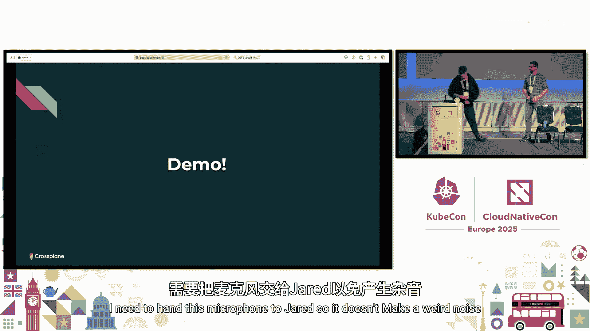

All right。So for this demo I'm just going to go through the GD started composition guide that's in the new V2 doccks for Crossplay and we actually did quite a lot of work revamping the V2 documentation。

I hope that you can see this okay， it's about as big as I can make it。

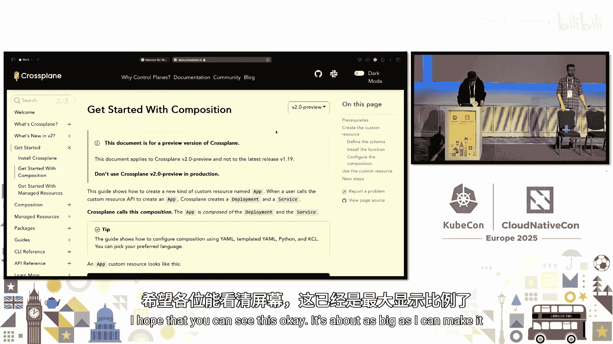

So we're going to stick with the same app， composite resource example。

Our goal here is we're going to create an app that looks like this。

You can see it's only got one field in spec the image。And when the app gets created。

 we want a crossplay integrated create deployment and a service， no managed resources。

 nice and simple， just going to create a deployment and a service。

The replicas are going to be copied from the deployment status and the address in the app status is going to be copied from the servicesens status。

So we need to do three things to create this new type of XR， this new custom resource in Kubernetes。

 we need to define it， we need to install a function。

And we need to configure how cross callss that function。So first， we define it by creating an XonD。

Defins the sr and teaches crossplay and Kubernetes that this app is the thing that exists。

It's the X that we've got here， I'm going to jump around a lot now from these windows， I apologize。

And I have this X here already， so I'm going to create that X。Just so you aligned to you。

 that's the same study， I promise。Now that I've created this XID。

 Kubernetes knows the app as a thing that exists and Crossplay knows the app as a thing that exists。

 Crossplay knows it's responsible for app， it knows it should spin up a controller and start reconciling apps。

 but it has no idea what to do if you create one if you create one of these right now。

 Crossplay Institute go I don't have an implementation for this， I just know I own it。

So next we need to install the function that teaches crossplay what to do。

For the purposes of this guide it's kind of more complicated as Ja touched on before。

 but let's assume that a function is basically a pluggable configuration language that lets you pick what configuration language you want to use to configure acrossplan we've got four in this guide Yaml's a bit boring and I want you to pick what function I use so why don't you let me know by show of hands I'll ask for show of hands in a second would you like helm style templated Yaml Python or KclL which is a relatively new CNCF configuration language。

All right， show of hands for homelm styleyle templated yaml。Co， all right， show of hands for Python。

これも？It's good， I like Python， that's my favorite show of hands for KseL。Oh， I think KCO wins there。

I do you think Jared its pretty even going toLL it is All right so now we would install this function I actually cheated because we're in conference Wifi and I will show you that I have actually installed all four of these functions already because Crossplay would actually have to download them and I don't want it to fail to download them。

😊，So what we have now is we've defined the app and we've also installed the function that we're going to call。

 but now we kind of need to connect the two together， we need to tell Crossby OK。

 but someone creates an app， call this function with this input so to know what to do。

So jump back over here and then go down to configure the composition。

And I'll show you what these look like briefly， templated yaml looks like a helm chart。

Python looks like Python quickn on Python some languages actually support you'll notice that this is like Python inside of a Yaml document which is convenient for small and simple cases like this。

 which is pretty gross and more complicated things you probably want syntax highlighting and completion and things like that for Python you can actually just like write a function in Python use your ID so that's what I would do for a larger function but this is great for something simple like this。

And then finally， KCL， which is what we get about with。

That's what KCL looks like it's kind of a little bit pythonic。

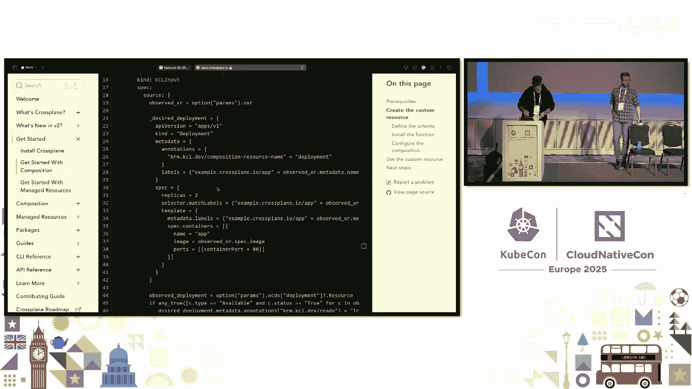

Sorry。Ply。Composition KCO。And make sure you have any other compositions in there。

 Great compositions there。 That means crossway knows what to do now when you create an app。

I've got an app here。Theres the app super simple？All right， so I've created that app。

 so now cross plane is saying， okay， I've got this app。Im going to look up what composition I need。

 so it's going to look up and find that there's only one composition's going to use the KCL1 that we just created and then it's going to call function KCL with the input from that composition so let's see how that's going。

All right， that's looking promising。 Oh， it's， it's actually done already， I think so。

You can see here in these events that it's selected the KCL composition that we created before。

 and for a minute the deployment and service weren't ready。

 but I can see that it is now synct and true， so syncct is true and ready it's true。So。

One of the cool things about this all being aimspace and just like more of a normal Kubernetes resource compared to crossplay V1 is I can use the Coop Cuttle tree plug in on the app and it'll show me that the app is true and it'll show me the app composed of a deployment as sort of the important things that they。

Entaille。Also ends the demo， this is all namespaced， hey， that's the big change。

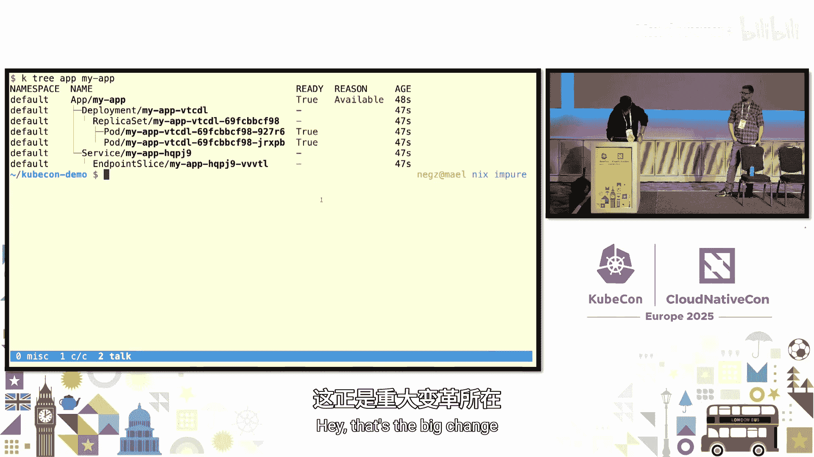

Thank you。to come back over Crossplanin V2 is available today。

 Jared and I spent a lot of effort on revamping the docks for crossway V2 as well So if you follow this URL or open this QR code which we will show later once we finish the talk that'll take you to the docs that'll teach you how to get started with Crossplane V2 as a preview The reasons the preview is the actual design is still open We're still waiting to get more feedback from the community。

 we wanted to give you something concrete that you can install and kick the ties on and play around with and let us know if this is the right direction before we commit to it as the real future of crossplan V2 I feel pretty good about it personally but I'm really excited to hear what you think。

😊，So definitely give us feedback on acrossway B 2 and give us feedback on the new documentation that we've put out。

 Now， I'll give you back to Jared to wrap it up。All right， let's close it up here。 Thank you。

 Nick for showing us off all that awesome V2 stuff。 So you know， once again， like the project。

 the Crossplane project is nothing without it's community right so more contributors are always welcome we did recently author like a getting started guide for new contributors。

 So if you go to the crossplan Github repo It's in the contributing folder right there easy to find There's a little QR code if you want to scan that too but basically it kind of helps you understand the lay of the land of where do we need contributions in crossplane。

 how do you get started with your first contribution Like how do you find a good first issue。

 all that sort of stuff。 the docs definitely need help as well。

 So there's a lot of places to pitch in and help out。

 And this is kind of your guide to figure out where to get started and how to become a crossplan contributor。

😊。

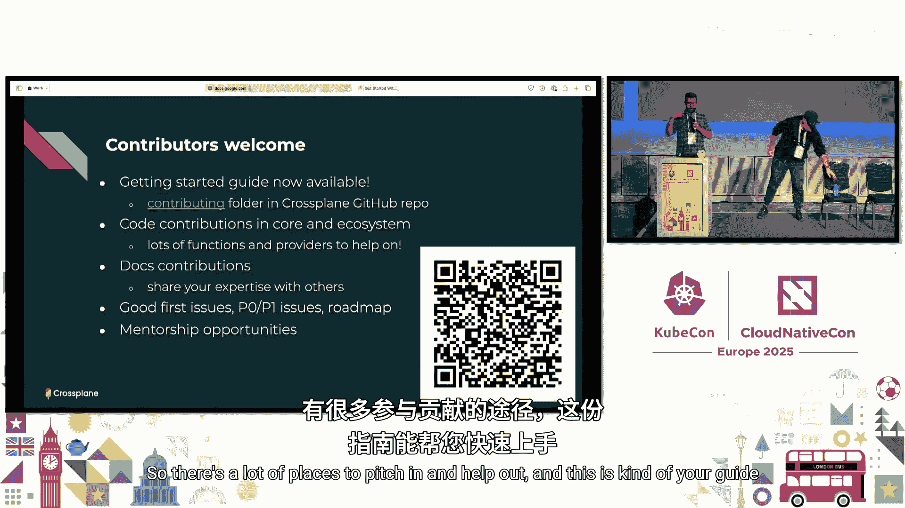

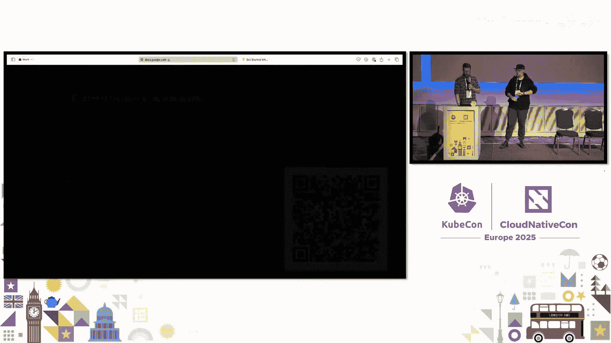

You know， and key takeaway from this slide， Crossplane do I O， go to the website there。

 All these things are linked from there。 You know， you can find the docs。 You can find our reos。

 blog， all that sort of stuff。 So crossplan I， that's where to go to find out other ways to get involved。

 And then final slide here。 Once again。 V too。 This is the call to action folks。

 We showed you off all this changes that we think are really helpful to make crossplane more useful。

 easier to use。 Lots of great stuff there。 So try it out。

 Wed love to hear your feedback and thank everybody for being here today。😊，Yep。

 I think we got three minutes for questions。 so we will take anybody who has a question。

Just I saw your hand first。 talk I'm running to you。 Oh， fear faster than I am。Right on。Hi thanks。

 does Crossplane has mechanism for fetching data similar to terraforms data？In a way。

 it's got primitives you can use to do that。 it doesn't have yet something that's。

Exactly the same as terform data sources， we have two things you can use though we have what we call observer only resources so you can create a resource in crossplay and won't actually do anything in the cloud。

 it'll just mirror it back。And then on top of that。

 you can write functions that will then sort of load that up and。

Sort of do interesting stuff with it where it's a common request to have something more like data sources。

 And we think we've got the primitives。 and we're thinking about what we want to do to build something a little bit more convenient than saying you have to write a function to do it。

 So kinda basically。Okay， thank you。What question。Anyone else？这说了没。还有约咱们这。はい。

Thank for all the prayers。I got a question。 I there a way to schedule the deployment of various resources or want to deploy one or source player to another one in corporateplay to schedule the order like。

The deployment phases。I think you were asking basically can you order the updates or creations。

 right？ Yes， you can。 So because composition functions are pretty open endeded。

 what crossbe will do every time it calls a composition function。

 it'll say here's the observed state of the world。 So you ask me to create a deployment in the service Every time it calls the function'll say。

 hey， I've made the service， but I'm still waiting on the deployment for example。😊。

Which means it's pretty trivial to add logic to your function to basically say， hey。

 just don't create this service until the deployments created or whatever sort of thing。 So yes。

 you can， but you do need to by default， it doesn't， by default， it'll just create everything。

 but because we give you a lot of power。 It's relatively easy to do that。

 And there are certain existing opinion needed functions that support configuration areas that will kind of magically do that for you as well。

 But it's kind of on a function by function layer。Okay， thank you。

then last question was I'd ever hear if you're still here， Bden。there you are， okay。

So is there any way to increase the reconciliation loop interval so we won't get rate limited in some providers？

😊，Yeah to like to throttle it or to pause it or those sort of things exactly Sarah there's a couple of configuration options that every provider exposes that basically allows you to specify how often you want to be syncing resources or you can make them goes slower basically and then there's also the concept of a pause in Crossplanin where you can apply a pause annotation to resources and composite resources and stuff in Crossplayin will stop reconciling it entirely until you unpa it exactly what I take you so Thank you for just a quick follow up on that as well there is another feature that is hopefully going to come at alpha soon called real-time compositions this is more at the composition layer but something that can cause things to be reconciled more than you'd like is that at the composition layer where every 30 or 60 seconds polling and just checking everything we have an implementation that uses sort of watches or kind of like pop so that you don't need to be constantly poll long story short when we get this debate there'll be fewer reconciles in the system and that's a priority for the。

Soon。Cool， yeah awesome stuffs all the time we have。 Thank you everybody once again。

 come to the booth and hang out more。😊。

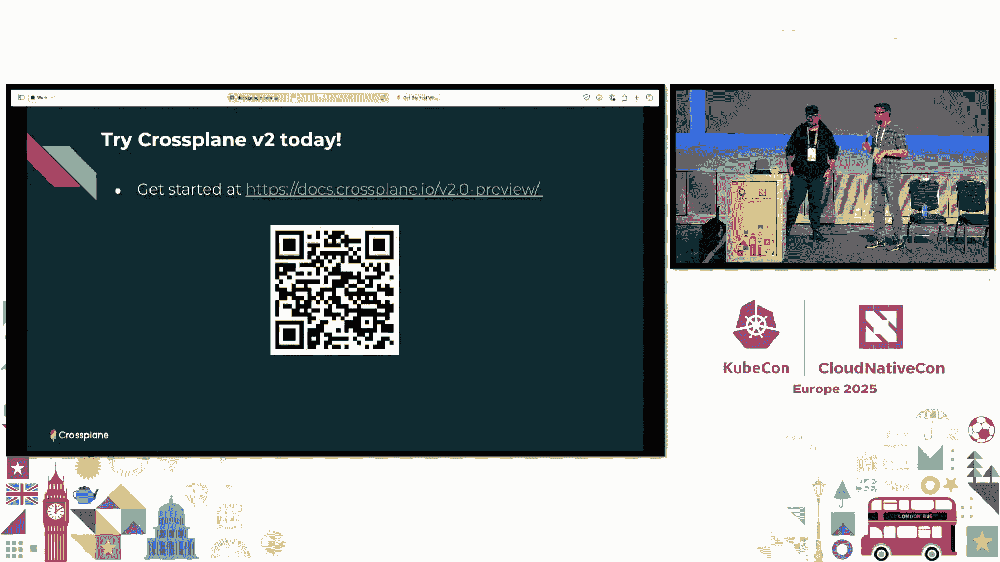