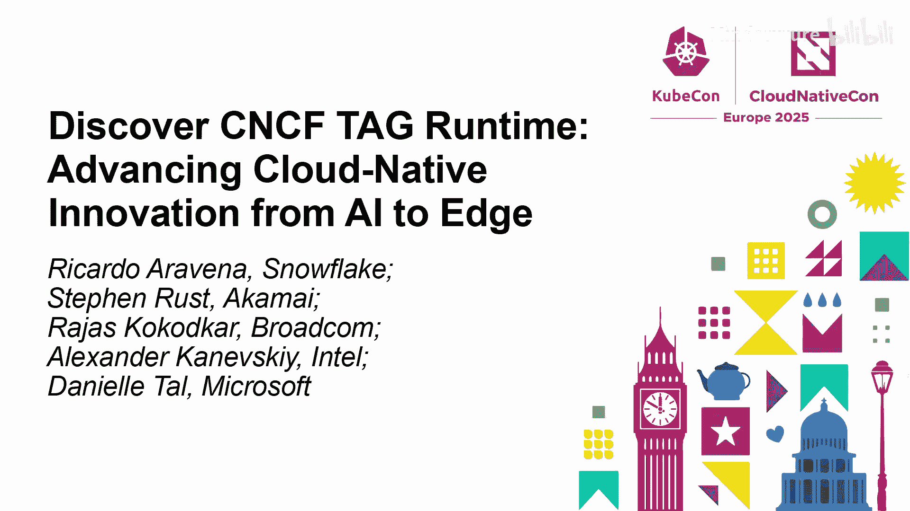
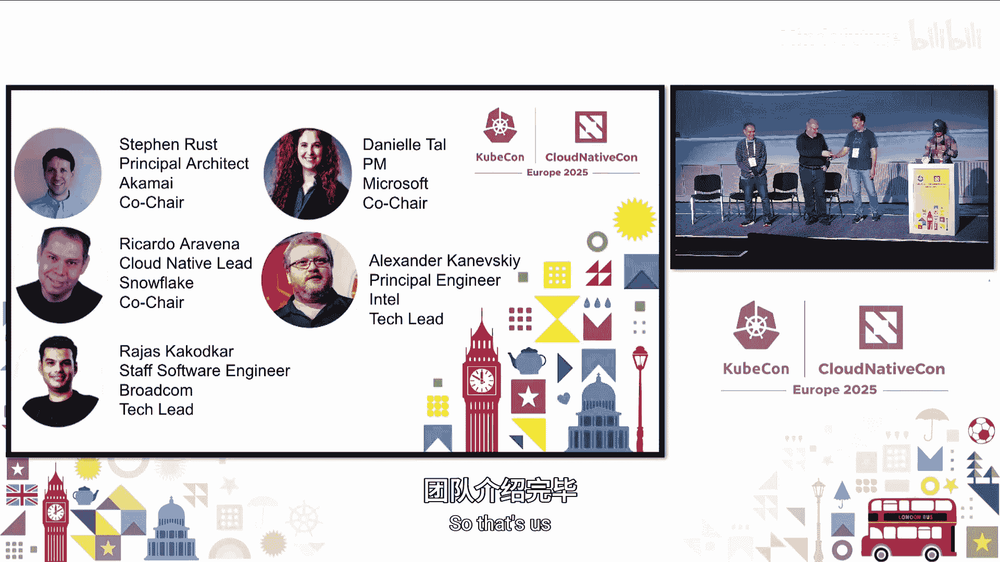
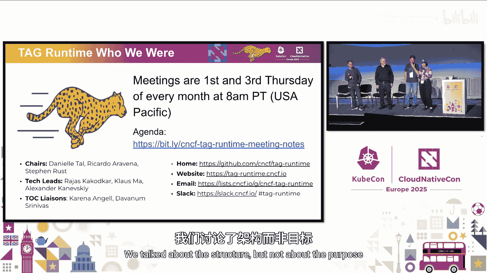
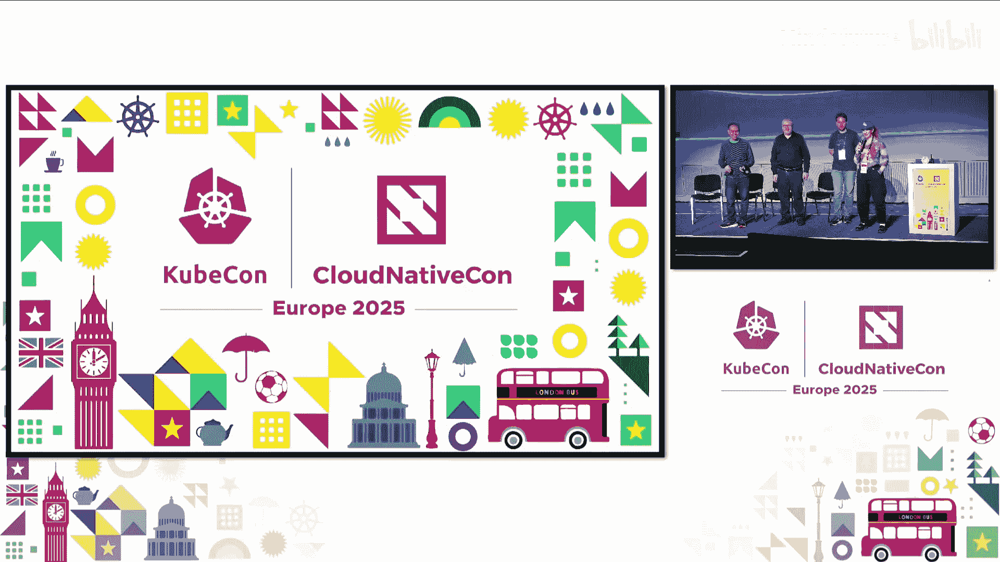

# KubeCon-+-CloudNativeCon-大会2025-｜-云原生计算-｜-可观测性-｜-Kubernetes-｜-Prometheus-p04-P04-Discover-CNCF-TAG-Runtime---Advancing-Cloud-Native-Innovation-from-AI-to-Edg--BV1Cd32zDEBG_p4-

Hello， welcome to the Tag runtime talk。 So we're going talk today about the T tag runtime its current structure。

In principle， we have five speakers， Rogers couldn't join us today and Ricardo might join in a bit。

 so hi I'm Danielle， we got here at Alexander and Stepan。So that's us。

 should we say short something or okay， so I'm a PM for Microsoft and also co tech runtime。Hi。

 I'm Steve Rust。 I work at Akai， I'm a principal architect working on all of our cloud native initiatives for the Akamai Cloud。

 Aka A Leode。And Alexander， can you have Sky work for In。

 doing all different stuff about the Kubernetes and CNC of stack。

 mostly grant times resource optimization and so on， and particular here。

 it's more interest of container orchestrated devices working group and CI spec。By the way。

 I'm Daniel， I forgot to say my name number before。 and unfortunately。

 Rajas was called home so he couldn't be with us today， but we also have Ricardo。Hi， Ricardo Arvina。

 I'm one of the co chairs for Tag run time。 I've been a co chair for a long time。

 like about four years。Co， so that's us。 We're going to talk about the introbo tag time overview of the tagg itself and the working groups then。

K of gonna talk about the tag reboot and restructure。

 and then some ways to get involved if you're interested。So what's a tag。

So we got a nice definition here。 the CNCF technicalnical advisory group scales to contribute by the CNCF Technical and user Committee while retaining integrity and increasing quality in support of the CNNCF mission。

 So basically what the tag goal is to help the T OC to just。😊。

Do whatever is needed if it's technical reviews or just getting involved with the community。

 facilitate discussions and so on will。Get into it in a second。The landscape is quite wide。

 We have a lot of projects。 So that's why we need to kind of restructure tags in order to facilitate all of these different areas that we have at the CNC F。

 So now there is 209， I think， including archived project。 And about。200 like5，6 years ago。

 I think they were like。50。Yeah， so it's growing。And in order to facilitate all of that， then the T。

 O C needs some help。 And that's where we get into the picture。So what does the T do。

 it's a way to get basically to help the TOC to be involved with the community。

 so we facilitate talks and areas of expertise that need coordination between the TOC and the community。

Currently， there are eight different tags， but that's about to change。 We'll get to that in a bit。

And the Ts work with TLC to help to spread the work and across the different domain of expertise。

Some of the projects might be under one tag or more because it depends which area they're attaching。

 So it depends on the scope of the project。Here are some the tags themselves。

 So in the current structure。So you could see the little tiger that's us here。😊。

But we have observity， networking storage， cloud native security。😊，Delivery up。 and yeah， okay。

 you could read the rest。What are the tech responsibility as it's structured today？

So we have the reach out to project to engage with the community Project come and do presentations。

 we have also helped them to do project reviews， start to help to bootstrap initiatives。

 White Pa facilitate different working group， we meet with the community by facilitating biwe。

 fortnightly meetings。And that's like the first often。

 it's the first point of contact for projects project to with the CNCF。All right。Great， thanks。

 Danielle。 So that was really the overview of the current tag structure。

 And then we can dig into a little bit about what， what runtime is specifically。

And what we've been working on here。So really， run time is， you may think it's about runtime， right。

 So clearly， that is how it got it started， but really。

Goes into all kinds of different things as well， such as。Orchestion and different workload types。

Into operating systems and virtualization as well， and then into a lot of edge and devices。

 and you can tell there's a lot of kind of breadth to what is runtime today。And actually。

 a lot of the AI initiatives as well have fallen under currently under runtime。

So just really a broad area。 And it's， it's more than just container runtimes， right。

So some of the examples， and I think it's important to note that this is all about the projects at the end of the day and the tags are here to help the TOC。

 of course， but it's really about helping the projects and those communities because that is why we're all here and that's what makes the CNCF so important。

So a few callouts from this slide， we have flat car， which is recently incubating CBdge。

 which is recently graduated as well as WSM Cloud just graduated last year。

And just joins a long list of projects that have come through。

 even Kubernetes itself is technically a runtime project。

 although very self sustaining today with a lot of its own structure。

And just to go over some of these scope areas， as I mentioned。 So a workload orchestration。

 you can see a lot of the projects there。 it does get into runtime as well， like container runtime。

 So container D， cryryo and Friend Yuki was a recently accepted sandbox project。

 which is a container run time written in rust， which is really interesting。

And I didn't mention the Web assemblymb as well， is also a runtime area of focus。

 So things like Wm cloud， Wam E。And then moving down to serverless。

 O K native and a lot of the OSs as well， so K3S， K0 S was just accepted into sandbox earlier this year as well。

And then special purpose operating systems。 So a lot of the。

Purpose built Kubernetes distros is a good area of focus there。And then， of course。

 we have the AI and then a lot of those related projects there， a lot of。

 lot of interest in that area。 And there's been historically a lot of working groups as well under under runtime。

 and we can get into。Sort of the， the current structure that we have。

In those working groups and talk a little bit about some initiatives that they have been able to accomplish to this point。

So first， do you want to， do you want to talk about this part。 Yeah， sure， yeah。

 briefly about the AI working group。 This working group has been around for。Maybe about two years。

 there's there's been a lot of interest around AI， so the community came together and tried to create something around cloud native AI on how to run AI workloads on top of cloud native。

 but also how you can use AI to improve cloud native workloads like AI ops or things like LLMs connecting to Kubernetes。

 so multiple areas so we have several initiatives going on and a lot of it started with the cloud native AI White paper that was published in Paris last year and subsequently with interest in different areas like an AI security White Paper created in a playground or there's also。

Scheduling challenges， white papers， so there are a lot of challenges around GPU management。

 so the community has come together to try to create some best practices and create a document on that and there's also a sustainability AI white paperper in the works and this kind of addresses the issue with energy consumption which is also kind of related to GPUs。

So there's been a lot of effort around web assemblymbly as well。

 there's been a really cross company cross community kind of bringing a place to bring the web assemblymb community together to work on specific initiatives。

 so one outcome has been updates to OCI artifact layouts specifically for WASM。

And then really working on code updates through kind of in collaboration with the Bte code allianceiance as well。

 So those are different organizations， but this working group allows kind of a CNCF。

Collaboration with that group as well， so they have committed code to upstream in a lot of cases as well as working through W3C standards as well。

The batch system I or BSI is another effort that has a。A community around it。 And you can see on。

The landscape that we showed， there's a lot of batch projects and communities there。

 So things you may have heard of around Q， which has been mentioned and a lot of。

It's really about how best to define specifications and CR types and really resources that are specific around batch efforts。

One thing that I'd like to point out on the batch System Itiative working group that there is a lot of overlap with AI type of things because a lot of the AI type of workloads require batch seduling and efficient use or resources。

 you GPU， CPUUs or memory， so this is tightly coupled with some of the other stuff that's going on in the cloud nativeative AI working group。

 so I'll talk about a little bit on how maybe some of these initiatives can fall into the AI working group with a new tax structure。

 but there's also。An open door policy in terms of like if the community wants to come together and create something that's super specific。

 maybe we can create like a short live initiative， or it could also be a long lips of project。

 but it all depends on who leads this initiative and how the community comes together。

So next working group is container the orchestrated devices working group。

 like one of unusual working groups in the CNCF ecosystem。

 it started in the Lan table like Beckons Kubcon， San Diego just for a few people talking like how are we actually going to use with devices in Kubernetes and the result of that is what like we are one of。

The only working group which produces the code and owns the code in CNncCF so we are owning for specification about how devices are expose it inside the container So it's the lowest building block which like many of like more user visible things built on top of it example is D or common line usage in Portman in Docker and LXC and so on。

 so we have people contributing from different companies practically like all of those big projects related to container run times contributing and a good thing what I really want to announce and Vi Cucon is what our specification 1。

0 is released several days ago。But it doesn't mean what like the work for our working group is over。

 we still have to do maintenance because like all of those big projects are depending on what we are producing。

Plus， there are new things which people are starting to ask more and more and there are some movements in OCI runtime spec。

 so we expected to get support for network interfaces which was again merge to OSI spec just in a few days ago。

If you're interested in devices， please also join our meeting to our small community of hardware vendors and runtime maintainers are really welcome。

So join。Our neighbor working group inside Tagran time is IoTH。

 we have a bit different structure so if previous group doesn't well produce code but doesn't produce the documents。

 IoTH were opposite so if youre interested in age interested how IoT device is connected to a Kubernetes clusters。

 have a look at the white papers which was published well quite recently。One。

 one of them bit earlier one。1， one is re recently。

We have also the special purposese O working group。

 so we had a couple of outcomes for that more like in advocating for our different approaches for special purpose O so we had a panel in Kubkin Paris we had also a panel in the open source summit in Vienna birdsd of Fe in the Last Fo themm it's more like we utilize it to have。

Kd of round table to see where are the similarities and advocate for what is an what is a special purpose operating system。

 so that's the stage that we are in， and we welcome anyone that is interested in the field to come and join and participate。

So now I'll talk a little bit about the tag reboot。

 so some of the changes coming up after the Cu con。

So the new structure of the CNCF will look like this。

 will have the TC making decisions about projects， about the different levels of the projects and about governance in the CNCF。

And then on top behind or underneath we'll have the the tax。

 and this is not going to change in terms of like what it was before。But。

The changes will come with the sub projectsjects， initiatives and the community groups。

 so sub projectsjects will be something like a working group。

 but they'll have an option to work directly with the TOC or with the tag or of their choice。

 if they think they're more associated with a specific tag， they can work directly with the tags。

 but if they need to work directly with the TOC that can do so and this can be included in the charter or the review process and the application process。

And these sub projectss can actually be long lived so they can live for two years。

 three years or as long as the community is active and there's activity going on。

And then we'll have initiatives and these are meant to be shortlived。

 like something specific like a deliverable， like maybe like a spec or some piece of code or the community comes together and creates like something that solves a specific problem。

And then finally， we'll have community groups。 And this， this will be more like。

Meetings where people kind of discuss things together like technology and around like a specific topic。

 so we'll have all this structure available on how to apply for each one of these or how to create one of these in the CNCFTC Rpo and also on the CNCF website or the CNCF structure in the Gi the CNC GitHub organization。

Nextll one， sorry。Okay， so this is kind of like what it would look like in terms of like the different tags。

 so we' have initiatives and for example we could have something like artificial intelligence initiatives and then sub projectsjects could be something like a contributor strategy and then in the technical advisory groups。

 this is where this is the current structure of sorry not this is the new structure of the tax so we'll have five and we'll have developer experience。

 workload foundations， infrastructure， operational resiliency， security and compliance。

And so T run time will map more directly to T Workloads Foundation。

 but it doesn't mean like folks that are working in Tag runtime can actually work with the other taxs。

 so for example there's a lot of overlap with tech infrastructure and there will be maybe topics around operational resiliency or how do you keep services up and running all the time or how do you monitor those。

 etc。And these are more details about the different areas that the new tags will cover。

 so you'll see here the TG Workload Foundation maps more directly with Trantine will you have runtimes。

 containers， VMs， batch schedulers， dynamic scaling， CICD， etc。And。

 you'll see that also there's operational resilience and， and。

 and there are things like that tag related to tagger and time， for example， reliability performance。

 And in in infrastructure， theres some overlap with like compute and maybe edge。

So more details about the scope of Workload Foundation， which is more related to tag run time so。

We mentioned before so there's web assembly， virtual machines， runtime， schedulers。

And some of the initiatives that examples that may fall under tag runtime could be something like a best practice on batch scheduling or something or how to use Giups in a more efficient way and then for the leadership they suggested leaders could come from these different tax like runtime a delivery or environmental sustainability。

 but if you're not in a current leadership role in one of these tasks。

 I encourage you to look at you the scope and the different areas and please apply apply and I mean there's a way to be a tax chair or a tech lead in the specific area that you're working in。

So these are the current working groups in。Tal run time。 And they suggested。

Changes so for batchch working group， we are suggesting either archiv in。

 depending on how much interest there is or applying for a new initiative， same with Wasm Work Group。

 the container orchestrated devices， working group， COD working group。

also the recommended thing is to reapply in IoTH， there hasn't been a lot of activity in IoTH。

 so their recommendation is to archive， but if somebody wants to work on it。

 you feel free to step forward， special operating purpose operating system， apply for initiatives。Or。

 or use a community group in the cloudown native AI working group。

 They suggest to create a T O C sub project。So just wanted to mention that it's important to note that all of those communities。

 it doesn't mean that the work is stopping or that that community is not important。

 It's just in the in the relation to C andCF。 It's important that there's an initiative or something that is a deliverable out of that so the community's work continues and then that initiative can be part of the deliverable and outcome。

So this is just an example of artificial intelligence initiatives。

Recently we had the AI or we have the scheduling White Pa in the works and the AI security White paperper。

 we also had the white paper published last year。And the leadership is usually led by the TOC。

 but then you could have team members from all these different tags and anything related to cloud native or artificial intelligence is applicable to this initiative。

So even with those big tag group boots and changes in the leadership and the way how we are working。

 there is nothing really change in the way how you can participate or how you can actually get yourself into one of the tag groups again。

 regardless how it will be name it regardless we would be like initiative tag or something else。

Please participate， please join our meetings， please join the discussions。

 please help us with review of our new projects。Any any feedback from fields。

 any feedback from end users will be much appreciated by all of T members。

 by all of projects and so on。So。We have currently working groups where will be restructured somehow。

How we don't yet know， we don't know who will be leading in it。

 maybe like it's its maybe last time when we are in this group。

 the engineering was scene and talking about the same subject we don't know。

 but still we are continue working on our particular topics。

While when you until when new structure will be announced， please。

Contact us with usual places we usual like our slacklack channel。 It still exists， still working。

 We're still going to have the next several meetings on unusual time slots。

 same again with working groups。 So until the new structure will be established。

 the work is continue as usual。 And like our leads。

So please yeah please reach out anytime we're available so while this happens and yeah。

 the work continues， it's just a matter of like you know where it's going to fit in the different groups。

Just want to add shortly that the whole idea of this risk structure is to enable the community and help them to grow faster and just like to present and be able to spin initiative more easily so that's just like if you look at the landscape now we mentioned that it's like 200 project that it grow and still grow exponentially so we just think about the next 10 years and where we would go with that so we need to be more had to say it about agile and to support the growth of the community so that's all facilitating the community growth that's the entire idea we talked about the structure but not about the purpose。

So I think we don't have anymore。 That's it for the slide。 So we'll open it up。

 open it up for questions。 So anybody has any thoughts or。Things that they want to talk about。

 happy to answer。Any questions， any hint？

Well， I hope you enjoyed your Cecon。 And thank you for coming for the talk and have a nice Friday。

 folks。😊。