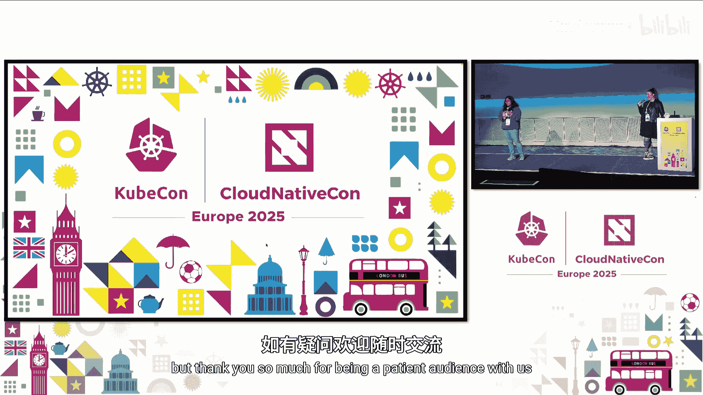
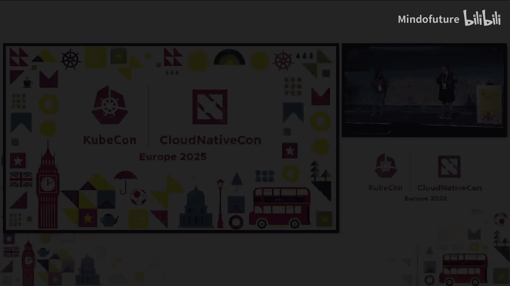

# KubeCon-+-CloudNativeCon-大会2025-｜-云原生计算-｜-可观测性-｜-Kubernetes-｜-Prometheus-p05-P05-Bridge-the-Gap-To-OSS-Adoption-With-Documentation---A-Kubernetes-Story---Nat--BV1Cd32zDEBG_p5-

Alright， so thank you so much to everyone that actually showed up for this talk right at the end of Cecon。

 We did not expect this audience。 So thank you very much for showing up。

 This has been the largest crowd we've spoken to。😊，So last year， we had a lot in Paris。

 I believe yeah， that was that was just like a smidge larger。 but thank you so much for showing up。

 I'm the via Mohan。 and I'm joined by Natalie here。

 and we're gonna talk about how we at Kubernetes are trying to bridge the gap to option with the help of talks So to give you some context。

 we are some of the people who shared documentation at the on the Kubernetes project our coch unfortunately could not be here。

 but we have some of our stellar tech leads and if you probably encounter them or you know attended one of their sessions yesterday。

 That's great。 but yeah I'm at my day job I'm a principal technology advocated Suusza one of the cochairs。

 as I mentioned before。 and I also serve on the Kubernetes code of conduct committee。 What about you。

 Natalie Yes hi， I'm Natalie， pronouns she her and。😊。

An open source architect and Ospoow lead at Cisco， a little small company that you maybe have heard of。

 I'm also one of the coaches of SiDocs I've been involved in the Coms project for quite a few years and I have recently become appointed to the Todo Group Steing committee and the To do Group is a group that's part of the Linux Foundation that gets together folks who are Ospo experts interested Ospo curious folks who want to share best practices and information about how to help your company。

 your area， your domains get better in the open source program Office space。😊。

And so starting right out why we're here today， basically we're here to talk about documentation in the context of open source adoption because。

😊，One of the things that we've normally noticed in the open source space with both of our experiences。

 and it's confirmed by research is that it's one of the important factors when making decisions concerning the adoption of a project within an enterprise or a company right？

 but next slide please。But given the context of today。

 today's presentation where we're both Kubernetes coaches。

 we want to throw out this fun fact where in Kubernetes seems to be the second largest open source project in the world。

 just trailing Linuxox and is also the primary container orchestration tool for。😊。

Roughly 71% of the Fortune 00 companies。 Next slide， please。 And to tie this boat together， we。

 we've received a lot of compliments and a lot of not so good compliments as well about the quality of our documentation So we thought we'd share the knowledge with a lot of folks who might be interested in sort of。

😊，Ramping or improving their documentation efforts in open source and otherwise。

 because it's not just open source where documentation is clearly having worked in an enterprise。

 I do know that we have proprietary documentation that we regularly need to update and improve based on the releases。

So we are going to talk you through how we achieve this feat。 And for that， I think Natalie。

 take over。Thank you。 So we have a decent agenda today。 We've got another 25 minutes with you。

 and if we've got time at the end， we're happy to take some questions and I'll run around with the microphone to help out with that。

 But a couple things we're going to cover today So we're going to talk about the proximity problem when it comes to kind of teams and how we all work together who are working in the user shoes and how we embrace different voices and when it comes to docs and contributions we're going mention this idea around the minto pyramid principle。

 which is quite cool。 looking at how we do a lot of community driven development when it comes to improvements to documentation And then thes things that we would like to improve which is where we talk about the callouts of please help us。

 please contribute to docs。 please， this is the way that you can actually do so。😊，So with that。

 so let's go into the proximity problem。The closer you are to a group。

 I'm just gonna to read this out loud， the more you interact with that group。

 this is the idea of the proximity problem， but you can't be everywhere at once。

 and so you have to choose the group that gets priority given these dynamics is it better to be embedded within project teams or within a technical team so myself and Divia we have a diverse backgrounds when it comes to tech and our work in Kubernetes I'm a web dev by design and then I went into engineering management and now I work in the Kubernetes space in terms of open source and so the technical writing team is actually more my pace in my area unless working on the website necessarily and I believeas you I have background。

 Yeah I have a background was in the trenches I think a decade before I moved into project management and then found my way into technical writing and where I am today as a developer advocate。

 but given that I believe what we just said like you we are not。

The experts or the technical people right now， so to say when it comes to the documentation for Kubernetes。

 we've worked with Kubernetes individually in different capacities in our career but currently there are several more people within different sake more qualified。

 And that definitely creates a problem of whether we should be the stakeholders when we create when we create the documentation。

 or should it be the technical experts that actually create the documentation and get it better by us and that's something that nottalie is going to decipher for Yes definitely we are not the engineers anymore necessarily。

 So we always have to make sure that we're thinking in the space of whose side are we on in terms of representation I it the technical owners or is it the users and I think you can probably guess what our answer is going to be。

 So in terms of any technical documentation， but specifically what we aim for in the Kubernetes docs。

 we need it to be not only readable and usable for the folks。

We're using it but we also need to be technically accurate。

 And those are those two lines that we are drawing here。

 How do we make sure that something is readable and usable in one space。

 but also technically accurate， we can't be in both places at once well I think Tim Bannister in the audience here our former tech probably can sometimes but at the same time it's one of those things where we really do in order to not only help our workloads and probably our work life balance。

 but we really do have to maintain that divide and so in the Kubernetes documentation while we inG docs we say that we own the docs we don't own the content of the docs and that's something that's really really important we own necessarily how to documentation but then we talk about this idea of what and so。

Our docs requirements in the project， we talk about how we have different features that come up with different stages of implementation Albetta graduated and we talk about this idea of ownership in the area of CP owners So for folks who don't know a CP KEP it stands for a Kubernetes enhancement proposal and this is a way that we actually get features introduced and moving throughout the Kubernetes project and it's a really specific way of how we divide up technical ownership ownership of work that is being shipped in the project。

 this happens three times a year， if you're interested in joining the release team to help out with the Kubernetes release。

 you can also come and talk to us have been on the release team before it was awesome but basically these requirements mean that these stages of implementation。

 not only are handled by technical owners， but a lot of those features require docs and those docs and how you actually write them and implement them。

 that's where we come in to help out。So we work with the C owners to do exactly that。

 We need to shape how docs are structured and the reason that we need to do that is because we're representing the users。

 we want users to be able to approach our docs in a way that's readable legible and that has a flow so that they're getting what they need out of it which is you know at maybe the beginner level versus all the way up to an administrator and app developer level we need that flow to be consistent and usable and that's why we in docs own that specific area and workflow and then the what as I mentioned before。

 that's the technical content that's actually owned by CP owners and we are always getting technical LGTMs in terms of docs to make sure that even though we have a lot of knowledge around Kubernetes as well getting that actual technical overview is super important because the actual content of that documentation is owned by a different area。

 different special interest group and that representation of them needs to be accurate as well。

So we represent in SG docs， the uses of Kubernetes。

 We set the standards to make our docs usable and kept owners ensure that docs are technically accurate。

 So those are the two groups that we're talking about in terms of proximity。

 and we are always the ones knocking on the kept owners' door saying， hey， you got to change this。

 Hey， the style is like this。 Hey， please use site relative links as much as possible， etctera， etc。

😊，So what we wanted to do in terms of helping to encapsulate that message that information。

 we're going to put out， I think every speaker is late with slides usually on shed so we're very sorry about that but we will after this talk put our slides up and we wanted to link here from last year how we navigate how we navigate collaboration across across Sigs with Docs in the project that Dea and Ray and Xander were able to give last year Xander and Savi sorry should I say and Xander is one of our tech lead。

 Saviha also involved in S security and how we enable that collaboration this is a really cool talk to understand how we do that two team proximity problem work and feel free to watch it on your own time。

Oh start playing。 So that is probably also。Better to start。 Yeah， All right。 I'll over to you。 right。

 So Natalie talked a lot about how we at sick dogss are more， you know。

 representing you as the users and how we want to make it more user friendly by representing you all when it comes to actually creating talks。

 So what we do is we basically classify the docs based on。😊。

What Kubernetes does for our various users and who actually uses them。 Now， when I started out。

 obviously， I did not start out as a co chair or even as an expert。

 I wouldn't call myself an expert still， but I did not start out knowing a lot。

 So there are various levels of documentation that we have we have concepts and how to for you know people who are just getting started。

 So if you go to Kubernetes i slash talks， you'll see that there's big level information with a glossary with you know page of concepts or rather different pages of concepts and tasks and how to of going from you know scratch to having a Kubernetes cluster of your own based on the operating system you're using based on the kind of tooling that you're using。

 there's a lot of material there on getting you started。And getting you hands on with Kubernetes。

 we previously also had catata tutorials which we had to remove because of some issues。

 but those also were like really good big friendly resources that we had to actually go from zero to maybe a cluster of your own and now when it comes to Kubernetes the main the main people who are using Kubernetes。

 those are the developer， system admins， architects， etc cetera。

 we have documentation for them as well。 So we have like API reference documentation。

 a bunch of you know advanced conceptual documentation that may be required by folks who are working on it in a more deeper capacity we have those as well next slide please So with this we focus on catering to different skill levels not and it could be someone as new to Kubernetes as you know getting started with the cloud native ecosystem in general。

And we want to ensure that it is you know consistent。

 it is recognizable so the language that we use which we shall get to in a bit is also very consistent and we make sure that when we are evaluating the documentation you get that consistentent voice from us rather than it being inconsistently structured and inconsistently driven across the board the reason being one study actually did show that the voice and the tone of the documentation that you write actually does have an impact it's one of those really small things that you do not really notice but it does have a huge impact on a consumer and how well they are able to grasp the information that you are conveying in your documentation which brings me to the voice bit because we if you've noticed our documentation。

 any of it there is no first person reference it's not。There's no there's no， you know。

 passive voice usage。 If you， if you notice that， please obviously do flag it because that's a part of our style guide that we。

Consciously did not use all of those， but this is how we actually ensure that the voice is consistent across our documentation and within S dos。

 we actually use active voice to make documentation easier so that the user when they complete a particular task。

 It is them that it is the user that youre addressing。

 It's not a passive you know service that we are providing。

 So it basically gives you or empowers you to take responsibility， and it also you know。

 positions you as a subject rather than a passive consumer of documentation。 again。

 throwing back the style guide that we have here。 youall can visit this link and it's a constantly updated style guide we have made edits to it。

 So this is not a set stone sort of a thing this definitely gets updated as in when we find。You know。

 things that would be beneficial for our end users to consume。 and we make edits to it。

 I think we recently had a couple of edits a couple of months back。

 So we address the user or the consumer of the documentation as you and use active voice all across the documentation and weve always stressed on the usage of direct language。

 We do not want you to rise write Shakespeare and prose。 That's not the end goal of documentation。

 Like I'm pretty sure nobody would like reading Kubernetes documentation in Shakespeare and prose。

 It's already very difficult。 Let's not complicated。

 translating Kubernetes documentation and it would be and it would even be worse if we were to use the use flowery language to actually translate across different languages right。

 So we ensure that。The language is simple， It's easily consumable。

 and it is addressed to the user that's actually consuming these talks。And with that。

 I think I'll hand it over to Natalie to cover the next few aspects。 Yeah。

 so we talk about how we're addressing users and how it's really important to be direct and communicable in that way。

 But on top of that in terms of like how you communicate the docs。

 we also think about in terms of the personas that we're looking at in skill sets of how our docs are consumed。

 and how people are going to be reading what we're actually putting out there。

 And there's this really， really cool concept called the Men pyramid that we want to talk about here。

 the Menyramid principle that helps us actually structure how docs should be consumed for us specifically in the Kubernetes project。

 So the Menyramid principle for folks who don't know it's a framework for documentation specifically in the technical writing world。

 and it structures information like a pyramid。 So the idea is that at the very top is the most important takeaway and then you go down in that structure to the most and least I don't want to say least important。

 But let's say you're getting more and more granular in terms of the information that you need。

 this concept is really。quite a lot of factors because we talked about personas before and we need to understand and we constantly are asking and engaging with users and contributors how you're using the docs。

 Why are you using the docs。 People may just say oh， people want to learn how to use Kubernetes。

 Okay great。 What are you using it for Are you using it for your work。

 are you doing hobby projects at home I this something that you had to do because your boss told you。

 are you moving careers into S or something， for example。

 or are you taking an exam All of these different kinds of use cases is something that we like to try and focus on in terms of docs consumability and thement pyramid principle helps us do exactly that What we want to be doing with that specifically if I go to the next slide。

 as you can see，79% of online readers strictly skim content when it comes to docs。

 especially docs that is so vast and so detailed like the Kubernetes documentation And so we want to make sure that we're using something that we call scannable text principles。

In the documentation style that we employ there。 So what's a scanable text principle， for example。

 subheadings having the main main key takeaways at the top bullet points is a very good scanable text principle。

 things like this that seem a little bit sometimes obvious。

 but you're not sure why it's really grouped into these kinds of documentation principles to make sure information that you need is being highlighted in the places that you need it。

 And so our doc style guide again is very very much influenced by how general users read on the web。

 I've got information about that study in this slide as well。

 where we want to be making sure that any use case or any possible use case that any of our personas have can actually be be looked at and be good with the documentation that we provide。

 And so I mentioned exams before。 And this is a really great use case a lot of people don't kind of think about that often。

 you know when people are taking the C and CKD they're often kind of。

Study cramming These folks know usually how to use Kubernetes。

 but those exams are hard and they're hard on sort of on purpose。

 but we make sure that our documentation is kind of geared into helping folks with these exams as well so they can kind of you know study for those last three or four hours before before they're taking those tests。

 I know a lot of people who do it and it's the docs structured in the way that we do around this menpyramid principle is actually really。

 really great for this kind of use case So it may not seem as an obvious thing or like why would seek docs care about people taking the docs exams well again。

 one of the different personas and different reasons why people would be using our docs and why we want to improve the reability of that So the menpyyramid principle is something that it's a very ny techwriting thing。

 but if you ever want to hear more about it， please come speak to divvi and myself because it's a really cool way to structure your information projects。

Allright， and now we're gonna go into some community driven development。 We've got 10 minutes。

 So again， we talk about docs， another really great and contributing to them and another really great way to generally contribute to docs。

 and we say this to folks all the time is actually using them if you need to follow a tutorial。

 And it turns out that maybe a step that youve replicate it is wrong。

 but you know the right one put in that PR to fix the docs for example。

 this is something that I can't stress enough。 the best way to contribute is to use docs and possibly find those things that could be fixed in the first place。

 And this is part of the community driven development work that we want to kind of chat about today。

 the Kubernetes documentation。 It may come as a surprise。 but it's never perfect or complete。

 And this is something that we stress consistently。

 we have three leases are a year I mentioned And again。

 because we have different features graduating to different stages。

 We have to update different feature flags， features that are need documentation because the user a facing。

😊，Just having doc and having a docs team as part of the release team three times a year。

 you're constantly going to get these updates on top of that。 we have 16 localizations。

 including English in terms of what languages our docs are available in and there is no way they are always up to date either。

 In fact， the amount of edits and changes and improvements that come into English docs。

 there is a natural lag that will happen for our localization teams and they're always trying to make sure that they're catching up to give their users the best experience on the doc side too。

 And then finally on the version documentation side in terms of support。

 that's another reason why docs aren't always going to be perfect。

 there are going be different versions of docs different features come about。

 And that's something that adds to the inconsistency of completeness when we when it comes to communitiesubernetes documentation。

 So we need continuous contributions。 And that comes from a very dedicated community。

 I like to say we are all pro drive by contributors。

 If you just want to do one or two things definitely get in contact with us's something that we absolutely。

Happy to to accept。 But with that， we also have this idea in mind of making sure that we're keeping those users in mind in terms of readability。

 and we're also keeping in mind a couple of things where I put my engineering manager hat on for for a second in terms of what contributions that we want。

😊，What would the docs be improved with a certain change。 This is a question。

 especially in S Sig docs leadership， We ask in PRs and issues and in meetings all the time。

 is is this an improvement， Are the docs better after this merge。

 and the majority of the time it is yes。 And that is why we're leaning towards wanting to get that contribution through is a perfect doesnt need to be。

 But are docs improved and better because of this great， Let's try and push forward with this change。

 And so that's why we talk about that， we encourage PRs that are good enough It is really。

 really hard to as a contributor going maybe somewhat quite new into the project。

 and you're putting a PR through and you're doing a lot of back and forth comments and reviews and it's a long drawn out kind of maybe possibly painful process。

 because there is maybe a reviewer to who wants to get the things that you're submitting perfect and。

Exactly right。 That experience sucks and we want to make sure that there's a bit less of that。

 that there is a bit less of that。 are these docs good enough。

 Is this change already an improvement And can we make another PR to make the improvement better again。

 This is something that is like I think in the last couple of years for docs is a bit of a new leaf where we're really trying to just get the changes out there and get the experience to be better。

😊，And with that， each contribution has an engineering cost。

 This is something that especially when I used to manage engineers。

I used to talk about like how long is this going to take。

 how much of your time and context switching is this going to take and so on and so forth。

 There is an engineering cost to every contribution。 and so when we talk about good enough。

 we do still have a certain baseline standard。 and what we talk about there is this idea of trivial edits。

Again， a drive by contributor might just see， oh， there's a small typo in this。

Equivalent of three pages of documentation。 I'm just going submit this small fix。

Puttting that through getting the review to happen， getting the merge to happen。

 getting the PR wrangler that we have on the week to actually see the notification I'm so guilty of this。

 it's something that comes at a cost and so what we want to do is encourage folks to ask themselves can this doc be improved further maybe you find a second third spelling mistake maybe you see that actually this big chunk of information would be better suited into a bullet point format for better readability and you giving your reasoning as to why because it helps you maybe read something this way。

 Those are the kind of contributions drive by or not that are really great for us to receive because it shows us that you're thinking about how the docs are going to be improved for you the user in terms of how you then consume the docs and that's the absolute golden golden standard for me and I think and a lot of other docs that are maintainers when it comes to PRs that are coming through So yeah every contribution has an engineering cost？

I can wax lyrical about this topic for a long time， so I'm going to move on。😊。

And then with that on top of that， we're also always looking for feedback with our docs。

 these are two quick screenshots from the majority of the documentation that you see up on the Kubernetes IO website where at the bottom。

 when you scroll to the very bottom of the docs page in the bottom left hand side of this slide。

 You see this little feedback option where it says feedback。

 Was this page helpful to click buttons of yes， no。 we get a lot of notes。 and that's okay too。

 because that gives us a great signal。 unfortunately， the signal is just it was not helpful。

But we don't know what part wasn't helpful or we don't know if we don't know what the meaning of helpful is to that specific user because of what they're using the docs for。

 And again， we need to get a bit more granular with that tool。

 we're looking for ways to improve that。 But then on the right side。

 the right image that you see on the screen there in the top right corner of all of our docs pages。

 we have these options where you can edit the page create an issue you can print the entire section which Matt Fina from so just mentioned that if you wanted to print the whole API reference documentation will be over 1000 pages so don't do that。

 But but we also add this here so that folks can see and have a bit of a call to action that wow。

 I can contribute to this thing that I think is maybe that maybe could be better。

 And that's something that we're always hoping to highlight to users as well。

So now I'm going to touch upon the fact that although we've given you all these steps and tricks were not the standard。

 we are not perfect。 and this has been drilled consistently。

 I know that but we are also looking on ways to improve the documentation One of the ways one of the things that we're looking to improve is our API reference documentation and the way we generated in fact if you were not able to catch this talk this Ccon I think it was just yesterday was it was just yesterday and probably in the rooms you know in the to the side of us。

 but this is something that we are actively trying to revamp as a project and we have a subproject dedicated to reference documentation but again。

 it it has a lot of issues because it has a lot of code that is basically you know needs to be revamped and we are looking。

For help。 So if you're like， you know。Proficient with Co and would like to contribute orython because it's just a bunch of batch scripts that call Python script。

 Please help us Yeah We are looking like we we've itated this request everywhere。

 So now now I think this is the best avenue to sort of like issue a call to help。

 So if this is something of interest， please do reach out。

 and the next bit I think I'm gonna put them on the spot here this is one of the things about our blog sub project。

 and we have been lacking blog reviewers and approvers for quite a while right now。

 we've been trying to improve the situation And fortunately， or unfortunately。

 we've not been able to do much。 although there has been little sports of progress here。

 So this is something again， that we are looking to improve because blogs as you might you know。

 envision they come out every release and every almost。😊，We have like feature blogs。

 we have a release blog。 We have blogs that just do not fit anywhere in a release but are just like use cases and case studies and stuff like that。

 So there's a lot of work in the blog sub project as well with respect to approval in reviewing and we need people like all of this is still very much done by people with actual personal lives whenever we find time I do unfortunately like I get four hours of time where I sleep So so we have actual personal lives and a day job So we are all doing this in voluntary capacity and you can help you know join the Kubernet slackla we hang out on S dog Sck channel but there are also a couple that have not mentioned youre dedicated to localization and the blog sub project but if that's of interest。

 please let us know but do join slack do Kubernetes slackla link。

And we urge you to read our contributing guide if you are so interested in contributing to the documentation and whatever Natalie and I have said actually does reflect in most of our contributing and style guides there's a PR process and now since we're in Ccon I can you know assumeoom safely that a lot of you all know Github。

 So we have a PR process that we go through when we accept a contributions。

 so please be familiar with that。 And if you have burning issues feedback you know we have mailing list。

 but we rather chat face to face on a call during meetings attend our meetings。

 you will get the invites to those by joining our mailing list。

 and last but not the least there have been some fantastic talks at previous Cuecons。

They're available freely on YouTube。 You don't have to pay us。 So please go ahead and watch them。

 And Tim Hi has actually given a good talk with you know Celete and Brad about the introduction to Kubernetes talk。

 please go ahead and watch it。 And if you're a new contributor， want to get started。

 attend the monthly new contributor meet and greet that we have for sick。

 it's first Tuesday of the month1030 UTC。 I do not know what that translates to another time zones。

 But you can get the invite in your inbox by signing up for our mailing list。

 And I don't know how much time we have left。 But thank you so much for being a patient audience with us。

 Yes， thank you so much。 If you have questions， come and find us。 Thank you。😊。

