# KubeCon-+-CloudNativeCon-大会2025-｜-云原生计算-｜-可观测性-｜-Kubernetes-｜-Prometheus-p06-P06-Beyond-Classical-Cryptography---Building-Quantum-Resistant-Cloud-Native...-A--BV1Cd32zDEBG_p6-

Thank you for coming out。 This talk was originally aimed at being。

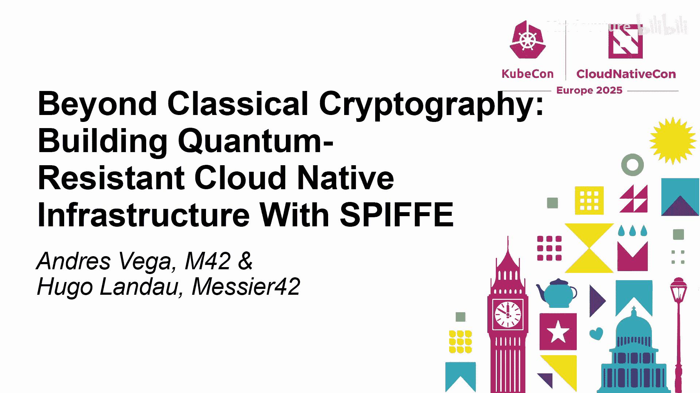

Sharing our end user story as end users of the project and contributors to Spiffy Inpire。Now。

 after chatting throughout the conference with different folks throughout the week。

 we feel there' is still a lot of skepticism and lack of understanding。

 possibly even feared out uncertainty around quantum computers and quantum resistant algorithms。

 So we shifted things a little bit last minute to explain some more of the case in the background was the impetus behind it。

I will preface with， I am not a crypttographer， but over the past year working with Hugo and closer to the cryptography community。

 I have come to learn the most dreaded situation for a cryptographer to be in is to have to explain。

The math of a crypto system to a lawyer。 And why is that math secure。

I recently found myself only a couple weeks ago， having to explain it to a lawyer myself。

 And to my surprise， he was able to grasp it。 And he hit me back with a great analogy of。😊。

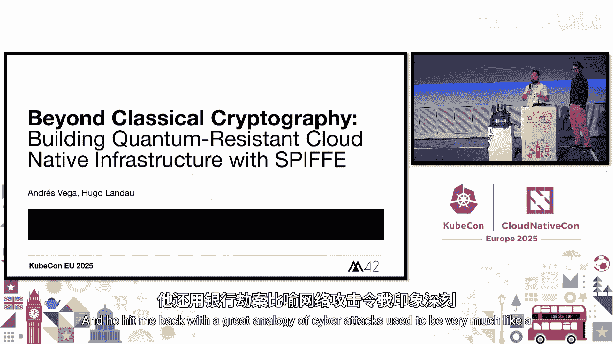

S cyberber attacks used to be very much like a bank heist against a clock， quick， frantic， loud。

 They only had as much time to like detection meant failure now。

These attacks have turned a lot like forklift jobs。 The attacker lifts the entire safe， the data。

 the credentials， the systems and takes it somewhere quiet。 No alarms， no rush。

 just a slow methodical decryption and exploitation。

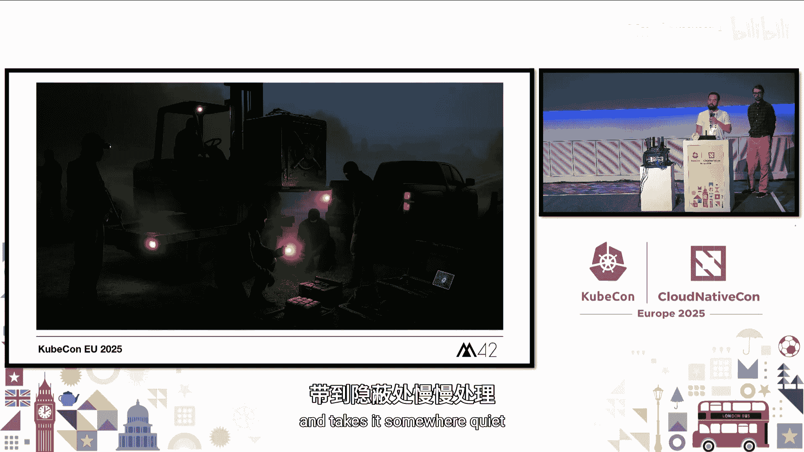

A blast of openafe does bear a lot of resemblance through unscrambled data from a Kubernetes container。

Forward secrecy protects past and future data， even if long term keys are compromised。

 This is especially critical in systems where confidentiality needs to last for decades。

 like in healthcare care， finance or defense。While current cryptographic systems are still holding strong。

 the rise of quantum computers could change that dramatically。

 even though we don't have large enough quantum computers yet， the threat is there。

A quantum computer operates over qubits。 A single ideal qubit exists in a superposition of the basis states of k0 and Cat1。

 which correspond to the classical binary by it 0 and1。 But instead of these being just values。

 these basis states are actually orthogonal vectors。 and they form the basis for linear vector space。

What that means is a single qubit can express any linear combination of the vectors， Ke 0 and Ke 1。

So let's look at the composition of a qubit， which we call phi。

 we will write theres a cat phi equals alpha k0 plus betaca1。Although by definition。

 alpha and beta were called a probability amplitude， meaning their squares have to add up to1。

 the qubit allows for states like Cat0 plus get1 divided by the square root of  two。

 which means it's in a state where both ats0 and 1 will equal probability。

 and more importantly that property scales。Most traditional encryption today such as RSA elliptic curve cryptography and Diffy Heman rely on the difficulty of factoring large numbers of solving discrete logariths。

 However， quantum computers can run short algorithms which can factor large numbers in polynomial time。

 making RSA and ell curve encryption obsolete S remains the biggest threat shore algorithm was the proposed by S in 1994 and defending against that requires a new set of mathematical algorithms we have to diversify the set of mathematical problems。

 That's why the National Institute of standards has already started standardizing quantum safe alternatives。

Of the quantum safe algorithms， lattice space cryptography makes for the most versatile foundation for quantum resistant crypto enabling。

Multiple primitives like fully homomorphic encryption signatures and key exchange mechanisms。

 they offer strong security reductions to problems like learning with errors and are built in linear algebra over n heart lattice problems structured as anti dimensional grits。

 as you see on the slide。 This is the backbone of schemes like k and the lithium。

In round three of the NIS post quantum cryptography standardization process。

 which culminated last year， NISist selected Kver， ML L Kim。

 and ML L DSSA as federal information processing standards， PhPS 203 and PhPS 204。Now。

 breaking classical crypto might feel decades off right now。

 we would need thousands of fiscal qubits just to get one reliable logical qubit。

 and IBM thinks we might not reach that level until the late 2030s。

 That said a surprise breakthrough a black sn event could speed up things much faster than expected。

Right now， there's a laser 10 x capability gap between hardware and what they need to break。

 what they would need to do to break modern cryptography。 So we're not quite there yet。

But of what makes it not quite there yet， are technical hurdles。

 like qubits not staying stable for long enough。 There's a lot of errors through computation and challenges in scaling up this quantum computer systems。

 We haven't really cracked quantum error correction。

 which is essential for making quantum computers reliable。In recent weeks。

 we saw Google announce Willow at 105 qubits， and that's not quite cryptographically relevant yet。

 We would require millions of qubits and error corrections for such a task。

 and the current focus is quantum error correction and scalable bits。 At the same time。

 the expert opinion has started to shift。 This is a graph from the global risk in where the surveyed experts。

 but the likelihood at around 30% of there being a breakthrough in the next decade。

 That's quite serious， considering attackers can already harvest data and the cryed later。

 So even without a quantum computer yet， there is a thread window。

 The moment data is encrypted today and for the time period needs to stay secure and the moment in the future where quantum computer has made the cryped retroactively。

So if x plus y is greater than the quantum thread because the data encrypted today like consider。

Healthcare data requiring long term confidentiality must stay secure for about 50 years。

 It will take 10 years should they commence work today to migrate systems to quantum safe alternatives。

If a quantum computer capable of breaking RA and elliptic curves arrive within the next 60 years。

 that organization is already at risk today。But。Very well framed by Ryan Hersst in the cryptography community。

 If you handle a life critical data， you should already be taking action。

 if your organization deals with sensitive data that requires long-ter confidentiality。

 you should start thinking about it today， but if you don't do you with either chances are your organization may not face this in the time of your career。

But quantum computers aside， if a quantum computer never has realized。

 what is the value of these algorithms， given that there's enough attention to the problem。

Classic cryptography。Cas so implementationation flaws that can lead to significant vul vulnerabilities。

 You can look at the documentation for Python cryptography， the Hamet module。

 And it has the warning of， you should only use it if you know 10 percent what you're doing。

Things like timing site channel attacks， weeks up group of attacks or off curve inputs。

 These crypto libraries often expose very low level hazardous APIs that are very easy to misuse。

Is like shooting yourself in the foot。 And despite strong standards。

 there's many flawed implementations that remain persistent to these problems。

 So the merit of this newer set of algorithms lies and the diversification of problem。

 particularly constant timing implementations， deterministic fuckes like shake。

 which reduce the chance of failure due to poor randomness。

Defining sampling stops for attackers for exploding bias and deterministic behavior。

 Many of these algorithms are formally specified and formally verified。

And fastsky generation isn't really about performance。 It also enables forward secrecy at scale。

And vetted parameters prevent， like， do it yourself configurations。Secretets can't be long lived。

Particularly in national defense， governments tend to work with secrets with lifecycls for about 25 years on top of that with the grounds of store now the crypla attacks。

 meaning an adversary might store encrypted messages today that have been exfil traded and decrypt them once they have a large enough quantum computer later。

 Many governments like the UK and the US started to legislate a plan to migrate systems。

 This is from GCHQ only last week。NSA， the last year released updates on CNNSA2。

0 with the advisory to account for quantum system cryptography。

We know cryptographic migrations tend to take a lot of time。

 We can look back at the Sha 2 migration timeline。And the sequencing of faces for cryptographic algorithm transition from selection and development。

 standardization， implementation， deployment and usage where we're at today's like very early steps of implementation。

 but the majority of the industries is not quite there， certainly not the enterprise。

There are real world adoption examples of key digital infrastructure。 There's not an exclusive list。

 There are many more OpenSL just announced in the last week， near term roadmap for it。

 so how can the Kubernetes community and Cl native community take action to prepare。

It's important to limit the utility of keys to an attacker。

 and the key lifespan is not just about the algorithm。

 It largely depends on how the keys are managed。 using keys for shorted periods will reduce exposure even if those keys are compromised。

 regular rotation will limit risk， but it also will help you stay prepared for transitions。

Historically， as an industry， we haven't done a great job if we look at high profile compromise like digit notor。

 heartbeat， storm。A lot of the key management we have in place today focuses on reducing sprawl。

 but not in true protection。 even if you're using hardware security modules。

 Keys are most exposed when they're in use or when they're distributed。

 And that's exactly what where the fences are the weakest。

Cryptographic agility is about staying ahead of the evolving risk。

 that means being able to swap algorithms， cphers and protocols easily。

 managing key securely throughout their life cycle。

 and adapting policies as standard change and staying prepared for new cryptographic threats in the horizon。

As the cryptographic right answers evolve and the use of post quantum cryptography increases。

Commersurally， the anxiety and the enterprise will grow。

 the fear is often driven by lack of clarity in what applications use cryptography and the unknown outcomes of changing algorithms and rolling keys。

And that hinders adoption。 Now， to overcome that anxiety， there's steps you can take。

 you can eliminate manual processes and remove the human from the loop。

 You can make use of better visibility and observability to help trust the safety of changes while standardizing the practices that make everything easier to understand and debug。

 And by regularly exercising those changes， you will build the confidence that teams need in order to move faster。

Adam Langleles quote is a great metaphor for crypto agility。 The idea is fairly simple。

 Instead of spreading complexity across the system， focus on a well defined， maintainable point。

One joint well oiled。 That way， when crypto needs needs to change。

 you will have a single place to update making your system both adaptable and secure。

Key management is often treated by auditors or compliance teams as a checkbox and just rigid based policies。

 but also ensuring you overcome the disconnect between policy teams and operations is critical。

 There are a number of operational challenges that I'm not going to cover at length。

 but having them on screen for you and for posterity if you want to look at it after。

So let's bring it back into being a spiffy maintainer talk。

 I've used the spiffy throughout the last decade of my career throughout many of different organizations。

 and there's a number of reasons why we chose to build around it。It gives us dynamic。

 verifiable identities for every service。 There's no more static API keys or long lift certificates。

 The credentials are shortlift and automatically rotated， reducing the risk。

 and identities are tied to trusted runtime signals and wouldpi the reference andation。

 We get centralized control over the issuance， renewal， revocation all governed by policy。

When authenticating workloads， service account level trust is not enough。

 you need workload level attestation， you measure the code， verify the runtime behavior。

 possibly even tie it to trusted execution environments or policy based context。So with that。

 I'm going to pass it on to Hugo and talk about the work and the approach of fitting PQC into Spiffy Inpire。

系い。So SPiffy and spre make use of cryptography in ways which require adaptation to obtain PQC security so it's based on TlS Mu TlS specifically。

 which uses asymmetric cryptography， uses care exchange mechanisms and it uses certificate verifiers。

 which is a。Pie of data which verifies that the counterparty controls that certificate。

These are vulnerable to cryptographically relevant quantum computers。

 So these need to be retrofitted with new quantum resistant algorithms in order to make neutral Tl S secure in the post quantum landscape。

Siffy is based on Tl S。 It is based on X 5 and9 certificates。 It can also use JWT tokens。

 So we need to retrofit these。Formats with new algorithms。

So the real highest threat that is in this landscape is that of the cryptographically relevant quantum poses to key exchange。

 because this allows attackers to capture data that is encrypted now and store it on the speculation some day in future。

 They may have cryptographically relevant quantum computer。

 And then they can just retroactively decrypt all data that they have captured today。

 which means that you actually need to be thinking about this threat right now。

 So the absolute highest priority is to tackle the key exchange piece in the Tl S stack and replace the existing exchange algorithms。

 such as elliptic curve David Heman with a。Post quantum secure key exchange algorithm。 Of course。

 you also ultimately want to retrofit the signature algorithms in X59 certificates and in JWTs with post quantumum secure algorithms。

 But because that requires an active attack， it's less urgent。

So we integrated post quantum cryptographic algorithms to Sire。 We added Kber X 25。

519 hybrid key exchange， which is post quantum procu。To the T L S stack that is used by Sire。

We augmented X 5，9 certificates with dilophi and free signatures， which are now the basis of M LDSA。

That has been adopted by NT。As the basis for authentication。

 So we have tackled both of these threats， both the higher priority threat and the lower priority threat。

Designing for quantum security， we have now T， L S with post quantumxography。

 which can be used alongside with the filtering policies that Celium allows to express filtering policy at layer 7。

 including HTP request fragments。This enables secure cost cost communication。

So the building blockss aspire，sillium and envoy to actually support the service mesh approach where H T TB requests being made over M T L S can actually be audited and inspected。

In terms of the URL structure。To allow and deny requests at an application level based on what is in that URL。

So now we have a short demo。We didn't really plan not to bemiced up and having to handhold the microphone。

 so I might put it like。Right here， right here for Hugo， thanks。So。We。

 we have fitted this for tactical edge equipment。 We have a X 4000 and and a couple gateways。

 So what we have here is a free node Kubernetes stack running selium。

 as you can see if they on Cium status。

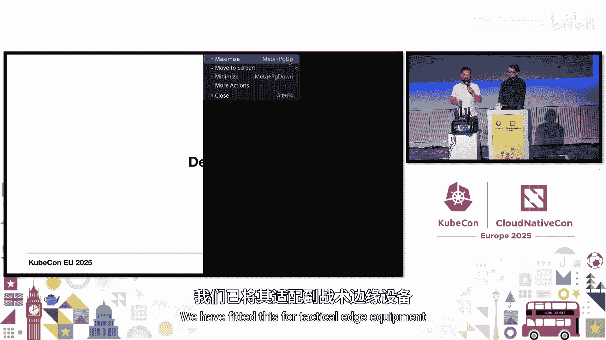

We have a lot of different things running， and it's all in good status。So。We have a short payload。

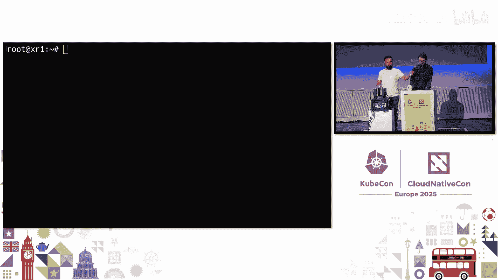

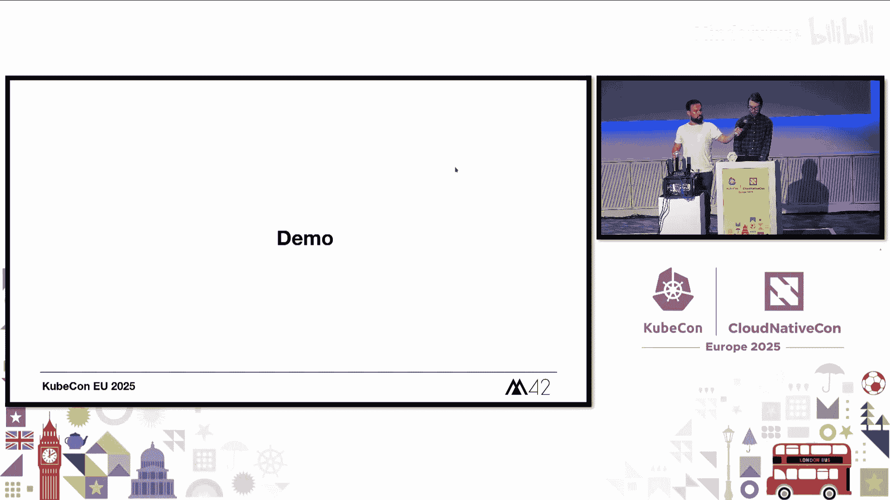

嗯。Okay。So if we take a look at。Our namespace is。 We can see we have a default name base。

And we have a simple test application running in the default name of space。

 So if we now take a command。Such as this。So we've now made an H request from。Our demo pod worker。

To our Tmo E server。 And we can see that we just have a simple。

Diagnostic result over this HP request。 But if we try a different HP request。

 we can see that our access is denied。 Why is this。Well。

 it's because we've configured a Sc network policy。Ningli。This。Which， as you can see， restricts。

If we take a look at the animalmal that defines this， we can see that this。Restricts。

The HP request that we allowed to make so that we are only allowed to make。Request by this E。

 RL and not to anything else。 So we are allowed to impose fine grain policy where this is not allowed。

 but this is。The big deal is of course that this is going over envoy service mesh so that from one node to another。

 this is all being secured over MTLS， which is post quantum secure so that your application is not required to know anything about post quantumum algorithms。

 the node to node communication is secured and you can actually add policy on top of that。

So we can also take a look at some things that show us how this is working。So example。

If I just paste in a command here。We can paste the command in here。

And we can see that there is a whole process going on behind the scenes in which sium is interacting with spire。

To get authentication certificates that can use no to or or authenticate communications。

We can also see the identities that going on。H no。As you can see。

 there's a numerical identity assigned。To each workload。 And this is then retrieved。

Ass the next 5 or 9 certificate from the spire， which is used for M T U S communication。So。

We can also look at the next 5 or9s S VI D， specifically， So， for example。If I take this command。

So what is this going to do？ Well， what this is going to do is this is going to query the spre server for an X 509 SVID。

 which is a kind of X 509 certificate。And is is going to request the identity。

For our echo server demo。 And it is then going to decode that X 5 and 9 certificate。

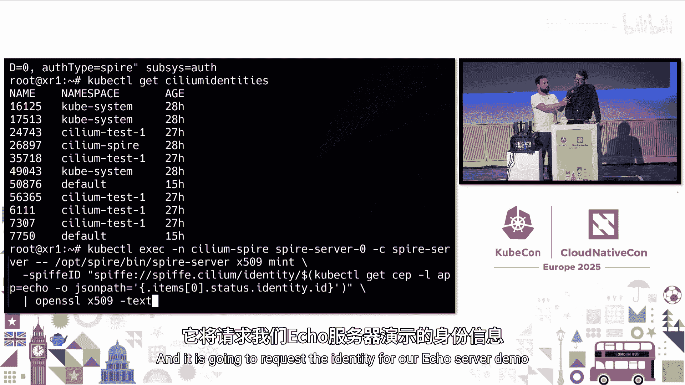

So。What do we have here。What we have here is。A new certificate， which is signed。

We can see that there is a spiffy identity on it。For our echo workload。

 But we can also see that the signature algorithm is actually。Something new。

 It's actually something new enough that the version of opens a cell installed on this machine doesn't understand。

 So it's just telling us。Though it doesn't understand it and showing us through all data。

 but I can tell you that it is a dilaphheium free signature。So that you have it。

that pretty much sums it up。は可。Yeah it's notworthy that the support for Kber andlithium are part of spire server。

 spire agent Confix， I don't know if you want to showcase that real quick。Or。Couldd。

 could you do a Cu cu edit for the spire agent and spre server config。

We'll share the code examples afterwards as well with the changes that were up from to Spre。

 but I'm going to pass it back to Hugo for some key takeaways。

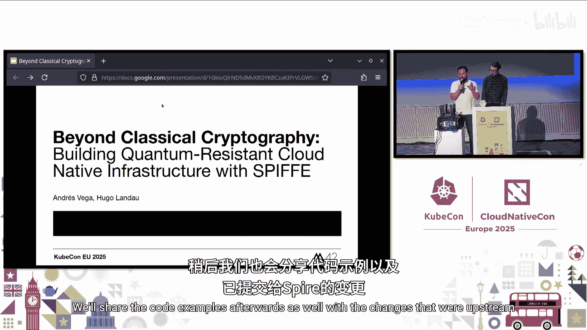

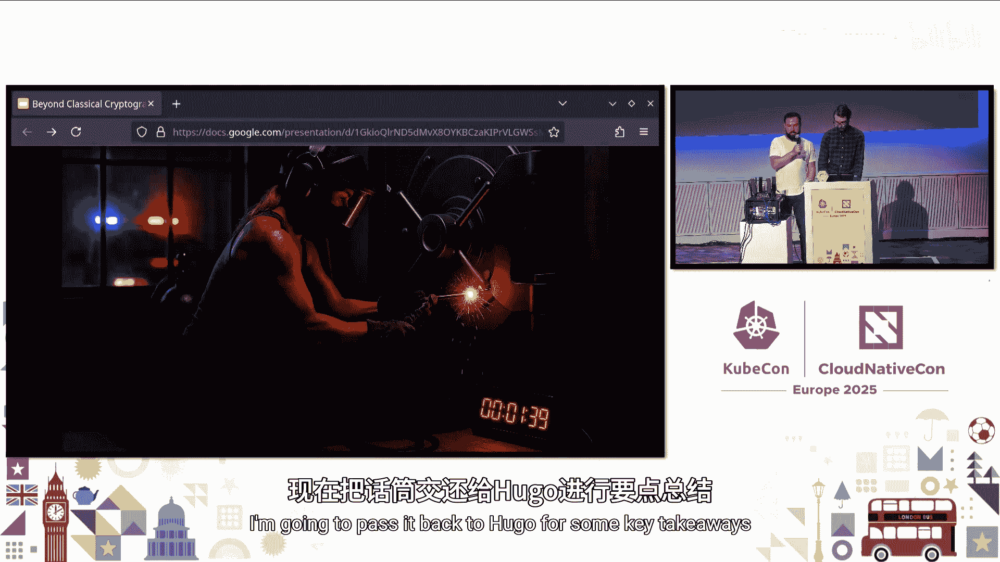

YeahYou can。So basically， cryptographically relevant quantum computer is threaten current osymmetric crypto。

 especially via stormor out crypt later attacks where。An attack now。

 just recording traffic that you can't currently could be decpted later in the future。

 So adoption of at least post quantumum secure key exchange mechanisms is critical now to future proofing systems like Spiffy and Spire and other P I technologies。

So that that is the highest risk。 Hence， you want to adopt post quantum secure key exchange mechanisms。

 particularly hybrid mechanisms such as X 2，5，5，1，9， kber 7，6，8。

 where you are actually hedging against the possibility that either algorithm becomes insecure in the future。

Likewise， you were ultimately， but this is less of a priority want to retrofit X 5 and 9 certificates and JWC tokens and other things that use signature algorithms with post quantum secure signatures。

There are some gnarly parts of the T， L， S protocol， which can result in a peculiar outcome。

 such as where。Both sides of a connection， support a post quantum secure chem。

 but due to slight implementation differences。They actually don't negotiate the camp。

 This is something to watch out for。 And in this case， they end up。

Falling back to a non quantum secure care exchange mechanism。So you actually need to have a way to。

 to measure what you were actually negotiating in the field and verify that this is being used。

So with the go ecosystem。 And， of course， this is highly relevant to Kubernetes。

Very large amounts of software implemented in Go， Go has now shipped mainline hybrid key exchange mechanisms for T or S。

 We Go 1。23。 So in many cases， you can actually deploy this in your existing go code just by upgrading to Go 1。

23。For things like post quantum signatures， we actually made an adoption based on Cloudflare circlecle。

 which is a library that Cloudflare pioneered for these dilifum fee signatures。

Theni standards have now been published， so you should expect a lot of churn。Thank you for that。

Security is never done。 so we encourage you to start。Planning and considering the sharp edges。

 the trade offs， the considerations to embark on migrating to quantum resistant algorithms and working with the open source community and sharing those learnings。

We would like to thank the SPIFy inspired projects as a whole， the steering committee。

 the Mainers and the community of the respective CNCF projects that make part of the data path with which we showcased。

It's literally taking a village， but we're very appreciative for the support and enabling us to carry out this work。

At the same time as a small business working in the front of national defense。

 we want to share our customers， well， a big sentiment of gratitude to the United States Department of Defense and our partners to the Dell Techologies's federal team for allowing us and enabling us to carry out this work and demonstrate a feasible path that can light out an approach again。

 like one joined， welloed in order to bring quantum resistant sooner than would have otherwise been possibly realized how we've been doing this individually and not in the open。

Thank you。I think it's lunchtime， but happy to take any questions。而而。Thank you。

 I wonder if you're able to comment on the Delta in overheads in running in the target state as opposed to the。

The old crypto I can barely hear you with the server running by my side Can you ask the question again。

 please louder louder I wondered if you were able to comment on the delta between the overheads in running in the target state in the state So I believe what you're talking about is the larger key sizes and traffic sizes of post quantumum algorithm is correct exactly。

Yeah， so you are going to be paying a， a higher computational cost for the， for this kind of。

Post quantum security， everyone would like。an algorithm that exists that is postconec。

 which is as fast and lightweight rate as the classical algorithms。

 But we are waiting for Goddo on that one。So you're going to be paying a high cost。

 but I don't think that you're going to be。Really having a concern in perspective is because the cost of the T L S handshake in a large variety of deployments is not。

The bottleneck in your workload。Even before or after。So， yeah。

 you are going to be seeing more ti less traffic overheads。 But I think that mainly shows up。

Let me trade places with you。哪儿给我。But I think that mainly shows up。In。

Environments where the primary thing you're doing is terminating to your last workload。 So。

 for example， if you have a。T， L， S load balance so that it is accepting the request on the Internet。

 and it does only this。Well。For example， you're relying on that load balance to be able to handle a million requests per second。

If you adopt post quantumum cryptography， that may go down。 But in an environment such as Kubernetes。

 where the overhead of a T L S connection is lost in the noise of。

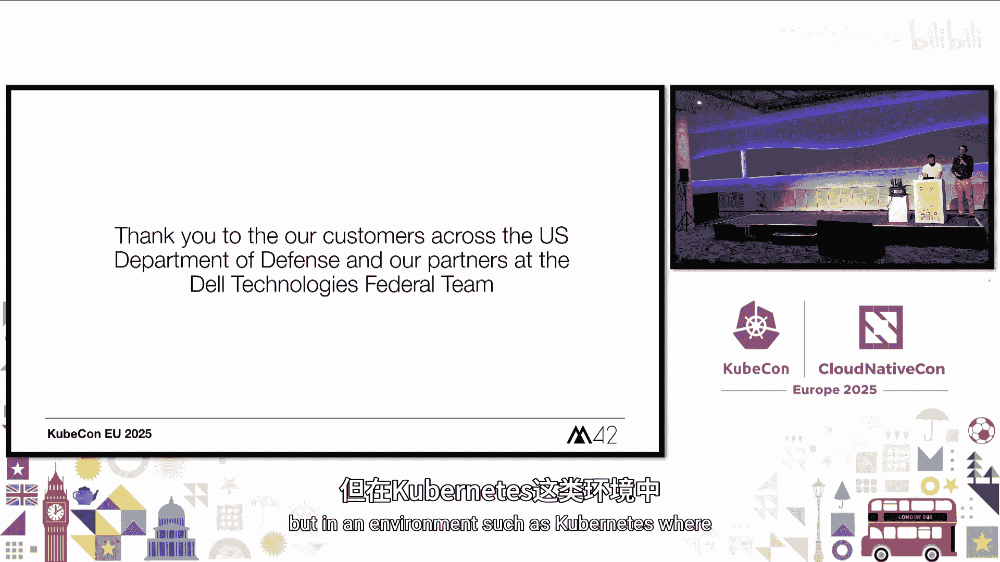

Countless of computational activities that are going on。

 I don't think that you're going to see a significant impact。Does that answer your question。Yeah。

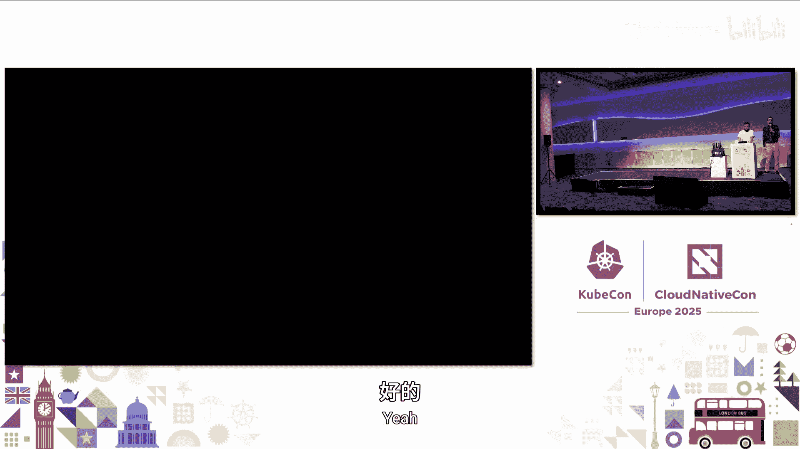

Thank you。Hey， guys， great talk。 Thank you very much for that。

 I was wondering if you could help me unpack a little bit。

 What is it that we could do like today to prepare ourselves for these new breath algorithms like。😊。

If N is standardizing and ratifying lattice based stuff， right， your open SSL version was so。

 you know， that's so bleeding edge that even your open SL version on your laptop couldn't really recognize the algorithm。

 Is it too world， do you think like。All those building blocks that you've mentioned， the spire。

 the selium， the。嗯。I don't recall all all of them apologies。

 but it seems that this stock is fairly experimental， right？

 So would you say that we are like as cryptographic。嗯。You know， non non experts on cryptography。

 but someone would a vested interest on making our system secure。 I it。

 Are we ready to even start adopting the lithium and all these latticebased stuff。

 is our stacking to break if we do that， could you just shed a a little bit of light on that？

 So I think as an end user or as a system administrator or operator deploying in the field。

 the main thing you can really do is listen to advice of your vendors and upgrade when they have a postconm story available And if they aren't promising a post quantumm story in the future。

 then you should be asking them questions on that。In terms of what's available now。

 we're actually finally seeing starting to see the practical viability of postcon algorithms in terms of existing software stacks。

 Theres now compatibility being shipped by open L。 But we've already seen actually。

 for a number of years， Cloudflare and Google shipping experimental versions of these algorithms in Chroium and so on and so forth。

So we're now getting to the point where this sort of thing is being turned on by default。

 As I said in Go 1。23， you now automatically get the benefit if you want it of a post quantumum secure care exchange mechanism。

 So again， it's just a case of really upgrading your software when new versions become available and these capabilities will be turned on by default in most cases。

 if you're building your own software， then you need to be looking at the SSL live you are using and really enabling that。

So in Go， for example， it's literally just a case of upgrading to go 1。23。 And then suddenly。

 this is in the box。 It's automatically on。 So I would say from the end use the perspective。

 it's mainly a question of upgrade when the patch is available and really track the software that you're deploying and see if a vendor has offered you an upgrade yet。

I believe no more questions。 Thank you very much。

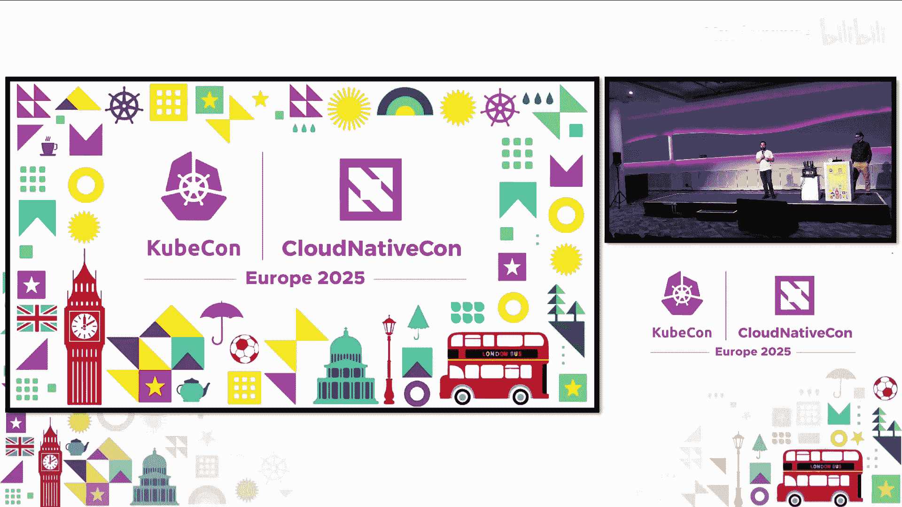