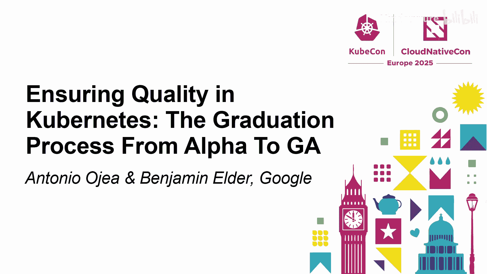
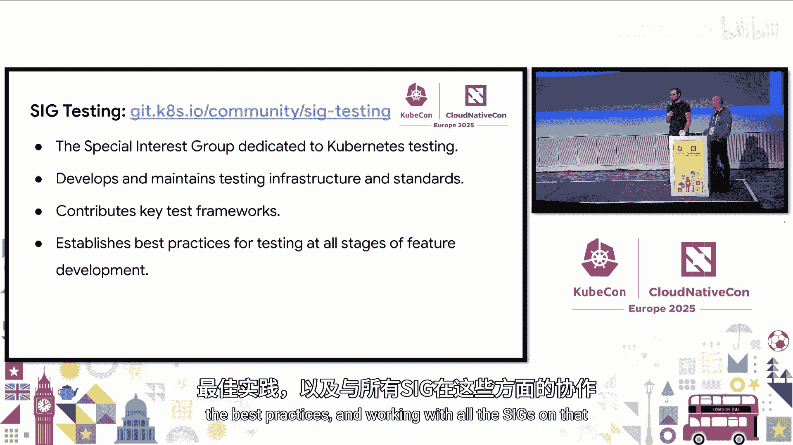
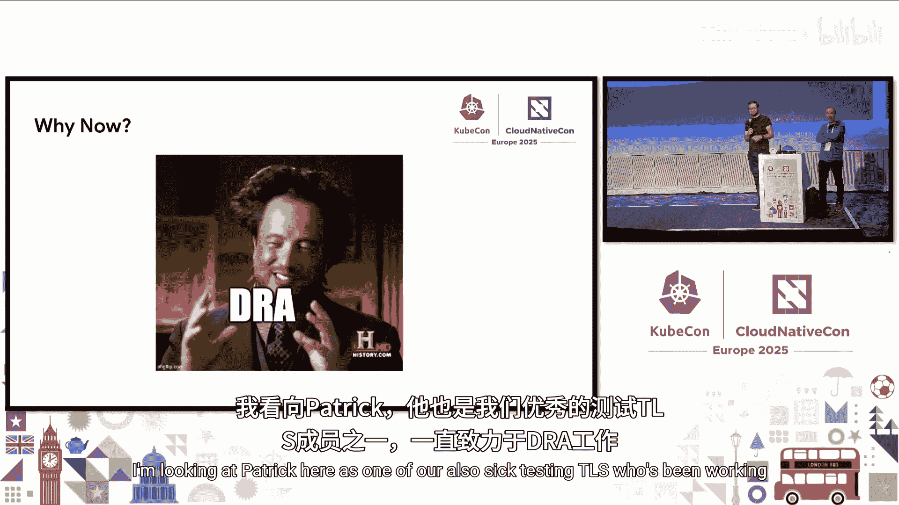
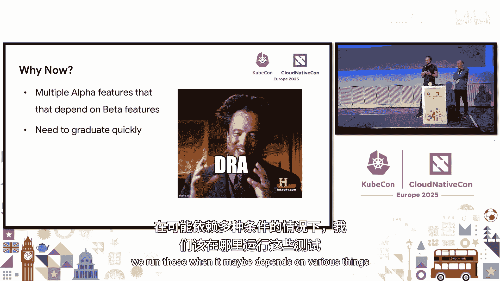
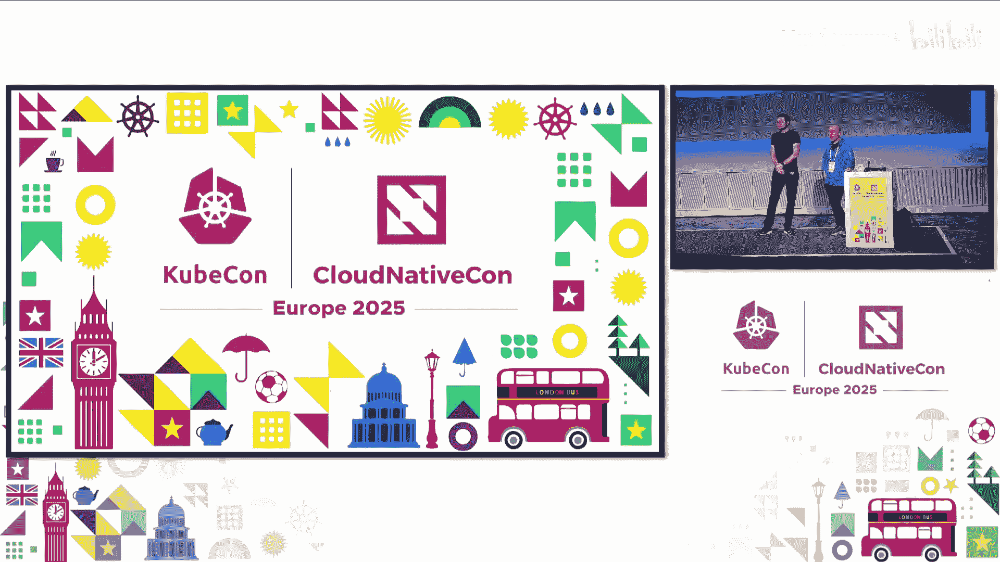

# KubeCon-+-CloudNativeCon-大会2025-｜-云原生计算-｜-可观测性-｜-Kubernetes-｜-Prometheus-p07-P07-Ensuring-Quality-in-Kubernetes---The-Graduation-Process-From-Alpha-T...-Anto--BV1Cd32zDEBG_p7-

Hello不完毕。

Thank you for coming。 We are going to talk about。How to manage the quality in Kubernetes and explaining how the graduation process go from alpha to G A。

 My name is Antonio here。 I work at Google。Ii am Benjamin there。 I also work at Google。O， we are。

Bother of the6 test。嗯。Members of thet。And for all of you that no Kubernetes， you may know this。

How Kubernetes work。 Kubernetes is an important open source project with a large ecosystem。 right。

 It's not only Kubernetes。 You'll be here you go to the booth。 you see。

 I don't know how thousands of projects depend on Kubernetnet， right。And。

To handle the development of of this project。The way we are organizers is technically we have special interesting groups right。

 so each group can be horizontal and handle things like A machinery or CI or can be vertical like networking or no。

But。What is more important for， for the project and for the users is。

The project need to keep growing， need to keep evolving， right， And this means adding new features。

 so。I don't remember when this started。 We are very large and we need to get organized， right。

 So the the， the way we organize the new feature development is via caps， right， so。

The case process is， it can be。A bit heavy for newcomers or for users。

 but it has a purpose right has the purpose of communicating across 6。

 so everybody can look at the place。 Oh， I'm proposing this because it's impossible to understand beforehand all the radios that your features is going to have。

 So it's important that we have a center plane a center point to communicate with with all the features and also to be transparent。

 we are an open project。 this is about community right If I want to add something I need to get for the other six because。

You don't work in isolation。 We try to break all the silos。 So there is no network。 There is no no。

 There is people that is interested in now that may work on network things and people in that dis interested in network that may work on on all things。

So。Let's， let's dip a a bit more in into the process。 Right， So when you want to add a new feature。

 then you need to， to consider what is going to be the life cycle of this feature， right。

 we have serious stages that are alpha。The expectation of Al is， okay， I have a feature a proposal。

 I know more or less how this is going to work。 I discuss it with the sixs and all the stakeholders。

 and。It I wouldn't say a prototype because we want As to be usable。 right。

 People cant try and should work。 it should work in much work。But we understand that Al has。

It's impossible to know everything beforehand。 right We need to， to allow innovation so we cannot。

Being forever trying new things or prototyping or getting feedback。 So the。

 the quality bar for what for alpha is a bit lower。 Then we move to better。In better， we have。A more。

How can I say。A stronger requirement for stability， right， we。

 we have a feature that is better and doesn't depend on As。

 This is going to be enabled by default default。 That means that every Kubernetes user is going to run their cluster and is going to have your new feature running。

So when something new running in， it means that there is already a contact with this end user， right。

 We cannot break them， but we， they still know that we are。

Not fully getting there and details of the featuret shop， we may have some room for improvement。

 so they need to be aware that something can change。And then after betterta， we move to G A in G A。

 we have a strong， strong commitment with， with the end user and with implementation。

 And this is one of the key points of Kubernetes， right， we have a very high quality bar。

 And this means that we can have an ecosystem that depend on our feature。

 right Use the of something in in one person against the G A version now。I mean。

 we are not perfect We fail。 There are packs and there are things。

 but I think that we are doing well on， on our stability of the fit。And we talked about features。

 But you see one of the strongest points of Kubernetes are the APIs， right。

 Most of the features depend on the APIs。The， the key of the API is that allow to。

Provide contrast with all these thousand projects depend on Kubernetes， right。

 So you don't need to absorb all the problems in Kubernetes。 You can create the right interfaces。

 define the right semantics and allow all the consistent to grow based on your interfaces。

 And that's why it's important。 And you see that。If you go to any API review or。

 or you have a new feature， there is a group of people that is specifically attending to this。

 A are very sensible and very critical。 And we invest a lot of that。

 But most important that I want to highlight。A Ps are not just for defining the synax， right。

 I'm going to put the field or whatever thing。 It also define the interactions with。

 with the other component， right， and it defines what the system should do。

Is not only to define the fields。 you need to define how it's going to behave because people expect that when you add some fear or when you set your ga manifest in a certain way。

 the system is going to react react in certain way。

 And this is what provides interoperability and portability。

 That's the one of the biggest success of Kubernetes is that you get your hand charge， your jam。

 you apply in one cloud and runs in the other cloud。

 right because we have a strong API with clear the behaviors。But here is when。

When the problematic started， we talk about features。 and now we talk at APIs。

The problem with APIs is that if As are better and are better forever。 It's hard to graduate then。

 right， So since I don't remember now which person 1，21 or 222。

All these be APIs are disabled by default fall。 And as a consequence。

 all the features that depend on be API are disabled by default default。

 So we start to see a bit more on the problematic of feature development， Right。

 So now you have features， but you have also APIs。 and we need to be able to graduate both at the same time to offer the stability。

But。我20多个的吧。Benjamin is going to dig a bit deeper later on on these topics。 but we talked about cap。

 We talked about the feature case and we talked about the As。And in the process some years ago。

 we started to， to find gaps in our dis。 right， we were building a lot of features。

 And then the system was unstable。 I don't remember in 1，21，23。

 we have a lot of fls in the in the C I， right， since didn work， Why。

 because we had a lot of features， but the system was not stable。 We have kind of。This is a joke。

 but most of you that work in software development。 ensure sure that you work in produce ladies。

 right。So we have now the production read group。 That's the one that when you go with the cap and you want to move to better and to the A。

 they start to to ask these hard questions。 what happened if how the N said is going to control this。

 just running10000。 What are your scalability requirements。

 So this is an important process an important group that the project put in place to control that when we release something is production already and production ready means。

You can run it and have your business on top of your features。I went。

All these systems are needed to guarantee a quality bar。 We want。High quality art for。The project。

 but we know that the quality bar has to be adapted to this development， because。We need to innovate。

 and we need to keep the core stable。 And for achieving both things， we need to， to face this， right。

 That's why we have these different stages and different criterias， and then。How we enforce this。

 well。啊，真的是人的死了。We， we for this with testing。So we have different test， right， We。

 we run kind of a pyramid， but its a metaphor。 We， we don't want to dig。To get into technicalities。

 But we have a strong phase for only integration and it test。

 And we have this suite of test that is called conformance。The， the whole point of this test is that。

integration and third party projects。Can can bill。Application。

 depending on the A S and the behaviors。 That why it's important。 We， I said this several times。

 and I would not stop saying this we need to guarantee portability。

 We need to guarantee that application works in different Kubernetes batchs and different Kubernetes installations。

 And that why it's so critical this this suite of test。Is the minimum necessary that we consider for。

 for a Kubernetes cluster to be to run portable applications。OK。How we enforce this。Well。

 I'd touched on this before。We have a lot of。We， we spent a lot of money in C I and we done a lot of this。

And we invest heavily in automation， and we rely heavily on 6。

If you think in in the traditional software development， there is no developer， Kui and other people。

 This is。And。How can I say there is。好。A share responsibility。 Thank you。 a shared responsibility。

 right， It's not that this is my feature。 This is your future。 This is our project。

 And we need to take， take care of that， right， and it's our project。

 and I'm responsible of this feature or， of this area。 I need to be accountable of， of this area。

What is how we enforce this， we really don't enforce it。

 There are different groups of people that everyone has the value。

 There is a group on cigarettely C I signal that monitors some specific tests that that rice。

That when San fail just one the， the responsible of the job。

 There is people in the6 that are re responsible of fix these jobs。 and we work as a community and。

I think that one of the most proud things that that I'm of this project is that we have a set of flag policy。

 So we don't allow test to flagake。Why， because if it test fl。

 you don't know if it's working or it's not working， if it's your goal or what it is。

 And we have a strong commitment with this。 And we have also this written in in our policies。

 We don't allow flakes。This is。哦，不是对里问。So the SIG testing Special interest group is dedicated to Kuberized testing。

 you've heard about this a bit。We， to be very clear， don't own the tests。

 It that's the shared responsibility。 That's not scalable。

 There's so much complexity in all the different parts of the project to have one central group on of those。

 It doesn't make sense。 But what we do own is the testing infrastructure， the standards。

 the frameworks， the best practices and working with all the Sigs on that。

So why are we giving this talk now。Why are we making some changes to improve this？Pretty much D。

 I'm looking at Patrick here is one of our also sick testing Tls who's been working on DNA。

 DRA makes this problem a lot more interesting because we have multiple alpha features that depend on beta features and there's a huge demand to graduate quickly and get this functionality available for all these people that are running all these huge clusters with accelerators and need more flexible scheduling。

 and it has a lot more complicated to understand How are we testing this correctly。

 Where can we run these when it maybe depends on various things。

 So we'll talk a little bit more about that。😊。

So when we're testing a feature that you've been developing a CP。

 the unit tests are like fairly self-explanatory， you have this scoped piece of code that's part of implementing it and you're controlling running that code and you write test cases for it pretty standard。

 Same thing for the integration tests are a little weird。 Ours are a little weird。

 but the integration tests themselves are standing up the environment。

 So you know exactly what the API server looks like because you just started it。

When we get to into end tests， it's a lot more complicated。

 we mentioned earlier that this's a conformant suite。 Well that's part of it。

 We have a test binary that needs to be able to point at different clusters。

 It's not really feasible to totally couple the into end tests which each of the cluster environments directly So when we get to into end test it is totally separate that we're bringing up some kind of cluster and that we're trying to run tests on it。

 and we need to know， wait， can I run this DNA test case or not。

 I it depend on an alpha feature or beta feature and so on。So in the past。

 the main way that you would tag one of these tests with the framework is you would just say， well。

 it has a feature and features a super nebulous thing and it would get inserted as sort of like a pseudo tag in the generated test name with the rest of your like handwritten and test name and it would be embraces and save feature and then the name of the feature you gave and this is just an arbitrary string。

And it could mean that your test depends on having a load balancer installed。

 It could mean that your test depends on having a feature gate turned on。

 or it could mean that the test depends on the cluster being configured in a certain way。

 like we're going to test the dual stack logic。 So the cluster needs to have dual stack enabled to not be a single stack cluster。

So this is really heavily overloaded。 So what you would see is most of the C I jobs would just skip anything with any feature tech。

 Like， I didn't do any special setup。 I'm not dealing with this。 And if you're building a feature。

 then you're going to go make sure that you have something that instead says。

 I'm going to run things that match this feature。And it just doesn't scale very well。

 You're pretty much on your own to figure this out。 And you can talk to us。

 but there's no shared system， really。Patrick here did some work a while back to make us onto Gko V2 with some other members of the community。

 which also got us access to Gnkco labels。 We hadn't adopted them very much yet。

 Gnkco labels with the test frame reviews。 they allow us to move metadata about the tests into selectable labels that aren't crammed into the test name you can actually query them we'll come back to and you're not just doing a regular expression that's include and exclude。

 So you can actually say， you know I want to run certain things。

 So weve in 133 towards the end the release where will finished。

 we tweaked this with feature gate methods。 So now if your test just is testing a feature gated feature。

 you pass with feature gate and you pass the actual standard feature gate definition。

 And I wrote here you may not be familiar with this in Kubernetes there is a centralized registry of features that can be enabled across all the components。

 And so there is like a package that has all the features。 they're named。

 they have a bunch of metadata about them like who owns them and and centrally approved。

 they have the。State alpha beta GaA， if they're on by default and so on。

 so you can now actually pass to the EduE test， this is my canonical feature metadata and it can annotate the tests with the information about the feature stability level。

 whether it's turned on by default and so on， the feature name。

And no more horrible broken redx is trying to select the right tests。

So you now say my test depends on this feature gate。 and that information is there。

 You say my test depends on this feature， like。Special setup installing a controller。

 Or in the case of DRA。 It depends on both。 We need to have a DRA driver installed because there isn't a standard driver。

 It's for whatever device you want， whatever you're allocating dynamically。

 So you need to have the dynamic allocation features turned on。

 and you need to have the dynamic allocation test feature。

 which is signaling that there's some extra setup required before I can run on a cluster。

 So you tag it with both。嗯。And so this is this was talking about this is the metadata we we pass through What we are doing as part of this is setting up some standard CI jobs that will run all of the tests that just need to turn on that feature gate and skip the ones that require extra things。

 So for a lot of features in the project。 they're doing something like declaredative validation。

 that is a totally server side feature in the API server， it doesn't have any external dependencies。

 it just needs to be turned on because it's not a GA yet。

 And to test that all they'll need to do is annotate this。

 And so we will be really pushing the feature approvers to say。

You should not be promoting features that have no tests or are being hand tested。

 as may have happened in the past。There will be。An expectation that you definitely have CI all the way down to an alpha feature。

 even if it's brand new， we need to know that it's working， if it's totally broken。

 we shouldn't be shipping it to users and it definitely shouldn't be promoting to beta if it doesn't have reliable tests yet。

So when we're doing this， we're basically saying， okay， this cluster。

 we're turning on all the alpha features。We're turning off a Blake， because。

We that's one of the features that had promoted further， Turn out。 it wasn't stable enough。

 needs quite a bit of work。 but hopefully going forward， we're just turning on all the alphas。

We're turning on all the alpha and GA APIs so that you don't have to worry about that distinction in CI we're standardizing on we turn on alpha and APIs and features at the same level be and so on。

 makes it a little bit less confusing to think about。

 and then we can write this query that basically says if it has a feature that it's an off by default feature gate。

Or if it doesn't have any other feature information。

 we'll run that if it's not a beta off by default because we're doing alpha tests and if it's not a deprecated feature because that's another feature level that we didn't talk about some extra complexity there for basically here's a way to toggle something that we're removing for one more release you can turn it back on but it's going away and then this slow disruptive flaky is sometimes when we're working on tests we've kind of kicked them out or so this is slower we're gonna to iterate some more on that but basically there's some categories of like these tests are known bad and we're not able to fix them quickly let's make sure that they're not blocking pull request until we get that sorted out。

If you have a feature like DRA， youve still got to work with us to set up some CI for that。

 but that will be a diminishingly smaller set of features and we will expect to keep up and have that for everyone also。

呃。Let me come back to this one。Where did that。So one other thing that happened here as we were working on this is we actually found that while the Kubernetes feature policy says Als must be off by default。

 this wasn't enforced， which made this problem a bit more complicated and also means we're not communicating things clearly to users。

 There was， in fact， a feature that was on by default since 126 That was an alpha quality and it's going away in 133。

 Hopefully it's fine most you probably won't run into it。 It relates to host network on Windows。

 but now we have some tooling in place that you can't do that。

 It will block the pull request if you try to set on by default and alpha。

 that's an inconsistent statement to the user so。That simplifies how we communicate on the test to make sure we're shipping the right quality bar to production。

 and this is the kind of thing that we're working on to make sure that going forward， you know。

 we're 10 years in the project and still having features that are partway through the life cycle being hand tested locally just isn't good enough。

And so this is an example when you have a feature that you do need to do extra setup。

 and so we're saying it's allowed to be tagged as it requires this extra dynamic resource allocation setup or an off by default feature because we're going to turn all them on to run this because this has alpha and beta features。

 we've turned on the alpha and beta APIs that we need and we're ignoring the flaky tests until we've gotten that sorted out。

There's some extra bit here that isn't in line because it's some fun bash that sets up actually having a mock D driver。

 and this runs on a kind cluster， which is another sick testing subpro。

These are pretty like copyable， so if you have a relatively simple one where you need something like a load balancer or a driver for a dynamic resource。

 we have like little local implementations， you just need to make sure that if you're testing that that you know we've taken like this D job。

 made a version that installs the load balancer instead and runs your load balancer tests and we're doing that。

So we'll be putting out some more comms in 134 early in the release cycle。

 Kubernetes is about to ship 133 shortly after KubeG。

 and we'll be making sure that everyone who's contributing to the community knows about these changes knows the expectations to adopt them and the increased expectations on not just the written quality bar that we've had。

 but actually making sure that we've provided the tooling and the shared resources to execute on it more easily。

And that includes getting more of the signal into release blocking and pull request blocking we actually want to go as far as to say even just turning on an alpha needs to be blocking releases。

Not the tests。 We know people are just getting started iterating on those。

 but we'll have that signal running somewhere so it can block promoting them to beta。

And pull requests should start blocking on beta APIs consistently that's not actually guaranteed today。

Make it a lot harder to have regressions with these earlier in the process。

 Kubernetes used to lean a lot more heavily on stability in GA。

 We're bringing more of that back down to beta and even down to alpha that even an alpha feature shouldn't make GA features unstable。

Thanks， lets know if you have any questions， come join us in S testing in the Kubernetes Slack。Yeah。

可律。Do we have a。真是的。好了。How long does a typical feature take to run all the test suites in C I。

For a given it， like one feature。 Yeah， that's really hard to say they're all over the place。

 For some features， we need to run scale testing。 You know。

 we need to make sure that if you make some scheduler changes that you haven't regressed the performance on large clusters and some of those test runs take 12。

14 hours，5000 odd clusters。So there is when we talk about this。

 there are two stages right Please submit that we don't want this to merge and we have kind of a line of one hour to run So you get right youre developing you sending something that you want to know I'm breaking something or not。

 So we have kind of a hard line in one hour it's not correct we try to keep that then we have a lot of tests running in periodic jobs right and then there are like scalability tests that run every two or three days and105000 that can take longer but usually for developers that are going to submit something we tend to get a of one hour forgetting feedback。

We also have a two hour bar for release blocking signal。

 and then we have some release informing signal。 that's like the release team should look at this。

 but it it's not guaranteed blocker。 Also to be clear， we're talking about like a whole suite。

 We generally don't want to have like a C run that we have to do for like a specific feature。

 There's some overhead to just like compiling Kubernetes and bringing up a cluster。

 even when we're running with kind。 we have to throw a decent number of cores that just building Kubernetes in a reasonable amount of time。

s a lot of code。 So typically these are shared suites and individual test cases are expect to be pretty fast normally。

 but Kubernetes has thousands and thousands of test cases to cover all of everything。

 So it really depends on the scope of the feature。Okay， thank you very much。Hey。

 can you expand a bit about the zero Flakes policy。Okay， yeah， we did a talk about that okay。

 so you know， if anybody spots a flake， we're filing a bug。

 were assigning people that are working on that feature。

 the community is pushing to fix that it takes an initial push to get to a place where things are pretty reliable so people aren't used to flakiness and I think we've achieved that so now that people aren't used to flakiness。

 the community is pretty good about。Why is this thing failing it doesn't seem related to my change we also have a lot of tooling for this。

 We have this system called triage go dok slash triage。

 and we basically run a pipeline that does KNN clustering of failure messages across all of the CI jobs so you can say。

I have a graph of over time this error message started cropping up more so we have some failure mode with like starting up a pod or something and you can prove that maybe it only failed once or twice in a PR job。

 but there are 10 other periodic tests that are also hitting it and that graph has spiked and there's a button to collect that information and you can just like file an issue with all that and the release C signal team also works really hard on this for all of the release blocking and forming signal to make sure that the moment one of those crops up。

 we're tracking it。 we're fixing it removing it the flaky tag you saw earlier was more of how we handled in the past。

 we just okay we gotta kick this test out we still have some but we've also been eliminating those。

The there is also a cultural， right， So before we have this go flake attempts or something。 No。

 so if eventually pass， it could read， we remove that。 The test password doesn't pass。 then Yeah。

 but that is days one like when when you say 0， it's 0。 It means that it flakes 1。

 then you you have to chase it。 Yeah， and then that's what say it。 then we have a strong community。

position on the right。 So you have the releasinging when they see that this periodic graph， you know。

 flake， they open the back when， when there is an investigation can happen several since that the test could fix it or that the test get removed。

Right， so that's， that's if you keep the fls going at the end， you are going to have a lot of flakes。

 So you need to take a decision。 I think that in my experience in all the other projects。

 this is one project that takes the decision， right， or you can get your fitted out。

You have a feature that is flaking， and it happened。 It was flaking。 It was better。 And。

 and nobody did anything。 So he got the motive to alpha。So when。

 when you start with the project has this position and this is strong commitment quality。

 then everybody start to absorb this， this behavior， right。

 And then it when you in the later run are able to， to， to。

Have a more stable C I because the person that the ability the feature results are where。 right。

 And it's not I'm going to throw me a feature and leave is I'm going to draw my feature my feet。

 and I'm going to take care that my feature is。I think to get there low。

 we had to make a pretty big push around this and look at like what are sources of flakes。

Get rid of the systemic sources of flakes， like noisy neighbor problems in C。 get that cleaned up。

 So there's no excuse。 It's like， oh， the C is making my test unreliable。 No， no。

 your test is unreliable and then burn those down and then get people used to。 Okay。

 no longer doing flake attempts。 And we have a bot that auto posts retest the C when it fails。

 none of that's going on。 it passes or it doesn't get people used to that so that it actually feels like an outlier。

 And then it's a lot easier to get buy in from all the developers。 yeah。

 we should address these when they see lots of flakes。

 It's really hard to convince people to work on it。I think that's it。

I think we're time， thanks all。