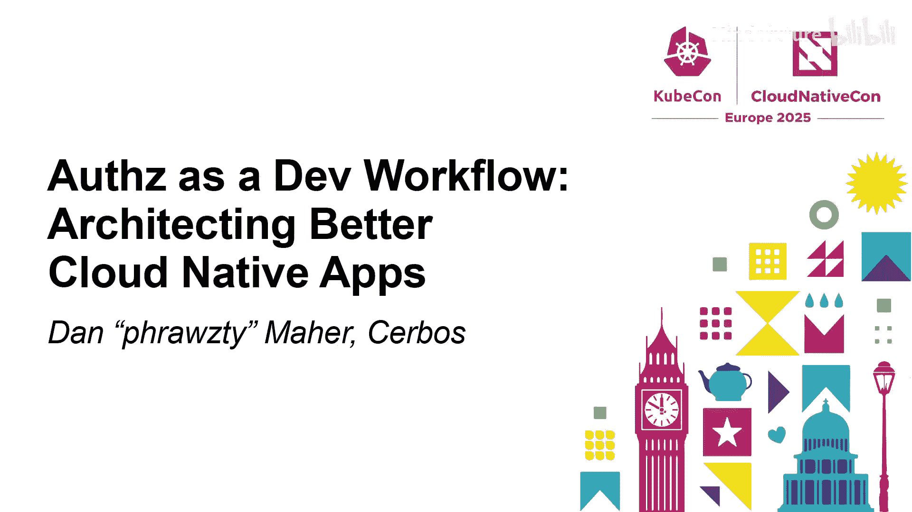
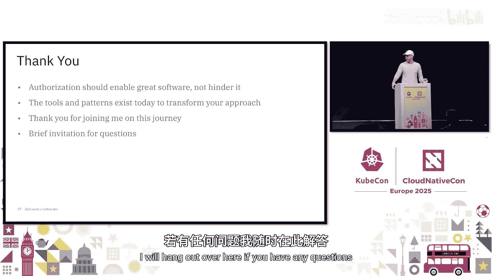

# KubeCon-+-CloudNativeCon-大会2025-｜-云原生计算-｜-可观测性-｜-Kubernetes-｜-Prometheus-p08-P08-Authz-as-a-Dev-Workflow---Architecting-Better-Cloud-Native-Apps---Dan-phrawz--BV1Cd32zDEBG_p8-

Three days。 this long man。 Give yourselves a round of applause。 You made it。

Heck， yeah。 All right。 I'm going to start the timer。 I said I'd forget it， and I didn't。 Nice。 Hi。

 everybody。 My name is Dan。 I work at a company called Serba。😊，This is Cecon in London in 2025。

 That is my title slide。Thanks for joining me today。

I get to work at Surbas and I get to work at Surbas on Open source。 and before this。

 I worked at lots of neat places like Ubioft and Mozilla and Datadog。

 and I say this only as context to let you understand where I'm coming from for the remainder of this talk。

 I've gotten to double lot in infrastructure and development and also in security and a thing that I've learned along this path I've learned a lot of things。

 But one of those things is that authorization different from authentication， Thank you very much。

 isn't just a security problem although it's often relegated to that。

 It's actually a developer experience problem as well。

 And that's really what I want to talk about today。Let's start with what I call。

 and I'm not the only one who calls it this is the authorization paradox， okay。

Every single request in every single application， especially in today's modern Wizbank cloud native environment。

 right， needs to answer the question at every single encounter。

 is this user allowed to do this thing？Under what conditions， right， it's unavoidable。

 It's important for security， but authorization is actually treated as an afterthought in our architectures and our workflows。

 especially as developers， especially even as infrastructure people。

 And we've actually seen this pattern before。 I'm a man of a certain age。

 And I remember when deploying was just a collection of bash scripts or like setting and grippping and stuff like this。

 right， You probably remember when observability meant gripppping through log files。

 as opposed to like a single pain。 you got your Grfaa and your datadog and stuff right now。

 our industry basically recognized these pain points。 And was like。

 we don't want to feel this pain anymore。 What can we do， but。😊。

Authorization hasn't gone through this elegant developer transformation yet。 right。

 It remains stuck in this sort of a weird， strange place。

 something that every developer has to implement。But few have good tools or patterns， really。

 for building it， right。So it creates friction rather than flow And when something creates friction。

 we find ways around it and sometimes not very good ways。

 right This leads to this disconnect and that's kind of what I want to talk about today。

 But let's step back and look at how we got here， right So how has it evolved over the past decade。

 remember networking。I remember networking， I remember plug it in stuff right I went from manually configured load balancers and firewall rules to declare itative service meshes。

 CI plugs right so we did that leap infrastructure concerns have now become developer concerns with clean primitives and clean abstractions。

 storage followed a similar path right move from managing volumes and mount pointss to just declaring persistent volume claims。

 etca， et ceter， right CSI standards， deployments。You know。

 we transferred from error prone shell scripts and stuff being done by hand。

 And I'm just gonna a super quick SP this over to Prod。 We don't do that anymore。

 You don't do that anymore。Don't do that anymore。 Okay， And in this case。

 transformation made developers more productive whilst simultaneously improving security。

 improving reliability， right， That was the idea。 So the patterns clear。

 like you have good abstractions and those good abstractions don't just hide the complexity。

 They really change how we work。 and that's a good thing。😊。

So why has authorization remained kind of stuck？ Well。

 it hasn't really followed the same evolution path。

 And it's part of the problem is that it's really often deeply coupled with application logic。

 which I'm going address in a moment。 It tends to like live inside business logic。

 It's not outside of it， like networking or storage。 right。

 These are just things we need to do the business。 authorization' much more of a business level problem。

 So it makes it harder to extract。 It makes it harder to standardize。

 It makes it harder to rationalize about， especially like our weird developer brains。

 We don't oftentimes think about the business。And second authorization requirements tend to be domain specific。

Like financial services tend to have different controls than a Saas product or different controls than like Uber for dogs。

 right， There's no single model that works for everyone。And， and that's rough。 Third。

 modern applications have like incredibly complex relationship needs and like objects and resource constraints and stuff like this。

 If you think about like， I don't know， Google Drive permissions or Slack permissions， right。

 It actually gets really， really tangled up really fast。

And these aren't simple matrices of users and actions。 right， You think， oh。

 like user A can access document B， and has crud access on it。 Like， that doesn't exist anymore。

 It hasn't existed since the 90s。Right it it's much more complex than that。

 There's no one size fits all solution。 It doesn't exist。

 A lot of people will try to tell you it exists。 Those people are trying to sell you something。

I'm trying to sell you something。 That's beside the point。 The reality is， there is no one。You know。

 fits all solution。 It doesn't exist。 So as a result， authorization。

 I just said remains in this weird space between infrastructure and application and business。

 It's too complex to be standardized， It's too common to be solved afresh every time， right。

 in principle， at least。So this complexity has real costs。It can't just be ignored。

 It actually costs money， which is the issue， right。

 Developers constantly context switch between implementing features enforcing permissions。

 You can look like controller code， business logic。

 intertwined with authorization checks and this tangled rat's nest of if then else statements。

 It's freaking disgusting。And it's super hard to maintain。

 especially if you've got like multiple mobile apps and like multiple this and that and deploying that。

These scattered implementations， they create security gaps。

 It's hard to verify permissions are being enforced consistently when they're spread throughout the code base。

 It slows velocity。 No one wants a slow velocity。 We got to go fast。 We got to break things。

 except when the things break。 And then then what。Right？So if making changes。

 these permission models requires extensive testing， oftentimes regression testing。

 because it's difficult to understand the full impact of these changes。

And it creates this massive friction， especially for onboarding new team members， right。

 You're a new team member waiting into this code base for the first time。

 And you're spending the first three months you're there just trying to figure out permission structures before you actually touch any features。

 That sucks， right。😊，So it's not a security problem。 It's an infrastructure problem。 It's。

 it's a developer experience problem and poor developer experience makes everybody feel bad。

 But what if we approach this differently， right as like a workflow issue。

What if authorization could be a creative tool instead of a constraint。 Yeah。

Develop your experience is fundamentally about enabling flow， right。

 that flow state that we all love， that state where you're fully immersed in solving the problem。

 right， Super， super good。 Authorization tends to break that flow， but it doesn't have to。😊，O。

 it can be declarative rather than imperative。 That's really important。

 It can live in well defined places instead of just scattershot across your application's code base。

And with the right abstractions， it becomes intuitive。 It becomes maintainable。That's the idea。

 And so the， the key insight， really， if you， if you take nothing else away from this talk。

 and I'm going give it to you right now。Is that you got to focus on the workflow first， right。

 focus on solving that。How developers interact with authorization during development is a big， big。

 big element。 And we can create better security outcomes， better developer experiences。

 And that's what we're going to explore next。😊，So when we architect。

 let's go ahead and say cloud native applications， because look where we are， right。

 We typically give authentication， the architectural attention that it deserves， right， Aations。

 usernames， passwords， Pass phrases， identities。 Oh， yeah， we get that。 We get putting in a password。

 We get putting in a security token。 And that has a big architecture around it， right。😊。

But authorization often degrades into these scattered if thin L statements， like I said earlier， and。

 and separating up business logic from database access and so on and so forth。

It's important to make these clear boundaries， right？

We separate business logic from database sources， database access， Rather。

 we create clear boundaries between business logic and permission logic。

And this means authorization becomes a service。Write a service rather than just a bunch of lines of code。

It could have its own APIs， its own contracts， its own testing strategy。

 its own development life cycle。If we want it to。And these are all sorts of things we're comfortable with and familiar with as developers。

 These are things that allow us to have flow， right。

 Netflix actually famously took this approach on really， really early。

 with their microservices ecosystem。 And they found that centralizing authorization。

 improved security and actually accelerated future development。

 They have really good white papers on this that you should go read when you have a moment if you don't believe me。

 Their whole thing was focusing on core business logic without getting like bogged downing permission checks。

 It's a really good paper。 So definitely go read it up。😊。

And so there's a really crucial mindset shift here， right。We frame authorization as a constraint。

 What can't users do。 And this negative framing pushes authorization to the realm of security restrictions。

And the better question really is， how do we enable the right access。

 That's the right question we should be asking。 right， It's a positive framing。

 It turns permissions into a product feature。 whoa， whoa， right， When we make the shift。

 Permissions become part of product discussions。 They're not just relegated security reviews and stuff you don't want to touch。

 They shape user experience through progressive disclosure of functionality based on you know。

 context and and constructs。😊，Look at how Slack approaches Workspace permissions， for example， right。

 They're not just security controls。 They're collaborative features that enhance how teams work together。

 That's powerful。That's the difference between authorization as a constraint and authorization as a product capability。

 right。So to be clear about what we're trying to avoid。

 we're trying to avoid authorization that's added as an afterthought。

 We're trying to avoid context switching that kills that that developer flow。呃。

Authorization logic that's tightly coupled with business logic becomes resistant to change。

 So we have to， we have to deal with that。Permission models need to evolve over time。 They always do。

 And you end up refactoring core functionality。 And I actually did a talk in Denver a couple weeks ago at an Oas talk about how Facebook refactored a U I model and destroyed their permissions and made 15 million private posts public one time。

That was a fun white paper， too。Avoid that， right， The idea is that authorization shouldn't be a secondary thought of。

 you'd treat it as a first class architectural concern。So let's talk about core design principles。

For workflow first authorization。The first is domain driven authorization。

 This means modeling permissions around business domains， not technical constructs。 right。

 Now think about the business。 And as developers， we don't want it。 but we got it。

Don't think in terms of crud operations on database tables。 I know it feels familiar to you。

 We're done with that。 We have moved past that now。 Okay， think in the language of your product。

 permission should speak the language of that product， not the code basease necessarily， right。

 This creates a ubiquitous language between product and development and security teams And everyone understands what editor means。

 for example， And a document system， but like update documents is a technical implementation details。

 So which one of those two should you actually use right a document collaboration system might model permissions like editor。

 reviewer and viewer rather than read， write and delete。

 because that's what the product actually expects。😊。

These map directly how users think and ultimately tell how the business and the product thinks about itself。

 And this is an alignment when you start to feel this way。

It makes authorization more intuitive for you， the developer， for other people in your organization。

 and it makes the product more maintainable as it evolves， which is really， really nice。😊。

The next principle is using declarative thelarative policies rather than imperative checks。

 Okay traditional cobas are filled with imperative permission checks。 They're scattered all the race。

 Like if user has permission， then allow this to happen， right。

 These checks that they're hard to audit。 They're hard to test。 They're hard to maintain。Notably。

Declarative policies， in turn， describe intent what should be allowed rather than how to check permissions。

They become human readable artifacts。That can be version controlled。 They can be reviewed。

They can be tested independently of your application code。 This is critical。

Your policy should clearly express who can do what， who can do what based on business rules。

 It should live outside of your application code。Be tested independently。

 should be updated without changing your application。

 You don't want to actually have to reroll your app and reeploy your app when permission models change。

 This is an anti pattern。Remember that。Thelar approach scales with complexity as your permission model grows。

 more sophisticated， the policies remain readable， They maintainable。

 while imperative checks would create a tangled mess。earlier， third principle。

 use external decision points for authorization。 externalize your authorization。 super important。

 decouple authorization from application logic。 And I've been hinting at this。 Now。

 I'm saying it out loud。Right？Instead of embedding permission checks in your code and your application ask is an external service。

 Can user do thing。 This architectural pattern enables consistent enforcement across all of your software。

 That's what it does。 That's the magic of it。 right？ That's what's so cool about it。

 All your microservices called the same authorization service。 It's uniform。😊。

It's easy to reason about。Okay。Your application grows and authorization decisions then don't become a bottleneck that have to be updated。

 Okay， You can verify your permission model without spinning up your entire stack。

 That's pretty sweet。😊，Right， doesn't mean authorization becomes a black box。

 It shouldn't be a black box， right， You should be treated just the same way。

 The rest of your code and the rest of everything you work with works。 It's not a black box。

 It's a service。Okay。It's a service，'s probably got an API， and we're developers， we love APIs。

 right？Fourth principle is about making authorization context aware， aware。

Simple rowbased access control or R back isn't enough for modern applications。

 It was enough when you know， our back 96， right， That's， that's when it was ratified。

 We've done a lot since 1996。 So we need to consider attributes， like time like location。

 resource properties， relationship context， all these sorts of things。

 So context where authorization adapts to this situation。

A health system might allow access to patient records during business hours。

 but require additional approval after hours。 Something as simple as that implemented as code。

 especially if you have a lot of exceptions， especially you have a lot of doctors and a lot of sites and a lot of patients。

 right， a collaboration tool might check document status before allowing certain a actions。

 So the idea is here like finegrained access control。

 So moving from R backac to something like dynamic R backac or even Abac attribute based access control。

 which I can talk about for hours afterwards， if you're interested。😊，U。

Let's talk about Aback for a little bit。 Actually， know what。 Let's do it。

Let's talk about some CCF projects a little bit later on that do some A backac。

 I think that's going to be good。 So let's look at how these principles integrate throughout sort of this development life cycle。

 right， So during requirements gathering。You need look at your permission models and those permission models should be defined alongside your features。

 Remember， we're not talking about tack on permissions at the end anymore。

 these permissions and this authorization now becomes part。Of your product thinking。

What access patterns does this feature need。How do permissions integrate with those existing models。

 right？ And we're talking about API design。 Authorization requirements should be explicitly documented in the API specs themselves。

Right， these aren't separate things。 These are integrated in。 Who can call the endpoint。

 What context is required for that call to be successful or not， right， during implementation。

 those clear interfaces for authorization checks make the integration consistent。

And this helps with that developer workflow that we alluded to earlier。

Developers should never have to invent new ways to check permissions。

 If you're inventing new ways to check permissions， something has gone wrong。

 You have gone off the rails。Okay。Testing， you need dedicated testing for your authorization。

 just like you have dedicated testing for your tests。

 We're all high level super good test driven developers here。

 We have 100% code coverage at all times， because that's how we roll here in this room。 I believe it。

 I believe in you， Your policies and your authorization should not be any different。you know。

 in operations where I spent a lot of time monitoring observability for authorization decisions helps you to identify problems。

 right， So actually integrating policy checks， integrating authorization checks into your logs into your audit trails。

 right， It's not just about did library fail or't I， I don'm not be able to connect to this database。

 Like， what permission checks are being made。 And how are they affecting the behavior of the system。

 right， Monor that。It's， it's not an afterthought， right， It's woven in and every stage。

The payoff here from this approach is substantial。 It's substantial。 Okay。

 we talked about how this costs money。 This is how it stops costing you as much money。

 Maybe even starts making you money。It's developer experience。reducededuced context switching。

 The permission logic lives in well defined spaces。 It's easier to reason about。

 You have clear contracts between components that makes integration simpler。

Services know exactly how to request authorization decisions。

 So the actual code to develop those services is more straightforward。

Self documenting permission models。 Heck， why not？Right。

 team members can now grasp those permission models instead of having to spend weeks mired in the swamp。

 right， this leads to faster onboarding， this leads to faster feature development。

 These benefits are not theoretical to be clear。 Okay， I'm not making this up。

 Theyre practical improvements to everyday development work that we see in our customer face。 Okay。

 They're achievable with these tools in these patterns。😊。

So let's talk a little bit about the authorization ecosystem。As look at some of the tools， right。

 over the past few years， there's been a a increasingly rich ecosystem of tools that's become available in the open source world。

 I'm only gonna to talk about open source stuff because I'm a hardcore open source nerd。

Many have found homes actually in the CNCF， which is really super。 So that is excellent。

 So we're going to talk about a couple of those。 And this has helped drive standardization。

 It's helped to drive adoption。😊，They take different approaches to authorization challenges。

 Remember， I said at the outset that there's no such thing as a one- sized fits all solution。

 So different approaches， different ways of thinking about it， right， Some prioritize scalability。

 some prioritize relationships， and so on and so forth。

 They all share a common goal of making authorization more manageable， okay。

Let's see how this fits in。 First I want to talk about is OPA A， OpPA or open policy agent。

 which you may have encountered if you're on the sponsor floor or the past few days。

 a number of people here talking about， hey， let's do OpPA， right。It's a graduated CCF project。

 It seen wide adoption。Yeah， some adoption， not as much imagine as we'd like across the industry。

 It's a general purpose policy engine，s a general purpose policy engine， right。

 It can enforce policies for systems， I don't know， Kubernetes， you know， admission control。

 microservice API authorization。 And at its course， something called Rigo。

Rgo is a purpose built policy language for expressing rules。 It's， it's a real language， right。

 So you're like programming your policies。It's quite powerful。 It's super interesting。

 The architecture completely decouples policy from code。 We talked about externalization， right。

 So it aligns that principle that we talked about earlier。

 It is used at some pretty big companies I alluded to Netflix earlier。 Last I checked。

 Netflix is based on OpPA， Although I'm sure that my head of product will correct me on that after this talk。

 if I am wrong。😊，嗯。It's really good at what it does。If it is what you need。

 But like a lot of general purpose tools， it's not particularly excellent at any one thing。

 and it can be difficult to struggle a little bit with Rigo。

 which is probably why OpPA hasn't seen the level of adoption maybe that the project in some ways deserves。

 So keep that in mind。I was here of Open FGA。Open FGA is a CNCF Sandbox project。

 which is really cool。 It's focused on relationship based authorizations at fairly large scales。

 OpenFG is based on Google's Zanzibar paper， super super interesting computer science stuff。

 If you're into that， which describes the system that powers their permissions。

 like for Google Drive and like YouTube and all of their services， right。

 the sort of planet scale relationship based architecture， right。😊。

O created an open source implementation。 That's part of the CF。

 It's specifically optimized for like doing relatively high performance at scale。 But again。

 it's all about modeling complex arbitrary relationships between objects。

 And if that sounds like a little bit abstract， it's because it is。 you know， it's for example。

 not very good at our back。It's only marginally good at AVc。 So if your problem is your Google。

 this is probably what you want。If your problem is， werere anything other than Google？

It might not be what you need， but it's really， really interesting。

 And I highly recommend taking a look at it。I do want to mention。

 and we're going to step away from the CNCF here for a moment， talk about some other open standards。

 which are important。Is the open I D Foundation。The Openeddia Foundation has established the Offend workinging group to standardize authorization APIs and interfaces effectively。

 right， So taking this whole smorgasborg of possibilities that exist out there， I'm going like， hey。

 like can we， can we get together as an industry and come to some conclusions about how we want to work together。

And this group's building on the success of OF 2， on the success of Open Id Connect， notably。

 if you have encountered these things before， which has solve similar standard days and challenges for authentication。

The focus is on interoperability between authorization systems。

 creating sort of common interfaces that different implementations can support。

This work is around creating an open dialogue， right for authorization systems across platforms。

 across vendors， and it's super important work， it's slow going because how do you get enemies to talk to each other。

 it takes a little while， enemies， competitors。To talk to each other， that's how it is。

It's less about specific implementations to be clear。

 although they have reference models and more about ensuring that different systems can work together coherently。

 And off Zen， which you see up here， off Zen represents an important sort of effort for the long termm evolution of the authorization ecosystem。

 So if this is the world you're getting into， this is a working group that you need to get familiar with。

Right？Sba takes a different approach。 Serbas is involved in that open I D working group。

 is involved in ON。Uses human readable Yao policies that product teams can understand review。

 These policies sort of clearly express， who can do what to which resources under what conditions。

 And the thing I want to point out here is that I think it actually has pretty good developer experience。

 which is maybe a little different from the other model or the other tools we mentioned earlier。

 you know， playground for testing policies that as an inbuilt testing framework。

 I think which is pretty good。Simulating requests， examining traces。

 it feels more more like a developer tool than some of the other ones which feel more like a bit of an obscure endpoint or service。

If， you know， if your priority is making authorization accessible。

 I think Surboss is probably worth taking a look。So。How do you choose among these options。

 I just gave you a bunch。Right？There's no one size fits all， as I said earlier。

 your choice should really depend on your architecture， it should depend on your need， okay？

Consider OPA if you need broad policy enforcement beyond just sort of authorization。 So， you know。

 we might choose OPA， for example， if you need configuration validation or Kubernetes admission control or something like that。

 right， Therere a broad service， okay。You can look at Open FGA if you have complex relationship based permissions at planetary scales。

 particularly for those user to user sharing scenarios。 you should look try serve us。

 if you like those developer workflow integrations and a certain level of simplicity Being that complexity is what you're interested in Many teams actually end up using multiple tools。

 this isn't necessarily weird。 you probably have multiple tools to do more or less the same thing in your environment。

 Pick the one that makes sense。 And if two makes sense， pick two。😊，It's okay， right？

The important thing， again， is to settle on those principles we talked about earlier。

 So let's see how to implement these tools a little bit more effectively in the five minutes we've got left。

 Good luck， Daniel。 Now that we understand the principles and the logic。

Let's talk about some overviews。 These are battle tested approaches。Architectural patterns。

 development patterns， testing patterns， each pattern。

Addresses a different aspect of the authorization challenge。 So first， we have an architectural page。

 So policy as a service。This pattern encapsulates all of the authorization。

 logic and a dedicated service that your applications can call to make authorization requests。

 Your applications can make explicit authorization requests can user X perform action Y on resource Z or Z。

This policy service which a simple yes or no。Right just get that yes or no back done。 right。

 it enables consistent enforcement across services and that same policies apply everywhere。

It simplifies policy updates when the rules change。

 you update the policy service without touching the application， right。

 you want to having maybe a rest API or something you make GRPC requests against。

 This is what we're looking at here when we're thinking about policy as a service。

 this is what we're aiming at right a pattern works really， really well， for example。

 in microservd architectures or anywhere where centralized governance is important and policy changes end up being frequent okay。

Well， alsos sidecar because it's the NZF， it really like Kubernetes， right。

 it takes a different approach。 So instead of calling like a centralized service that exists somewhere in your whatever。

 each application instance has its own authorization sort of engine that's applied along with it。

Or it's deployed along with it， right？Typically， as like a container sidecar。

 or maybe it's part of a damon set。 I mean， you do you， right。

 This gives you very low latency for those authorization checks。

Since there's no network app or minimal network app， depending on how you're doing things。

 sidecar runs in the same pod， it makes those local calls really fast。

 And especially if you're putting authorization in the critical path and you should be putting in your critical path。

 This is a really good model for dealing with network latency for dealing with environments where maybe you don't necessarily have the time or the luxury to wait for a round trip right obviously。

 it shines in Kubernetes environments。 you can implement it with envoy。

 if you felt like it works super nice， right The idea is to eliminate those network dependencies instead of having a central service whilst still getting the advantages of having an API or an endpoint that you can just call programmatically。

😊，You can also look at multilayer authorization， right？

 So patterns that recognize different types of authorization belonging in different layers of your stack。

 your API gateway or your ingress layer is maybe we're gonna to have some course screen checks where you might be even just validating the authentication to a certain degree。

 right you also do API check verification， basic roll checks could occur at this layer， for example。

And then you can move to the service layer， right， so you can enforce that business logic authorization。

 and you can use this to perform user checks。 right。

 Can user perform this action at their current level of access these current conditions， time of day。

 etc， etc cea。And then you get into the data layer and the data layer。

 you might be implementing like row level checks， authorization checks， object level。

 authorization checks， right security for that really fine grained access control at a fundamental primitive level。

Each layer handles what it's best at。And this creates among other things。

 And I I'm gonna to talk about security， but I'm gonna talk about security for a moment because I really like Obs。

 It， It actually helps creating this defense and depth model。

 If you've ever read about that or heard about that。 So this is， again。

 what you want to kind of be aiming at。 But I'm getting off track。

 So a practical implementation of this would sort of integrate all of these。

 And I realize I'm going super fast， but don't have a lot of time。😊。

So moving to development patterns， policy driven design， flip ational implementation sequence， right。

 instead of writing code first and adding authorization later。

 you start with authorization requirements。 This is the Z equivalent of test driven development。

Right，So write your tests， test them， and if your policies are spitting back to you what you expect them to。

 then write the code that uses them。This works really。

 really well because it means you know that your authorization is going to do what you expect。😊。

And you can bundle that into your feature set。You can even use these policies to drive API design。

 If your policy says managers can approve expenses， for example。

 then your API needs endpoints that expose that capability appropriately， right。

 You can use this to drive your API design in an intelligent way。嗯。Like shout out Servo。

 We're really good at this。 Okay， you also have request context inment。

This pattern addresses an important， but like really practical challenge。

 which is that authorization decisions tend to need rich context。

 where you need a lot of context to make a good authorization decision。

 These include user attributes， resource metadata， environmental factors， relationship information。

 right， This is where our box starts to fall apart。

You need to be able to bundle all of that together and go， hey， we have got these complex。

 distributed， emergent systems with a ton of rich contextual information。

 Use that contextual information to design good authorization policies。

 Implement that in a request middleware or integrate that in an interceptor somewhere， right。

This rich context makes your authorization rules a lot more powerful， a lot more flexible。

I'm running out of time。 So very， very quickly， I have so much I want to say。

 I have so much I want to share with you because it's such a huge thing to mine。 And I， I love it， O。

😊，Policy testing， you have to test everything。 You have to test your policies。

 If your authorization solution doesn't have tests built into it。Yat。

 you need something better than that。 All right， you got to have the testing super important。

Test fixtures， Oh my God， practical workflow integrations， IdeE plugins。 it's all so good。Okay。

These transformations aren't just theoretical， okay。

They're happening in organizations around the world today。

 I'm not talking out of my butt here about stuff that doesn't exist。

This is how we move from friliction to flow in the authorization process。

 This is how authorization becomes part of your creative workflow， rather than an obstacle。

Developers spend more time building features this way， right， less time wrestling with permissions。

 That sounds good。 We shift from security as an add on to security by design， defense and depth。😊。

It becomes integrated into the architecture， right from the beginning。It's inherent in how you build。

 That's the goal。We create a situation where we can empower developers to make better security decisions。

 We can allow developers to make better product decisions。That's huge。

Teams understand the why in a way that they wouldn't have before。We create friction。

 We eliminate friction to create flow。We get set security by design。

You get that empowering of the developers。 So where do you go from here。Where do you go from here？

Is discord。Slack and docs。 because this is the start of your journey。Thanks。呵呵。😊。

I appreciate you all hanging out with me a little over time。

 I will hang out over here if you have any questions， otherwise， safe travels。 Be well， everyone。😊。

