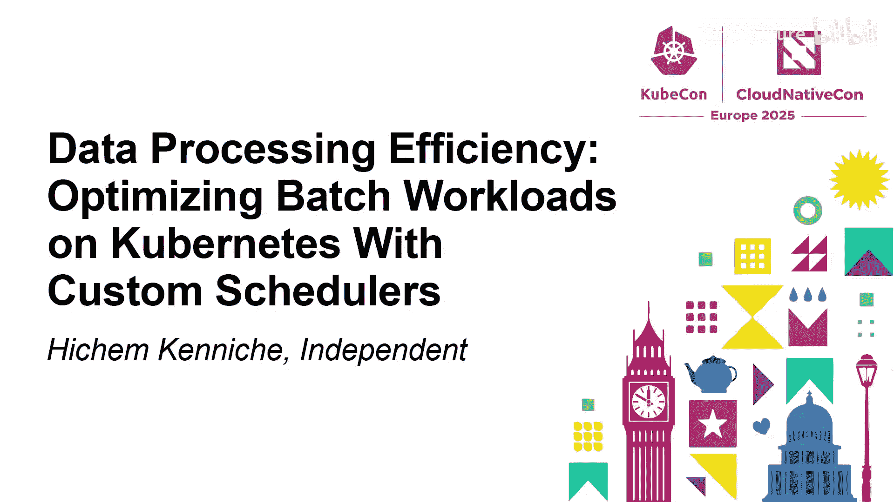
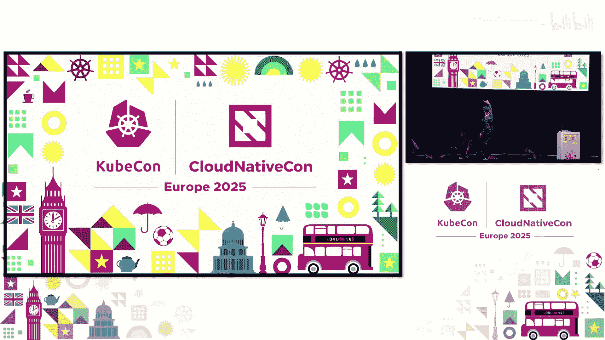
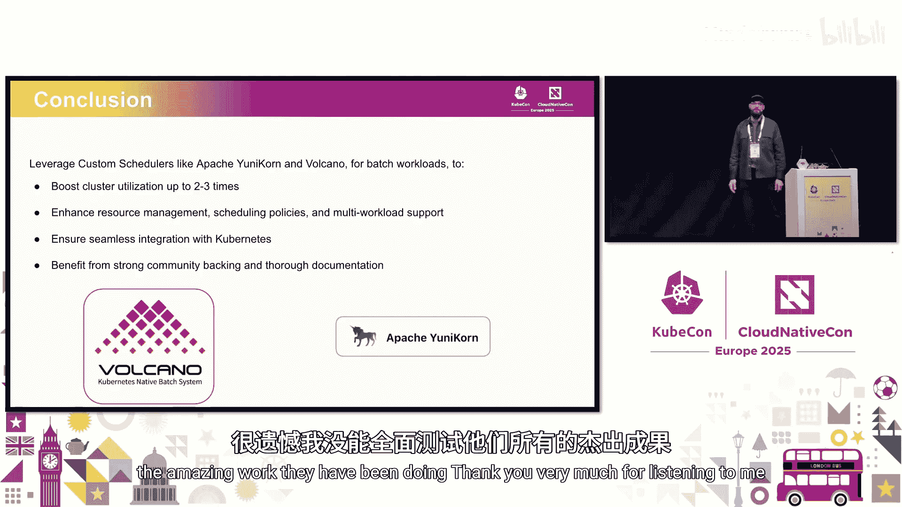

# KubeCon-+-CloudNativeCon-大会2025-｜-云原生计算-｜-可观测性-｜-Kubernetes-｜-Prometheus-p09-P09-Data-Processing-Efficiency---Optimizing-Batch-Workloads-on-Kubernetes-With-C--BV1Cd32zDEBG_p9-

H everyone。 thank you for joining this maybe last session。

 I heard that they kept the best for the last。 So'm really excited and happy。 I will just。

 I always dream had a dream to do this。 Can I take selfie with all of you guys， Okay， just。😊，Wve。

 I can show my wife that， you know， I have an important job。Okay。Are you there guys？Oh。

Thank you very much。 Thank you。 That's first to do list。 my dream。 now， okay， perfect， hopefully。

 I will not bore you to death。😊，There were a lot of subjects。 This topic is really trending。

 and it's really hot。I have one explanation here。 So my background is data engineering。

 machine learning engineer。I'm sorry for all the infrra guys。But， no one is perfect。So。

Data engineering， machine learning， engineering。We come from another word， Hadoop word。

 And it's probably dead already。 And we came to Kubernetes， and we found a new home。

 Was it the perfect home， I'm not sure about this， We struggled at the beginning a lot。

 especially that。 I mean， Kubernetes was built for。Stateless， yes，9 years ago， I mean。

 I heard this morning that there was no way no one was thinking that Kubernetes will be the target platform for any type of workload。

 And this is kind of， you know， I will give you like here in my feedback from from the field as an end user as a data engineer as a practitioner。

 Okay so custom schedulers。 that is an S it's plural。

 but it's only two that we kind of manage to test and so far。Yeah， hopefully， I would not， you know。

 spend a lot of time。 And I just want you to go， you know， take， take away here with two things that。

Actually， now we can run batch workload， which is E T， L， E。

L T and ML engineering and like training and serving at scale with Kubernetes like any other framework we did in the past。

 So the Apches Sp case， So whenever I'm talking about Apaches Park， hopefully oh sorry。

 I need to put this I took already maybe two minutes。Okay， so whatever I'm saying about Apaches Park。

 hopefully will apply at least for Ray， who is familiar with Ray。Hope prefers Ray to spark。 Okay。

 So now， really， like here， the， the goal is to get anything that does， you know。

 to serve the purpose to work on Kuberities， okay。😊，So this is the plan。 hopefully。

 Ill try to go fast。 and then keep the rest for the best。 this looks like obsolete already。

 What I've seen in the three days。 I was really depressed because it's Gen AI everywhere。

 And this was like， you know， old fashioned machine learning predictive machine learning。 We predict。

 I don't know， like， you know， traffic jam。 we predict fraud detection。

 but it seems like it's already yesterday。 like， you know， I was so depressed。 hopefully。

 it's still something relevant for you guys。 but， you know， its sort we're still doing， and。

 you know， businesses and our customers and what we do is still based on predictive M L or old fashioned M。

 not everything is generative A。 You can ask your best L L M model to predictive fraud detection。

 and it will probably right， you know，😊，Hundreds of lines， but he would never do the job。

 So the whole thing was born from the idea we were building the open source platform to predict。

 let's say it's a navigation system for cyclists。 If you cycle in big cities in urban places。

 you know， there is no such thing。 There is no like a navigation system to tell you， yeah。

 there is a road closure there， or there is a fire there or there is an accident So or this dedicated road is growth。

 So the whole idea， the genesis of the the work was born around building this platform。

 make it completely open source and give it away to all cities from Hilsinki to Madrid。 you know。

 and say， like just plug it to your data。😊，Give it to your customer use。 by the way。

 theres also like I want to shout out， give a kudos to the open street map folks。

 and you have lot of， if youre either cyclists in the room really amazing tools out there。

 So we had the need to get something like a custom schedule。

 We built the whole stack around Kubernetes。 We had Apache Park。

 Then you can argue why you choose this versus this one。

 This was like an MVP or a minimal viable product that we wanted to kind of provide as a blueprint to build this kind of navigation system for cities that have cycling for。

 I mean， you know。😊，People using。Cycled roads and navigation system。 Okay。

 so that's was the star sparkar was born in the Hadoop era。 then， you know， needed a cluster manager。

 We've seen a lot of talks and even like， you know， testim from Apple， I guess。

 from migrating from Hadoop to Kubernetes。 So we had in the past standalone Meos yard。

 which is still widely used。 The is important because it's still。

 we at least got inspiration from there。 And then finally， Kubernetes。

 which is the the most popular one。 And it， and I think objectively is the the right way of deploying spark。

😊，So how do we run quickly spark on Kubernetes。 So using an operator， actually。

 there are two operators， one in go， one in Java。 But anyway， the more we have better it is。

 And then so we have a spark operator that runs there。 And you see like， you know， the rest is。

 is pretty similar。 And what matters here is that the scheduler is still around， okay。😊。

So the benefits are there are a myriad of benefits。 this is not the point here。

 I hope you are all convinced。 but， you know， besides all， I can list all of this。

 But one of the key things here， I didn't hear this a lot。 This is my personal view。

 we want to do efficient infrastructure， we want to do efficient utilization。

 we want to reduce our energy utilization， our carbon footprint。

 So thinking that cloud native means we have infinite resources。😊，It doesn't mean anything。 I mean。

 it doesn't mean anything。 Like， you know， even if you are a big company and you have billions to burn。

 you will not burn this into infrastructure。 So the whole idea was to how can I have a finite set of resources。

 How can I use them efficiently。 That's the kind of key thing。 And hopefully， like， you know。

 we can more and more talk about this， How can I use efficiently， my infrastructure。

 and the result will be cost reduction and also will be you know， energy reduction， footprint。

 carbon footprint reduction， etc。But there is one limitation， not a lot。

 It's that the default scheduler is not adapting， okay。

But saying that it seems like the default scheduler is not good enough。 Sorry， I want to be like。

 you know， we we keep baing about the default scheduler。 but kudos to that s or people working。

 the default scheduler is really amazing， by the way。 If you look at it。

 and Daniel did this amazing kind of I mean， if you have an hour to kill。

 if you are taking the Eurostar or if you are flying back home。

 just go ahead and look at how amazing is the default scheduler。 It's an amazing piece of technology。

 by the way。 So what we saying it's not adapted， it's because because our need is not there。

 So we have to be really conscious that the work was done。 and it's still evolving， by the way。

 it's really amazing。 It's not just pod to nods， it's more complex than this under the hood。

 you may just a your workload， your pos。 but under the hood。

 it's doing piece of amazing stuff to do this。😊，And we can take， take it even further。 You know。

 this is like the whole kind of process where you have the pre filtering。

 You have different algorithms and concept just to do just to do that scheduling part。Okay。

 so hopefully this is was the first kind of， you know。

 message I want to convince you that default scheduler in Kubernetes is amazing。😊。

Our needs from the batch world， the batch processing were missing。 Okay， that was the， the。

 the first message。So now what are the limitations， if I like expand a little bit。

 if I kind of elaborate whether you are coming from one project or another， I mean one project。

 open source project or another， you will hear this。

 and this is really like you know this makes sense。 The lack of application concept。

 It doesn't default schedule doesn't kind of you know the distinguish between an application for application or ray application or reno application or linklink application。

😊，The， the awareness culing， FiO， fair， etcettera， etc cea， to to simplify。

 And maybe it's like more oversimplification is just one large queue， you know。

 only a pod level queue。Un limiting scheduling policies。 Obviously。

 we're talking about gang scheduling。 What is gang scheduling。

 I need all my pods to run together just to simplify it。 Okay， I have one job。 I need all my pods。

 I cannot just one half of my pods and then wait for another half。

 gang scheduling in a nutshell is just to put all my pods together， okay。😊。

Then limited multi tenancy support。And furness party handling， again， coming。

 depending on what is your background and what is your favorite tool， you will see more or less。

limitationitation。This happens a lot。 And you may think this is like really kind of。

 this should be kind of sorted already。 This happens a lot。 We have a lot of this deadlock。 Like。

 you know， I need an app that I need four partss for my spark application A to run。

Same thing for a spark application B。 The only problem is like each of them。

 they were assigned two pods。 And this， like， you know。

 it will remain like this without any way to say this is completely uns。 Let's just， you know。

 free the pods。 Let's spark plug application a complete。 and then we give it the resource to Api。

Okay， that's for the limitation。 And then it feels like ages ago。😊，Whoho here knows about Cuba。

Anyone。No， I feel like a dinosaur。 Okay， this was 2018。 It was not like， you know。

 my son was born 2018。 It was not。 but this was the first initiative around how can we bring batch processing to Kubernetes。

 And I call it the ancestor because it's laid the foundation to everything we are doing。

 And I would talk about volcano and volcano was kind of fork about this。 And by the way。

 you see Apache spark there。 It was not even G A on Kubernetes when it started。

 So Spark was just experimental on on Kubernetes。 We had a cafe。

 and we had a tosflow stuff like this。 But it laid the foundation And I don't know people really like kudos to people who thought about this。

 They had this They were visionary at that time。😊，So Qubba， it's archived now。

 but it really gave shaped the future of the custom schedulers。 and the first one is volcano。

 I'm just giving you here。 I mean， you can read all about it。

 buts CNNCF backed when I mentioned this CNNCF backed or A party software foundation backed。

 It's really important at least from our perspective。

 the reason is really there are some tools if they are backed by John Do in his in his backyard in Nebraska。

 we cannot rely on it。 That's the thing。 So we really need tools that they are kind backed adopted by the community。

 so we can run them in production。 That's the key thing。

 but still there are some frameworks and Python stuff that rely on one person。

 And it's really kind of scary。 but here I started with this really matters that if we want to trust a solution。

 a project， it should。Somehow widely adopted and backed。 And there is a vibrant community behind it。

So。Whats， what else I can say it was really adapted for bad scheduling system。

 It has a lot of tight control on on the resources。

 quotas handling extensive resource allocation and suitable for a mass massive multiten clusters。

 again， I will show you this， but multitens in a nutshell again for。

 for those who were wondering why。 I mean， just think about that stock。

 I showed you that cluster I showed you， I had data engineers。 I had M engineers。

 I had data scientists。 I had PhD student doing and then research。 And I kind of， you know。

 split the resources into different business teams or different groups using the same resources。

 Again， finite set of resources。😊，Well on the top of， you know。

 I will add it's adapted for GPUus or specific specified hardwares， which is really important。

 We had a lot of discussion around this。 And by the way， this is personally my next Nirvana。

 How can we meize the usage and slice the GPUus because it costs a lot of money。

 And I will mention this。When to use batch jobs， whenever， you know， whenever you have batch jobs。

 sophisticated scheduling， it's really adapted AI and M L batch processing。 H PCC。 I just put here。

 you know， I'm not familiar with HP PCC， Let's be honest with you。 but I think， you know。

 I've seen a lot of talks around this。 A lot of testimonies that it's well suited also for HPC。

And multiitetanant clusters， the best practices， this is just to summarize again。

 So leveraging the queue management aspect。 So organization， you may ask in me， you may ask me。

 ask me， sorry， like， how do you think about this queue。 How do you manage this queue。

 How do you organize all this， And I will touch a point on this at the end。

 we have to specify the resource requirements。 at least think about it。 And yeah。

 manage all this job job dependencies。 Anyone familiar with the airflow。Yes。

 so the spaghetti that you have at the end。How this dog。

 this crazy dog that the data scientists give you and say， this is my amazing schedule run it。

 So you really have to rethink this kind of stuff that you say， no， I don't。

 I like spaaghettis in the life， but not to run on Kubernetes。

 This is really important when you need to rethink the way we have job dependencies。

 whether it's batchge or AI and M。😊，Okay， next， so this is wasvolcano。 And as I said。

 it's it's a fork from cube batch。 Then we had unicor。 So the name is kind of crazy。

 Anyone had an idea about the name where the。Name comes from。I'll pay your coffee。Yes。Secondiggan。

Yarn， yeah， okay， I'll pay a coffee or tea。 So yeah。 So yarn is there。 yarn。

 So remember that yarn was the cluster manager。 So yarn unified with Kubernetes or something like that。

 in some orders。 anyway， So there's yarn， unified and Kubernetes。

 So we took all from what was good yarn scheduling and all this concept。

 and we brought them to unorn。 And then， you know， it fits our again。😊，Our needs in the batchword。

Apaache Software Foundation， I I kind of gave you the。

 the reason and rational why it matters to trust a project， open source project。

But scheduling system， it enable enables sorry yarn like features， queue game scheduling， support。

 hiarchical， hierarchical make it cues and guarantee resources。 even though we see。

 like in real life， this may differ。😊，Yeah， well it was really important that we didn't have to kind of。

 you know， sorry for my French， but mess around with the existing Kubernetes。

 give us this capacity to run it smoothly， like， you know。

 abstract a away of the complexity that had to do anything else， and ideal again。

 similarly to multi tenantant clusters。Pority based scheduling。 I mean， if you're interested。

 you can read all about it again， when to use big data workloads。

 multi tenant and dynamic resource needs。It has you know like some best practices， similarly。

 we have to think about ahead about the cues， how do we made this hiarchy。

 we have to configure the resource quota， what do I have to give the priority to who my data engineering team。

 at data science team and then I mean， I heard this morning from the volcano folks that they also have in the latest version of UI。

 but so far only Uniicorn has this nice QI to kind of figure out a visual aspect。

There are some benchmarking and performance testing out there。 This is just my personal view， again。

EYou know， I spent some time doing aautics in another life。 I had a long hair。And if。

You want the plane to fly。 It's not on a simulation。 So you can spend 10 years doing simulation。

When once you put it on you know， the the airport， that's when you know exactly so。

I'm really happy with this stuff。 But， you know， they like this realistic aspect of bringing something like Spark。

 which is complex to something like Kubernetes， which is complex。

 B them together and test them in real life scenario。 And this is a call out there for the community。

 And I have been trying to preach for this。 We need to standardize。 We need a set of， I don't know。

 data set。 Let's think about for those who are familiar with TPCD S for analytics。

 We need a data set to test these schedulers to see how they really kind of， you know。

 act in realistic。😊，呃。Situations。Okay， so we've seen a lot of， at least。

 I've seen a couple of talks talking about KW O。 K， which is Kubernetes without Kubt。

 So you can deploy as much as hundreds of nodes， but there is nothing there running like， you know。

 there is no Kubt。So going back to our platform， what was the need， Think about it， that we are。

Calculating ahead， we have a model just to simplify that say these are the roots from point A to B。

 We already kind of had our model now。I have a new information。 sometimes， you know。

 its a sophisticated word， big word， event driven architecture， stuff like this。 Okay。

 this is really simple。 Okay， I have this information road closure in Paris， okay。

There was the Olympics。I have this information。 How do I deal with this， Okay。

 I have my data pipeline。 I defined exactly in my graph， you know， on based on graph theory， where。

 what should I do。And this information here， or this pipeline has to take the priority or whatever over。

 sorry， whatever is running in my Kubernetes cluster。Is this clear。

 This is like the most important thing that I want you to go ahead like。

The priority and whatever it's running， it's important。 But I have a new kind of， you know。

 higher priority workload。 I have something that matters more than anything else that should take the priority。

 But at the same time， I need my platform to continue serving。 Okay， continue working at least。

 you know， in some capacity。😊，So this was a whole kind of genesis and idea about why we needed to add custom schedulers and Hawaii is really relevant comparing to the default scheduler。

 So in our setup， in our experiment， we didn't use that， you know， kind of。

Not at least not relevant in the real life scenarios， but this setup is， as I said。

 we have a finite set of resources。 It's not infinite。 So and this is the kind of setup。

 So we had a multitannet， as I said， we had a data engineering team specialized in crunching data。

Dealing with streaming ingestion， we had an M L team。 We had a data science team。

 and we have to split the resources and make sure this platform is up and running。

The in different situation。This kind of jobs。 This is what we evaluated as being like， you know。

 the average users。 So we had， you know，1 hundred events coming per hour about， you know。

 different things happening on the on the city level that impacted our calculation of the best route for cyclists。

And it depends on the information we got， depends on the event we got。 It's either like purely CPU。

 It's purely， it's just like a set of joins。 It's just any information we need to write in a database。

 or it's just or it's impacting， sorry， the whole model that we need to retrain from scratch。

If you look at it here again， you can legitimately ask， why did we reach no more than00 jobs。

I think I can just say that at some point， the API server and ETCD will start to be the bottleneck。

 and this is not the point of the talk。 So there are other impacts or other ramification I would say we have to consider。

 But this was like， you know， for this kind of capacity， this is the maximum we could do。 And yeah。

 so in different scenarios。 And the only thing that we simulated completely is the node failures。

 I was part of a company that was built around building a whole stock around spot instances or unused instances。

 So it' really matters for us that I lose the spot instances because Skill because it's taken back from the cloud provider。

 how do I make sure my job is resilient。 So we had to simulate sometimes by hand。

 node failure just to make sure this。Now， this is the subjective part。 And please don't shout at me。

 It's for rational and technical people。 The scale is really bad。 Three stars。

 Is it like a review for a restaurant， Yes， but actually， it was a really good consensus actually。

 among us。 How do we evaluate this， Is it like perception。 Do we calculate the。

 I don't know the integral of the second derivative of no， no， no way， just。😊，Just think about like。

 you know， rational basic stuff。 So the scale is three stars is the best thing we can get get。

 you know， and one star， if it's really okay。😊，And for the complexity is three sad face。

 And I know how to make sad face。 And one， if it's okay。Alright， so if you think about it。

 we took this again from a pragmatic point of view。 and I see really is running。

 So the support for different workloads， definitely here， volcano。 And by the way， yeah。

 I forgot to say the whole， I mean， idea here is not to say one V S another。

 I'm completely against this。 I'm really again， I said this， the more we have。

 the better it is and that let the community let the developer adopt and grow the tool they see better fit for our needs。

 So it's not one V S another is just to say， like， you know， our experience， how did we kind of。

 you know， get into this result。 So the support for different type of workloads。

 the complexity of configuration。 The reason in volcanoes defense here。😊，Volcano is more complex。

 It's more complete。 covers a lot of use cases。 So as a result， as a consequence。

 its there has a lot of configuration in place。 That's the reason why。

 because it covers a lot of use cases， as said， scs。The resource utilization， you know。

 is's quite similar， but we see it N dot volcano kind of， you know。Uses well the。

 the whole resources we had in hand。 for tolerance and recovery。 I would say it's the same。

 What does it mean， Either I inject Nor failure， port failure。

 or just like as as simple as a preemption preemption is I take a workload that is wing。

 And I give these resources to a higher priority， And sometimes it will never be rescheduled back again。

 That's kind of weird situation。Or bizarre situation。 the s latency。

 This is somehow what we got as a result。 Again， we two stars not really far。And load distribution。

 pretty kind of similar and job completion time， especially that you have jobs that run。 I mean。

 again， this is really important when we talk about some bad jobs or some training for mod training。

 We're talking about days。 So it doesn't matter like， you know。

30 seconds or even5 minutes when my jobs run for 48 hours， really， What matters is the completion。

 The number of jobs that will complete conquercuring jobs that we complete。

 That's really important thing。 And then we have this weird behavior and name them will。

 because we couldn't reproduce them and share them with the community time to time， I mean， you know。

 it's not a perfect match for interactive workloads。 If you are familiar， like， you know。

 you can connect your notebook like a Jupiter notebook to your spark cluster and data scientist just run code interactive code。

Actually， both of them are not really well suited， and then some weird starvation happened and you know this is in volcano and for unicorn。

 that is really bad situation， the spark driver kind of dies sometimes because it's affected by the preemption。

As a conclusion， I would say， Im really running out of time。 They are really well suited。

 Both of them are really well suited for batch workloads comparing to the default scheduler。

 the cluster utilizationization is really by a factor or2 or three。 like that's really proven。

 say it's not scientific。 It's not hard science。 but this is something that is， that is a consensus。

It enhances the resource management， the scheduling policies and the seamless integration with conencies is really important。

 We are not getting out。 We don't need a kind of weird stuff outside。 And they， again。

 kudos to the amazing community， whether it's volcano， unicorn and others， unfortunately。

 that I couldn't really test for all the amazing work they have been doing。

 Thank you very much for listening to me。😊。

