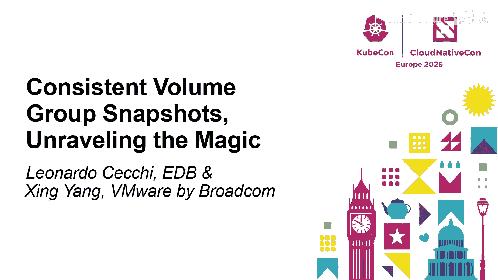
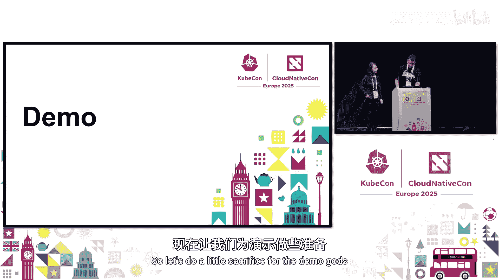
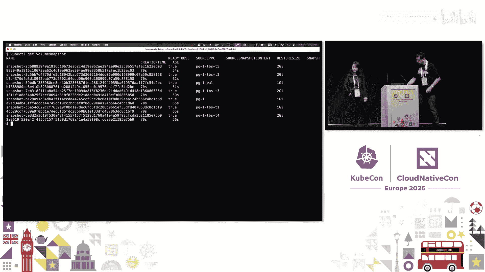
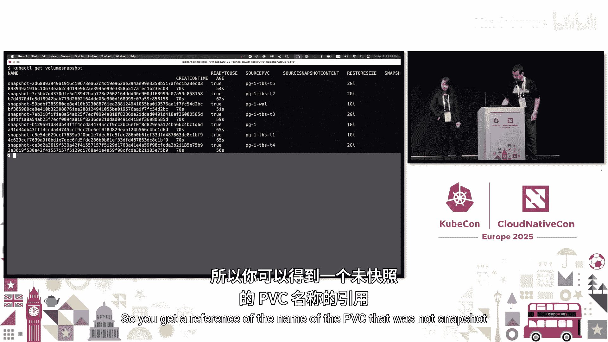
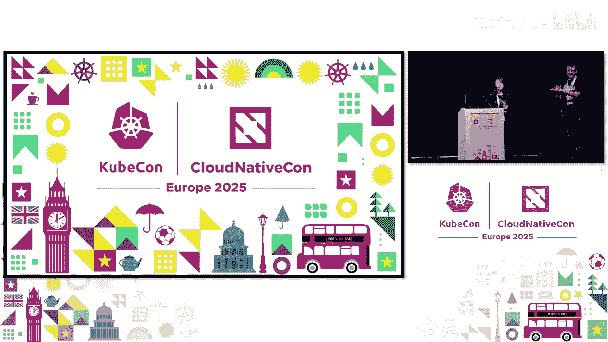

# KubeCon-+-CloudNativeCon-大会2025-｜-云原生计算-｜-可观测性-｜-Kubernetes-｜-Prometheus-p11-P11-Consistent-Volume-Group-Snapshots,-Unraveling-the-Magic---Leonardo-Cecchi,-E--BV1Cd32zDEBG_p11-

Hello， everyone。Thank you for coming to our session on World Group snapshots。😊，My name is Xing Yang。

 I work at VM Wellby Boan。I'm also co chair of Kubernetes， S storage。My name is Leonardo。

 I'm a principal software engineer working in ETB。 I'm a postg user since a lot of time。

 and I I'm a contributor to the Kubernetes C I project and the maintenance of the K native P G project。

Here' is today's agenda。We will discuss why we need one group snapshots。

 explain how it works and how to use it。 At the end， we will do a demo。

When I was preparing for this presentation， I asked ChaGBT to show me why disaster recovery is important。

 Here' is what I got。😊，It looks chaotic and dangerous all around。 but in the middle of this picture。

 it looks calm and safe。😊，This is definitely better than what I can draw。

Here we have a data center being protected from disasters such as fire， flood， cyber attacks。

A shield that safeguards your critical data。A contrast between chaos and security。

Disaster can happen at any time。 How do we protect our precious data from a potential loss。Here。

 I listed what could cause a disaster。Actually， human error is one of the leading factors。

As show you this picture。If this data center is burned down。

 your data stored there will be lost for sure。 however。

 if you have your data backed up in a different location， you can always restore your data back。

So data protection and disaster recovery are very important for your mission， critical applications。

Wden snapshot API was introduced back in Kubernetes 1。12 release and moved to GA in Kubernetes 1。

20 release。It allows you to take a crash， consistent snapshot of a persistent volume and use that to restore your data back at a later time if a disaster strikes。

It provides a basic building block to protect your applications running in Kubernetes。

We already have a volume snapshot API for individual video volumes。

So why do we need voting group snapshots。Now， let's take a look at an example。

Suppose you have an application running that uses multiple volumes to store its data logs and so on。

 You want to protect your application。To ensure application consistency。

 you need toqui your application before taking a snapshot and unquias afterwards。

Butquias takes a long time， and it is very expensive。 So you may not want to do it frequently。

But you still want to be able to back up your data more frequently。Without applicationqui。

 you take a snapshot of the first volume at time 1。Then you take a snapshot of the second volume。

 item 2。Then you take a snapshot of the third volume at time 3。No。

 you try to clone the same application to a different name space。

 or maybe your original application is corrupted。 somehow you are trying to restore your application back from those snapshots。

Now， after restore， you may run into problems because the snapshots were taken at different times。

 and you get inconsistent data。How do we solve this problem。Fortunately。

 we have consistent group snapshots come to the rescue。😊。

Consistent group snapshot allows a snapshot to be taken from multiple volumes at the same point in time to ensure a right order consistency。

This is important for applications that have multiple volumes。

After taking the consistent group snapshot， you can create a volume from the snapshot and get your application back。

😊，Note that if your application is a database， you will still need to do crash recovery。

Leonardo will give an example， later。Wing group snapshot feature supports crash consistency。

Taking snapshots of all the volumes at same point in time also is more efficient than taking one snapshot at a time。

 It provides better performance。😊，We started to design the volume group snapshot feature shortly after volume snapshot moved to G A in 1。

20 release。But it took a while before we finalized the design。

 and we introduced it as alpha feature in 1。29 release。😊，Then we moved it to beta in 1。32。

This feature introduces three new APIs。We have a volume group snapshot class that is created by a admin to describe how volume group snapshots should be created。

We have a volume group snapshot that represents a user's request to create a volume group snapshot for multiple volumes。

We have a volume group snapshot content that represents a physical volume group snapshot resource under the Saudi system。

The content is created by the Snshot controller in a dynamic provisioning and created by the admin for the pre provisioning case。

Leonardo will explain the two types of provisioning later。In a volume group snapshot class。

 we had the C I driver name the parameters that contain。Information that is opaque to Kubernetes。

And is understood only by C S I drivers。It contains the deletion policy。

This works the same way as the di policy in a volume snapshot class。

It can be either delete or retain。Here's an example of a wording group snapshot class。

 The deletion policies delete here。Here is the volume group Sshott API in the spec。

 you need to specify the source。The source can be either a label selector or a warning group snapshot content name。

Depending on the type of provisioning。Warning groups snapshot class name may be left new to indicate that the default class will be used。

After voting group snapshot is created， you can see the buned voting group snapshot content name and the creation timestamp in the status。

😊，You'll also see the ready to use parameter in the status that indicates whether this volume group snapshot is ready to be used to restore your PVCs。

Here is an example。 See the label here。 You need to specify the label on all the PVCs。

 You want to be snapshotted together。In the volume group snapshot contents back。

 you have the deletion policy， CSI driver name， volume group snapshot， class name and the source。

 the source can be either a list of volume handles for the volumes on their sort system or group snapshot handles。

 which includes the volume group snapshot handle and a list of individual snapshot handles on the sort system。

The voting group snapshot and voting group snapshot content highway  one to one mapping to each other。

In the word group S snapapshot content example here。

We see volume handles in the source In the status， we see volume group snapshot handle and a list of individual volume handle and snapshot handle pairs。

To support this feature， we also added volume group snapshot definition in the C S I spec。

This feature in C S back moved to GA in the C S S back 1。11 release。C， S I spec does not have a beta。

We added a new group controller service and a new capability。We added three new R PCCs。Create。

 delete， get voting group snapshot。In order to support this feature in a CSI driver， a sorty vendor。

 we need to implement this new controller service and the new R PCCs。In this diagram。

 we show how CI driver is deployed and how various components that support voting group group snapshots are working together。

 We added voting group snapshot support through the snapshot controller and the CI snapshotter Secar。

Snapshott controller does the heavy lifting。It creates the volume group snapshot content and in the in case of dynamic provisioning。

 and it is responsible for binding the volume group snapshot and the volume group snapshotshot content。

The CI snapshot or site car is deployed together with the CI driver。

 It watches the volume group snapshot content API objects。

 It caused C S I driver to create or delete volume group snapshot on the storage system。😊。

We introduced featuregate。In both Snapshott controller and the CS S snapshotter set car。

 Since this is the beta API， the feature gate is disabled by default。Now。

 let me hand it over to Leonardo。 He will explain how the two types software provisioning works。Okay。

There are three main things you can do with volume group snapshots。

 The first one is called dynamic provisioning。 And it is the wordflow you use when you need to take a backup。

 And given a volume group snapshot class。You need to create a volume group snapshot object。

And the system will provision everything for you。 So a volume group snapshot content。

 a set of volume snapshots and a set of volume snapshot contents。

 Isn't it beautiful for It's magic from just one object， you're gonna get everything。😊。

The second wordflow is called pre provisioning。 And this is what you use when you want a Kubernetes clusterer to take control of an existing group snapshot。

 existing already in your storage。For that workflow to work。

 you need to create all the objects yourself。 So the volume group snapshot content。

 the volume group snapshot， the volume snapshot contents and the volume snapshots。Then the third。

 most， the most important worldflow is the restore。

And this is really easy to do because it's just designed to be used。

 as you would use a plain volume snapshot。 We see that later。And from La1。

 we are going to explain how the dynamic provisioning works。 And， you know。

 since I'm an Italian guy and of classical music at Op， I will use an opera metaphor。

 So we split this process in four acts and each act as scenes。 And this is a opera for four personas。

 You have a Kubernetes administrator。 You have a C I driver。 you have doesn have shortter sidecar。

 and the Common snapshot controller。 So let's start from。Oc1。So what happens now。

 you are a Kubernnetes administrator working on your desk。 Everything is good， Everything is fine。

 And suddenly， are developer is asking you for a database。😊，Do you really need it。 Yes， I do。

 But it's just temporary data。 Don't worry， you can destroy everything when you want recreated button。

But I don't trust temporary data。 Let's create some storage for it。

And I know that it iss always best to have the transaction log in a separate volume。

 So I'm going to create two PVCs。 One is for data。 This example used CG because it's the operator I'm most familiar with。

 but concepts are genetic。The second one is for the transactional lo in Pos。 This is named Wall。

 right ahead Lo。The most important bit here is the common label between the persistent volume frame of data and the other one of the walls。

 Shes named in this example， instance name。Then I configure immediately a volume group snapshot class because it's better to feel safe than worry。

 you know。I'm gonna be up everything， getting things。If it is temporary。Okay， act2。

And now we are inside the controller manager。 You know， everything is good。 Someone created a Ch job。

And the Chrome jokeck starts。Handling definition of a job to the job control。

 And the job controller is one that always complains because you want to be used by in isolation。

 And everyone use just the common jobs。 But anyway， let's work。 I'm going to create a po for you。

 It's fine。And this po is triggering your database of era to take a backup。And the database of era。

 it is a quiet place that's back going on。 back is perfection。 Beai。

 What is doing in the database of eraator is creating a volume group an snapshot object。

 And look at that。 We have the labels， the instance name label we have seen before。

 Isn't it beautiful。 And we have DN S for the volume group an abstractshot class name。😊。

This comes from Akman。Okay， we have a new object。There' an abstract controller is waking up。Oh， look。

 I have a new object。 Let's create a content for it。

 I'm going to get all the details about the volumes you need to snapshot。

So I feel the volume handles， everything beautiful， Ok。

And now we are inside the po of the C S I driver。 And there theres a shortest sidecar realizing。

That there is a new volume group snapshot content object。Okay。

 but I don't know how to take snapshot by myself。 I need to ask my CI driver friend。

 which is sitting next to me。 And so I scream in a GRPC format， create group snapshot request。

But the that poor guy ising Jack Ne to me said， look， I heard you， okay， these are the U I D。

 I'm gonna do the your work。 Good。 Okay， let's take a group snapshot。

These are the U Is of the snapshot to you requested me。 And this is the U I D of the group snapshot。

And you know why group snapshotter so fast。 It's because the snap shot is continually screaming at that poor guy sitting next to him until it is ready。

And I'm like， go。Okay， let's do that。 So Im gonna feel all the details。It's everything there。

 these magic numbers， all the U I Ds。And it is ready to use immediately Bea in this example。

This natural control wakes up again， because the object changed。

So I now have a volume group snapshot object。 I have a volume group snapshot content objects。

 I need to create。A set of volume snapshots and a set of volume snapshot contents。

 because this is what you need， when you need to rehydrate your PVC。

I do that just using the data they were sent to me in this step before。

And I'm going to create everything。 This is how the magic works。But， you know， again。

 since I created new objects。The snapshot sidecar wakes it up。Oh there's new object。

 Let's ask the poor C SI driver the status of this object。 I already told you， they are ready。 O。

 let's do。 I'm gonna feel the status。Good， I have the statusers now。 They are ready to use。

 They have a volume group snapshot handle。This classifies them as a member of a group snapshot。

 not just an individual as snapshots。Actuallyly。Okay， we go back to our office。 Everything is good。

 and， you know。The reviv comes asking for a restore。 It's always happening。

 but it was temporary data。 Yeah， but， you know， it taking so long to recreate from scratch。

Can you restore as it was two days ago， Okay， O， let's do it。O。

 it is enough to recreate a system volume claim and use the data source stance inside the specification。

Referring to the volume snapshot objects that were created a few steps before。

This is just like you would use playing volumes and option。

We won't restore to be easy because when you need to restore something。

 we are usually arriving in troubles。 It's better to avoid complexity。 This is so important。

 This is why。Was that way， Act 4。The world is quiet and beautiful， and we finished。And that's it。

So this is how dynamic provisioning works。And as you can see。It is teamwork。 It not。

 It is not just one soft component doing the magic。 It's collaboration。

 So the most important here is the communication between all these software components。

 This is more important than the actualqua implementation。And if something doesn't work。Okay。

 we need to know that this is a betafish now。And we need to check the F gates to be enabled。

 There are featuresure gates in the common snapapshot controllers。 There are。

 there is a featuressure gate in the C S I snapnapshot test cycle。 And then we need， obviously。

 the C D to be installed。And we need to check that the PVCs need can be really snapshot together at the same time。

 At least they need to be provisioned by the same C S I driver。And that C I。

 C S I driver is the one that should be referred to in the volume group snap class。O。

 I checked everything， but it still doesn't work。EWell， so you know the history。

 you know which actor is supposed to play。 Now， the logs are your friend。

 And you need to check which step you stopped。And what happened。

And then we need to iron on out some bags。But anyway， okay。So， you know， I'm a Postsgss person。

 so I need to share a few words about Posgs。 But this is true for many software systems working like a EBMS S。

 So you get basically two data storage at the price of one。

The one on the right is called the transaction log。 and every time you change something。

 someone is adding a note there。 And when you commit， this is flush down to permanent storage。

 And periodically， the system will perform a checkpoint。

 checkpoint means it's going to flush down all the has to your data store。

 which is the one on the left， it can be splitty multiple volumes。 like in this example。

So to be a system like that， you need collaboration between the primitives。

 just like volume snapshots in this example and the database of a。

So someone need to start the P PG Be start function。

 which is going to turn a few knobs inside the VBMS and immediately perform a checkpoint。

The system is consistent at that point。 And then you can take your snapshots。When you did that。

 you need to run PG Bha end。 This stops the reha process。When you need to restore this situation。

 it is inconsistent because nupts are taken a different point in time。

The database will just look for the checkpoint immediately before the first snapshot。

 So the one where PG start was performed。 and then a pieback called the transaction long until it is consistent。

 This is going to take a bit of time。Because they are not consistent。Meanwhile， with group snapshots。

This is easier because everything is consistent and it's going to be really quicker。

 This is why groups and actuals are really loved by database people like me。

It's such a great feature for us。So let's do a little sacrifice for the demogos and。

u。I hope it is big enough。Can you see， Is it big enough。Good boot。 Okay。

 So this is a clustered object。 I'm using CPG， but everything is genetic here。

I just created a cluster object with just one instance。

 That means you are going to get just one port。 But these databases split across multiple volumes。

You want bega， that's good。嗯。Better now you。Multiple volumes there。 There are 7。Okay。

To backup this system， I'm running the CPG backup command。 It is no magic。 absolutelyly。

 It's just creating a backup resource that it is triggering the database operator。 And you know what。

 wow， this is nice。 It's gonna trigger even an update of item。 Okay， it's fine。 Anyway。

 our backup started。 finished and completed。😊，This is what happens when you' found on your Wifi。

 okay。How did he do that， It just created a volume group snapshot object， which is ready to use。

Look at the definition of these。The most important bit is this selector。Okay。

 and then you get everything else because C andP Gs are notating it with the database status。

 But this is something。For CPG。Then you are going to get a volume group snapshot content object。

 as we were saying before， which is ready to use。And then you are going to get。Asset， oh。

 this is the definition of the volume group snapshot content with all。

The mapping between the U I D of the volume and the U I D of the snapshot。And then， we get。Poooof。

 okay， a list of volume snapshots，1 per PVC。

This is nice。 So you get a reference of the name of the PVC。 That wast a snapshot。

And the list of volume， snapshot contents。Here it is。So it's really easy to use them。And it teamwork。

So， great。I'm going to。Start my presentation， again。不不。There we go。Back to sh。Thanks， Leonardo。

Now that the feature is the beta， we have been working on fixing bugs and trying to bring this feature to GA。

We'd like to see implementation from more study vendors。

 and we'd like to see integration from more Kubernetes applications like the Baab Re Sous case that Leonardo described for the Postg SQL operator。

😊，Here are some resources for your reference。That's all we have。 Thank you。Yeah。

 I have a question about the demo。 like in the demo， you showed a volume that was 2 GB。

How it works for how quick it works if we have some larger volumes attached。Okay。

 the answer is it depends on how your storage is implemented。 This is just an infrastructure。So。

 yeah， sorry。 I don't have a clear answer for you。 Check your C S I driver。

 You will find a lot of documentation about this works internally。

 It may be immediate or it may take some time， depending on if your C S I driver implements secondary storage or not to。

Yeah， definitely it depends on how your storage works。Okay， okay。 Thank you。Hello。

 I have a question about the demo also about the restore with CNPG。

 because in the CNPG documentation， you need to delete the cluster and recreate from a backup。

 Does it mean that with volume group， you need just to restore the volume group， right？

 and without touching the cluster object。Yes， when the volume group snapture fisher will be merge inside CPG。

You will just be able to reference the volume group snapshot object。 And then you are done。Okay。

 so I it's not available yet， right， but you need to change。Yeah， it will be merged。

 I hope for the next release。Okay， thank you。Okay， thanks for the presentation。 I， I want， if I can。

 I would like to answer the also the question before about the recovery time， because I I did a。

I did a presentation in Kcon in Chicago a year and a half ago， where we Michelle Au from Google。

 we showed how to restore a Postg database of 4。5 TB。In two minutes。As Leonardo explained。

 volumes and snapshots are still at the foundation on this。

 but I would like to ask you if you can briefly cover the differences between snapshoting in VMs and the benefits that Kuberneteses has brought to this technology that is unprecedented。

 I。Okay， so you're talking okay the VMs right so yeah VMs or outside Kubernetes I mean the advantage of Kuberes so with this feature if your VMs using multiple volumes。

 you can take a know group snapshot and that will be very helpful for your VMs right because your VMs typically have multiple volumes。

Yeah。And to add a bit of something， this is foundation work that is common to every storage implementation。

 So you just have an knife an API and using that API。

 you are independent on the actual implementation。Yeah， no sorry。 I probably rephraed it。Wrong。

 but mine was I've seen from， from a user's point of view。

 the advantages of having a standard interface that Kubernetes brings when taking volumes naturals。

 that it's not available。And in V， where every vendor is their own。 Sorry， I should。 Wow， So。

 if your V Ms have all the data stored in the PVC， so you can use this。You can use this feature。

To take a group snapshots， Okay， thank you。Thank you for presentation。

 Have a question in your selector a video with only host name。

 Is it possible to use different attributes in a selector。Absolutely， absolutely。

 it's just a plain selector。 this is foundational work。 It's not about particular implementation。

 It's for everyone to use。So potentially， we can make a like multipo snapshot。Absolutely， okay。

 Thank you。One clarification question， are you calling this CS SI provider with a list and delegating consistency to them or you are you taking responsibility for consistency and handing。

 calling them parallel。So a CSI driver needs to implement this one and need to call their vendor specific APIs right if they support consistent group。

 then they can use this they can implement this， but if they do not have that yet。

 then it's not going to work right so this depends on whether a vendor supports this technology or not system you need an option from each vendor that's providing CSI driver to have Yes。

 actual consistency and they can implement that however they want in the back end。Yes， they can。

 Yeah， They can implement this one if they have that feature in their storage system。 Yeah。

 do you know out of the major vendors who supports it yet。So right now， it's。

 it's speed early last time when we asked there are like a couple of companies saying they。

 they have implement this。 So that's why I'm calling for implementation for moisture vendors。

Thank you。Any tentative timelines when this feature will become GA。So we just moved to beta in 1。32。

 so right now we are fixing some issues。Probably you need some soak time。 This is just tentative。

 right， Maybe 1。35 really。 So well see。Thanks。Hello Bonjono。

 I would like to ask when you take the snapshot and。

The snapshot operator cooperate with the CPG operator and you have to issue the PG start backup command it does to flash the wall to the disk to be able to take a consistent snapshot。

 or does this affect affect performance And if this affect performance。

 because I imagine I wonder that in that case， right will be located for a moment。

 Yeah to the database。 Yeah， so this is actually Postgre specific not about But yeah， okay。

 with Postgres， you can spread your checkpoint across time to avoid the spike of your workload just when you perform a checkpoint。

So it depends on how you configure your engine。But you can definitely avoid that spike。

 at least a good part of it。Thank you。OhSo sorry， I just need one more minute or two minutes of your time。

I would like to thank Shink for all the help she gave me when I started contributing to the Hoernetas C S I system。

 She set an example， both at the technical level and the personal side。

 that could to be a really good leader on the tech storage initiative。

A big round of applause for her。嗯。👏Thanks， Leonardo。

 you have been contributing a lot to this feature。 and also there are many other community members who are contributing to this feature。

 They are not in this presentation， but I want to thank all of them for contributing。

