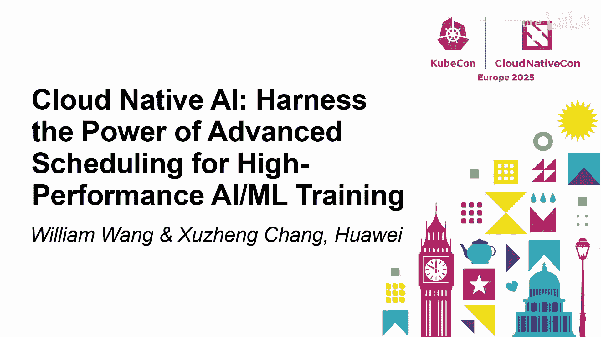
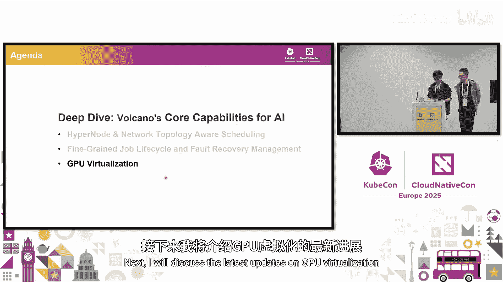
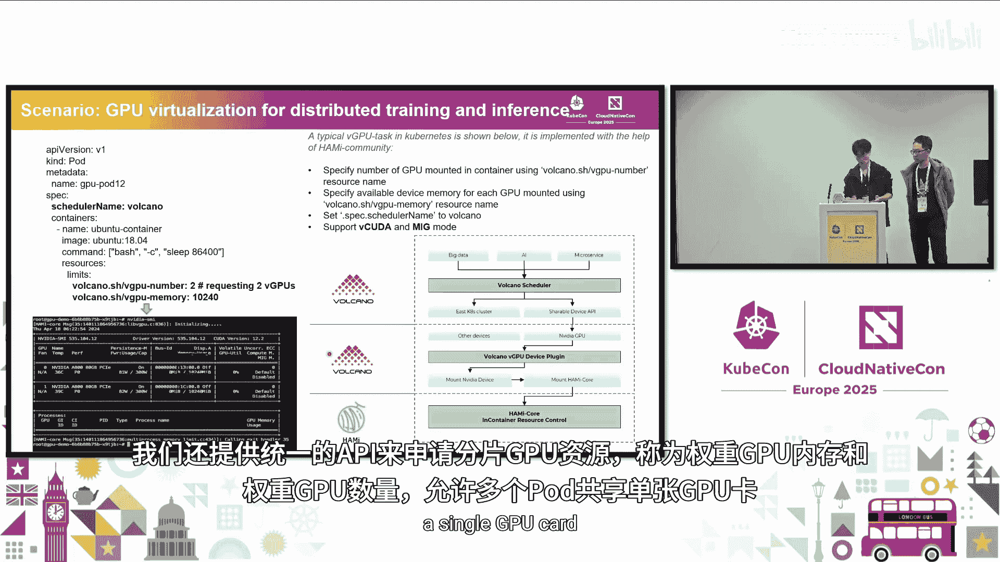
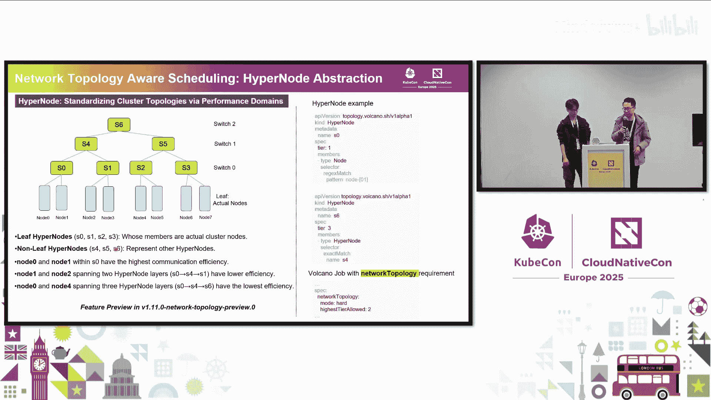

# KubeCon-+-CloudNativeCon-大会2025-｜-云原生计算-｜-可观测性-｜-Kubernetes-｜-Prometheus-p14-P14-Cloud-Native-AI---Harness-the-Power-of-Advanced-Scheduling-for-High-P...-Wil--BV1Cd32zDEBG_p14-

Hello， everyone。 Thanks for joining our talk。 So we are going to share the work we have done in the recent times。

 So basically it's also I talk about the volcano project。

 So we will focus more about the the new features。 we are working on to accelerate the high performance AI machine learning training。

 my name is Kevin W。 unfortunately， William didn't make it here。

 So I'm helping him to give the this talk。 Personal， my background is all about scheduling stuff。

 I started contributing to upstream Kubernetes back to 2015。 and so also a lot of subpro。

 and currently I'm also working on the T OC to help the whole community。 So today's talk。

Its more based on my personal expertise and also as the role of maintainer。hellello， everyone。

 My name is Xu Zheng， and you can also call me Z。And I'm a maintainer of candle。Alright。

 so basically， we， we will just cover the following part parts of the talk today。

 a little bit background and deep dive our key features。

 especially the new new ones for AI workloads。 Yeah。

 and also a little bit more about the scheduling staff and the the future plan。Okay。

 so we all know that in the recent years the rapid growth of AI workloads become more and more。

 especially for the L Ms， you know that。Other from a scale efficiency or performance perspective and more and more advanced the setup and the deployment requirements have raise。

 have been raised。However， for users， especially like the data scientists。

 that they don't have a much background about the the infrastructure sort of things。

 We think that simplicity is always very important thing。 So it's kind of， you know。

 we need to always consider。Expoing more the like the top topology。

 like the underlying hardware thing， as well as providing a a more simple way for the users to use。

So based on our observation and research， we think that there are two key trends very closely relevant to the cloud native AI infrastructure。

 especially also very relevant to the work we are working on。 So from the resources layer previously。

 we have done a lot of research and also implementation tryout in the in node topology。

 like new my awareness and also like the features discovery thing。

 and now and the focus and also the kind of attention extends to more inter node。

Tology thing like the network， topology stuff。With that， we also need to。

Kind of think about how to better support， you know， hydrogeneous hardware。

Hderogeneous AI cluster from different vendor， right。From the infrastructure management layer。

 we know that the workload have have become more and more complicated。 like for the training。

 more and more doing distributed training。 and also like this year。

 a lot of people are working on distributed inference， right。

 So we need to kind of find and way easier to mapping this deployment pattern of the workloads to better use the underlying infrastructure basically better align with the underlying network topology。

So let's deep dive a little bit more about volcano key features。

 So actually we have been working on this area for quite a long time before the name of this project volcano was used actually we were a subpro called cube batch in kubernetes scheduling sake and during that time we found that actually you know workload awareness of scheduling is very important。

 not not just the part by part。 We do like G scheduling and also like a lot of batch workloads we found that we can really reuse a lot of middle state of the scheduling algorithms and also we need to kind of queue a lot of workloads and。

So， you know， deal with the fair sharing between different users。That's why we kind of extended the。

 the scope and turned it to an standal alone on CF project。 So currently。

 volcano is in the incubation level in CF。 and we also have been adopt adopted by a lot of users and like this year last year。

 a lot of more and more use case werere working on the training and also inference。 So for a volcano。

 we basically support。Btch API like volcano job part group and also job flow like Q。

 and the new one we introduced is hyperno hyperperno。

 Hyno is an abstraction for the underlying network topology。 We will dive into deep later on。

 and also we have provided a lot of ecosystem support on the top。

 you can see actually the mainstream AI framework as well as the big data and also little bit H P HP framework computing frameworks。

 we all provide very good integration。Okay， so the one of the most important feature I would like to introduce today is about the hypern obion and also the network topology where scheduling。

啊。So we know that especially for their hyper scalers and a lot of large end users。

 they are kind of designing their own AI cluster to make more powerful helping the training workloads and also more like this year for distributed inference。

So like， like I said， before there are a lot of research and investment on the in node topology。

 right， and this year， last year， a lot of requirements are focusing on the inter node topology network topology。

 for example。 So on the left， you can see actually like in Nvidia DJ X。

 they have the concept called superpo， right， basically。

 a group of notes that are connected with very high performance。GPU network。

 we call it Mvy link en switch and also Infinnian and were even roki。 And we found that actually。

 there are also some of the AI cluster vendor hardware solution vendor。

 They are trying to design similar concept。 know， group a set of node together define it as a high performance domain。

 and the underlying AI network GPU network might be a little bit different in implementation。

 but from an abstraction layer abstraction perspective， there， there are a lot of common ideas。

 So that's why we are thinking about we really should make this abstraction layer clear and easier for users for schedulers for the other part of the system to to better easier。

Int。That's why we started working on the the API called hyperper node。 So basically。

 it's it defines a a group of node that has similar performance in the especially from the network space perspective。

 actually in， in real world use case。The notes inside one of the hyper node can be just the in same flavor。

 So we also， from the API perspective， we also actually designed this data structure to。

 to be able to be nested。 So like I'm not sure if my cur is。okay， so on the button layer。

 you can see these are actual nodes， basically of Kubernetes nodes。 and we can， you know。

 design all node connected to the same level like the switch0。

 this one level as one of the hyper node。Right， so， so like this node 7 note 6。

 they have just one hop， you know， connecting with each other。

 And we also make it possible to define like the nodes connected in the by the switch one。

 the second layer as， as a kind of nested hyper node。

 make it easier for users to mapping their workload in in the different layer。And in， in the result。

 it will be turn turn out to be multiple hyper nodes and actually multiple trees。In your cluster。

 you know， you can actually define one of the tree from the data center net network perspective as a tree。

 And also like the GPU network， the， the infinement perspective。We don't have the limitation。

 You know， it has to be one tree。 If some of the nodes are net not connected into the same GPU network。

 that's fine。 You can just define multiple one。 And when you're doing configuring your kind of scheduling preference。

 you can actually。You know， use this field that we are adding to the part group， the the。

 the field network topology。 and we， you can also define like。The higher tier。

 the highest the tier allowed。 That means for example， we marking it as 2。

 That means we only set accept scheduling results with notes in you know， like S 5 or S 4 like this。

 So it's easier for users to easy map group of parts that being highly heavily communicated with each other。

So this is for the hypern perspective。 So I'm， I'm giving just the one of the example how a workload perspective requirements were were can the configuration can be。

 so。So actually， like， you know， for inference like L W S leader worket。

 they also have the concept of groups， right， to group a set of parts together。 and for。

 for training。 we already have a job or a volcano job that's kind of we think that it's a group of similar part that can work together。

 we can actually map this group。To tier one nodes， right， basically。

 all the notes connected with just one hoop， one hop。 And， you know， for training。

 we can do tensor parallelism in in in this among these group。 And also。

 we can do data parallels across these different groups。 So that makes you good， clear expectation。

How the kind of latacy between your parts would be right when you are really doing training。

 and it still gives the flexibility because the underlying the actual network。Confiration， I mean。

 also the setup， the implementation can vary according to the hardware provider you choose。

So a bit more about the scheduling over world workflow or， or the overwork process。

 So we are also currently collaborating with a lot of hardware solution provider to provide auto discovery functionality for the different hardwares。

 accelerators and also the even the AI clusters。Right。

 so users would able to use the hyper node controller together with the provider plug in to make it out you know。

 discovery， fetching the underlying information about the， the real network set up。

 turn it to bunch of hyper node definition and become， you know， the。Basically， the tree。

 trees in inside the cluster。 And also， we are relying this mechanism to。

 to collect the status information， especially health check。Between， you know。

 node through the switch， like in the large scale training， we always met issue。

 some of the switch or some of the cable connection。 So that gives you， you know。

 flexibility to easier monitor the status。 And when users create workloads。

 it's still just the normal process。 The only thing we add is the a new field called network topology。

 And basically the volcano scheduler will find the best way to map this group of parts to the underlying hyper nodees。

Okay， so actually， for the network topologyware scheduling， we have been working on for a long time。

 In the very beginning， we were just using labels on node。And also， like in 2020。

 we started to working on implementing the scheduling algorithms。 However。

 there are some limitations of the labels on node。 That's why starting from last year， we。

 we are working on making it really a standalone API。 So as you can see。

 there are a lot of advantages。If we choose the the API mechanism， for example。

 it gives more clear semantics because it's a clear API with very clear， you know， field。 However。

 like node basically， there's no kind of best practice。

 the node key the label key label value can vary you know， by the different provider， right。

 and that also turns out when people are configuring their scheduling constrain。

 it can be complicated while with the standard API， it's quite easy， you know。

 you can always reuse the same top topology constrain configuration for your workloads。

And because of the design of the hypernova structure， the data structure。

 it provides the scalability of flexibility of the granularity granularity， you know， you can。

Constraint basically limit the。The workload scheduling like spread across the different hyper nodes that is in tier 1 or tier 2 connection。

 That's fine。 While node labels， basically everything you need to do it by yourself。

 And with the management like lifecycle or status management， with the simple unified API。

 it's quite easy and clear， you can check out like which hyper node consists of which set of nodes。

 And also we can easily monitor the healthy status。 while node labels。

 you need to kind of always take a look， update the node labels。 and also there's no。

Where to you know， track the status and represent healthy healthy info problem to the system。Alright。

 so that's a little bit about the hypern thing。 And for the rest of part， I'm handling my colleague。

 Xu Zhen， to give the introduction。Okay， next， I will introduce some other features of candle。

And the first one is F job， black cycle management and For recovery。

In distributed AI training and high performance computing environments。

 Po failures called by hardware or software issues can disrupt the completion of a job and what can the job lifecycl management。

Enables users to define events and action to handle these failure， such as restarting the entire job。

And recent updates have further enhance this capability with multi layerered research policies。

And instead of restarting the entire job， users can now choose to restart only the field port or one task。

Improving the job execution efficiency。And additionally， a time， a temple oftics is also supported。

 If a po recovers with a a specified time time window， the prede action are skipped。Next。

 I will discuss the latest updates on GPU virtualization。

Given the high cost of GP P sources and low usage， particular in AI inference。

 Wcano offers V GP P functionality to enhance efficiency， supportinging both Wicoda and Mi mode。

Andvolcano also provides a unified API for requesting fractional GP PU sources。

 which is called V GPP memory and V GPP number， allowing multiple pos to share a single GP PU card。

Then I will talk the the A job scheduling in multiple cluster environment。

More and more users are using multiple cluster to manage their workloads。

 while they use the candle as a scheduler in a single cluster。

ETo also use can scheduling capabilities in a multicural environment。

Avolcano has incubated the volcano Global sub project for a multicast scheduling。

And including the Q priority scheduling in multi tenantant and fair share and geo priority scheduling。

Beyond AIs narrow scheduling and resort management。

volcano also offers additional functionalities for unified cloud scheduling。

A queue is a key concept in resource management。a queue can be considered as a basic unique unit of a resource allocation。

And often corresponding to different teams or departments。

Since departments typically need to share or reclaim resources。

Fed cubes are not sufficient for effectively managing。Resociing in hierarchical structures。Therefore。

 a more fine grind and non flat structure is necessary to。

To handle the third allocation between different departments。

And this approach becomes even more critical when migrating big data from yarn to cloud native platforms。

And a queue has three important fields， capability， which is a hard limit。Well deserved。

 which means an elastic quota that can be reclaimed by other queues and guarantee which refers to a reserved resource that cannot be shared。

And in the later the version，cano introduces a resource dashboard where you can view handle jobs and power groups and queues。

 And you can also check resource usage and key fields within H Q。And in the upcoming version。

 the Can dashboard will support the creation deletion and updating and and all all these resources and providing even more control and flexibility。

A volcano natively supports batch job scheduling and is fully compatible with default scheduled algorithms。

And this allows you to schedule both batchs and microservices。Microservices in a unified manner。

And additionally， by colocating online and off jobs and also dynamic resource over subscription。

 we kind of can optimize resource utilization while ensuring that the service level objectives for online jobs are met。

So next， let's discuss the the future developments of Cano。A distributed inference is a key scenario。

 and Canno is integrating with the laser workset API to to support the gun scheduling。

And additionally，volcano will support elastic replica settings for workloads like deployment and safer site。

And enabling a better gun schedule for microserv。And for multiten scenarios。

 we are working on supporting different scheduling policies for different queuees。

 We are also making improve improvements to discheding features。

 and support for DRA is currently in progress。And if you have any feature requests or preference regarding feature priorities。

Please feel free to share your comments on these issues。Since its open source release。

volcano has attracted a large number of developers and， and users。

And it's not being used in production by over 60 organizations。

 We like to thank all the contributors and the users。And feel free to share your use cases on Github。

 and our community is open and welcome to and welcome to any volo related questions or requests。

And you can also contribute following our contribution guidelines。And finally。

 you can connect with channel through our F hours， Github and select channel。O， that's all。

 thank you。So we still have a bit of time。 If you have any questions。

 please use the microphone in in the center， yeah。Hello， I have a question about the scheduling part。

 I saw for the network set using the network tire to scheduler between the cross switch kind of things。

 But I'm wondering like if goes to one let's， let's take every GPU at example Hs 100。

 Let's say like if you're using the one node 80 GPU every link situation。

 like do you have any special setup for。For this， this kind of a topology。

So actually today we only define the actually it's more from。

 you know just resource perspective and and the status monitoring perspective for the underlying like set up it's actually free for you to you know。

 use and we have been discussing with some of the adopters。

 So they have basically some of the assumption or design present principles like making。

The node connected to like， let's say， Tier 1 hypern， all the performance are the same。I mean。

 also like the latency and bandwidth， they are the same。Okay， see yeah， because yeah。

 it's still it's a bit different。 Like if the the nodes。

 if they connect with every link there they are theyre in a much faster path there And also if there is a real optimization there。

 you mean just schedule one1 GPU auto this node and good to the other。

 they need a special kind of configuration to make it work。

 I'm just curious like how the schedule side do this kind of work。 yeah yeah。

 so currently we are more like because we we are just starting this work。 So currently it's you know。

 the resource allocation perspective like when you are doing know for the workload communication we are still thinking about what we can help to do yeah。

😊，Okay， thank you， good parent。Thanks。Alright， I think the times over。

 So you are still welcome to reach out to us or just join the community to share your feedback。

 Thank you。😊。

