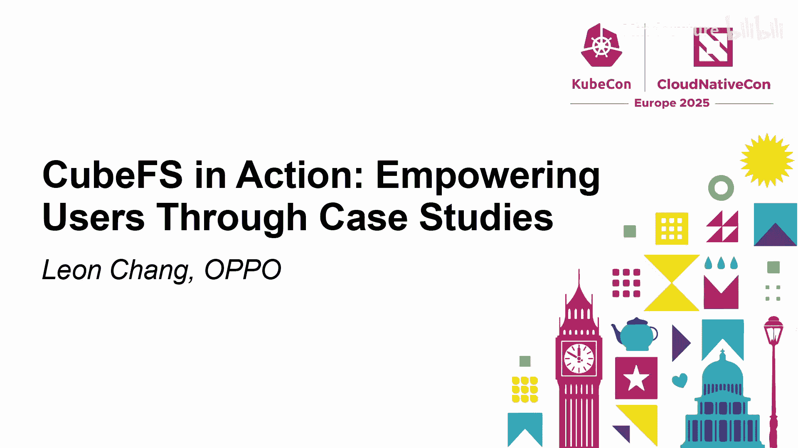
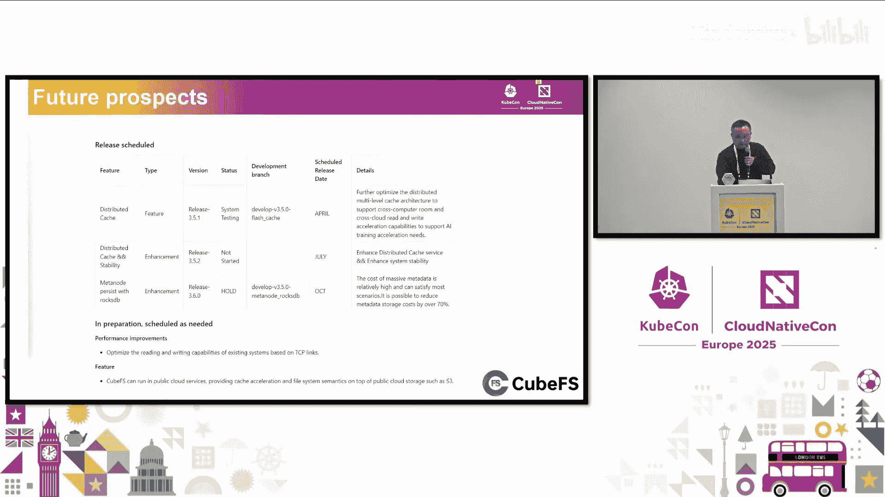
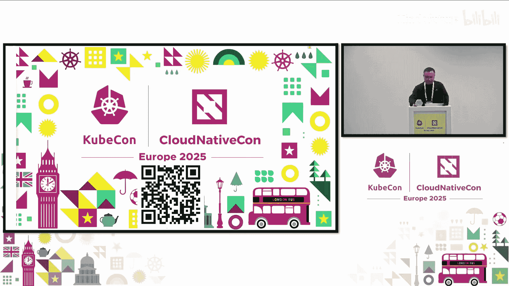

# KubeCon-+-CloudNativeCon-大会2025-｜-云原生计算-｜-可观测性-｜-Kubernetes-｜-Prometheus-p15-P15-CubeFS-in-Action---Empowering-Users-Through-Case-Studies---Leon-Chang,-OPPO--BV1Cd32zDEBG_p15-

，Hlo， everyone。

I'm Liu Chang from oppo。And I appreciate the opportunity to attend this conference。

This is my first English speech， so excuse me if I have any grammar issues or bad accent。

I'm the maintainer of open source product， Q files。And I also， in charge of the file system of oppo。

Well， let's get started now。Today， my topic is Cubafa actionction。

 empowering users through case studies。My speech will include three parts。First。

 I will introduce the architecture of C files。 Second， I will introduce several end user cases。

Finally， let's review the future prospect of Cuba pass。

Cuba Pass is a next generation cloud native storage system。

Kub joined the CF in 2019 after about five years of development。

 We released around a dozen versions in the past few years。 Finally， at the end of the last year。

 we graduated from Cf。 The picture is from the Cef website。In terms of the architecture。

Q F S is an independent and self governing story system。 as can be seen from the background。

 It includes several parts。The part in the top left is the client subsystem。

 The client is actually a very complex component。It provides capabilities for different interfaces。

 such as S 3， ADFs and ps。 Meanwhile， the client side interacts with the backend frequently and even gets the whole process of our system。

The middle part on the left is the cache subsystem。

The cache system is a new designed system for adapting to different acceleration scenarios currently to support AI。

 the cache system is becoming more and more important。 This is a main point in my topic。

The lower left corner is the metadata。 metadata subsystem。 It's carefully designed。

 It has strong consistency and be can be scaled easily。

 many system live functions like the trash audit and atomic physics interfaces need support from the metadata subsystem。

On the top right is the object access system different from the traditional object storage architecture。

 Q F S achieve the capability based on the file system engine。

 and this system can be considered as as a satelliteized proxy system。

The system in the bottom right storage sub systemem is a data sub systemt。

The story subsystem contains two engines。 One is the multi replica engine。

 and another is the coding subsystem， which is independentent story subsystem using the usual coding algorithm。

It it has its own met data management， including the inspection and management system。

 percent layer and so on。Now， let me highlight the features of Cuba files。 Firstly。

 Cuba supports multiple protocols。 Secondly， S has two engine storage engines。

 including multi replica and usual coding storage engine。 Thirdly。

 all the main common components achieved a strong consistency based on raft and qua。Fourthly。

 the distributed catch capability can be used in the acceleration scenarios。 fifthly。

 the intelligence intelligence deterring helps to migrate data from the hyper performance media to the lower media to help the business to cut the budget。

Finally， you can use fast onub new Kubernetes where the C S I plug in。Next。

 I will introduce several end user cases where Cuba fast applied。

The first use case is building AI storage based on Cuba Fi。In recent years。

 artificial intelligence has brought us tremendous changes。 In fact。

 every industrial upgrade brings both challenges and opportunities to storage。

From the previous in Internet area to current AI area。

 each time it has brought about improvements for storage such as the architecture scability and the performance。

 So in the area of AI， What specific challenges are we facing。At oppo。

 the five story team has been supporting AI related business for over five years。

 The business include computer version， large language model and mobility and so on。

From the architecture diagram， we can see some of the upstream and the downstream components and sources related to AI in Kubernetes environments。

The blue parts in the picture are the sections related to the storage。

The top layer is the service layer for specific of AI products。

 The model layer is AI main workflows in the cloud's native environment。

There are several storage related parts， such as AI code and their online editing and sharing capabilities。

 data integration， AI training workflows and model storage and distribution。

Cuba fast has also developed a feature that enables the acceleration of framework。

The feature accelerate deterrating by perfect chain through adapting the storage pging in。

The bottom layer is is thefr infrastructure layer。 This layer includes storage computing power。

 as well as some network capabilities。Okay， next last start main process of artificial intelligences and explain in detail its requirements to storage。

 just as introduce before， artificial intelligences can be divided into three stages。

 including the process of data processing training and inference。

data processing actually means that data sources will write it into storage system。

 And at the same time， a large amount of data filtering， cleaning and。Will it carry out。Here。

 Cfa has the capability to handle different data sources， reducing the business pressure。

Of moving it from a different storage system， it can also handle a tremendous amount of this storage based on its scalable capability。

The second stage is model training。 the most training scenario For most training scenario。

 deterrating is a repetitive process。 A large language model may be a exception because it can load all the data at one time。

 but for a training process like the computer version。

 deterrating needs to be done multiple times with a I with a high probability here Q has a capability to handle high with low laency。

The third part is the input stage。 In this stage， the model generated in the second stage be used for AI platform。

 It is necessary to distribute the models to the end point quickly。

The distribution process requires high throughput and should be completed with a short time。Let's。

 let's talk about some of the challenges faced by the AI storage。

Especially for the large language model。To achieve a better model。

 there needs to be a large number of tokens， parameters and deep pointss from the diagram。

 we can see that the parameters and deep pointss has been have been growing for many years。

This will generate large data sites， checkpoints and models。 Also。

 the upward trend of these factors has start to slow down to to the current number is still quite large。

Just as the last page introduced to improve the just as the last page introduced to improve the model performance。

 a large number of parameters are used， and it is it also requires a lot of computational resources as this picture shows the computation consumption of the model has been rising rapidly in recent years。

 especially during the training process of large models。In the past few years。

 most air developers has experienced the shortage of competition resources。

For a technology company like oppo， we have to purchase a lot of computing power on the public cloud。

 This is not a only consideration for the budget， but also for a elastic capability of computing power。

Of course， there emerged a lot of optimized algorithm to reduce it to a certain extent。

 but the demand still exists。Using the computing resources on the public cloud is a good choice。

 but it's not a easy thing either。 The computation transfer from private cloud to public cloud can be achieved。

 especially for for Kubernetes environment。However， the storage is useful。

 There are several changes in the geographic distribution of data。 That is storage cost。

 transfer cost and technical difficulties。First of all， the cost of storage is rather significant。

 Multicop of data of different regions means extra cost， which will put pressure on budget。

 but is if there is a central storage and only the how data transfers to the different kind of the end points in different regions。

 the cost can be reduced significantly。 Secondly， we need to consider the transfer cost。

 The first one is transfer all the data and then transfer the incremental data。However。

 the data transfer may not be needed by the application in different regions。

 The second one is just transferring the ho data。Despite this difference。

 there are still some common difficulties to address。

 One of the main difficulties is ensuring data consistency。

ConConency is an important aspect that need to be considered for for multi copies。

 It needs to be realized in specific this transformation system。However。

 when it comes to halt synchronization， ensuring consistency is much easier and highly simplified。

The data just need to be updated incrementally by the user' request。 And that's all it takes。

Another important factor is timelines。 whether it is incremental synchronization or the synchronization timelines is a critical factor in data transfer in oppo  to meet the training requirement for AI。

 We saw it by combining public cloud catching with self built cloud storage。

 That is the full data is stored in the selfbuil cloud and the hot data is catch in the public cloud。

 Also， the latency of the first pool is relatively increased。

 The performance of the repeatedly will be better。If the distance between the cloud center and the self build cloud center is short。

 that the impact can be reduced further。Next呃。Let's talk about the model distribution。

 Mo distribution is a big challenge for bout regions in oppo。

 The efficient distribution of models is also built on catch system。

 So this requires the catch system to have several features as a charge shows。Firstly。

 the system should have the ability to distribute models promptly the cache system of support pass configuration when a file right right within the configured pass it can be synchronized to the endpoint of the dising cache system。

 achieving a private warming during the right process。 Secondly。

 there needs to be a working control system prevent the client from accessing the steel data data。

Thirdly， support private warming capability to enable better integration with business operations。

 The private warming is a service。 the directory of the request to be。

Proformmed is taken as a specific task to drive un driven by the management system。

The cache system also needs to have， several technical。Several technical points， capabilities。

 The first is high performance and high throughput。

 and the second is load balancing to avoid a situation where hot catches can't stand the massive requests。

As shown in the diagram up after the air training model is stored in Cuba files。

 it will be distributed to terminals of the inference services through the cash system。

The catch system is designed based on consistent hing。 The file is divided into multiple segment。

 and each segment is one megaby in size Each segment mapped to a slot partition is hing。And many。

And many。And many slot partitions are map to one catch note together。 This is the rout rule。

The distributed catch supports both memory and disk storage forms in the benchmark test。

 each catch node within four teraby capacity of M E disk can provides 50 gig network through。

 the bottleneck of the distributed catch lies in the band wise。

The cube F has distributed catch takes multiple aspects into consideration in design。

 Here is some main features。EEastic cache repas can be configured according to business requirements。

 There are two main scenarios to use multi repas。 First。

 the scenario is to massive request to how data in the regular operation of the cache system。

 It usually use a single copy。ly， it refers to multiple regions distribution of of cache。

 data can be spread globally based on multi repa form。

Distance awareness means that in a scenario of multic replica cache system allows the clean client to select the repa cache node with the lowest network latency。

 Additionally， that capability is currently under development。 The requirement runs as a task。

 which can be scheduled systematically large models。

 large models and other business can be prohibited before real operation。 Finally。

 in order to integrate with a cloud ecosystem to adapt to more usage scenarios。

 a community is seeking cooperation with other communities like fluid to provide service solution that can be backend data persistent and cloud data catch acceleration。

In oppo， we used to use high performance disk to support high throughput in AI scenario。

 but the annual cost of storing 10 pettes of data in N E is quite significant through data analysis of AI driven business。

 it has been found that for most AI business。80% of the data will not be read within three months。

 and typically how data in accounts for less than 10% of the total data。

How to balance computational performance and storage cost。

 the best way is to utilize the high performance media to allow the writing pressure and support the hot support reading and migrate the data to the lower cost storage medium。

 that is intelligent dataing。 there are several technical points。

 the first one is the life cycle system， which is fulfilled by the module node of files。

 the life cycle system is built to run tiing task and realize in the the controlable and mental tiing process As shown in the picture。

 the directory of the file system can be configured as as the tiing pass Moreover。

 during the migration process clients are used to ensure the normal and writing operations。

Are not affected for data security。 The original date will be retained for a certain period after the transfer。

 there， theres the， the a check for both sides to guarantee the data consistency。Next。

 let me introduce another end user case that is computing computer storage separation in cleanhouse。

Comput and storage has has have different resources requirements。 So the separation of competition。

 Comp and storage is a very reasonable solution。 before the application of compute storage separation。

 Clhouse have several pingons in storage as introduced in the chart。 First。

 the storage capacity of single node is limited。The inspector should pay attention to this space and finish the operation timely。

 Second， the S R has to use high capacity disk for each node to ensure the system runs mostly。

 the cost is significant。 Third， on the other hand， similar to situation with capacity。

 the disk performance count fully utilized because it can be accessed by it can only be accessed by specific part。

 First， once the space is balanced between or node。

 the data migration and balancing will be quite complex and may affect online sources。

All the factors contribute to poor stability and the factors related to storage。

 So it's better to leave the professional things to professional teams。

This is the first edition of architecture to maintain clearhouse original structure。

 The use a single replica model of， of Cuba files。To make sure that the volume distribution are separate from each other。

ClCllayhouse use two Cuba fast clusters to store different replicateas。

This approach offers nearly unlimited storage space and enables declar significantly cutting cost。

 At the same time， it adjusts to cleanhouse original architecture。 While However。

 it has drawbacks because we use two different single rep volumes in Cuba5 storage。

 The consistency cant be guaranteed by the storage because the two volumes can't sense each other。

 the storage platform doesn't know the relationships of the two volumes。

The check module needs to do the inspection periodically to guarantee the consistencyency once theres a bad disk of files because of a single repa and can be repaired automatically。

 the repair depends on the checker module of clearhouse。

At the same time to enhance the repair repair speed。

 the by disk should be detected promptly back house once more the inspections and repair needs a long time。

 The drawback of these system architecture influence the online services to a certain degree causing delay in processing request。

Finally， the Clhouse team updates the whole architecture and uses the Cubaic fast as a shared storage。

 Clearhouse doesn't need to care about data repairs compared to the design on the last page。

The reliability and stability are much better than those of design with only one replica。

 And since the third fully depend on C files， the promote repair disk failures can be achieved。

 Moreover， the operation and maintenance are simple。 can restore it on its own with intervention。

 leaving business unaware。The last end user case is compute storage separation with S D K。

 The compute and storage separation inhouse is based on the fields client。

 and the storage is accessed by the point。 the fields is a standard tool to access storage， however。

 in reality fields can affect the whole performance。 As shown in the slide。

 the S K has following features。 S K has high performance and stability This is because S T K totally run in the user mode and bypass the column mode。

At the same time， it was many constraints of fuel。Itse， such as the boot block size。 Moreoverover。

 it can also adapt， adapt to some special requirements in the user mode。

What is shown in this fee in the figure is a typical computer service based on L S tree。

 this service stores both the wall logs and access files in Cuba files。

 It's a typical app only right application for storage。

This is a female architecture of key value storage。

 and it usually used for online services for massive key value storage， such as radis and Ro T B。

 The requirement of the stability of data storage is extremely high。

 especially for a P 99 requirement， should be kept within one millisecond。Based on the requirements。

 we also have actually made a lot of optimization on the background。

 I won't introduce it in detail here。Last year， the committee released several versions。

 including four official versions and three bitter versions。 This year。

 Cubafa already released the deter version and also and we will officially release another three versions。

The first one is release 3。5。1， which mainly focus on distributed cash and is mentioned a lot in today's speech。

But this is not the final version。 There will be an enhanced version released 3。5。

2 as the second phase of the dispute attach。At the same time。

 the version will be a stability enhance the version。

Including features such as magnet atomic migration。

As mentioned in the speech that we will put the manuals memory into LC C B storage to reduce the memory costs。

Which is also a basis for hybrid cloud deter。If we still have the energy。

 there are some aspects that we want to schedule to do。

 The first aspect is the performance improvement。And the second aspect is。

Is hybrid cloud where we want to build an complete hybrid cloud system。

 support the S3 outside storage and to make the data flow freely。

Thank you all for listening patiently。 If you have any questions。

 you're welcome to read or contact or contact us through the slack。 I will。do my best to answer。

 And at the same time， I hope you can pay attention to Cuba fast and is community development。

O， thank you。 Thank you啊。

