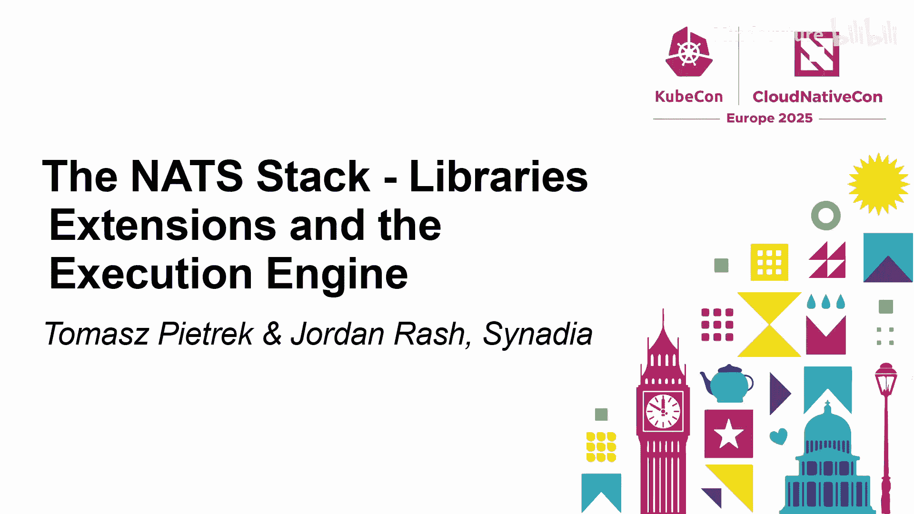
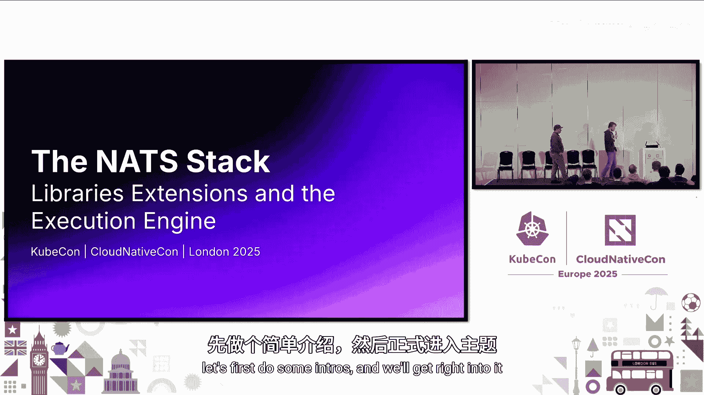
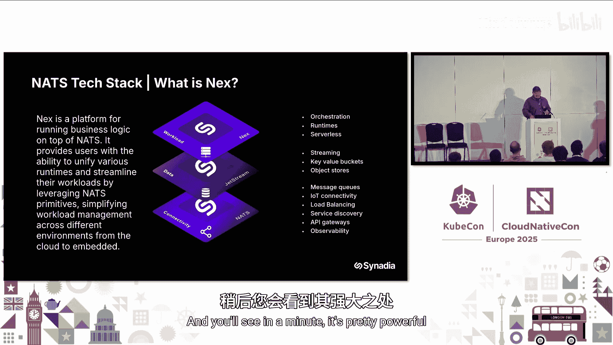
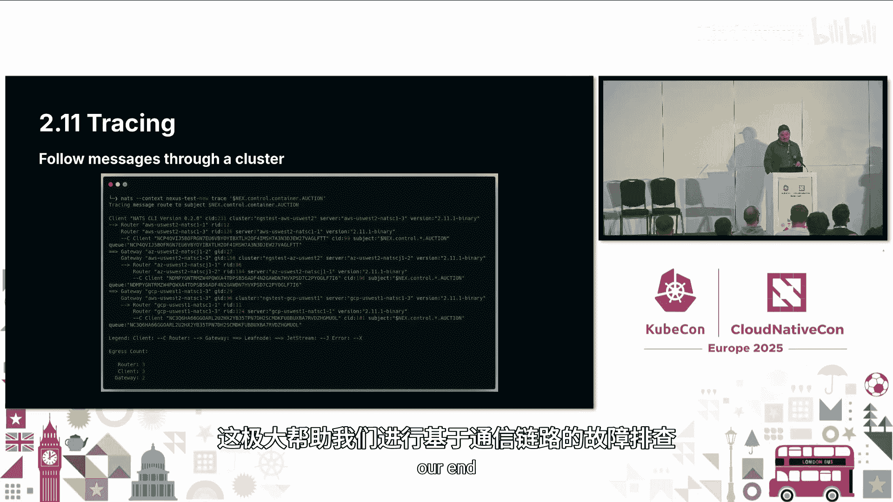
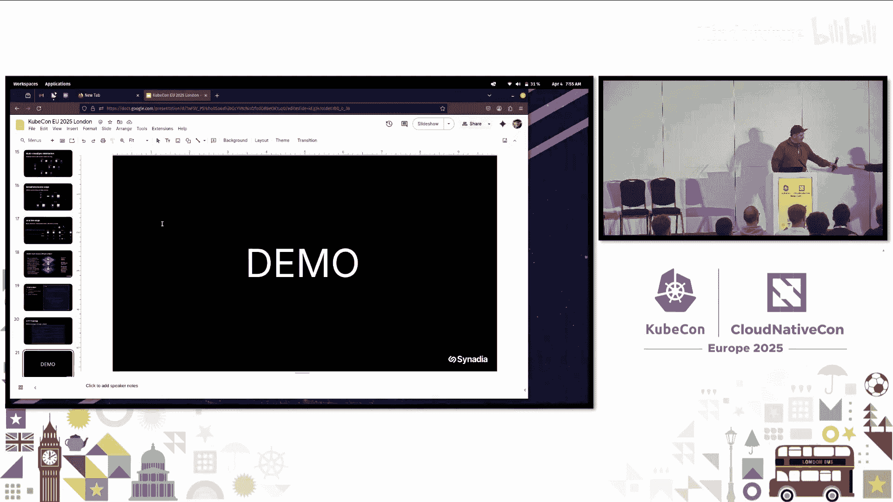
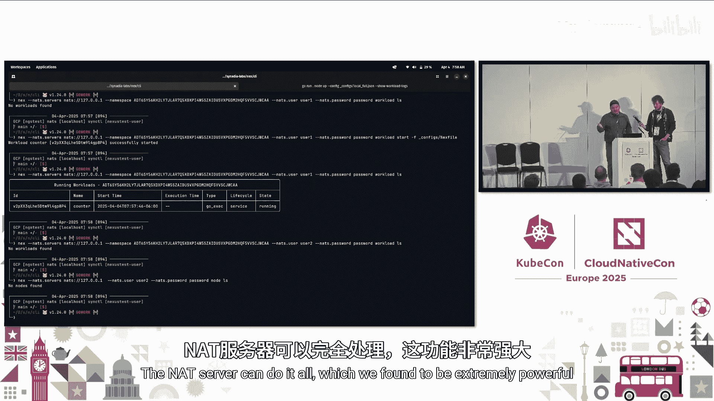
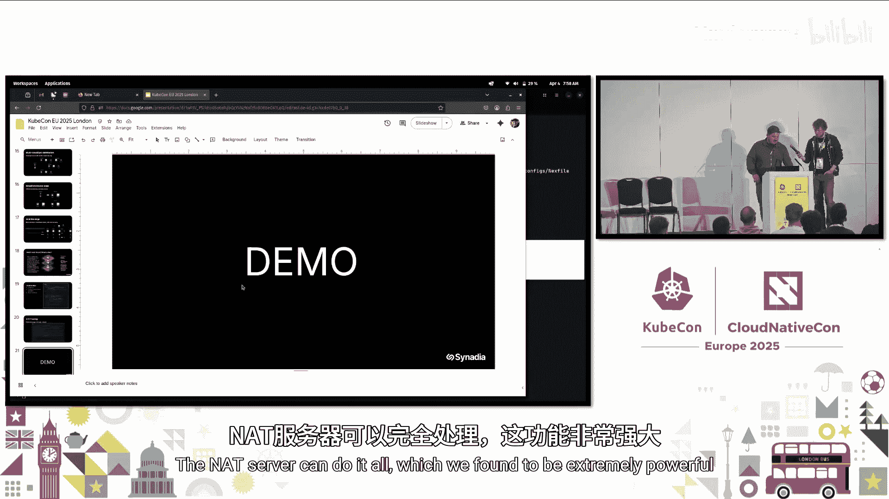
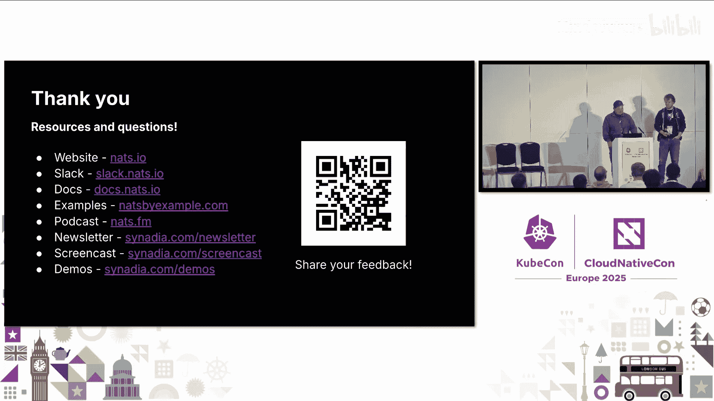
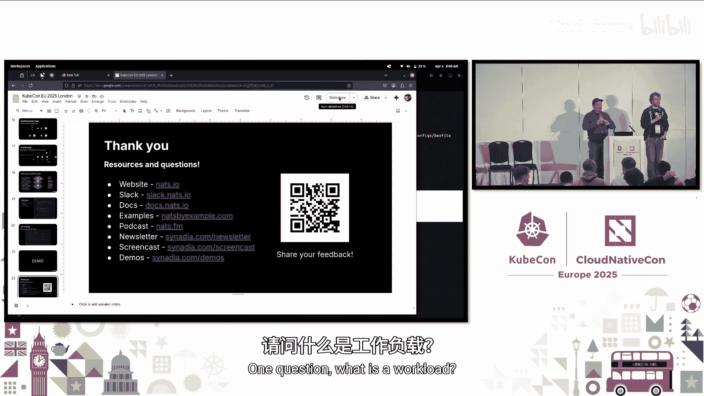

# KubeCon-+-CloudNativeCon-大会2025-｜-云原生计算-｜-可观测性-｜-Kubernetes-｜-Prometheus-p16-P16-The-NATS-Stack---Libraries-Extensions-and-the-Execution-Engine---Tomasz-Piet--BV1Cd32zDEBG_p16-

Hello， everyone。 Welcome to the Na Mainer track talk about the Nas stack。 First of all。

 it has been a very， at least like for personally speaking， has been a pretty long conference。

 I've been standing on my legs for all day。 I hope you're， you're feeling a bit better。

 I didn't actually know that my legs were able to like， stand for that long。😊。

Anyway， yeah， talking about again， Na talk， let's first do some intros and we'll get to right into it。

So first intros， I am Maice Fonfain， I am from the Netherlands， maybe any Dutch people in here。

Look at that。 That's great。 Ever， it's， it'， it， it's pretty funny。

 Like we have so like pretty much like senior software engineer， snaia。

 we are a remote company with pretty much people all around the world pretty much。

 So it's pretty funny when like our， our French col can can just talk French And like there are some Dutch or Belgian people anyway。

's Fun stuff。😊，Yeah， and so pretty much I'm a nas product maintainer。

 I've been working a lot on the server the last few。

 Well I've actually joined in a relatively recently like a half year ago， over like nine months。

 but I've been contributing prior to that for years already and pretty exciting as well since prior to last pubcon I actually became the Nas ambassador of the project。

 which has still kind of exciting to me but I don't know。 previously， I've been a software engineer。

 Yeah， in fact， also been a prim much at the same time。 teacher at the university。

 So I hope I kind of kinda do a good job at presenting。 and if not let me know。😊，Awesome。😊。

Anyone from Colorado here？Nope， didn't think so。 So my name is Jordan Rash。 I am from the States。

 I am a software engineer at Scnaia。😊，My primary role there is I'm one of the maintainers on the NAtTS execution engine。

 how many people knew that Cnaia was getting in the business of an execution engine？It's new。

 So we're going to talk about it a little bit today， not as a product， but as。

What features and like perks it gets on top of thenats over for free。 When we started developing it。

 we found。Building a product on top of Nats gave us a lot of really cool features that normally as an app developer we had to think of that we didn't have to think of anymore。

 So we'll show some of those。 And before this， with cybersecurity and defense fields，😊。

A bit of a different perspective。 I came intonats differently than most。But nonetheless。

 you get here and we find that at Cnati， it's pretty much a unified vision no matter what field we come from。

 So Maurice is going to talk to you a bit， and then I'll show you some demos。Alright， so first off。

 some nats，1 on one ws already familiar with Nats。 So like I heard about it。 Okay quite a few people。

 also like using it in production or maybe also not yet in production。 Okay cool， Qui some hands。

 pretty cool。 So first， pretty much。Kind of the， the the boring stuff。 like what is a project。

 what is it all about， So for the next slide。So。This is kind of a bold statement。

 So I'll kind of I'll try to get kind of wrap a story around around this。So kind of thinking back。

 like it might might sound strange， like talking about this at a conference like this， but like。

Really long time ago， you used to be just， you a server somewhere。 you'd have like one application。

 run one database。 and that was it that like to that was your company。

 And it was like so simple before。 And well， in a way， because like S H into F T TP。

Things have gotten a lot better since。 But in terms of applications are not that simple anymore like。

I don't know look kind of the use cases that we were hearing and probably also have various unique cases within your business。

It's just really amazing like how。relatively quickly。

 like all these applications just have to be distributed in a way。

 or like maybe they can't always have an internet connection if you're at the edge。嗯。But， but， but。

 but still， like。From this， this kind of initial perspective。

 that things don't necessarily need to be complex。 And if。

So kind of what whats like a occurrence or what might the current stack look like。

 So you have various technologies for reaching out to like from one server to another。

 you might need some maybe you need some other patterns。

 So you kind look around like what's what other components are available。

 you search for different components。 you add it into your stack。

 But then still still missing something。 maybe maybe it's observability or persistence in one way or another。

 and you're kind of adding multiple components。 And and to be honest。

 it's not like like any project for something。 It's like because I think I don't need to tell you this with all of these projects are just great。

But it kind of the thing that makes me think is like of all this this general pattern of I need to add and just keep on adding more and more components and things start to common complex。

 and kind of going back to the initial simple example of just one server or maybe multiple but like your application。

 a database， things were simple。 And the things you were working on were actually like maybe over 90%。

 your own business thing。 your own use case， thing that you'd like to work on and not necessarily like other like maintaining other things or and。

It's kind of starting to look like the most of the things that you need to work on is like having lots of other other components in there。

 And also the thing that you would like to do。 I hope at least that kind of also depends what you're working on。

 But I'm mostly coming as as a developer and engineer。

 I like to fix things for for the business and what they're doing。

So I'd like to spend my time on that， Not necessarily on like any， any other system。

 And keeping that other point。 I'd like to I think you get the point。

So where do we come from in terms of what do we have available right now？Well。

 we think it's kind of these these。Inherent limitations that you have。

 So things like the the one to one communication， just adding all these。

 all these layers in terms of like the components， not necessarily specific components。 But like。

 in general， adding more layers of， I have an application somewhere。 I need to deploy it somewhere。

 I need to have it highly available。 Maybe in a cluster。

 I need low balancers proxy and list goes on and on。Things are。

Centralized the location dependent in a way， even though we don't necessarily need them to be。

 And if we're doing like an edge use case or like， like like maybe a car is driving around it。

 I mean， it is location dependent in terms of like， it's physically somewhere。 But in terms of。

 if youre related to where a data center is， it's not static at all。 So of like。

 how do you still figure that out。And it's just generally like multiple technologies that you need to learn。

 not only as a developer， but also in operating it。Yeah， so。刚服。

Not necessarily going back to that initial example of like one server a database。

 which was probably sQL at the point。 I don't know。 And like an application。And thinking about about。

 like， what do we need nowadays for the distributed systems we're building right now。

And how do we simplify that？ And I think we've learned a lot also the whole government containerarization et ce。

So things like， I'll need to check those slides because I' gonna actually read it from from there。

So like services that are inherently just discoverable。

 giving you the flexibility for two premiums to use any type of communication pattern。

 or you need to reach one service， Okay， fine， you can do that if you need to have like run request and you have multiple services of different times that need to answer you do like a request many pattern。

 you don't need to send every application a different message。And。Things。Well。

 how it relates to nets for example decentralized， it doesn't need to be decentralized。

 but in a way where I can I could be the one hosting some。

 some some infrastructure and I could give you the keys to actually an account somewhere and I could give you some some。

I don't want to equate that to like being an AW S in a way， I'm not sure。 but just in general。

 I can give you some key student account and you can make users。

 I don't need to care about who needs to access your system。

 And I give you the premature ability to do anything you want in a way that I don't even need to know who your users are。

 I just't give you some limits in terms of how much infoar you can use。嗯。

And things like intelligent routing and still having。Like again， kind of an edge use case。

 of you can you have data at the edge， for example， bringing your services。

 not sending your data up to the cloud， but bringing your services down to the edge to do local inferencing or like local shit I kind of mentioned a I。

 sorry。And， of course， like the Internet con connectivity issues， even with the like。

 I'm not sure how your experience was with the conference wifi， but especially on Wednesday。

 I was really struggling like even loading the Google slide。 So anyway。

I think those things are changing a lot。I don't think we'll be deploying on the cloud Well， I think。

 while we will still in the worries， but。In general。

 things will be shifting more to the edge as well。 And things like Internet connectivity is not given in in in such a place。

 And you you probably also again， depends， it depends on your use case and what you're solving for for business as a business。

And again， Re all Nes provides a single technology to learn。Yeah。I'm a salesperson。

 so I'm not going to tell you that thats the thing that you need to use and otherwise， I don't know。

If this talk just helps you kind of rethinking， like， where can I simplify my architecture。

 if I don't really， I personally don't mind if you would be using Nats or you wouldn't。

 but that kind of make you think， like， where can I simplify my architecture in a way。

 can I and maybe Nats can play a role in it。 Maybe maybe not good。 that's your decision。 And again。

 I'm not a sales guy， but。Yep。So kind of why do teams love nets？

Like kind of there are these different kind of roles。 and in practice。

 And it also depends like in which company you work for And like these roles might be fluid in practice。

That might be more fluid in practice。We're forward giving developers the tools to use all these kind of different communication styles。

 using persistence through key values stores， OIC storage， all with just a single API。

 just one technology to learn similar thing for architects like what how do you map the technology and the infrastructure that you need onto your business and allowing architects to pretty much？

Deploy infr or。Have infrastructure in multiple clouds， multiple Ges at and extending to the edge。

 And again， where Internet might not be available at some at some point。

And also kind of giving the operators kind of the handles they need for things like multitenancy。

 like the thing I mentioned， like I can give you keys to an account and you can make users and I can also give some keys to someone else and you cannot see what others are doing。

And also， of course， the are similar important things like security， monitoring， and et cetera。

So what is Nats kind of going to words like this simplicity theme？

So it's a really small it's one static go binary that you need as complex as everything。

 If you want to cluster in the cloud， you have really like large workloads， you can use it。

 you can cluster it。 you have access to persistence through streams， kVs， etcter。 But again。

 say the same binary at the edge。 the same capabilities that you can use for the connectivity for the persistence。

 All of that is just available。 and。You will have the ability to actually choose how to use it and how it fits it to your business。

Yeah， and of course， it is so small because like no external dependencies。 it supports many O's。

 official client libraries。Also community maintained clients。 and well。

 the Slack has already reached over 10 K Slack members。 So that's pretty cool。

And so going through this pretty quickly， we finally done the NAS 2，11 release。

 who has been waiting for this for more than a year。I was。 or finally， we finally are there。

 I'll go over it a bit quickly。 We also actually， on Wednesday。

 we released a podcast that we did on it。s way， way more details。

 And I'm just not going to be able to like fit it into this time slot。

 So if you're interested in in these things and more kind of the design and like what went into testing and reliability watch that later。

 but。😊，In essence， a dised message message tracing your topology can be very large。

 and where does your message go。 Well tracing is， of course， like important thing。

 per message T T L is a new thing。 So previously with streams， you would only have like one max age。

 if you have a max age of an hour， a message would go away after after an hour。

 if you want anything different than no， sorry， you wouldn need a different stream of a new new max age。

 But now you can actually have per message T T Ls。 and you can expire based on whatever you need to them to。

Pretty obvious one， consumer pause impulse jet stream consumers。

 you can pause and imp them now instead of like needing to shut down your application or having change your application to actually pause consumption。

 you can actually do it as as a kind of a management or maintenance point of view。

And you don't really need to adjust your application。

Consumer priority groups is kind of this thing that we're going to build on more in the future as well。

 one thing that we we're' not sure how like where it's available right now in terms of it will be in orbit。

 but。One of the things that it will have is like。If you have multiple clusters across， for example。

 various geos or availability zones and you have services local to also processing you need to do。

 but those services are overloaded。 you have a way to overflow pretty much So request to maybe a different availability zone or a different cloud or whatever to ensure the load is still still balance appropriately。

And batch direct gets previously， you could pretty only get multiple messages if you actually created a consumer or you could like get a single message by with one API call。

 But you never could get multiple messages in a lightweight way without creating a consumer。

 And now you now you can。 So you can send one request to get many responses of like messages that are stored in your stream or in your your KV。

 for example。And I kind of already managed mention this with orbit。

 It's kind of you might effort or maybe not but the kind of the thing is with the clients。

 we the official clients we provide， we kind of want feature parity across all of them。

 which is hard if you get like contribution to any any one of the clients and we'd really like to say yes put it in but then theres so much work also to get it in all the other clients and even。

One obvious thing is like all the languages are different and we're trying of try to be idiomatic in in all the languages。

 So there might be some things that work and go or in rust or whichever language but might not work in another。

 And we didn't really have a place to put that contribution where we would like it to have it。

But also from our end being able to iterate over APIs was pretty hard for us and our solution is pretty much orbit。

 so pretty much every language can have an extension to the official client。

 you can pretty much do anything you want if anyone contributes。

 we can just accept it versioning and iterating over APIs is it is way easier and eventually once like an API is finalized we can actually pull it into the client and then we can actually be sure it works properly it's useful for all the clients and you can move it into the client and once it is in the client。

 you actually can guarantee stability still need to change the API。嗯。

Final things with the NAC rewrites so NAC is Kubernetes CRDs if you want to manage streams。

 key value stores， etc cetera， that way， data rewrites has now proper control loop also related to some changes in the were in 211 and also support for key value stores and Ob stores if you want to create them。

 I believe。We also did a JavaScriptscript client rewrite this is now pretty much the different transports of DU browser web so I are now all in one repositoryiented set of separate ones。

And。And also， if you only need core messaging， you only need that package。

 And if you only need text string， you only get that package a bit more modular as well。Yeah。

 with that， I'm going to give it to Jordan， I think。Yes， I remember just like。

 I think you' can talking a one。啊。He， so thanks， so for the rest of the slides。

 this is going to be less about our execution engine and more about how we developed a product。

 dog fooding， everything that server had， I'm just using the execution engine as a。As a reference。

 if you have more questions about that， we can talk afterwards。First off。

 we have three slides on different ways to like configure Nats as a cluster。

One of the most interesting things I've listened to Maurice answered this question about 100 times in our booth is like what does our reference architecture look like And the question is it's really hard because it's different for every customer。

 right You have retail that wants to be able to support a connection loss in their stores。

 You have things all the way out to the edge that need to be able to offload at certain times when connectivity is there。

 So the net server itself runs in two modes。 One is a nat server and one is a leaf node。

 And with utilizing it's the same binary an area。 It's not like you have to deploy multiple things。

 utilizing those and putting a little thought in your architecture really extends the concept of a cluster anywhere。

 we call， I think， cluster of nodes， we call that cluster。 and then we can do clusters of clusters。

 which you call super cluster。 So it's really whatever you can imagine。

 we can usually find an architecture for it。 So this is just a simple demonstration of you can see。😊。

On prem and connecting three clouds to。That eventually reaches the customer via Web modal。

 Web or mobile。 So you can imagine GCP， Azure and AWS there also supporting onprem with resiliency between all the clusters。

Another one we see is the edge device being the customer in like store。

 so we can have storefronts running small clusters that provide that person， you know that。

Disaster recovery。 And that。呃。You know back up to each other while also reaching up into bigger clouds in the back end so you can have like large clusters up in the cloud and all your stores reaching in that can be a typical hub and spoke type thing where you have a single thing and hundreds of stores reaching in。

呃。And the big one， the， the one we were demoing in our booth。

 if you came and saw it was this is kind of like AI fidge。

So we recently did a demo where we were able to do inference， model generation。

 data generation in three different clouds all over a same a NA subject bus。

And because the underlying layer was NAtS， the messaging system was able to move between clouds real time。

 support model generation real time， support data gathering via camera or Web app real time。

All with the Go。Without downtime moving you know when nodes and clusters we go up and down。

 so it really does show that kind of like NAts can go wherever you want。

 And that's one of the things that we don't do is like we don't try and define what your edge is。

 you tell us what your edge is because we have people that mainframes the edge。

 we have people where an ESP 32 is the edge and we have people where a phone is the edge and our goal is to meet you where you're at。

So。I'm going to give you a brief review of what next is so that we can talk about as an application。

This is kind of how the NATS ecosystem was built， we had the connectivity layer you've all。

 if you're familiar with NAT Sur， you've been using it it's pub sub， it's load balancing。

 it's server discovery， it's all these things that make our connectivity easy and then we overlaid jettStam on top of it that gave us KV that gave us streams that gave us object to。

 we could persist data， we could replicate data throughout our cluster。

 these all these things came for free。And then we started building applications on top of it。

And what we found when we were building specifically the execution engines。

' we didn't have to reach into our old bag of tricks， we didn't need a database。

 we didn't need a caveV store， we didn't have to pull in everything， we realize， oh。

 it's already sitting there waiting on us， even from a security perspective where you would normally have to do things like OOth。

 well we have you off callout， which is the Na server supporting OOth the stuff。

 we also have subject level security which I'll show you here in a second。

 which essentially mean enhances that multitancy concept and it'll feel a lot like name spacing here in a minute。

And the important thing to say is no code was written for that。

 We leaned on that server configuration for all of it。 and you'll see in a minute。

 it's pretty powerful。

So going back with what Marie said a second ago， orbit， so orbit was even new to our team。

 it only dropped maybe a few months ago。And we came in and we like。

 we started look to see what all was there and things like request many。

We already had the capability to put out a request， Listen for a bunch of responses。

 and then use some context and some timers and kind of。Kind of do this ourselves。

 But what we found is。A lot of people wanted to do that。 A lot of people want to request。You know。

 do scatter gather， request stay a message from a bunch of servers， wait some you know。

 expected amount of time and then stop listening。So the simple request mini concept in the orbit。

But removed， I think a few hundred lines of code and fixed like 14 race conditions that we had because we had written our own loop and we were not doing and we were not closing our context correctly。

 this solved all that for us， so we found very quickly that the mini is better than the few when it comes to things like common patterns like request a scatter gather in next。

Or in thats。 And then， yeah， So that's the whole trusted code。 it comes from a community。 and。

 and many people are using it。 So these bugs tend to bubble up a lot faster。

And this was an exciting one we only very recently since 211 landed。

We turned it on in the execution code and we started using it to like try and follow our request。

 so one of the very first things we do when we deploy a workload is we said we auction an entire cluster and we're like。

 who can take this workload？And it was kind of you can imagine it。 it goes out。

 the servers respond if they can。 But what was pretty cool is we turn this on。

 and all of a sudden we can start to see our request travel through the cluster。

 So you can tell I live pretty close to AWS West。 So that's where I ingress into the into our cluster。

 But then I have nodes in AW in Azure and GCP。 You can see it traversing the gateways between all of them going out asking those nodes the same question and returning back。

 So this has actually helped us do a lot of。😊，Comication based troubleshooting from， on our end。

And let's try a demo。

T过 I said this up。All right。So what I have right here is I have Nats running on the left。

 NAs running on the right， NAts is running pretty much as bear as you can get all the default settings。

And what we're going to say， thank youor。As I'm going to do something as simple as deploying a workload。

 I don't know if I'm doing the logs， but。You can trust me。

 So what happened was I deployed a simple workload counter， and I'm going to do。

To list the workload for you。And this all kind of works exactly how you would expect you deploy a workload。

 you list your workload， and it's there。The problem with。

A default server is if I go over to the other user and I request。You can also see my workload。

 so multitency is not working。 Everyone can see everything。

 There are admin type commands you can also run that if you were to run those as well。Yep。

 that's a high spell node。I do have one bit of security in there。All right。

 so those are admin type credentials that or admin type functions that normal users shouldn't be able to do。

 so now we want to lock that down。But what we don't want to go do is add a whole bunch of custom logic to our application。

 So let's address it in a that's configuration。And what I'll do is I'll just show you kind of what I'm doing。

So we're going to create three accounts here， an admin account and two user accounts。

In the default version， it's pretty much one plane note， no credentialing。

 But when you look down here， you'll start to see that on our control subjects。

We're going to require。That the account that there that you're using to do the request matches the account in your credentials。

 And this is what empowers all the security over like a na based subject mapping。

 So with a little bit of architecture and making sure the subjects make sense。

You start to get security for free。 So if we do。That。We'll turn next back on。All right， Mary Hu。

 we're going to start the exact same workload。Ohpe， that's the wrong command。So I think I actually。

 I actually have logs dumping this time。 So you can see the workload running right there。And now。

 when user 2 goes to when user 1 gets to look at their own stuff。They have permissions to ask。

 what workloads does this account ID have， but no longer。

Does does user2 have that and you'll notice it happens so fast because that request isn't actually making it into into NAts。

 The export that it has is not even allowed to do a request on that subject。

 so the server shuts it down immediately。And you' you'll see even when we go。

So we'll even try and do the the admin type functionality。 It shuts down immediately because。

The users aren't allowed to do that。What we pretty much demonstrated is configuration based security that no longer has to be rolled into your application。

 The Nat server can do it all。

Which。We found to be extremely powerful。

Then I think we're just here。So it's all you。So yeah。

 thank you for coming out like here are a bunch of links we recently did an online conference where we had a bunch of great demonstrations it's on。

😊，It's on our website if so if you go tocinnaity。com。

 you should see a link up top to watch that where we had something like five hours of demonstrations of everything from 211 features to the execution engine running to another new thing we have。

 which is connectors， which。Is running on top of the execution engine and pretty much all of the new NAts 211 features that you can hope to see。

 so if you have any questions we're happy to have them。

 feel free to send us your feedback and thank you for being here。

One question， What is a workload。 Could a workload something be that I can react on an event which is coming。

 I can subscribe， and then I can react。 can I， how a pattern matching， which events are coming。

 combining and。

Is that what you mean is the workloads？So， the。So pretty much what wordloads allows is multiple types so you can run pretty much any type in terms of like you can run some containers。

 you can also you run， for example， JavaScript where're kind of working on that so you can actually kind of as as a function as service as I think that's what your question was about or。

I think when it's integrated and nutss， it's something which react on events or can react or it's triggered when an event is coming and these things。

 So， yeah， so the workload engine itself does emit events。

 So we are in the process of making it event sourced and making it a lot。

 So you saw a little bit delay in the thing。 It is pubs。 It is a request reply at the moment。

But it is using streams to bring the whole event sourcing type ecosystem into it as well to be a lot more reactive so using that is kind of where we'll get to the more declarative type workloads eventually right now it's very imperative I hope I'm understanding your question correctly。

Yeah， Im I think so。 Yeah。 So I wanna call a workload or Lada serverless function， for example。

 if some events is coming or。A specific event So you have an event filled a that event is coming with。

 Yeah， so you said if there's an event on a na subject， can the workload be triggered。 Yeah。

 so that is actually how our functions as a service will work we call them trigger functions。

 you'll run them and they listen to pretty much a trigger subject。

 And as soon as you send some sort of payload down that。

 it will it'll execute the function and return it kind of like pretty much exactly like a lambda and a web hook but all over Nats Okay thanks a lot absolutely。

Hi， one quick question。 did， did you work on or any optimization of key value store storage with nuts。

In when it comes to wasing items。I， I was trying to use nuts。 And in my use case。

 it would be very handy， but I。U。Find out that， for example， once you have。Oh。

1100 thousand00 items in， in key value， it's really slow to waste or compact storage on the file。

Yeah， so the we've been hearing this lot and kind of the。The。

 the thing that makes RKV unique is also kind of where this performance issue comes in。

 So having the ability to like the delete and purge markers that you have。

 which allows you to to watch on a KV， but also introduced like this， so。

P message T TL is one thing that will hopefully solve that。

 so you will not be needing to do any manual compactions anymore。 So when you purge a key。

 you can give it a T TL and then actually the data will just be be removed which pretty much well。

Lets let's see， but it should solve。 It should not be able。

 you shouldt need to do manual compaction anymore。 and it will be solved in that way。

 So you just say probably you're using like a perch already because you're using the manual compaction。

 So you give T TL and it will be removed automatically and that should ensure that the stream is kept at a reasonable size and it stays snappy。

 Yeah， so per message TTL is like a feature that one use case was also being able to optimize this。

Okay， thank you。Allright。You have had a question or yeah， just tackle one。

So the workload thing you demo， What's the difference between that and that's micro the。

So that's actually all built on top of Nats Micro。 the concept is to run Nats Mi。

 you build your thing。 It has the micro。 And then you have to run it somewhere。

We're trying to replace that run it somewhere for you so if build if you build your own Nats micro instead of putting it in an EC2 or ECS or wherever。

 you can tell the workload engine like deploy this for me and it'll go find a place to put it for you what we're not is another runtime we don't need another runtime we have too many but what we are trying to be is a。

A control plane for artifact types。 So if you have an O C I， we know 50 ways to deploy an O CI。

We can do it in the cheapest way for you based on some analysis。

 or we can put it in Kubernetes for you， or we can put it in E C S for you。That's。

 that's the hole we're trying to fill。 We'， yeah， we're not trying to be another runtime。 Okay。

 absolutely。Thank you。