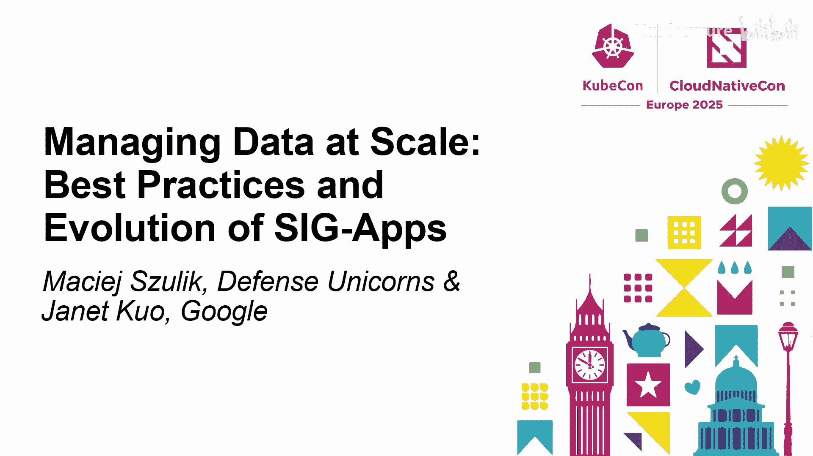
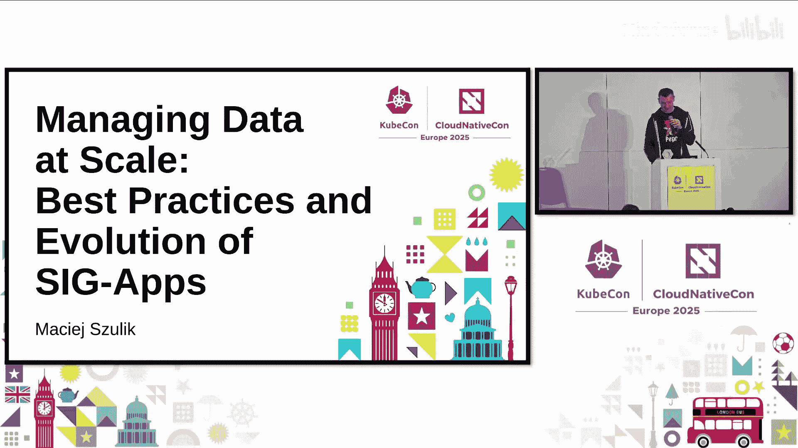
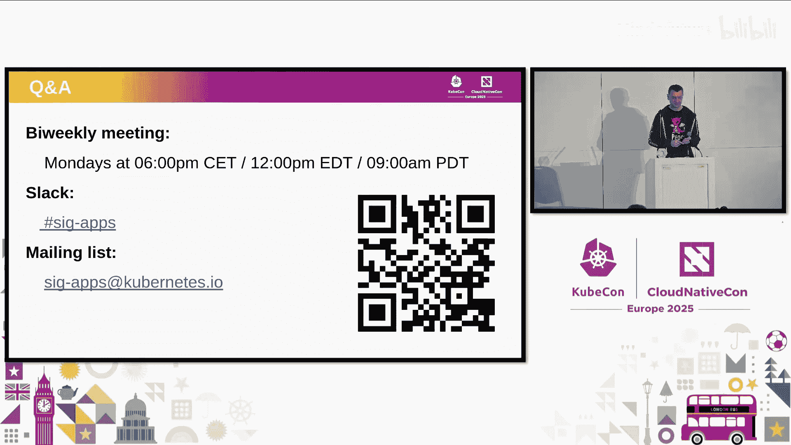

# KubeCon-+-CloudNativeCon-大会2025-｜-云原生计算-｜-可观测性-｜-Kubernetes-｜-Prometheus-p17-P17-Managing-Data-at-Scale---Best-Practices-and-Evolution-of-SIG-Apps---Maciej-S--BV1Cd32zDEBG_p17-

Welcome everyone， thank you very much for showing up and learning about SUs。

 I'm fully aware it's Friday afternoon。And the one thing that is on everyone's head is I want to go home。

 I'm exhausted。 The conference was awesome， I hope。And。

But you're all probably ready to just finish it off。

 So I do hope that the presentation will be a strong finish。So let's start。 So who we are。

My name is Mae， as I already said， and sadly Janet and Ken were not able to join us today at this stage。

 the three of us are in charge of the Saps。And for the rest of the presentation。

 I'll try to walk you through what the SIG application group is， what we do。

 and what are the plans for the upcoming weeks and months。So how to reach us。

 that's probably the simplest and the starting point we are meeting every other Monday。

The times depending on your time zone are listed on the web page。

 the best option also is to reach out on Kubernetes Sla6 Sigaps or a mailing list if you remember from the past we used to have a Google Group mailing list。

 we migrated this over to Kubernetes managed， it's also easier to remember its just Sigaps@ Kubernetes。

IO。So what does the Sapse does？I will admit that the Sapse has a pretty broad areaea of impact into the Kubernetes Project。

 Theorely， we are always welcoming and inviting a lot of the people to show up and present to our group。

What you are doing， even though primarily the S or special interest group is。

Evolving around what the Kubernetes。Core controllers。 And I'll cover a couple of them in a moment。

 But if you're thinking about it， that's like deployments， that's job， Cr jobs， statement set。

 stateful sets。Even though we are primarily responsible for the following controllers。

 we are always open to hearing from other people in the community using Kubernetes what kind of issues that they are struggling。

 what kind of problems that they are solving how they are solving them Also if you are seeing limitation in the built- in resources that the sick is responsible for。

 we are more than happy to hear from your problem about your problems。

 how we can solve because there's a lot of discussion that has been happening over the years。

 maybe we'll be also able to point you in the right direction or connect you with a different group。

 a different team different person that was already struggling with a similar problem and how they。

How they resolved it in the past。Aside from that， there's also something that we do every single year。

 we're doing like a summary information about what the special interest group of ours did。

 you can find the links in the presentation that is also linked in the schedule。So， like I mentioned。

Over the past 12 months or even before I'll jump quickly in the annual reports。

 if you're also interested in what the Sigaps was doing over the past 10 years。

 a little bit of in-depth history of our special interest groups as well as the entire Kubernetes project in the annual reports。

 there are two presentation that we did last year during KubCon in Paris and in Salt Lake City。

Which was going in depth into the history and evolution of various APIs， various resources。

And the problems that we encountered along the way。 So if you're interested into that。

 I will also welcome you to， to have a look at the annual reports or just look for the presentation。

From past cube guns。 But now focusing on what we are currently working on and what we've been in the in the progress for the past 12 more or less months。

 Some of those features， there are in the parentheesis information about diversions。

 maybe you've already had an opportunity to play with them。 If you have any feedback， let us know。

Okay， I'm alive。The poster Nali so quickly I'll go through them。

 try to explain if you have any questions or suggestions。 let me know we will have。

 I hope a couple of minutes after this presentation I'll be also hanging out around the hallway for a couple more minutes if you have any questions so let's quickly go over the stable features that we release over the past year the first one was an interesting one So pod disruption budgets。

 the way that they were originally created the goal of the resource is to prevent your application through labels and selector labels and number of applications。

 it will always ensure that the number of specified replicas is available and during eventual draining of a note it will stop or prevent draining from continuing until we have a new pod replacing there was a tiny little bit and we had。

multiple arguments back and forth with regards to how the pod replacement pod disruption budget was counting the pods Orin it was counting both ready and not ready pods so assuming and I do hope that each and every single one of you have proper。

 healthy and readiness pods defined in your pod once a pod is ready as in past readiness。

 there is a difference between a ready and not ready pods。But before this change。

 we were accounting both equally。 Normally， only the ready pots should be counted towards your pod disruption budget。

And but because Kubernetes， one of the important goals is making sure that the backwards compatibly not is not being broken。

We needed to introduce another field in a po disruption budget。

 which explicitly allowed you to pick one solution or the other and the addition basically there was that I'm only interested in the ready pods in my PDDBs to count towards the disruption budget。

 that means if your po is not ready， it can be evicted which is important in some cases and allows you to save extra resources。

I I know that we found it。Very useful in a couple of interesting cases。

Another one was actually long overdue。 A lot of users came to us with their request to be able to randomly pick pods within a replica set when we were downscalling。

 normally there is a halffty algorithm that that basically tries to pick the newest pods created and replaces those but that's not always the best solution。

 especially if you're rolling your application and you're actually trying to replace older with new ones。

 it would actually pick the newest one first， Currently we've implemented a little bit more random。

A randomandization in the algorithm。 And that allows us to have a little bit more。

Control over how the the rollout is progressing in a replica asset， moving on。

That was an interesting use case for stateful set。 If you are aware。

 each and every single stateful set defines basically pos。

 and each po has a particular number in a stateful set。

 and it's always starting from zero up to the number of replicas。

For the cases where you're trying to migrate your stateful set from one cluster over to another。

 you actually want to maintain the numbers consistent when moving from one to another but in parallel to that you want to still maintain the entire stateful set as a single unit watch from outside of the cluster。

 so this future specifically allows you to say oh my replica should start numbering from let's say。3。

 not from 0 but three， because the0 and one already move to the next cluster。 And this way。

 I can slowly move one by one po from one cluster to another or for storage or for for various migration。

 Pri the migration was the the main use case that we've been investigating。The last one in a GA。

 I believe that's the last in GA。Of course， it decided to blink down。 So the last one，6 storage。

 actually， people within stick storage reach out to us。Normally， when we are creating a stateful set。

 Orin when we created the Sful set， we decided that we don't wanna break users and we don't wna touch the PVCs created by the stateful set。

This was to ensure that the data that is being managed by the stateful set is secure for the entire lifetime。

 so we never do anything and if you were either removing your statefult or migrating whatever you were doing you were responsible as the owner of the stateful set to remove the PVCs after the stateful set was removed or eventually migrate it there were some use cases and with the help from the state storage we've actually implementing an explicit policy so you have to be configuring your stateful set and clearly point that during either a scale down or entirely during a removal it's completely fine to to remove the PVCs alongside the stateful set So this is a your explicit decision to touch the PVC or leave it as is and if I remember correctly we always we even went as far as there are separate configuration for。

scale down and separate configuration for delete。 So you can specifically say that it's okay to do it only when removing all also during this scaledown。

 So you have that kind of flexibility。 Oh， actually， we have a lot more related GA features。

 And a lot of the， if you notice。A lot of the work around the Saps currently and especially within the past。

 I would say two， three years has been driven heavily by the working group batch。

 So those are people that help us ensure that any kind of workload。

 whether that's AIML or any kind of high performance computing that they are feasible in a Kubernetes clusters。

 so a lot of work around the batch area， primarily the jobs introduction of index jobs or improvements in the performance of handling jobs is coming from from the batch working group。

 So a couple of examples。 Elastic index jobs。 So index job if you've never heard about them。

 it's basically the ability to specify it's a combination of that that will be probably the best analogy。

 it's a combination of a job in a state full set， meaning that each and every single part in in an index。

Job has a specific index。 If that index fails， a new pod will replace the same pot with the same number。

 so it will have a stable DNS also associated with it。 If I remember correctly。

 were also injecting environment variable with information about your your index in in a job。

The elastic part in this particular feature allowed us to scale or modify the index job。

But only when we are modifying both the completions and parallelism。

 because if you remember properly， the job allows you to modify a parallel。

 which is how many pots are executing particular job at any given point in time。

 and that is basically to allow us to dynamically scale up and down the job。

Depending on how busy our cluster is or what's going on with our clusters so。

AndComps are usually fixed in place at the moment when the job is created for elastic index jobs and for some use cases when using index jobs primarily again。

 in the area of MPI or HPC computing， it was reasonable for us to say， oh。

 I want to create this many this many pods， but once we reach a completion that is not fully defined at the moment when we are starting the job。

 or it is defined outside of the Kubernetes cluster within the job itself。

 we are able to modify completions and parallelism together。

 but it has to be the same number and modified at the same time。An interesting thing。

 And that's actually a very simple future。 but a lot of users have asked for this thing for quite a while。

 when we are creating jobs from within a Ch job， a lot of users wanted to have a clear information when this particular job was meant to be created。

Within a Chron job， there is an ability to decide that， oh， if something happens in my cluster。

 for whatever reason， I don't know whether a cube controller manager goes down or you'll turn off the cluster for tonight。

 I'm not asking， I'm not judging whatever you want to do do。

And the Chon job controller kicks in again。 You can tell the Ch job to。Oh， if I'm delayed with my。

 my schedule for this long， it's still okay to create the job for me。That's an explicit。

 separate feature。 And a lot of people wanted to know still within the job created。

 how big the delay is。 What is the actual timeline my job should have been created。

 So we're currently injecting an annotation into a job so you can inspect that information and eventually do whatever you。

 You're pleased with that， with that date。The next one is also very similar to to the previous one this time around。

 and this is what I was talking about， we're injecting an annotation with information about your po index in a both stateful set and in an index job。

 which was a request for multiple users， again， similarly from primarily coming or gathered around the batch working group。

Because they want to know that， oh， yes， I'm， I'm index 5。

 And eventually what they want to do with that， they frequently will。

 I had an example that I built like multiple years ago when I was initially introducing jobs。

You can chunk your major， for example， image processing pie applying into chunks。

 and you actually want to know that your index in the pod is number five because the number five bucket is the one that I have to pick up。

So you don't have to manually inject that information into the job。

 but just read it from the annotation。And a couple more GA features and something actually that is lending in。

In this new upcoming Kubernetes release， one is a backoff limit。

 so in within a job and that applies to every single job， we allow you to say oh。

 I can retry a particular job a couple of times， but that limit is specified as a global limit for the entire job。

 so if I'm running。I don't know a couple hundred or a couple thousand and my back is and the default is6 if I remember correctly。

 that might not necessarily necessarily be enough and there will be only it'll always be only at a global scale of the entire job in some cases。

 especially for the index job you want to be a little bit more descriptive and you want to have that kind of a limit applied only for a particular pod this allows you to if you're running your job against several clusters and one of the pods will land in a faulty noteote for example。

That one faulty node will only kill this particular pot and get it replaced rather than killing the entire job because you reach your back off limit。

 so it's always currently calculated per particular index of a job。The next one。

 job success and completion policy。Before that， we always said your job has to complete and it has to finish everything。

 meaning all the partss in a job have to be have to reach a completion status with some exceptions Currently we will actually allow you to define an exit criteria which will be which will allow you to tell that a job is finished sooner than actually all the predefined completions number is reached。

 So that's also in some cases useful for the ba' use cases so。An interesting future。

Another batch related topics， primarily this is coming from people that are working on Q。

 has any one of you heard about the Q project， the queue as in written by K K U E UE。

 it's a project one of the SigGAP sponsor project， which helps withqueuing the work primarily for the batch workloads again。

Their use case that they have， and this is not the first time where we have a similar mechanism in Kubernetes cluster。

 endPo slices and IP addresses is a similar， we basically introducing an annotation which says this particular job is handled by an external controller usually in the annotation you put the name of the controller。

 but that is assigned to the built and job controller within the Kubernetes cluster not to run the job at all。

I know it looks super simple from the outside because from outside it's oh。

 I'll say just this and the controller doesn't do anything。

 but actually when we allowed third parties or external job controllers， what we wanted to ensure is。

The correctness of the status is reported by external controllers in the job status。

 so we a lot of the effort that we put into implementing this particular feature was around ensuring that the status validation for a job object is properly defined and encoded in the Kubernetes API server to make sure that not only the built in job controller is behaving。

In a specific and and consistent way， but also for to force other users or authors of an external job controller to also make sure that the。

The controllers abide by the same rules and are following the same limitation this way。

 users of the job object can ensure that whatever they're using the built in or an external controller。

 they get the same consistency with regards to the job status。

They primarily their their main use case， how they are using is in a case where you're in a multicluster environment。

 you can have a primary job defined in your ho cluster。

Which serves as a central point for holding the information about the status。

 But the actual execution is being。Is being mirror or placed in sub clusters or even can be divided in into multiple different clusters。

 So that's the kind of approach that they have， in which case。

 obviously in the in the hub cluster or in the central cluster。

 they only want to mirror the information about the status and the progress of the job。

 but the execution is happening somewhere else。Okay。What's in our what's in our pipe for。

 for the next couple of releases。The jobpot failure policy is an interesting development that has been in the works for。

 I would say， more than a year。It defines entire sub languagegu within a job which allows users to define when my job or when specifically my po should be reed or not Currently we have mechanism describing exit codes conditions。

And。Yeah， condition and exit codes coming from a pod which allow you to say， oh， yeah。

 this is actually an expected failure， and it'll be fine if it finishes。

 or this is not something that I want to or this is an error card that I did not expect。

 And I should probably just retry this particular pod to be rerun。Another they're interesting。

A topic that we have in the books for a couple of months。

 and we've been going back and forth is normally when you are when you are rolling your deployment。

It will try to lot assuming that you specify the correct search and Max un available。

 It will try to fill in and replace your pos as quickly as possible， like I said。

To match your search and max an available configuration for your deployment。

 but there are some cases， for example， if you're running at your quota or very close to it where that kind of replacement is not possible so we want to be a little bit more mindful with regards to not pushing the limits as far as we want and explicitly request that only bring new pods when the previous one is reaches a termination phase so this way we will allow you to replace one by one or like multiples in parallel in which case if you're at quota。

 let's say you have five pos and this is your quota I will be only allow to create the new one when one of the existing five will go down as will reach a terminating state。

So that， that's a， we have a couple of use cases described in the， in the document。

 Part for that feature。 So that's an that's also， if you have any thoughts or or。

 or ideas around implementation of these。Now。The were all we， we are very open to the feedback。

The third on the list is something that is actually in that has been discussed。This week。

 numerous times， but also in various special interest groups within the Kubernetes project and which includes architecture。

 node， auto scaling， saps。I can't remember what else。 But there were like multiple6 involved。

 The idea is currently nowhere in Kubernetes node resource or anywhere in the built and resources。

 We have the ability to express。That we are in the process of draining a note how long it should how long it should take care when it should be able to just forcefully remove start forcefully removed。

 which pots can and which cannot be forcefully removed， Yes， we have PDBs。

 but PDDBs have a very limited surface because they will basically prevent the eviction from happening。

 but they will not allow you to either delay the eviction or eventually if your eviction process requires a specific amount of time for moving your workload from one one po to another。

That information is not encoded anywhere， and we are thinking and discussing how we could better in what better way we could describe the entire draining process and eventually introduce external actors which could help us with draining the note and eventually moving application from one node over to the next one。

The last one on this slide is something that I'm personally very ashamed of because that's kind of like a topic that still has actually a three digit enhancement number。

 which means it goes way in and back。 I forgot to check the actual date。

But the enhancement is probably more than like four or five years old。

 The idea is introducing Maxin available for a stateful set。

If you've ever used the MaxN available for deployment or replica set。

 which basically allows you to say， oh， it's okay for my application to reach this number and this is either a number or a percentage。

Of unavailable pot during a rollout， this basically allows you to speed up your rollout to a newer version。

 we wanted to introduce and we started introducing this functionality into a stateful set But the problem is that each and every single enhancement in the Kubernetes。

 each and every single future in Kubernetes when it's being introduced requires a very tight information presented to the cluster administrator that that the future is working correctly or is not and for the past two or three years。

 we are all struggling to come up with a reasonable metric that will express the rollout。

Of a stateful set， because for deployment or replica set， that's pretty easy。

 a lot of those controllers basically will spin up as many as many pods as you allow。 and it's done。

 There's no， there's no external parties affecting the rollout process as in from the controller point of view。

 in case of a stateful set， at least the one where you're rolling one after another。

 I'm not talking about the parallel。 po mode rollout because that's obviously。

 that will allow to roll out multiple pods。But in a case where you're rolling one after another。

The actual time required to start the application will significantly affect how quickly you can roll the entire application。

So with that in mind， we cannot easily express the information how long the rollout for that particular or other application would take because。

Those numbers will differ from application to application。

And that basically means that the metric is not reliable and will not allow us to quickly say。

 oh this actually the number， if your deviation is more than 10% from the norm that's bad or good and we are not able to express yes。

 the future is working correctly or no， it's not and you should probably roll out to the previous version or basically turn the future off So this is where we're currently dealing。

 they are also problems around like you see in the picture。

 we lost the main contributor that was working on this future they were moved to work on different topics so we're looking for new volunteers to help moving this particular future forward。

Okay， I'm literally right on time。 Those are the information， how to best reach us。

I will be in the hallway for a couple more minutes if you have any questions。We are going。

 I'll be able to answer them afterwards。 Thank you very much。

