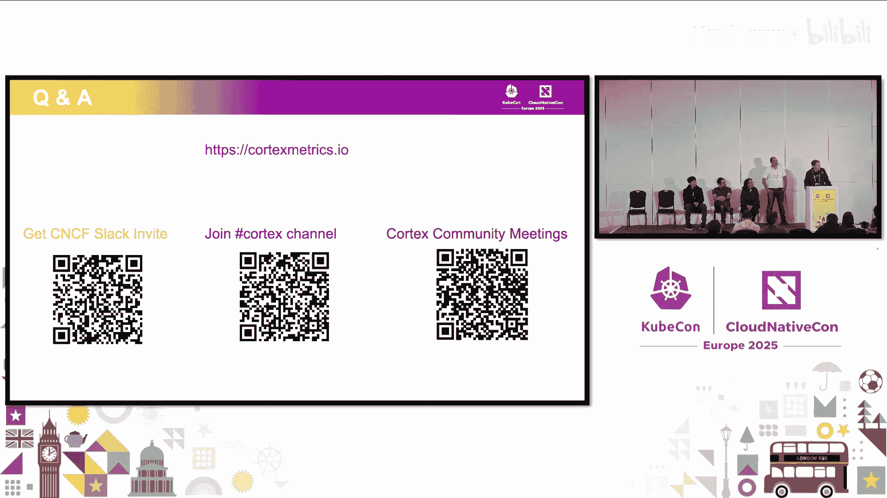

# KubeCon-+-CloudNativeCon-大会2025-｜-云原生计算-｜-可观测性-｜-Kubernetes-｜-Prometheus-p19-P19-Cortex---Insights,-U...-Friedrich-Gonzalez,-Daniel-Sabsay,-Charlie-Le,-Aloli--BV1Cd32zDEBG_p19-

So thank you for joining in。I know it's the last day of Cecon。

 but lots of folks I think are also streaming in from the keynotes， so welcome everyone。

Today we are covering in this session。Lots of cool things about cortex。

 How many of you use cortex today。😊，Awesome。😊，Very cool。 And those of you who are not。

 you should definitely consider it。😊，So today we are going to talk about the project。

 provide some updates on you know some of the new features that have rolled out already this past year and also give you an update on the roadmap that's coming forward for these this coming year。

 I'm Aita Sharma from Apple， we also have our awesome Mainers on the project here。

 some of them joining in today， Charlie Lee from Apple， Daniel Blando from AWS。

Daniel Saabay from Adobe and last but not least Fririick Gonzalez from Adobe， so again。

 you know all the maintainers have been working on this project for a while and really excited to have them all here today。

So in case you don't recognize them on stage here they are again and they will be covering different parts of the agenda。

 we'll be starting off with an introduction to what cortex is but also diving into the architecture a bit and kind of talking about the different moving parts。

 Charlie will be also then diving in into a super cool demo to show you how to get started with Cortex if you don't know so already。

 and kind of doing you know walking you through a couple of scenarios。

 then the maintainer team will be actually providing an update on the different features that have been rolled out for performance or you know scalability。

 reliability and others。😊，And then we'll talk about what are some of the cool features that are coming in in terms of interoperability。

 compatibility with new formats and upgrades on the protocols。

And last but not least we'll talk about the roadmap to graduation again the project is looking to graduate you know again it's super exciting we at that time you know where we are just kind of getting ready so Frederick will be diving into that and then if we have you know a little bit of time please hold your questions still then and if we do run out of time please you know do find us hang out know we are happy to hang out and talk more about things so as many of you know Cortex is a very highly scalable specifically horizontally scalable highly available multitenant long-term storage for Prometheus again it is you know a very popular multitenant solution for most large and small organizations that are looking to isolate data and Charlie will be diving a bit more into the features so Charlie over to you。

Sorry。Thanks Alta so I'm going to be talking a little bit about cortex， what it's about。

 like Ata said， it's a horizontally scalable version of Prometheus。

 it tries to have the lowest response times possible for queries and rights to it。

 there are a lot of strong stability guarantees which I'll talk a little bit more about and its's community managed like you see here it's backed by multiple companies and there are lots of diverse contributors all around the world that are helping to build it。

This is the architecture diagram that is on our documentation if you've read it it's probably you've probably seen it before。

 but at a high level there's the right path， which is the orange line here where something like open telemetry or Prometheus sends metrics to cortex and then it lands into the distributor。

 which is a service inside of cortex which handles the rate limiting and fanning out of those requests to an ingester。

 which is the second part of that right path and the ingester is responsible for the ingeter is responsible for storing the metrics so that you can query them in like in memory and then when the ingter has enough of your metrics for I think two or so hours。

 it will compact them just like the Prometheus service does， and then the ingor。

We'll send those compacted blocks to some object storage of your choice so that way you could have longterm storage。

 so in this case it could be a three or Google Cloud storage and we'll talk a bit about more about what are the supported object storages and then on the RE path there's dashboards like Grfana that will query Cortex so that you can query all of the metrics that you sent it。

When you query cortex， you pass in a header which signifies which tenant you want to query the metrics for。

 and there's a lot of caching features as well so that it doesn't have to go through the whole query path to get the metrics that you want for your tenant。

So how's it different from blank that does something similar。

 so with cortex all of the components that you saw earlier are horizontally scalable。

 so if you wanted to scale up some component there you could。

And there are no unexplained metric graphs， so anytime you restart something。

 there's always some sort of availability or high availability setup where something else will take on that load。

Query speede is also a very important feature for cortex so we try to optimize aggressively on that。

And there are also strong stability guarantees， so whenever there is a new feature。

 we always mark it as experimental so that users of cortex aren't surprised。

And the CNCF project is also backed by many， many developers from multiple companies。

 so you can tell that the community is quite vibrant and healthy。

And here's just a quick table of what Cortex is about， it has object storage， scalability。

 performance， data resilience， data flexibility， and its community driven。

So this is our getting started， we have a page on our documentation that shows you how to get quickly started with either Docker or kind。

 whichever you want， the Docker one has a single binary mode so you can just have cortex running as a single binary and Docker and then play around with that there's also the microservices mode where you can have cortex broken up into the microservices that it is made up of and then see how those components interact with each other。

I wanted to show you a little demo of。Cortex can action。So on the right here， I have。

Its just an empty Kubernetes cluster， it's just running on my machine here。

And these three pods are just part of the Kubernetes cluster。But what if I。

 let me just double check that all these values are correct here， sorry I was assessing this earlier。

 so I need to reset these back。So I'm going to apply this helm file。

 which has a couple of charts that it's going to install， cortex itself in microservices mode。

So cortex， like I said earlier is made up of multiple components here。

 so there's the ingeter which stores the metrics， there's the distributor。

 which is the front door for all metrics that get ingested in。

I just have one repa here and three replicas of the ingeter engine Xs like are basically our HTP router here。

嗯。There's the query which executes the queries and all of these components are scalable here。

 so it'll take a second to load these all up。I also have some Prometheus pods here that will be scraping metrics in the cluster and then sending them into cortex with their own tenants so imagine you have a dev tenant in a staging tenant and you want to have isolation between the two tenants you can have that and it's possible here I'm going to show you how so yeah I just have these two Prometheus instances they're sending metrics to cortex so let me pour it forward into Grfauna so they can show you there's also Grfaa running in this cluster。

So let me诶。Create some data sources and some dashboards in that Grfana instance so that I can visualize some of the metrics that are coming in。

So in this dashboard， I'm showing the ingestion rates for samples between the two tenants。

 so I have a dev and a staging tenant， both of them should be sending the same metrics。

And I also have some rate limits over here， so each tenant currently has 25。

000 samples per second as their limits， and on the bottom I have what each ingestion or each ingester pod is currently ingesting per second for samples。

The first thing I wanted to show was how I can dynamically rate limit a tenant without restarting anything on cortex。

 So what I'm going to do is go into。My helm file where I have some overrides for these tenants here。

 so let me just change this 25，000 to 2000。Apply that again。

You'll see that that is the di here is this change for the dev tenant from 25，000 to 2000。

 if you notice here， none of these pauses got restarted because these values that I'm setting are runtime configuration values so they don't require a restart and each of these services our program to reload these types of values every so often I think it's 10 seconds by default。

 but I've changed it to one second so that we can try to see it faster。So if you notice here。

The ingestion rate for the death tenant is actually going down to 2000 like we expect。

And then over here you can see the limit as well got set to 2000， and then for further proof。

 you can see the ingester pods actually are seeing less metrics coming in， which is working。

So the demo gods that are praising or are happy today， I guess。

 so there's one more thing I wanted to show and that is how do you automatically scale up in gestures so if you want to store more metrics？

To do that， I'm going to set the ingeter pod replica count to four。

 and you can have this be done automatically based on scale。Or some other metric。

 so let me go ahead and apply that。And we should see one more ingested pod coming up。

Pretty soon here。佢。I'll load the logs here so you can see it coming up but I have the logs here for this ingester pod coming up and then I also have this panel here on the bottom that is showing what is the ingestion rate for each of those pods and if everything is working correctly we should see those three ingester pods。

 giving those metrics that it was ingesting before into the fourth ingester pod that's coming up so we should see the fourth ingeter pod increasing in samples ingestion and then the other three decreasing as it's being load balance across the four。

So that seems to be working as expected here。So you can see the new one coming up and then the other three kind of releasing those inge。

Those samples that are coming in。So that is what I wanted to show for cortex and how you can quickly kind of change things and see things working in a multi tenantant way。

And I'll hand it back over to Daniel to talk about。What's。あ。

Coming are they sorry the team updates for the community in cortex？Thank you， Charlie。

Since the last CubBcon in North America six months ago， we've had one release， nine new contributors。

 three new triages， 381 commits。We've recently added this new triageure team。

 which is a group of contributors that contribute just like external contributors do。

 but with more persistence， and they have a little bit more permissions to manage PRs and issues to help alleviate the admin overhead on the existing maintainer team。

 the current team of triages is made up of non-raj Goal， Song Jin Li and myself。In this last release。

 version 119， we have a bunch of new features。The first is that OpenStack Swift as an object storage back end is no longer experimental。

Which means that the four officially supported backends are Amazon S3， Google Cloud Stage， Microsoft。

 Azure Stage， and OpenStax Swift。There are two new features for the cortex ruler。

This component is the component of cortex that evaluates Prometheus format recording rules and alerting rules。

 we've had this component that runs as a microservice inside cortex for quite some time。

 but prior to release 119 it has not been properly highly available。

Thanks to the work of and apologies for mispronunciations， Alan Pertaggio， Y Jiqin， Wilbert Wou。

 soon ping。A non Raja Kpo and Emenuel Lodoviche， we now have experimental support for high availability。

Unlike the high availability that we use in distributors in gestureers。

Instead of using peer replication， we use a primary versus non primary approach。And this approach。

Each rule group is assigned to a set of ruler instances。

 but is only evaluated by one instance in that group of rulers at each rule sync。

 which happens by default every one minute。The non primary will check the health of the primary and if the primary is unhealthy。

 it will the non primary will take ownership of those rules begin evaluating them so you see two scenarios here。

The third scenario not shown is that if the both ruler  one and ruler two are down。

 the next non primary in the chain， there is an ordering。Imposed。

Ruler three in this case will take over ownership and when the other rulers come back alive。

 they will relinquish ownership。This approach helps us minimize gaps when rulesrs restart and fail。

 but also avoids redundant rule evaluation。So at any one time。

 a given rule is only evaluated by one ruler。This high availability is also availability zone aware。

The second feature that we've added to the ruler is the option to use the existing query path。

This means that rules evaluated by the ruler now take extra network hops。

 but allows you to take advantage of the caching and query splitting performance enhancements that exist in the query front end。

This feature was contributed by Sunng Jinli and B Yi。

And I'll hand it to also Daniel to talk about more features in version 119 and upcoming。

Thanks Daniel。So the next feature that we released on Mon19 it the partition compactor。

 we have been talking about it for a while， we did do a talk on less coiccon it went very and it dive on it so if you are interested please take a look at the talk the partition compactor mostly help us with the limitations from testB index which is 64 gigytes and it hope also if you E this case has more blocks or bigger blocks to speed up compaction that was problems for us that we added it。

Another feature that we are working on recently， not recently。

 but we already have for a while is OTOP compatibility。We already had it for cortex。

 but we are still working in improving in adding more functionalities one of them is the max request size limit that was added to prevent。

 for example， out of memory metric and memory issues。

We are also trying to be as consistent as possible with Promeus OTLP compatibility。

 so we also added the target info metrics by default。

 and we added a new proposal that was passive on Promefuus and it was already implemented Promeus。

 which is called configuration called promote resource attributes。

That configuration allows you to add custom labels for your metrics that helps a lot of LTLP cases because sometimes you want to add a different label for querying or for aggregating the data。

For example， you can use the labels from target infotu。

The other part that we are currently looking a lot on it is ingestion optimizations。

 focus on CPU and memory， one thing that we added as experimental for1。

19 is something that we call push workers credit for JRPC。

 they actually were looking at that and we are getting the idea implementing Cortex。

Basically the idea for push workers， if you look at the Ppro there。

 we have a place called new stacks and what's happening there is like when we create new go routines。

 we have these new stack and that burdens the CPUU so what we added we added a workers poo for managing go routines。

 so instead of creating new go routines every time if we have in the working pool we reuse them avoiding these new stack to be creating every time。

in some use cases not all， but we are seeing improvements up to 20% of CPU on gestures。

 which is pretty good， so if you guys have problems with CPU sometimes take a look。

 try to enable this and see how it goes。Let us know。

Another improvement enhancement that we did it for ingestion optimizations。

Focus on CPU again is expanding posting cash That's something that was already added in Star gateway I don't know if you guys are familiar but the idea is instead of caching the result of our query we cache the postings of the query so instead of receiving all the response from the query we basically get the query and see which postings are and be related to that query the idea here is because some of the queries are very complex and very burden on CPU when they are loading a lot of postings or when there's rejects that wants to match for a lot of postings for star gated that was easier just because we don't have the head block foreign in gesture that was a little bit more complex because we had to add some invalid cash for that if we just added that to the in gesture we could have wrong data so what we did is every time that we receive a new sample that matches a posting we invalid the cache for that posting so it's not as good as star gateway。

ItAlso helps a lot。There's a lot of regrets here。 But if you look at the first one on day。

Right left for you guys， you can see the difference on CPU usage。

 we also see improvement around 20% when we enable this So it's another thing that you can try and see how it goes。

 It really depends on the type of queries that you have if you have a lot of reject queries that can help a lot。

Another part of the code that we are looking at is scaling cortex and a lot of focus on in gestureure itself。

As you look at for the demo from Charlie es scalinging up in gestures is pretty easy like we just enable it goes to the ring and that's it it works scalinging down is a little bit more complex just because the in gesturestion for us is the hard data layer so if we just escape down in gestures we basically have opportunities not opportunities we can have issues about losing data temporary or permanently depends on how we configure context we do have flags on configuration to avoid that the problem that those flags can also cause co performance issues。

 for example， high latency。So what we did was we added a new state for in gestures for the ring itself it's called really only but basically in gestures use it the idea is if you have a new really only in gestureure it is still active on the ring is still visible for everybody but it's not receiving any information so if you look at the first graph there I have some red lines the first one is setting the in gesture really only and you can look in the the second metrics below it。

 which basically shows the push requests for those in gestures going to zero so the idea is data is not going to in gestures anymore but the data is still being query from in gestures so if you look at the metric on the side you can still see that the query request maintains the same but the push request drops。

So with that and additionally， we also add a new API on in gestures which is basically to get statistics from in gesturetures。

 the API basically tells you if there is any blocks loaded on in gestures。

 so if these were the only in the API we can safely assume when we stopped receiving data。

 we can safely assume when we don't have any more blocks on in gestures and then we can scale down gestures because on that time we don't have any more information to query on on those in gestures。

everything that we improved on the release 1。19 for those that use HA on cortex。

 which is a feature for cortex。Previously， we only accepted one HA pair by request。

 So if you have a request with a different samples， but different HA samples， HA pairs。

We basically would get the first one and know the rest so it doesn't work and how you prevent that is basically creating different requests which is not ideal so right now we have a experimental flag that you can enable which allows us to have mixed HA pairs so the idea is we look in the request for each HA pair for each sample and then you don't need to create a bunch of requests that's what something that was online for users sometimes。

So now what we are cognitive working on and what we are trying to release the next versions。

We are still working on the OTLP compatibility， we already have OTLP but we got to merge the OTLP metadata conversion。

 so now we convert OTLP metadata also and that was already merged so it's probably going to come in the next version of cortex。

Continuous improvements we are also working on another improvement for inge CPU the idea in this one is instead of creating connections every time we open a string connection between Shibua in gestures and we leave it open we have a keep alive for that stream connection and then we don't have the burden to create connections to manage connections every time from our tests again we are seeing a 10% CPU improvement this one is still open we are still having discussion about it so if you are interested go take a look at the PR。

Another big topic for us is native histograms， we already support inter hisogram in gestures in Cortex。

 but we are missing the custom Bucks native histogram and that's something that we are working right now and going to be coming in the next features in the next versions。

And lately the big topic which is Promeus 3。0， so how we are doing on that。

 we are actually talking a lot internally about it。

 we are trying to support the more and more profuion at all。

 so we have they are open for the remote right V part of it Pro， it brings the headers。

 the new headers that the remote to the V has， and it also brings the string internally。

 which also is going to help with the CPU performance foreigning gestures。

So if something that you're interested， we are having discussions discussing how to implement that incortex。

That's it for me。 I'm going to pass for Frederick for the road。

Thank you Daniels for the amazinging updates it's been an honor for me to work for Cortex for a number of years I started as a user then became contributor and then became maintainer and well when I'm here talking to you about the project so well and what I when to talk to you about is we have a number of users。

 a number of companies pretty large using and we need to organize to get the project in a roadmap that is cohesive right and this is what we've decided is that we have this feature or GiHub that we're going to be using to handle the projects looking forward and we have organized all the features and this and this buckets I'm going to talk to you about one specific one that has been long coming and is the one。

About the graduation。The graduation of cortex means for us a milestone is not the endline。

 we have even more things to do， but we think the graduation is what we need to do between next there's many adopters of cortex public and private。

 and so we think we will fulfill all the requirements the things that we're going to be working on that we are missing over the course of this year is this thirdpart security review and also document the roadmap change process so that we have a more inclusive governance also in the release management we need to finalize some details。

And that's all I have， we're moving into questions， thank you for being here。

 thank you for listening， thank you for contributing to Cortex， thank you for your next questions。

Think again a few minutes。Yeah， I think let me check couple of minutes。Yes， we have like yeah，7。

8 minutes， two minutes， okay， okay， two minutes。Anybody has questions anybodybody has questions。

Does the mic， if not。All right， all right。He。Is there any discussion in cortex to。

 I say these the storage layers that cause taxi storage as like as3 or GCS and so on。

Is there any discussion to consider as an ingestion to analytic storage？No， at this point。 No。

 we don't have an issue for that。 No， nobody has。That's the first time I hear that but you're welcome to create an issue what's typically happened is you don't know that is other people in the community one in one you want so the first thing I would say I will create the issue don't don't just ask the questions if if you're interesting yeah。

Any other questions， Daniel。The last thing that I'll add is that if you are eager to contribute。

 you are all invited to check out our Github project， Github。

comcortexproject/cortex there are a lot of issues and you can check out the good first issue label you can filter by those check those out we're happy to have your contributions。

Thanks again for being here。

