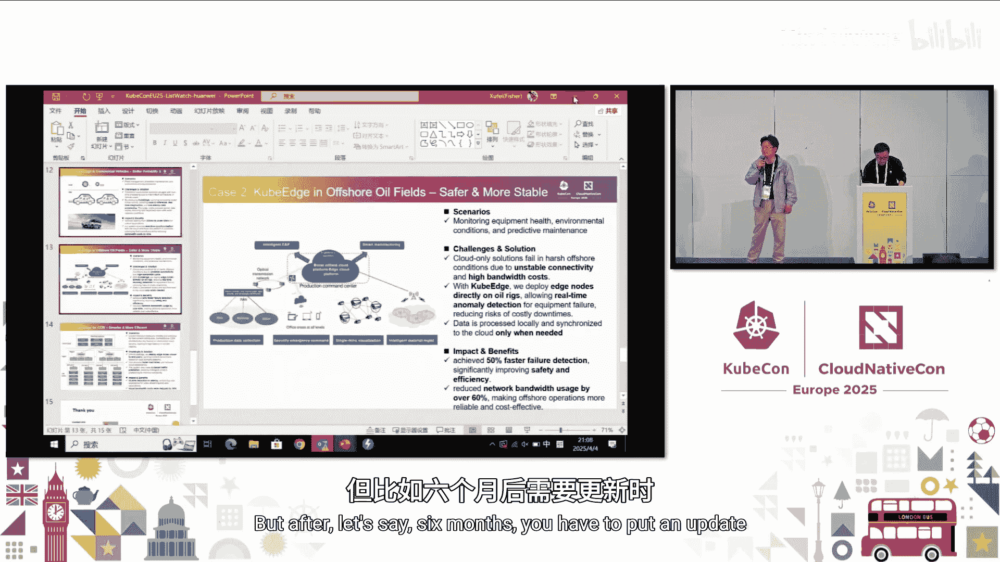
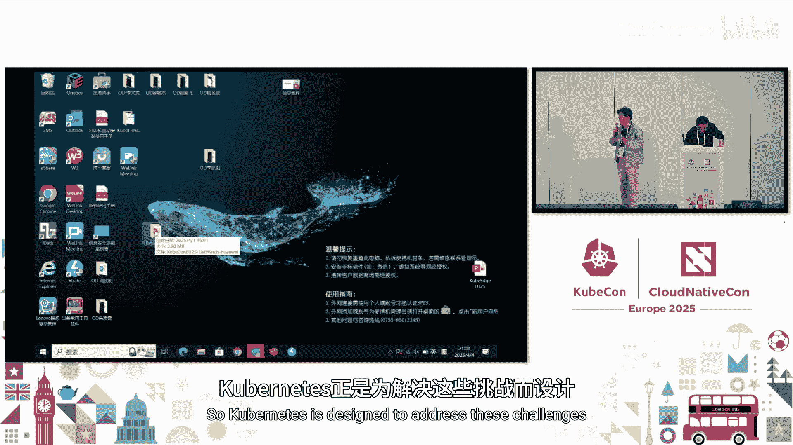
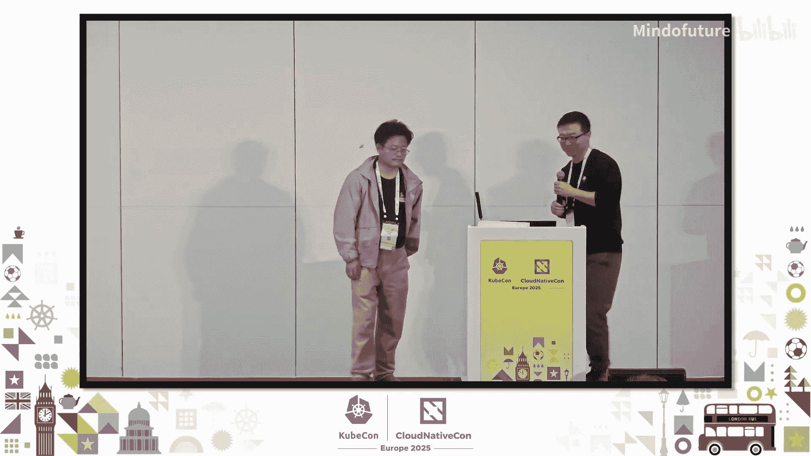

# KubeCon-+-CloudNativeCon-大会2025-｜-云原生计算-｜-可观测性-｜-Kubernetes-｜-Prometheus-p21-P21-KubeEdge-DeepDive---Architecture,-Use-Cases,-and-Project-Graduation-Updates--BV1Cd32zDEBG_p21-

Hello， everyone。 welcome to join our talk today。 today， we'll talk about Kub H， Kub H dive。

 deep dive about the architecture use cases at project graduation updates。 Okay， first。

 let's have a brief introduction for our speakers，hu。😊，嗯。Okay， good afternoon。 I'm， I'm Weihuan from。

From Ham Cloud， I'm I'm doing the with work on the， on the products design and。

 and developing of the。The edge computing and also Apple solutions for。On customer to， yeah。Okay。

 thank you。 I'm Fe X from highi cloud。 Now I'm a full time maintainer of Co H。

 which a sinceF graduated project。 Okay， okay， let's start now。😊，Okay， first。

 let's see this is the cube H project Johnny from scratch。 You can see first， we create this project。

 then donate to the sinceF。 and the set box。 Yeah， then we release the V1 releases。

 then we have the large scale use cases first。 Yeah， then in 2020。

 we became a sinceF ination project。 Yeah， then we。Create the set sub project。

 which is a H AI project in K H。 Yeah， then we have several use cases like the Vi satellite。 Yeah。

 then we do some large scale test。 Yeah， and in the last year。

 we have became the sinceF graduation project。 Yeah。

 K H is also the first graduation project in the age scenario in CF。 Okay。

 this is brief project journey for K H。😊，Okay， this is the Cup H graduation celebration in the last year。

 Yeah， we have do some discussion for the future of the project， okay。😊。

we also thanks to every member in our community。Okay， next。

 I will introduce some project backgrounds for the Kage。Yeah， from this diagram， you can see the。

From the right side is the cloud， then the regional age， then the C T H， then near side age。

 You know， many devices thrown in the near side age and many data also generated in the near side age。

 So how to manage the node and application in age is what we want to do。OK this is呃。😊，Or。

 overall introduction for the Kubage project， yeah。

You can see K H is the first cloud native edge cloud computer S project。 Yeah。

 we have the open governance。 Yeah， we also have many stars at Fox or Github。 Yeah。

 we also have many contributors from， all over the world。 Yeah， from many organizations， okay。😊，Okay。

 next， I will ha have a introduction for the project。Okay， you can see this is a Kubage architecture。

 Yeah， from the diagram。 you can see Kubage include three part。 the cloud part。

 each part and I O T devices part。 Yeah， from the cloud。 we use the Kubernetes master。

 we don't make any modification for the Kubernetes master。 Yeah， the right side is the cloud call。

 Yeah， this component is we developed in Kub age， yeah。😊。

Because we think the network between the cloud and age is always unstable。 Yeah。

 so we have do some enhancements between the cloud and age for a network issue， yeah。In the age part。

 we have the component， age core。 Yeah， H core， we integrate the light Cubt。 Yeah。

 light Cubt is we remove some unused feature in the Kubt。

 Then we integrate it in the age core component。 Yeah， right side。

 we also develop some function for the I T devices management。 Yeah， you can see。😊。

We can use the component called mapper to connect the O T devices to the Kage cluster。Okay， yeah。

 this is the overview of the Kage architecture， yeah。Okay， next。

 I will introduce the latest release of cubeage。 as we release many new features like support batch age node process like H node batch drawn in Yeah。

 like IPV 6 for cloud age communication。 and also multi language framework support。 Yeah。

 this is for the out devices management。 Yeah， also， we upgradeub depend to the latest version。 Okay。

 also have the new release of dashboard。 You can see this is overview of the dashboard。😊，Yeah。Okay。

 next， I will introduce the detail of the Kage architecture。

 You can see this is the age architecture， mainly for the age application age pod。 How。

 how we manage the edge pod in the age node。 Yeah， you can see above is the cloud part。 Yeah。

 we send the po met datata from the Web socket protocol。 Yeah， in the age node。

 we use the age hub receive the metadata。 Then they we。St the metada in the edge store。

 then set the data to the H D， light， then run the container in the edge node， yeah。Okay。

 next is the L T devices management。 Yeah， we define a interface called the device management interface in the age。

 Yeah， it can manage the L T devices connected to the edge node。Yeah， from the equivalent master。

 we use the CD to define several A S for devices like device model and device instance to manage the L T devices in the edge node。

 Yeah， we can manage the connect age device connect or collection of data of the devices。 Yeah。Okay。

 next one is H mesh。 Yeah， H mesh is a network sub project in K H。

 It can solve the age application communication in the age scenario。 Yeah， because， you know。

 in age scenarios， the age node cant connect to each other directly。 So we build the。A mesh。

 it can help the age application connect to each other in， in different sites， yeah。Okay。

 this is the age mesh。呃，it includes呃 like the呃。DN S function or other yeah。Okay。

 next is security in Cupage。 Yeah， you can see Co H is one of the first sincef project reaching L 3 of supply chain level。

 Yeah， and we also have the full audit report。 Yeah we also also Kage is one of the first sincef project integrating with fasting。

 and we also released the threat model and security protection analysis。 Yeah， yeah。

 this is security updates。😊，Okay， next， I will introduce the H AI。 Yeah。

 maybe many developed want to learn。 Yeah， first， you can see this is Sana。 Yeah。

 Sana is a sub project in Co age。 Yeah， it's a。Age cloud energy AI framework。 Yeah， from the diagram。

 you can see this is overall architecture。 Yeah， it also include cloud part and age part。 Yeah。

 include part。 we have component called global management。

 It has all the H AI task management task codation and model data set management。 Yeah。

 this is the cloud component。 or we also have another component called local controller。

 It runs in the cloud node and age node。 Its the bridge between the cloud and age， yeah。

The right side， you can see we have a worker。 Yeah， worker is the AI task run in the node。 It can。

 It can run in cloud and age， yeah。We have another called the lab in the worker through the lab。

 the application AI workload between age and cloud can do some collaboration for like joint inference and federated learning。

 Okay， this is a brief introduction for Se。Okay， next， I will introduce the C age joint in France。

 You can see。What say。What is cloud age joint in France。 Yeah， you can from the diagram。

 you can see we have， we have the devices like the camera then 3 age node H1。

 H 2 H 3 and one close node。 Yeah， we can deploy the shadow model small model in the age node and the deep model to the cloud node then。

😊，Developers can do some users can do some inference from the。H node。 yeah。

 when the confidence level is unm， the request will forward to the cloud。 Yeah。

 if the confidence level is meet the。H node will return the result。 Yeah。

 this is a cloud edge joint in France。Okay， next is case studies。 Yes one， please oh。Okay。

 now let me show some cases that can highlight the power of Ksh。First， we have。

 we have Kubai in the commercial vehicles。 And as we know commercial vehicles like trucks often。

Oper in the。In the remote areas where the signal is comm。 and however， for the。

 for the better fleet management and the。The minutes we。呃， the。呃。

See reliable network and connection and the the， the better vehicles management it is， is very。

Very crucial。This is why Kub， this is where， where， where Kub comes in。I so by。

By enabling vehicles to run the the AR models locally and locally。And Kubbe can make them to。

To identify potential issues before the problems occur。嗯，所以 this way嗯。

The benefits is that even if there there is no called access， the vehicles can can can run the the。

 the models smoothly and。And this can help to help help us， help our， help our。

 our customers to reduce the maintenance， maintenance costs and the to do the better fleet fleet management。

And next， we have the kbe in， in the， in the offhore oil oil fields。And all leagues are often。

 often situated far from land。啊呃，说说的说的。So the network between between the the oil League and the clock is is。

 is often very， very weak。嗯嗯，所所以。In。In this， in so machine failure in such an environments can be very can be not only dangerous。

 but， but also。But but also culturally。ubub addresses these challenges by and handling data on。

 on site。And so。嗯，说的嗯说的班级啊嗯。And our customers can work in a safer， safer safer environment and the。

The oil field。Oil fuel systems can remain stable， even if there is just no network network work connectivity between the oil rig and the cloud。

And finally， we have， we， we have a case about K bad on the CN。 as we know。

 content delivery content content ten delivery networks are。I'm working on the。

On the developing of the content from the， from the cloud。 But sometimes they will， they will suffer。

The problem that the connect is is very， very weak。 And， and so the the the downloading is， is very。

 very slow。So Kubbe can help， help to。To provide more efficient solution。by。啊拜身。Some A models。

 we can， we can do the。Do the pre ticket of the traffic。 So， so， so we can ensure that only the。

 only the necessary content will be fetched from， from cloud。So so with， with cool bad。

 the and outcomes are faster loading times and。And。fewer。Few problems。 And the mob。More and the。

And the improved performance of the CDN servers。And also， we have。

 we have many other other cases in the different， different different industries like the in the intelligent transparent and smart energy and。

 and and industrial。inter intelligence and also also others we can， you can track this。

 these cases in。In our comm community。So， and I would deliver to。Okay， okay， thanks， Huan。 Yeah。

 you can see this is the use cases in many industries， Yeah。

 especially in many traditional industries for K H。 Yeah， like the small energy。 Yeah。

 smart CDN at smart campus at smart logistics。 Yeah， at so。 Yeah， you can have a look。Okay。Okay。

 next， let's see the K community， because K H is a open governance community。 First。

 let's see this is some。Governor's model in cubeage。 Yeah， from the diagram。

 you can see we have the TSC。 Yeah， yeah， about below the TSC。

 we have some sub committees and special teams and we also have many6 in age。 Yeah。

 every6 have many sub projects like set9 in AI。 Yeah， and H match in S network。 Yeah。

 we also have many working group like the M E working group。 Yeah and so。Yeah。

 this is our TSC members and several six and working groups。 Yeah。

 this is a open governance model for our cube H。Yeah， next， you can see this is Tom。

Partners for K community。 Yeah， we have many partners from across industries。 Yeah。

 I can make a research。Okay， next you can see we have many activities in the。😊，Community， yeah。

 like the Le Foundation， L F X。 Yeah， we have many mentees from all all over the world。 Yeah。

 this is activities。Okay， in our website， we also have the partners。 Yeah。

 the our partners provide like the solutions for the consumers。 Yeah。

 if you want to find the providers。 you can check the partner part in our website。 Yeah。

 we also have many case studies， in our website， you can also have a check。Okay， okay。

 that's all what， what's， what， what we introduced。 Thank you。 Do you have any questions。

I have one question Ray relating one specific queue case in our company today。

 we have sometimes sus of workstation connected to the cloud native backend。

 Have you already deployed cube edge on all workstation。To。Take benefits of the computing power。

 provided by。Old walkt， for instance， during the night， where。

 when the employee are basically sleeping。In order to spot poets。Un exploit the。And you the， sorry。

 the boer of。This Susan of Sleing walktation。Yeah， could H is mainly manage the edge node located in many places from the central cloud。

 yeah。Yeah， we have theub Kubernetes master。 Yeah， this is our control play in the closed part。 Yeah。

 we can manage the。Age node in how many places that we think the network between current age and untable。

 Yeah， this is the main scenarios。 Yeah， H focus store。Okay。

 but this edge could be the workstation themselves， okay。Okay。Thank。Okay。Hi。

 I just want to ask them when you have this case study on offshore oil rigs right and I mean normally I think their internet connectivity in all is very constrained how do you manage your day to operations after it is deployed introduction production how do you manage the security updates new version updates and all because they also probably have a lot of regulations or low I would say the short life longer life cycle expectations that they can't just allow you to window have update coming every six months or 18 months how's your experience with。

The day two operations on， on。After deploying it。呃。You mean they pulled after the in the H node。

 Yeah in the production， right， that。Project deployed on oil rig facility the case study you have。

 So to means case regarding and see offshore oil。 yes， that one。 And I mean。

 I am however I am zic that you have deployed this in production， it is running there。 But yeah。

 after， let's say six months， you have to put an update。

Or do you have internet connectivity constraints， Does customer says that you only have this window and you can update it。

 you cannot do it like every six months or so is to address these challenges especially on the connect weak Internet community between the edge and cloud and as we know。

 the oil rigs are often are situated far from land。

 So so machine in the in the oil fields are are very very important we need to keep these machine running smoothly and we need to identify any potential risks before。

The problem occur。 So in this case， we。And actually， we and we developed some。

 some AI models to do the predict of the problem。 So and。

And because cool badge has a a very in important feature we called autonomy。

 this means even if there is no cloud access。 the cool bad components will。

 will remain very stable and keep keep running。 So， so all the edge applications I mean。

 edge parts they are running in the edge will， will will keep running。

 even if the the edge nodes even if the I mean， the O S is restart。

 then the all all the parts running on this on this node will， will become normal in seconds。

 so in this way， we can， we can predict the potential issues before any and then we can。

We can do the more effective。Oil rigs， operation and maintenance。Yeah， okay。

 and whatever the cybersecurity compliance， you have regulations and all you need to certify for deploying in oil and gas industry。

Do you get kind of cube edge need to be certified by this cybersecur authority or something like that to deploy。

Do you any。Yeah， just cyberseity any any kind of compliance requirements in all you mean the。

The continued isolation。I there no， I mean like getting certification saying that yeah。

 this system complies what you deployed based on this kind of industry。

Certification on cybersecur and things like that。Is that kind of requirement often， often the in the。

In the oil fields， they have their own。On private， private networks。Okay。Yeah， so this can。And。

Can ensure the， the network and， and also， we have， we have the security， the， the。

 the very secure communication mechanism between the， the edge and cloud。 We have the T L S。

US connection， yeah。Okay， well thank you。 I have question two question。

 One question is like you tell about robotic， what kind of robotic you meaning。 It's like the。

 for example， Ro， like the robotic operating system or it something else。

And second question is about this device management integration。Do you have like use cases。

 Someone use it with the automation， like the PLC stuff or in manufacture something like that， maybe。

Yeah， yeah， the second question for the T device management O。

 we only define some API S through the CD from cloud。 Yeah。

 we can we use the APII called device inter and device model。 Yeah， this。

 these two API S can control the T devices to connect to the K cluster。 Yeah。

 then for the collect data。 it will depend all the third pass application deployed in the age。

 Yeah Yeah， yeah， yes。Yeah， for the first K can yeah repeat again。

 like the what kind of robotic do you think Like， there was like information about extending cube edge to their robotics。

And， for example， we use robot our robots with the ro system。

 It's like the robotic operating S system。 It's like the。Use for the manufacture robots。

 So basically， I asking if robotic， you mean by some manufacture robots or like the human new kind of new new age robotics stuff。

 Yeah， actually， we have some products。For the robot in our community。 Yeah。

 they manage the robot from the central code。 Yeah， they run the age core component in the robot。

 then the control player in the code。 Then we can manage the application in the robot。 Okay， Yeah。

 good。 Thank you。 I come。😊，Okay， any questions。O， O。😊，Thanks for your time。 Thank you。

Yeah，这边系。