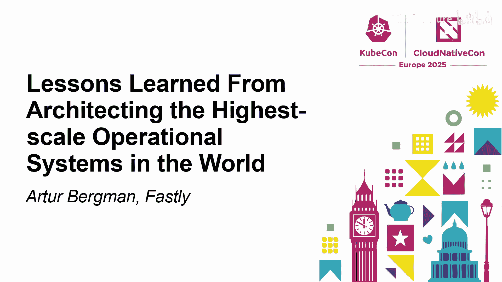
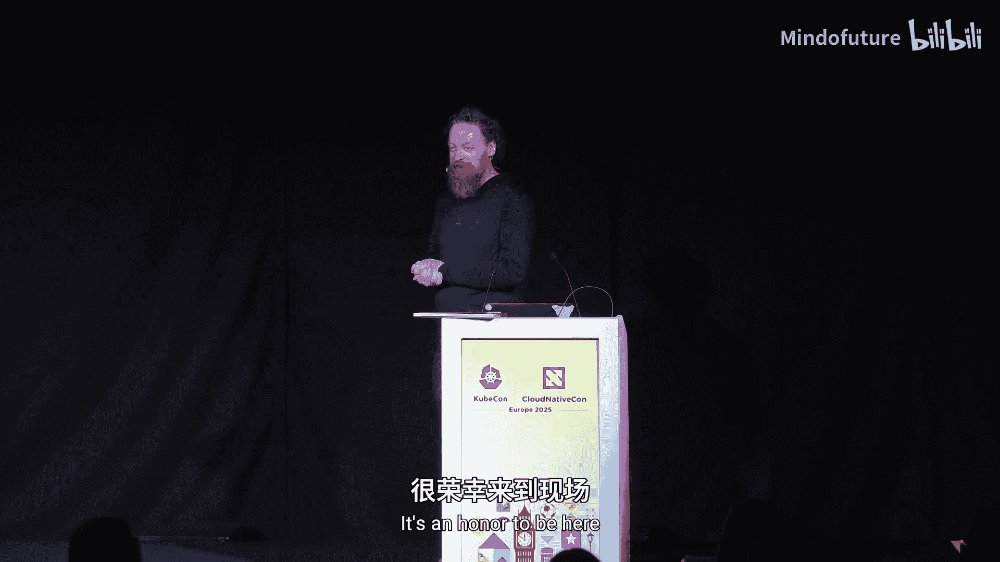
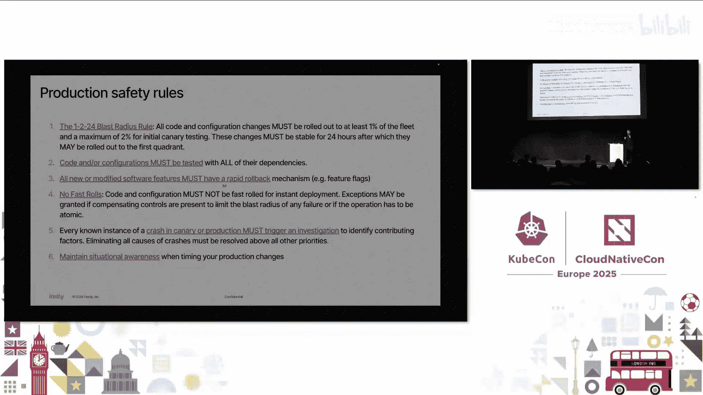

# KubeCon-+-CloudNativeCon-大会2025-｜-云原生计算-｜-可观测性-｜-Kubernetes-｜-Prometheus-p23-P23-Lessons-Learned-From-Architecting-the-Highest-scale-Operational-Systems-in-t--BV1Cd32zDEBG_p23-

Hi， everyone。I'm Arthur Bergman， founder and CT TO of Pasley， and。Its 2025。

 and connectors are still not working well。So I found it fastly in 2011。 It'ss honor to be here。

 I have been an open source developer for a very， very long time。😊。

I started off an open source of the Pel 5 core team in the previous century。

And has ever since been involved in， in a lot of different open source projects， products and events。

And 2011， I started fastly where we make D a better place。All experiences are fast safe and engaging。

 And so what is fastly。We are a network around the world with servers that sit between users and the central cloud locations。

 providing a whole bunch of services。I like， Arthur， this is a really boring marketing slide。

 And I'll be like， that's true。 Just wait。What we actually are， right。

 is we have about 100 locations around the world。These locations all have physical servers。

I understand today， a lot of software developers have actually never been a data center。Which。

Lucky you。 but we still have plenty of them。And as， you know。

Someone who has benefited immensely from open source。

And I think to really kind of explain more what we do to this audience。

 we have a program called Fast forwardward。Where we sponsor all these wonderful projects with posting。

 So essentially， whenever you download a software package。😊，On the Internet。

 it probably comes from a fast service。I some quotes here from。

Threeree of the different projects that use us。And this is something we're。

 we're immensely proud of to be able to offer。Becauseuse we。As a company and as individuals， me。

 the founding team， everyone else has benefited immensely from， from the infrastructure。

 So we serve at peak today， about a million requests per second of open source software packages。

Around the world。 And it's。So when you， when you build systems are fast because they're pulling content really fast。

 like， that's us。Also， when you watch lots of live streams， V O D， surf the Web， buy stuff online。

 that's also us。 But for this audience and for me， I think this part of the business is really important。

So we， we started 2011。We started with five popps，5 locations， couple of servers。

And a fairly small network。Now， the network peaks at。40 million requests per second， probably。

And total network capacity is about 400， little over 400 T per second， worldwide。

And there's been a long。Journey of learning。In how to， to operate at scale。 but also。

By learning that。I， I wasn't。 you know， if you asked me14 years ago that。

Becoming a platform that our customers rely on is， is a different。 Its a separate parallel journey。

 because it's one thing to just build。You know， a scalable system。

It's a different thing to build a scalable system that other people are building scalable systems own。

And so I wanted to talk about platform， and this talk will diverge a little from， I think。

 a technical， a normal technical thought， so。I have kind of always thought about platforms， but。

It wasn't until about a year ago that it kind of clicked for me how to really describe what a platform is because theres a lot of different ways to describe it。

And I kind of came to it more from a scan of more an emotional description of what the platform is。

 So I dont know if。I mean， Europes， and more people probably know what festivalists than in the US。

But this is my daughter。 and I got all into festivals。 I dressed her as festival as well。

 Festivalest is a German power tool brand。That has like， helped me define what I think of platforms。

So bear with me。Festal is， so 100 year old， and they're famous for something called dust extractors。

 Dust extractors is what normal human beings would call vacuum cleaners。

 but they are certified to deal with lead， blah， blah， blah， blah。 These are very， very good。

 vacuumum cleaners。 And amazingly enough， cost about as much as a dysyson。

 So think either these are like vastly underpriced。 or the Dysonons are pretty overpriced。😊，嗯。

But it's just a vacuum。They also invented。 It's kind of funny。 This was invented in 1982。

 The straight rail before that， straight rails did not exist。Apparently。

 it turns out that making like a 2 m rail straight and shipping it is a really hard。

 like physical engineering problem。 But they invented this。And。They invented this。

 which is kind of looks like a boring container。Storage container。啊。

They also invented a circular saw。Which a table sawy， I saw you slide material over。

 a circle of soyce。 I saw you slide material on。 The reason I discovered festival is because I live in by US standards a relatively old house 100。

 And I need to do some work。 And I asked my co-founder， Tyler， What sort to get。 And he said。

 get the festival1。 It's the best one。 And then I talked to someone else and said。

 you should not get it。 It is the best。 Its the most expensive。

 Turn out it is not the most expensive at all。 if you really go into that world， there's more。

 But And， of course， I'm a nerd。 So I was like， this looks cool。 I'm gonna get it。😊。

Kind of a mistake。 ended up being a lot more than just one soul。So how did these things fit together。

 well。These containers stack on the vacuum cleaner， which until you have to drag stuff around。

 you're like， why is it a big deal， It is a big deal。 You only have two hands。This rail， obviously。

 the track， the saw runs on the rail， right， makes sense。外国人。

The rail also has a hole in it so that you can put it on top of the sustainer so you can carry the rail and the sustainer with one hand。

It's like these small details。This is a router not like the router。 we know。

 There is some overlapping， like。These terms， router， bits， etc。

 even though they're completely different world， The router runs on rails。In fact， I think。

 as far as I can tell， if they sell something that could possibly run on one of these rails。It does。

 They have a chainaw that runs on the rail。It was pretty cool。These then like stack。

 so you can now stack your sustainers high。 And each piece of equipment you buy comes in one of these sustainers。

 So you like， add on more。 And what you see here。Is a vacuum cleaner in the shape of one of these sustainers。

So you can now stack them even higher and buy more of them。They have a battery system。

 This is a standard based platform that most tool companies will talk about。

 They'll talk about a battery system， which is just that they have proprietary connectors。

 They actually add a Bluetooth to their batteries， which initially like really Bluetooth works even worse than HMI。

 But their Bluetooth has talks to the dust extractor， A A fancy vacuum。

 so that it turns off and on the vacuum and you turn the power tool on and off。

 It also notifies you when you leave your batteries behind， which by friends。

 I have friends in the trade that tells me that's an important feature because they lose a lot of money by batteries wandering off。

 And if you haven't never bought any of these tools。

 the batteries costs generally more than the tools。Or at least equal。

They also innovated quite significantly。 This is the the festival domino， which was released。

About 20 years ago， patents have about to expire。 People are very excited because now。

 otherwise people may do it。 It basically takes more to sing。

 which is making holes in wood to put it together much easier。 I don't use it very often。

 But if you're， you know， furniture maker， you're gonna use it a lot。 And you saved a lot time。

 And they patented it， they integrated it with just extraction。

 And the rest of the world of being complaining I'm allowed to do it。 They also， they。

 so they have a culture of innovating patent and then building that into a platform。😊。

So you end up with these， you know， stocks。And the power of this is that once you have one of these tools。

 right， you want to buy more， and they use that to such effect that in the E。

 they release this Independence Day sustainer。Which is just one of these boxes with a branded iron for your steaks。

 This says festival， a salt shaker， a pepper shaker and an apron for 1 89。😊。

And it sold out immediately。 So to me， it's like， okay， that's what Germans think Americans will buy。

 And then it turns out they're right。 That is exactly。What Americans will buy。

They also have like some ridiculous things like this。

 which is a hand sanding block connected to the dust extractor。 So think like at some point。

 like you can't they can， you can't get to make a product there unless you integrate with dust extractor。

This is the spirit level。 It's the best spirit level I ever used。

 But the really cool part is that it slides into the handle of the sustainer。😊，And I really wonder。

 like， did some engineer go like，ooh， there's a hole in the sustainer， We could s the thing in。

 or did they go like， if we make it this way， we can then make a spirit lever to slide in。

 I really want to ask them this question， actually。😊，嗯。When you buy the tools。

 they come with like all the insectcess and little displays that tell you where everything goes。

 also helpfully reminds you of the things you didn't buy because they were too cheap so that you can then go and buy them and like fill out your collection。

But very useful becauseuse everything has its， you know， its place。

And so this is 100 year old power toolol company。And if you think about like， true platform plays。

To me， there aren't that many。 And， and I'm going to define like， how I。

 I view platform is if I am a user of a platform and that platform。

Provides a new product or service or function that I need。

Will I just use it because I already know the platform。Right， like。

 if Apple releases another headphone， I'll probably just buy it because I know it work with my iPhone。

 Do they best， Do they make the best headphones， Probably probably not。

 I haven't even looked the last 10 years。 I just know that I won't have the like Bluetooth hit if I。

 if I buy someone else's。Right。In the real world， I think Lego is a great platform play twice。

 They started off having like， a to some different products。😊，They went down to Lego twice。

 They went away from the brick twice and nearly went bankrupt。 And， in fact， my。

 my 11 year old was complaining both， I think， like Lego play and the characters are like larger。

 they don't fit with normal Lego things。 and it was very mad because you couldn't put it in others like so they broke the perception that all Lego works together。

 And so when we think of this is how we decide like our products or platforms。 And we provide。

 you know， en level， is this， the notion is your platform provides a promise， right。

 whatever that promise is And when you add new features， new functionalities， your platform products。

 it has to live within that promise。 And if you break that promise， your users will get sad。

 confused An， angry。 And you know， so you know， fastly has these kind of corresponding to to those。

 I compare dust extraction to network， like when it works。

 no one cares when it doesnt shit everywhere。Same of your network。

 So there' are some things that like， silently are part of it， some of more， you know， there。 But if。

 if you release， if you do something that doesn't match what your customers want。嗯。They。

 they get upset。Other way of looking at it is like， if I need a tool that they make， I buy it。

 If I they don't make it and they don't make that many。

 I spend like three hours on YouTube watching reviews because no one actually writes anymore。

 And then I have to buy the tool and hope it works。And the end result of that is that like。

 if you are a platform customer or a platform user platform does it。

 why do you go for that thing that already exists， Well， because you get value quicker， right， Like。

 you already know the ecosystem， you know， the tooling， you know， the lingo， you know all of it。

 you just the cognitive overhead。Of the act。Adopting a new thing is much lower if it fits into the platform。

Right， and。This is kind of， I think this is more of a maybe a philosophical definition of platform。

 But over the last two years， I've really shifted my way to thinking about it。

 And I think it applies。You know， from very low level all the way up。

 which is core of it is this promise。I promise of what you deliver。Tell you， like。

 they sell a angle grinder that doesn't do the dust extraction。 I bought it。 And man。

 I was pissed for like a weekend when I realized that it doesn't。 And even worse。

 they license it from another manufacturer。 and that manufacturer has。呃。

Thusust extraction on their angle grinder。 So some product manager at festival is like screw it。

 We're gonna ignore all of it and just do it easy。And， and this is hard， right。

 because you have to think about like global maxima versus local maxima。 right， Like。

 it's easy to optimize in the moment and forget that then you break this great promise。

That was the detour。 Hope it was useful。 That's the set of platform。Another big important。

lessonsson of fastly for me， is outliers。We spend a lot of time on outliers。

We spent a lot of time looking at， at data and performance。This one is pretty cool。

 This is the latency to our pops。Around the world。 So this chart， this started with an empty map。

 and the dots are just drawn based on latency。And you can see no one lives in the US Midwest。

For example， no one lives in central。And in Central South America， North Korea does not exist。

 South Korea is an island。 There also some other pretty cools things like here。 You can see the Nile。

 There's a lot of people that live next to the Nile。So we we dig into data a lot。And。We。

 we spent a lot of time looking at metrics。 And like， where do you start with metrics。

 And Ill just because we taste， like， you should never look at mediums。

Thiss just always look at my9 percentile or higher。At at scale。

And this is an example of a thing that we were， we were debugging。And if you look。

 I don't know if we can see it that earlier closely， but that is the。6，9 p。

Which at like 40 million requests per second happens 40 times a second。So it's like， yes。

 not that often， but pretty often still。And what we found。Is that by looking for these。

You can actually usually improve the， the entire system。 So we spend a lot time on this。So we。

 in this case。There was some。Some things that shouldn't be done inside an event loop。

 Let's say that was being done。But unnecessarily sometimes slowed down the event loop。

By accidentally doing file I O。We fixed it， and you can see the latetency histogram。

 but the latetnt histogram actually dropped even for the lower9s。He still49s，59s and 69s。 And then。

 you know。You do a control and you roll back and you see if it fix it。

 And then you quickly roll it out to everyone。 So the。

 the top number there is about 80 milliseconds and the， the 4，9，1， I think， is about 5 milliseconds。

So for most users， like they're gonna to notice。 But as we've。

 we've developed a folk a culture of really looking at outliers。 like you find outliers。

 they're not something。 you don't ignore them because they're outliers。

 like you go after them because they're outliers because the outliers is also what you're more most。

Sophisticated。And technical savvy customers will find or users will find and then complain about。

 And then they'll， you know， you and have to fix them anyway， so。Is， it's， it's just。

 it's become really part of our culture。 And I think。I rarely look at anything below P 99。

 but really， rarely on anything。 It's probably some， some damage of the scale， but P 9，9， free nines。

啊。And I'm running a low over because of the delay， so。嗯。The other thing to that。Really learned from。

 from the fast years is to focus on outcome。 Like， keep in mind like， what， what is important， Like。

 what are， why are we doing this。What is your user trying to achieve。

 What is your customer trying to achieve， And are we doing the thing that will help and do that better。

 or are we needlessly innovating on something that we shouldn't。 And there's a lot of needless。

 unnecessary innovation in this world。 I'm staying at a hotel where a room key is like half sized And every time I lose it in my pocket that my wallet。

 I got like some person spent time innovating on this room key to the detriment of all hotel guests。

They could have spent it on innovating on anything else。 There's a lot of that going on。

 And that leads me to this word， which is a terrible word。 And and some general， I think。

 career advice to anyone， which is never say something should be fixed because of that technical debt。

Because it can a Beth mean。Well， in the best case， it means what it means。

 which is the cost of maintaining this code is higher than the benefit of maintaining it is。

 In most cases， it means I don't like this code。Or sometimes it means I really want to rewrite it in this new shiny language or this new shiny thing。

 because that's what I want to do。And so I've kind of banned anyone from telling me something should be fixed。

Just because this is I actually have to specify， is it credit card debt or is it like a good mortgage。

 like one of them is bad， One of them is not bad。 doesn't automatically make it bad。

 And that is in context of outcome， right。It's the operational value of code。

Is based on the time and product of code。So if you， if your pro。

 if your code has been running in progue for a year and your new code has never been running in pro。

 the value of the code is in the old code。 doesn't mean that the new code wont replace that value pretty quickly。

 But at that moment in time。The value is the opposite。 And the longer the new code is not imp pro。

 The longer it is until the longer until it realizes any value and therefore。

 will'll probably never realize value。嗯。And so。Then this goes to。

Another thing that we focus a lot on our athlete， which is how to prevent global outages。

Which you then reframe as how do you cause a global outage。how do you call a global outage。

It requires a global state to change。And what is a say change， Well。

 it's a software release or a config release or a workload。Now， workload is a little bit out of。

 as a platform provider， right， Like workload is a little bit out of our hand。

 Like customers could choose to do something different， shift vast quantities of traffic to us。

 different forms。 But code and config， those are definitely things that we control。

And I think one of the lessons we have learned is that。There really shouldn't。

 There really isn't a difference between code and config because the code is out there for a year。

 but hasn't been run because the config is off。And then you flip the config。

 And it's really the same thing as pushing the code。And so if you just think of them as the same。

 as the same。 And so， you know， if you're blastphous， if you change this label， you have to stop。

 you have to stop and think。 There are very few things。

That actually have to be a global immediate state change。And from， from a networking point of view。

 there is Wa that's like unavoidable， which is anything to BGP routing， is instantly global。

Nrely instantly， but most others。啊。对。Also， at scale。

 there's no lab or dev in the world that will help。So these are some of our like rules。

 They're not super hard。嗯。But the， they no， no fast rules， but fast recovery。

 And then every known instance of crash and canial production must trigger investigation immediately。

Like you can't let any of its slide。The the one that I think is。The most important is the。

 the rapid rollback， whether that is cofig or or code， an ideally automated rapid rollback。

Maintains situational awareness and timing， production advantage。

 We had an outage launch in a pop where our pops have four networks。 And then there's four switches。

 All machines are connected to all four networks。All Internet is connected to all four switches middle of the night。

 Someone is doing a software update on the switches。 The first switch goes offline。

 second switch goes offline。 The first switch goes offline。

 And then they do the full switch and the pop goes offline because they never checked that the other switches had come back。

And， and so when you're doing any of these critical changes， like。

Maintaining situation awareness is important。啊。And then， to end。I wanted to share something I。

 I little mored。 you， weve been I。Yeah， I'm old。 I， I view this L M stuff somewhat dubiously。

 but I found， we found that I have。 and we have found a value in feeding all of our incidents through history into L Ms and training them on that。

And it's so if you haven't， if you haven't played that。

 I can highly recommend that we now have the ability to classify， get much better。

 much faster re collectionction of previous incidents。And also getting summaries。 So this is we put。

 we sent this out to customers。 but this is a pretty good summary of a very， very， very long。

investigationigation covering many Zoom calls and many chats and many log files and many things。

 And it's it's been a very significant help as the network has grown larger than any person's ability to keep it in their head。

So I can very much recommend this， like trying to use these tools on your own data to analyze any form of incident。

 and especially incidents that didn't lead to like fall on outages， because you're not really。

So in the， in the air safety world， right， you treat mere incidents as failures。

 And I think in our world， we tend to keep you know operations。

 We tend to treat mere failures as successes。 We try really hard enough to。 But yeah。

 it's like human nature。 But you don't have as much time to debug them。 talk about them。

 And these tools have been very， very helpful in allowing us to investigate these mere failures more like we would any other。

 like a failure that actually occurred。啊，So。And。The final kind of rule I have is that the abstractions are key。

You have to understand， you know， a little bit underneath you， a little bit above you。

 You need to get abstractions， right， And the people here know what the Winchester mystery house is。

I see some hands。 Okay， it's in San Josese， South San Francisco。

 If you have an architecture team and they are in that area。

 send them on a group event to the Winchester mysteryster House。 This is an image from me。

 this woman built it over like 50 years without any plan。

 And there are doors going into walls going into windows， It is like amazing。

 And it's an example of what happens when you don't plan a hand， when you don't have abstractions。

 And it' it's a great team building and exercise for any enterprise architecture team。 for sure。

 highly recommend that。 But with that， thank you so much。😊。

