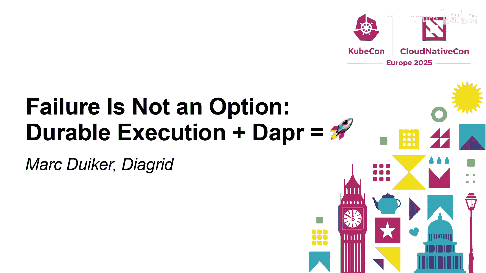
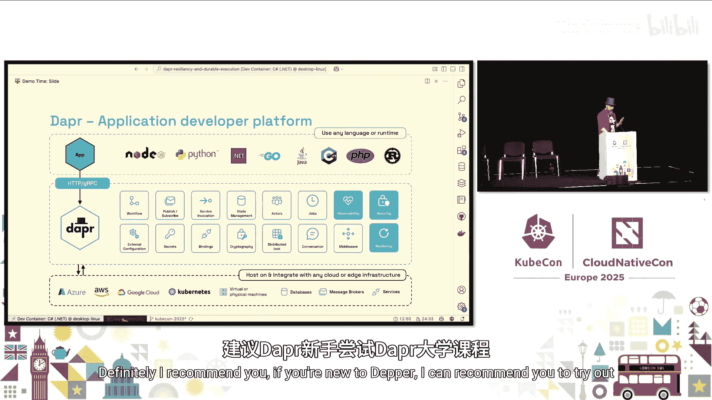
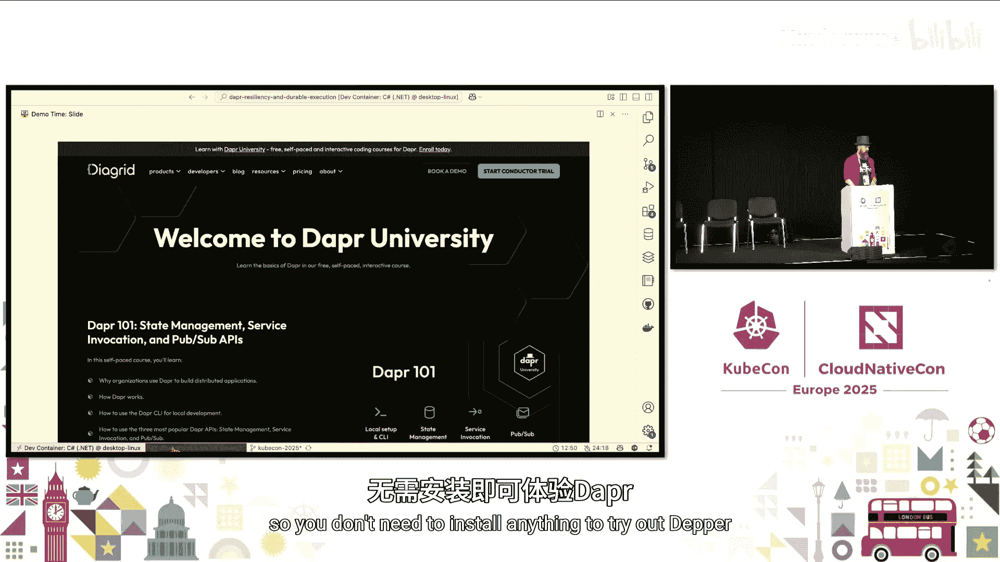
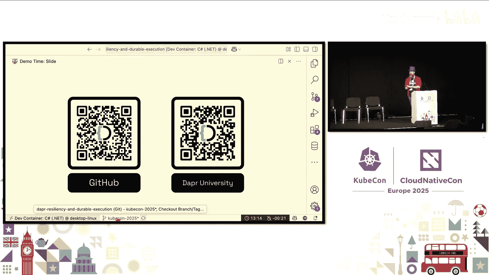

# KubeCon-+-CloudNativeCon-大会2025-｜-云原生计算-｜-可观测性-｜-Kubernetes-｜-Prometheus-p25-P25-Failure-Is-Not-an-Option---Durable-Execution-+-Dapr-=-🚀---Marc-Duiker,-Diag--BV1Cd32zDEBG_p25-

Alright， we are good to go。 Welcome， everyone to my session。 Failure is not an option。

 Jubal execution Plus Depper is rocket emoji。 I think we can translate it as amazing。 Yeah。

 thank you for spending this half an hour after lunch with me。 I think it's my job to keep you awake。

 Hopefully， I can manage that。 Let's get going。😊。

I think we are pretty much familiar with failure in IT right failure is inevitable。

 I think we already everyone experiences probably firsthand maybe because even some failures I know but definitely as end users we probably are familiar with a lot of IT failures usually it's always DNS that's causing it I don't know why and maybe some of you are as old as I am and are familiar with this Windows XB message information message that says task failed successfully which is of course a very weird thing to show to your users but this's actually what this talk is about failure is inevitable things will fail so why not make sure things will feel successfully so maybe you can even automatically recover or maybe we can make the impact on user as small as possible。

So I'm Mark Dagger， I'm a developer advocate at Diiggrid。

 a company founded by the co creatorators of Dpper Open source。

 I'm one of the Depper community managers， a big fan of Pixel art as you can see。

 also a big fan of Fas code， I'm running my entire presentation in Fias codes。

 I will share a QR code with the Github link later so you can definitely see all the slides and all the demo code yourself later。

So I did a bit of research about IT failures and I came across this very interesting blog post it's really quite all this from 2015 it's on the IAE spectrum blog post but it describes lessons learned from a decade of IT failure so it is quite a long blog post it just took one screenshot out of it but there there's this legends and the biggest circle is like a 10 billion of monetary cost of IT failures and here in this diagram you see across like 2005 and 2015 across the whole globe like very big circles so you can imagine the monetary cost of IT failures is' running in the hundreds of billions and this was like 10 years ago but I'm pretty sure that maybe the cost is even higher these days。

So the link is all in here， you'll get to your article code later。

 so definitely check out this link yourself。 it's very nice， and it's also an interactive blog post。

 so that's great。Yeah， one of the reasons maybe IT failures are a bit more prominent is because also our applications are becoming more complex so this is even not a very complex thing。

 but we are making more and more distributed applications and services need to communicate with each other either synchronly or asynchronously。

 there's lots of me brokers involved， lots of different state stores involved。

 and yeah there's a lot of moving parts。 So they have a lot of things that can go wrong and of course。

 that will go wrong。And that's nothing new， right， So who heard about the fallacies of distributed computing。

Okay， so some some hands so this this list of false assumptions is is compiled in 1994 so quite quite some decades ago。

 So it's pretty much well known that distributed distributed computing is is hard and that we don't understand everything when we start working with it。

 I'm not going into detail all of this because this is not really a theoretical session about this。

 I can definitely recommend you some of these links that I've included here。

 And one of them is like a playlist where Ui dehan from particular software describes all of these fallacies in very short videos。

So definitely have have a look at that。Now， about five years ago。

 some smart people got together and created this open source project， Depper。

 the distributed application runtime， and over the year it has been used by really hundreds of companies across all kinds of verticals to really help developers really run and build their distributed applications。

 so it really makes it much， much easier to build plus run at scale。

So last November it became a graduated project within CNCF so of course data DePA project is really really proud to achieve that and on the CNCF website its also on the Depper website there's lots of case studies mentioned on how companies are using Gpper and how they use this successfully so yeah if you have any doubts about Depper。

 definitely have a read in these use cases。So anyone familiar here with with Depper。

Couple of people who's using it like in production right now。

Okay well definitely stop by me later so Depper runs in a sidecar next to your application and you can use any language since it runs in a separate process and Depper offers a lot of API so you can use as developer to quickly build your microservices Now I'm not going to talk about all the APIs because this is really a session about durable execution and workflow and definitely I recommend to you if you're new to Depper I can recommend you to try out Depper University I'm working on some educational content about Depper now I also share a QR code at the end of the session where you can access this it basically runs like a samebox assignment in a browser so you don't need to install anything to try out Depper。

So getting back to the problem that we're solving， so we know that systems fail and we need to recover from those failures ideally automatically。

 but also limit the impact of these failures。So， and， and yeah。

 one of these solutions is durable execution。 So durable execution is means like running code in a stateful way。

 which sounds a bit bit weird。 Well， we've actually doing that for for quite a while。

So in case the process that runs the code， if that process fails， another process can can come up。

 it can read back the state because that state is persisted on disk somewhere。

 and it can then run the code to completion。Now， like I mentioned then maybe this job execution term is maybe a bit new。

 but maybe you're familiar with workflow engines and workflow engines have been implementing this job execution stuff for many years。

 so who've been using like workflow engines in general to automate their business processes。

 Yeah I see see got quite quite some hands right。AndSo if you're new to workflow engines and workflows in general a workflow consists of many tasks or activities and all of these activities are like small units of work。

 maybe calling out to another API， saving some state to a database or retrieving some states。

 publishing a message and so on， so your workflow typically consists of all kinds of activities that make other calls and some business logic。

And that the way that workflow engines and group execution work is because all of these state changers。

 they are stored to disk。To a stage store。So Ive create an animation just to give you an indication how this works in general。

 because there's actually a lot going on。 So as soon as you start a workflow。

 the input of that workflow is actually stored in in the state store And So this workflow I and input that stored。

 Then the first activity gets scheduled。 Well， the first activity is be executed。

 and the input and output is also stored in that database。

 So then we don't continue immediately to the second activity。

 but the workflow will start from top again。 So it will read the stage from activity1。

 It doesn't execute again because it's known that it's ready is there。

 then it goes to the second activity。 And again， everything is precisely to disk。 And again。

 we replay from the top before we go to activity 3。 So as you can see， there's a lot of。😊。

I going on between the workflow engine and the statestore。 and yeah， this is necessary because yeah。

 a workflow can stop， can break any time， but all of your head your statuss work is persist to disk。

So I had this in general how these workflow engines and drive execution works。

Now there are different ways how you can author workflows right。

 so when typically had these systems sort with visual designers。

 so you can more click and drag all these workflows， they're also like step functions。

 which is more like JO based， but they're also like real workflow escort solutions。

And I'm a big fan of these workflow code solutions because it's part of your source control so when you submit the PR which which changes。

 it gets reviewed by someone else， you can unit test your workflows。

 which is ideal because workflows should contain like business logic which is quite valuable if that's correct So I'm a big fan。

 so' some examples of workflow code solutions like include like temporal。

 maybe people are familiar with Sri functions if you do doing doing serverless now and Depot workflow is also like a workflow as code solution。

So the Depot workflow API has been stable in since the last Depot release。 So that happened in 1。

15 in February。 and it's been like on the development for for like over two years。

And if you want to know more about these group execution engines。

 I also include a list to an awesome Gi list that contains like dozens of these different workflow engines because theyre。

 theyre much more out there。So when you start using these workflow code solutions。

 you can you can use different workflow patterns with these with these things。

 So the most basic pattern that you can use is called task chaining。

And which is basically you run certain activities in a specific order。

 and you need the order because maybe the output of activity A is used as an input for activity B and so on。

 And so the order is important。Another pattern is the fan out in pattern and here there's no dependency at all between activities you can run them in parallel or in large batches the nice thing about this though is that your workflow can actually wait until all of these activities are completed and then you can aggregate over the results of all these activities。

Another pattern is the monitor pattern and this is great when you want to like a reoccurring talk so maybe you want to run a nightly cleanup job in the cloud and remove from cloud resources so the first thing that you can do is you can implement like a call to your cloud to clean up some activities。

 then you can instruct your workflow to create a timer。

 wait 24 hours the workflow will will unload it it will not do anything and then after these 24 hours it will become active again and then you instruct it to restart as a new fresh instance and so this is not the same as the replay behavior I showed earlier because when you do replay it will remember all of its history executions but if you say continuous new it's a new fresh instance。

Final pattern I want to mention is the external system interaction。

 so this is great when I want to implement a un approval workflow for instance。

 so here you can instruct your workflow to wait until an external event comes in and then you can use the payload of that external event to decide how you want to continue in your workflow。

😊，And normally you wouldn't use just one of these patterns in your workflows。

 you would actually combine several of these patterns。

 as so this is an example where we use a bit of task chain， we are waiting for an defense。

 we also do a fe in fan out one and the nice thing of course， if you use Depper in general。

 you can use andDepper workflow but also all of the other Depper APIs in those activities。

Then bit the out the Depper workflow engine。 So the Depper workflow engine is part of the Depper sidecar。

So as soon as your application starts up and a Depper sidecar starts up。

 there's a GC stream that's established between your application and the Depper sidecar because there a lot of communication needs to be happening for scheduling your workflow and your application itself will still run the workflow。

 but the Depper sidecar is responsible for scheduling it and in case it all goes down。

 the Depper sidecar will actually start up your workflow again and will start executing all of these things。

And of course， the workflow engine is responsible for persisting all of that workflow states to the state store and getting that back into your process。

All right， almost time for our demos so I have a demo with two applications。

 a workflow application that talks to an inventory and I have a shipping application and we'll do some kind of a simulation an order process where we sort of validate on order and interact with the shipping service。

😊，Now this is what the workflow is doing。 So the first activity of that workflow is an update inventory where we actually check do we have enough inventory and if you do we actually mutate that to that inventory if we don't。

 we immediately exit。😊，If we do have enough inventory。

 then we have another activity that gets back to shipping providers for this product that we're ordering。

 this gets back an array of different shipping providers and then for each of these shipping providers we will retrieve by making an API call to another service it gives the cost for the shipment so this gives back like several cost indications。

And then in our workflow， we have a bit of code that actually to to what is then the cheapest shipper for for this product。

 and then for the cheapest shipper， we will register this shipment。If it's all okay， then we end。

 if this is not okay。 that means we can actually do a compensation action so we can actually undo our update inventory again。

 and compensation action is not something that is built in into a depot workflow。

 It just means you write an activity to undo something that happens in an early activity。

 So we are actually undoing this update inventory。 when we call this activity。😊，Okay。

 let's have a look at the code in this code in this case I'm showing she sharp。

 but you can write your De of workflows in also in Java， Java， Python， or in Go。

So in this case we just have a class， we in it from a workflow clause that's given by the Depper SDK。

 and we are running this method called run Async， so the Depper SDK gives us a workflow context and we'll be using this context to call out and to schedule our activities。

 we give it an order as an input to us so that's our own object that we provide and the output of this workflow is an order validation result again that's just a custom object that we define ourselves。

So we are using this context to call to an activity so we we instruct the Deon time okay now run this activity and as soon as head the Deflow engine will actually schedule this activity this code will stop executing it will be unloaded for memory and once this activity code has been completed。

 then this code will actually start running again so that's the replay nature I showed in the animation earlier。

So we call on activity and you always refer to activities by name。 So in this case。

 we're calling the updates inventory activity， we post a payout and we get back an inventory result。

And then we have just some if statements which is our business logic。

 so if there's sufficient stock in our inventory then we continue the next activity that's called is getting the shipping providers and here you see I'm adding an additional argument that's called workflow task options so you can actually provide a retry policy when you call these activities I didn't do it in the first example here but you can actually instruct a workflow in case this activity fails。

 retry it a couple of times and in this case it's just a simple constant retri policy but you can also instruct it to exponential backoff so that's totally up to you。

So this gives us back an array of shipping providers。

 so what we're going to do next is we want for each of these shipping providers。

 we want to ask them okay well what's the cost of your shipment？

So that's what's happening next so we are iterating over the ID shipping providers in this4 East loop and again we are calling an activity get shipping costs。

 but notice that we are not awaiting this call here so that means the De workflow engine is not actually scheduling these calls yet we are purely adding these tasks here to a list so this is a list of task of shipping cost results。

And at this point， we are actually scheduling all of these tasks and also instructing the workflow here to wait until they have all been completed so this is the fan out fan in pattern here。

So once all of these activities have been done， we just ask hey give me the cheapest shipping service。

 so it just just gives me the minimum cost here， so at this moment I have a shipping service identified which is the lowest cost。

😊，And then the next part is registering the shipment for this shipping service。

Now I've wrapped this in a try catch clause just to indicate the head that you can use from other control logic inside a workflow。

So I'm calling a registered shipment activity here。

 but what happens if an exception is thrown in in this activity。

 well we can then catch the exception exceptions are wrapped in a workflow task field exception in this case。

 you can of course always inspect what what the inner exception is of this one because this is really workflow specific exception but this is how for instance you can do a determine if you need to execute a composition action right so if this call this activity fails then we are in this catch block and then we do the undo update inventory activity。

And so this is our conversation action。Right， just to show you an example of an activity。

 there are multiple activities， but I'm just going to show you one because they all have the same the same structure。

 again， an activity is just inheriting from a workflow activity that's based on on the Depper SDK。

 In this case， the inventory is actually checking against a state store using the Depper API。

 So that's why we're using the Depper client here。We have a run async method again。

 which is being called and were using the Depper clients to retrieve some state。

So we get back a product inventory and we just like if do we have enough of this product in stock。

 if not we of course give back results that we don't have enough in stock。

 but if we do then we make a mutation to the state and we save the state again using the Depper client。

All right。Now this is the startup part of the program so what's important for Dpper workflow and what might be different to with on other workflow as code systems you need to register your workflows and activities with DA because otherwise if you don't do this Dpper has no clue that there are workflows or activities present in your code so in this case we need to use the a Dpper workflow method on the service collection where we need to register our workflow and our activities。

Now when I run a demo I will run I will execute this endpoint。

 there's a validate order endpoint and what happens here we are retrieving a Depper workflow client and we are executing the schedule new workflow async method so here we are instructing the workflow engine please go ahead and schedule this new workflow again you do it by name so we pass in validate order workflow we provide an instance ID because each workflow needs an instance ID if you don't provide one it will just generate a good for you but in this case I'm just using the order ID as my instance ID for this workflow and we provide the order as input for the workflow。

So notice that we don't get back to the result of this that order and for for this workflow。

 because everything is asynchronous。 So what we actually get back here is the instanceense Id and the instanceense I in this case is exactly the same as the order I D。

 So I could have just returned the order I D here。 But if you don't provide this order I D。

 then you need to get back this instanceense I。 Otherwise。

 you don't have anything to correlate to what correlates to my order。

So we don't get back to result because yeah， we are triggering a potentially very long running process。

 In this case， it's very quick， but this could also take hours or days or months。

 right So that's why you don't get back the result of your workflow because everything is asynchronous。

I have some other endpoints to update the inventory。

 but I think it's almost time to run the sample now， so as I mentioned， durable execution。

 workflow engines states need to be persisted somewhere and you define what kind of state you use via component files if you're familiar with Depper。

You define them in this Yam structure。 so in this case。

 I am using a state store that's based on Redis because if you use a Depper CI。

 you always get a local Redis container running so Redis is where our state is stored and you're not directly interacting with the state。

 arere using the Depper API to interact with this。 mean you're not interacting with the state directly yourself。

Depper workflow is built on top of Depper actors， again you're not using the actor API yourself when you are working with workflows。

 it's just something that is useful for you to know and that's why you need to make sure that the actor stage store flag needs is set to true。

So this is like a prerequisite if you want to use workflow。Right， just one more Yl file I promise。

 and then we're done。 So I'm using Depper run to start up my services locally。 And in this case。

 I have configured which applications to run in this YO file。

 I'm starting up a workflow application and I'm starting a shipping application。Alright。

 so what I'm going to do now is I'm going to use Depper run， I'm going to use this command。

 but it's all scripted so you won't see me typing I'll just click a button and this will run so this will run both applications for me。

 it will run the Depper sidecar for me as well So once this is running I will use a rest client for few code to make a call to this fill order endpoint that will start my workflow。

Then I will stop all processing to indicate something severe happens。

 and our applications are crashing and burning and not alive anymore。

 And then I will restart the workflow with this Depper run command。 And then we'll see what happens。

 right， because we were actually aiming for like。Automatic and failure recovery， right。

 because that's what durable execution is offering us。All right， so I'm running the app now。

So now our roofful application is starting up。 now our shipping application is starting up。

 also the Depper side carss are starting up。So everything is running now。

 now let me make sure that we first have some inventories so this is working。

So let me check if this works。 Yeah， okay， so I have like  five rubber dos in my inventory。

 So that's all working。Okay， so I'm now calling the Fate order endpoint here。

 And this is my payouts that I'm providing。 I want to order two rubber duckies。Okay， so I am。

Sending the request。And then I'll wait very briefly， and then I will stop everything。

I will stop right now all right so the last thing in our logs that we've seen。

 I mean there's a lot of debu logging here， but the last thing that was happening is our workflow application was making a service call to our shipping application and that's the last thing but what's happening here so this is a lock from our shipping service and that it's going to retrieve the shipping cost for this order but before it could return this information to our workflow I've stopped all applications to indicate something something bad happened。

So everything is down。 We flows down。 Shiping app is down。 So let me。

 let me restart everything again。 So now I'm running head uppper run again。

 which just star up everything。 and let's see what happens。Okay， and again， we see that head。

 the shipping services are contacted again。Oh， three of them now。And let's wait a bit more。And shown。

 and now the cheapest one is selected that service B in this case。

 and now we see a log events called orchestration status is completed。

RightSo this is actually that the Depper workflow engine completing our work after a failure。

 we only need to start up the process again， which if you're running in Kubernetes。

 Kubernetes will make sure hey you'll get a new part and well start up everything again。

 So I didn't need to make a call to disel order endpoint again because Depper realize。

 okay I have a workflow that does not complete yet。 So let's let's run it again。

And I can verify its date by making a get request and with this instance ID to get back the state of this workflow so this is the workflow。

 this was the exact instance ID that we read the front and this is the final state。

 this was the input and this was the output。All right。

 and so this is how Depar uses the jurupbal execution concept。Okay， let me stop executing this。

All right。I will skip the next demo due to time， but I do have some other important parts to mention。

Right and so workflow S code is great or workflows in general are great。

 but there are still some challenges when you're working with workflows and so there are four points I want to discuss these are all described in great detail in a blog post by Chris Gillllam。

 I definitely recommend you to read this blog post if you're really really really seriously considering to use it to use workflows One of them is that your workflows should contain deterterministic code。

Let me assuming may need maybe a bit more more so Mo district code needs to be deterministic。

 well your workflow is being replayed several times， right？

So if during this replay your behavior changes within the workflow。

 this can cause a mismatch between the states that is stored and what's happening during runtime because after each activity call all of the inputs and outputs of this activity call are stored into into the state store and when during a replay when some of these arguments changed there's a mismatch between the states and then you have like a very weird mismatch between state and workflow so what you should not do。

 for instance， is this you should not use like good new good which creates a new random good inside your workflow or you should not generate a new timestamp in your workflow。

And for for these like common use cases， there are actually some some helper methods on the workflow context。

Call a new goodIs and also context current UTC day time。

 And so there are some help methods to make that a bit easier。

 if you have other code that is nondeterministic， just wrap that code inside an activity call。

 Yeah because your activity code can be can be nondeterministic， just totally fine。

 But make sure your workflow is deterministic。Now， your activities thepot workflow guarantees and at least one execution of your activities。

 meaning your activities can be executed more than once， right， So yeah。

 what happens when you write your activity code where there's like not a guarantee that there's different behavior in your activities。

So for instance， what if you do an insert in a SQL store and when you provide a primary key。

 so what happens if you do an exact same insert with that primary key for a second time。

 that probably would not work right So you're probably then better off to do like an up or you first do a read before you do a write。

 So yeah， you need to check what kind of code you're using other APIs maybe the APIs that you're using are item potent maybe not so you have to make sure that the code that you're using is item potent。

Another tricky thing with workflows is versioning， basically whenever you make a significant change in the workflow and maybe you change theor of the workflow or you change some input arguments to some other arguments。

 that is a breaking change in the workflow and test again has to do with the difference in between states and what you're using at run time。

So for instance I have this first version of a workflow and that has the order item which I'm getting as an input for my state。

 I'm using that as an input for both my activities。

 but then I change my mind and the second iteration of this workflow is I'm using the ordered item as an input for my first activity。

 but I'm using the result as my first activity as an input for my second activity。😊。

Now when I deploy this and there are still some workflows in flight。

 meaning some uncompleleted workflows， they have the state that belongs to this version。

 meaning they have the state that contains this order item input。

 but now my new code expects the result A which is actually a completely different type so that's a breaking change。

I think there are several workarounds to this。 and probably the easiest to do the version your workflows。

 right， So and here we see the workflow name is really has a number， version 1， version 2。

 And so that's。So never change the workflow， just always add a new one。

 it does mean that your client said that's calling the workflow。

 that also needs to be updated yet because your new version should now start calling this one instead of this one。

But that's the interesting thing。Okay， final one， just make sure that when you are passing arguments between activities。

 make sure they are as small as possible。 because all of these arguments。

 they get sort to this state store。 So in this case， we passing an I， which is small， which is great。

 we get back a large document from this activity。 And we're passing this large document as an input for another activity right here。

 So it means that this document is safe twice in a state store。

 Its first it's saved as an output argument for this activity。

 and it's saved as an input argument for this activity。 So it's very inefficient。 So in that case。

 don't make your activities very small and grandular give a bit more responsibility to the activity。

 So just make sure in this case， do both a get and an update and a safe in one activity instead of like making very micro activities。

😊，All right， my time's up I hope I'm showing you a bit about Depper workflow I've got two archive for you to share so the left one is this Giripo where all the slides are and all of the source code is the right one is a link to Depper University you can use that if you're completely new to De。

 but in a couple of weeks I' will release a new lesson that is completely about Depper workflow。

If you have questions， just go see me afterwards。 Thank you very much。

