# KubeCon-+-CloudNativeCon-大会2025-｜-云原生计算-｜-可观测性-｜-Kubernetes-｜-Prometheus-p26-P26-Tutorial---Hacking-up-a-Storm-With-Kubernetes---Rory-McCune,-Datadog-Marion--BV1Cd32zDEBG_p26-

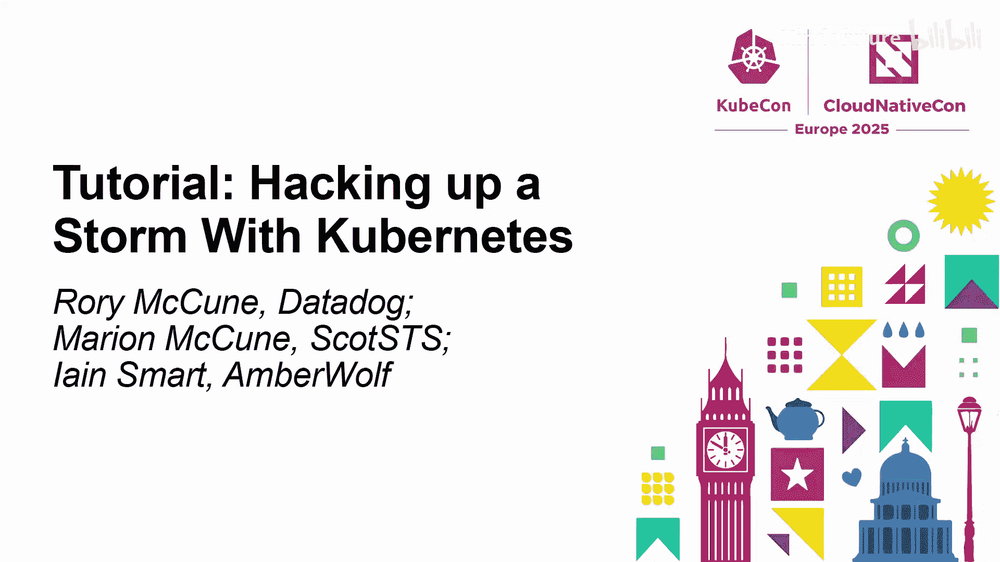

Afternoon， everyone。And welcome along to this afternoon's tutorial。

 very glad to see you all decided to come to tutorial and not go outside in the sun and get an ice cream and a cold drink。

😊，What we want to do this afternoon is we want to teach a bit about Kubernetes security through a hacking scenario。

My goal for the tutorial today is I hope that everyone in the room leaves with at least one new thing they didn't know about Kubernetes security。

 That's my personal goal。 So if we can get to that point， it will have been a success for me anyway。

嗯。About as you might have noticed on the schedule there were three of us unfortunately life sometimes happens and not everyone can make it so I am Rory and I will be running the tutorial today I've been doing container security now for around nine years and I do a number of things like help out with Kubernetes SG security and also helped maintain the CIS benchmarks for Docker and Kubernetes so if you've ever had a bad C CIS compliance finding and you're wondering who to blame。

I'm the guy。U。Also， if youre this tutorial sparks an interest in Kubernetes security in you。

 then Six security is a great place to learn more。 We have meetings every other week。

 I think the booth will probably be shutting fairly soon， but we are around on Slack as well。

 And my partners in crime， who unfortunately cannot't make it are Ian and Marion。😊，So。Let's start。

 What are we gonna do。 We are going to follow and attack path in Kubernetes。

 So we're going to take one attack， and we're gonna walk through several steps of bypassing and avoiding Kubernetes security controls to show us how someone might be able to escalate their privileges in a way that perhaps we didn't expect they would be able to do。

And we're going to explain the concepts at each step。

 So we want to walk through and actually explain what we're doing and why this works and also to an extent why it might be surprising to people that this is how it all works and hangs together。

Logistics phones on sale。 if anyone to phone ringers on。AndThese days， I don't know if you do。

 but best not to。 you can work in practice。 So we're definitely gonna have the idea is everyone who wants to can follow along on local machines。

 if you don't want to do that or you at any point kind get lost with it。 Do not worry。

 we will be going through every single step up on screen。

 So you'll be able to get everything of what's going on just by following along。

 If you're not feeling like hands on keyboard this afternoon。

 So probably have a lot of time for questions。 And also it's kind of tricky with a bigger room。

 But we will have contact links at the end。 So you want to know more。

 there's a question that I didn't get around to feel free to drop me an email or a D M and some social messaging platform as we go。

So technical requirements。😡，Hopefully， if you looked in the schedule。

 you will have noticed that the idea is all you should need for this tutorial to work is Docker or something else that runs containers and kind。

 So kind being a way of starting Kubernetes clusters。 If you haven't got kind already。

 It's pretty easy to get。 just Google kind Kubernetes and follow their quick start。

 It's a single binary download。 So it's not super bad。 If you haven't come across kind before。

 It's amazingly useful for spinning up test clusters because it works anywhere that you have Docker installed and you don't need any other prerequisites。

And then the idea is we're to clone a workshop repository from Github。 The QR code。

 which is there on every single slide， will lead you to this repository。

 And then this is the repository URL。And if you go to that， if you run that or click the Q R code。

 which will take you the repository， that will get us the code。No。I can do。Is we do。

 what we go in here。When you get the code down， you should see a number of directories。

 the main one here is there's a directory called commands and a file called tutorial commands。

 And that has every single command we're gonna to type。

 So it's well worth having that file open because you can copy paste things out of it。

 I will be copy pasting at various points in this because I'm not going to try typing all this stuff live because it will go wrong。

So there's also all of the slides are there as a PDF and all the other files we're going to use。

 so let me go back to this thing just in case people are typing away or if you want to get the QR code that's the other way of doing it。

😡，And that's the first steps。 I'm gonna get a couple of seconds on this slide just so people can get that。

 And that will have all the files we need。 And it's gonna to have all the manifests we're going run。

 There are some manifests which we're going to deploy into a kind cluster。 Feel free to look at them。

 I promise there's nothing deliberately malicious in there。 They are all the standard manifest。

 There's nothing really clever going on。So。People got that you can always take a picture of of the screen as we keep going on slide。

 just know that that's the QR code to where we need to go。So setting the scene。

 what do we want to do today。What we're gonna do is throughout the tutorial。

 we are going to play the part of a developer who is writing some software which is going run in a Kubernetes cluster。

 It's a Friday afternoon。 and they want to get this working。

 this feature working for this sprint by the end of the afternoon because they want to go away the weekend。

 Mark that is done and get out the way。 And unfortunately。

 they're going to encounter some problems and we'll need to get creative。

 And it's the act of getting creative in which we're going to find some hopefully interesting Kubernetes security facts that we're gonna work around。

😊，So。😡，Set up a cane cluster， setting up cane clusters is super simple。

All you need to do is first go into the directory。That we from the， that's just the Github the。

Repoitory that we cloned， just go to the directory there， and then we run this command here。

 which just starts a cane cluster。

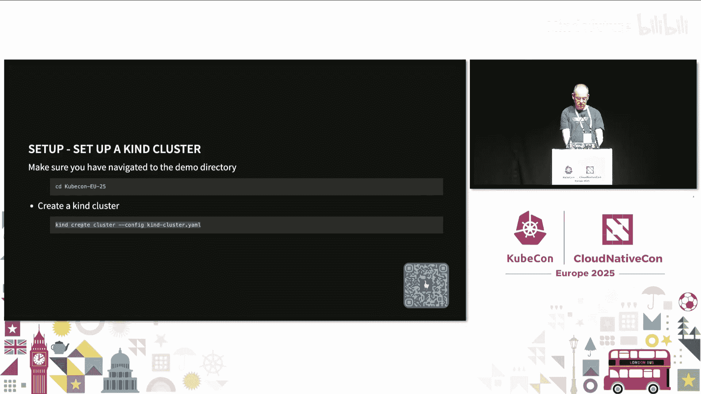

So I'm going to do that。Where is my。So you should be able to paste that in as long as you're in the directory from the repository。

 It will happily create a kind cluster。 I'm going go a little bit slow at this one because I'm conscious。

 I think the conference Wifi can handle this。 I was in another tutorial earlier on this week。

 and the conference Wifi seemed to be able to handle kind cluster creation。

 I've already got the node image down。 it was pretty fast for me。😊。

But it should look a bit like that。So we're just running the command to create a claim cluster and we're passing a custom config。

 There's nothing super major in the custom config， but it'll give us some stuff to go with。Okay。

Is anyone got the can cluster working or is it heading in the right direction thumbs up， Yeah。

 we've got a couple ball working， okay。That gives us the environment that we're going to work on。

And everything we do will be in the kind cluster， so we shouldn't be going anywhere else on your machines other than the kind cluster。

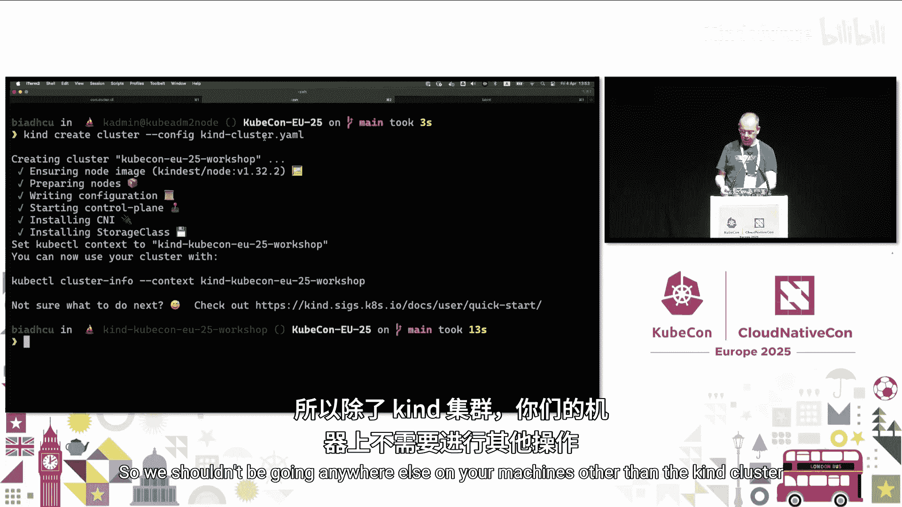

。So with done。

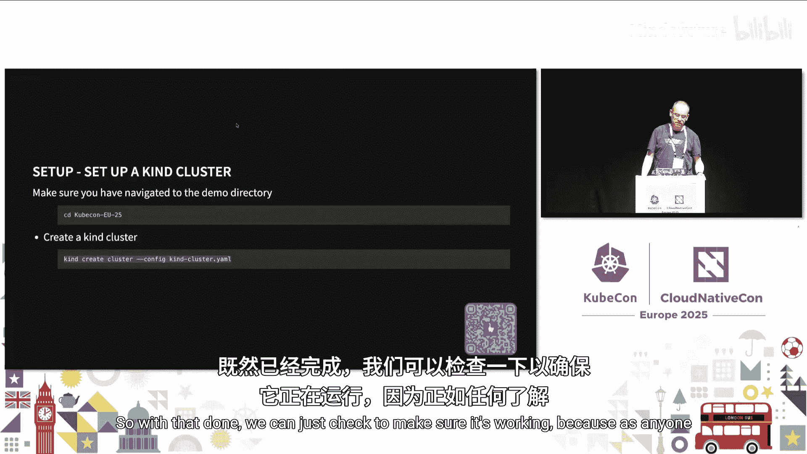

We can just check to make sure it's working because as anyone knows who does a lot of Kubernetes stuff。

 it's pretty easy to end up pointing at the wrong cluster。So I'll just check and yeah。

 I'm running against the local cluster because we can see our nice 1，2，7，7，1，2，7，0，01 address。

 so I'm definitely heading a nice local kind cluster。

So if you run up the king cluster and also if you're running something like Starship。

 you'll see that we've got it in our prompt as well。

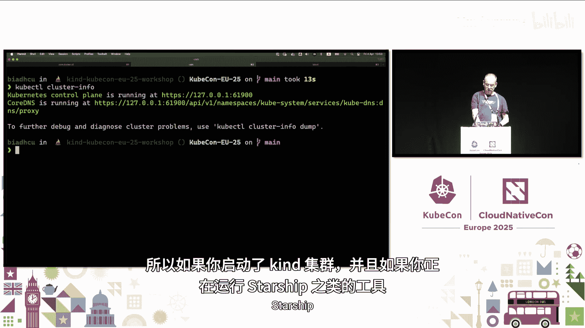

And then what we're going to do is we're going to apply in everything in the manifest directory。

 so this is all the manifests we're going to need for the work tutorial。

 all of the different pods and namespaces and things like that。😡。

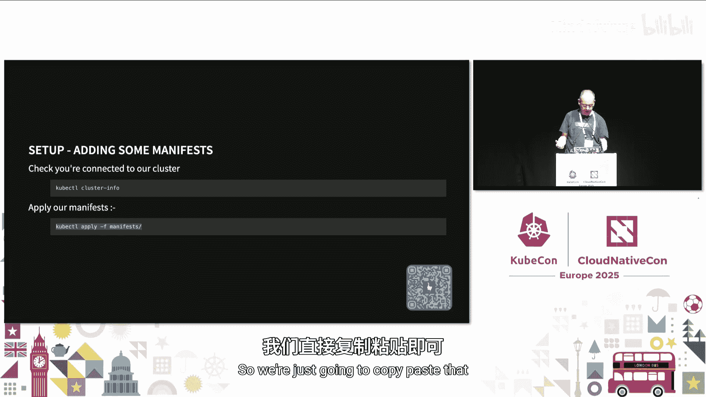

So we're just going to copy paste that。And then just put that in。

 So let's just apply all the manifests in the directory called manifests。

And you should see something like that when you run it。You will get a warning。

Which might be familiar to some people。 Don't worry， we will talk about that warning later on。

 But that is part of the scenario that's intended。 Don't worry that's not broken。

 Things's not gone horribly wrong。 It is actually what we wanted to do。So。If I do those。

 keep it I get PO。Things should hopefully be thinking about it。てて。How was it。Okay。

 things are starting to image。But one on image pull back off， hopefully that's going to fix itself。

And if the update log one isn't working， don't worry we're going to get to that one and why it's not working。

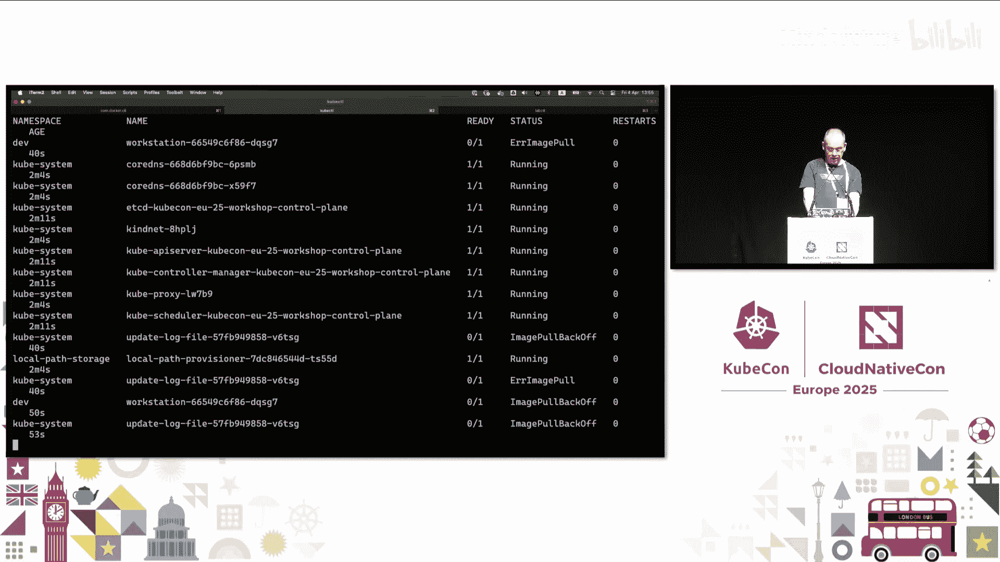

Okay。So what I gonna do is before I do that slide， I'm gonna talk a little bit about what we did there。

 And some of the things we actually did behind the scenes。

 And then we'll come back we'll make sure people's clusters are working because if they're going funny。

 we're gonna give a little bit of time because I think it might be fun on the conference Wifi。

 So how did that work。😊，We have just spun of a cluster and we've applied manifests from a security standpoint。

 What did we do？ Well， we went through three gates with every manifest we created there。 First。

 we had to authenticate the cluster。 So we had to actually make sure that we can valid credentials。

 We then had to go through authorization。 Are we allowed to do the thing we are trying to do。

 So create things， update manifest， create namespaces。

 And then we also had to pass admission control and admission control is a very important step。

 because it handles additional policy requirements。 So even if you go authorization。

 we can have admission control in place to say， actually， can this person do this specific operation。

 is this manifest valid， I it badly formed， does it have all the things it needs to have and is it trying to do something it shouldn't。

 So admission controls a third very important security gate。Authentication。

 usually if you're working on production clusters， I would expect that you are using OIDC so you're using your cloud providers authentication service and you're authenticating to a cluster however。

 in Kubernetes there are always other ways of authenticating to a cluster not just the OIDC setup service account tokens are used by workloads to authenticate the API server but developers can also use them and I've seen clusters quite a few times where actually they're used for human users as well that has got some drawbacks。

And also， some system components use client certificates for authentication。

 users can also use client certificates， but I didn't actually write this slide。

 but I was meant to talk to it。 It comes with problems hopefully no one is using client certificates for user authentication in their clusters because it's not really a very good idea for production mainly because you can't revoke user credentials that are issued that way。

 There is no certificate revocation in Kubernetes。 And if you ever use client certificates you find you can't actually get rid of the access you've given people if that person moves team or leaves the organization or the certificate follow gets stolen。

 So typically， it should be O IDC， but there are other options available。Orthorization。Kubernetes。

 typically， you might not think a lot about authorization and how it works。

 But Kubernetes actually has a flexible authorization model with lots of different models。

 sort of different ways of doing it possible。 This is a standard。

API server flag from a Kubernetes API server in Kub ADDM and there's two modes defined node is a specialist authorization model which is only applicable to nodes。

 so when the node itself authorizes itself to the API server it uses that plug and R backAC if you're using cloud Kubernetes you're probably going to have a third one in there not that you can look at it because you can't look at the API server flags。

 but the cloud providers typically have their own authorization model there as well。😡。

You can always look at what rights you have from an R back perspective。 These are very。

 very useful commands。 We'll be using these later on。

 H cut off Can I list gives you a list of all the permissions you have in a cluster as far as R back knows about them。

 And if you ever want to know exactly what's going on， you can always do minus V 9。

 and that will tell you everything about all the different areas of permissions that you have got。

 And we' were running some of those commands later on。嗯。

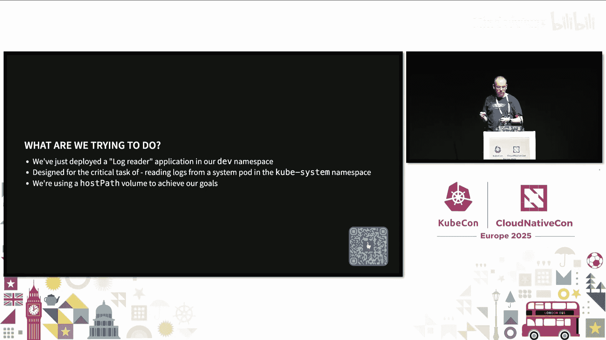

Right， so let's go back and let's have a quick look and see。What's happening。So if I just do。Oh。

 my workstation pod is not having a good day。 Is anyone's workstation pod also facing that or is it just me。

And image pull back off。 that is。That's unfortunate。Ca we need that one。

 One of them were meant to be seeing the update log file。Yeah， I'm logged into Docker。

 I was hoping it wasn't going to do that to me。Because logged in shouldn't complain， okay。

Always going to be fun， so。Because I'm a little bit paranoid。All。

And I was worried about the fact that it may decide to be annoying。I have a backup plan。

There's always of a backup plan for live demos， especially tutorials。

Kind of surprise Docker Hubbs complaining about that because I did actually ask them about rate limits this week。

 and they said， we're not putting the new rate limits in place this week。 and therefore。

 it shouldn't be a problem。But maybe they have to change the mind and put in real wordss。

I also haven't pulled that image very much this week。So。

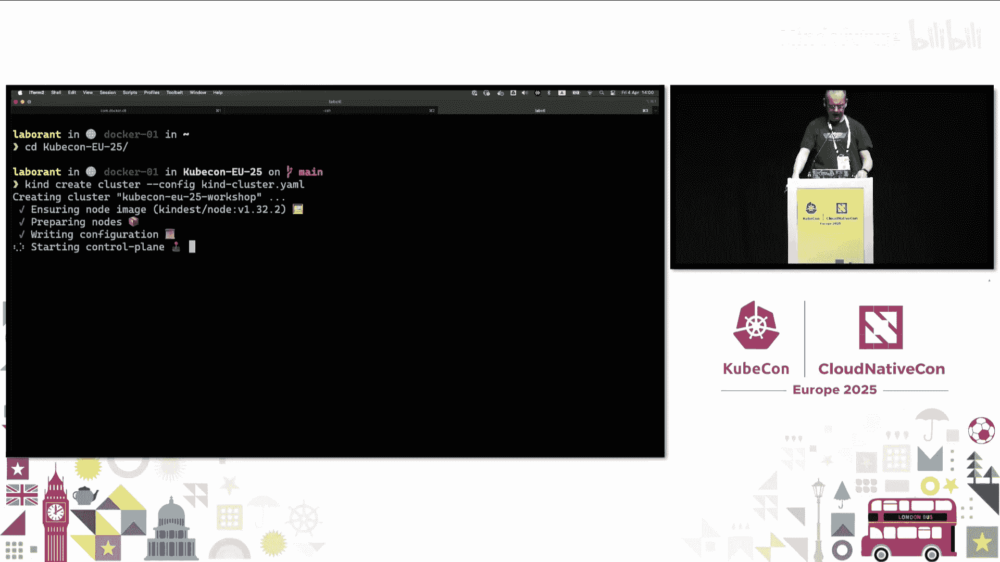

O。

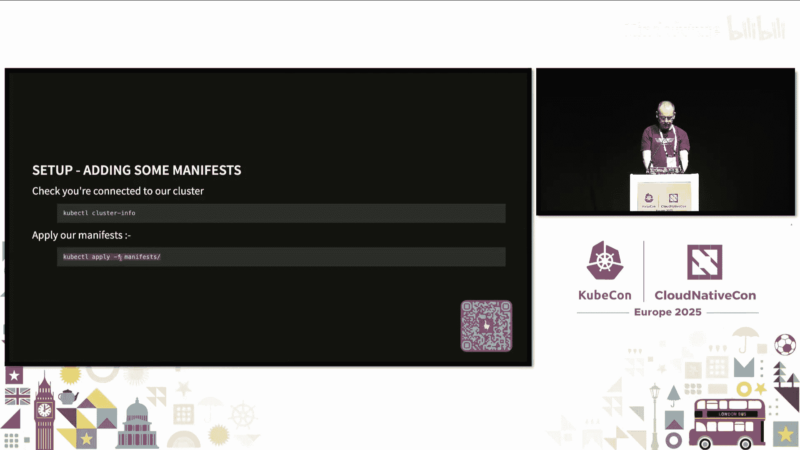

Okay。Did it work for anybody or did should have blocked it worked for some people， Okay。

 so we obviously hit some kind of fun rate limit。😡，Image's not been fast enough， which is surprising。

As I was doing the。But let's just。What I'm doing here actually just to explain what I'm doing。

 I promise this is not a paid advert in any way shape or form。

 this is just a service I use which I happen to like I'm currently running in a ephemeral environment that spun up in a place called Iie Mus Labs。

😡，It's really， really， really fun because they've got a nice CI and you can just run up ephemeral labs anytime you want with any kind configuration。

 So this is just a lab I've got with all of my container tools set up ready to go。 And I thought。

 just on the off chance， something goes wrong with a conference Wifi。 Let's have this available。

 As you can see， it looks exactly the same as if you were running。😊，Yeah。

 and this should be coming from a separate environment。 So I shouldn't。Have any problems？So。

Let's check and see if this one goes better than the other one did。嗯。Integrating。

What you should see if it's working is you should see all the other ones working apart from the update log file。

😡，Okay。Is going to complain。Oh no update look， sorry， the other one， where is it？Oh。

 wait won't be there。 okay， we got fun with things deciding to be annoying。 That's fine。

So what we're going to do once you've got up running。Is we're going run this command here。

 And this is going into our， if everyone's got problems they thinking about it the other thing you do is Ted up to your phone and that you get around Doc or hub being annoying。

Oops。唉。We're going to exec into our workstationations， here we're going to become the developer。😡。

When it's。Yeah， it's happy。 Okay， so what you were going to do here is we're exactecing into one of the workloads in the cluster。

 right So we're saying Qcad exec minus is D and， which is our developer workspace。

 and we're going to go to our workstation and just have a shell。

 So now we are the developer now we have got the rights that our developers got。

 And that's the start of the setup。 Hopefully that is now working for at least some people and I'll show up here anyway so。

😊。

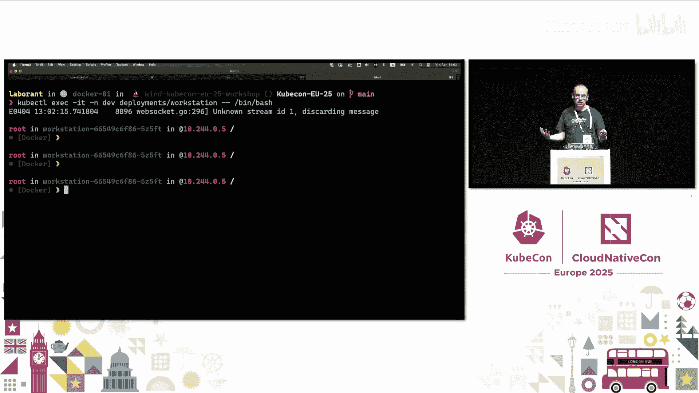

What are we trying to do， What's the actual goal of our developer。 right？

 We now become our developer。 We set up our test environment。 We set up our cluster。

 Our developer is just trying to deploy a log reader application。 So fairly simple application。

 It's designed for the critical task of reading logs from a pod in the cubeubbe system namespace。

 So it's a very simple thing it's trying to do。 and it's using a hostpath volume。

 So hostpath volume is just mounting a volume from the underlying node and then reading files of it。

 This is a fairly simple task。 It looks a bit like this。 We have got our pod inside cubeubbe system。

 which is updating a log file。 We then want to read the log file in our dev namespace。

RightAnd that's our task。 If we can get that done by the end of Friday。

 we get to go and have drinks in the bar。

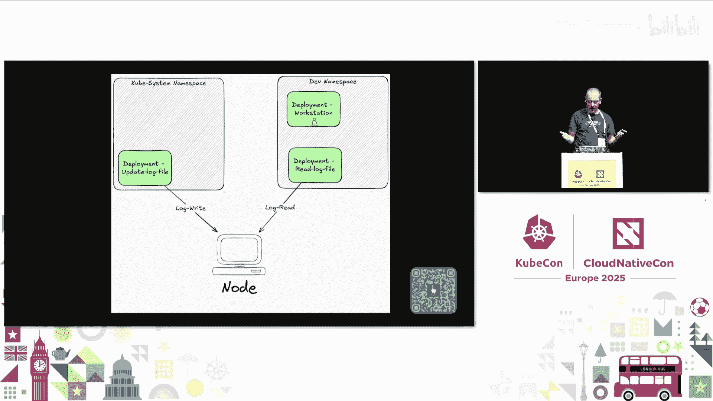

So I see what说。In our dev， so this is make sure you're inside the workstation pod when you're doing this。

We have got one pod running。 We don't have our log file reader， though。 It's not there。

 That's problem。

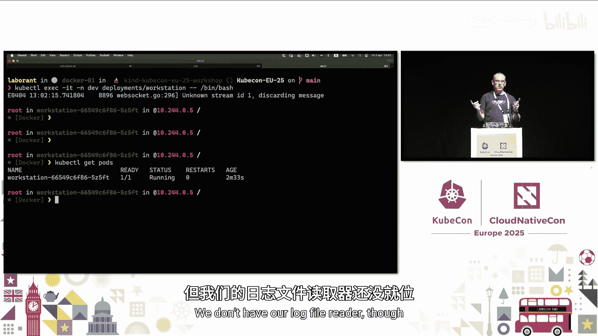

This one however is expected， this isn't Doal being an I。

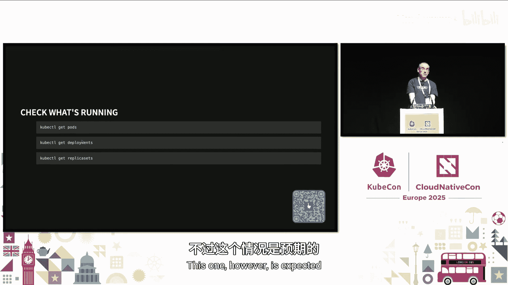

So let's look at deployments。😡，Okay， we have got a read log file deployment。

 but it has 0 of one ready。 Something has gone wrong。 It's not working。

And we can look at our replica sets as well。And。Yeah， we've got one desired0 currently ready。 Okay。

 something's gone wrong our。Deployment， which is our thing we have to get done today， is not working。

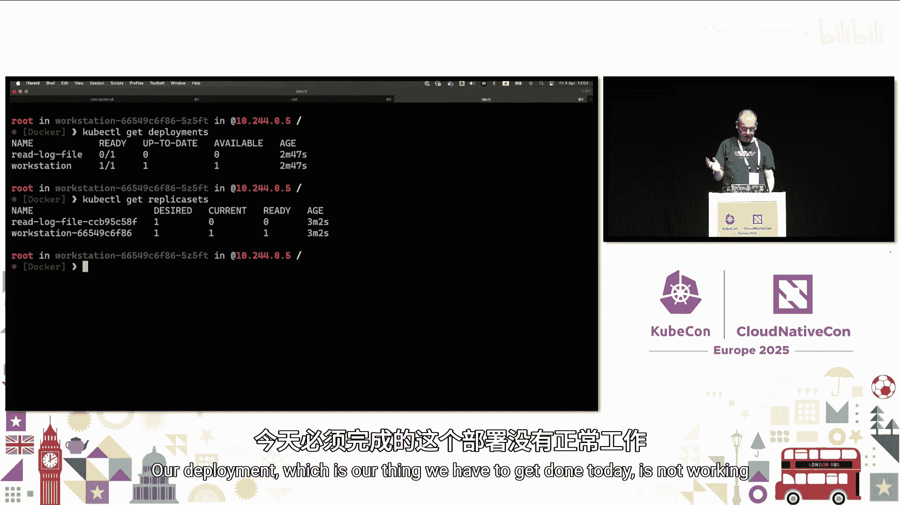

Let's see why， so there's our problem。😡，当然。Can't get created。 Something is going wrong。

 It can't read the logs。Let's find out what's gone wrong。 Why is this broken。Well。

 we have a feeling it's going to be admission control。Admission control is getting our way。

It's because it's trying to use host resources and our cluster administrator。

 like hopefully every production cluster administrator out there。

 doesn't want just anyone creating pods that can access node resources because that's dangerous from a security standpoint。

It can lead to cluster compromise。In modern clusters。

 there's lots of different options you've got for blocking this kind of thing。

 You could use port security admission， which is what we're gonna to look at today。

 You could use external admission controllers So projects like Caverno and Opa and Kub warden who have all you've probably seen if you've been around the booths earlier on at the conference or you can use validating admission policy at a relatively new feature if you're on Kubernetes 1。

30 or higher that's G now so you can have that as an option internally there's lots of ways to stop this but the general idea is there are dangerous things you can do with containers and we don't want everyone doing them and obviously our cluster administrator here said hey。

 we don't want anyone deploying stuff that can do these things。

Let's actually confirm that's what the problem is though。

 because we're just thinking that's the problem right now。 Let's run a command to actually check it。

So， we're going to run。Yeah， that's the problem。 I will say their message。

 at least is nice and easy to understand。 It's not like super bad。 Basically， what it's saying is。

 hey， you're trying to create something which violates the baseline pod security standard。

 We're not gonna let you do that。 So the baseline pod security standard is the basic policy you can put in place with pod security admission。

 It blocks all the really obvious privilege escalation attacks。

 So the idea when we design P S S was we said we want to to not let people do things that would instantly lead to privilege escalation。

 So we block them。So it's not going to do it。Okay。That's not great for our abilities to get out and have a drink。

So how are we going to fix this， Well， we could work in a different namespace。 That's one option。

 We know that this is blocking our dev namespace。 So if we had permissions。

 maybe we can deploy somewhere else， and that will fix the problem。

We could ask for the restrictions on the dev name space to be lifted， unfortunately。

We have got a bureaucratic process in place， as it turns out it's going to take weeks to actually get that change made so we can't do that or we could see if we can find a way to make it work。

 maybe there's some way of getting additional access that let us get get this done and get it knocked off the checklist。

That's what we're going to do。Let's see if we can do that。

So before I get into the stuff where we do things that people probably shouldn't inside clusters。

 I am I always do this。 we always do is when we do these kind of tutorials and workshops。

 What we're showing you here is technically possible。

 Please don't do anything like this on clusters that you do not have explicit permission to do on So don't go like go back to your production clusters and think I can do the sort of things on production Please don't do that because it's not a good idea and it can legitimately get you in trouble with either your company's security team or in extreme places。

 legal law enforcement， So don't do any illegal No crimes。Right。

 let's look and see what permissions we've got。 right， What can we do here。

 Let's go see what we can do。 So this is where we're going to use that command we talked about before off Can list。

 It's a very， very useful command。

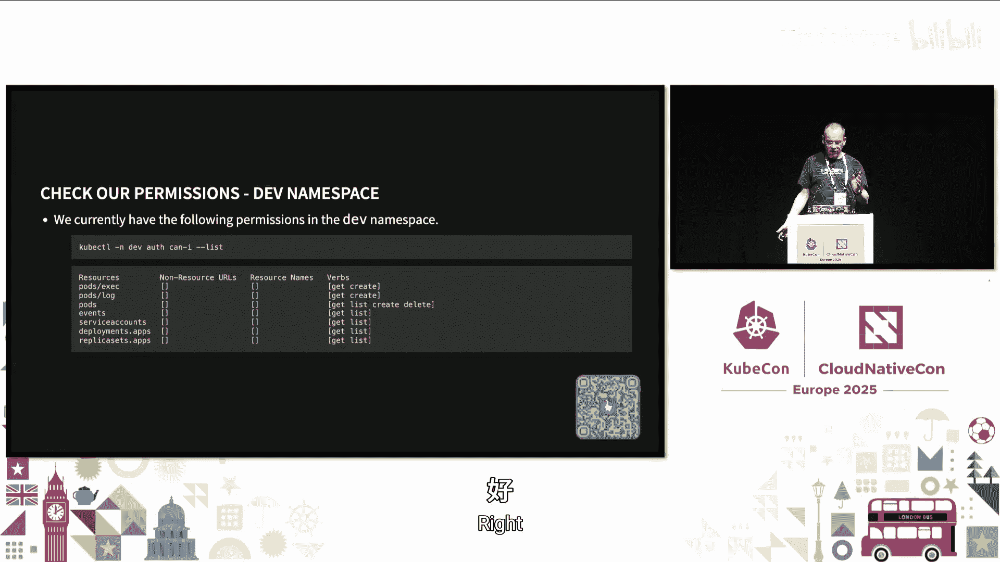

So let's quickly look and。Make that a little bit smaller。So hopefully it will stay on the screen。

There we go。We have got some permissions in the developer namespace。 We can do things to。Os。

And we can do things to。Po logs， we can do things to pods。

 We can do things namespaces and service accounts and deployments。 So we've got some rights。

 But these are really only read only rights。 The only thing we really do here is we can create pods。

 which is kind of nice。😊。

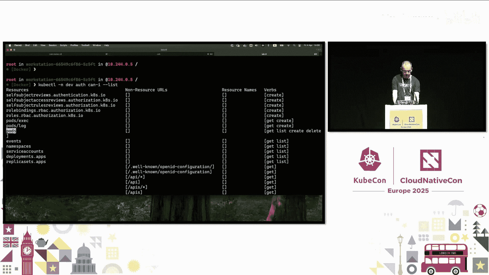

嗯。So。Let's also just check because one of the ideas we had why was maybe we can just deploy in a different namespace and that may one thing you think of so the cubeB system namespace is almost never restricted。

 it just doesn't get restricted because the pods and cubeB system needs to be able to do privileged things。

😡。

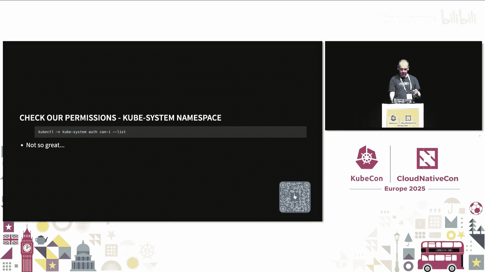

So let's just check， see there， see what's going on there。Here， unfortunately， it's sad faceace time。

 We have very little permissions。 Those of you don't recognize them are the bo standard permissions that you get through system authenticated。

 So every authenticated user in the cluster has those rights。

 But those are absolutely nothing useful。 All that basically says is I can check my own permissions。

 And I can get certain nonresourcebased paths。 So things like I can tell what version the cluster as software is running。

 And I can check that things are healthy。 None of this is very useful to us as attackers or as people who want to get something done that they maybe shouldn't be able to。

Okay。

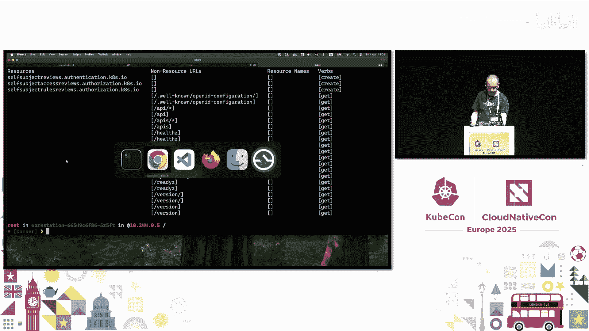

So。We can't get any good rights， this isn't going very well for us。Whatt。There was something。We did。

 we weren't able to get service accounts。 That was an option we had。

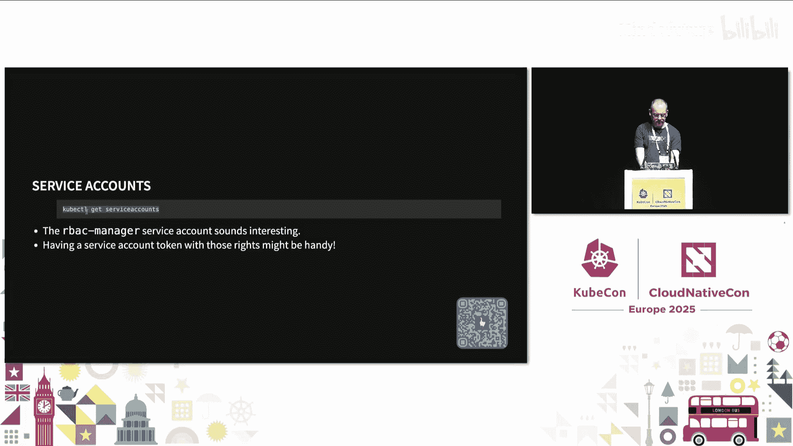

Let's have a quick look and see what service accounts we got。

So service accounts are used to give permissions to workloads。😡，And we've got a couple ones there。

 We have got our developer service account。 That's the one we're currently using。

And then we've got one called our back manager。😡，that looks interesting。

 Our back manager sounds like the kind of thing that might be useful to us because it sounds like it's something that might have permissions。

 So maybe we could use that somehow。

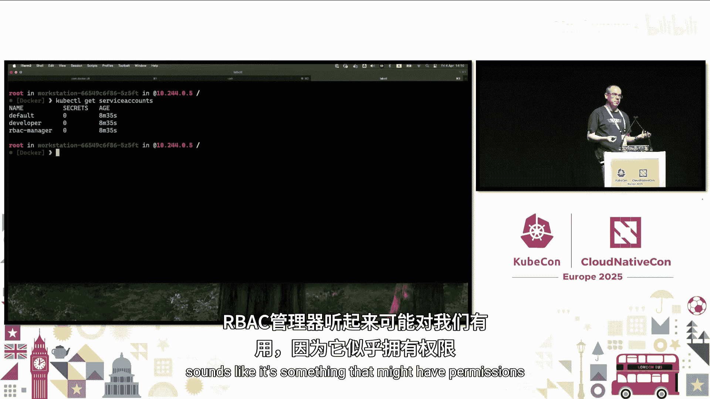

It might have rights to service as account tokens with those rights。 Let's see what we can do。

So service account tokens are kind of interesting。 There's three main ways to get one。

You can either run the command Cuub cutttle create token。

 which will let you create service account tokens。 We don't have the rights for that one。

You can create a secret with the right kind of type， and it will create a service account token。

 But you'll notice we didn't have create secret。 So that's no use to us either。 The third one。

 which is very useful to know， because it's the sort of thing that you will almost always have is we can create pods right。

 because obviously， we can create workloads in the in this namespace。 We can create pods。

We only have fruititions for that one of those three。

Any pod in a namespace can use any service account in the same namespace。

 So anytime you're creating a pod， you can say what service account you want to use。

 and because that service account is in this namespace， you can use that service account。Okay。

 that sounds useful。 We have a route to get the permissions of our back manager。

 which sounds like is' at least worth exploring。 It might be useful。 So， let's create a pod。😊，Now。

 here is one of those places where if you are doing。

 if you have a following along and you're doing the command of the command file。

 I thoroughly recommend copy pasting。 Don't try and write this yourself。

I'm not going to try and read this myself writing a Yamel on a Friday afternoon。

 we can get the indentation right， does not sound like a good day。

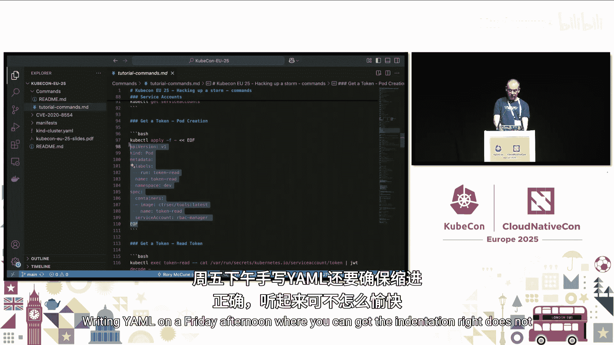

So what's？Do that。And itll create a new pod。 So all weve done there， fairly simple pod manifest。

 We basically just said， hey， creates a new pod and mount that our back manager service account token。

 So that then gives us a new pod running。 And one of the other rights we had was we had pod exec。

 So I can execute commands inside that pod。 right， So we have a new pod， It has the token。

 we can get access to the token。 hopefully。😊。

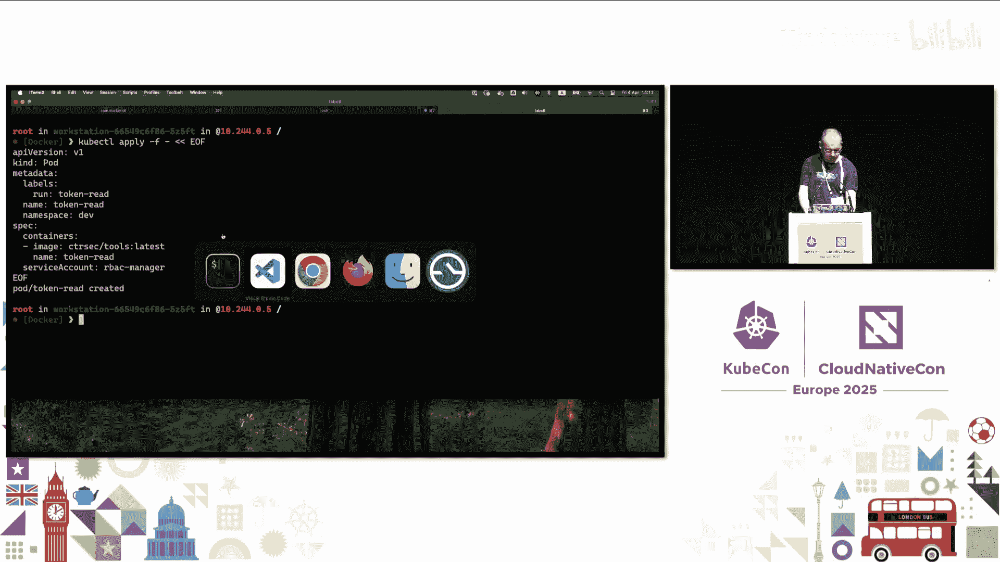

O。Cool， so that sounds up we're making progress。 Let's just check and make sure that pod came up。

 It should have done。

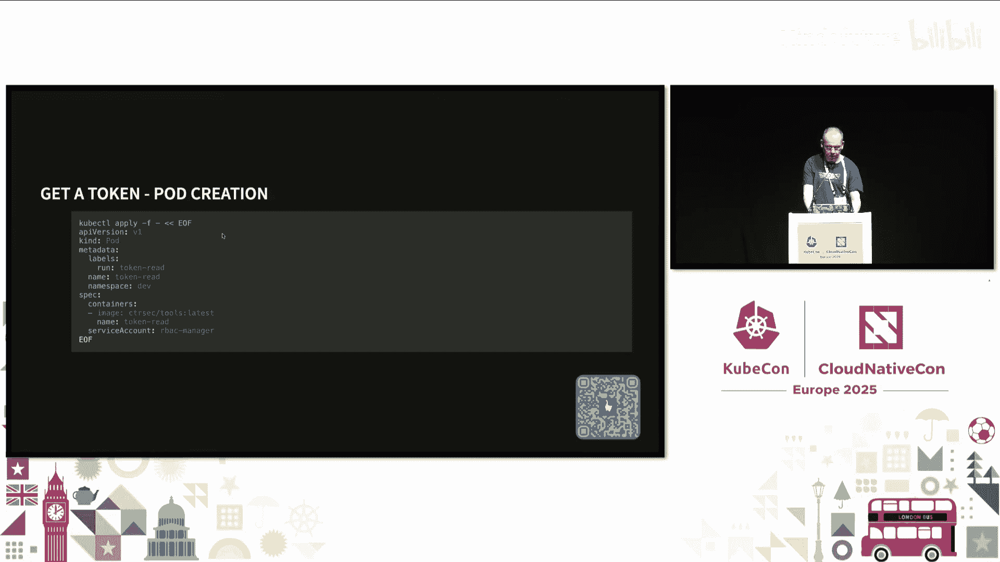

If you manage to get the first one working， that one should work as well because it's the same image。

😡。

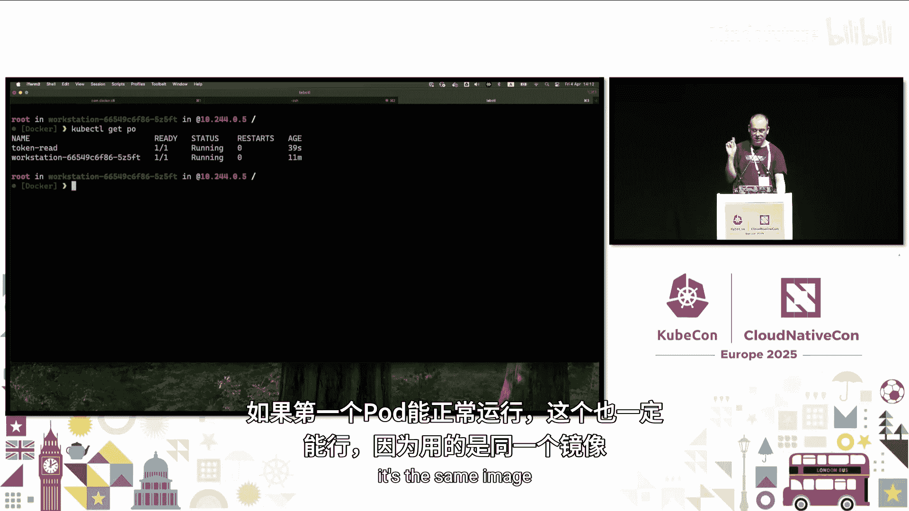

So what we can do here， we can do something like this。C cutttle Exec token read。

 which is the name of our pod。 And we're gonna exact the file cat。 that long string。

 That is the location of the service account token in a pod。 It's almost always in the same location。

 I think you theoretically can change it， but it's almost always there。

 And we're gonna pipe it to a JWTT code just to see what it looks like。

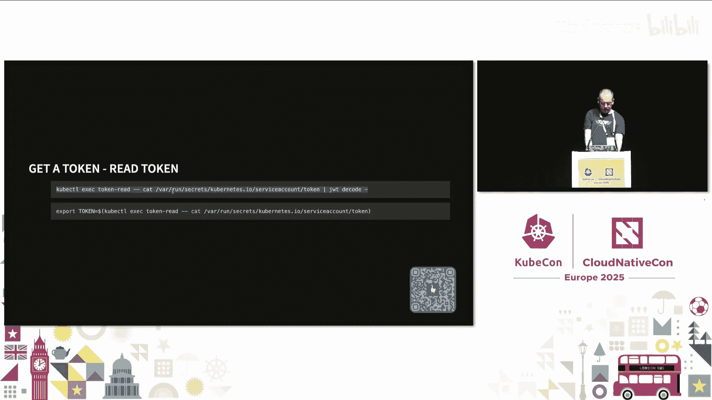

Let's do that。And what you get back is some nice JWT。Dekoded。Serverice account token it tells us。

We have a token for Rrb manager。 Great。 That's a valid credential for the Rrb manager service account。

 It can do anything the Rrb manager service account can do。 That sounds promising。

 One little bit trivia that you may may not know。 if you've ever looked a JWT token。

 and it looks like it's base 64， And then you try and decocode it with a base 64 decoder。

 and it doesn't work properly， The reason is it's not。 it's URL safe base 64。

 which doesn't decode with a base 64 decoder。 You have to use a JWT decoder。😊。

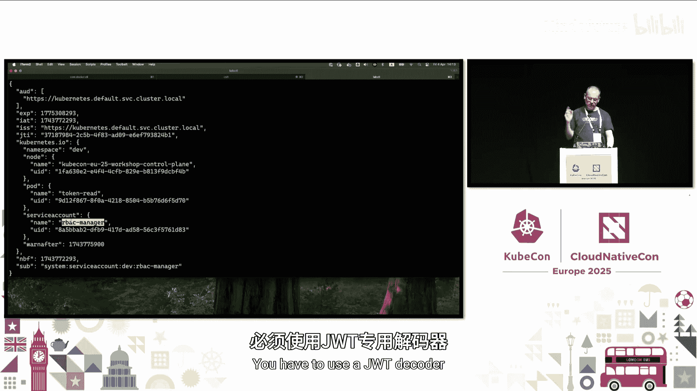

And thatre the hard way after many times getting it wrong。

 So what we're going to do now is we're going to export and create a new environment variable。

 We just has that token in it。 right， So we're just give it's just gonna easier than copy pasting a token into our shell every single time when we do the next couple of commands。

Oh， cool。Minus I on the basics of4 Dakota。Okay， minus I or basically word as well。

 That's useful to know。

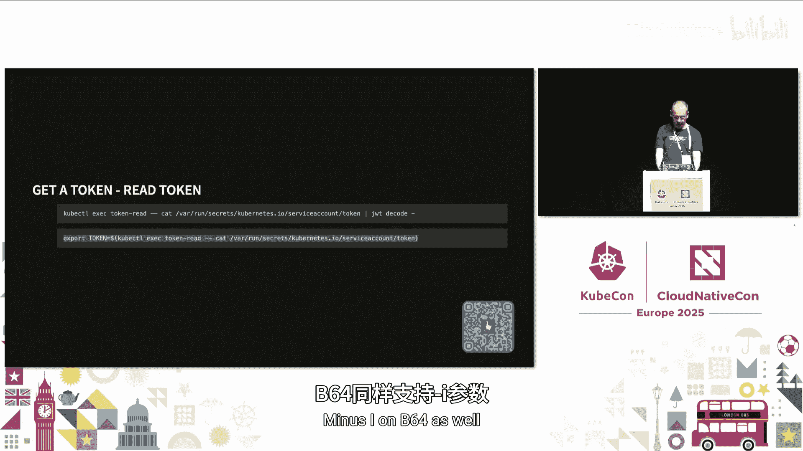

So we're just going to do this。 We're going to export a token。

 Let's just second environment variable because we want to use that token in various other commands。

 So we just have to set that。And that just gives us that environment variable set up。

 So now we can see what we've got， right， We've got Raback manager。 But what， what can they do。

 Is this going to solve our problem， Is it gonna get us finished on time。

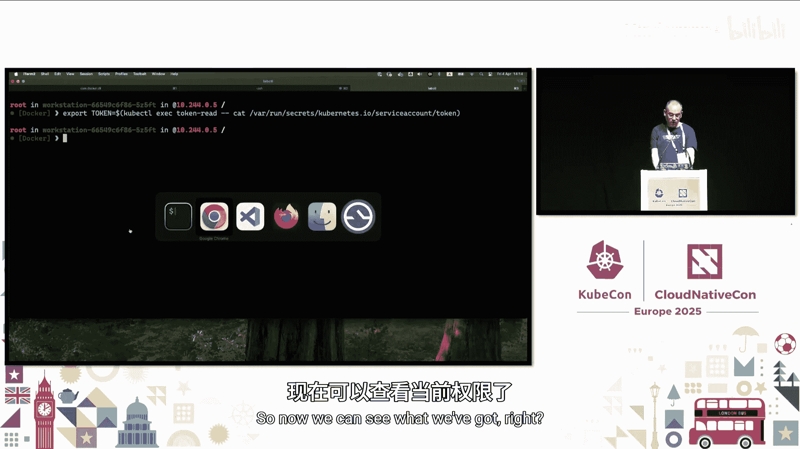

Let's find out what we do。So we do this。

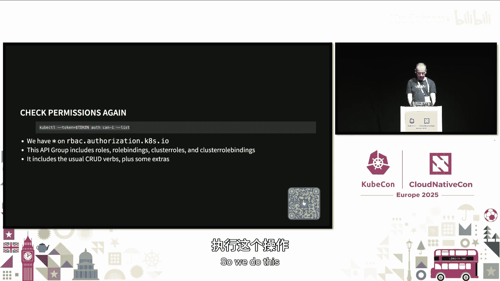

And。That。So we have got a lot。 These are all the boring rights。

 but there is one interesting line right at the top。RBAC manager。

 kind of unsurprisingly based on the name， has got rights to everything in the RBAC area of Kubernetes API。

 and it has got star star， which is great because it means any object inside the RBAC schema we have got rights to and we've got rights to do all verbs。

😡。

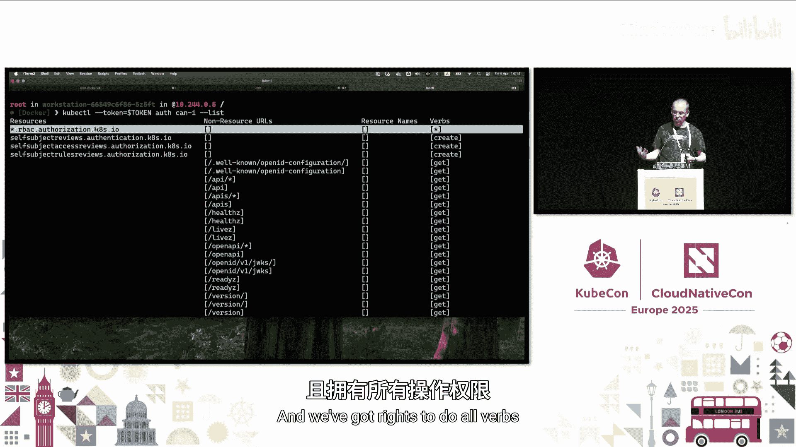

So this schema controls anything， things like cluster roll bindings， role bindings and。😡。

At this time， we've only actually got it in one namespace。

 but it lets it lets us do role bindings and roles， but not cluster roll bindings and cluster roles。

It includes the usual crud verbs。 So when we say star， that means any verb。

And one of the things that you may not know， this may be the first time people find something they didn't know about Kubernetes security is there are other verbs in Kubernetes not just create。

 read， update， delete。 There are other ones。😡，Specifically， there is an arb verb called Escalate。

Escalally only applies on certain objects in Kubernetes。But it is a verb that is valid。

 and you can specify it。 If someone gets star rights to our back， it includes the escalate verb。

 The escalate verb is amazingly useful because usually， if I try to escalate my permissions。

 So Ive got rights to create roles in a cluster。 and I try and create a role that has permissions that I don't currently have。

Kuberes says no go away。 You're not allowed to do that。 You're attempting privilege escalation。

 I'm not gonna to let you do it， unless。You have the escalate verb。 If you have the escalate verb。

 it says， of course， you have the escalate verb， you're allowed to privilege escalate。

 That's what this verb is meant for。 So this is basically the privilege escalation verb。

 And because we were granted star。 So whoever created the R back manager。

 maybe they just meant you to be able to create roles and roll bindings。

 But they didn't know the fact that star includes escalate。 So we can escalate our privileges。

 That sounds like fun because that's what we're trying to do today， get more rights。😊，So。

Because we've got escalate。We can basically run a command like this。

 And what we're doing here is we're just using Cu kttle and we are saying， okay。

 we're going to use our our back manager token， which we says an environment variable。

 create us a new role which has got star rights on the resource Star star and we'll call it NS admin。

 So this is a role。 remember， only write in one namespace， not a cluster role。

 which we write in all namespaces。

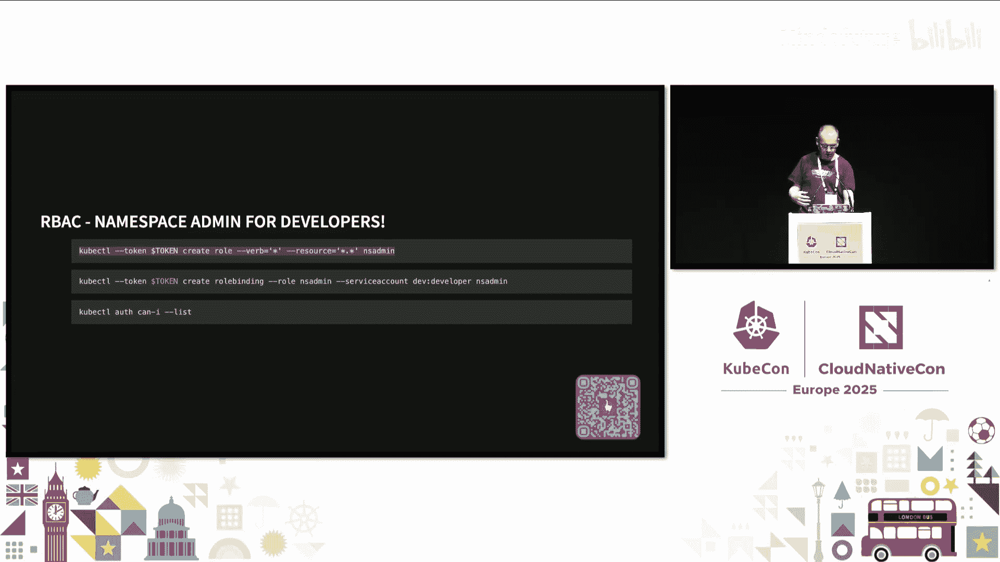

So。We'll create that role。

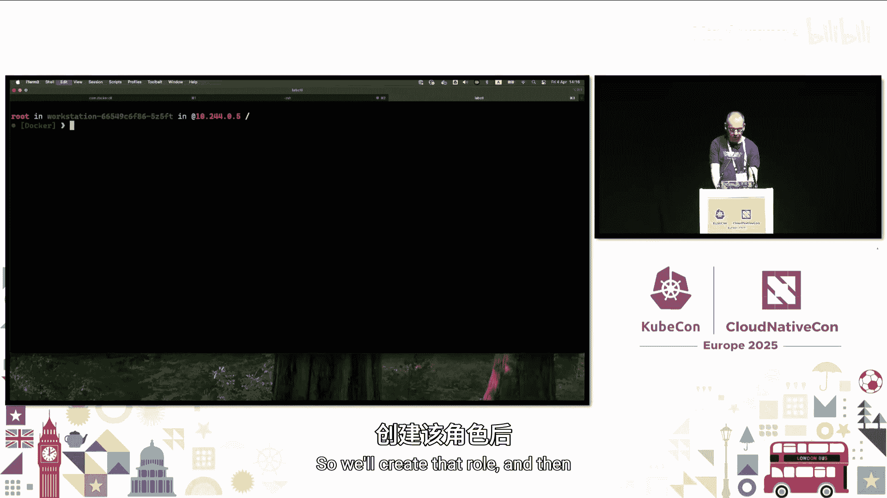

And then。We will give a role binding and we'll bind it to our developer user right because we bind it to our developer user。

 That's is going to make it easier for us because then we got the permissions。

 So all we're doing here is we're saying， create a new rolebin of role of N S admin and the service account we're binding it to is our developer service account。

 So that's going to give N S admin rights to our developer。

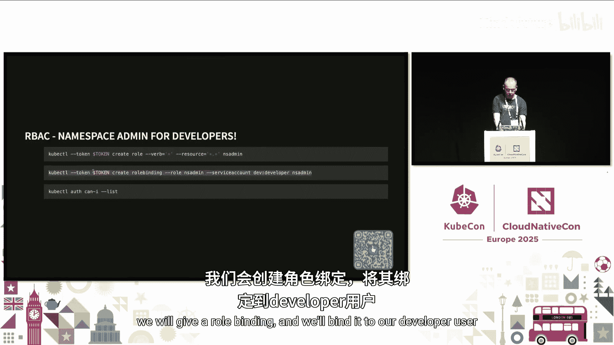

And itll say yes。 Now， I said those two commands with the escalate verb。

 if you just had to create read update delete， that would have failed。 It would have， no。

 that's not gonna let you do that， even though you got right to create roles。

 you can't create that role because it's more permissions than the Aba manager account does。

 But because we have escalate， it said， of course， you can do that。

And then we can check our permissions again。嗯。It looks the same apart from what you always like to see when you're trying to escalate your rights。

 lots of stars。So we've got stars across the board now inside our namespace。

 This means that we've got all the rights to do anything to any object in this namespace。

 That sounds great。 That sounds like exactly what we wanted to get the job done。

 because now we have more permissions。 Maybe we can make the annoying warning go away。😊。

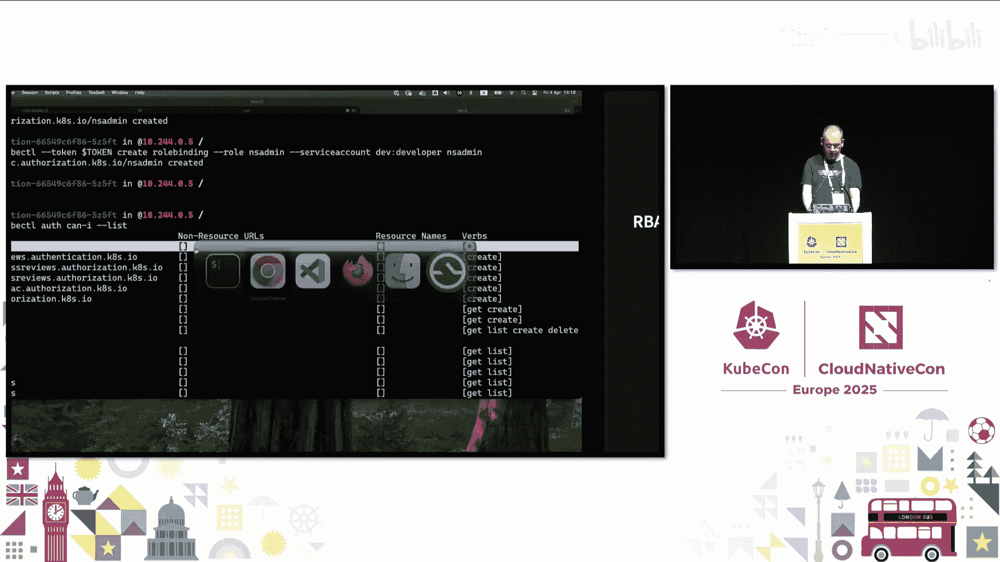

So our next object， we've now got namespace A essentially。😡。

And this is where you come across another thing which， again。

 this might be one of the thing you learn in this tutorial that's new to you。

Our back rights objects are either global or they're namespaced right that probably know that part right your object either exists in a namespace or is a global object across the cluster。

😡，We are only rights of one namespace。 We can do what want inside our namespace。

 but we can't do anything globally。 right， If I try and do something in the cube system namespace。

 it'll say， nope， you don't have any rights in this namespace go away。Namespace objects themselves。

 though。 This is where it gets a bit funny because I'm going to overuse the word namespace。

 Namespace objects are sometimes global and sometimes namespaced。Specifically。

 requests in a namespace for that name。 I didn't write this。

 but requested a namespace for that same name trace or namespace。

And I'll explain what that means to the next slide， because that sounds like gibberish。

One of the things you can do now you have rights inside the one namespace is you can change labels on the namespace。

Because labels are something you can change on a namespace object once you have full rights to it。

Now， that's when you get to a fund implementation detail of port security admission。

Which is that prose admission is enforced as a label on a namespace。So if I can remove the label。

 I can remove public security admission。This is true for any security control that you put in place that has got is done implemented via labels on a namespace。

 If you do that and you then give someone full rights to the namespace。

 they can just turn the label off things they gl the label。 and I've got all the permissions now。

 So why don't we do that。Let's remove the annoying pesky thing by saying， no。

 we want this name of space to be privileged， please， Mr。 Cluster administrator。

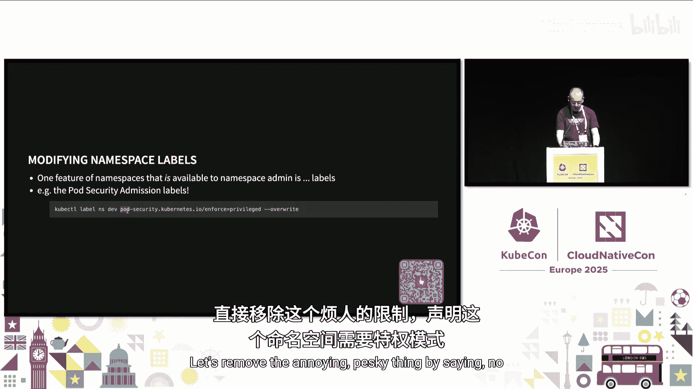

And it says。They have namespace labeled。 awesomesome， that sounds promising。

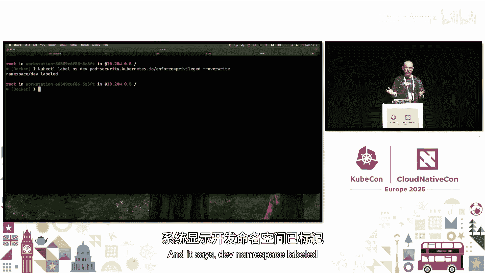

So let's just do cu cutttle get pods again。

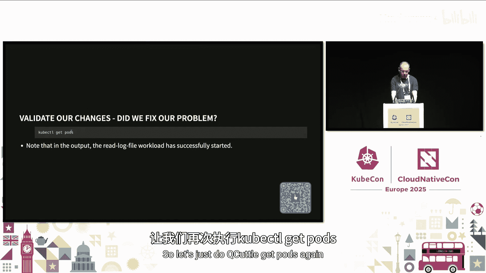

And our token reader workspace object is now working。 Look。

 we have got a a token read and it's ready and it's running。 So it did what want to。

 And youd see it came up， and it's now doing its stuff。😊，So。We now have what we wanted。

 We've achieved our goal。 Yy， we can get to the pub。Um。Maybe we're not quite finished yet。

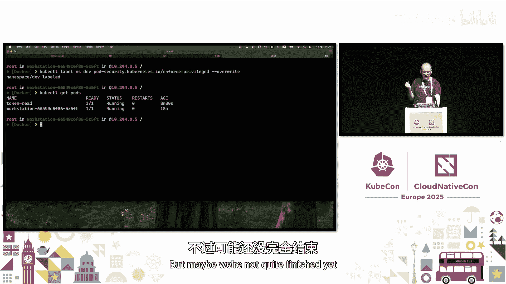

So let's just recap what we did there。When we started this workshop， we were developers。

 We had got rights to do this， the kind of things developers would be able to do， but not a lot more。

And then because of a service account that been left in our namespace。

 we were able to get our permissions a bit higher and then because of maybe a misunderstanding of exactly how our back works。

 we were able to get even more permissions and actually the point where we owned the whole namespace and then lastly。

 because of the fact that our control was a label in a namespace， we were able to bypass it。😡。

These are all relatively plausible mistakes to make。 These aren't like， you know， wild， you know。

 things。 They're not all necessarily that well known。 And now our workload runs。不。

Let's we're not quite finished yet。😡，What else could we do？Well。

 one of the big problems about Kubernetes security is the problem that pod security emission and things like were' meant to stop。

 which is if you have unrestricted create pod rights。

 which you have to give to anyone who you want to have workloads running in your cluster if you're going to let them do it directly。

😡，It means root on the node， right， because Kubernetes is distributed remote command execution as a service。

 That's where it does for a living。 And if you don't lock people down。

 they can do interesting things。 And this can lead to privilege escalation。Now。

 we're thinking it's very useful that we've been able to bypass this control and get， you know。

 what we need to get done， done before we leave today day。

 Maybe we could do a couple of things to give ourselves some more access in case this problem ever came up again。

 We don't really want to bother the cluster admins with all this， you know。

 annoying things where things don't work。 Let's see if we can do something else and make this a bit better for ourselves。

So let's compromise a cluster。 Why not？ We're here already。 let's just compromise a clusterster。😡。

We're going to apply a manifest and I'll count this manifest out once I've run it。

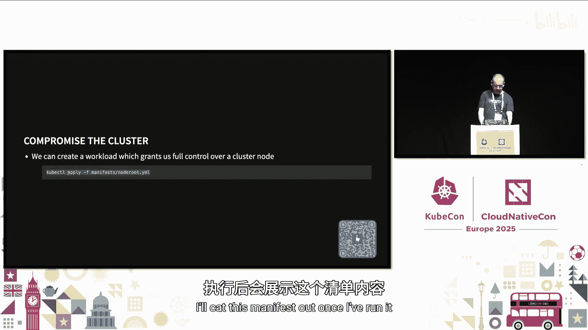

We're going to apply a manifest called node root and you can probably guess what it is by the name。

If I can't。This is a fun manifest。 I used to use this manifest all the time in pen tests。

 And it's a very fun manifest。😊，What it does is it basically says。

Turn off all the security that you usually put in a pod。 It says， give me the hosts network。

 Give me the host's PD。 This is the namespaces that usually be used to construct containers。

 And then it has the magic flag in the security context setting。 It said privileged true。

 The privilege flag is a really well named flag originallyin。

 I talked to someone from Docker who said they wanted to call it insecure as a flag that management didn't like that as an idea。

 So it's called privileged。 But it basically means turn off all the security。 So we said。

 but let's just turn off all the security。 So that's what that does。 It runs a pod into a node。

 and it turns off all of the security youd usually use to restrict a pod。😊。

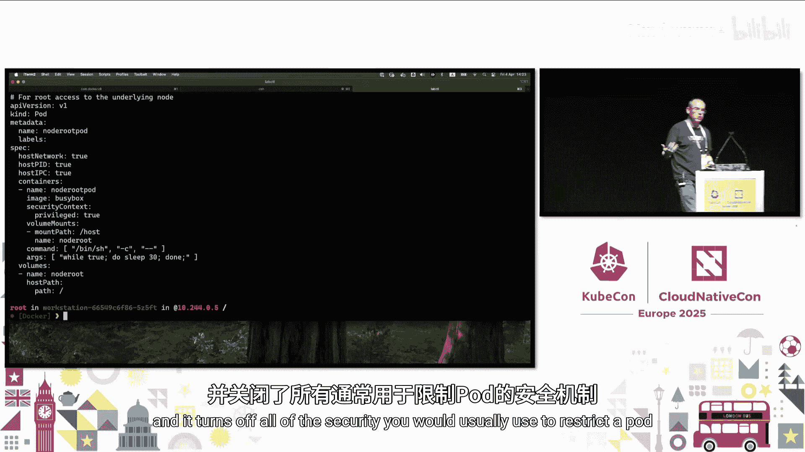

Once we got难。We can just exec into it。

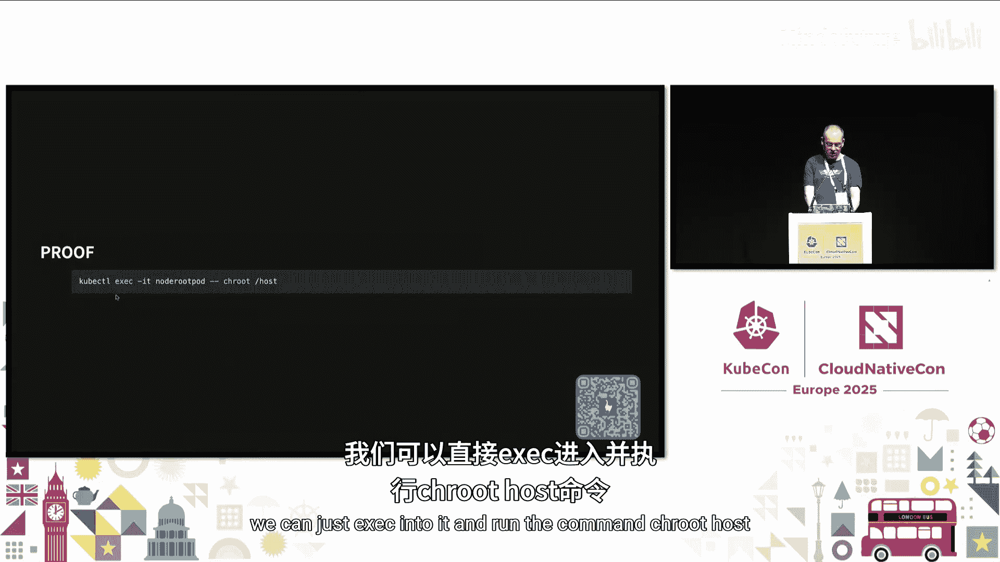

And run the command Tru route host。And what it does。It mixes root。So we've root the node now。

 We are now the full root user on， in this case， a control plane node。

If you had a cluster with 100 nodes， you could run the same thing as a demon set and you could run one of these onto every single node in the cluster and you get to be on every single node in the cluster。

 which is fun because it means you can do whatever you want。

 And then you'd have to worry the admin with any pesky problems you might have。

You can just get access and this is full access， route access to where you are。

You have about everything you ever wanted， you have all of the processes。

 this is a control plane node so it's got。The API server and everything else's running on it。

So that's nice。 We've got our access。 But that's only access right now。

 What if someone comes back in on Monday morning and realizes that pod security admission is being turned off accidentally and they turn it back on again。

 Then we're gonna have this problem again。 So what else could we do。😊。

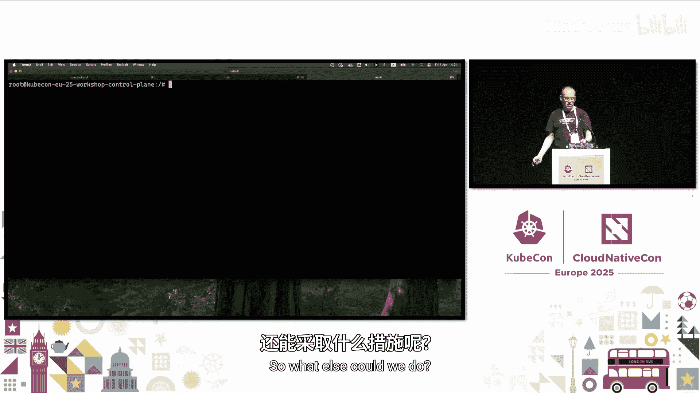

Well。Now we're here。 We might as well see if there's anything useful in the node for us to use。

 Maybe we want to come back later and， you know， do some more stuff。

It would be really handy if we had a way to fix problems we had。

 maybe we need some better credentials。If we had a credential that wouldn't expire。

 that would even more useful， wouldn't， because that's one the other annoying things about cred。

 they tend to expire。So this is where we come to admin Comf and super admin Comf。嗯。

Most Kubernetes distributions， when you install them。

 will create a credential with the that you use at the start in anything based on K A DM。

Theyre the files admin Comf。 Well， it used to be admin Comf and super admin Comf。

And these files essentially have client certificate based credentials that don't expire and have cluster admin level rights to the cluster。

 so if you can ever get access to a control plane node where those files might exist。

 you can just get the files and copy them and then you have access to those credentials。If。

 if anyone's doing this on a kind cluster that is older than 1，29， you will only have admin conf。

 The super admin came in in 1，29。And， Alex， I'll briefly explain the difference。 But basically。

 if we do that， anyone was following along。

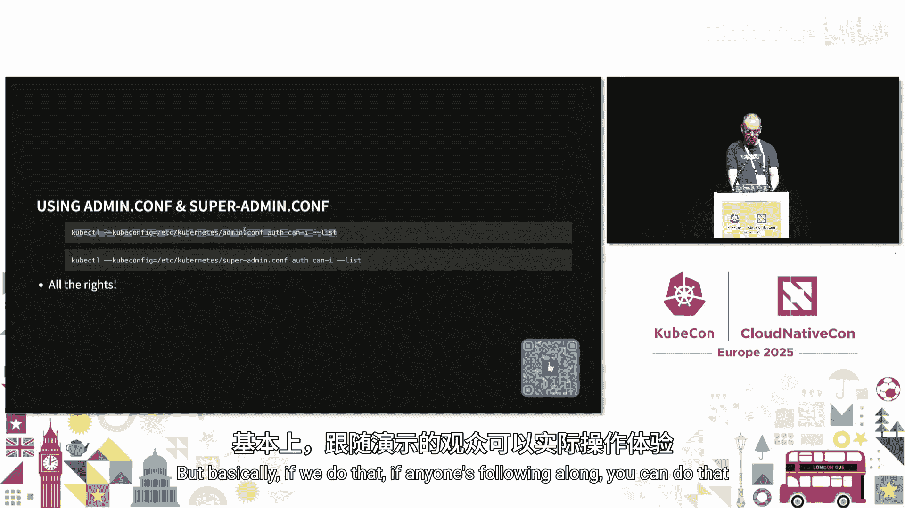

You can do that and you'll see this is， that's actually at the cluster level。

 So we got star star star at the cluster level using that credential， which is fantastic。😊。

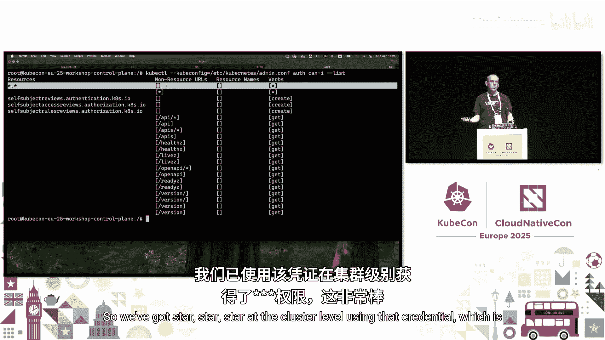

If we use super admin Comf。

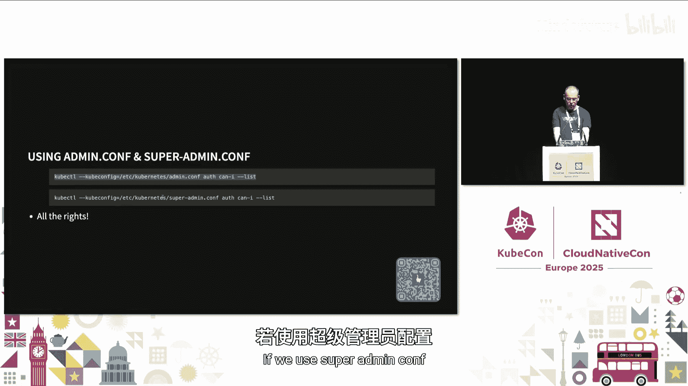

We also have star star star at the cluster level and at this point you might say， well。

 what is the difference you've just told me there's two files and they seem to have the exact same rights。

😡，And the difference is that super admin is in a group called system masters and system masters is a special group in Kubernetes。

 If you have a credential that is in system masters， it doesn't touch Rac。

 you cant you can't remove its rights in Rac。 you can take every single line out of R backac that there is。

 and that credential will still work and will still give you cluster admin if you look at the Kubernetes API server source code。

 you'll find why there's actually a hardcoded bypass for all authorization modules if you use a user in the group system masters。

 So typically you shouldn't be having credentials that are in system masters unless you want to be able to do something like coming back in a year's time and still having cluster admin no matter what's happening in Rac。

 and the reason is you used to have one file that only had system masters and they split it up So this one really really shouldn't be given to anyone The other one at least you can revoke its rights by taking away the binding the cluster admin group。

So we could have that credential， and that would be super。

 super useful because then we could come back anytime we liked and fix any other problems we happen to have with our cluster。

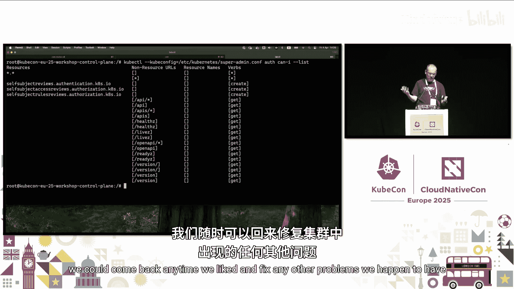

这。That sounds really useful， all of the rights。So how would you avoid the problems。

 How would you avoid this happening in future。Because really， if you're a cluster admin。

 we shouldn't let someone do that。 That wasn't really something that should have happened。

 Let's take our frustrated developer hat off。Namespace seggregation is important。

We that Rrb manager service account should have been in its own namespace。

 It shouldn't have been in a namespace that other people use because it has got lots of privileges。

 It should have its own dedicated area where you deployed it to。 And in general。

 if you're going to create service accounts with privileges and you don't want everyone else who can deploy workloads to that namespace to have those rights。

😡，Then you don't actually， you know， you want to split it up。Here with service accounts。

 It's very important not to let people create service account tokens。

 And knowing that pod creation allows for service account creation in the namespace is very important。

And then ourrb back needs privilege。 Don't give anyone rights。 They don't need to。

 Star is incredibly dangerous in Kubernetes are back because star is matches anything that could exist that exists now or could exist in the future in that area。

 because it just string our back Kubernetes are back is just string matching。

 And so star always matches a string。 So realistically speaking， if you get someone star to anything。

 So star star star means literally anything that exist now or could ever exist in this cluster because it is just string matching So all of those things would have helped us avoid the problem。

那。That was kind of fun。 But we've done pretty well over time。

So let me just go on a little bit because I thought we might have time。

 and I wanted to I wanted to demonstrate one more thing。

 which I thought is a kind of fun bit of hacking。 We're going to exploit an unpatable Kubernetes CE to finish off the afternoon。

 So if you don't know there are it's from 2020。 So this CE was discovered in 2020。

 and there is no patch for it。 It exists in every single cluster that there is and you can't patch it。

 There are actually 485。 I wrote this slide， and I forgot to update it。

 There are currently five unpatchable Kubernetes Cvees。 Four of them relate to networking。

 and one of them relates to git repo volumes。 It's fairly new though。

 which is why I hadn't mentioned that as a5。 but we're gonna to do one of them。

 and they exist pretty much in every cluster you can get。 because there is no patch。

So we're we're going exploit something called CVE 20285，5，4。

 And it's one of my favorite CVE to exploit because it's really fairly simple to demo。

 he says before running the demo script， it should work fine and it's quite interesting because it illustrates something about how Kubernetes works。

😊，The way it goes is this。Say I had got two different namespaces owned by two different teams。

One namespace， the one in green， wants to make a connection to an external website。

And get some resources or get some data， right？People over here in the bad name space can hijack the traffic of。

These users and can say， I don't want this to go to external web server。

 I want it to come to our internal pod， any internal pod that they've got control over。

 and they can hijack the traffic and actually make it go in their direction。

And this is kind of a feature of Kubernetes， well， and it is a C， so it's not， it's a bug。

 but it is also a feature。So let's actually try that out。

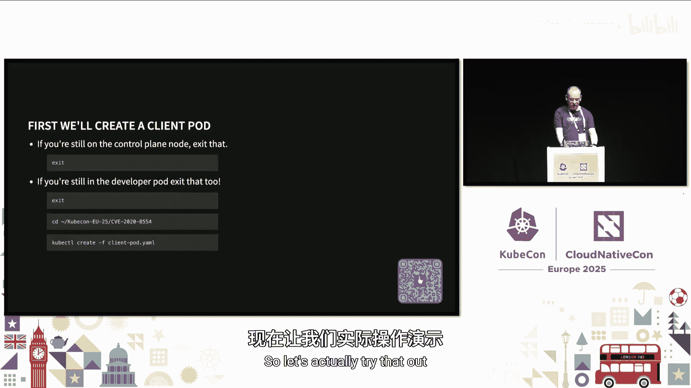

I'm going to exit if anyone is following along and is in the shell。

 we want to be all the way back to our repository。You want to be back to where you are。

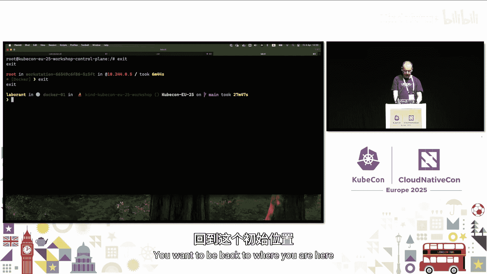

Here。

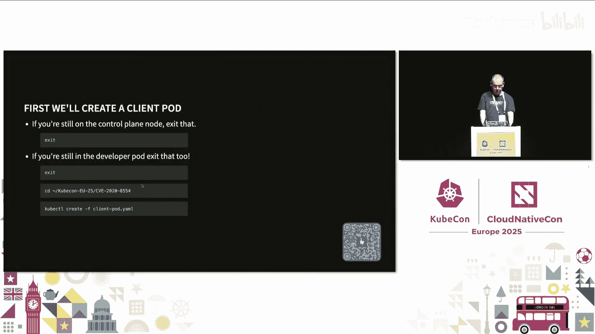

And then I'm going to go into the C。Rectory， so we're going to demonstrate this just by creating a little kind of client pod。

 which will be our good， the green namespace pod， and then our bad namespace people will will create a deployment and a service。

 and they're going to hijack the traffic that that user is trying to send externally。

So。

Let's do that。So we've created a client pod， and that pod is up and that po should come up and running。

 I put it in dev name space， I remember， right。

Yep， it's up and running。And。That pod wants to get some data from the very important Internet service I can has I。

So we'll actually check to make sure it can get to that service。

And it can right So I can has IP just gives you back your IP address。

 There's lots of services which do that。 I remember that one because I all remember the name because I'm old enough to remember the meme。

But now we're going to hijack that traffic。And I'll show you the manifest。

 explain how it worked once we've done it， assuming all goes to plan。We're going to create two。

 we're going create a deployment and a service。And once we've done that。

 we're going to go and try again。Did I saved to come up？And suddenly， our request has changed。

 And instead of being a request that's gone to an external web server。

 it's gone to an internal instance of the engine X。Web server。 So we've hijacked the traffic。

That will work in any Kubernetes cluster cluster you try it in unless someone has specifically blocked the feature that it is or the other one is if you are using selium in non cubeubbe proxy mode。

 it won't work there either if I remember rightly So what did we do there We have just essentially exploited a high traffic hijack inside a cluster。

😡，This is a Kubernetates 132 cluster。 This is fully patched。 How did that work。

The magic came in the service。So。In Kubernetes， another lesson known， fact。

 hopefully a thing that you might know that you didn't know before about how Kubernetes works is there are different service types。

 And you see here， one of them we've got is we can specify external I Ps。And that's what we did here。

 You can basically specify any external IP you want。 And then the Kubernetes will say， hey。

 if anyone makes a request to that IP address， it actually belongs to this service and not any other thing it might otherwise have belonged to。

And the reason that works that way is because Kubernetes services are just IP tables rules。

 When you create a Kubernetes service， what you're actually doing is having an interface to create Linux IP tables rules。

 and Linux IP table rule can redirect traffic。 That's one of the things you can do with IP tables。

 So that's exactly what a service object is。 It redirects traffic。

 And that's why it doesn't work in Cium am right thinking about that because in Cllium。

 they don't use IP tables rules if you replace K proxy。So basically。

 all we did here was these are the two I addresses that belong to Icans IP。

 You could change those for any other IP addresses you like。 And then we said。

 if you get any traffic that's going to those I addresses， don't send it there。

 S it to the deployment that we created。Hjacking the traffic。If you want to fix that。

 because that doesn't sound a great thing to allow in your clusters。

The best way of fixing it is you want to block creation of external IP address service。

 If you don't need them， probably a lot of clusters don't need that as a concept。

 the best thing to do is have an admission controller and say to your mission controller， hey。

 don't allow in to create those or maybe only allow it in a specific namespace and then have control over who can deploy to that namespace if you do need that feature。

Why did that work yeah？Hubernetes uses IP tables rules， and IP tables rules can redirect traffic。

Yeah， if you want to stop at happening， our back is obviously you don't let people create services and admission control。

 the two best ways of doing it。So。But， well， in terms of time。

 But let's just talk a little bit about。The goal of this。 and hopefully， I shall show of hands。

 did people learn something they didn't know about Kubernetes security。 Did I succeed this afternoon。

 Yeah， I succeeded。 Asome， Thank you very much for that。 The goal of this was to try and say， look。

 Kubernetes can be a bit complicated。 And there are lots of little。 And we've talked on some of them。

 I could literally have done another 10 of those without too much difficulty。

 There's lots of different little things in Kubernetes that you don't necessarily know or think about。

😊，Generally speaking， the best way to handle them is try and be very careful with permissions you give to things。

 be minimal access and segregate stuff as much as possible。 If you got things you really don't trust。

 maybe you want to put them in separate clusters， depending on how confident you are that you can actually know all of the places where someone might do something like this and escalate their privilege or get somewhere else。

If you want more resources， a couple of things that might be useful。

 I have my blog is the Ra link there。 I've written about most of this stuff at various times。

 There's also that talk site if you ever like Kubernetes security talks I've put a searchable index of every security track talk from every Kubcon going back to 2016 there's like 300 talks so unless you really can't get to sleep that should make you have a nice time and get to sleep as I mentioned earlier on。

 six security or Kubernetes security on the Kubernetes Sck are great places to get more information about this kind of thing of this has sparked an interest and you want to learn more these weird and wonderful places that Kubernetes might be odd from security standpoint and also tag security on the CNCf Sck one thing that's known on the slides that I promised to someone else at the conference I would mention is if you like hearing Scottish accent and talking about Kubernetes KcD UK this year will be in Edinburgh in October and we would love to have everyone come up to Edinburgh and join us for KcD。

Which will be obviously I think it's middle of October， I remember rightly， but later on in the year。

And now with that， I've got some time for。 is anyone going， oh， contact details。

 I promised contact detailsles。Contact details there。 happyy to take questions that way。

 We've also got time。 If anyone wants ask any questions now。😊，Yeah。Would network policies block it？

If you were blocking。If you were blocking yeah， if you were blocking the bad namespace and saying no traffic could go to that bad namespace。

 then maybe。So， yes， if you looked it right down with network policies that might stop it just because it would stop the traffic altogether。

 But I think the idea here is the bad namespace people。Yeah。

 you might build a block with that as well。 That's a fair point。 Yeah。

 network policies might also manage to block it。 If you put them in by the making sure you have a default。

 deny and on ingress and egress on all namespaces by default would be the way to go。

Any other questions。Yeah。嗯。Oh， there's a microphone， awesome。Hello， thank you for the presentation。

 for the first pen test that you did。 you， we used to get the token from a file。If we use secrets。

 is the token will be still persistent in the file where we where we get the token from。

I'm gonna I heard that but secrets in files。 It's kind hard。 Yeah， I mean， we， we got the token。 we。

 we got the token from a file。To use it in order to I got。 I to come down。Oh。Start in the file。

 Service came to into the files。 I'm gonna to get this right。 Otherwise， I'm gonna not be here yet。嗯。

Yeah。Yeah。ゆしく？Oh yeah， yeah。 So the question is， if we use secrets。

 would the token still be in the file， The answer is yes。

 You typically have to put secrets somewhere inside pods if you want them to use them。

So you've got to either put them inside a file or you've got to put them in an environment variable。

Ultimately， it the problem with secrets is if you want people to use them。

 they have to be somewhere for people to get them from。

 You can make it harder for people to get them。 But the way。

 because I can create a service account in a namespace。

 I can say where I wanted to go so I can say I wanted to be there。 the secrets。You you， cause。

 we didn't have any rights to get secrets in this scenario。 We only had access to great pods。 So。

 yeah， it's still generally accessible。

Any other questions。Or all have I said。Cold drinks and ice cream in the sun far too many times。

 And everyones now can think of nothing else other than。

It's Friday afternoon。

In that case， thank you very much for your time。 And I hope that was useful。

