# KubeCon-+-CloudNativeCon-大会2025-｜-云原生计算-｜-可观测性-｜-Kubernetes-｜-Prometheus-p27-P27-Tutorial---Workshop---Developing-as-a-Team-for-Kubernetes-With-Nix-an...-Lei--BV1Cd32zDEBG_p27-

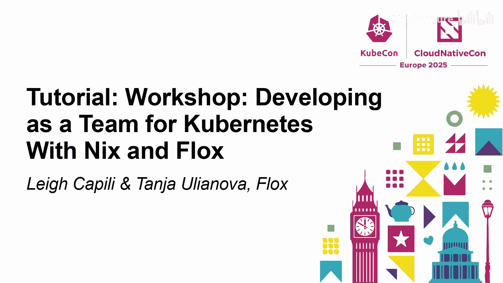

Hi， friends。 How's everyone doing。Yeah， my name's Lee。

Thanks for so much for coming to the tutorial today。 Today。

 we are talking a little bit about something that you may have or you may have not heard about。

 And then we're gonna be fusing that with an idea that you probably have heard about。

 We're gonna be talking a little bit about Nicks。

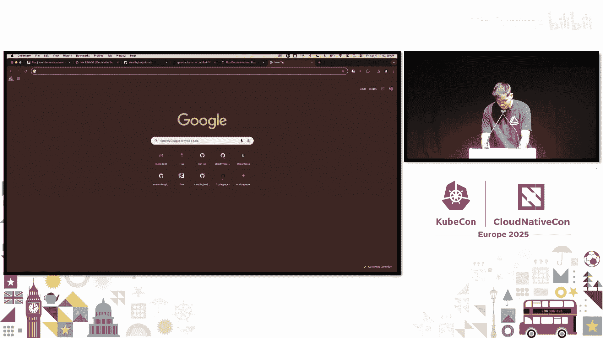

嗯。We had any Nick's users in the room。 Oh， wow， All right。 So we're in good company。 Now。

 there's like half of the room that raised their hand。

 And then there's probably another half of the room that has maybe even not heard of Nick's or never touched it or used it before。

And then。I want to sort of paint a little bit of the visions and the possibilities。

 So I'm gonna be real with you all。 I am in the lab right now。 Like I am doing a lot of R And D。

 and I wouldn't say that I'm maybe as experienced to the Ns user as some of the other folks in this room。

 but we are all in good company。 and we're going to run some experience。

 learn some principles and try to hack some stuff together。 I that feel like a good vibe for today。

 We've got 75 minutes to get our hands on the keyboard and mess around。 All right。

 the other thing that I am much， much more authoritative in is get ups。 right， so。😊，We have Nix。

 which is a completely kind of separate idea from lots of cloud native stuff there where there's a lot of overlap。

 N is this sort of functional package manager that lets you build reproducible software in a hermetic way。

 And then you have a bunch of addressed bbs that you can get from caches and you can assemble your programs with graphs of dependencies。

 So N is all about building software and doing it in a programmatic in a declarative way。

Git ups is about。Declaring your infrastructure。In a way that is collaborative and shareable。

And so we're going to be looking at Ns， we're going to be using。诶。

Ease of use layer on top of Ns developed by the fine and talented folks at Flocks。

I did use to work with them， so I'm a little bit biased， but I still use their software every day。

 it's very good， a great way to share Ns with your team and then I work at control plane again。

 my name is Lee I think there's two control planes I'll just get this out of the way control plane IO。

And I control plane employs me to help maintain the flux project。

I know that I just mentioned f earlier and now I am telling you that I I work on and have worked on flux for a really long time。

 I'm going to do my best to enunciate both awesome projects， both very different from each other。

 very similar names， but maybe some fun overlap， where we could paint a workflow that goes into production all the way to the end。

 but maybe also starts its story at the very beginning。

And I think that that's something that's missing and that could be really exciting。

We're talking about Ns， we're using flux， we're talking about gi ups， and we're going to use flux。

Sound good。Alright， so the first thing that I want to point you friends to is a repo where I have some experimental things going on and。

😊。

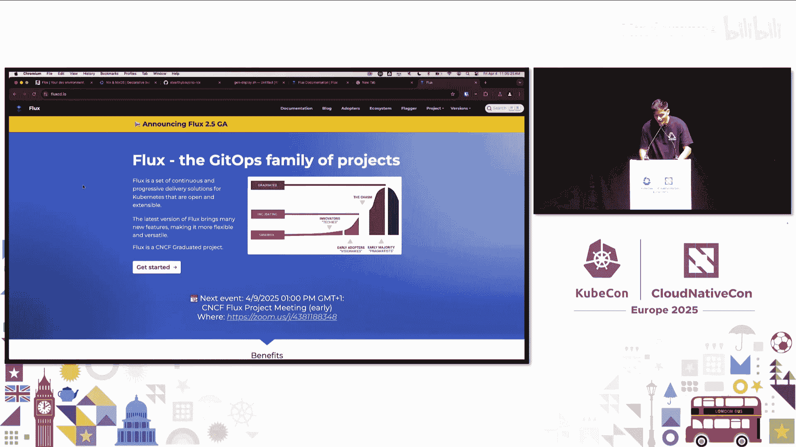

I think the conference Wifi here in this room because it's not very dense is actually pretty fast。

 but I'm pretty sure as soon as all of us run this speed test， it's gonna be a little bit miserable。

 So if you are comfortable using your free credits in your Github account for Github code spaces。

 I recommend。

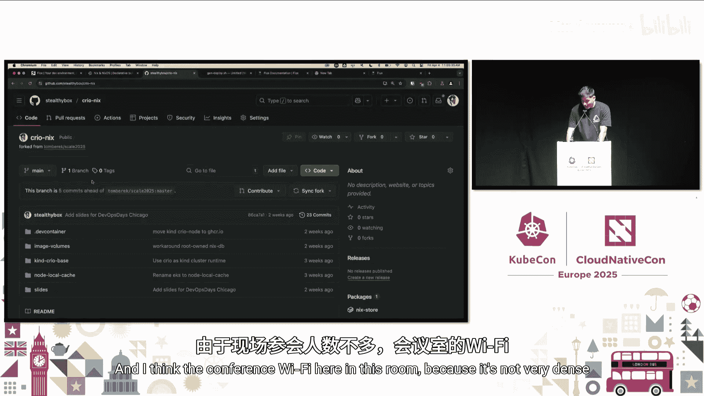

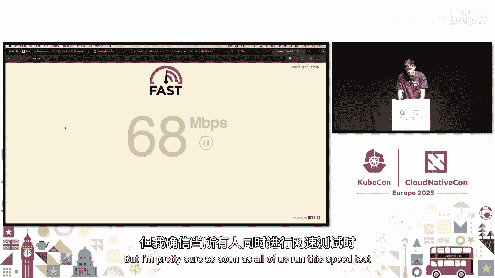

Coming over to Github dot com stealthy box is my repo。And then cryo hyphen Ns。

 which is a little bit of a teaser for some of the things that I'm experimenting with。

 And instead of。Cning the repo or forking it。 And instead of clicking add a code space。

 you should probably click this three dots right here， and you should say new with options。

And then you can check it out on mainine in some your you know region that makes sense for you。

 and I would recommend bumping up the core count as well as the RA just so that things compute a little bit faster for you。

 This is going to run a Kubernetes cluster and so it's nice to have a little bit of headroom that will use your core seconds on your Github account faster so if you are running out of those for some reason。

 even though it is only the beginning of April then maybe just use the two core， it still works。

So once you create your code space。Or if you don't。Yes， yeah。 I will go back。 Thank you for。

For calling that out there。 So the repo is here， there's a green button。 you click the green button。

 you click the three dots， and you can say like launch with options。

 and I recommend clicking four cores。And this is， this is kind of like the。

TheThe point where I'm like trying to pre bakeake some stuff。

Sometimes these code spaces can take a little bit to start up。

Some things that are gonna be happening in this code space。

 I will admit that the dev container that I've prepared for you is。In an early state。

 it's not like the most， you know， like。Perfectly put together dev container。

 But what it is using is Ns in the dev container。 It's using Ns via flocks。

 which I've mentioned a couple times。And it's using what's called a flux environment。

Which has its dependencies declaratively stated inside of the Giripo that you are looking at。

And that's going to create the dev container with Docker coming from Ns。

 providing you your Kubernetes command line tools， providing kind， the Kubernetes cluster itself。

 as well as a bunch of developer tools and getting everything set up in the dev container and then。

Using Microsoft's and HRRC and hooks and stuff to start the Kubernetes cluster for you。

 as well as the Nick statement。So that's just some background as I fill the space to allow folks to create the dev container。

 I'm going to start moving on， but definitely if you need a little bit more time。

 please feel free to ask another question， sweet。So get the dev container spun up。

 What that will look like is a window that kind of looks like this。

 You can see I've also been working on some local changes and things。

 So yours will maybe look a little bit different。But when you pop into here， you'll have a terminal。

 I'll try to make this big for everybody。And you'll notice that you are going to be at a shell。

 Your shell will probably look different from mine because I have my dot files loaded。

 if you're really suffering。And you need you know to import your dot files or whatever。

 feel free to take the time to do so， I also have a simple BRC simple。

 It's like BshRC hyphen simpleple under my name on Gitthub if you want to clone that you can use those and then your repo will look like mine in codespaces。

嗯。What else was I trying to accomplish here， Okay， so you'll pop into here。

And you're gonna have a code space。 and you're gonna to be in the workspace cryononicix。

 I think that you should also clone another repository。

 So we should go into the workspaces folder and get clone。Just HtTPS column slash/lash Github。

Dot com。 And then it's going to be stealthy box slash scale， hyphen mixs， hyphen Gi ups。

And that should put a repo into that workspace folder。 I already have it。

 so Git is complaining at me， but there is another repository that has other folders with other micro demos that we can play with。

 So go ahead and get that other repository I'm just gonna to leave that up on the screen there。

Let's talk a little bit about。Depenencies， and。Working with people on a team or even just becoming frustrated with yourself over time。

 working on the software that you like to play with or the projects that you want to work on。嗯。

When I want to install a database on my Mac so that I can write software and put information into that database。

 I usually will need some sort of package manager。 I'm either popping into the browser。

 going to a website and clicking install on some sort of application， or maybe you get brew。

My teammate uses abuuntu。And he needs to go and get that same sort of database。

 probably a different version of it， because the package managers are now kind of out of step with each other。

 but he's going to use app。And then my teammate is on Arch Linux is going to use PACman。

 but then maybe they also might want to actually get the same exact version of the package as me and so they might also use LinuxB。

 and maybe they'll have the same version， but it'll be crossbuilt for their machine。

 their operating system and CPU， and then I'll have my own version built for me。

This it's really frustrating when we have different hardware from each other。

 And so Docker came and kind of saved the day because we just wanted to pretend that everything was a Linux machine。

Unfortunately， that comes with a couple of trade offs。

 one you've got to run a virtual machine and split up your resources。

 it's not so big of a trade off because now we have really fast CPUs and stuff。

 but it can make a difference。And then two， it means that you actually don't get to use the benefits of your operating system kernel and your native hardware。

 And maybe that might be important if you're doing an ML workload and like wanting to do some GPU you know。

 computations or something。We， I think， need to get to a place where the system package manager evolves a little bit。

Luckily， there are some folks that got ahead of us。

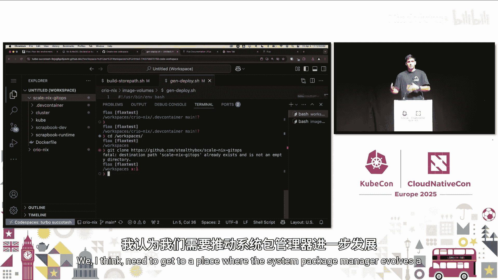

So I'm gonna move on from having the repos on the screen。 Also， please forgive my disorganization。

 I had to restart my machine right before this entire presentation。

 So I'm gonna try to find things as quickly as possible。

 But the the Ns community has been around for 22 years。 this project is huge。

 If you go to Github dot com Nix O Ns packages。

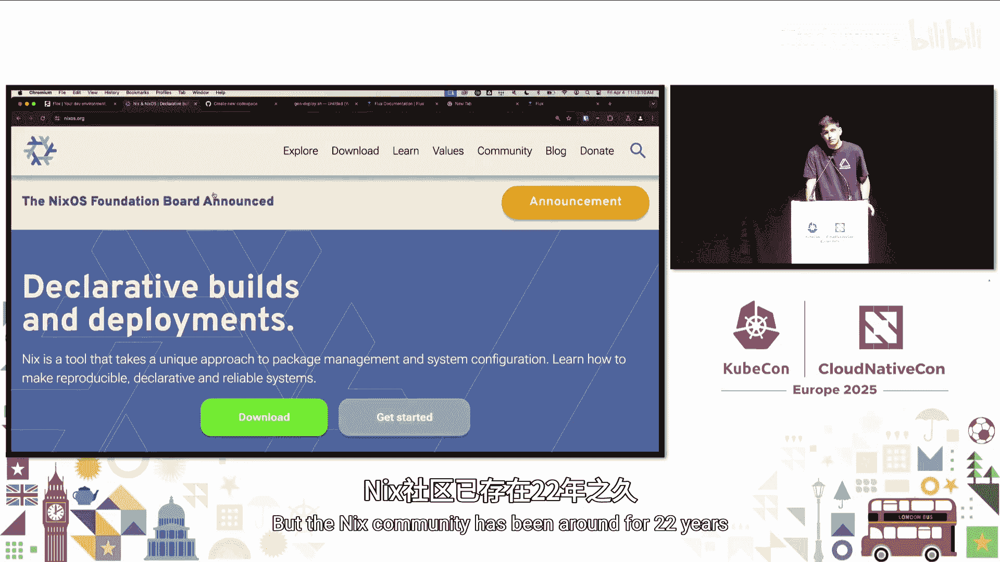

And if you can type correctly。You'll see in here that。There is， I had this up earlier。

 What am I looking for。It breaks the contributor count on Gitthub。

 It's more like 20000 or something like that over 22 years with massive amount of commits。

 and you can see that over this history， there's a very large maybe even kind of multiplying or exponentiating trend some sort of curve that's going up people really like this stuff if you've never heard of Ns before the benefits that it gives you is that your builds are declarative and then you can maybe start to do operational stuff declaratively Ns looks like this It's honestly miserable for anybody whose experience would be you know beginning programming Python and just。

Normal stuff that everybody knows。 N is a functional programming language。

 and consuming it oftentimes， it has a reputation for being very hard to g。

So I want to show you maybe an easier way to use NIC but still get the benefits of it。

 It's an open source project called Fs。 They do have like you know an open service that's similar to Docker hubub as well where you can push and pull things but you don't really need to use that part and we're not going to use it today。

 We're just going to use flocks to create environments that are reproducible。

 we're going to consume software from open source and then we're going to try and use our same habits to build a go application。

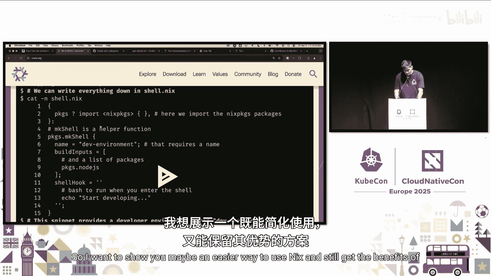

哦。

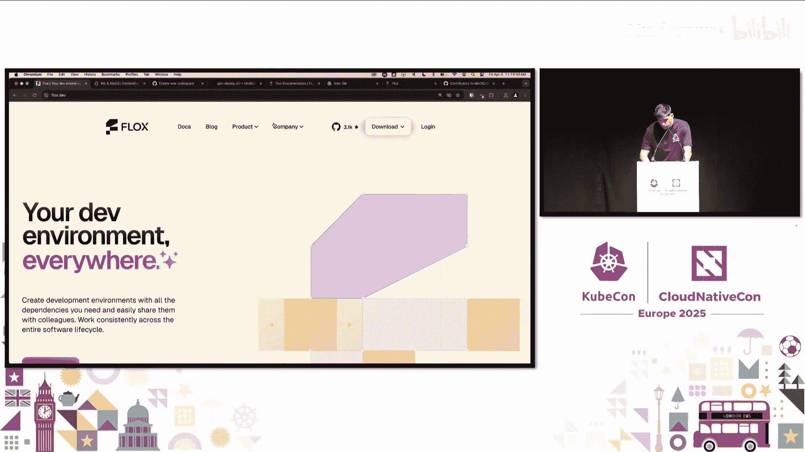

收。If you pop into the oh， also one thing that's really important here。

 after you clone both of your reos， press command shift P to open up the command palette。

 and then you'll want to like make sure that you type the。Greater than sign。

 like a little arrow space。 And then you'll want to look for add folder to workspace。

 You need to click that。And you need to add scale N's giups to the workspace。

 So that way you have two repo。 And when you do that， it's actually gonna like restart the editor。

 So if you don't do that， if you pause this code space and come back to it later， you may lose work。

 So just heads up that has bit in me before。嗯。Let's hop into the scale Ns。Getit ups。嗯。

Repo here I have a software repository， I want to work on my go application。

You'll notice I don't have go。If I go into my dev folder。Scrapbook hyphen dev。

Then you'll see that I have my source code there。 I would like to go build this。

 but I can't because I don't have go。But if I run flux activate。

Then now I will be put into a subhell that will have my dependencies。

 So if you're a Nixon in this room， which， you know。

 there's like a pretty impressive percentage of you here， this is like no news， right。

 This looks a lot like maybe running Nixon V or activating this thing called a flake。

 which is a complete jargon term that you've never heard of for the rest of the room。

 But here what we're doing is activating what's called a fs environment。And so。

 somebody has prepared。A group of dependencies。 Let's see what's inside of it。

So if I list this flux environment， then I can see that I have a CAA certificate bundle for making sure that my application can do TlS。

I have GCC， the Gnu C compiler for doing C binding stuff。

 I have the go tool chain for building go applications。

 I have the image magicic C libraries and development kit。

 and then I have this thing called package config， which honestly I don't know what that is。

 but I downloaded I added it to the environment after I had to deal with some errors and it helps build the image magicic libraries when you're doing stuff。

So it's necessary。So this is what I need to develop my application。Similarly。

 if I go up into the folder above and inside of the dev container。You'll see that。 there's also。

A flux environment。Here。It's called flux test。 It's got Z S H， Na， Kubernetes Helm， Kub C T L， Ki。

 JQ for some JsonN parsing or whatever you want to do。 There's Gup PG for validating。

 you know some secret stuff。 the Github command line tool， Docker， etcter。

 the ACL thing for fixing some file permissions in the dev container setup up inside of code spaces。

 all kinds of fun stuff。And this environment is declarative。 Let me show you what that means。

There is。A f folder。 and we'll actually hop back up over into the。Sorry。

 let's could you ask that question， I just wasn't listening。Yeah。Okay。Cool。

 I will do my best to slow down a little bit here。So in the scrapbook dev folder inside of the repo。

There is a folder that's checked into the repo， it is a hidden folder。

 so LS minus LA that shows you the files inside of the scrapbook dev folder。

 I just ran the CD command to get in here。There's a folder called flux。 And inside of this folder。

There are manifests。 and these manifests， I did not write them。 Instead。

 if you want to change things inside of here， you just like f install。

 And then we could say we want to add like Python 3。You can do the same thing with like f search。

 Maybe we could search for some。I don't know。elixir related things or。How do you even spell Alexixir。

 Maybe let's just look for a node。So you can get some no JS runtime from the catalog。

 These packages are ultimately backed by the Ns packages， cash。

And flux is doing a little bit of work in their service to index them。

 which means that you can also say like flux show the name of a package， so like say I did no JS。

 you can see the different versions that are available and what CPU and operating system architecture combinations are supported for that particular package version。

So this is。A package manager that probably feels similar to something you've used before。 B， NP PMM。

 those sorts of things。 We have a question over here from the person in the Plumi shirt。So basically。

 those are versions that predate the release of the Apple Silon Mac。And so historically。

 those package versions when they were built on a communal build farm called Hydra just。

That the CPU and operating system target for Ar 64 Darwin or like basically an Apple Sil Mac just didn't exist yet。

 which is a really good question For the other ones。

 the operating system Tple is just not being shown because it's kind of canonically expected that most packages are crossbuilt for all four targets。

But if you end up looking in here and you see any architecture combo。

 then that's a sign that it's not maybe supported on your laptop or your friend's laptop。嗯。

So this is really interesting because this package manager is showing me a single idea of a package that has multiple versions that then is also supported on multiple operating systems。

 which is sometimes I think that that's pretty unusual it's not unusual if you're just looking at like version manager tools for say node Js or go but it is really unusual when you're thinking about a package manager that has a scope that's as wide as N packages。

 which is like over 120000 packages， some of them come directly from programming language libraries。

 others are command line tools， others are system libraries。

 a bunch of C tool chain stuff and even things like system D and Docker you can install all of these things with N packages and many of these targets are cross are crossbuilt So' this is already getting really interesting What's also interesting is if you run flux editit。

 there is a declarative manifest for anything that you do imperatively。This， I， when I look at this。

 I see the design of NPM， basically a package Json。

 The format of this is called a manifest Tamil file。And you can edit this as well。

 So if I wanted to say， I just added Python 3。And。If I。Was privy with。

 I don't even know what editor are in Nano。Then。Oh， you know。

 I'm just realizing some of you probably ran that flux edit command and then didn't know what editor you were in。

I probably should have added that。A variable to open that up in V S code。 I apologize。

 if you are in nano and you are like。Struggling to get out， you can press probably like control an X。

 and that will exit。So just in case anybody got trapped。嗯。So there's a declarative manifest。

 And that means that if I change it and I look at my git status。

 then there are changes to those files。 And then I can go and di。The manifest change。

And you can see now that I've removed a comment here and I've added I guess made an edit。

 but this was uncommented just a moment ago， it was added automatically and declaratively and I could you know Git commitit。

 you know to push that up to the repo and then anybody who used this commit would then whenever they activate that environment。

 they would now have Python 3 at that particular version when I say at that particular version。

 it's a promise。Because if you actually look at the gi diff。There's a lock file。Also， a huge idea。

 like， what a concept。When I'm working on a project and I would like dependencies and I install a version of a programming language interpreter or some C libraries or a CA certificate bundle that the hash and the version and the provenance of that decision that I made as a developer to pull a dependency into my software project。

That we would lock it。 And this is， again， not a new idea。 NP PMM does this。 cargo does this。

 Go mod works this way。So basically， anybody doing real software development has found this need for per project dependency management。

 resolution and locking。 and we just don't treat our machines this way， Nicks。

Kind of has this in a thing that's called a flake that's also moderately experimental and sometimes controversial depending on who you talk to。

 Fl is not using a flakes。 It doesn't like require them。 You can use flakes with this like。

Environment format， if you would like， like， I can， I can go and install any flake ref。

There's a bunch of Nicks people in the room。 So yeah， you can install the flake refs。

 You can do all of yournicks magic， you know， your years of experience doing functional programming and。

 you know， crafting perfectly， perfectly。You know， Tshan software builds and then just put that into a flux environment and somebody does a Git clone and they do a flux activate and they have all of your stuff running or even potentially building。

 So very nice but these are lockeded not just for one operating system but for all of the systems that my environment is declared to support that's really nice because this exact environment that I'm using on this Linux AMD machine in Github code spaces。

 if you go and check this out on your Mac you will be able to use that exact same environment so。

This is， I'm going to increase the font size in a second here。Again。Why is this not。

 I'm in the wrong repo？This needs to be。Workshops scale。There we go。

I need to check the status of where I'm at here right now， right I'll push that up。Oh， wow， okay。

O up one second。I have to mount a disc。Look away。 I'm doing developer build stuff right now。

There we are。Oh， boy。嗯。Scrapbook dev， okay。So this is that exact same developer environment right here。

 right The C search GCC go image magicic package config。 I can activate it。

 And then now I have that environment on my stack of subhells。

 and I have access to go go is coming from my f environment you can see that it's coming from here。

 And that actually comes from a immutable read only disc that you saw me just mount that's part of my Ns installation。

 that is built for arch 64 Darwin。 But this is the same exact get repo and the same conceptual environment with the same lifecycle of management anytime you change the software project for the。

😊，Linux M4 stuff。AD 64 stuff。So。O。we've thought a little bit about environments。

 we've talked through kind of what that means you have the codespace cloned。

 you probably have both Git reoss cloned， you have your Git repo added to the workspace so you don't lose any of your work So just one more time unwinding since I know that we've kind of gone on a couple tangents。

 but in the scale N GiOs repo if you go to the scrapbook dev environment。So in this state。

 and you run flux activate， you will get the development dependencies necessary for you to run go build。

Of this application。If you run that command， then it will start to download a bunch of dependencies from the Internet。

 At this point。 now， I have only one thing to mention to the Nixs in the room the folks who used K Ns already is that。

You would probably， if you're very experienced with Ns。

 write a a Ns program to get your dependencies for your go build。

 And for people in the room who are not using Ns， I'm just asking you to run a go build and do a go mod basically like hydrate modules The normal go away。

 So I would say that this is stepping out。Of maybe the normal Nick's path。

But what we are winning is a lot of N's benefits for everything underneath the developer environment and。

Nothing is stopping you from continuing to use Ns from here。

 but just like what's really nice about this is you can get the benefits or at least a good number of the benefits。

 but then you don't have to actually ask anybody to learn really anything new at all。So go build。

What you'll end up with if you run L S， I like to run LS L。嗯。

It is a binary that's built that's just sitting in here。Great。

 I have my application built if you look through the source code。

Of the app inside of the scrapbook dev folder， you'll see in main。go。

That this application is using a Postgress driver。 It's using the go fiber。

 like web application framework。And then we also are doing some stuff with mime types。

 and we are using the go graphics Iic bindings So these are C bindings from a go application。

 and I've done that kind of intentionally because now you're asking for kind of cross language dependency management。

 which is the kind of thing that's usually really frustrating in error prone and cause you all sorts of issues the beginning of this program initializes Ioic with this C bindings and then we open up a connection to a Postgres database and listen for a couple of views。

And then there's a couple of。you know， kind of rest dish ways to put stuff into a list of things。

 and then we serve some things from a public directory and then there's， you know。

 if you want to mess with the HTML and stuff you can go directly into views and index and mess around if you were a fronttime developer and want to have a JavaScript。

 go application Co， Okay， so that's a little bit about the application that we're doing。

 let's go ahead and run it。Go image app。Okay， my fiber server is running because I'm using code spaces。

 it has noticed that my application is running on local host Port 3000。

 you'll notice we're at a cloud native conference and we're currently not using any containers at all。

 We are using the thrill of local host So open in browser。 That's great。

 It's gonna go in proximity to my application and just oh gosh， right I thought。😊。

Things are not working。So I'm just playing a game。 I'm， Im。

 I'm totally expecting that because you know， my， my。

Go application is trying to connect to a Postgres database， and there's no Postgres database。

Let's fix that。 I'm going show you why it kind of is fun to not be inside of a container all of the time。

 I'm going do。😊，Flockox， so like with， with my scrapbook dev environment already active。

 I'm gonna run flux activate。Dash， dash remote。And then I'm going to say in the f namespace。

 so f slash Postgress。And then I'm going to pass another flag。 I'm going to say， start。Services。

And this is going to pull a remote environment that's just kind of ephemeral。 And of course。

 we're doing a live demo so。Something didn't。Work。Why。Is it a flaky problem， Why did that not work。

Service manager is unresponsive。 Please try again later pulling updates from fub。

 I could also pull copy this and attempt to run it。 I also can just not start the services。

It's a couple of things I could do here。I'll be truthful。

 I was expecting this to be like a wow moment， but instead。5，0，3。 yeah， maybe， but I mean。

 I'm on a code space， you know， like the this machine is in the cloud。嗯。I did get a 50。

3 from the flux Meta。Getit repo。 That's interesting。What can I do about this。I am going to。

Make a new flux environment with you， friends。So we're going to make a directory。

 I'm just going to call it。Postgres。And then I should hopefully be able to f， pull dash dash copy。

Flocks， Postgres。Environment。Presumably， if flux hubub is up right now。

 then I will be able to do that。 If not， I can get it directly from the Git repo。

 The problem here is that we need a database and we want to run it。 And wow， that's。Yeah， okay， cool。

 Let's go ahead and。Go get that environment。Lox and。

There's a repo under the flux namespace called slash f ends。 And if you look through this list。

 there's Postgres。 and basically， I'm just。Trying to。In fs， Postgres dot f， E And V， Im。

Trying to get to this to file。And we can。Kind of just copy the entire thing。O。

I wasn't intending or expecting that service to ever go down。 That's never gone down for me before。

 So thanks for suffering through this with me。So what I'm gonna do here is I'm in this new folder。

 I'm going to flux in it， a new environment， and then。I'm going to。Set my editor。

I think it's like this。嗯， and then。Maybe笔。Does that work？Yeah。There we go。

And then I just paste what I just copied。 So again。

 that that's from the flock slash f and repo in the Postgres folder under dot f E And D Tail manifest Tail。

 and I'm just going to save that file and accidentally close my code space。From muscle memory。

 And we're just gonna。Yeah， yeah。 the upstream repo address。 that's so that was。

Flockox slash f EN VS， and then in the Postgre folder， there is a dot f。

And then there is an E and V folder with a manifest Tail。 and we basically just want to copy this。

 technically， you should also have like the lock。 So if you want。

 you can just like clone the entire repository。But it this should， should probably work。

 even just copying the manifest。 at this point now， I'm， I'm totally just playing jazz， so。呃。Yeah。

 yeah。 So once you make a new folder， you can flux in it to create a new environment。 right。

 So here's just this created the environment Postgres。

 And then you can also just like open that file。 You don't have to necessarily run flux edit。😊。

But that will do like some validation checking similar to KubBCTL edit。And。Basically。

 so like in this Postgres folder， if you just like edit the manifest Tail here。

I would just paste it in， save it。And then if you're in here and you flux activate。

Then it will want to build that environment。 So after activating it， I'm actually gonna like exit。

 and I'm gonna to show you that you can activate and you can start。The services。So。

Environment does not have any services defined。 That's really odd to me。 Okay， I'm like， really。

Losing it right now。 Thank you。Where are the services in here。did I not copy the right？File， I see。

There we go。I just I wasn't able to save the file。And then I keep accidentally closing my code space。

O。就。I think I've saved that file， yes。And then。So。I just say I want to build Postgres and then it goes and it makes sure that I have the Postgress package if it's not there。

 it goes and fetches the one that's needed for my CPU and architecture from Ns packages and then it initializes a Postgres database for me and then tells me。

 hey， you know there's some stuff that you should go and try。Here I'm also going to。So right now。

 I have a database running， right， So if I run Psql。

 I can actually talk to a database that's running on local hosts now。 and then I。Forget， yeah。

 you can just type exit if you want to get out of there。I am going to quickly gr。

Through the cluster directory inside of the root of scale N's Giops。And。I am just going to look。

Kind of recursively。For the word。I think。I think recursively and case and sensitive just table。

So if you do that Gr or you look inside of cluster app DB Yal。

 there is a table creation command here。And， you know， we're， we're doing local dev。

 So we're just kind of imperatively messing around。

 If you copy that command and you go into PsQL and you paste it， then it will create a table for you。

And then now， if you in your。devb environment。If you try to run go image app。

 which is the thing that we built。Then you should be able to open that in browser。

 and now our app should be running。

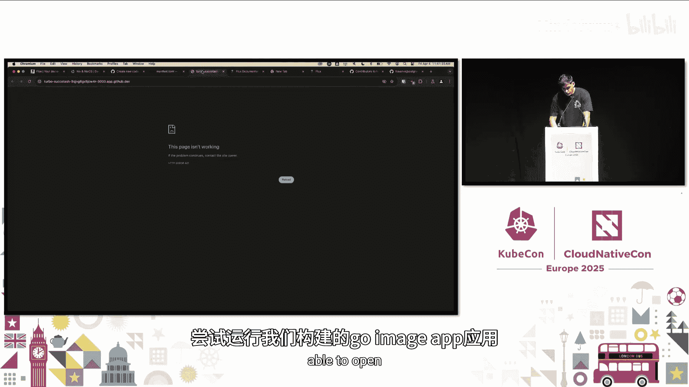

So what happened here is we're。We have our development environment that's giving us our development dependencies。

 and then we also have the Postgres environment that we built with the database that initializes itself。

 and then I logged into the database really quick on my local machine with no authentication or anything and then added a table and now our app is working。

 This is pretty kind of quintessential experience for local development and what's notable here is that we sort of were stacking。

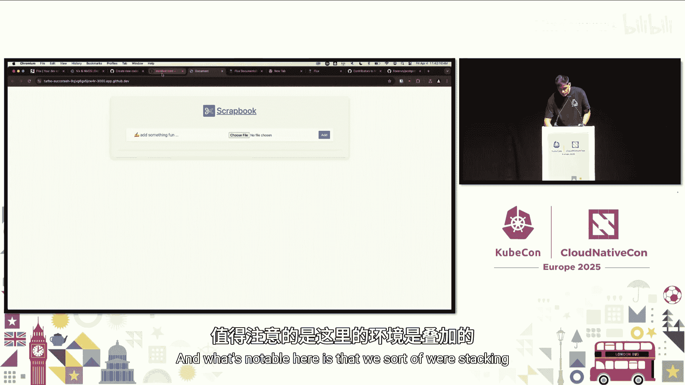

So you'll see at the top of the prompt or for you it might be at the beginning of the line and now it's taking up your entire window。

 it says fs and we have the f test environment which has like Docker and all of those things installed for our home directory and then we have the scrapbook dev environment for my go interpreter and then we also have the Postgres database and then the Postgres database is running a service。

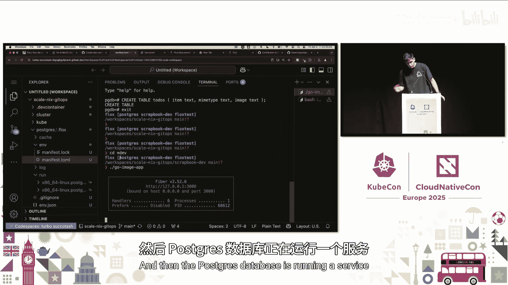

So that's， you'll also notice， you know， like you can say。呃。No， we can。

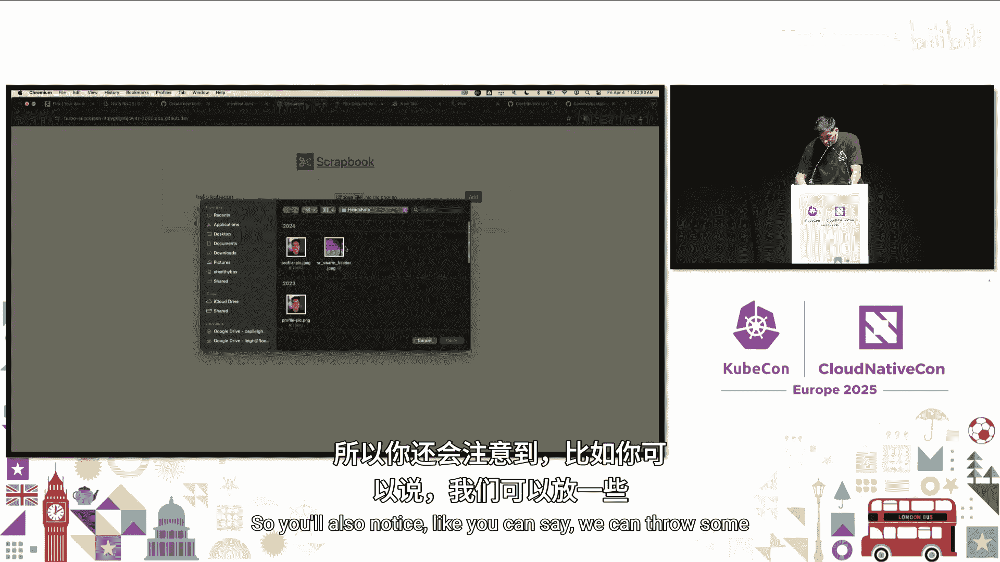

You know， throw some。Pictures in here and then upload them to the database。 And now they're。

 you know， being serialized and stored within Postgres。 So if you， you know， stop the application。

 now the app's not running and then。You know， you start running it again。It'll come back。

So that's just like my little scrapbook， which is like a little modified to do list where you can put pictures。

 The idea as well was that image magic is in the go application。

 So maybe if you are really good with the Iic API， then you can start you know。

 making the images a little bit more generative。In， in the fun 200s， you know。

 turn of the millennium kind of way。

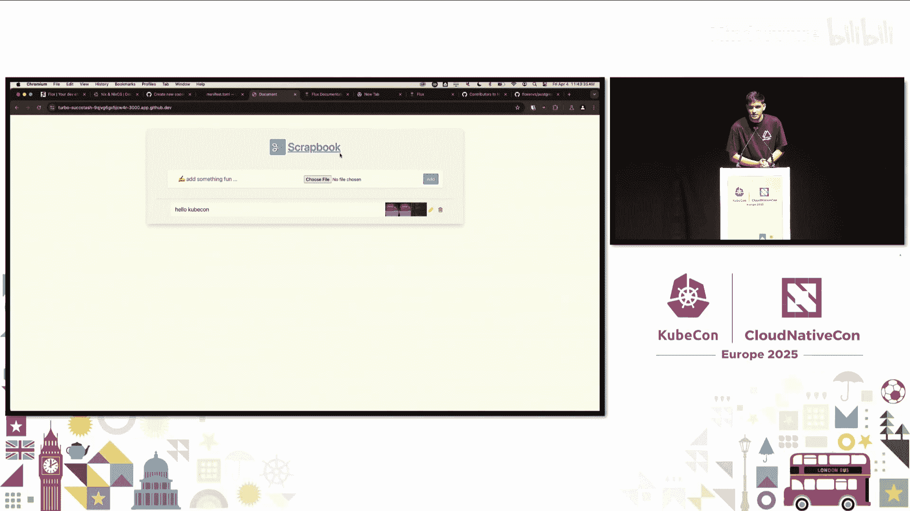

Great， so we have our application。 I think we should try to think about what we can do to put this in a container。

There are some easy ways and then some some more experimental ways。

 So the very first thing I can show you would just be f containerized。

What this is going to do is it's only going to take the environment， not my application。

 just only the dependencies for my environment。And it's going to put them into a container。 this。

 honestly。Is it's， I think in an early form and a a glimpse of the future。And。I guess。

Suspicious ownership。Why would that have occurred。I think that this was the a。

Saying this won't happen to you。 my， my code space is in a very different state than yours because it has been through multiple restarts。

But this is a file system permission issue that sometimes happens on Github code spaces when they recreate the temp directory。

 as well as some of the device tree。 And I have a script inside of the。Deev container。It's the。

Post creates script and the probably the posts。Start。Should have fixed the permissions。

The Nick statementmon's running。改。I'm expecting that to work if it doesn't。

 then I will show it to you on my Mac。You know， why don't I do that just now already too。

So we ran that。 and then I also need。Terminal here。So I'm。

 I'm here with the repo checked out on my Mac， obviously， because I'm using my Mac， I shouldn't say。

 obviously， the all of the binaries that I'm using from N's packages are built for my Mac。

 There's no such thing as a Mac O container right now。

 that is anything that you would actually want to use。 There's some experiments， but。

If I run flux containerize， then what will actually happen fail to populate Docker I I need to start Docker because I stopped my machine。

At the start of the session。Let's go ahead and just run that with klima。

 It's my favorite container runtime on a Mac。I guess。Meanwhile， okay。

 I need to fix my window management。 Here we go。Cool， back on the code space。

 f container I completed， and it wrote a container image to the runtime。

So this image doesn't actually have my app in it。 It only has my dependencies。

 That means that if I want to actually build something with that。

 then I need to probably write a docker file around it。 you know， so I can use those dependencies。

 so I basically have created a base image out of my f environment。 The cool thing is that。😊。

I can also run that same exact command on my Mac。 what will happen here is flocks will actually resolve the Linux version of all my dependencies。

 and it'll put it into a volume inside of the Docker Damon and then it will use that volume to build a container image that is Linux native that respects basically the lock file so for all of the Mac packages。

 you'll get the same exact versions of those packages with the same build flags that were built at the same time in a hermetic way on the public build servers that are called hydra。

And then that'll assemble it into a docker container。 You'll see that this process。

I wish it was faster。 And it's， it's very possible to make this a lot faster。

 It's just that it's an early sort of prototype of how this works。

 Some of the ways that you can make it faster would be I started messing around with a kind of more manual way of doing this。

So， I have。嗯。Yeah。Add flux and。Generic docker file。Let's go ahead and push up a commit to the repo。

 You can pull that down if you have it cloned on your code space。

 So this docker file that I'm messing with。Let's go ahead and just read the source code。

It's Docker file dot flux n。What this does is from Github container registry flock slash flocks。

 So an installation of Ns with the， with the fs usability layer on top of it tagged at just one version ago。

 so。From this image， I'm gonna make a working directory。 and from my application directory。

 I'm gonna copy my dot f environment into the build context and into the container。

And what's really important about this is if you might have noticed when I looked at where the go interpreter was or the go tool chain was coming from。

It，It was actually inside of this folder， but not actually， it's being slinked into。

What's called then store？Which is basically a flat directory of a bunch of hashed versions of different。

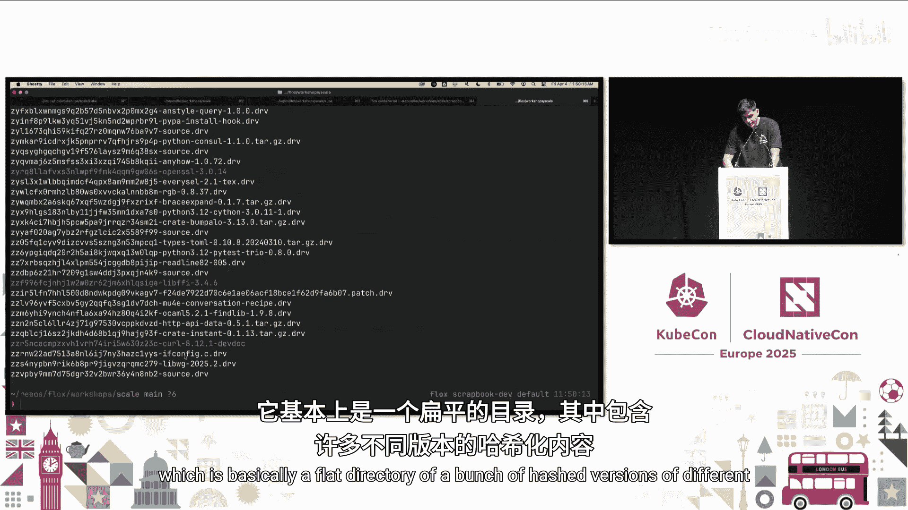

What are called derivations， they're like pieces of packages。

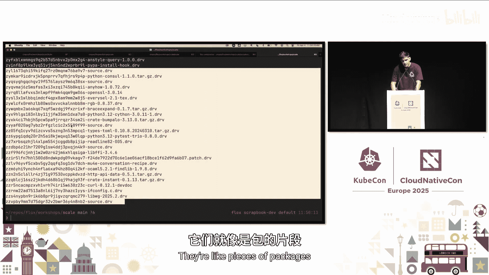

嗯。And so because everything is actually in the N store and it's only slinked。

 then when you do this in your Docker file， you're actually only getting the metadata about the environment。

 so none of the actual binaries or documentation or library dynamic libraries are actually being copied into the container here and then when we're in the container。

 not on a Mac， but in the Linux machine for arch 64。

 we can activate the environment which will go and pull down everything in order to make sure that it's actually runable and then here we can actually query。

The next door。So I'm saying I would like all of the requisites。For the runtime environment。

 for my current built system。And my current system from the。Nick's standard library。

 And then we have to do a little bit of formatting。

 And then I also threw a couple wild cards in there because I'm lazy。

 And then basically after we get all of the requisites。Then。These are recursive hard links。

To all of the files in the next door。 But in a folder that I can look at separately。

And once we have that folder， I tested a few things。

 this seems to be like the most performant and bugfree way to do this。

 Then you can call that a build stage where we basically get all of the requisite storepaths for everything that our environment depends on and then we can copy from that environment and then into the N store on an Alpine Linux machine。

So this， this new container that we're producing， it no longer has Ns or flocks or anything needed for Ns or fs。

 It only has the dependencies that are necessary for the applications environment this is effectively equivalent except the base image is different to what f containerized does。

 but the benefit of doing it this way is that all of the logic sort of stays in the Docker Damon and you're kind of only in a Docker file。

 So if you're using tools that use Docker files or you want the cache coherency and behavior of the Docker buildex builds then this is one way to do it so you can。

You can say something along these lines。If I Docker builds with this generic Docker file。

And then I can name it something like say， like scrapbook runtime。

 and then I point it to a folder where the context of that environment is。

 then you should get a docker build。So it loads up flocks， I already have it downloaded。

 that machine is like a gigabyte because it includes Ns and flocks in all of its dependencies。

But we're just using that as a builder image and then we run the f activation Internet's working pretty fast here in this conference center Lovely this is again。

 happening locally on my MacBook and then we queryrry the next door， we find all of the pads。

 we make sure that they're recursively hard linkeded in a way that's completely isolated from everything else that's not related to it and then。

This usually takes like whatt，25 seconds， yeah。This step could definitely be removed if， you know。

 you just wrote like a build deckex frontend or did this a different way。

 like directly with O C I Reggis of storage。But yeah。

 we get copied into our new image and then you end up with， in the case of a Mac。

 this is an arm 64 Linux image that is runnable。嗯。You're in a shell， and。Inside of Nick's door。

 there's all of my dependencies。So you'll notice I was using Alpine Linux there。

 It's just so that youd， you know， have a reliable base for a shell and don't have to go and find。

 you know， the Sim link to。 there should be like bash in here somewhere。L S next door， Gr bash。Yeah。

 so I mean， like you could run bash here and set the entry point and then you wouldn't need Alpine Linux at all。

系。There's just an alternative way to build those sorts of base images。

 but we want to be able to get our application to a format where we can actually run it inside of a container。

So let's go ahead and look at。What that Docker file might look like？This is probably the most。

Kin of standard way to do it。 So if you've used Docker before。

 what's happening here is a multistage build so the first stage is up here and then as soon as you see another from statement。

 we're into the runtime which the last stage is always the output image。

 so basically from the scrapbook dev environment that we produced either with f containerize or with my special Docker file hack we're gonna enable Cgo so that we can use our C bindings with Iic。

We have the work directory being set， copy our source code in there。

 make sure we pull our dependencies， and so we actually run a fully containerized build that's not dependent on anybody's imperative you know kind of process or debugging or whatever they did on their local machine and then。

We make a new runtime container， so we don't want to have the the go interpreter and all of that stuff in it。

 we just want our C libraries ideally so we have a separate flux environment that is the base image for this that only has image magic in it and then we take our go binary and we。

Just copy our web assets in there， as well as the binary itself。And if we build this。

So you'll need to make sure that you have run like flux containerized on both the scrapbook dev and the scrapbook runtime。

 or run the Docker file on both of those， then you can go ahead and run this Docker file。That's just。

Docker build and then dot。I've already done this。 So it's built to the go application。

 And you end up with a container image that is usable。 You should probably tag it with something。

 I'm just gonna。Call it。Scrapbook run time。没完。得。So then this container image you。Can Docker run it？

Oh， that's right。现个。Yeah， thank you。 Appciate it。's that was exactly the thing that I needed to hear。

 Thank you。You'd really appreciate that。Okay。There we are。 Okay， go。downownload。

That was an interesting one。 You have to have a temp directory in order for go to build。

 I I can't say that I knew that。But I guess when you。And you have minimal container images。

 sometimes。Sometimes you discover fun things like that。Oh， I should actually unpack something here。

 I'm like glossing over a little bit of a hack that I've done。

So let's go ahead and just dig into that。For a second， this run statement right here。嗯。

In order for this go builds to。Link up to all of the。

C binding for the C binding to actually call package config and and build all of the image magic stuff into the binary itself。

We need to make sure that our environment is active。

And so a hacky way to do this is inside of our base image if you look inside of the N store for the development environment that comes from flocks and again I'm doing a little hack here because this really should be pinned to hash that's specific to the image not that there's more than one in there there's just one but and then we run the activate script with the environment from that same thing and then we can execute。

Go build。And that allows you to actually build against those bindings that come from NI。

 these kinds of wrappers are necessary because since everything actually lives in the N store instead of the standard file hierarchy so like nothing is coming from slashlib or slash user there's like nothing to bind against in those directories。

 we need to have an environment that's specially structured to inform the linker and the loader when programs are built and started where to find their dependencies this is just kind of an inherent thing about how N works and something like this is you know again。

 a sort of proof of concept kind of hack you wouldn't want like the final like usability to look like this。

 but conceptually what's happening there is we are hydrating the environment of the build so that it can find all of the C stuff in a nonstandard place。

The reason that we want to find it in a non standardard place again is everything in the next door is hashed。

 specifically to the inputs or to the content address of the bits of the packages themselves。

 And since they're hashed， that means that we can be。Fully sure。

 every time we build that the exact versions of the things that we want that our binary will never accidentally get the wrong version of image magic or a slightly different version of Gliby。

 It's always only ever gonna be built against exactly what it's supposed to And then when you run it。

 it'll only be It doesn't even know how to accidentally find other things。

 It's just only ever looking for exactly the stuff that it needs。

 And this these sorts of loader hacks and environment rappers and things like that。 are our。

In like 99。9999，9，99% of the time， like completely free。

 you never will notice any performance or behavioral difference with your application。

 It'll just work better than。Any other time you've had a weird issue where you've had a version sw between something you were using on your Mac and something that got accidentally pulled and updated on some reconciling thing in C。

But you're only found out after an incident。Has anyone ever had a problem like that， You know。

 you're like， you had a version like slip on you with something that was actively running in production。

 And then you ran C I to like rebuild something。 and then it just like didn't work the same or the build didn't even work。

Yeah。Yeah。Seeing a couple of nods。 It's like one of the most mortifying problems that you run into。

Let's get to a place where stuff is reproducible。So at this point， we have a container。

That runs our application。Right， like if I were to。Then。Should be able to just。Run。

 I think it's like go image app。 yep， cool。And。Another hack that's happening here is the entry point for this container is actually the flux environment itself。

 So you'll notice when I activated the scrapbook runtime environment there or a Docker image。

We ended up in a flux environment， specifically for this go app。 and there's a bash shellll， so。

I'll show you what this looks like。Say we wanted to actually run the the like just with a single Docker run command。

 we have to。I think。Just past the binary that we're intending。

 and then that gets activated as an argument to the activate wrapper。

 So that way our go image application is finding the exact version of image magic that it needs in order to actually run。

So that' now we have our application containerized and there's some caveats about how to start it。

 basically our entry points is not pre programmed because we need AGs。So I could have added as to it。

 but let's look at a Kubernetes manifest for this kind of thing。So in the cluster folder。

In the scale Ns Giops Repo， there is an app folder that has a D B Yaml and a scrapbook Yaml。

So most of these things are for illustrative purposes。 so ignore the the missing。You know。

 shutdown hooks and things like that that you would need and like missing resource limits and all of that for an actual Kubernetes deployment。

 But here we have a Kubernetes deployment， Yaml。And we're calling everything scrapbook。

And then we can point it to some container image here。

 This is using a different name and tag than what I built just now。But。

You can build it at that same name in tag。And then here we're doing that sort of workaround， right。

 like passing an argument so that we can load the binary in a maybe like slightly non standard way。

And then we want to pass it some connection data for a Postgres database。

We'll just tell Kubernetes that there's an HTP port on 3000。

 as well as a service that's pointing to that port。And then in the database Yal。

 there is a config map here， I didn't build the database with N。 You can do that。

 One of the things that's nice about using the upstream Docker image just from Docker library Postgres is that they do have lifecycl for creating tables so you can just put。

A SQL file inside of a config map and then mount it which is really nice。

 And then what's also nice and what was kind of being used by my go application to connect to my flux environments Postgres database is that there are standard environment variables to direct。

Postgre drivers to the right place。 So my f environment was setting these things。

 And I just copied them， put them into a secret， and then made them appropriate for the Kubernetes service name。

 There's a little deployment here。 Again， This is definitely not a production ready database。

 It's exactly the opposite。 It's a single replica deployment of。Postgre。Container instance。

 so it's not even using a stateful set。And then there's the volume mounts for that table initialization logic。

And then。Except。So sort of the full story here is that we would be able to run our application in the Kubernetes cluster。

Let's go ahead。Let's go ahead and skip actually， like applying this and running this because we have。

 I think， only a handful of minutes left in this session。

 Does anyone have any questions about flocks and Ns itself。

 And we can maybe spend a few minutes on that。 And then I have a few closing statements about Giops。

嗯。Hi。Yeah， so usually stuff in next packages is very up to date。

And if we search for the top level Postgres SQL， I think would probably be what we're looking for。嗯嗯。

So yeah， ask Q O let's go ahead and flock show Postgres SQL。 and then I'm gonna pipe it through head。

 and let's go see what's on top。 So currently 17 dot4 is the most up to date package I would expect that for any high traffic software the usage the user base is incredibly wide and active。

 if you need to update a package。 you can open a pull request on Nx OS slash N packages like。

You don' you don't need to know anybody， it'll be reviewed by somebody who knows what they're doing but for packages like Postgres they have an active community of maintainers specifically looking at that all of the time。

 and then there are bots and scripts that are constantly looking at upstream places to automatically update these packages。

 The result is that N's packages is larger than pretty much any other package repo on the Internet and it tends to be the most up to date。

Thanks for the question。嘿。Yeah， S bombs， I think the story is pretty like like。

 like it's like it's like begging for an S bomb story， right， And like when you。

 when you do that next store。嗯。You know， queryrry requisites， you know， for some。You know， scrapbook。

Dev flocks runtime environment for some CPU architecture。

 then you get a list of every required dependency that would ever possibly be touched by applications being run in this way。

嗯。And that's like a little bit of formatting away from an S bump there's no like flag for it right now。

 but definitely the story is like obvious there。 Also something I would say that it's like kind of weak right now in I shouldn't say kind of it's very weak。

 It's almost nonexistent is a vulnerability correlation in X packages just the way that the packages are maintained and stuff there's nobody you know who's like FedRA certified like looking at all these things and trying to correlate them to you know does some CVE apply to this or whatever yeah。

Cool， that's gonna be the last next question。 I'm gonna take five minutes to just talk a little bit about the vision of like getops with this。

So one really cool thing here is when I update the environment。

 I get a even if I'm working with it imperatively， I get declarative changes to a manifest inside of my project's repository。

 I do a gi push and then when my teammates come in in the morning and they do a git pull and they activate we're all using the exact same versions of all of our dependencies。

So that means that any time that somebody makes a decision to pull on a new dependency or update something because they want to use a new build flag or a new API or a new you know feature or subcomd。

 or they just really want pretty printing for that JSON output that came from AWS CI and they're putting it inside of your you CI script。

 then。Any change that we make， it just naturally becomes a declarative consequence of iterating and collaborating with each other。

 It ends up encoded in the repo。 This， to me， has like a really nice mirror to gi ups。😊。

Where the reason that Kubernetes begs for Gioffs is Kubernetes is so wide in scope， networking。

 cluster management， Compute， storage and often across many。

 many namespaces across multiple clusters， multiple organizations， multiple teams and apps。

 infrastructure that's like deep in critical experiments。

 things that have been there in production should never change in the next 10 years。 Kubernetes。

It begs to own all of that。 And so。People are begging to collaborate on Kubernetes。

 but ain't nobody walking in into you know the office in the morning and they're logging into Kubernetes to chat with their teammates。

 right Kubernetes is not a collaboration tool。And so。

Using Kubernetes as a team begs for us to glue collaboration in front of it。

RightAnd that's what like tools like flux and Argo are really good at doing is educating people about how the infrastructure works and then giving them an almost invisible thing。

Where it's like you don't even have to look at it when you are making collaborative changes to your infrastructure。

 when you're changing code， the robots are always constantly at work。

 reconciling and making sure that exactly what is intended is funneling through the builds through the links through the artifact publishing。

 signing， verification。To your fan out in production。And。I think that there's a missing step here。

 which is that that's everything operational。We need to take gi ups further。

 We need to shift giups left。And I think it starts with how we think about using。Our machines。Again。

I'm really happy to walk people through things if you would like to continue hacking on these things。

 you know I want to be respectful of everybody's time， but like in these last two minutes。

 if you look in the scale， N's Giops repo， there's this cluster folder。

And for any flux users that showed up， there are a couple of new things I would like to show。

 one is a usage of the open source flux operator by control plane。

 who full disclosure I'm employed with， you can make flux instances and then point them to a tagged release of the flux operator manifests for installing flux at a particular tag version Se bear scheme。

 and when you make this and you install flux operator and you put this one flux instance in your cluster。

 now you have auto updating flux。That's really nice。 if you've got fleet。

 a fleet of 1 thousand or you know， a couple hundred clusters or something running on tractors or whatever。

The next thing is， okay， well， if we're gonna be installing flux this way。

 then it sort of feels like it's replacing flux Botrap。

 which is sort of the bread and butter of anybody using flux。

 So a good way to sort of emulate that is we don't have to worry about the installation manifests anymore。

 let's just make a git repo point it where we're at create a secret that has a token and then make our top levelve customization So here you can see the git repo is pointing to the one that we have cloned and then it's configured with a token and it's going to reconcile every minute on the cluster path。

So that would be this。Which means that now the Git Repo is also managing what version of flux you're using on all of your clusters as well as itself。

 and then creating a namespace for your app and then deploying our database in our scrapbook application to the cluster using our container image that was built with NICs。

And， again。That container image， all of the dependencies。

 they were always version locked from the moment that we used them。

So there was never a shift where it's like we went into CI and now some。

 something different is happening。 And there's never a drift when I'm experimenting on something。

 and then somebody on another laptop pulls down my branch。

 and they're actually using a different version of Postgres。Like just these differences。

 they just can't happen anymore because we brought declarations all the way through the collaboration platform。

 not just for production infrastructure， not just for ops， but for our development environments too。

 And I think that that could be a cool piece of the future。

 So thanks so much for coming the tutorial today。 I wasn't expecting a production incident to take on flux hubub。

 But you know，s there's always cool stuff that happens when you are friends with people at startups。

 And I'll be like around if you know， we want to have a little chat about whatever you guys want to chat about。

 and thanks so much。😊。

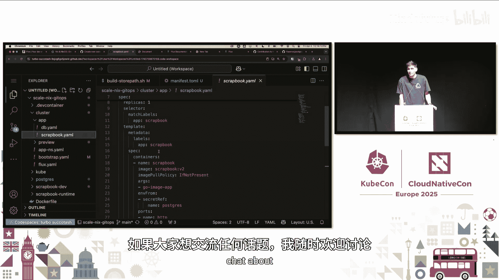