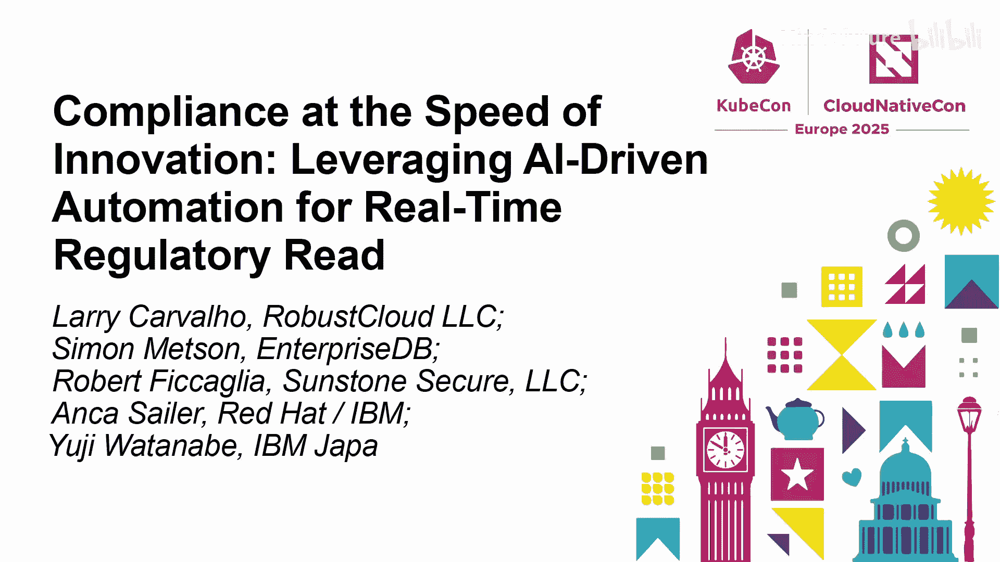
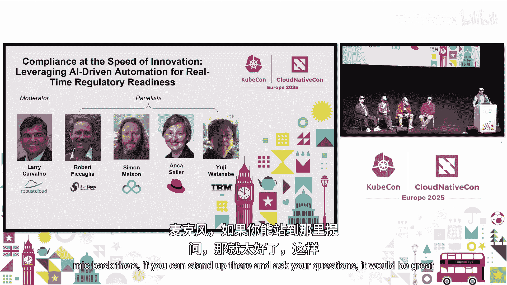
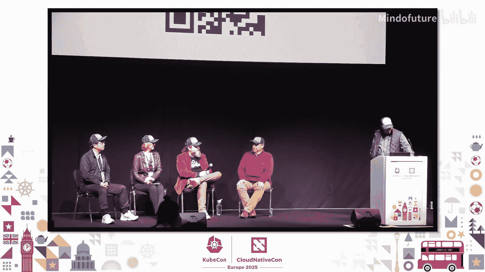
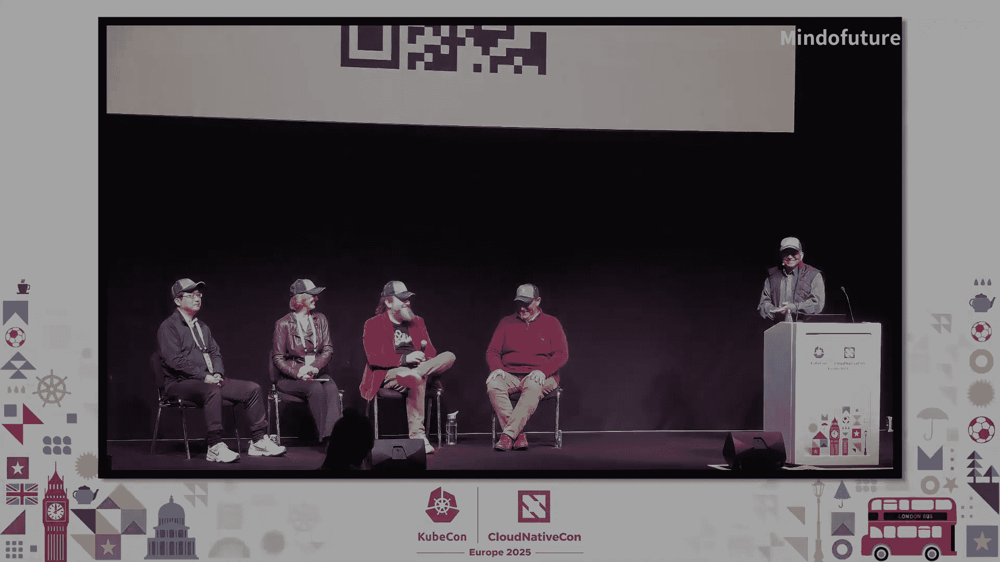

# KubeCon-+-CloudNativeCon-大会2025-｜-云原生计算-｜-可观测性-｜-Kubernetes-｜-Prometheus-p29-P29-Compliance-at-the-Speed-of-Innovation---Leveraging-AI-Driven-Automation-for--BV1Cd32zDEBG_p29-

Thank you for attending this late session。

Just quick introduction， my name is Larry Kvallo， I'm an independent analyst and I bring great panelists to the stage and we are going to talk about compliances code。

First of all， the caps we are all wearing are is the CNCF project that's in Sandbox right now。

 And that's the open source project that we are going to talk about a little more。嗯。

Complis code is really a business liability。And you will learn how to achieve continuous compliance with automation and standardization at this session。

We will start with the panelists giving one slide。 They'll introduce themselves。

 They'll talk about their slide。 And for those who have questions， there is a。Mike， back there。

 if you can stand up there and ask your questions， it would be great so that we can record it properly and have it for those who cannot attend and attend the replay。

So with that， without further ado， I'm going to start with Robert， who will talk about your session。

 please introduce yourselfselves。Can everyone hear me Yep great hi my name is Robert Facaia。

 I'm with Sunstone Secu we started in 2019 primarily around the open source community as a group of senior CISso executives and our core area is public sector healthcare heavily regulated industries like pharma。

And from day one， we were trying to solve the problem for ourselves how to manage。

Compliance in large enterprises with minimal staff。

 reduction in budgeting and yet an increase in attacks and increase in threats and from day one compliance is code is an investment we made we built out knowledge graphs and have applied machine learning to that over the last five years now that's actually a common way to do things called GphraG and we've been involved in the policy work group in Kubernetes。

Working on formal verification with NIS and other groups。

 and we are contributing all of our AI related security and compliance to AINativesecurity。org。

 so glad to be here。Looking forward to a great panel。Simon， yeah， hi， I'm Simon Meton。

 I'm S VP of engineering at ED B。 We mainly do Postgres worrying about data， how that gets stored。

 how you process it in various systems， AI analytics。 What have you。

I've been working on kind of cloudy products for。Longer than I can remember 13 years or so。

 And one of the things that our team had to take care of is taking our environment through Sock 2 audits and PCI audits。

 things like that。And so being able to sort of automate those problems away。

 I remember one of my info team was sort of leaving the office and 7 o'clock one evening which is sort of ashen。

 And it's cause he'd spent all day pulling。Lists and lists and lists of servers and ports and all this kind of stuff for us。

 all very。Paper driven audit。 And it's like， this is not the way to do stuff。 So we。

 we started building some software to do it。That became a product we or project that we open sourced  5。

6 years ago called Aitory。 And we're working with the Oscar stuff and and compass to sort of see how we can kind of plum that in and maybe bring it into CCF in the future。

And， if you can say something about the open source project also。 that's great。 Hi， everybody。

 My name is Anka Sler。 Thank you for being here。 I'm a distinguished engineer at Redhead and IBM and I have two minutes now。

145 to tell you everything about compliances code， which is impossible。

 So I packed as much as possible on that slide that you can analyze afterwards yourself。

 I'll just give you the keys to that So in that picture。 you have the horizontals。

 and they are the videos layers going from compliances code as as policy as code。

 And this is what Simon talked about。 And on the top。

 you can see the regulations they typically come as PF spreadsheets that cannot be used in a programmatic way。

 So the compliances code， particularly O Open security control assessment language is a N standard for compliances code provides schemas for specifying your controls catalog。

😊，Is there in yellow。 It allows you to specify for technology how those controls are expressed as rules。

 And then at the policy code level allows you to map to the actual check Is and the evidence that is associated with that。

 So these are the horizontals。 Now the verticals。 we give examples for each of those horizontals。

 One is in the Do context and the other one is in the EAI for AI。

 So there are controls rules associated with that and so on。

 If you want more details now you can look at the text。

 you go on the left side of the screen and you can see the Oscar link where you can go and learn about the details about compliances code and the artifact schema and you can also look at our CNCf O compass project that provides an SDK tresle for the O and also a platform on top of that。

 So it allows you to manage all the layers that you see in the picture。

So the need for this compliance has became very evident when we are bombarded now with many new regulations and also the industry is moving from annual and quarterly rewarded to a continuous compliance。

 So here is your solution。Youing。系い。Hi， I'm Yuji Waabbe from IM Research Tokyo。

 I'm working on the how to apply the AI and J J AI and agent technology to the this code field and the this area the as you know。

 the lot of the。Different persona work involved and with a different knowledge and different experience。

 a different two。 So the very the process is very complex。And now we have AI Gen AI and agent。

 So the we are trying to apply how the agent AI， Gen AI can help the whole entire process。

 We started from the analyze use AI for analyzing the existing policy document。

Internal control and requirement document and all the knowledge from the different persona。

 and then we the new regulation code in the agent GI use is used for analyzing the what is existing what is can be mapped to the existing control as existing framework and find the gap then identify what what is missing。

 what needs to be filled。 then apply the G AI to generate the control。

 and and this is over the process。So we are and we are using trying to use this agent and J AI to improve the overall the speed and efficiency。

Thank you。Right， thank you。 Thank you Vigi。 So we're going go through some questions that we have already you know prepared for for those who have any questions。

 whatever you don't understand， we've got a great panel here。 please make use of it。

 Please stand up to the thing when you're ready and I can I can get your questions to them So Anka。

 how do you prove the AI used for compliance I itself trustworthy and operating correctly。Okay。

 so you want your slide back again if you need to talk to it Yes so you have seen that now we have JenI right and we have in the pipeline multiple agents to help with the process and obviously the question is how are we able to evaluate and answer is benchmarking So together with the agents that Yuugene mentioned and the first one for the assessment for policy code is also available in open source we also provide an IT bench if you are googling for IBM I bench you are going to see the IT bench with two。

3 samples agents for Caw compliance assessment for S for phops and they come with about 50 scenarios and they are modeled in a real environment they are deployed in a real environment to test the agents that you。

S， you can subscribe your own agents。 You can use the ones that we have already to play with or you can register your own。

 and you can test them against those in the case of compliance 50 compliance scenarios。

 This are typical C benchmarks that are made available deployed in a real environment with un with opPA for REl and for Kierno and for opPA。

 So this is the way that we can set up benchmarking and provide the comparison not only between how the agents behave but also against a standard of what is the right answer because we have obviously the ground truth together with the 50 scenarios。

Right okay so next we'll go to Yugi and how do you approach national natural language compliances code this could include crosswalk various regulatory frameworks and down to specific controls as well as AI ingesting ragging tooling with many you know policies and procedures and round trip engineering so。

The initial input is。Nural languageage take。 So it's highly very abstract and non operational。

 So the first use the AI to extract the information and find mapping with the existing the compliance framework and the requirement。

 That part is the fast fast layer。 So we are using doing the layer， the layering approach。

 fast layer is a very the analyzing the document。 then second layer is a lag。 So many。

 many the curated body of the document framework control requirement is picked from by using log mechanism that input to the AI。

Then then AI user do the analyze the crosswork helps the cross working process。

 So find the commodityality between the multiple multiple the regulation then the if the if the new regulation regulation requirement covered is covered existing the control then it's okay。

 but if if we if the new some datata is fine， that part is filled by the generation and and also that this part if the。

Policy exists， some implementation exists， but some changes required we use the agent to identify what is a de requirement and how to change the existing policy to the new policy。

 that part is also done by the agent。Okay， so next， next question is to Simon。

 what operational challenges does a cloud native environment present。

 And what about the opportunities that you get。So from a sort of compliance point of view。

 I think there's， there's。My answer to both questions begin with a D， which I thought was cute。

 So the the the challenges come down to the dynamism of the system。 So you want to have an auto scly。

 You want to have things where pods are ephemeral coming in and out of， of existence。

 You want to be able to enable developers to spin up a database through an operator or whatever。嗯。

And that's how you get the benefit of the， the cloud native environments。

 But that's completely at odds with some of the controls and expectations that those controls have。

 So we're looking at FedRA for， for some of our product。 and， and there's things where like。

This change requires a general to sign off on it， right。

 So having an API that lets you spin up 1000 of these things。

 The general is not gonna to be pleased with that， right So that dynamism causes problems。

 So not only do I need to sort of measure and track and collect evidence in this sort of rapidly changing environment。

 But also， the policy needs to change and adapt and adapt and pick up that kind of real world。

 New Bra world sort of thing。But the， the， the， the， the benefit of the the cloud native stuff is。

 is another D declarative。 right， I know that if we provision a database through CP， for example。

It's always gonna to be the same thing。 It's the same image。 It's the same set of ports。

 It's the same behavior。 And so I can， I can use that operator to make sure that when I make another one。

 it's the same as the last time that has been approved by the general。 And。

 and that can then feed into policy and behavior and procedure。

 because it's not about every time I make one， I it okay，'s。I've made one once。 Was that O， O， now。

 I'm happy with making more of them and stamping those out。

 that declarative nature that you get from Kubernetes。

It's a lot harder to do with other other sets of tools。 You can do it， but。

 but cube really gives you that opportunity。Andken Yugi， you want to add anything to that to the。

Challenges or opportunities， or we can go to the next question， okay。So I'll go to Robert。

We all thinking about cloud native compliance。 But what would AI native compliance look like。 Well。

 actually， I'll answer that， and yeah， continue the conversation on the challenges Simon was speaking to you。

 As you were saying that， I， I contrast cloud native。

Confidence in that declarative code with what now if agents are generating that code and that's the kind of design I'm seeing。

 In fact， you come the great part about cocon is you come here thinking you have this bespoke problem that no one else has ever seen and sure enough this morning I went to a great talk Google gave this morning about using AI LLMs to generate their controller code right and the point they made is the same point I'll make they generated1 thousand controllers with their LLMs now someone had to go review those so now the task is just shifted to a different type of complexity so if。

If Kubernetes and cloud native today is about the comfort zone around Declarative。

 how do we transition to a model where agents and prompts define your system。

 now how do we build the skill sets for those humans who have to be part of that trust loop。

How are they going to evaluate， how are they going to keep up with the scale of code that's being generated because you might not have humans crafting very small blocks of code that are highly tuned。

 it may be more advantageous and scalable to have the agents generating thousands of blocks of code that are reassembled and dynamic every day so they one example of how fededRA breaks down in that world or this standard 53 breaks down is they assume you have the static inventory and they tweak this to say。

 okay， well， we understand containers maybe a more of them and they may be ephemeral。

 so at least give us a container image inventory。But how is that going to scale when you have agents generating the images。

 generating the deployment？Even without， you have the problem of I have an immutable image。

 So how do I do a CV patch right That's the fun one。

 I have to change the image to fix the CVE and I have to fix the CVE within 24 hours or whatever the timeline is。

 So you've got that dynamism is just prevalent across the whole system and you've just got to work out how to deal with。

So I think it's that， you know we're going to be orders of magnitude more dynamic。

 the speed is going to have to increase and then the human ability to keep up with that code and the risks and the thought model that go along with that。

 that's going to be the biggest challenge I see in the next。I can end one more。

As you execute all these。New controls。 And let's say that， you know。

 we solve all the AI needed controls and the Dora and all of the kind。

One problem that I have seen and if you are just starting on that journey you will notice as well is the cultural change that is needed in your compliance team to move from the current manual processes and screenshots to technology and the main problem that is there is that these teams are by design non-techn and they are right now introduced in all this world not only on the technical level but with agentss and with AI and they are overwhelmed。

 so I think one thing that you need to have in your agenda is to help those teams bridge the gap into the technology either with support from agentic advisors all technical team it's much easier for a technical team to be upgraded to skills that deal with compliance than other way around so this is one of the challenges that。

One， one of the things that we've been trying to do and think about is。How do I。

 how do I turn a compliance problem into a software development engineering problem？

 And so if I can use an AI to sort of say， I know， the control is that all data in rest in the system must be encrypted。

 It's like， okay， cool， I can understand that。 But if you say。

That means that lux needs to be turned on on every server。Suddenly。

 it becomes a configuration management problem rather than a compliance problem。

 And then you get into the evidence collection around that。

 But turning these problems into things that S R， Devops teams。

 engineers can kind of rationalize really quickly or even use an agent to sort of turn into some system。

 I think that's how you get around that sort of thing。 and the roles sort of a slightly different。

 And it becomes that sort of communication between different types of team。

 turning the control into a thing that can become code or configuration or an agent prompt to what have you。

Great， so。The next one is for Yuuji again。 I there any questions from the audience， By the way。

 I don't see anybody standing near the mic， So I'm taking that there isn't any yet。

So usually the title talks about speed， where we talk about speed of innovation。

What are the current metrics and you know， how do you benchmark them And then the other one is a little loaded question is real time。

 really realistic And you know， how do you audit agents in real time Yeah thank you。

 when we say the real time actually is we we are not expecting the real time assessment of the by the agents actually this the we are not。

fully rely on the whole verification and assessment by the agent。 That's not， that's not today。

 but by bringing the agent， we can improve the overall。Compreance lifecycl。 actually， the。

 for example， the the。Agent can detect the new comp requirement change them or some control change them the we can agent can navigate the the relevant stake persona to do the action。

 and it can be a part of the C pipeline。 So the we can ask bring the compliance activity in the more shift form way the not so that's。

Kind of efficient improvement to bring bringing bringing by brought by the agent。

 and for the benchmarking the we So one approach So approach is So how much how long the over the。

ニュリレショューレーションュリポトメ anotherハ how manyマニュアル touchポイント included inザサドゥサ。Subportting new change， so。

That kind of metrics is used for evaluating the effectiveness of the G AI and agent。

 And the first last one is the。Audit audit for the agent。

 So actually that part is really the difficult part， a challenging part。

 one this is not specific to the complaint， but this。

 if we bring the JI agent to the this regulated scenario that part that in that auditability is really important。

 So one approach is agent explainability So keep the all the trajectory of the agent is recorded and provide easy transparencyability transparency to the human beifier and keep the record for the rate compliance or。

If other compliance evidence， that type of things is approached for the。Agent。嗯。Auditability to them。

 Any thoughts from you， any of you。Okay。Okay， we'll go to the next one。 An again。

 What are the realistic timelines and budgets for digitized， enabled compliances code， You know。

 Yeah， this is a question that immediately。 I get when we're talking with our customers when we bring the compliance modernization and compliance digitization。

 it was of we have a very good white paper from the time before Gen AI around 2020。

2019 by coal fire where they made an assessment of the。😊，Total cost of ownership T C。

 when we introduce compliance modernization， and they show that using Oscarlike technologies。

 it will reduce the T for compliance by 50%。 And now we see as we introduce accelerators like the one that Yuji mentioned to his agentss。

 This becomes much more complex cost evaluation because on one side。

 we have the reduction in the development cost using agent to develop code。

 it is much more accelerated but on the other side。

 we have all the additional work in creating the benchmarks in creating the controls the totally new path for explainability like UG has mentioned。

 So I think right now we need to have a new assessment。

 I think the original 50% reduction needs to be reeval。ed definitelyly there is an improvement。

 I don't think we have the choice not to go into the digitization for the reasons that we discussed at the beginning of the call。

 right， we have so many new controls that are upon us。 We are moving to continuous compliance。

 especially we say I， I cannot rely on an audit that was done last year。

 So I think this whole thing needs to be reevalu and and provide the new time cost expectations。

 Timelines。I always compare compliance as code to our experience with， with infrastructure as code。

 I see a lot of you here are very young。 I lived to see the infrastructure configuration being managed with spreadsheets。

 Okay， you are lucky you haven't seen that。 So we took about 10 to 15 years to mature and to have the infrastructure as code as a de facto。

Practice， so I， do I expect 15 years for compliance as code， I think with all the G AI technology。

 I hopefully will not be there。 On the other side， I think compliance is many times fall more complex than infrastructure as code。

 which is depth set cops。 people were technically， it was with you know。

 comp confined business unit in compliance。 We see this many personas across many business units。

 different type of skills。 So just。In your plans with compliance modernization don't expect that to be done by second half of the year。

 This is something that will take many years to get there。 And again。

 I cannot underline enough your cultural change will be the one that will be the longest I'll add that said you can get a faster time to value by just bringing the AI into the assessment process and the discovery process。

 So often we'll come into a situation where there's a lot of bespoke documentation and policy and procedure。

 Theres kind of a mix of infrastructures， code and legacy systems gathering all that together and then ragging that。

 vectorizing that， reviewing that， questioning that through the LMs。

 you actually discover a lot of unknown unknowns。 And there's been a lot of tribal knowledge in these enterprises where now the LMs can help surface those lots of components in the component model that the ciss and security team didn't even know existed until the LM process。

So time to value， I think， is very rapid。 Time to perfection。That might take you。

 So please join our Oscar compass to help contribute to this content and accelerate this path。

 I think the other thing there is that the the analogy within infrastructure is code is kind of interesting because。

😊，There， there's， there's like we used to use chef， and you kind of could pick up a recipe。

 So if you wanted to deploy a system， there was a recipe for chef and you just do that。

The thing that's challenging， I think， with compliance is even though the regulation is the same and the control is the same。

 the implementation in the company is very， very specific to that company or that organization so。

One company might say， well， we use this tool for our backups。

 and then another company says something different。 And so。

 so there's not that kind of the thing that's going to take it。

 make it take longer is that there isn't that kind of commonality that you can take a solution from there to there。

 you have to think in that more abstracted fashion of how do we talk about controls。

 How do we have tools that help us。But the company is still gonna have to make their own policy and procedure and all that kind of fun stuff。

 not yet。は。😊，Okay， one last question， I still don't see any questions from the audience， so Robert。

What does a Caw's Day look like in five years as AI becomes more integrated into all aspects of the tech stack and operations？

Yeah， I would say that you know the thing that humans are good at is judgment right so there's always going to need to be a human in the loop to you provide the trustworthiness no matter how many proofs we have or mathematics we delve into you know human organizations are human so they're going to need to trust an expert on complianceli in the use of AI how those AI models are trained and the whole pipeline。

 how you ingest data， the provennce of data， I guess for me the crystallizing moment is for those of you have had to be part of an incident response or a breach response and you're usually immediately brought into the C suite。

 usually there's outside counsel and often regulatory officers and suddenly the sistersA's job is to be fact-based and to provide that subject matter expertise and a moment of crisis I don't see。

That role going away with an LM anytime soon。I think the gravitas and the judgment and the expertise that humans bring to the loop will always be an important part of the process。

 and I think the skill set that AsISA will need in five years will be applying AI in the right places and applying human judgment to counterbalance that。

I think every Car in the room was hoping you'd say drinking my ties on a beach， right？Yeah， no。

 I agree。 I think it's， and it's that interesting piece where there's the intersection between a technology problem and a business problem。

 This is a business risk。 We're accepting this business risk。 that， that decision。

Is hard to sort of push into an LM because it's going to be very。

 very contingent on lots of different factors。

Very good。 Any final comments， but otherwise， if we all done on the stage。

 thank you for attending and please give a hand to our panelists。

