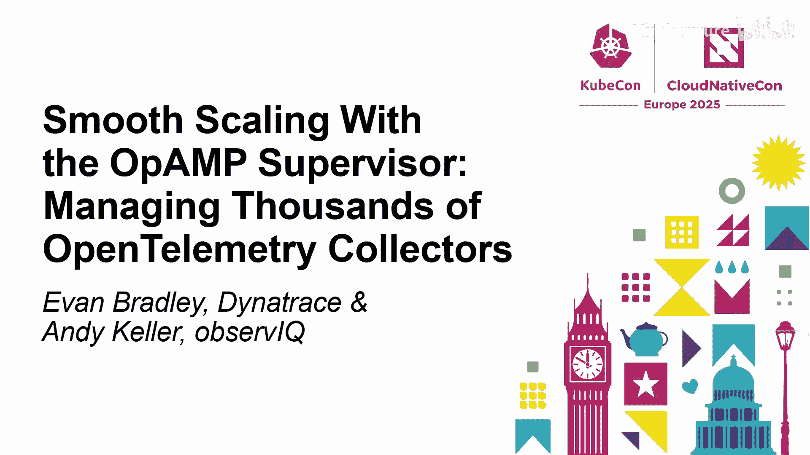
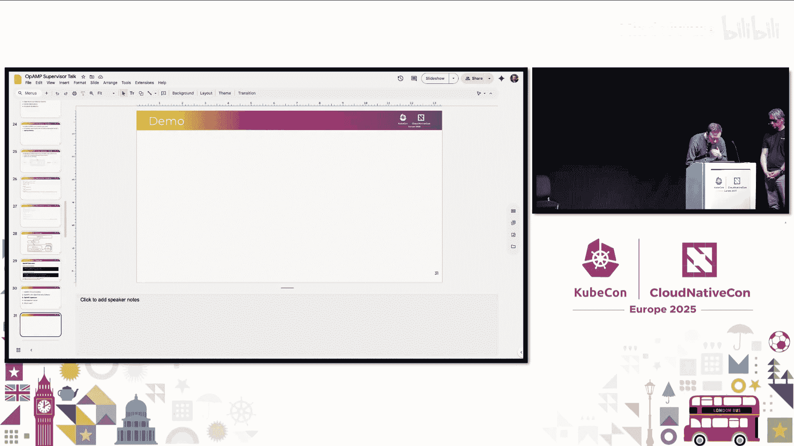
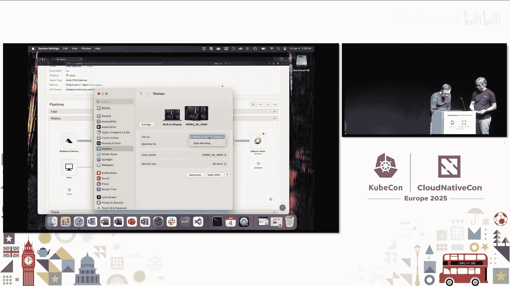
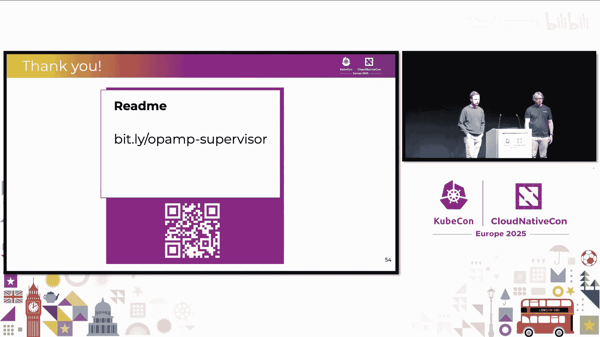

# KubeCon-+-CloudNativeCon-大会2025-｜-云原生计算-｜-可观测性-｜-Kubernetes-｜-Prometheus-p30-P30-Smooth-Scaling-With-the-OpAMP-Supervisor---Managing-Thousands-of-OpenTe...-E--BV1Cd32zDEBG_p30-

Welcome to smoothth Sc with the Opamp supervisor。 I'm Andy Keller。

 I'm the principal engineer at Bineplanin。😊。

I'm the approver of the Opamp spec and a maintainer of the go implementation and work on the architecture and implementation of Bplane。

 a telemetry pipeline management platform。And I'm Evan Bradley。

 I'm an engineer at Dnatrace and a collector maintainer。

 I'm an approver on the Go OpAmp implementation， and I help maintain both the supervisor and the opAmpP extension in the collector。

So we're going to start with an introduction and update of the OpA protocol。

 And we'll look at an implementation of OpAP in the open Telemetry collector and the role of the OpA supervisor。

And we'll demonstrate op Amp working in an agent management server and finally talk about what's coming next for App Amp。

And the supervisor。 So how many are familiar with op amp show hands。familiariliar with a supervisor。

Anybody using OutPamp。All right。So Opamp stands for Open Age management Protocol。

 It's a network protocol for remote management of large fleets of observability agents。

This specification is available within the Open Telemetry GitHub organization。

 and a Go implementation is also available， it contains a client and server SDKs and provides some example implementations。

OPmp is used to connect agents to an agent management server。

The server can coordinate telemetry agents reporting on their status， sending them configuration。

Upgrading their packages。 and it provides a command and control interface to a large fleet of agents。

The protocol supports both HtTP and web sockets。In the case of HTDP。

 it polls for updates from the server periodically。

 and web sockets use a persistent connection to the server and messages can be pushed to the agent directly。

OpiM defines two messages， agent to server and server to agent。As you can guess by the names。

 they contain data sent in each direction。By looking at the different components of the agent to server message。

 we can answer basic questions like， what agents do I have， Are they healthy， What are they doing。

 What can they do。The message sent from the server to the agent describes what the server can do。

 and it can also instruct the agent to use a particular configuration or provide packages for modifying the agent。

 and it can also send commands to the agent。While the project lives within the Open Telemetry Gitthub organization。

 Op Amp designed is designed to be agent agnostic。 We hope that other agents in the future will support OpAmp for remote management。

OAmp allows for partial implementations of the protocol。

 So only capability supported by both the agent and the server。Are enabled。

 and this allow also allows the protocol to be extensible。

 New features can be added to the spec without requiring support from all agents and servers。

If you'd like to learn more， I gave a talk about Opium at KubCon North America in 2023 with Jacob Aernnov。

And since then， there have been a few updates that I'd like to share those with you now。

Many improvements have been made to the Op A specification and implementation over the last year。

 I want to highlight three new features that have been added。Let's start with heartbeats。

heartartbeats keep the Web socket connection between the agent and the server alive。

 Most low balancers will terminate idle web socket connections。And periodically。

 sending an empty message prevents this from happening。

Agents that support heartbeats can set the remote sorry， the reports heartbeat capability。

 And since the server is more likely to know the keep alive requirements of inbound connections。

Servers respond with the preferred heartrbeat interval。

Custom messages are also a new feature in opampmp。So suppose you want to implement a feature that's not defined by the Opend protocol。

Custom messages allow additional messages to be sent between the agent and server using that Opamp connection。

This allows the connection to be reused for new features。

 and while the overall structure of custom capabilities and messages is not defined by the spec。

The format and content sorry， is defined by the spec。

 The format and contents of the messages are not。If you want to implement a new opamp feature。

 start by defining a custom capability and define the message， type and data for each message。

For messages to be sent， both the server and the agent must indicate support for that custom capability。

So to give you an idea of how this works， there's an example in the spec of using custom messages for a service discovery feature。

The server sends the agent a custom message requesting the available services that could be monitored。

And then the agent could respond with a list of services。That it discovers。 So first。

 we define a capability here。 we have a called calm example， discovery。Then we defined two messages。

 one for the server to send discovery request to the agent。

And other to carry response from the agent to the server。 Again。

 this is just an example of a possible use of custom messages。 And while the capability。

 while a capability may be vendor specific， vendors are encouraged to publish their custom message specifications to allow for more interoperability。

Available components is the most recent new feature added to Op Amp。 As we'll show you later。

 the supervisor allows for custom distributions of the open telemetry collector to be managed using op Amp。

This means that you can now create your own custom collector distributions capable of remote management using op Amp。

We have a flag to indicate that the collector accepts remote configuration。

 But how do we know if a configuration is compatible with the agent。

 What components were included with the agent when it was built。On a message to the server。

 the agent sends a hash of the available components。

 and because the full list of components can be long。

 the server is required to set a flag on the response to request the full list of components。

The agent will then respond with a full list。For example， here。

 it says that it' is using a specific version of the file log and O TLP receivers。

There may be over 100 available components in a collector distribution。

 but with this full list of components， the server can determine if a configuration is compatible with the agent。

And provide options based on different component versions。All right。

 so now that we've taken a look at what opAmp can do for configuring agents generally。

 let's take a look at what are some of the considerations and implementation details specifically in the collector。

So to control the collector， we need to do two things。

 first we need to send it configuration so that's the whole remote configuration part from the server and then in return the collector is going to return to the server。

 status and telemetry information from the collector so that you can monitor it and make sure everything's working all right。

 we have two ways that we could do this from an implementation standpoint。

 One we could put all of the opampmp pieces inside of the collectors。

 the collector itself would speak op amp Secondarily we could have something kind of do that translation so it would run the collector process and the collector itself wouldn't necessarily need to know how opampmp works。

 What we're doing right now is the second approach basically its first of all it's simpler we don't need to worry about if we put in op amp into the collector there's a lot of lifecycle things that need to go into consideration and then if something like a crash happens。

 you need to figure out how to recover from that。 it's just more complicated so having another。

Process， start and stop the collector is just simpler。 Additionally。

 it's a lot more powerful In addition to communicating crashes， like I mentioned。

 we're also able to perform binary upgrades more easily。 You simply download the new binary。

 stop the old one and start the new one。So what this looks like is in the middle of the collector and opamp server kind of communication。

 we have a supervisor， so the supervisor is started before the collector and does all the opamp communication with the server it configures the collector by writing config to disk and then using the collector's command line arguments to pass at that config in return。

 the collector can return any information that you need on the server side to ensure the health and like just general good state of the collector you can return。

Attributes that identify it so that you can figure out what the collector is that you're running you also can figure out like Andy mentioned supported components you can see the resolved configuration the collector is currently running so if the collector is going over a network or something to grab additional config。

 you can see that and then finally like liveness information about all your pipelines and the supervisor will gather logs through STD out and make sure that those end up in your telemetry backend as well。

 the supervisor also supports forwarding its own telemetry as well as the collectors to the telemetry backend of your choice。

So to use a collector with the supervisor you need basically a distribution that supports the opAmp extension。

 the upstream distribution that you can use to do this is Collector Contriib we recommend you just use this for testing but nonetheless it can be used to test out the supervisor Additionally there are some vendor distributions that support opAmp so you can use one of those and finally I'll cover this in just a moment。

 you can build your own distro with OpAmp support and control it that way。

So all you need to enableAmp in your collector is ideally a recent version of the collector framework。

 so V122 plus hopefully you can use older versions but there are just more caveats if you are using that。

 all you need is the app Amp extension， if you just put that in your collector。

 it can be controlled through OpAP。So just a quick overview of OCB to kind of show you how you do this with their own distribution。

 basically the collector builder is a way to create collector binaries only given a manifest file。

 so all you need to do is specify what you want in your collector。

 OCB will run this through some templates， produce some go code that can be built with the standard go compiler。

 and then you get your own collector binary。So here's an example manifest for OCB。

 basically on the top here， what you have is just some metadata around your distribution。

 and then the rest of the keys are your whatever components that you want in your collector。

 The key point here is that the only thing you need is the OpAamp extension。

 it's fairly easy to enable OpA support in a collector。

So were going to describe the custom message feature that was added to OpAP this last year。

 I'm going to show you how that's implemented with the supervisor。

 basically the OpAmp extension maintains a registry of custom capabilities and custom messages are sent from the server to the supervisor and the supervisorvis forwards them to the OpAP extension running in the collector and then the OpAP extension dispatches those to the component that implements that custom capability。

So this is how we would implement a custom component that uses custom messages。

 components register with the extension， passing the name of the capability and some options。

And this returns a custom capability handler。And the handler provides access to a channel where you can receive these custom messages and you can send custom messages back to the server。

 So coming back to the example of discovery I described earlier。

You would implement an extension that can do discovery and implement all the。

 the the necessary components of that。 And then it would register its capability on startup。

And use the resulting handler to send and receive these discovery messages with the Opamp server。

Then you build the extension into your distro and add it to your collector config。

 So you can learn more about this by looking at the readme for Op amp custom messages。

 and also the AWS S3 receiver uses custom messages to send status。All right。

 here's where it gets exciting。 we're going to be both doing a live demo and I'm going to be reconfiguring the screens during the presentation。

Let's prepare ourselves。Let's see here。 So I need to。

All right， here we are。Looks good enough。 Okay， so what I'm going to show is a live running demonstration of the supervisor using the example Opamp server that you can find in the Op A Go repository。

 We're gonna to have a link at the end that will point you to all the stuff that you would need to run this。

So。What we're going to do here is I'm going to show you basically like a bare bones supervisor setup。

 so all you need is a supervisor binary， a collector binary that you want to run and then a supervisor config and of course if you want to do remote config you need an op a server。

 so that's not included here but is running on my machine。So。

What we're going to go over here is just kind of a bare bone supervisor config。

 basically you need to specify the opAmp server to connect to， note that the TLS。

 like the insecure like skip verification thing， you don't do that in public or in production that's just for testing but what we're going to do is we're going to connect to an opA server running on my local machine。

Next we're going to enable the remote config capabilities。

 they're disabled by default just for security reasons。

 you know we don't want to make it so that you're open to remotely configurefiguring your collector unless you specifically opt into it。

 know that the supervisor still has uses even if you don't enable remote config it can be used to minor the collector or add like telemetry settings to it。

 stuff like that but we want remote config so we're going to enable it finally you just need to specify where the binary is and then where so it will store some kind of just runtime information like it'll cache the configurefig and stuff like that on the local machine so we just specify directory for that storage。

So with all of that out of the way， you can see here we've got the server running。

 there are no agents running right now， but we can fix that。

 so I have a command here that hopefully is fairly readable where we're just going to run the binary and then pass it the supervisor config。

If we run it。You can see that basically you just have a message here that says no config president not starting agent if we go into the server interface。

 what we're going to see here is a UUI that matches our collector that was automatically generated and you're going to see that the collector isn't running so basically what is going on right now is we started the collector we got all its information and then found that the server had not sent any kind of configuration if there's no config to run there's no point running the collector so to save resources we don't run it。

You can see some basic kind of configuration here that was just used to bootstrap it。

 additional you can also see the attributes that are kind of describing the collector。

 but what we want to do is any also you can see all of the cached files here。

 but what I'm going to do here is I'm just going to add a really dead simple NOWt pipeline so that there's something running but we don't need it to be fancy。

So what we're going to do here is from the server。 So the supervisor is running。And from the server。

 we're going to remotely send this config to the supervisor。

 the supervisor is going to receive that and then restart the collector with the new configuration one important thing to note here is that while we do support remote configuration。

 this isn't hot reloading so it will incur a collector restart of itll completely restart the process if you update the config it won't just kind won't it's not intelligent about it right now。

 we'll cover that a little bit later that something we hope for the future but currently that's not how it works。

So if I save it and send it to the server or the supervisor， you'll see now it is up。

 it's been up since less than a minute ago， and you can see here that the config is applied in the collector。

 if we look in the logs， it didn't print anything because it just ran as normal。

So a couple other things to cover here basically so this is just an example server。

 you can kind of get an idea of what it's capable of but one thing that this enables is from a fleet management perspective you have all of this information that you can use to select which collectors that you want to configure so for example。

 if I'm running like a host metrics receiver and I want some specific arm information I can select on that host arch attribute and choose just to update those collectors that's really where the power of op a comes into play again。

 this isn't a production grade implementation， it's just a demonstration so that doesn't have these capabilities but hopefully that can get you thinking about the sort of capabilities of this unlocks。

 additionally， all of those attributes are included on the collector's telemetry so self-observability is kind of an important thing of running your observability pipelines and all of these will be the supervisor can be used to configure all of these as well。

That is it。 We go back to the slides， right， We can get back to it。

 We can switch the demo if you want。 We want to go to the demo。 Yeah， it's fine， okay。Okay。

 so let's start it over。I recorded mine because I didn't trust Wifi or my ability to click on things live。

 So I'd like to do another demo showing opamp features like changing the configuration。

Of a fleet of agents using a custom collector distro and how the available components feature allows the server to know what components can be used in the collector。

So here is Bineplanlane， a telemetry pipeline management tool that my company builds。

 and in this simple example running my laptop， I have 50 open telemetry collectors running in Docker。

 an open telemetry collector running on my Mac， and they're sending metrics over OTLP to a gateway that I built and they're in this case sending it to diyattros。

So we can see the list of agents and their status and some details about each of the agents that are connected to the server。

And if I click on one of the agents， I can see more details that were sent to the server via opAmp。

 So let's look at a configuration。嗯。I'm going to modify this configuration and filter the metrics that are being sent to only include process metrics。

 So I'm going to find some metrics and say to include them。And this will change。

 This will add a processor to my configuration， which means I'm going need to apply this and send it down to the agent。

So actually 50 agents。 So I'm gonna start that rollout。

 We're gonna see that we are sending new configuration to all of those agents。

 and they will receive that new configuration， restart and use the new configuration。

So now let's look at the gateway， the gateway， like I said， I built it。 It's super stripped down。

 It just has an O TLP receiver， O TP exporter and a bunch of processors。

 So this is a custom build of the open tree collector。

 and you'll notice that because we're reporting the available components。

 Most of the sources aren't compatible。 So here we can see that the Apache Spar requires the Apache Sp receiver or another destination。

 If I try to send this to S3。 It says I need the AW S3 exporter。

 And we know this because this information was sent from the。

From the collector via available components via op amp。Allright， that's it。

 We can switch back to slides， All right。

Gotta one。嗯。Tricky。So this is the real live demo here。This is the hardest part。Oh， my gosh。Nuts。啊。

Here。I'm probably just going to。Oh。Okay， sorry。Forget。Go away。Nice， all right， so close。

 thanks for hanging with us。Okay， so I want to talk a little bit about doing this。

 the challenges at scale。So。嗯。Suppose you to deploy a new version of your server。

 The agents will temporarily disconnect from the server。 And when a new note appears。

 they will all attempt to reconnect。 This is。Known as the Ting herd problem。

 So exponential back off helps with this， but it can be difficult to manage this large influx of agent connections。

嗯。They'll also send their complete status， and the agent will the server will need to process this information and send any necessary configuration updates to the agents。

 There's also the agents， the issue of agents that are not connected。 So how do you know。

If you have an agent that's trying to connect， but it's failing。

 is it still trying to connect or was it a container agent that's been replaced and deleted。

 And then lastly， the。The opband protocol defines the interaction between。

An agent and the management server， but specifically one agent， so。

We know how to send configuration and receive messages from an agent， but。If we've got 100000 agents。

How do we ensure that we're sending the same configuration to all of those agents。

 Do you do it all at once， Which ones do you update first， What if you encounter errors。

How do you ensure that all agents are using the same configuration。

 These are some challenging problems， but it's outside the scope of this 30 minute talk。

 but I just wanted to present some of them。Okay， so。

Let's take a look at kind of what's coming up So over the next six months to a year or so we're looking at mostly just increasing stability of the supervisor doing some refactoring stuff like that just making it really ready to go right now it's currently at an alpha stability。

 you can download binaries for it it's ready for some testing we don't necessarily recommend to use it in production。

 but if you do know that's your choice Additionally。

 we're looking to implement some more op- app capabilities these are kind of in progress right now。

 we're currently looking at doing collector upgrades so making it so that you can upgrade collectors through the supervisor rather than having you like a full redeploy can simplify the management a little bit additional we're looking to enhance how we configure and report telemetry within the collector and supervisor so just making it so that these are fully observable additional this is kind of in the early stages right now but we're kind of working with some of the Java Sig to help support。

S amp inside of the Java SDK。Further down the road。

 we're looking for more integrations with the operator， the operator already supports OpPamp。

 but with the help of Jacob Aronnoff， we're looking at adding some more features。

 or really we're going to be helping add some more features， Jacob will be driving this。

 but we're looking at taking just to the next level。

 basically just making it so that it's more Kubernetes ready。

 so trying to handle connections at a high scale， high availability etc。Additionally。

 we're looking to expand what the supervisor can run。

 we want to be able to run multiple collectors with one supervisor also just noncolor things so SDKs like the job SDK other agents are also hopefully going to be supported in the future this is further down the road likely even further down the road we are looking at or we have designs for supervisor list collector configuration so this is running the collector putting all of the op amp bits making the collector really speak op amp so you don't need a supervisor in all cases again we have some designs for this but implementation is not really started or planned and then something that would be really cool will be hot reloading of the collector so making it so that just the bits that you change when you do a configuration update are actually reloaded in the collector this is going to be highly intricate it's going to be in involve process currently also just in the ideation phase right now but。

Contribut。 So if anybody like to see this， we'd love to hear what you have。

 That's all we have for today。 Here's a link to the supervisor。

 Read me in that you'll find links to the SG， the Slack channel。 if you want to ask any questions。

 links to download the supervisor instructions on how to run it。

 We'd love for you to try it out and hear your feedback。That's all we got。 thank you， thanks。

