# KubeCon-+-CloudNativeCon-大会2025-｜-云原生计算-｜-可观测性-｜-Kubernetes-｜-Prometheus-p32-P32-The-Missing-Metrics---Measuring-Memory-Interference-in-Cloud-Native-Systems--BV1Cd32zDEBG_p32-

Hi， everybody。 Welcom to this talk about memory Noisy neighbor。

 I hope you're all caffeinated and ready to go。😊。

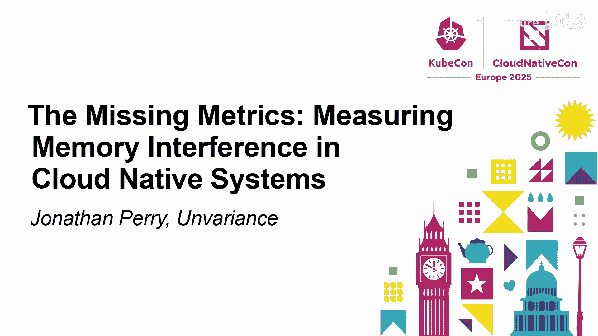

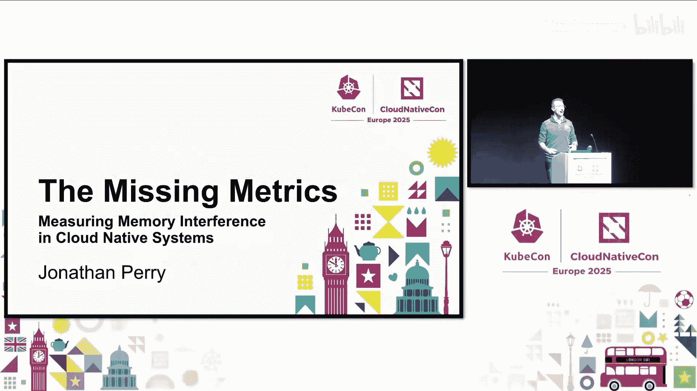

I want to start with a few snapshots from this YouTube video called Positive Aations for S Reliability Engineers。

 I highly recommend you watch it。😊，It starts at night alone asar is sitting at his desk。

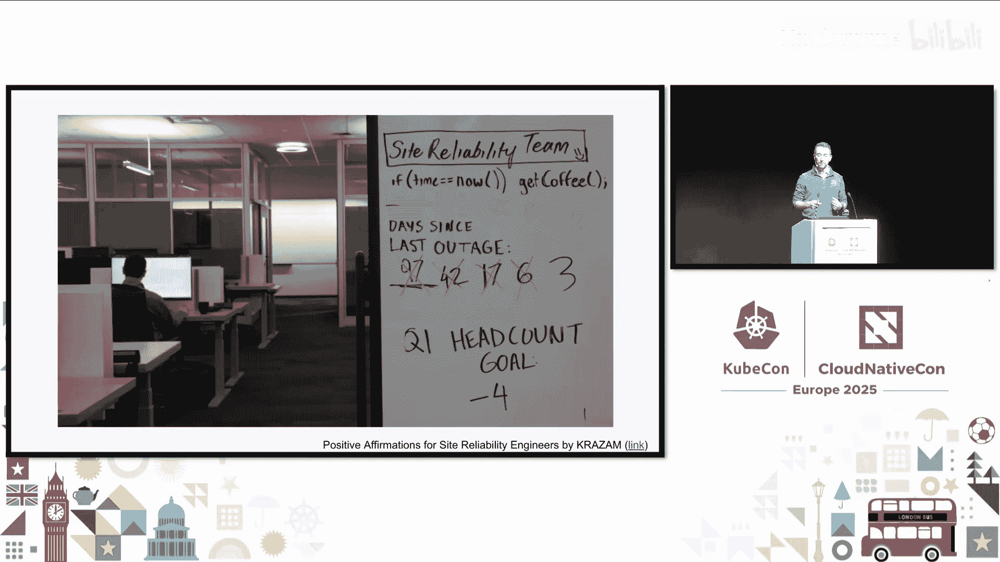

Looking at exceptions in production and the rising cost of the deployment。

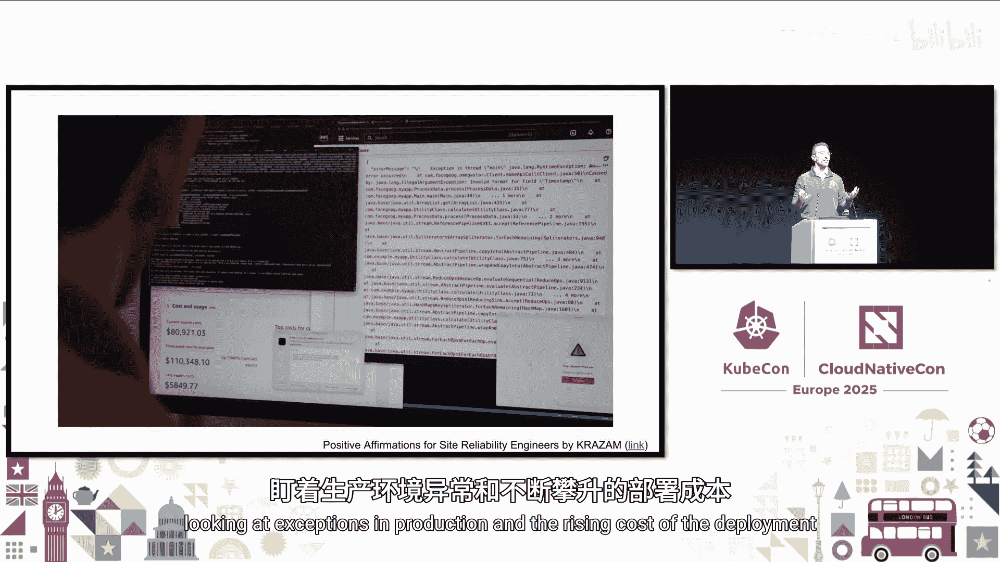

He's feeling so frustrated and haggard。

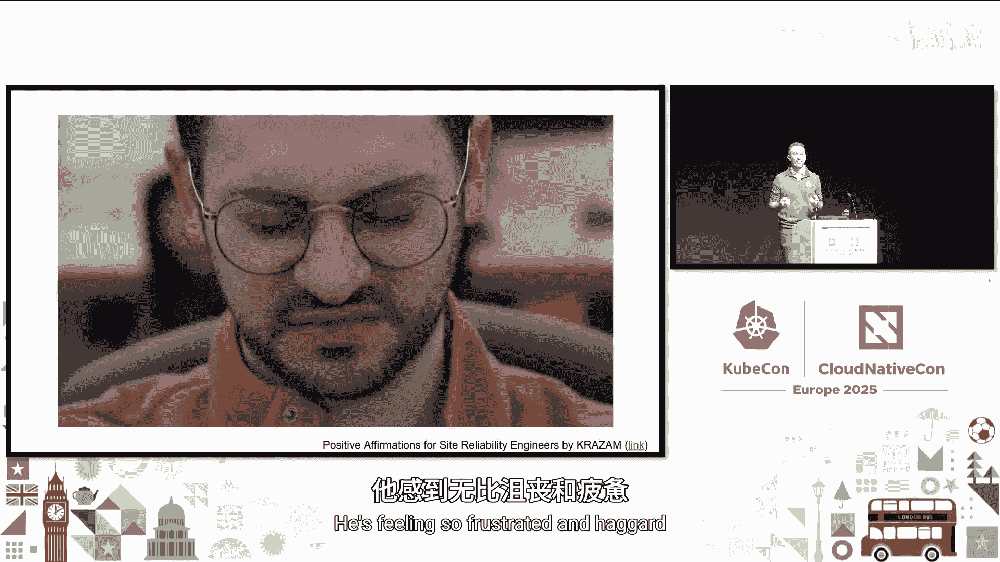

He meditates。A calm， female voice tells him。Your pipeline is green。

Your tests are well written and stable。Your friends and family understand what you do。

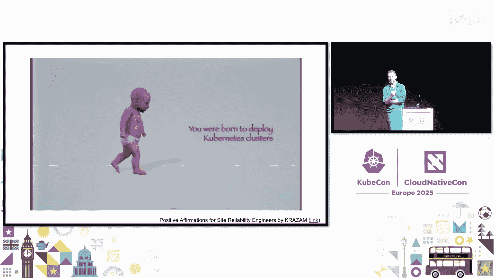

You were born to deploy Kubernetes clusters。And so this got me thinking。

 why do we take on this heroic task of maintaining these large deployments。

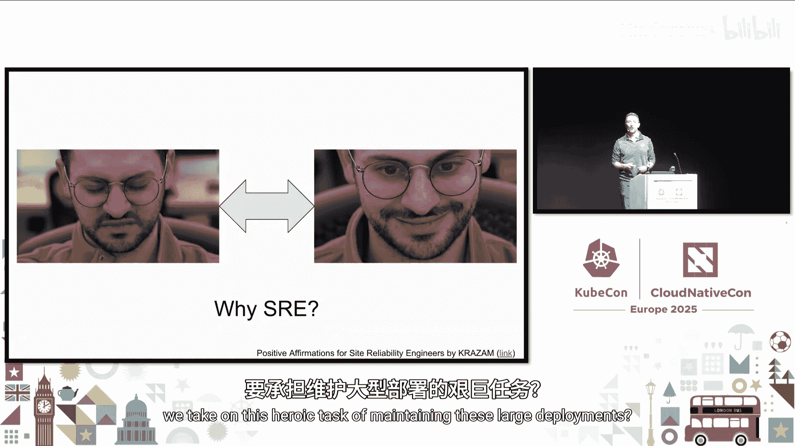

And for me， the ultimate affirmation is this。 Your deployment is highly available and cost efficient。

 Users delight in the product and its performance。 And this is the holy grail what we all strive towards。

😊，And performance that part of our holy Grail really matters。

 And both companies understand the importance both to users。

 the user experience and their bottom line。 Amazon released a case study saying that for every 100 millisecond increase in user response times。

 they lose 1% of revenue。And there have been dozens of case studies over the years reinforcing those results。

 I only were was able to bring just a few of the high caliber names I was Ive found one of the one of the case studies I really liked is this one by Ray 1024。

 which is a Japanese online gross grocery， where they ran an A B test。

 and they ran two applications with exactly the same functionality。

 but one of them was optimized and ran 400 milliseconds faster。

 and they had startling results from the faster application。

 It increased revenue per user by 53% and reduced bounce rates by 35%。So performance really matters。

But with that， users also expect better functionality。

 and your systems might not be as complex as these extreme examples of service maps published by big companies。

 but still， your systems are probably quite complex。 users expect better functionality， right。

 better recommendations， search engines， maybe AI。 And in general。

 just a more featureful application。 And as our systems become more and more complex。

 it becomes harder to reason about performance。And it's easy when performance thegrade to blame the spaghetti monster of complexity。

 or the network。But really， a lot of that degradation in performance comes from simple resource congestion on the server that we just have no visibility into。

 And that's the topic of this talk。Now。What if I told you that a small cabal of engineers got together and created this resource allocation capability that allowed them to run 50% more transactions on the same size of servers and reduce their tail latency。

 their P 95 and P 99 by factors at 5，14， Like that would be fantastic， right。

 How can we not know about this， How can they not tell us。😊，Well。

 it turns out that this capability actually exists， but it was not developed in secret。

 Over more than a decade， there have been more than a dozen papers by well-known research universities and our hyperscalealrs that explore this capability and。

 and give us detail on how to mitigate these noisy neighbors And today， I I'm giving this talk。

 because I think it's time for the Kubernetes community to get a solution based on this research that we can all enjoy。

😊，So in this talk， I want to talk about what is memory noisy neighbor。

Should we care And what are the benefits we're going to get from solving it。

 Talk about some of the hardware and software mechanisms that we have in order to approach the problem and what we're doing in open source right now。

I did my PhD in noisy neighbor mitigation， specifically network noisy neighbor mitigation。

 I started a network observability company， which we sold to Splunk。

 and I'm a maintainer on the open telemetry network collector， which we contributed。

 and I'm now working on noisy neighbor mitigation。So let's start with what is。Memory， noisy neighbor。

Our cloud native applications。Ultimately， run on physical servers。

 and the applications have to share the finite resources that these servers have。

When in one in noisy neighbor， one application takes more than its fair share of resources。

 And so other applications cannot get that resource and their performance thegrade great。

In this talk， I'm going to cover， I'm going to talk about the last level caches。

 which I'm just going to call caches and the memory bandwidth。

So how does cache noisy neighbor look like， Usually。

 your application fits into the different levels of hardware caches that are on the CPU。

 You have the blazingly hot working set in L 1 cache， and then the hot。

 warm and cool working sets in L 2， L3 and Dam。😊，When a noisy neighbor comes in。

It uses the shared L3 cache very extensively and evict your application out of that cache。

 And so when the application wants to access its warm data， it has to go to Dam instead of L 3。

In the more extreme example where the noisy neighbor is running at the hyperthread next to your application。

 it also evicts your application from L2 caches。 And so now your application has to go to DRA where it would have gone to L2。

 which is a lot faster， right， It it could be up to 50 times difference。

 So that could degrade applications quite a lot。And in practice， it does Google。

Published results from experimenting with different synthetic noise generators on their production services。

 So here you can see three production services。 You have Web search， which is the Google search node。

ML Cluster is an online machine learning text classification system that works in real time。

 And Mem Key Val is an inmemory key value store like Memcash。

 And they found that the slowdowns across the different loads on the system was five times for web search。

😊，Five times for M O cluster and up to 14 times for Mem Keval。So performance degradation on the P 95。

 P 99 is。There and dramatic。So I'd like to take a short survey。

 Can you please raise your hand if you know what type of VMs are used in production。

 Is it bare metal， I it like the4 core，8 core 16 core roughly speaking。 now， okay。

 leave your hands up， please and leave your hands up。 if you never use fractions of a CPU。

 You only use bare metal or you only use full CPUs。I75% of hands were retracted。 Thank you。 and so。

Best practices today is to separate our big data analytics from our production user facing latency critical applications。

 because we don't want somebody to run a big data analytics job and destroy performance for our latency critical workloads。

But if you're working with VMs that are smaller than a full physical machine。

 then what ends up happening actually looks like this， right。

 like next to your VM with your interactive workloads are other tenants of， you know。

 your cloud provider or infrastructure provider that might be running batch analytics， right。

 And some random dude on the Internet is running these batch workloads next to your workloads。

And it's fine。The question is， does the cloud provider protect you from these noisy neighbor running running alongside potentially noisy neighbors。

 And Ive been able， I have not been able to find evidence that they do。 And I。

 I believe that there is very little protection from at least memory noisy neighbors。

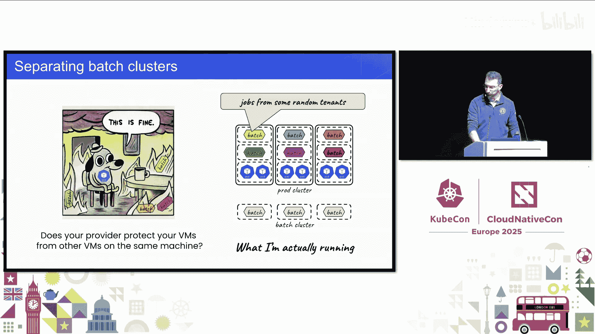

So imagine this。'， you know， our engineers can spend months and years of their lives optimizing deployment。

 They could be adding indices to the database or changing data schema So queries run faster。

 They could be taking services and breaking them down to multiple services so that queries run in parallel and they could just do profiling and alleviate bottlenecks。

 also that the performance for users improve。 And all of that work can be obliterated。

 destroyed by a noisy run neighbor， running alongside the workload on the compute infrastructure that is just degrading the compute infrastructures performance。

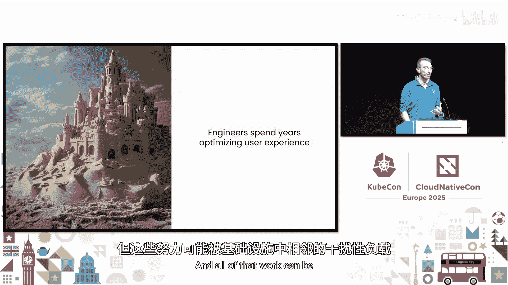

And so one takeaway is if you're running， let's call it100 cores or more。

Then you should prefer running on fewer00 core instances， the larger bare metal instances。

 rather than a lot of the four core 8 core machines。

 because then you at least know who your noisy neighbors are。

 They're going to be latency sensitive workloads that are much better behaved than batch analytics workloads or some random workloads。

 Some other folks could be running next to you。

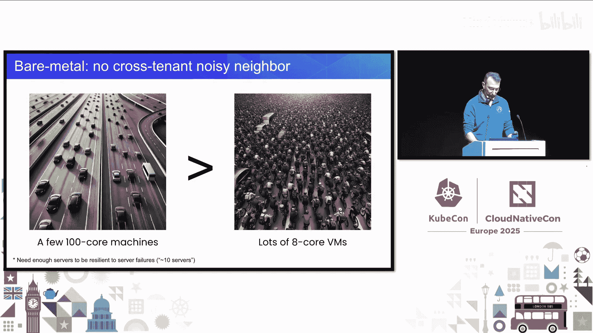

Now， do you have to have batch analytics run next to your workloads in order to experience noisy neighbor。

 The answer is no。 researchers from M I T ran Memcash alongside a garbage collected workload。

You can see on the top graph here， the memory bandwidth。

It is relatively low and stable throughout the experiment until the mark phase of the garbage collector。

 which is very memory intensive and saturates memory bandwidth。😊，Then if you look at latency。

 it is pretty stable at 50 microseconds，99。9 percentile latency。But then as the mark phase starts。

 it jumps up， increases three orders of magnitude1 thousand times。

So you don't have to have big data analytics neighbors in order to experience noisy neighbors。

 There are many workloads that we run today that experience them。 And， for example。

 the garbage collection， if you have a system that has heavy transactions。

 And once every 10000 transactions， it just has to run through a lot of rows in your database。

 then that could be noisy neighbors as well。So should we care， does it matter。

 and what can we get from solving this。You might have seen one of these published surveys。

 This one was published by Datadog， showing that a lot of the containers that we run today use a lot less of the requested CPU。

 And usually I run surveys。 and I ask people how much is your CPU utilization。

 And I get answers between 10% and 40% for most people。

 And that's in good company because some of the world's largest companies have published their average cluster utilization。

And these are companies that certainly have resources to optimize their deployments。

 There's a lot to gain from optimizing them。But what happened over the last few years is that some companies have been able to get a lot better efficiencies。

Google was published around 35% in 2011 and increased to 50% in 2019。

 So that's one and a half times more efficient。 They run a lot more on the same infrastructure。

So what happened to increase efficiency so much in these organizations。

 I was able to find two major contributors。 There might be more。 I。

 I was able to find these major ones。 One is advancements in vertical auto scaling。

 So making sure that the memory and CPU requests fit the workload。 So you don't have waste。

 and you can bin pack better。😊，And another one is handling noisy neighbor， which decreases P 95。

 P 99 latency and enables to run a lot more workload on you know。

 more denses on the same amount of systems。And to just to illustrate why we are not able to run at high density today。

 we simulated two systems。 One runs at high load。 You can see it on the left。

 And so it has a lot of these memory saturation events or， you know。

 garbage collections for you know， just， as a way to think about it。

 And a system with low load that has fewer of these events because it has low load needs less garbage collection。

And。If you look at these。You can intuitively say that， you know。

 the low load system would have better P 95， P 99， right。

 that has a lot less of these interference events happening， slowing down our applications。

And I think a lot of us intuitively know that when we experience high P 95 P 99， we scale out， right。

 We want to reach this low load。So let me say it another way。 right。

 like we have high load on our systems， which generates memory contention。Decreases CPU efficiency。

 We saw that， you know， our noisy neighbor are kicking the applications out of caches。

 so they're slower， and that causes high response times and us breaching our SO targets。

And what we've been doing today is scale out our systems so that we run at lower load。

And I think this is an anti patterntter。 We should stop doing it。 It's wasteful and inefficient。

Instead， we should make sure that the memory contention， these noisy neighbor events。

 do not decrease performance on our systems by mitigating noisy neighbor behavior。

And so if we're able to do it and run at higher load， then first， we can scale down our systems。😊。

And we'll still keep our SOOs and just run at higher CPU utilization。

We can allow product teams to build more features。 They don't have to go and optimize the system and reduce the S O Os。

 reduce the P 95， P 99 before they ship more features。 They can just go ahead。

And we can have users enjoy improved S， L Os。😊，And in practice， we get a mix。 We get all of these。

 And if we mitigate noisy neighbor。And so why would only the hyperscales be able to enjoy it。

 we should all be able to enjoy it。And I think this gets us closer to our holy grarail， right。

 It touches on three of the important goals that we have， Both cost， you know。

 the cost efficiency product and sorry， the product features and product performance。

So what mechanisms do we have in order to measure and mitigate noisy neighbors。

Modern CPUs allow the operating system to control how much of the cache and memory bandwidth each application can use。

But even if you don't have support for these techniques in your CPU。

 you can still restrict the ability of noisy neighbors to create damage and noise in the system by pinning those noisy neighbors to a small number of cores and perhaps reducing the frequency of these cores so that they just can't do much damage。

I get this question a lot。 you know， containers should do this， right， Like。

 we expect containers to isolate workloads， but they don't today。

 This is not built into our container infrastructures。 And， in fact。

 containers are not very good at isolating performance， more security。But not all is lost。

 There is access to these mechanisms， but through a different subsystem called resource control。

 it's configurable through CsS。Okay， so。We want to tackle memory contention and memory noisy neighbor。

 We have these mechanisms that allow us to， to control and limit noisy neighbors。

So what do we measure in order to close this loop。We care about application service times。

 So why don't we measure P 95， P 99 and then adjust resource allocation based on which application has a bad P 95。

 P 99。This turn the these measurements turn out to be noisy。 I mean， first。

 we have to measure P 95 or P 99。 So you know， just to begin with。

 we have to measure at least a few hundred transactions in order to get a good signal for P 95 or P 99。

 It turns out this is noisy。 So it reacts very slowly。

Another thing we could do is we could measure CPU efficiency。

 So CPU wants to execute some number of instructions。

 If there is a lot of memory contention and the CPU has to wait for memory。

 the number of cycles that it has to take to run those instructions is large。

 If there isn't a lot of memory contention， then the number of cycles is small。

 So this ratio of cycles per instructions could be a good metric。

The problem is that this is also noisy because it measures a bunch of other things happening on the system。

 And it is also these systems end up being complex because we don't know what a good cycles per instruction value is。

 right， Like， is three good。 Is it terrible。 We need to profile the application beforehand。

 So these systems end up relatively complex。But it turns out that Google has deployed this type of system on all of their shared clusters as of 2013。

 So it's been， it's been deployed for a while now。Another thing we could do is we can measure。

The memory contention itself， we can measure the utilization of memory bandwidth and caches in our applications directly。

 And then if we find somebody using more than their fair share， we limit them。

 And this is actually a good measurement。 And this is what our open source collector is doing right now。

😊，And， in fact， Alibaba published that they have a system based on direct collection of。

 of memory contention events in production for over two years on order of a million cores as of 2020。

The problem is， if we want to solve the memory， noisy neighbor problem。

We need very frequent measurements。 on the top here is a simulation of you've seen this before。

 right， like the， the memory contention events。 and on the bottom。

Is a sampling of the memory metrics every one second。 And you can see that， you know。

 you lose all of the signal if you don't measure frequently enough。And so with this collector。

 we set out to measure at 1 millisecond granularity。

 And we started this as an Apache2 project called the Unvariance Collector。 Right， like the。

 the idea is to reduce the variance of response times。Okay， so with that， I。

 I want to talk a little bit about what we're doing in order to build this collector。Well。

 I told you we want to take these 1 millisecond measurements。

 So we want to have measurements across all of the cores that we're running every millisecond。

 So we expect it to be， you know， very， you know， very regular and want the measurements to be really good。

 In practice， what you get is this jitter。 Some cores might take longer to to respond to these timers and to do the measurement。

And so we wanted to know how much jitter we're going to have。 Jitter is bad。

 because if each core is measuring a different time interval。

 then how can you take all of these measurements together and say， okay。

 this application used this much memory bandwidth in this time interval or that much bandwidth。

 right， Like we have fuzzy intervals。And so to measure jitter。

 we set up Linux high resolution timers at 1 millisecond intervals。

And these graphs show how much each core the time that it responds to a timer differs from the the time that we wanted the timer to fire。

 And you have these vertical lines between the fastest core and the slowest core。

 So the top of the graphs are the slowest cores that took to respond。 And so I want to ask you。

 what do you think is the noisy graph on the bottom right。

 Like the noisy graph is 300 microseconds to respond to a timer interrupt。

 That's 30% of our measure and interval。 It's quite a lot of jitter。You know。

 it could be the metal because they are 96 cores。 It's like the same instance。

 but we take either the four corese slice or the 96 core slice。

 So it could be the the metal instances because， you know，96 cores。

 one of them is going to be slow or the four cores because， you know。

 the hypervisor is adding noise and there's noisy neighbor。So， metal。Extra large。Okay。

 so I kind of gave it away。 Yes。 thank you。 Yeah， the extra knowledge is a lot more noisy。

 So there's， I think there's an artifact with the hypervisor。

 These graphs actually show it much worse than it is。

 It just shows the extremes because the scale is seconds and we have 1000 measurements per second。

 So it kind of hides the good measurements。 But so statistics lies and all of that。

 But these are both workable， but there's a lot more noise on the smaller systems。😊。

So this influenced how we built the collector and its architecture。

 So I'll go through it very quickly。Whenever there's a fork in the system。

 So a new thread or task comes in， the collector assigns a resource monitoring I D， RM I D to it。

 This is something that the hardware needs。On every context switch between applications。

 the collector tells the CPU what RM I is active now。

 And you can think about it as coloring the traffic。 You say， okay。

 these are all going to be blue aes。 These are going to all to be red aes。 And now you can ask later。

Every1 millisecond， how many blue aes did you have。

 How many red aes did you have and how much of the cache is blue or red or the other colors。

 And there are hundreds of colors you can use。 there's enough for， you know。

 hundreds of containers on the system。So this all of the telemetry at 1 millisecond granularity and all of the allocations of。

Containers to our M I Ds flow to a shared memory buffer that the user space component can then come and analyze either output or action upon。

What we're doing today， the goal， we are outputting the raw telemetry into parquet files。

 and the goal is to develop good detection algorithms。 And the idea is like， let's。

 let's back back test using the raw data that we have in。

 in these files to make decisions which who is a noisy neighbor at any given time。

And so we are looking right now for production data。 We're building synthetic workloads。

 and we're looking for production data。 If you have a system that you can run the collector on and share the data。

 maybe a test cluster or a staging cluster that has real production traffic。

 We would love to see it so that we can build better detectors。

The idea eventually is to output for observability statistics on detection。 So they would say， okay。

 this pod was noisy neighbor 1% of the time。 And that pod was noisy neighbor1。5% of the time。

And with with these detections on each1 millisecond slice。

 hopefully we'd be able to also use those to mitigate noisy neighbor by limiting by configuring resource control。

 So that's the plan。I want to， to add one a note on overhead。 We're designing the system for 。

1% overhead in line with the traffic and 1% of the analysis and user space that is not in line does not increase transaction latency。

 but even if the overhead was high， it almost doesn't matter。

If you're able to mitigate noisy neighbor。 So on the bottom here is an example。

 So imagine if the average service time increased in your service from 40 milliseconds to 42 milliseconds。

 That's huge 5%。 We're not aiming for that。 We're aim for 。1%， but 5%，42 milliseconds。

 But then we're able to reduce the P 95 latency from 250 milliseconds to 75 milliseconds。 I think。😊。

Almost everybody I talked to would say， yes， let's do this。 right， Like。

 this is a great trade off to have。 Of course， we're not going to have that much added overhead。

 but it almost doesn't matter。So I'd like to invite everybody to contribute。

 I want to thank our existing contributors。 And if you want to join the project， please do。 and come。

 my details are here。 I'm available on CCF Slack。😊。

And if you have these clusters that you can contribute data， we'd really appreciate it。

 It's a very powerful way to help the project right now。

 And so I hope this will help us get closer to our holy Grail of better performance。

 cost efficiency and better product to our users。 Im thank you for being here。

 And I'm happy to take some questions。😊，Microphones over there。Hi， quick question。

 you mention that dot。Can you Amy me。 Yeah， Okay， you mentioned that there are two basically causess that Ill not identify is like the shared cash。

Lves。And the memory， bandwidth and memory。I also say。If you're running like static CPU U in inas。

 which is fairly easy to to set up， do we know what which part is in in your measurements or the data that you've collected。

 which part is due to the cache poisoning， let's say。

 and which part is due to the memory bandwidth or let see。So the question is。

 what percentage of degradation can you attribute to memory bandwidth or to caches when you run on fixed CPU。

 So when you pin workloads to different CPUs。Yes， yes， okay。 So usually memory。

 memory bandwidth itself。 when you saturate it， the latency can increase from 75 nanoseconds to 250 nanoseconds。

 It's on that benchmark was done on a specific hardware。 But that's kind of what you can expect。

 So what is it 3， four times with cash， you can expect 10 times difference。 But they compound。

Frequently， when you have memory bandwidth noisy neighbor， you also have the cache noisy neighbor。

 If you're running on these chipts， there's been advancements in Kubernetes where you can run some workloads and reserve a chipt you know。

 a set of CPUs to them and they， they have exclusive access to the cache。

 Then only those workloads are noisy neighbor for themselves on the caches。

 and you only experience maybe memory noisy neighbor。 But it's very hard to manage。 you know。

 these are very specific use cases maybe in telco that need the really low latency。

 and it' makes it really hard to pack more workloads。 when you run on these chipts architectures。

 usually I hope that answers the question。Yeah， thank you。Thanks for the talks important work。

 if we're sampling every 1 milliseconds， what are storage requirements， Can't hear you， sorry。

 sorry if we're sampling every one millisecond， what are the storage requirements to put on desk。

Really sorry， really can't hear you。Can you hear me now。 Yeah， Okay， sorry。

 I have to put it in my mouth。 If we're sample in every 1 milliseconds。

 what's the storage requirement for that。Right， so for the raw data， it goes into parquet format。

 which is a columnar store and it's compressed。 and it is relatively heavyweight。 It's1。

 I think we computed up to 1 meby per second。 But you wouldn't。

 you wouldn't output the raw telemetry。 What you would do is you would analyze it。

 You would do detection for noisy neighbor， And then you would output statistics on who is the noisy neighbor。

 And then for maybe every 60 seconds right today， we measure it 5 seconds or 15 seconds or 60 seconds。

 you would output per pod。 what fraction。 How many。

 how many 1 millisecond slots out of the full 60 seconds， for example， it was noisy neighbor。

 So that is a lot less cardinality in a lot less volume。 And that's something that we're capable of。

Thank you。Thank you， great talk， exciting project。嗯。Does it have to run， can you hear me。

 does it have to run always on， you know， or it's more like， you know。

 I'm profiling if the applications are saved。It can be done on， know， periodically then closed， know。

 profile， identify the noise numbers， I don't think。It you need to analyze， do some adjustments。

 and hipPA monitoring， it's more like that， right？So the question is。

 do you need to keep it on the entire time or or not。 So if you do automatic mitigation， For example。

 if you have garbage collection events， those are really hard to optimize what you want to do is to maybe either automatically label those as noisy neighbor and decrease the amount of resources that they can use。

 or I guess， I mean， that's what you can do。 So you need this automatic mitigation for some types of events。

 you could use the data to find applications that are consistently clashing on resources and create an antiaffinity rule。

 So that is possible and it's a use case。 and we want to support that to。

 But I think the next level of value that you get out of the system as automatic mitigation。

 And I believe a lot of the incident that you have of memory saturation can be mitigated by by automatic mitigation without need for profiling and changing of the application。

Thank you。I think last question。 Thank you。 So I have very specific question。

 So we can just like better bit of data daily from our customers。

 And usually what happens when we see performance degradation。

 we update the instance type or we update the disk type and。And this is basically our solution today。

 But as we scale， this is not a viable solution plus。So the question is， how do we know that。

If this is happening， due to noisy neighbor。 And the second point is， like。

 how do we enforce our platform team to。Solve this problem， because。

Like basically what would be the cost implication if the problem is solved by like implementing a solution word noiseisy neighbor as compared to just doing instance upgrade for different deployments。

So I think if I understand the question is， how do you know that you have noisy neighbor。

 How do you know that you've solved it and would vertical scaling help。Yeah。

 I think so cost application as compared to just agrading the instance type。Yeah。

 so I think you should run on large instance types， fewer of them。

 So that that should be a good recommendation。 You would know that you have noisy neighbor by using a collector like we're building now。

 And you know that you've solved it by seeing that you have the high incidence of memory contention。

 but no degradation and performance。As to kind of the different resource types。

 I think you mentioned， you have disks and， and others。

 Io is another noisy neighbor that we'd want to solve。 But we're starting with this。 So I。

 I hope I answered the question。 Yeah Allright， thank you， everybody for coming。

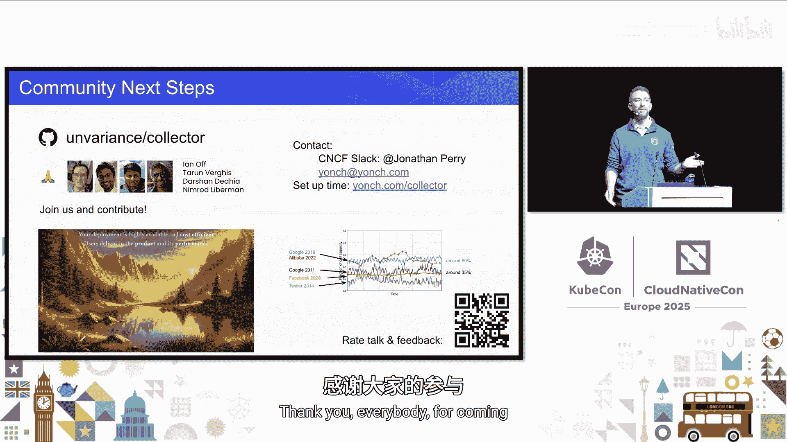

Enjoy the conference。