# KubeCon-+-CloudNativeCon-大会2025-｜-云原生计算-｜-可观测性-｜-Kubernetes-｜-Prometheus-p33-P33-Wait!-Can-Your-Pod-Survive-a-Restart---Aya-Ozawa,-CloudNatix-Inc.--BV1Cd32zDEBG_p33-

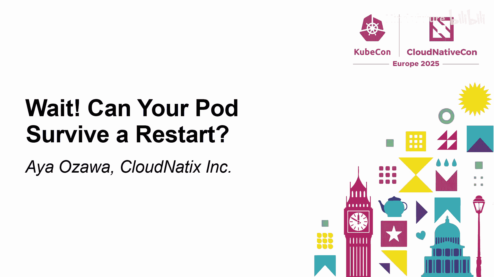

Hello， everyone。Thank you so much for joining my session today。Let me ask you a quick question。

 Can you pot survival restart。Potoist that might sound basic。

 but handling them correctly is a bit challenging。Huban native restartpot in manys。

 And if your pot isn't ready for prepare for that， you could run into unexpected issues。

Before we dive in， let me briefly introduce myself。 My name is Ayahozawa。

 I member of technical staff at Cron Arts。 I'm currently developing El Marina。

 It's an open source airI platform for Kubernetus。 So today Im going to show you some insights I learned over the years。

😊，Here is the today's agenda。 I' going to show you how to reduce the impact of wrist using three different type of applications as an example。

Let's move on。So。Why does it restart a bit of the matter。

 It counts down how Kubernetes straights Europe up。

 You might have heard the famous analogy Kubernetes threat to Europe up more like cattle rather than pet。

 but what does men。If your application is a pet， it requires special care。

 manual interventiont every time it goes wrong， but Kubernetes is optimized for cattle。In fact。

 many powerful features such as self hearing， Roing， upgrade。

 and oversing fundamentally rely on restarts， so take advantage of those powerful features。

 put restability as important。Aistta isn't just a single scenario。We'll dive into the detail later。

 but for now， let's get a high level overview。At the container level。

 if your container exit or liveness per failure。Thecover， restarted。And second。

 at the replicas level， even if your po gets derid。

 it automatically recreated by the controller to keep the desired replic account。

At the deployment level， during a roing up of the grade， unlike the previous two scenarios。

Deployments create a new pot of forest before decorrating the old one。

So how can we ensure our walkthroughs survive in these scenarios。

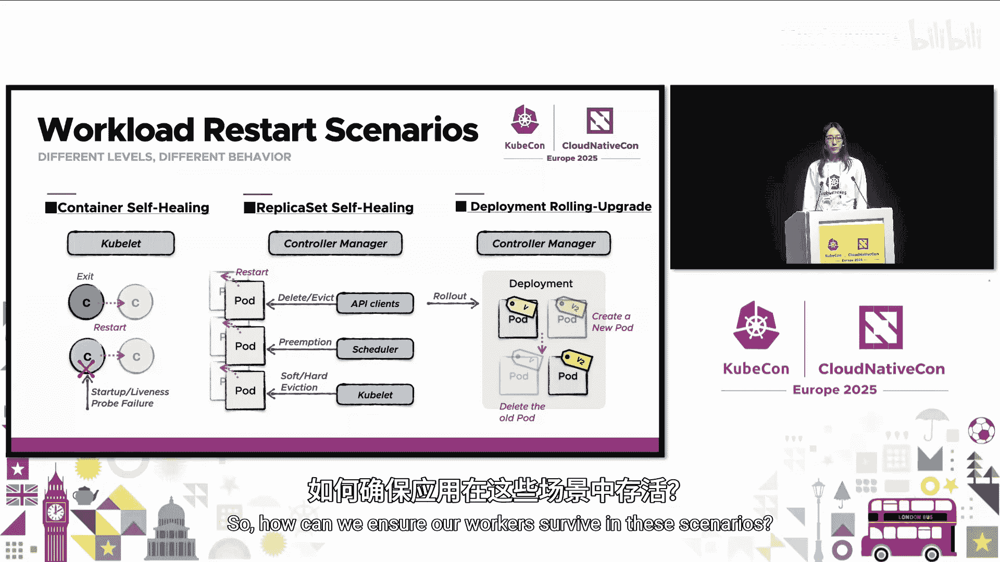

Let's use them in this simple scenario， a basic pot durationation and recreation flow。

We have a simple deployment。This define the only image and arguments that doesn't handle any signals。

Let's say we generate a po using cubickato de po。For a three default receiver a stop signal。

 usually signalom。 However， if the application doesn't handle the signal。

 it can running during the default30 grace spell。Once， that time is up。

Depot is forcibly stopped with sick kill。Meanwhile。

 the number of running pot drops below the desired number， so thepot is recreated。Then scheduling。

 image， brewing and container startup all happened as usual。

Now you might wonder why the pot keeps running even after it receives Siom。

 if you run some program on your laptop and send it som is typically terminated。

 however in the container world， application typically runs as PD1。

 so the Linux counters it especially if your application doesn't handle Siom it's just ignored that while the process keeps running until Si kill。

 and here's a problem。

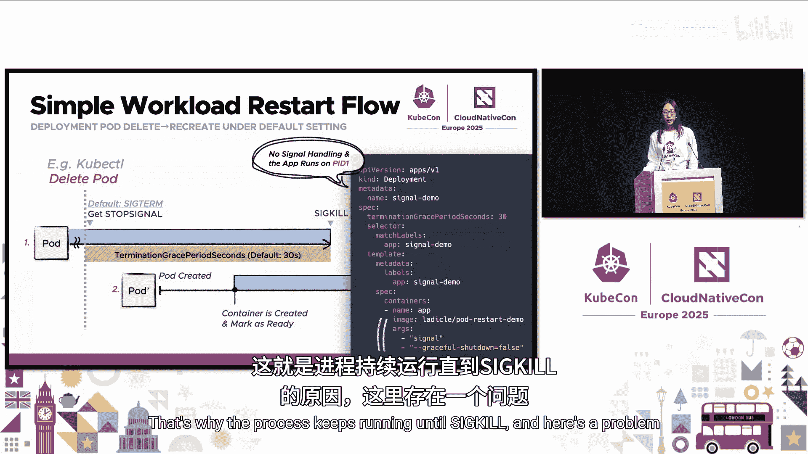

If your application just wait the entire grade period， the canvas resource。

 also your application has shut down tasks like cross connections or writing back data。

 sudden shutdown can lead to request rules and inconsistencies。To avoid this。

 it's important to handle the stop signal and shut down up before the grace for period ends。

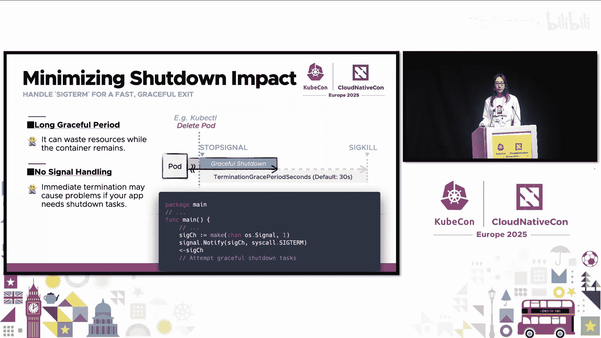

However， some application is a different signal for grace versus shut down。 For example。

 NG X expect s， but what if you can't modify the application code directory like those third party applications。

In such cases， there are two solution docafi stop signal and Kubernetes prestop。In the Doca file。

 you can set the stop signal to tell which signal your application expects。In this example。

Reet secret。 so container gets secret instead of saw。

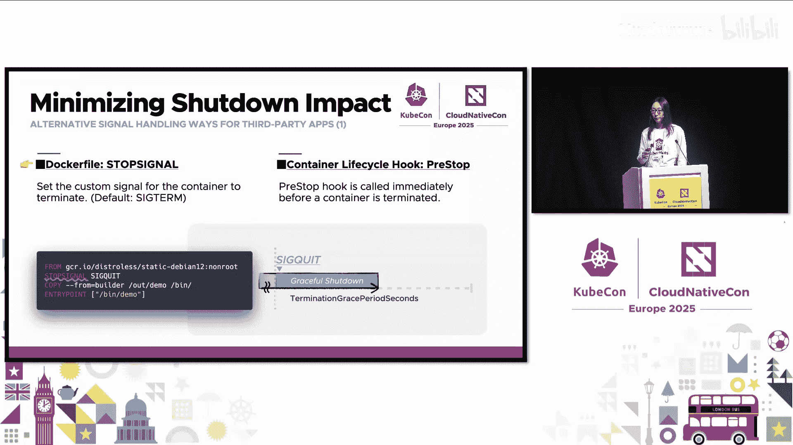

The second method is prestop actions， which runs just before the container shutdown begins。

There are several options。 First， with an exit hook， you can send the desired signal directory。

 like using kill secret。But it's required kill bin in your application container。Second。

 H T T P hook is another option。 It calls the shutdown end of point on your app。

 which is useful if your application provides the H T T based graceful shut down。

The last thing is the lifecycl stop signal。This feature isn't available yet。

 but you were able to specify custom stops， directory in the pot manifests。

This is useful because it works like Doca5 stop signal， but you don't need to rebuild your image。

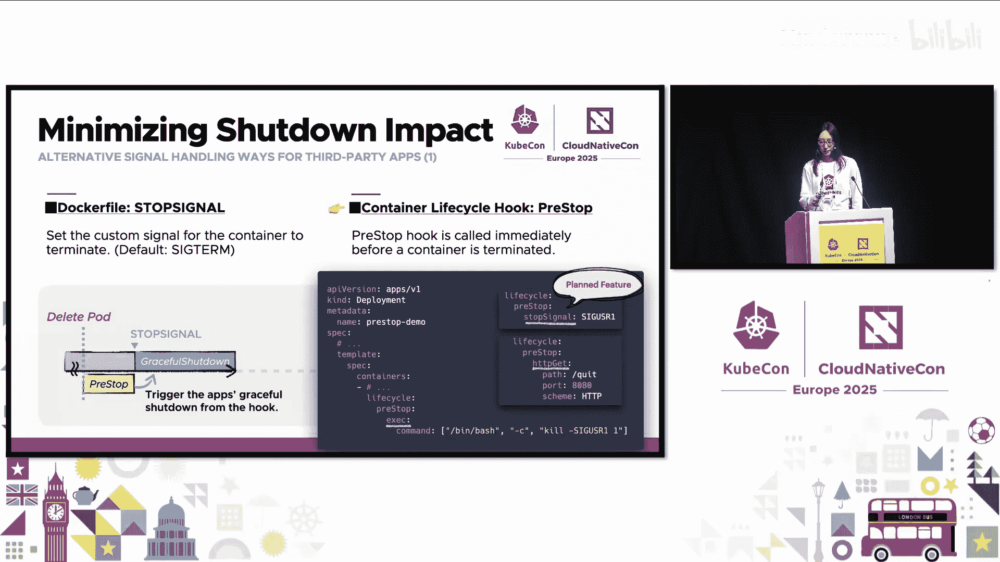

So now we understand how combination works for a single container pot。

 But what happened when your pot has multiple containers。For primary containers。

 the terminationation process all happens at the same time。But what about sides？

The acycl design pattern， which is extend the functionality of the primary container like logging agents。

Like that has been known for many years， but cytoica support as a native Cubaer native feature is relatively new。

 It becomes a default， starting in 1。29。This feature builds on the in container。

 and it's only a applied when the that policy is set to always。So。Here， how the shutdown works。

Unlike primary container， cytoicales shut down sequentially。

 once all the primary container have exited， the cytoical gets stop signal one by one。

In the robust order of how they started。In this example， cytoica stopped in the order 321。

One thing to keep in mind， the pot do grace period is shared by all containers。

 so make sure everything can finish in this period。So far， we've learned a grace or shut down。

 However， potion grace period not always guaranteed。 Of course。

 if you are upced due to bugs or get killed by home killer。There's no grace spirit。

And even when Kubernetes does to termination， it can sometimes be overriden or ignored。 For example。

 duration and eviction API can override this period。 For example， if you run Cubbat of the rate pot。

With a one second grace mued option， the pot will be immediately terminated regardless of its pot。

Grace figure settings。Also， when I noticed under severe result pressure。

 the C at big exposed to reduce node usage。In a softer eviction， this is disabled by the effort。

 but Cupver it overred by its configuration value。And how eviction is more aggressive。

 but immediately evicted with any grace period。So weve explore the standard applications we that。

 but Harvard applications that the handle network traffic like HTTP servers。

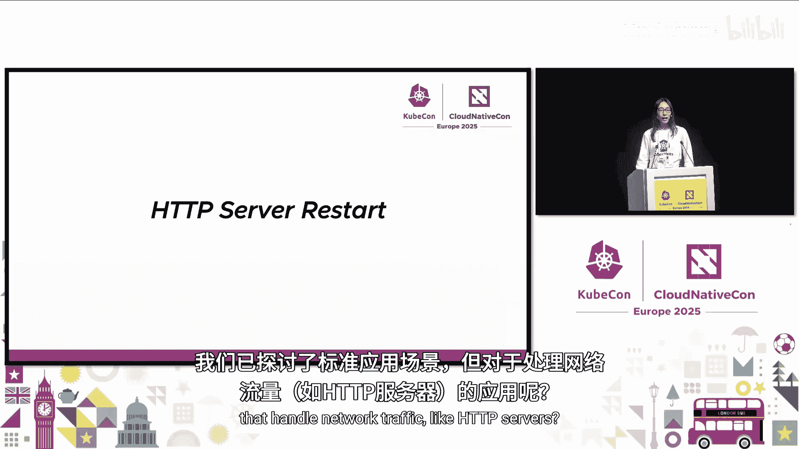

Let's consider deployment with a service。 When you delete a pot。

 Kubernetes send stops signal as we learned before。

 then eventually removes the pot from the routing table。A new pot starts up。

 and once it mark us ready， traffic is direct there。However。

 even if we've implemented that grace rich down is not enough to guarantee zero downtime。

 we still face to two challenges。Let's look at the first issue。On the right。

 this go code shows the typical HTTP a after receiving Sam the Shaam function is called for graceful Shadown。

 and this function keeps handling inrique but stopped listening in military Here's a catch。

The Sa stop listening to new requests， but new incoming requests will still be routed to your pot。

It's causing a request drop。To avoid this problem， shutdown should be deed until Kubernetes stop riding traffic to the port。

There are some ways to introduce this way。 One is just modify your application code and adding strip before the shut down logic。

 Another way is pretop sleep。From 1。30， this feature is available by default。

 so you can set straight seconds in the Po manifest directory。Let's move on to the next challenge。

 If Europe isn't prepared right after its startup， that Kubernetes immediately outstanding Ukraine。

This requests can get dropped。Readiness per can solve this problem。

Thiser check whether the application is actually ready to handle the request。

Kubernetes will start roing requests only after this probe passes。

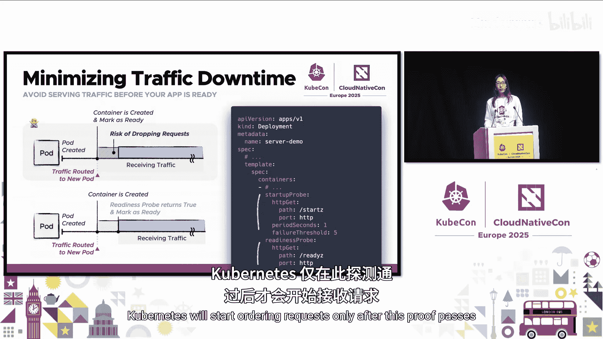

However， using only a readiness probe has limitations。

Because this projectss these status throughout the entire container life cycle。

 not just the ring startup。Generally， you need different threshold or ins for startup and post startup groups。

If you rely on reading throat for each basis， it could rate it to slower setup or two straight health checks。

That's where a startup prove comes in， this probe runs only during the initialization phase once the startup curve succeeded。

 readiness and live group take over。This separation let configures proofs without affecting the post start proofs。

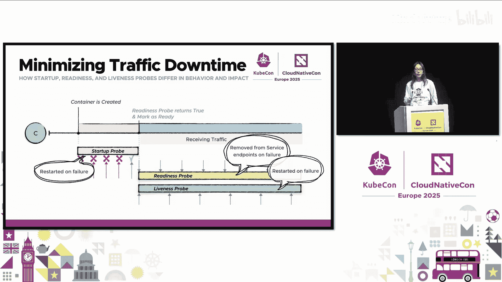

Next， let's say the actual behavior de restaurant。On the left， we have deployment and service Man。

 It doesn't have special settings。 On the right， This is a corrected version。 deployment。

 Its added prestop3 and Pers， which ensure smooth traffic transition with zeroton time。

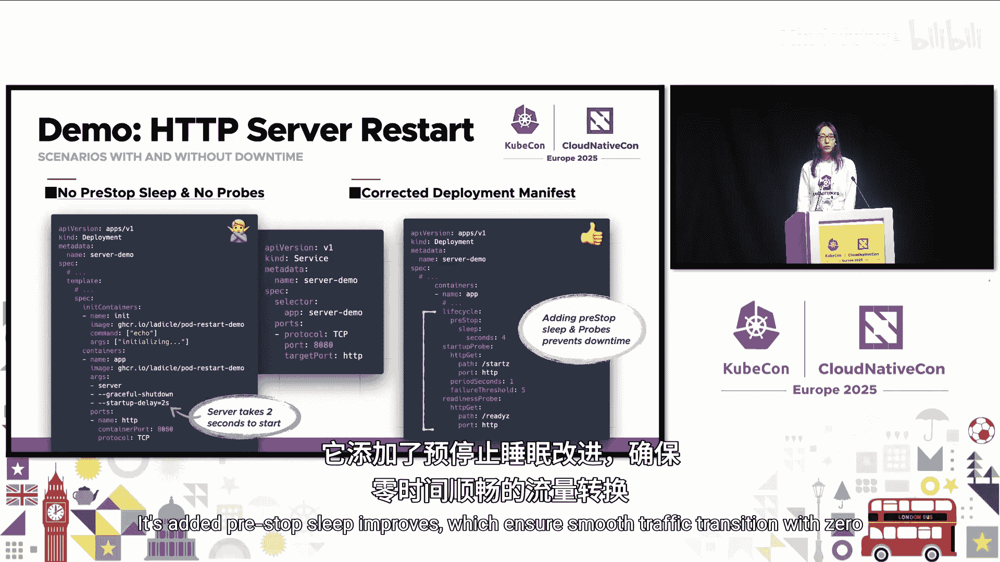

Let's see the V case first on the screen， each panel show the v case deployments port and the service endpoint。

And now I gonna read the pot。Look at the log， our server received a sick time and start the shutdown。

 However， up the table we haven't been updated yet and traffic is still being directed to the pot。

As a result， this request dropped。Now， Kubernetes has created a new pot。

 and the routing has switched， but we still see failures。

This is because the new suburb isn't ready to handle requests。So next。

 let's see how we can avoid these issues。Herear the corrected version of deployment。

Which has Brisol three empers。Now， I gonna rate a pot again。This time， thanks to pretop 3。

 Kubernetes waits 4 seconds before sending the sixton signal。While an old pot is shrinking。

 a new pot is created。The readiness for retail success once end point already。

 the I table will also be updated。As you can see， traffic militaryerate transition without any drops。

Finally， the old pot received system and exit it。This way， by applying pretop 3 P proves。

 we can minimize downtime during the potultry start。

We've covered traffic handling duringuring restarts that we haven't touched when the traffic shift happened exactly。

Normally， cube prophey do not send the traffic to terminating pots。

 but if no other end pointss are ready， traffic still goes to the shutting down pos。

This will change the restart behavior depending on rep accounts and restart types。

In multi elaborate scenarios， Kubernetes removed the point almost after the pot is derated。

Then it asks the new pot and the point once it becomes ready。Of course。

 there gap between the old pot stopping the new and the new one being ready。

 but it doesn't matter because as a replica can they handle this request。Next。

 in the routing upgrade， new ports are created first。 So regardless of labric accounts。

 traffic will be switched。When the newport market is ready。At one point。

 note that traffic doesn't stop at the same time of duration。Component right。

 Q endpoint right controller and Cu proxy all component fetch results status from A P S Har and process them asynchronous rate。

 So there could be a right， right。Then。How about that single replica worker， as I mentioned。

 If there is no other lady endpoint， traffic keeps going to the taating pot。

As you can see on the left， the older port keeps receiving traffic after it' started shutting down。

Once the newport is ready， the traffic is switched。With this similar traffic shift。

 even if it's a single repa worker road， we can avoid the request drop during restart。 However。

 as we learned in the previous demo， if the odd pot ends too quickly。

The new port can take over this request。8。There exactly scope request gas drops。Therefore。

 giving enough。P of T setting proved is important。Next。

Let's look at what happens when a livingus prevails in a single labpriica。

In the container level of results， all the events happens sequentially。

 So there's a show to gap before it comes back。Unlike the runninging upgrade case。

No one can take over this traffic， so。During this gap， the request is dropped。

 Thats why in some cases， we cannot avoid downtime in a single replicas。

 So multiple replicas is recommended for important applications。Now。

 we learned about simple app and H TTP servers。 but what about controllers。

We can appr the same approach to controller that with one extra factor， which is a leader election。

Typically， the controller controller implements leader election to prevent conflicting upgrades。So。

 let's focus on that。Here， we will take the controller a long time。 As an example。

 this is a commonly used library to implement a controller。In this rivalery。

 once the controller gets sit down and the context is cancelled， the grace term begins。

It goes through several termination procedures， and fineries stop renewing leadership。

Then your reader gets a leadership。So how can we reduce disruption during the election？We took。

Before talking about the optimization technique， let's see the Kubernetes leader election behaviors。

Kubernetes provides a lease resource for greater election， each candidate。

Continuously try to update these shared results。And first both the success rate updatedated。Becomes。

 it becomes a leader。Here are two key parameters that affect reader transitions。 First。

 list ratio at the maximum later duration without renewal。The default period is 15 seconds， Second。

 Retri period specify how frequently candidate attempt to acquire leadership。

 The default interval is 2 seconds。With these default values， in the worst case。

 a leadership takeover could take 17 seconds。You might think we could adjust shown an lead duration to reduce takeover time。

 but。Setting a two short period increase。嗯。Sp brain risk， like multiple pot bes。 there are a liter。

So how can we safely reduce this time。The controller at alone time provides an option called Le E releasease on cancer。

When in every this， the leader proactive ends the leadership not just waited for exploration。

Inernary， the manager updates list ratio seconds to one second， only at the end。

With this configurationration， the leadership transition time can speed up to three seconds while keeping the defaultation except on termination ends。

In summary， although care for attention is required。

 temporary list ratio updates allow you to safe and lap leadership transition。So far。

 we've discussed how application can grace three handle restart。

 But what if crossed the mentalance Florida multiple restart and affect the entire block world。

How can we minimize these disruptions。

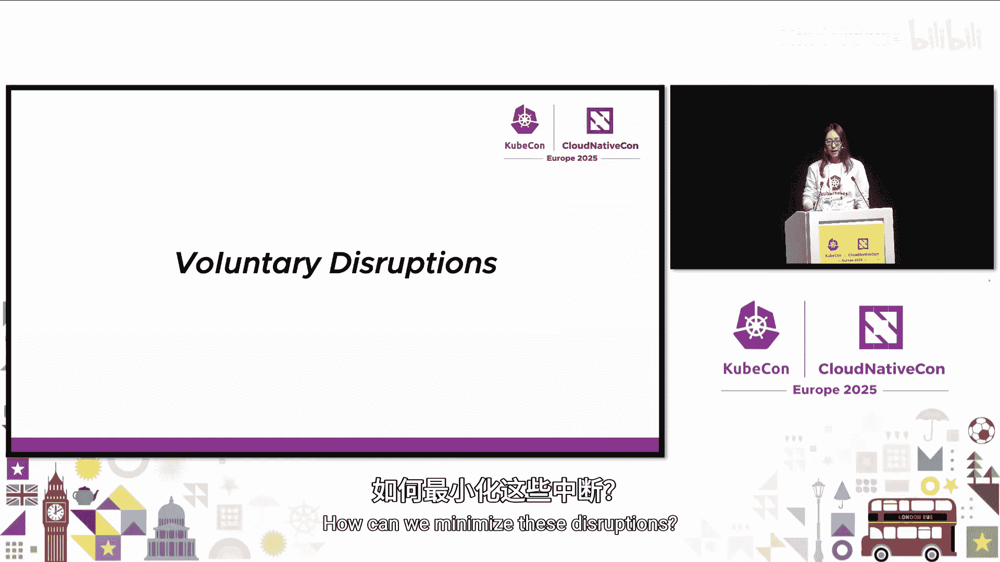

Pot disruption budget called PD DB can limit these voluntary disruptions。 On the right。

 we have to manifest a deployment with two replicas and is secured by a P DB。

 This P D B allows only one port to be unavailable。In the scenario on the left。

 the eviction request succeeded because it respect the budget we've said that in the scenario on the right。

 the eviction request is rejected。This is because another part is tear pending and the eviction would exceed that budget。

In this way， when you set up a PDDB result， it will reject requests that would violate the disruption budgets so you can reduce disruption。

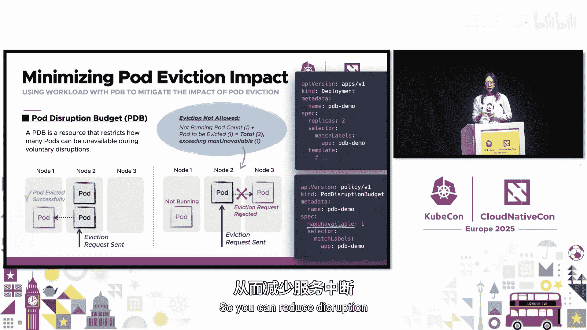

We found the PD DB is beneficial to reduce those disruptions， but they are some limitations。First。

 unlike roing up grade， pot eviction doesn't create a replacement pot ahead of time。

 So if you want to keep at least one pot during eviction。

 you need at least two running pots to begin with。Second， if you said。P D B too straight3。

 It could parliamently block eviction requests。 This would happen in several cases such as Van Waro has only a single Laricica。

 Maxna be is accepted 0， or the application is never in a running state to back。

Or something like that。This can complicate noise maintenance like cube brain and it requires a lot of manual innovation。

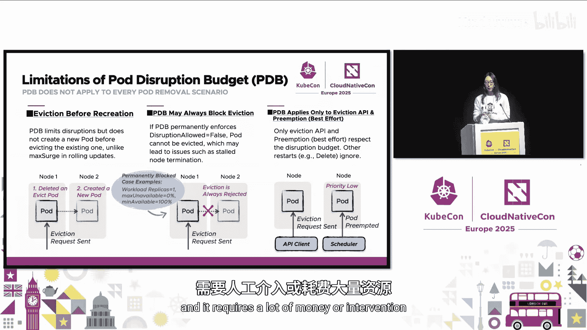

I mentioned that application part can also block this eviction， that。

Kubernetes provide this solution。 starting from version 1。27evern。

 Kubernetes supports unhealthy for eviction policy as a default。

When you said always a law to this policy， a healthy report did not block the eviction request。

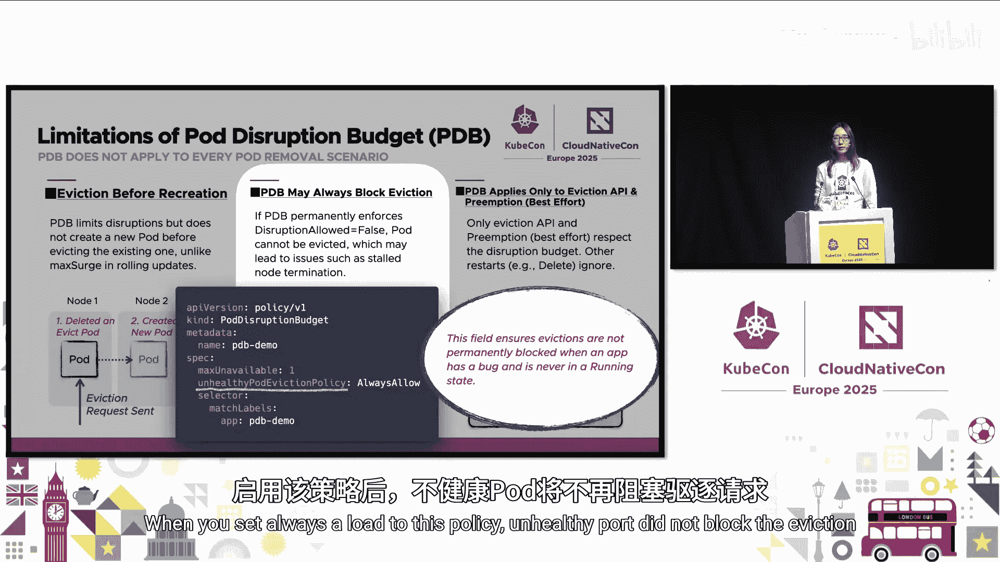

Lastly， remembers that PDDB only applied to the eviction API and deel brain。Of course。

 if you de rate pot QD B constraint won't be walk。Also all， also。

When the scheduler tried to print lower priority pot to make a node space。

 it normally will follow the disruption budget that it finds no pretty much those constraints。Budget。

 in which case， premium may ignore the PDDB。So。Finally。

 let's move on to the key takeaways for today's sessions。First。

Make sure your application can handle sit and that grace virtue down。If another signal is needed。

 use stop signal or prestop actions。Also。Cidecars terminated seary in robust order of their startup time。

And remember， the pot domination grace period is not always guaranteed。Next。

 pre stop 3 Leinburg help minimize traffic downtime。

 Both features support some traffics shifting during restart。Third。

 if your controller use leader erect， you can speed up the takeover time by setting in short period as a least duration ratio only at the manager stops。

 but be careful for a spread brain。Lastly， PDB can mitigate the impact of  voluntary disruption without losing Oocro lepreas。

These practices seal will help make your pot more least out friendly and take advantage of Kubernetes automation features。

And here are some las。This slide has been uploaded to the event site。

 and all example are available on my repository。That's wrap up our deep Po restart session。

 Thank you。

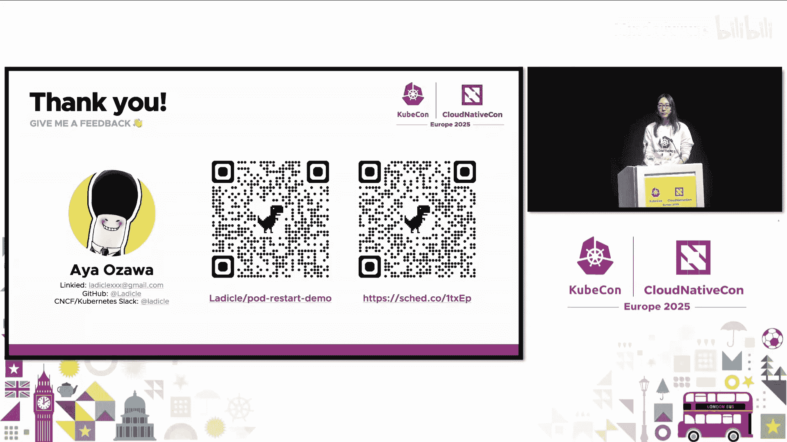