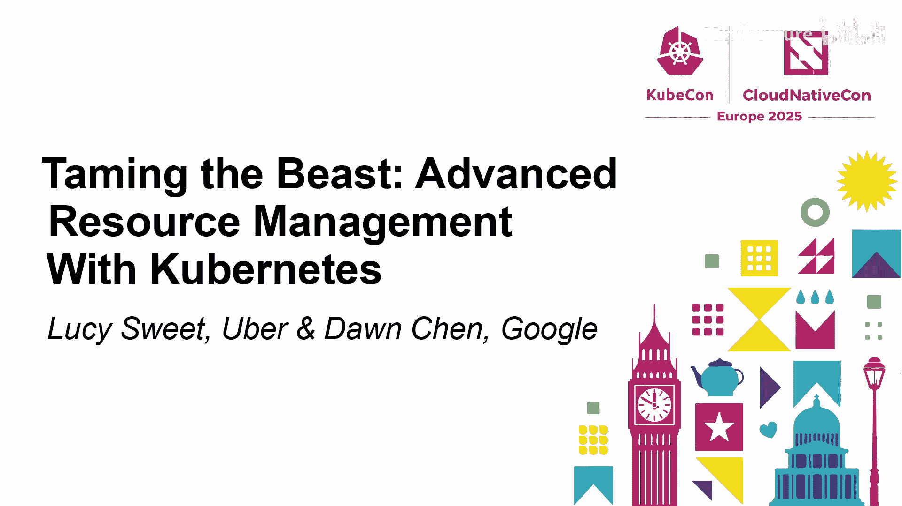
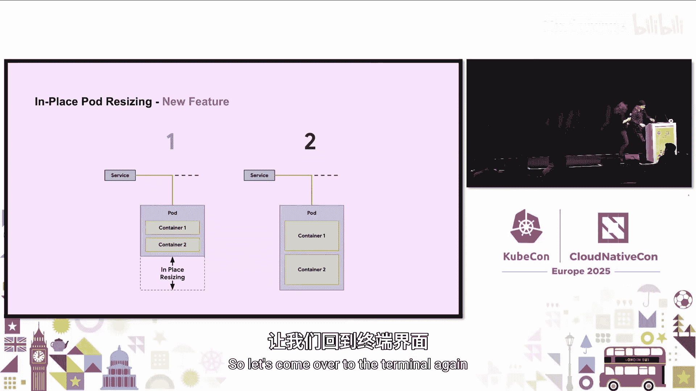
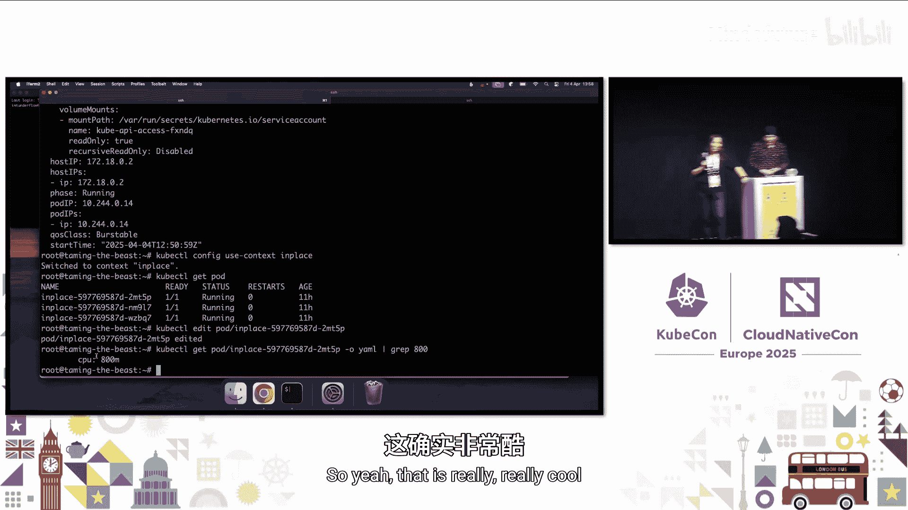
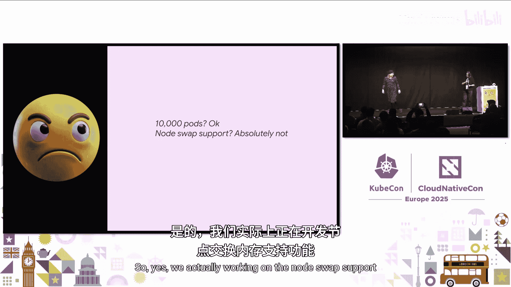
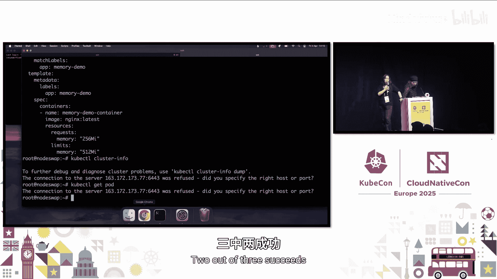
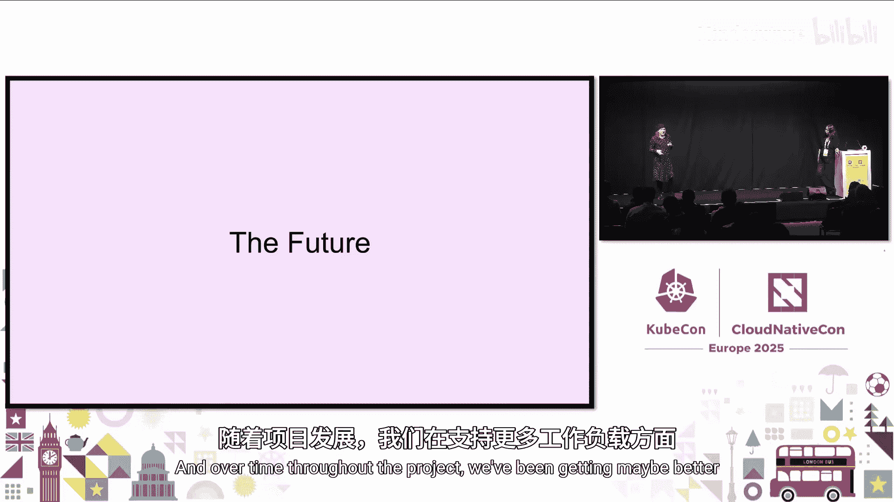
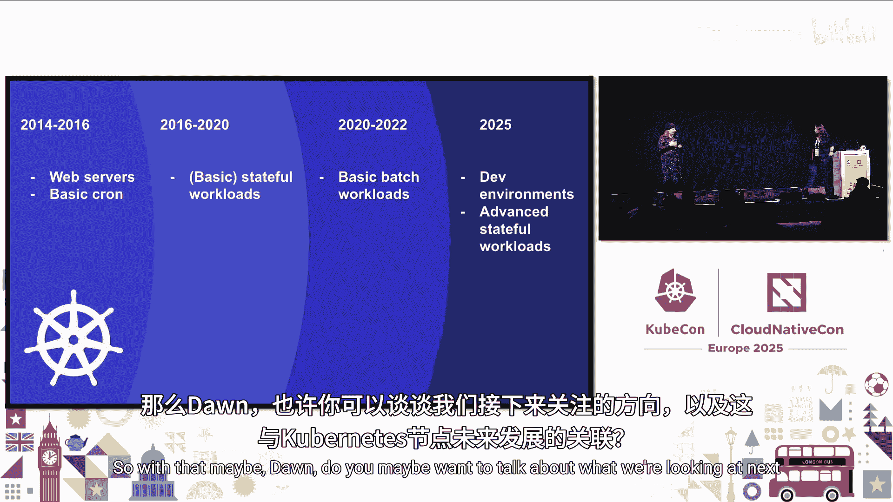

# KubeCon-+-CloudNativeCon-大会2025-｜-云原生计算-｜-可观测性-｜-Kubernetes-｜-Prometheus-p34-P34-Taming-the-Beast---Advanced-Resource-Management-With-Kubernetes---Lucy-Sweet--BV1Cd32zDEBG_p34-

Okay， everyone， welcomele to Taming the Beast on the last day of Kupcon。

 It's great to see such a good turnout considering last days， typically it's not really like this。

 My name is Lucy。 I'm an engineer working Uber and I may contribute to Kubernetes for most of this presentation。

 I'm going to be played more of a role as a user of Kubernetes who has what is it who has a lot of struggles with a resource。

 I'm thrilled to be joined here today by dawn。😊。

Hello， everyone。 My name is Don Chen。 I'm the software engineer from Google。

 and also I'm the tech lead of the Kubernetes signal since its inception。

 and I'm thrilled here be together with the Lucy。 and together with us。

 we are going to show you folks a lot of the new tricks with development last one year and a couple years and to help you to manage resources better and help you gain better control and also manage the Kubernetes resource。

😊，A little bit nice and ten， yeah。Awesome。 so oh， can I borrow to clicker。Yes。

So Da I've been using Kubernetes a lot at work recently and it's been quite useful。

 especially for more basic stateless workloads and the more basic stuff we have but we've really struggled with more advanced workloads and more advanced resource usage I thought that to show my artistic creativity I would draw how it feels like to me it's almost like trying to tame this wild beast to work with our platform there's a few things in particular that I'm really really having trouble with I was wondering if we could maybe step through them and see if we can work out whether we can do anything better ahead absolutely let tame the beast which is the forwardd one that one So first off。

It's really it's setting resources at a per container level。s sometimes it makes sense。

 sometimes though it's a bit of a struggle。 I don't really want to dedicate the entire slice of my CPU just to some loggings。

 I just wanted to share it with the main application there's also a few applications we have where we have one container only as high utilization the time another containers has a low utilization and then it flips on the inverse。

 and really we have to reserve all space for both containers in to use it there's no real concept of sharing。

 you could maybe do stuff in the CR all right， but it's really not that great。

 maybe anything we could do here。 Yeah， of course， signal the having heard this of request for years。

 and we finally introduce the new feature called power level resource So the feature actually it is in F2 in this recent release one data 3233 So and it is allow you not。

The resource request and limit at the power level instead of the individual of the container level。

 right， So to really dig into how this is work， let's start with how we apply of the resource at the container today。

 And you can see from the Yama file and you have to apply carefully thinking planning and how much of the resource you want to apply to the each individual of the container and you always theres the kind of struggle。

 you are going to over provisioning for each of the container and based on their peak usage and which is need about class level or node level of the resource and all you are going to risk your under provisioning of the creative application and impact performance right So so this is kind of current approach the introduction introduce of this new feature level。

So and you can see that from the Yama file， right， So you are hugely simplify your configurations。

 So you can apply simply at the port level。 And you can see the what is total of the provide boundary total of the resource request and limit at the level。

 Instead go to the detail about the container。 So you can see that the to container and share of the CPU and memory。

😊，Yeah， do you want to try the demo。 Yeah， absolutelyute。 that sounds really exciting。

 Let's see if we can make it work on a real system。 I will say this is over the Internet。

 So just be warned。😊。

So if I come in here， I have a Kubernetes cluster here let me remind myself what I havet here good so if I come in here I have first off a Yaml file here。

 which I'm going to cap for the audience。So this is just a basic web app， and it has resources。

 it has acycl container， it's doing some logging and it has a separate resource request right。

 so that's just applied that to the cluster pod levelve before4。 yal。Yes， I should make that bigger。

😡，Okay and I'll just quickly remind you， so resources are at the container level。

 we're all used to this， right？Now， what can we do differently？ Well。

 let's have a look maybe at pod level after thet yamo， which is the exact same application。

 except now， look， the resources are not set at the contain level at all that set all the way at the top of the pod level。

 And the pod is going it's going to share these resources among all of the containers within。

 So if we now apply this， pod。What was the phone cord again， it was called Pd level after the aml。やも。

And that's configured。 and if I look maybe at the pods。Once they come up。

Which one was it I can't even remember now， probably a one。And then I get this pod here。

And we go up to the resources。here we。 So you see here that the resources are now set at the pod level they're being shared among all of the containers。

 A that's really cool So done is this something where you have to make a binary choice。

 Is this something where I either have pod level resources or I have contain level resources or can I mix and match here as adults we want the bolts we want all combinations So this diagram show you how powerful it it could be so you can。

😊。

Oh， I thank you， this is。Oh， yeah， yeah。This四 one。Okay， so you can see from this diagram。

 you can see that you can apply the resource at the container level。

 You can also apply the resource at the part level。 you can also apply as the combination。

 So this is actually the highlights of the flexibility of this feature give to us right So you can ofubernetes So this one with this feature you hugely simplify the resource management configurations right So and reduce of the possibility because the misconfiguration based on the sum of the container resource and which exceed of the node capability。

 But if for advance of the applications you want for example。

 for the machine learning of the workload， which has one data prepare of container and which require a lot of the resource at the beginning and but also we need ensure about the。

Machine learning main app and have enough of the CP memory can do the training jobs。

 So in these cases， actually you can apply power level resource the memory as the boundary as the total in of the main application can be making progress。

 but at the same time you can set the really high limit for this data make sure they can using some of the at the beginning and not all the time So that's of things you can think about that another of the example I can think about it is application with have the web services along with of the cache proxy right so you the web services they maybe have due to the traffic you may be once a while need a more resource and but a lot of time actually it is the normal you can set the level boundary as the normal usage。

Those combination of the two containers。 So that's kind of power level。 in this case。

 part level resource give you the the guard as the whole right So since you can think about part as a unit。

 But at the same time， within of that part internally， you can do the better sharing。

 you can also at set of the peak usage。 But at the same for the at the same time。

 you can ensure of the normal time and resource usage。😊，That's awesome。

 So this is in Alpha still right， so if you want to use it， you have to term the feature gate。

 but yeah， and hopefully folks can use it and give us feedback awesome so。😊，That's great。 We have。

 though， another problem as well。😊，Right now we're trying to run stateful workloads on Kubernetes。

 databases， things that are more tough to disrupt as well。

 and we want to change their resource usage， but this isn't really possible right now pods are immutable and their life cycle is one way once you said that you have this many resources for the pod you can't really change that when we run databasefaces for example at work that really can be quite disruptive because we have to create a brand new pod move everything over and because of that we're really struggling is there maybe anything that we can do here to make this better。

This is a really good question， actually， and require about the powder restart and also container within that powder restart restart and it is when theres the little resource change actually is definitely introduce a lot of the operational burdens right So this is why we start signal started working on this in powder for years。

 So I just want to glad to announce that in the133 and this feature promote to the better。

 so thats and also it is default for Kubernetes cluster。 So so this feature just like name。

 and so you can let's go to the previous let's look at before picture first。

 and you can see that okay， you want to change small the machine have some of the s resource。

 you want to change。😊，Because due to that traffic peak。

 you want to change increase of the CPU and memory。

 and you have to today you have to care of the care of the running container and and of the new part with the new update of the resource requirement and then to that to the whatever suitable note。

 So this is definitely introduced of the disruption and could be and then the term about the services。

 all those kind of things lost of the network connection all those kind of problem we have and also even for some state side could be of the data corruption to because those kind of things So with this in place recing。

Graph a diagram to show。 so you just can Kubernetes take that your request and also just dynamic change。

 And if the node have enough of the slack and dynamic change of the request and the services continue run。

 And do you want to try。 Yeah， this is really exciting。 Let's see if we can get it work。😊。

So let's come over to the terminal again， I need to quickly change a context。

What is it a QCTL confi use context pub？What is it in place， is it yeah， okay。

 so in here I have a series of pods here。Awesome， so let's have a look at these。

 So if I open up this pod here。It's just running an application we come down a bit so I'm in edit mode okay so say I'm in here and like I want to increase the CPUU limit of this pod right I've got more traffic coming in and I don't want to blow up the whole part it's running a database or something but I just want to give it more CPUU so I'm going to come in here I'm going to change this 600 m to 800 m I'm going to write that and it's been configured and now if I have a look if I go coi I'll get。

😊，This pod here。Oh Yamel， Gr 800。The CPU has increased CPU limits increased 800800 m。

 So I've done that without stopping the application at all。

 I've just given it more CPU with absolutely zero disruption to my users and my application owners So yeah that is really。

 really cool and it's one of the most exciting features I've seen Qubs in quite a while yeah awesome Thank you So So it's that that we can do that with everything are the limits here for example adding resources is typically quite simple for systems but taking resources away from already running workloads is a bit tougher。

 for example， I could see maybe it works with CPU shrinking。

 but does it work with say memory shrinking Yes that's good cr leading to the next and so。😊。

So。So it's not all application。 you can easily to change the resource right so even like not just shrinking and even like the of the resource request。

 like， for example， Java application when you want to of the hip size and you may require of the restart of the So to make this this is used based on those kind of workload and different applications So in place introduce policyes policy two option today we is prefer no restart and another one it is restart container restart container basically just previous behavior default previous default behavior and for the VPA and those kind of things and but the preferred but even with the no restart't no restart here's the reason just like the Lucy just ask for memory shrinking actually doesn't work very well because thats。

Due to of the kernel limitation。 so Kubernetes signal community actually work very close with the Linux kernel community。

 We try to make this better， especially in the S V2 and and when shrink of the memory and this will trigger about column of the memory and but in the signal V2 actually prefer it is killed because the reason thats also have the good reasons behind because we want to make that predictable performance。

 all those kind of things but we work with them because the different requirements especially for the booming of the A machine learning workload and care of those those tasks actually cause a lot of the cost is really high So another things I want to point out and this feature actually also can work together with the power level resource we just introduce earlier and even you can apply off the level。

As a whole for the hold part， but the restart policy actually dictate about the behavior about the container itself。

 So I want to point out that one。 Also I want to point out theres the limitations So the feature itself actually it is no feature。

 but to make that in poverty is hold feature and make that more useful and there's the cluster level of the orchestration integration。

 for example， vertical auto scaling and even like the some workload framework a coupleubnetes and they have their own auto scale right So all those kind of things we need to integrate actually there's the community we work with them and to make that integration better。

 So so it's easy it's not like Lucy and have the manually the Yama file so in the future it will be automated and also please notice that there's other limitations currently for the better release only。

CPU and memory。 and there's the other extended resource we are under development。

 We are thinking each one of the resource actually introduce different type of complexity to the system because the nature of the resource itself but we are continue of the improvement or those kind of things Another small things I want to point out even the in with those and you can change the quality of the services job will stay with job with you may be change to their CPU and memory CPU and equals to that limits and also static CPU and memory management wont be change because even you change of those kind of thingss hard。

 really complicated to dynamic change of your exclusive or reserved CPU and new。

 all those kind of things。So another thing I want point and we make to simplify to get to promote this to better easier earlier so people can try。

 give us the feedback and we also make a decision it is atomic recing right you ask partial of the if only partial request adjust meet on the node admission time。

 we will reject in of the recing because that introduce unnecessary complexity to the system and also it's also for the user。

 it's really difficult for them to reasoning what's the behavior and we can。

 So that's kind of the all limitation and we have。 but please try because it's quite powerful and maybe in。

In last couple days of the talk and a lot of people already utilize this feature and in their production and and yeah give a lot of guarantees Well that is really awesome。

 I think this is a really feature let's just do a quick straw put your hand up if you're planning to use this feature in the future。

 put your hand up wow actually I should put my hand up to that is a lot but this is a huge boon for us now this is all really cool's just one thing that we're kind missing right now I run a lot of Java services and a lot of where on startup they have to warm caches or preprocessed things and a lot the time that means their memory usage It looks like a big startup and then it kind of falls off right now I have to give them dedicated memory all the way through to their startup load and then I can't really take it away even even now I can't do memory shrinking right So means I have a load of idle memory I don't want to use。

😊，t swap just like in any other system， but Kubernetes is almost allergic to swap。

 It's not just not supported。 If you run a kubt on a machine that has swap。

 it immediately blows itself up。 So yeah， it would be really cool if we could maybe use memory swap for at least for burst memory in Kubernetes。

 you think maybe we can get to that as well。😊，Yes， can we go to next one So， so， yes。

 we actually working on the node swap support and and。

Unfortunately， this time still is not graduate to the GA and you can see that this is for last many of the improvement。

 every release we have improvement on the node swap features and so in the one that 33 and we promote to the beta3 or better3 I think。

 and and add the more enhancement to the features So I just want to see something in the past as the signal and and community tech lead。

 I'm really strongly against the of the node any of the format of the swap usage。

 one of is the kernel limitation right the top reason it is because introduce performance associated performance right and also kernel cannot really accurate detect what's inactive memory So and and also we don't have the really good way to detect。

Those kind of things and carefully calculate how much of those inactive memory can push down to the disk。

 And also those disk activities， exhaustive disk disk activities really really slow and also exhaust disk activity could be introduce the neighborhood noise impact not just the itself performance and impact entire of the node other applications performance not just and also kernel once you enable of those swap and kernel will spend a lot of time to try to do push those pages to the disk。

 And instead spend time to really run off the applications So that's thing over also associate those kind of things。

 So that's why I strongly against to put off the node swap。 But at the same time。

 same time we realize because we evolveubes。😊，Support the state for site。

 And now we are support of the batch workload and also especially for those AI machine。

 large scale of the G AI machine learning training jobs。 So。

And we know and resource management and planning is really hard。 And woman care of those certain job。

 Actually， it is at more cost to， to push those and those certain of the pages into the disk。

 So that's why we start to accelerate of the development on the node swap memory swap。 So thats can。

isYou can see that the feature actually， it is the at this moment。

 the feature actually is node level feature。 You can see theubnet actually control plane major control plane here and so Kubernet you have to configure and this node and enable of the swap or not So Kubernet will do the carefully how much and and monitoring of the resource usage about those kind of things。

ubernet also will be based on the both of the raw memory usage and also swap usage and make decision when theres the w still cannot prevent and make decision So so this is but this one actually means node level of of the swap We still not really finish。

 give the pod level and and make the application like a pod for free to using those swap we are continue work in the。

And try to make that final ground of the control for the each of the part and applications。 So also。

 this sounds really， this sounds really cool。 Maybe we can give this this a go， as well。😊，Okay， so。

If I come over to my terminal here， let's see if I have access to the cluster first off because I've been fighting with it this morning。

 Yes I do A so on this machine here I'm running a basic cluster using QubVDM If I just have a look at my swap I have swap memory here。

If I have a look here and， sorry， yes， let me make this bigger。So you see here I I'm on a cluster。

 This is a single node cluster。 I have swap memory here， and it's being used properly。

 If I have a look at my Q8DM configuration， you can see here that I've turned on the no swap feature gate。

 and I've said that the swap behavior is limited swap。

 So that means that the burstable component of the memory of workloads can end up in swap。

 What's the bestible component。 Well， if I have a look and I actually let's count the live pod。

 QL G pod。😊，Okay， let's cap the file。You can see here so the requested memory is the part that's non-bursable and then once you're above your request but within your limit that's the burstable part that when limited swap can end up in limited swap mode can end up on swap memory and then there's another mode where you can actually end up with all of the po memory on swap okay so that's really really cool and yeah unfortunately I don't think the cluster is going to cooperate with me today。

😊，I don't know。No， it doesn't like me。 Okay， I think it literally just crashed my demo。

 that was bad timing， but yeah， that's really cool though as a feature。 Let me put this slide back。

To out of three succeed two out of three is way better than we thought it would be。 So that's great。

 So I guess now so I work Uber。 So I guess that's great because it means that with like many petabytes of this space。

 that means I have like8 petabytes Ram now， right totally right So that's why you can see the demo of the swap that's mean that indicate how cautious we try to use swap by default even swap feature it is G by default we will make that is available I want to carefully thinking and and how when there will want to the swap so I talk about a lot of those yeah using and there are more of those kind of things Most that and also have the security security so。

😊。

So the reason of this time， it is not graduate to the G A。

 Most it is because of security concern and another one， it is the eviction management。

 that potential policy， the good behavior of the part without using swap。 So that's why we。

 we can we can think about we need the more。Sort through。 but that's kind of thing。

 But each one of those kind of things actually have the medication suggestions。

 So we are going to document those medication and best practice to end about those feature。

 And so so looking forward after feedback when you try in your in your class production cluster。

 Yeah awesome。 And people。 yeah， please on use it maybe give feedback。

 Okay awesome thank you Don for helping us the time I've got micro friend here。😊。

Thank you Dawn for helping me tame the beast okay so now we're going to go into and talk a bit about maybe the future of what may end up happening in Kubernet Signno。

 before I talk about this， I just want to be very clear I'm a human who has opinions which is the most dangerous thing of all。

 but when I say something that doesn't necessarily mean that it's a promise and it doesn't mean that other maintainers in Kubernetes agree with me it is an opinion that I have。

 but it is not a commitment to anything particular。

 but I want to start by maybe thinking about why why Kubernetes are so ubiquitous。😊。

And I think it was Clayton Coleman who said it's because it can run most things reasonably well。

 and that's a really good baseline to maybe set ourselves towards the landscape though of workloads running in Kubernetes is changing and it's changing all the time and over time throughout the project we've been getting maybe better and better at running more things reasonably well。

If we look at maybe at the start of Kubernetes you have a basic web service， basic Chrome。

 this is what Kubernetes really started with 2016 you have the advent of the stateful set which has was with basic stateful workloads。

 eventually there's progression of features so that it can get better and better。2020。

 you have the jobet object which helps you run a batch workload in a much more better way and we've talked today about these new features that they could help you。

 for example run developer environments I know in the past maybe we've not had the best support for this I know that Gitpod was on Kubernetes and then left because of the challenges they were facing with this for example in place resizing a lot of developer environments require a lot of resources when you're building and compiling but not many when you're just writing code this kind of allows you to respond to that also more advanced stateful workloads things that are less able to be disrupted these are easier to support with these new features but but we need to keep relevant with the industry and we need to in my head it it shouldn't take you being a maintainer to run your workload on Kubernetes as long as it's not really crazy most workloads should be able to run in a reasonably well fashion So with that maybe dawned。

 you maybe want to talk about what we。Looking at next and how this ties into what may come next in the node in Kubernetes。

Thank you， Nuse。😊，You're lucky。 have the two most opinionated people on the stage。

 Now it is my opinion and also my proposal。 So so I've been tried to propose those just like what loses it and I always believe we can involve Kubernetes to support more workload even most of the workload like the last couple years。

 I we even signal make the Windows container supported here。

 So that's why I always believe we can do that。 but I also know that today's Kubernetes make a lot of the primitives to support certain workload。

 Like， for example， those complicated batch workload and G AI machine learning workload。

 we do we can support， but we don't do good job and it's really paying for a lot of the users right So one of the I want to to talk about one of the proposal I made last year is grouping and Kubernetes today。

😊，Have only have the part concept。 of course they have the high level concept。

 job set and replic side demon side tons of those kind of things。

 But each one of have that special meaning and special and also top So it's not first first layer on top of work to directly with the control plan and sorry no control with the schedule schedule thinking about the per part And so this is one and propose specially it is addressing the need of the distributed of the batch workload。

 we introduce it's not called part group。 and introduce part group like of the concept first line of the concept describe those workload I want and so so then that require the group of them They co located。

 and and tight couple of the container， all those kind of things So I want this is kind a fundamental of the building block and so。

So all those kind of things can be grouped together and so end of the hack scheduling。

 When I talk about hacking is kind like the re autoscaler and sm scheduler and also like this week and last of the Ca scheduler and by the by the run AI and and so all those kind of things I'm thinking about those power group on top of the Kubernetes and people can build about their own re cluster and sm cluster on top of Kubernetes。

 So then we can and also the whatever and for other customer of the customized of the scheduler right So another things So that link about the proposal and another one it is also it is I want to relax of the constrain。

 like today we talk about power level resource right and we also talk about which is make this happen。

 and we also talk about。Powder recessing， or it is make powder。Les static， right。 So this one is。

 I want to further make powder less static so you can inject。

 You can remove add and remove of the container。 right， So into a po。 So when you have the， this is。

This feature and together previous feature， po group actually represent a workload， batch workload。

 right， So then the batch workload control plan， they can schedule about their task and jobs into the those po group and inside each po group and inside of each po。

 they can schedule their task and jobs also。 And when you need more resource。

 you can also en of your po。 And and if you don't need that much resource。

 you can shrink or you can share with other other content other jobs on the application on the same node。

 right， So there's a lot of the things we can do so。So this is kind we we are talking about this one。

 So once I mentioned this kind of things。 And for example of the I been so signaled and myself actually work with the ray and S community。

 and also we just discuss with the schedule people and how we can group together the ultimate goal for me it is define another layer of the abstraction on top of theernet and so the batch workload can work on top of those kind of things。

 So just little signaled actually start about the D and then that it is built of the abstract layer standardized all those specialized of the device。

 So there's another layer we want to build it is on top of the objects。

 So then all those kind of the customer of batch work scheduler can。

Schedule target to the part group together。 I think we have to。

 I think we have to be very bridged here。 Yes， the fight， okay。No， no。

 Do you want to quit like actually， yeah， we need to go forth。 Very sorry folks。

 but we are already over。 The final thing I want to say and it's going to take 30 seconds。

 Don't cut me off is。Is this is not being built in isolation or alone。A significant amount of people。

 The London one wasn't available yet。 A significant amount of people were involved in building these things and in making these things reproduct。

 So please， when you decide to applaud， if you decide to applaud。

 please reserve some of that applause for those people。 I'm not gonna name people。 because if I do。

 I'm gonna forget someone。 And that's gonna be bad。

 But I'm looking around the room at a few of them that I can see。 And with that， thank you。

 I don't think we can do Q And A。 There there is a Q R code if you want to give feedback on the session。

 And yeah， thanks for coming。😊，👏Thank you。

