# KubeCon-+-CloudNativeCon-大会2025-｜-云原生计算-｜-可观测性-｜-Kubernetes-｜-Prometheus-p35-P35-Demystifying-Why-the-World-Is-Built-on-Kubernetes---Learning-To-Lev...-Abby--BV1Cd32zDEBG_p35-

Good morning， everyone。 How are you doing， Good。 Yeah， Last day So few hours， and then you can crash。

 Okay， anyway， thank you so much for attending our talk。 We will be talking about T R Ds。

 Let me introduce myself。 I'm Sebasian Bla。 You can call me Sebi。

 I'm a developer advocatevo for Port and developer internal Port。 And Abby。 I'm Abby Wanger。

 I'm a principal engineer at Senasso。 where we're building a framework for building platforms。

 And a lot of what we're doing is trying to make all of this a little bit more accessible。

 But today isn't about either of our products。 It's about what makes Kubernetes so powerful in so many different contexts。

😊。

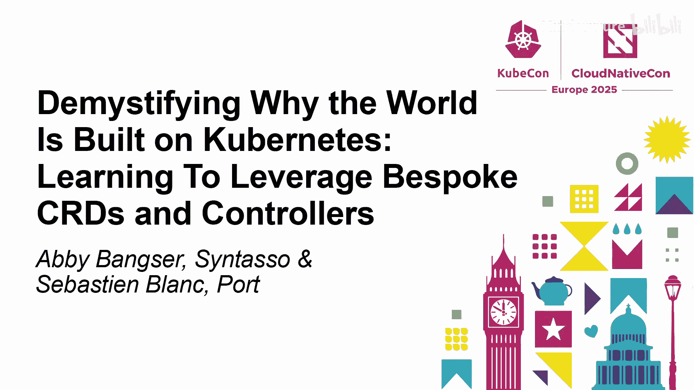

And the thing is is that there are different models， interaction models for Kubernetes。

 and sometimes when you're talking to someone and you're confused about how they use Kubernetes。

 it might be because you're talking across these models。

 so I want to call them out and call attention to them。So the first is the user personality。

 and this is people who might use CoB CTL， which is the command line tool to be able to see what's going on in the cluster。

 but the big thing here is that what they're focused on is what applications are running in the cluster。

 what are the pods that are running， how do they get logs from the software that's running in the cluster and that kind of thing。

The second interaction models around the administrator。

 and this is people that probably definitely use the CLI tool。

 but they're going to be focused around different things that they care about。

 they're more infrastructure oriented， they're looking at administrating a cluster。

 so how do they create the nodes， how do they do taints。

 how do they do upgrades of Kubernetes itself， and they may be setting standards for Kubernetes around things like RBACX or role-based access control and other things。

The third interaction model is the developer model。

 and this is probably the least spoken about here at CUBConn or just in general。

 and often these developers have a background as either users or administrators or sometimes both。

 but what they're looking at in this role as a developer is they're looking at extending Kubernetes to actually do more to not just do what Kubernetes does out of the box。

 but to bring more value to their organizations and to their teams。😡。

So if I simplify this down even further， a user sees Kubernetes as some infrastructure。

An administrator sees it as a container scheduler and a self hosting solution for tons of tools in the CNCF landscape and outside。

 and a developer sees it as a powerful API server。And all of these are true and it's part of why Kubernetes is taking over the world is because it does solve all of these problems extremely well。

 but it does it's like touching different parts of the elephant you never quite know who you're talking to and today's talk to be very crystal clear is all about this developer persona and experience because again we don't talk about it as much from an entry level why would I use as an API server。

 how does it work and that's what we want to dig into today so hopefully that sets the context。

 I won't be offended if this was not what you thought it would be。

 we'll learn to write better CFs it's okay but this is what we're gonna be talking about today。😡。

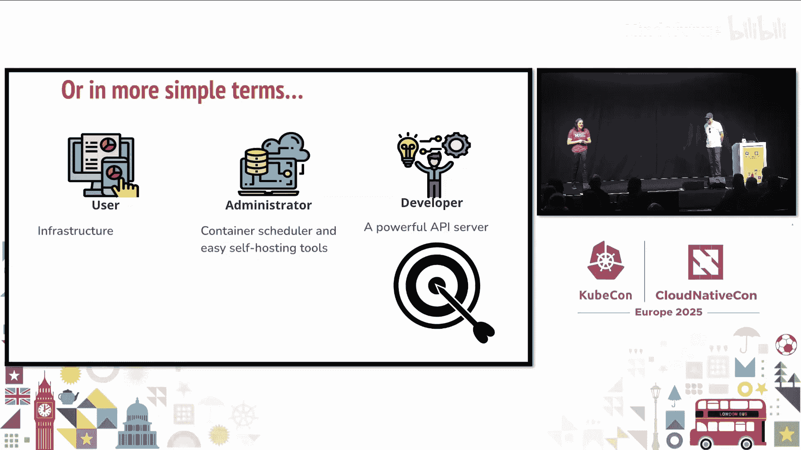

And the reason we need to talk about it is because the number of acronyms， the number of tools。

 the number of ways of working with the Kubernetes API is confusing。

 and we want to demystify how it works。😡，Yeah， and we will start with the first one。

 I will explain you everything about CRDs， what is the CRD okay。

 let's go CRD free words and first of all， it's a resource okay。

 it's a resource that you will be able to apply on your cluster。😡。

Resource is just a reminder in Kubernetes。 Def a desired state。 When I have a deployment resource。

 I define a state of I want free replicas， and that is my desired state and the cluster will make sure that the desired state is respected。

 okay。

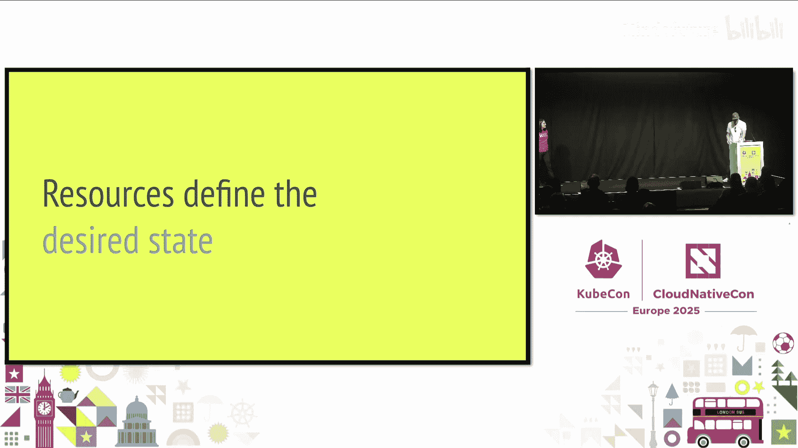

We all know about native Kubernetes resources， a deployment， a pos， an ingress， a service。

 those are the native resources that exist。😡。

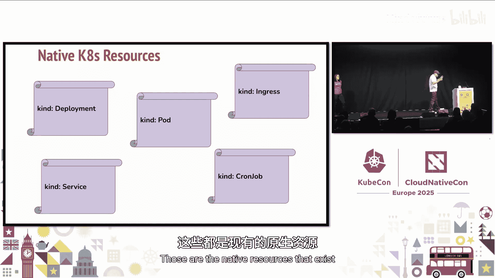

Custom definition。That means， that's me， as a developer。

I can create my own resources and apply them to Kubernetes。😡，And。

You can define basically a new type of kind and just it sounds really simple but for me in my opinion。

 that is one of the most powerful feature of Kubernetes We often hear hey。

 Kubernetes is a container orchestrator that's true it's really good at it。

 but what is the most powerful feature is that you can build on top of it in a really easy way and the entry point is building your CRD。

😡，You extend Kubernetes。

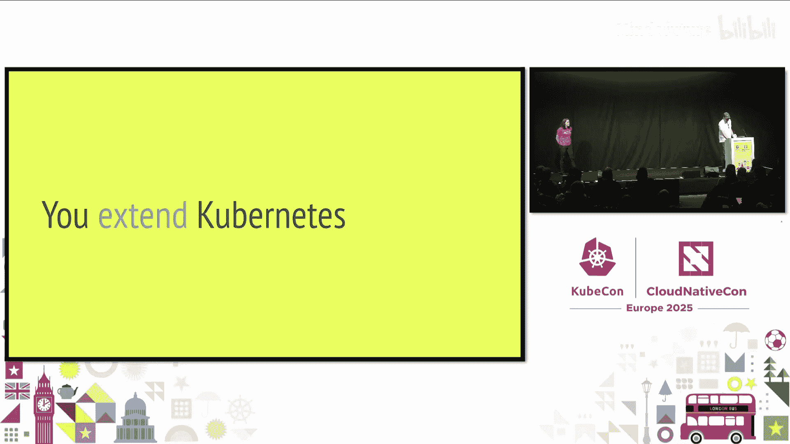

Let's see together how exactly looks like a CRD。 So first of all， the first part is。

 if you know a bit the native blocks like a pot or an employment， it's exactly the same。

 You have an API version and you specify the kind。Then you have some metada， as always。

 and then you will have the spec part。 And basically in the spec part。

 you will be able to put an API open API schema because a custom resource definition is nothing more than just extending the API of your cluster。

Let's focus a bit on。The spec part， okay， so here you can see really simple。CRD。

 and I haven't extended to the spec part here， but here you give it the kind that you want。

 I could call it widget， I could call it anything that made sense for your organization。

 I could call it pizzaizza， Qissant， anything if it makes sense for your platform。

 I can define whatever I want in here。😡，Let's focus on the spec part。 Again。

 it's an open APIV free schema。 That means that you can define there your field types。

 Do I need strings and tigers， booyions， inms。I can add constraints to it hey for this number this inte。

 I want a minimum and a maximum， this string is required and that will help me for validation if I don't respect any of those constraints。

 I won't be able to apply my custom resources Yes， because you create a custom resource definition and from there you create custom resources。

😡，If you are a Java developer like me， think about。

Custom resource definition is your Java class definition。 your pojo definition。

 and your custom resource are just the instances， the objects that you create。 I like this analogy。

 We have other analogies like a database schema that I Java developer as the one that I use。😊。

And by respecting those validation， you also ensure data integrity in ATCD， because in the end。

 it's a resource that will live in ATCD。Here you will have a more complete。Spec part。 Okay。

 so imagine I want to trade a custom resource definition to， to define a Postgres database。

What do I need， I just want here free fields， I want the name of my database。 and here again， look。

 you can get some defaults。😡，You can give it a description， really useful。

 and you can give it a type。Then I have another fields， which is also of the type string。

 And finally， I have another type， which is an minimum of the type of my environment。

 Is it dev or productd。 So when you will create your custom resource。

 you will be only able to choose between dev and Pro。 again， if you put something else。

 the custom resource will not be accepted by your API server。😊。

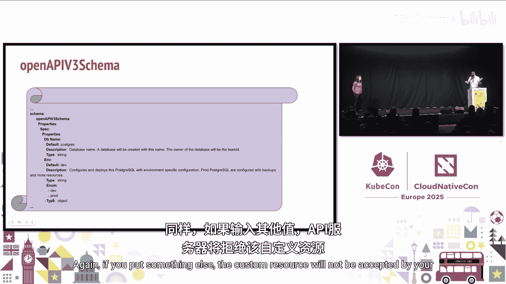

Cer these are definitions。 and again， whether I say customer resource are。😡，For now， they are valid。

 Your cluster will accept it。But nothing will happen。

 You have to assign something to it And Abby at this point， it's just an entry in a database。

 It's not anything realized The thing that helps us take those definitions。

 those assigned action items is a controller。 So a controller is something that listens for these entries into the database and very specifically a certain type of kind and then takes action on it。

 So let's jump into what a controller is。

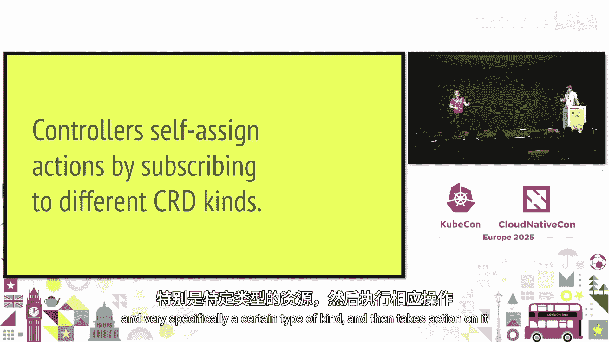

Because at the end of the day a controller is just an application。

 it runs as a pod so we know how our web applications run as pods。

 this just runs as a pod and what it does is it watches the state of your cluster。

 the data that's in at CD and the events that are occurring across your cluster and then it actions what it is telling it to do so the controller listens to a trigger resource and then it tries to take that trigger resource and action it in the way that it is supposed to so the to do list becomes create something。

 update something， connects something and that kind of thing delete something， etc。😡。

And so this is really just an eventbased application so let's have look at it in practice so here we're gonna to look at something that is like a built-in type within Kubernetes a deployment so if you've touched Kubernetes before this is one of the resources you may have already had experience with so the deployment is something that sets a specification for a set of pods。

 a template for that set of pods and it sets the number of those pods it wants to run this helps you with resiliency by having more than one pod running the same thing so we have this deployment resource which as of right this second is just an entry into a database。

But now we have this deployment controller when that entry happens。

 all of a sudden the controller kicks into action and creates a to do list。

It's to do this is actually to create a new replica set。😊。

So a replica set sits between the abstraction of a deployment and the abstraction of a pod。

 it says it takes that template from the deployment and it transforms it into the next resource。

Then we have more controllers who listen to these types of resources and continue on。

 which can create a huge chain if it's something that you're not familiar with。

 but actually can make a lot of sense if you have any experience with a UniX kind of framework and style of thinking where you want something to do something one thing and do it well。

 and that's why we have a deployment controller that creates a replica set which creates a pod when that's all you even wanted when you started with your deployment definition right。

😊。

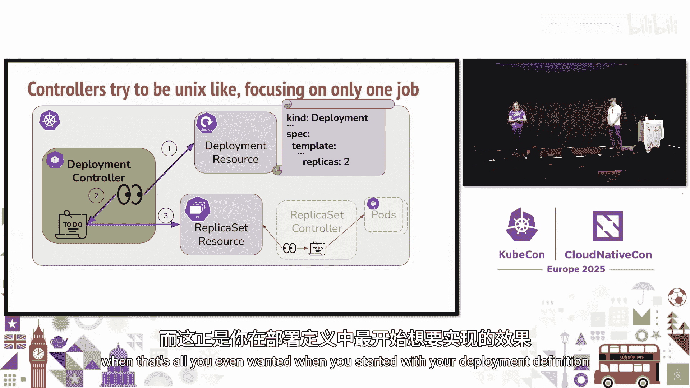

So the next thing is we've been talking about why Kubernetes is so powerful as a developer extending it and using the API。

 and we've learned how to make custom resource definitions， so new entries into the database。

 but now how do we react to them， well， we make custom controllers。😡。

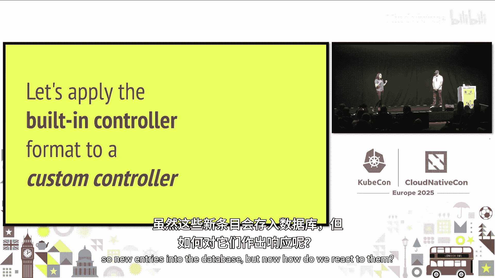

So I'm going to look at a custom controller that I helped build。

 but these are true for pretty much every project in the CNCF。

The way that it works with Cs is that we have a custom resource called a promiseise。

 the promise is different from any other resource in Kubernetes because instead of focusing on deployments or pods or ingresses as we were describing。

 it defines a platform service so what do you want to provide as a service in your organization so it has its own specification that helps an organization to find that？

It becomes an entry in the database。😡，Cratics， the controller。

 then watches that and creates its to do list。One of the things in that credit to do list is that if the intention is to create a platform service。

 a self-service on demand API， what we need an API for those requests to come into so one item on the to do list is to create another CRD。

 the service API that was defined in the promise。The other thing in the to do list is to create the back end。

 You can think of this like the controller for this service。

 this controller is then listening to the new CRD type。😊。

So what we're doing to extend Kubernetes is we're removing or're introducing an abstraction that takes that idea of custom CRDs or that's duplicate language。

 isn't it， said it all the time， but custom resource definitions and custom controllers and we're pulling that together into the concept of a platform API。

So coming back to the basics of a controller， controllers are event driven applications that run as pods in a Kubernetes cluster。

😡，That is it， so if anyone is making you feel silly for not understanding them。

 they are pretty simple stuff。That you can get involved with。

Those controllers are able to watch resources and then manage other resources。

 they tend to watch one and manage another one because otherwise you get into circular issues right。

 so you have a trigger resource， a set of activities that the controller knows how to to which they reconcile to bring together that defined state with reality and works on those managed resource Kubernetes。

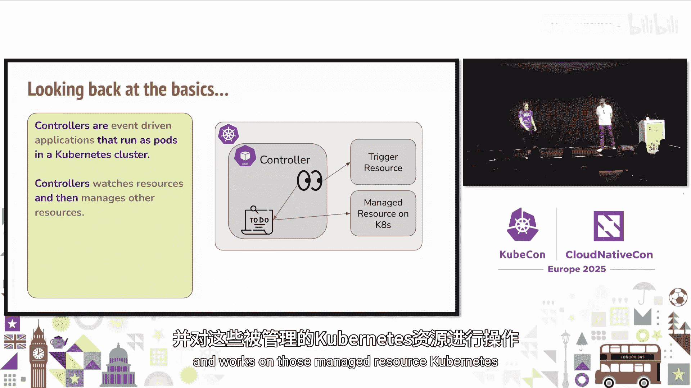

But before we close up the talk， we wanted to go through a few of the myths that I think are prevalent around the community when it comes to CRDs and controllers。

 and the first one is that controllers are only for Kubernetes resources。

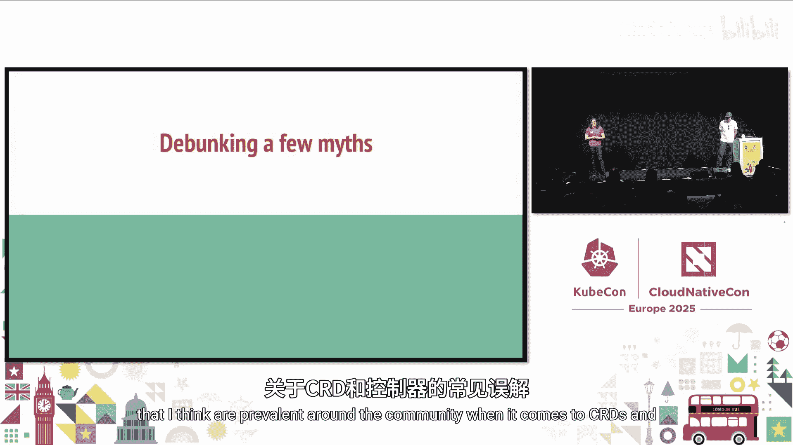

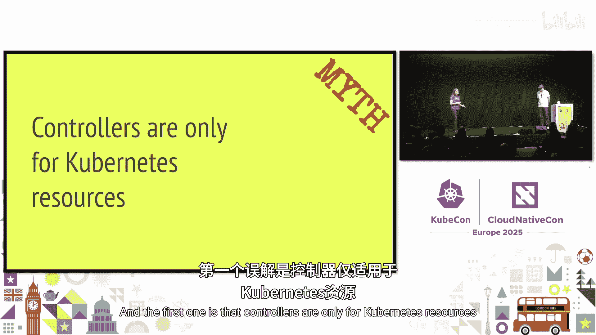

So I'm going to go straight back to that diagram we were just looking at and talk about the fact thatubernetes that controllers do run in Kubernetes because they use the API as a dependency for themselves。

 and they can manage things in Kubernetes， but they also can manage things outside of Kubernetes。😡。

Cratics， crossplane， all of the cloud provider controllers that come from them。

 these all do a great job of calling APIs that are outside of Kubernetes from that controller to take action。

 so there's nothing stopping a controller from managing bare metal。

 we're doing things on mainframes and edge compute and anything VMs and anything else。😊。

The second thing is is that it can even watch non Kubernetes resources Now this starts to add a little bit of complexity when you're talking about off cluster so this is a more advanced use case in a lot of ways。

 but it's very much done and it's very there's lots of examples across the community that you can go looking for and learn from if this is important to you so the thing about controllers and CRDs and why they've taken over Kubernetes has taken over the world as an API server is because it doesn't limit you to Kubernetes。

 but it gives you a single control plane， a single way of working across all of the infrastructure in your complex environment。

Oh， so the last thing is it can be on and off the cluster， that's the total slide。诶。

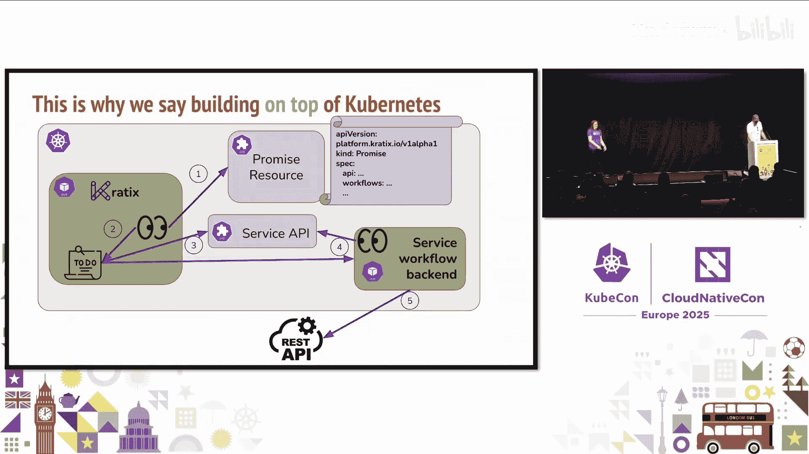

， okay， the other admit that we want to debank is a golden is the only way to work with Kubernetes and to write your controller。

 your operators。 Okay， so a lot of people think that because， yeah， Kubernetes is built with Golan。

Most of the first operator that we saw were built with Going。But again， a custom controller。

 it's really important to understand that a custom controller， iss nothing more than a pod。

 It's your pod。 And what you put in a pod。

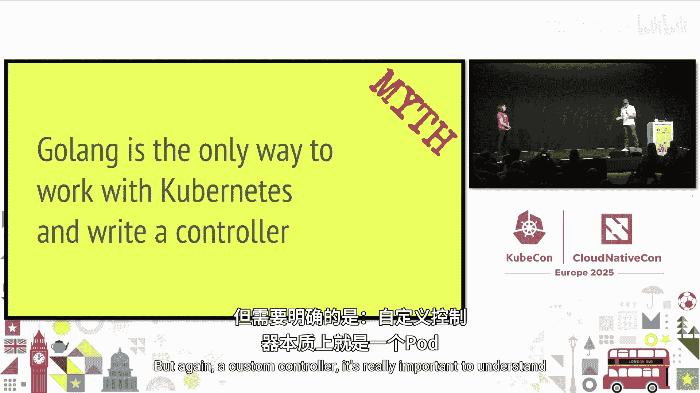

It's up to you。 so you can really use anything you want to create your custom controller。

 We can see here that there are even。Controllers built with shell， Okay， Python 0% is funny。

 I even saw custom controller written in JavaScript。 Okay if you want to have fun， of course。

 a few examples， the high languages。 Of course you can write your custom controller using a rust。

 we have the cube rest I don't know how you pronounce that Okay。D you as the pythonic framework。

 I have never tried it， because I'm not a pythonist。

 but there is a great framework to build your operators using Python。

There's a no GS operator framework， and personally needed one that I really love because again I'm a Java developer is the Java operator SDK。

😡，And it's great because those SD D K came a bit later than the go operator， S D K。

 So they could learn from the mistakes as they could also learn from what's worked well or not well。

 And the Java operator， S S K as a Java developer， make it really。

 I love to speak about developer joy。 And when you start building an。😊，Operator， using the Java SDK。

It's really a pleasure。 You have so much developer experience。

 You write a pojo that is converted to a CRD that is automatically applied to to your cluster。

 You just have to implement the event loop controller methods。 it really makes your life easier。

 So if there are any Java developer in the room， I am sure there are some。 Okay， give it a try again。

😊，You can build your custom controller with whatever you want。

 You're just ignoring the shell up there。 Hey， you know， Oh yeah， I it even bash， even that， yeah。

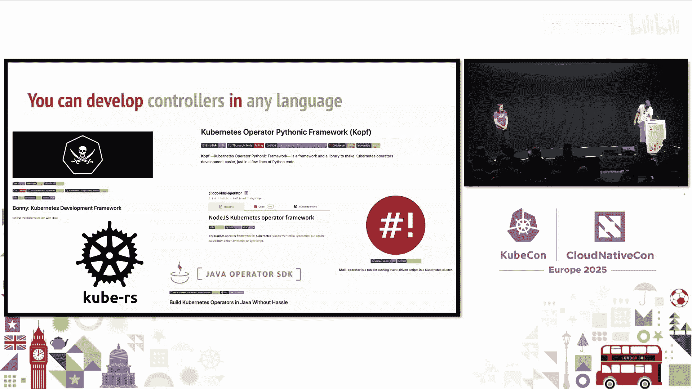

Cool， so the next myth we want to talk about is that you just because you don't know everything。

 you don't know enough to get started。 So one of the things about being at CubBcon is that it's such a large event with people at all different points in their journey and everyone's learning slightly different things as they go and at slightly different paces and with slightly different vocabulary。

 which just adds to the confusion And the thing is is like how many people have heard the term operator before。

Okay， and keep your hands up。 How about we go down controller。Okay。

 how many people think that these are the same thing。All right。

 how many people know why they're different？Cool， so we had almost the entire room knowing hearing about both controllers and operators。

 we have a very small number of people being like yeah。

 they're the same and a very small number of people being like I know the difference。 Well。

 the thing is is it's like squares and rectangles。 So if you're gonna get into a debate about controllers versus operators。

 it's a bit like getting into debate over Emax versus Vm or something else that is just that kind of esoteric technology debate right there are nuances and they're important to talk about and to understand in the fullness of time。

 but don't let people using one or the other stop you from getting involved in the conversation given the knowledge you've picked up over this week and hopefully in this talk。

😊。

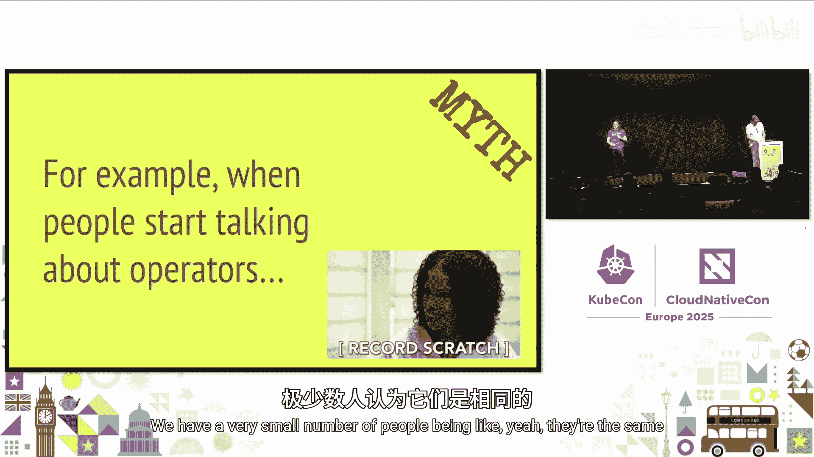

The operators are like squares， they usually talk about operating specific software。

 so the life cyclee management of creating， updating and deleting and there's actually an operator framework that was put out by Red Hat and that's where the kind of term really gained popularity Controls are the more generic。

😊，Pod running on Kubernetes that responds to a resource and affects another resource。 right。

 So you got squares and youve got your rectangles。I have the slides that go along with that。

 sorry about that。 So the operator is the operational knowledge in software。

 So as I said that lifecycle management and the thing about life cyclee management and operations is that it's a bit of a journey。

 So this is something that this capability model came out with the red hat framework and it talks about the fact that when you're thinking about operations。

 whether you're writing that into a Kubernetes operator otherwise you can start small and build you can start with installing。

 then do upgrades， then deal with lifecycle insights autopilot taking a human out of the loop the same thing goes for learning about all of these things writing a controller that auto populates an updated image tag in your pods or you know we wrote one at one point a few years ago that auto restarts a pod when it config map changes you can write really small things just to get a sense of how the world works and how the system works。

😊，Before you start trying to run with your entire organization running on a set of custom controllers。

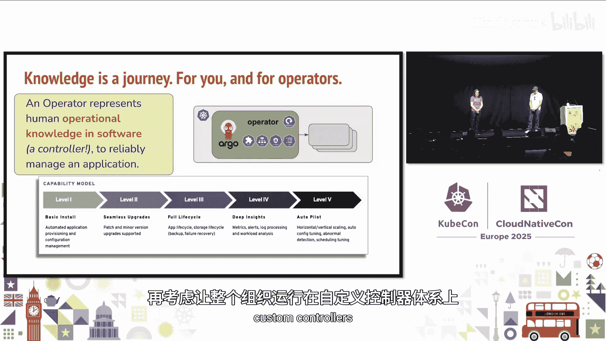

嗯。Building on top of Kubernetes is only for vendors。 An， you think that operators are only。

 I don't know， Sa providers， cloud providers that provides their operators or you can interact with it。

 And again， that's not true。 And here is just to show you how much projects are being adding over the years to the the。

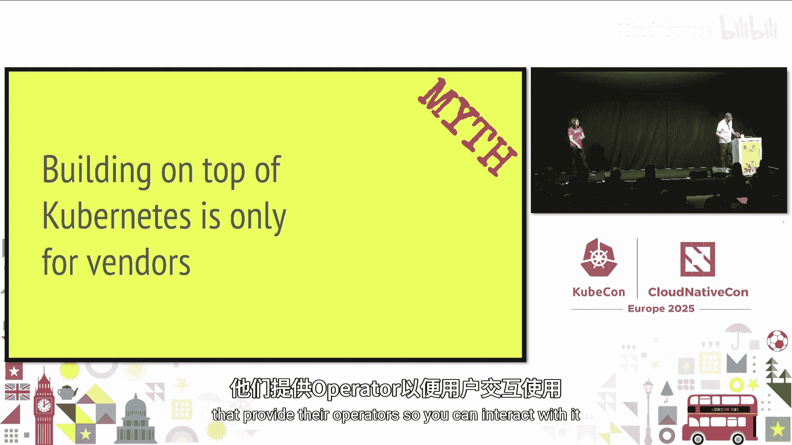

The the CF landscape。 But again， if it makes sense for your organization to write your own operator。

 just do it。 It's not just for vendors。Start buildinging one operator， starts building two operators。

 three operators As you have too many operators use credits。Anyway。

We know that platform engineering is really hot。 It's the hot topic。 Well， currently， it's MP。

 but let's talk about platform。 So there are no MCP in this talk。

When you will start building your internal developer platform， CDs and controllers are crucial。

And what I'm going to tell you here is， is a bit my opinion。 It's quite opinion。

 But I think that the source of truth of your internal developer portal should be C Ds。

The way you model your platform domain model should be CRDs， CRDs are APIs。

 okay treat your platform as a product， your product has a well definedfin domain it as APIs。

 do exactly the same with your internal developer portal， okay。😡。

One of the things that you want to offer with your internal developer platform is offering self service to your platform users。

 You want to make your。Developers， self vision， autonomous。And。

Providing a set of operators and C Ds is a great entry point。

You can streamline exactly what you want to expose to your developers because you are in charge of creating your CRD。

 okay， you can abstract away anything you want。😡，And， as Abby says。

Doesn't matter if it affects stuff that is not living in your cluster。

 Your operator can operate stuff outside of your cluster。 So even your legacy software。

 your success vendors that you are consuming， they probably offer you operators。

Put everything represent all of this as Cr Ds。 And you can see here， my design skills。In the end。

 what you should end up with is having a main base platform that。Opers all your other platforms。

 because that's another lie。 ever instance say， hey。

 I want to have just one single internal developer platform。 Belie me。

 you will have several role in your organization， including Saas vendors that you are consuming。

Having this approach of C and controllers is a great way to harmize your internal developer portal。嗯。

Wow， we are pretty good on time。In conclusion。Kubernetes is not just a container。

Orchestrator scheduler， even if it's really good at that。 and I love this feature。

 but you can do way more than just scheduling containers。CRDs are just like database5 G。😡。

I just wait for to。I don't think it's a good one， hope you all are okay being here and it's true because in the end it will end up in the database。

Cs are instances of a CRD schema。 you can also use my analogy。 CRDs are Java class definitions。

 and CRs are instances of this Java class definition。😡，Controller and applications。2对。Oh。

 that's the other room， probably。Controllers are obligation that subscribes to CRD types。 Okay。

 really important， controllers react when something happens with your CR that is being applied。

 updated， deleted anything。😡，It's really powerful because controller will always make sure to reconcilate the desired state that you define in your customer resource and the reality of your cluster and again it sounds pretty obvious but this is such a powerful feature that's a reconciliation loop and do we have another one No I think that's a thank you for coming and chatting with us the CNCF loves to hear back feedback about the talk so please use that QR code to share your feelings about this talk and also please just come talk to us we'd love to hear what we could have gone into more what we can do to help and also please get involved in mentorship if you can within the CNCF Thank you thank you so much。

I guess we should say that both of us build both of us have built and are building controllers and operators。

 so Port has a great one that connects your Kubernetes clusters into their portal and Ctics is obviously built as a controller so come by the booths in the last couple hours if you want to hear more about it。

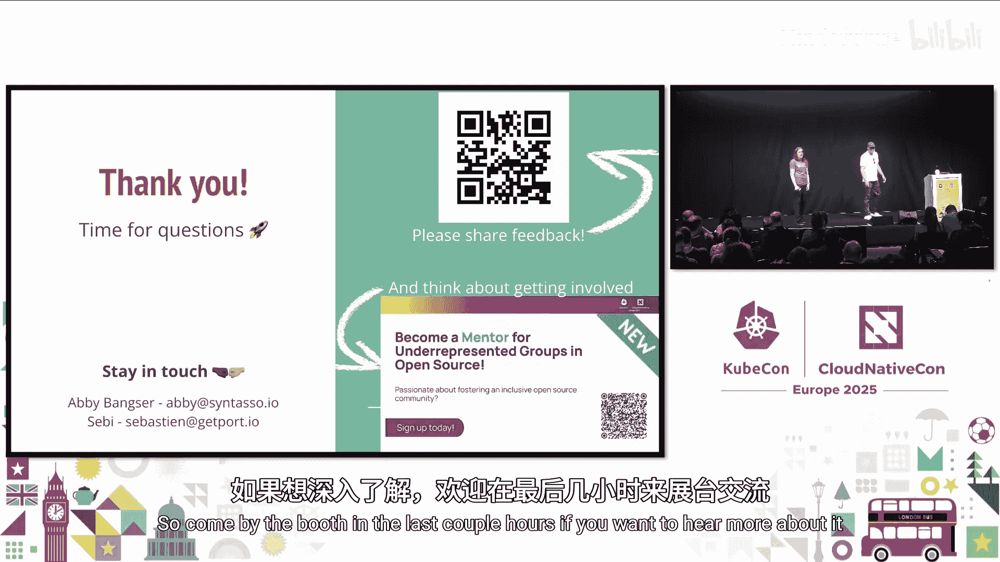

Thank you。