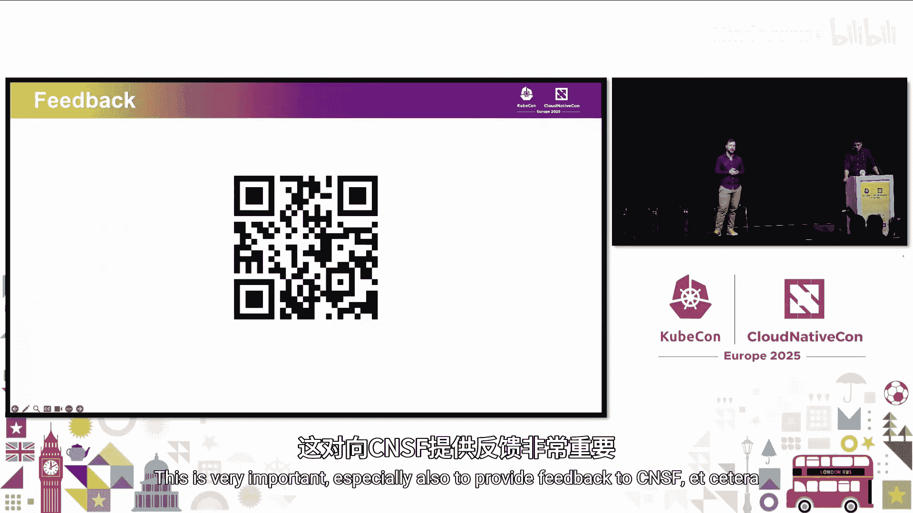
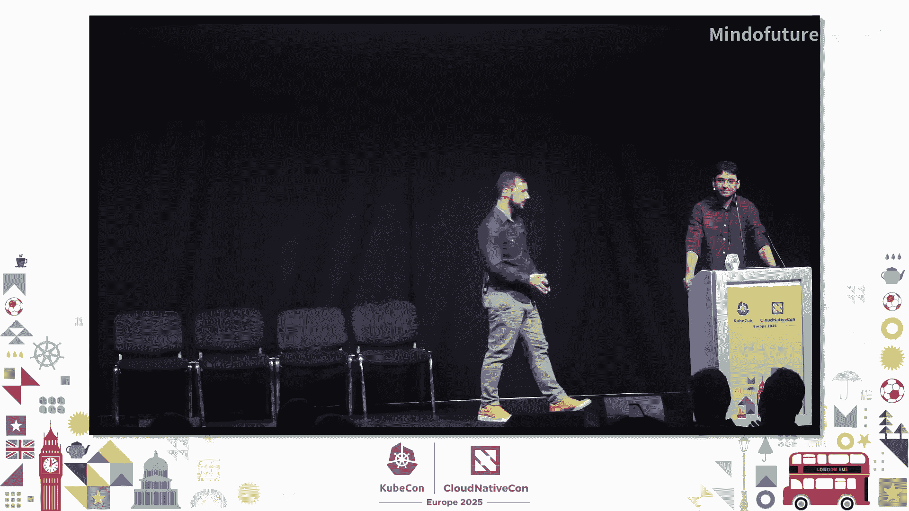

# KubeCon-+-CloudNativeCon-大会2025-｜-云原生计算-｜-可观测性-｜-Kubernetes-｜-Prometheus-p36-P36-Surviving-Day2----Picking-the-Right-Tool-To-Secure-Your...-Bruno-Gabriel-da--BV1Cd32zDEBG_p36-

Thank you so much for being here。I know it's Friday last day。

 I hope so far you had a great event so far。And once again， thank you so much for being here。

Before we start。I'd like to do a quick question for you。 make a quick question for you about。

 do you know how many CNCF projects， security approach is this today。I'll give some hints。

 some options to you to think about it。So between these options， what do you think？

Before I provide the answer， hold on， let me provide some an image that will help you to make the math from your side。

So this image is about how the secure CNCF。Open source。Projects。So now， it's easy to。No the option。

 right？So let's check。Who thinks that the answer is letter E， A， sorry。No one， want that。B。Okay。

 a lot of people。 What about C。Okay， I think be's the winner。So。The letter C。

And to be more precisely， it's 80 and counting， it's growing fast and not easy for the image to get this number need to count because the squares are not the same size。

My name is Z Hick Sotan， I'm in principal Cloud support Engine at AWS。

 I work with customers for ECS and EKS for about five years almost six years now。

 I'm based in Dublin， I'm Brazilian and together with me。Its hello， I'm Bruivva。

 Seni Solutions engineer at Ciic， I'm also Brazilian live in Dublin a little bit about myself before knowing this Kubernetes thing。

 I work a lot with no corporatelash legacy， let's say， technology like Microsoft products。

And since then， I discovered this open source in Keres world， I shift to this。

 and welcome to Surviving N two Pick the right to secure your Kubnetes habitat。

So if you read the description of all your talk， you may be thinking。

 how can we correlate technology and you know open source tools， Well。

 I hope our presentation make this a little bit clear。So starting with， you know， the animal kingdom。

 we have some animals that are very similar even sight in shape， but they're not the same。 Let's get。

 for example， like a tiger and a lion。But they overlap in some things， you know， kind of the family。

 etc ceter。 But they have some social ways to do or different strategies to hunt。

 And this is where I think the tools in open source space， as we saw 80， at least， well。

 when it is like， maybe anyone was announced， do this sccom。

 And this is how we want to get this cl in this talk。We don't have time， of course。

 to cover all the8D tools。 otherwise， well， it gonna take a long time。 and honestly myself。

 I dont I don't know all of them top my head in what they do。

 So we select some tools that based on our experience and community usage so itthub stars or blog post or even know Kubernetes Kubcon talks and based on those we like okay how can we structure this in a way that I can understand the fluxs or the flow where the security tools fits in the security space as also the idea here is。

Get a little bit of one on one idea of how the secure around Kubernetes can be used。

For those with decide to get four kind of stages， build， deploy， start and run。

 And this way we're gonna focus today。 But， of course。

 there's way more as we saw the number of projects。Starting in the be face。I heard so many times。

 so many times this actually was why I discussed when H to create this， this talk is， hey。

 can you use the project X， Y， Z to scan my containers。For vulnerabilities。

 And then I kind of step back and say， oh， you mean you want to scan your container image。

For vulnerabilities。 This is a very， I would say spread misconception。

 And I understand the person wants to say the image。

 but we need to be very clear when I talk about the image is the green square。

 What is like we have the layers。 So it feels like Docker file before to create a container For example。

 you're gonna have the layer1 from alline。 So the base O S。 then I're gonna copy a configuration。

 we're gonna run F K。 So basically installing something and then then I'm copy my app directly。

 You can see that the layers are between brackets are oh， like read only。 So this is a static file。

 So the image is very important to remember is something that is a static。When I teach in my company。

 especially when I talk to people that are starting the security journey。

 I like to compare this when like， you do a recipe of a cake。You get a recipe。

 You're going to start to， you know， the cake pan。 So let's say the alpine。

 and I'm going to start adding products over it。 So I'm going to add sugar， egg， milk， etca。

And then we're gonna go to the build phase when I gonna， you know， like bake the cake itself。

Then we go have， you know， the blue square， the container。 when you're gonna have the new layer。

 which's called the runtime layer， or sometimes referred as a sendbox layer。

 which only exists during the time that the container is alive。 And this also。

 we change the behavior to be read rights。All container images。They are based on operational system。

 On this case， were using al P as base。 So you can see here like the file system of like slash binan。

 M and T， proc， root， etc ceter。 So things that my application will need to work and then makes this job。

So once again， image or container image is based on layers。 So going back to the cake idea。

 if I get something from supermarket directly from the shell。

 I just basically trust that product to add on my cake。

 but I may don't know exactly what is inside very similar in the container or Kubernetes world。

 We just download packages or use， you know sources that maybe are not so trustable or we don't have the。

Knowledge or time to inspect them。 So what is you can do in this case is thinking about scanning this image。

 So check what is insides。For this case， the two that we select for doing are very well known in the community is3vi and simplifying the3vi steps。

 We're going to start to extract the layers。 So get those layers that I explained before。

 Then we're gonna build the file system。 So we know extract and go similar to the image that I showed before。

 Third part9 O S and no S packages。 So kind of may distinguish between。In the check。

 we're gonna get this value and cross check with the vulnerability B。On this case。

 what I'm saying is， hey， get specific product or you know against get something for the shelf。

 let's look the composition of it。 let's try and identify if the shelf life is okay or in this case。

 the VB will have the CVs that matched with a specific package or library。When we run3V。

 this is how result looks like。 We can see that the base base image here， the Python 3，9， etc cetera。

 It has0 vulnerabilities。But some Python packages， they have vulnerability。

 So in total 3 and inform forms directly the package。

 This is one of the ways that if I have the image built， I can get extract the data from it。

 once again， Str the layers build， etcter。 And then from this， I can get， you know。

 what are the package or the vulnerabilities being affected on specifically。

 So this is one of the open source tools to use in the build stage。And well。

 which animal can we correlate with this。 Well， actually。

 was' a lot of interactions between ourselves。 And we come to conclusion that maybe a raccoon。

 is's kind of better fits it， especially because， you know。

 a raccoon has something that it scaveneng just for looking， you know， for food or something。

 And he knows what difference like， hey， This is plastic。 This is food。 This something I want。

 So he has the idea to， you know， open the layer So open a trash。

 open a trash can to know what is inside and then get what he wants。😊，Okay。

Moving on for a deploy phase where you are。Hiating the Kubernet API should change something like to create a pod or delete something or modify something so。

For this， it follows a specific path， so if you go to the admission controller。

 which basically is a checkpoint that inspects all the requests and enforce the defined policy that you have like for example。

 you can have a company policy that saying that you cannot allow X。

 Y and Z so this a controller is the gatekeeper that make sure that you this the checkpoint that you make sure that the rules are compliance with the company。

So。And after death。With all the requirement enforce force。

The objects can now be be stored into the E TCD。 So basically， this is a workflow for。

 for every Kubernetes API that every。Modify or update or delete Kubernetes API that we are making for the Kubernetes cluster。

Talking now about the project that we select for this stage， we select the Caverno。

 that it works as a dimension controller for Kubernetes。It works with Yamo file。

 which is the same language that almost everyone that is using for creating the resource like the pod definition。

 the prime definition。 So you don't need to learn new things to use Caverno。

 which is very good for that。 There are some policy at school that you basically need to to flip the language that you are using。

 And this is good for someone that is familiar with already the Kubernetes word。

 So it's it's very good for that。So there are two things that for the request the caveerno do it can do more than that。

 but these two validating and mut are the most common ones。 So first it you mut。

 So basically mut is on the fly on the fly modification that the request that is is making you make the change on that that object to move forward。

 So for example， let's say that you have a policy in your company that is make sure that you have memory limits for your pod definition right So this is an example that you can do。

 So let's say that the developer forget about that and try to deploy the pod without these memory limits。

 So the caverno。Mooo workflow will make sure that you assign a minimum amount of memory for that resource before move forward。

 so it will not block the modification， it you just change it in move forward the next stage is the validating so the is now is okay if you are not complianceli you will not be allowed to move forward and save CCD。

So a validating example would be， for example， if you have a closer that a production closer and you have a company complies that you need to have a label on your name space that you are。

 So every name space should have a specific label。So for that you can create a validate hook that you basically make sure that for that。

 name says that you are trying to create， it should have that specific label with that key and on that if it does't have it your block and not allow to so you avoid a lot of mess if you have these two things there are two more。

 theygenerate and clean up。That for more details on that。

 I would recommend to go for the documentation because it's not so easy as case were at a 200 level here。

 so these two are more commonly validated and mut ones。For the analogy that you are thinking。

 were thinking a venue is like a forest guard that you， for example。

 if you go inside a forest at night and you forget your lantern， the forest。

 you make sure that you bring the la so it can provide the lantern。

 it's the mo one that I just speak about so it can provide a lantern for you to go inside of the forest。

At the same time， if you are going inside of the forest with something that is not allowed it to block you to go inside of the forest。

 So it it's pretty much aligned with the Caerno thing that just spoke about。

 So it's an analogy that I will bring to you。So moving to this star phase。

This is used before the deposit is running。 So its once the deploy is the state is saved on the H TD。

And before the pot is running， there is a star phase that。 Basically。

 it's for A And I attachment and secrets， for example， that you are using。

 So for talking about specifically secrets。Itsあ。It's about a special object that the Kubernetes is stor CCtu information。

 so you can think about credentials， tokens， keys， certificates。

 wherever that you can save into Kubernetes so you can use a secret to save these objects instead of putting directly。

 for example， the password inside of your pod definition。So with that configuration。

 your po instead having this hardcoded password you amount as a volume or as an environment variable inside of the po。

 and your application can read safely read this information without being the description of your pod with the information directly。

 So if you save on into it easy。So however， there are some well-know limitations with the Kubernetes。

 the full secrets on Kubernetes， for instance there is no beauty rotation mechanisms in place。

 so basically if you are trying to change your password， it will be a bit challenging。

 also there is no versioning about the change that you are making you cannot like easily roll back at least not out off the box。

And also to integrate with GiHs and other pipeline workflows is not also an easy way to do that。

One more thing that。We we we see that his missing here is about integration with external votes like secrets manager。

 Hehcarp and so on。 So there is no integration by default far with the secrets on Kubernetes。

So that's where external secrets of Brato comes through the picture。

 So it brings the secrets values from external resource， like in this example。

 EWS secrets manage into the Kuberlands。😊，So it also supports others， as I said， Pararamid store。

 Hshco Vo and others others external vote systems。But looking on how it works with AWS secrets。

 you fetch the secrets from AWS using the EM roll that you have。

 so you basically configure the external secrets operator with your EM role with permission to fat the secrets from the secret manager。

And also， it periodically syncs this with the external secrets and keep the secrets inside of the Kubernetes synchronized。

So with that， you have the all the the gaps that you just mention about the Kubernetes secrets。

 So you have the benefits of automatic rotation versioning that is also easily integrateds with Gith because with Gith。

 you can check the secrets from secrets managed as well。

 So it''s pretty handy and and good way to manage your secrets with Kubernetes and also integrates with external workflow。

😊，So thinking again about the analogy here， you can think about this external secrets as a skilll that gather their resource from outside worlds and bringing it for its home。

To consume when they need。 So similarly， the external secrets。

 you get the resource from the external secrets。Whatever you are using。

 bring into the Kubernetes cluster and make it available as an external object for your po。

 your application to consume when they need。So we scan our images。

 We have the mission policy in place。We have safe secrets management。 We are safe， rights。Right？Well。

 now， finally， we came to the final stage of this， which is going to be the runtime。 And yeah。

The colors are really to be again。 I know I said this six times already， or maybe more。Image。

Green container， runtime， blue。 And， of course， we are in cubeubecon。

 we're gonna go one more level and talk about pod， which needs to have at least one container running。

So if I need to observe or scan， let's say the container when it's running， how can I do that？ Well。

 I could use some， you know， instrumentation， some SDK or something。

 but this creates a lot of overhead。 and especially I need to involve maybe a developer to be part of it。

So if you think how a container or a pod works in the Knetes world， it's basically he needs like。

 hey， I， let's suppose I have like engine X container。 and then container， I needs to， you know。

 write access logs to specific P。 What he does is the pod we know of using Docker and other run sees。

Go using system calls to talk to the kernel。 and then the kernel will do make the action no to write the disk。

 etc cetera。This is how the application works。 important to highlight that is if it's a pod or if I have a。

 you know， a bare metal or Vi machine with my application running that directly。

 it's going to work the same。 But again， we are a cube con。 We're going to focus on Poway。

So if I need to follow this， so can I do that。 So the tool that we chose for this is focal。

 So the foco has the idea of using EBPF。 you probably have heard about this during the cubecom。

 If not there's a lot of dos。 I suggest to take a look。

 but to simplify EBPF is like a bridge a way to talk to the kernel in a very light lightweight。

 but also very safe， avoid us to using like kernelno module that if you use kernel module before and by mistake。

 you did some wrong parameter and you saw a kernelno panic。

 you're probably gonna want to know to use the new version。

And how the Fo works in this case is he's connected to the same place。 so instead of try to。

 you know be inside the pod or being， you know a sidecar pod。

 is's actually tried to do like a mirror， let's say during the kernel using EBPF so whatever the application in the pod is doing。

 Foco is watching and then he can react or make events of it。So talk about Ciscos。

 If you saw this before。 if you get like， let's say，5，10 seconds of Cisco of a Kubernetes node。

 you're gonna have like thousands or maybe millions。

 So how can we get all of this data and transform this on information。

 something that we human consume information。 So in this， for this case。

 Focal has something called rules。 The rules are a logic or a way to get all of this massive dump of Cisco data and interpret them to then generate an event。

Going back to my previous example， let's say I have， you know。

 read read and write calls all the time。 wow， actually， we have。

 but I don't want to be notified every time someone reads and writes。

 But if someone or some process is writing to， for example， slash TM， I want to be notified。

 And this is where the focal rules come in place。 you can define a specific called specific behavior to a specific path or program。

 there's several ways to do it。Another very famous rule that's being used in foalco is detecting someone open a shell in the container。

 because when you think about shell in the container， most people think， oh， yeah。

 I bypass my application using a vulnerability or something like that。

 But maybe I have access to the node。 Maybe I using a docker or you know， I'm using CuCT L。

 I got a credentials leak for KC L and got there。 So I need to have a way to find this。

 And this is where foalco comes in place。If you're still not clear why do we need runtime。

 you may saw last week about this in the security world， the In nightmare。 If not， type on Google。

 you're gonna find lots of results。We're not going to go in details here， but the thing is。

We had like a conversation， one of the X maintainers of the Kubernetes engine X。

 ingress Engine X and he explain details that。This was something that happened at runtime。

 So if we scan with3y， we didn't find a package with vulnerability。 If we try， for example。

 use caveverno to deny there was no Kubernetes。 It was inside the inx itself configuration。

 So the only way we can get this here。 It's about runtime。

 The behavior that happened in my inx in spot。 is something we're able to detect。

And why this is so dangerous just to give a little bit if you didn't see it。

 basically the ingenex Ingress controller has access to all secrets of your Kubernetes cluster。

 meaning everything we did safely to keep an external vault and syncing Kubernetes。

 it goes to this in genetic ingress。 So so somehow I'm able to exploit this。 I need to know。

 So that is why I really need a runtime secret technology for it。Well。This was the easier one to do。

 Just was some interactions with， you know， AI to get a kind of nice image。

And the easy way I want to highlight this this is foalco is actually the Italian world for Falcon。

 So very easy to do it。 And similar to foalco， he knows where to go to attack。

 attack a prey because in his brain， the foalcal rules know that， hey。

 this is a rock doesn't make sense。 But when I see a mouse running， it's time to go。

 So this is where， you know， the action needs to happen and then are gonna react to it。😊。

So the main takeaways I want you to go home with is， please remember。

 scan image is different than scan containers。The best threats can be enforced。

 So just because Kubernetes out of the box doesn't have a way to prevent people to don't follow my orders。

 Let's say， as a platform engineer doesn't mean I'm gonna just allow to do whatever they want。

 So Caverno or other tools can help us a lot of that。

Keep using external vaults without losing Kubernetes way。

 I think something that even in Hki mission is very important。 We tend to think that Kubernetes。

 Kubernetes。 But if you run let's say in a call provider。

 we may have an ins instance or other products。 They also need to share the secret。

 So how can we be sure that the same RD S password is being sync between my inst instance。

 and also sync between my Kubernetes spot。Etra， I want this to don give extra work to my developers。

 So he knows， hey， get from secret in my Yamo just works。

 It doesn't even know where the secrets coming from。And for sure， the fourth run time to the rescue。

 If the previous barrier， the previous projects were fail or maybe fail is not the correct word。

 They weren't not designed tool。 So if you go back again to the animal kindle comparison。

There are different types of hunting， different skills。

 and they are designed for specific animal to survive and then evolve。

 And then we know new tools will also show up to cover other place， other use case。Something really。

 really important that's not written take away is when we were writing this talk or discuss about the talk。

It's very hard to find one on one content for security。 I worked with security for some years now。

 So， of course， for me it's like what's easy。 But if you go to documentation of some of these project。

 the documentation is awesome。 A lot of flags， how to do this， How to parse that， But okay。

 I'm a very beginner。 How do I start with this， What this is doing for me。

 what stage should I use this。 And this is where， you know， create the idea for we being here。😊。

We have some resource learning。 Don't worry， you don't need to try to click the hyperlink sit from your place。

 We're gonna share this in the official CF place。Now， one small ask。

 I know you have a smartphone in your pockets。 I'm sure you have it。

 So this is the here code for doing feedback。 Im gonna keep this for like。34 seconds。 if you want。

 this is very important， especially also to provide feedback to CNCF， etc cetera。

I say， hey， you， you， please do it。And if you want to connect with us， there's， you know。

 social network called Linkedin。 you may have heard about。 So once again， trust us。

 the care code safe。 don't need to worry。 You should just scan and good to go。 Take us so much。

 If you have any questions， please let us know。 Thank you。😊，你听。

