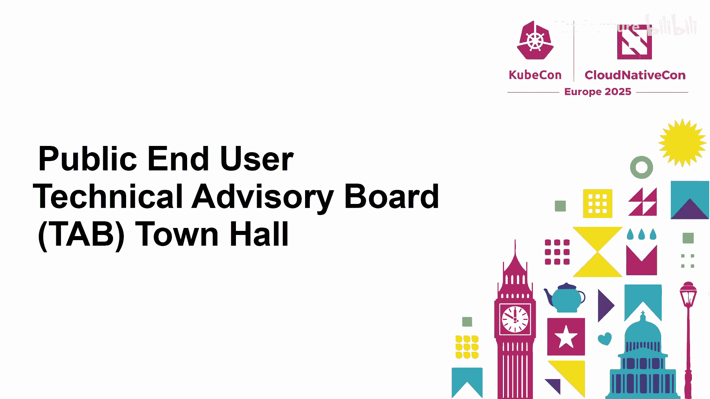
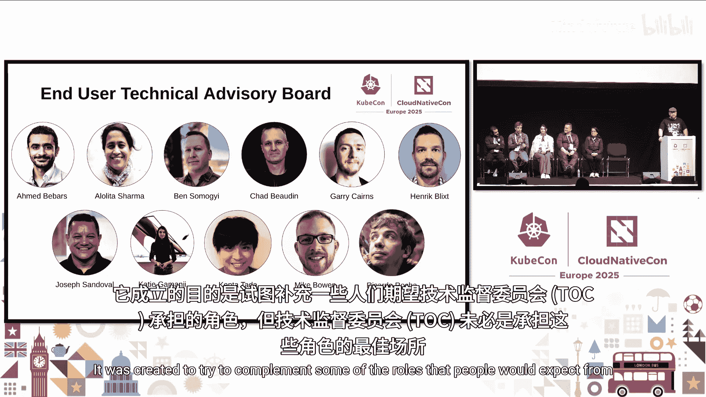
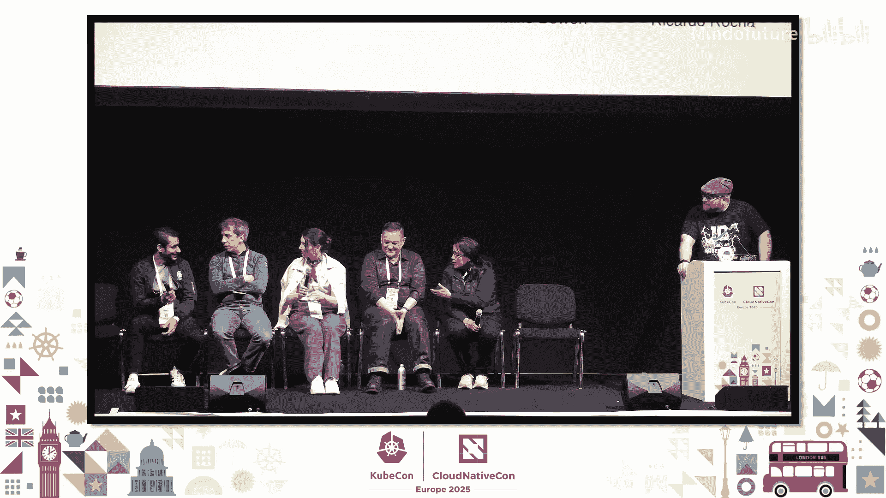

# KubeCon-+-CloudNativeCon-大会2025-｜-云原生计算-｜-可观测性-｜-Kubernetes-｜-Prometheus-p37-P37-Public-End-User-Technical-Advisory-Board-(TAB)-Town-Hall--BV1Cd32zDEBG_p37-

Hello， everyone， and welcome for the sort of。

endd user technicalnical advisory board ask the experts or a AMA。

Technical advisorisory board is one of the top three governance bodies of the CNCF。

 alongside the governing board and Technical Oversight Committee， who was just on stage a minute ago。

With that， oh whoops， I'd like to introduce our tab members。

 Would you like to start introduce yourself？Hi everyone。

 I'm Aloita Sharma and I am leading observability engineering at Apple and also have been involved in the CNCF as a maintainer of the Open Telemetry project and also in Cortex very actively working also on the tag but very happy to have been representing you the interests of the end users and some of the initiatives on the end user T community。

 so thank you for you know again joining in。😊，Joe。Sure I'm Joseph Sannibal， I am with Adobe。

 I am also a member of Kubernetes SG releaselease， kind of absent right now as I work on being a CeCon Co chair。

 and then I think that's it。Hello everyone， my name is Katie Gamanhi and I work as a Se software engineer at Apple。

 I'm also part of the TOC or Technical Oversight Committee and part of the T as well。I'm Ricardo。

 I'm a computer engineer at Cern where I lead the platform infrastructure teams。

 I'm also in the TOC and in the tab and I recently chair the tab。Hello everyone。

 my name is Ahmamed Pece， I'm a principal engineer at The New York Times and one of the newest members。

 so I'm still learning a lot from all of the T group。

 but happy to be representing the end user and the New York Times as well on the tab。

So do you want to tell uss us a little bit about the tab and sort of what the tab oversees within the CNCF？

Okay， I can start and then others can come in。 So the。

 the tab actually exists since just over a year。 it was created to try to complement some of the roles that people would。

Expect from the T OC， but the T OC was not necessarily the best place to do it。

 So everything that needs a lot of end user。Point of view， things like reference architectures。

 better interaction between projects and end users。

 So we we decided to to try to create a new body that would complement the technical oversight committee and the governing board。

 like Bob mentioned， but would bring more end user centric perspective to the ecosystem。

 So we've been scaling the the the body in the last year。 So Alolida was the chair during last year。

 and she did a great work getting us。Into， into speed and understanding how to work better。But yeah。

Yeah， I think。Sure， again I think that you know， as Ricardo was mentioning there are two aspects to the tab that we started off with。

 one was of course， that there are several you know dependencies and interactions with the end user community and including end user members of the CNCF who actively participate on the projects and the technologies that as end users we all consume and really know augmenting and helping the TOC in accelerating some of those you know interactions the other part also was that from an end user point of view really bringing to the TOC as well as to the projects feedback from the end user community which is you know again。

 really a measure of success for all the projects and the technology。

innovation that is happening in the CNCF projects and also being able to give back project feedback in terms of what works and doesn't work for end users and last but not least when there is an concern in terms of rolling out this technology in production。

 because at the end of the day the end users are the consumers of all the technology that is being innovated upon in the CNCF to give that feedback back to the projects to the TOC and work together as a community to impact the roadmaps of projects sometimes to have that alignment。

 so there's again a complex interdependency but yet a very collaborative way of working and getting that feedback together。

Katie， did you want to add or Joe？I was just going to say Ill literally kind of hit on some of the things that I think are really important when I stepped into this role。

 know I really was like，I've been at end user at a lot of different levels right now I'm at a larger company but I've been at smaller companies and one thing that I was really key to me is just being able to find my way in whatever that size company is and helping end users to be able to see how they drive impact and I think that's one thing that if we have a goal for I'd like to see out of this is helping so that wherever you're at whatever size you are you find those entry points as well as driving it into the projects themselves I think that's going to be really key Katie and I actually talked about a little bit about the future the CNCF over the next 10 years and I think that's one of the things we think is critical that's going to help us be sustaining and to help this thing to grow one last thing I think we have one other team member here who's key we have somebody in the past Taylor Diaz all I know Brian's over there hiding out that's one of our key support persons I just want to call him out because we're really excited to work with him。

Gotta stand up so we can。There we go。Yeah， so I joined the tab recently and one of the reasons that I specifically joined is to break the silos in some way to like feel that we are all working as in our companies in a similar problem on similar projects。

 but how to collectively be able to like，Making them impact as Joe was saying。

 like how to get this back and report all of our feedback back to just like the CCF and say these are the projects working for us and how can we make improvements on these projects to be able to have a voice and understand the ecosystem better I think that's one of that great way of having a line of communication between end users and the CCF。

 the TOC and like being able to share all of that feedback that we get from working on problems that hit our industries but also some of these problems we believe as I'm an engineer by nature so sometimes I would build something I think like I'm the only one who build it but like a lot of people build the same thing so like where we can drive and back together to make the community and the open source as a better place for all of us。

So you all have on No I think this is like a very， very good representation of what the tab is doing and perhaps to put it in perspective within the from an ecosystem standpoint end users have feedback they have the real use case of all of these technologies and they know what works what doesn't work how easy it is to engage with the community or not and I think the main idea for the tab is to。

Give end users a voice or an input into the ecosystem as well。

 because it's been very dissipated so far。 It's been very dispersed in general because only end users who go to the project directly and engage with them directly would be able to move forward things。

 But now we can do this as part of the tab and we actually can integrate with different processes and we have。

What's important about the topic is we have people that you can interact with。

 you know how to engage with us and we definitely will be able to perhaps channel this back into the ecosystem as well。

 so I think it's kind of this public facing interface that's very important that has been missing and kind of at least concentrating some of this effort into how we're collecting this feedback。

You've sort of like all touched on some issues of that and users have had with sort of engaging the ecosystem and things like that。

What do you say are the key challenges and potential tab initiatives or things that are actively going on that might help with this sort of thing？

Y， so last year we had a couple of areas that we focused on。呃。

I think the one that was the most successful was around reference architecture。

 So this has been a very long discussion top in the technical oversight committee。

 but the experience there clearly showed that this information should come from end users not from the projects or any other body。

 So it was decided that this would be one of the working groups that we would form。

 Joe has been really active on it。 So he can talk more about it。

 The other areas are about project health。 we heard in different sessions during the week that we have a challenge。

 which is we have this maturity levels but we have a challenge understanding we put a lot of effort when the projects move between levels。

 but we don't have a similar effort yet when the projects remain at a certain level to ensure that the expectation that was through when they moved is still through today。

 So this is where。We believe that the end users can really have a very large impact from the other perspective。

 which is to give tools to the end users to improve their own processes internally。

 there will be a lot of work during the year to give you the tools to create your own view of the cloud native ecosystem。

 It's a very hard to navigate landscape because it's so large there are different views of the maturity is only one metric that you might have a lot more metrics internally。

 And what we want is to hear everyone and try to give the tools to the end users so that they can build their own landscapes ecosystem with the additional information they they rely on internally。

I was gonna say yes so definitely the reference architecture has been one that I've been really passionate about。

 I think you know when I look at like the landscape and I know we see the memes and the jokes and everything about it because there's like so much and it's just you know it can be confusing but I find it really interesting when I see organic projects stir up like there's a project like canoe where people are putting building blocks together what it's telling me is that we're all looking for ways to find patterns or ways how we can make these things work together ideally if we start to as Ahmed mentioned earlier。

 we find ways to collaborate because we share some of the same problems it's similar like an open source it's always better when you can share something with100 people then just doing things on your own or find lessons learned also I like it when I see projects like Argopro for example。

 which was an end user- drivenrin projects I get excited to see that because that to me tells me that we're creating this ecosystem that enables this type of innovation end users start to make that journey start to churn these things out so ideally hopefully that works and then I think Bob and you and we both share a background in the Kubernetes community the one thing that's different from the Kubernetes community versus like the。

NCF in general is that you know over the 10 years there's a structure right we kind of know how to we know the enhancement protocol。

 how that works， I also feel responsible for it， but guess what， we know how it works。

 we can show people how to get features in。Ideally we can kind of do something similar in the CNCF because there's a lot of projects。

 some have different governance， different structures they're at different levels。

 but if we could create a way that could maybe make sure that they're getting the right signal from end users the stories and use cases as a product guy so I'm obviously looking to make sure that we're building projects that are getting the right feedback so we help them so that in partnership with the TOC maybe we can help these things kind of graduate to move along get adoption so that's the thing that I think I'm hoping to really over the next year help to drive and work on。

Very quick because I know we have two questions as well。 The other kind of not necessarily challenge。

 but one of the gaps is。What are other users using within the ecosystem and I think this is where take radars has been quite beneficial because the maturity levels provide a level of credibility。

 however the radars as well， they provide like another layer of perspective of where this is used or how much it is used by other users。

 so I think that perhaps is another initiative I would like to highlight quickly。

It's a question questions。Please ahead go ahead。Hello， I have a question。

 So I think the T A B just click the user's feedback and it can also give suggestion and influence to the end user and when we C andf a lot of projects。

 they kind of like tackle and solve similar problems and how could TDA guarantee their suggestion iss neutral and fair and do we have a standard when we evaluate different projects and give end user feedbacks。

I think Ben。When you have different users providing feedback for specific technology right。

 in an environment， especially like the CNCF and alluded to the complexity of the landscape today。

 you have several projects in larger group of projects which are working on similar solutions or different parts of a larger solution and when you're providing feedback that's one of the things that we are looking at that it's like how do we provide that feedback in a more standardized way back to the projects where then can be reviewed by all the projects in that specific focus area and then we considered for giving back their comments or their prioritization in terms of。

That aligns with their project roadmap right so again I think it addresses part of your question。

 but there is no guarantee in one sense that all feedback from end users will be incorporated by the projects because it has to be also aligned with their technical you know roadmap and where they actually see that technology evolving to and needless to say you know what we want to do from the tab is to take those。

Areas of， you know， recommendations that are coming from end users for specific roadmap items and make that you know。

 visible as a general backlog to Joe's point where there is more alignment cross project， right。

Maybe just to take the other part of your question on being fair to the project。

 So the CCF has the principle of knocking making for the projects。

 the things like the reference architectures that we talked about are really useful because they put things into context。

 and this is where what is really important is when we have the end users coming forward and giving presentations at Co they don't tell you they chose the project X over Y。

 they tell you they chose project X over Y and the reason why they did it and they relate that to their specific use case。

 So there's always some context when you have to make decisions。

 the best area that our easiesties area usually talk about is storage where you might choose a project because you need the high throughput or choose another project because you need the reliability and this is really related also to the domain you're involved in So probably the reference architecture will be userbased user specific。

 but we probably will also。Find domain reference architectures where。

 where different projects might play a similar role for， for multiple reasons。

 So I think this is where the information will be very interesting。

 If we get a lot of momentum from end user reports in this area。

 we can really build this knowledge and help out everyone。Thank you。Oh my。

Question half suggestion is mostly about the reference architecture。

 So I'm very keen on making whatever architecture we have also publicly available and。

I've noticed I've been hanging around the pavilion way too long。

 that there are many different levels of maturity and levels of understanding。

 so people will usually want something， they have an outcome that they've seen somewhere else and they want the same outcome。

But they don't have or don't want to invest the time， read the documentation。

 make something that fits their use case， so you end up with the hello world problem where they will copy and paste the hello world example。

 then perhaps somewhat silently complain that it doesn't really suit their needs。

And then only a small fraction of those will push through and actually engage， ask questions。

Take the next step。 Is that something that it's not necessarily part of the reference architectures。

 but is there some way that。As a community， we could communicate。

 this reference architecture requires you to have this level of knowledge or skills or consultants to help you actually make real world use of this reference。

So it's almost kind of like about to give an analogy be like you know， if you're gonna on a ride。

 you have to be this high to ride this thing basically as what I kind of hearing and I think back in the day。

 I remember there was like kind of a phrase and maybe you might notice but we used to use like Giffy when it was like Google's infrastructure for everyone else and the point was kind of like Google made something to show you what they could build but that may not be suitable for you but it was a pattern for you to kind of build off of and if I look at it that's kind of really I think that starting point it's where we're at you're right this is probably not gonna fit what we put out there but least wanted to show how we built and designed it and then hopefully you can extrapolate from there maybe there's a potential for us to like take some input on how we can improve maybe there is like hey give me a starter guide or maybe someone suggestions but'd love to explore if you have some ideas around that Yeah in fact I think actually it refers to more in terms of what you're mentioning as a maturity model right because again that different dimensions in a maturity model。

And it's not only the technology reference architecture。

 but it's also the dependencies in the ecosystem， whether that is experts， whether that is。

 really level of understanding complexity as well as other factors so you know again。

 that's a great way to also extend and expand upon reference architectures in themselves because it becomes more of a model at that point than just static reference architecture and time。

Yeah， so instead of being a。Blueprint like take this blueprint and now you're us that's not really how it works。

 the same is if it works for Google it is good enough for us， well unless you're also Google。

 it might not actually be good absolutely absolutely because there are all other you know dimensions in the ecosystem that we really have to enable in order for that blueprint to work。

Good question。Hello yeah， thank you very much could you perhaps give us an idea of what life is like as a end user technical advisory board member。

 how many hours a week do you sink into the work， What's an average task you were doing a week like what's it like？

AndLet me start with div because。Yes， yes。 you're。

So I just started like all I know so far is so far。 like last week。

 there's a weekly meeting that like we attend together to discuss like specific agenda items that we go through。

 But there are other working group and work streams that like you would put effort to。

 So I don't want to like from my perspective， my estimation around something like that would be between like5 to 10 hours that where like I see depends also on the size 5 to 10 hours。

 like maybe like a week depends on like what working group or what efforts that you are implanted in。

 but I'm still like exploring。 So this is my first week assumption， ask me next year。

 I kind of the deep end of the pool on that one so。😊，You。

Yeah I can say that you know having been on the tab for a year now it's definitely you know at least four hours of a commitment every week because think about it this way right we started off this year and now we have kind of converged into one meeting per week but we actually had spun up three were groups through the year which were about an hour long meetings and these were discussions you know focused on three initiatives that we were actually working on through the year one was reference architectures one was project feedback and one was project health plus we actually also had in general you know a tab meeting so that was about four hours of meeting time but then you have also some amount of work you know for。

😊，An hour you know for each related area that you could easily invest for the proposals。

 for the review of know and providing feedback and being thoughtful about other additions to those proposals so Amazon is actually quite you accurate in terms of about six hours to on an average because however。

 that being said we have consolidated the four hours of meetings into one hour every week we decided to go for a regular cadence and really be intentional about how we used the time to discuss a specific area and go depth in but also come prepared to the meetings with work that we are doing on the proposals or on feedback and on any followup with the projects or TOC or others。

Yeah， so I， I think the fair， the， the rough guess would be around 10% of your week。

But what we are trying to do after the first year of experience is to mimic a lot of what the TOC has learned over the last 10 years which is we do need the weekly check that's really important to be available for that but a lot of the work has work has to happen offline and this is where you can scale out and really be effective so the effort this year will be on having this more timecod and well definedfined deliverables that we want to come up with and to have the automation in place to be able to delegate these tasks and do them offline the goal being also to not be restricted to the and user technical advisory board members but to have some sort of structure similar to what the TOC has with the technical advisory groups where they can really make use of a lot。

people and not only that open the access to this initiatives to a much broader community so that if you maybe don't feel you have the time right now to commit to become a member or apply to become a member of the board you can still do your contribution in some specific deliverable or help review white paper collaborate in a white paper this kind of thing will happen more and more So I would suggest if you're interested to reach out propose an initiative or show you're interest in a certain domain and we'll be super happy to follow it up as just about out of time do you want to mention like how people can potentially follow that the end user community in the tab or how to potentially get engaged so the best entry point is to go to our GiHub repo for the tab you have all the information there with a contact the meeting times and we'll start having a public meeting very soon that you will be able。

To attend as well。 The second possibility is to look for the existing end user groups in the CF。

 There are a few per domain。 We'll actually be reviewing those as well during the year。

 but those are also a very nice entry point。 They have regular meeting points。 some of them。

 even in different time zones， which are really nice for， for different people。 So the tab。

 the tab will also have the weeklyling meeting starting to be in different time zones so that it's more open to new。

 new people。Thank you， thanks。Thank you。