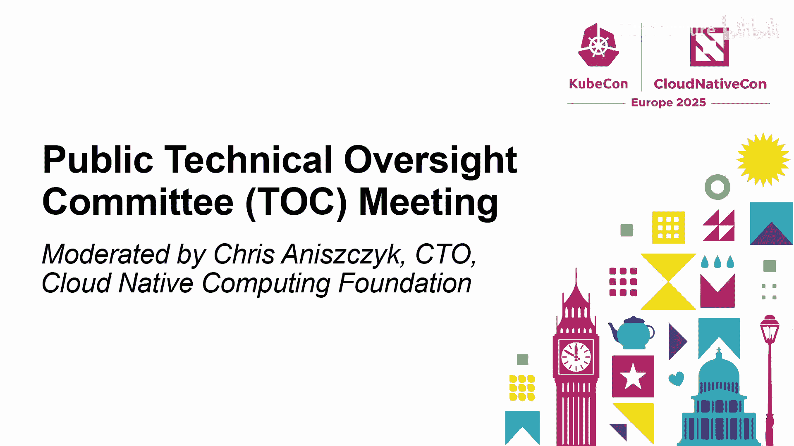
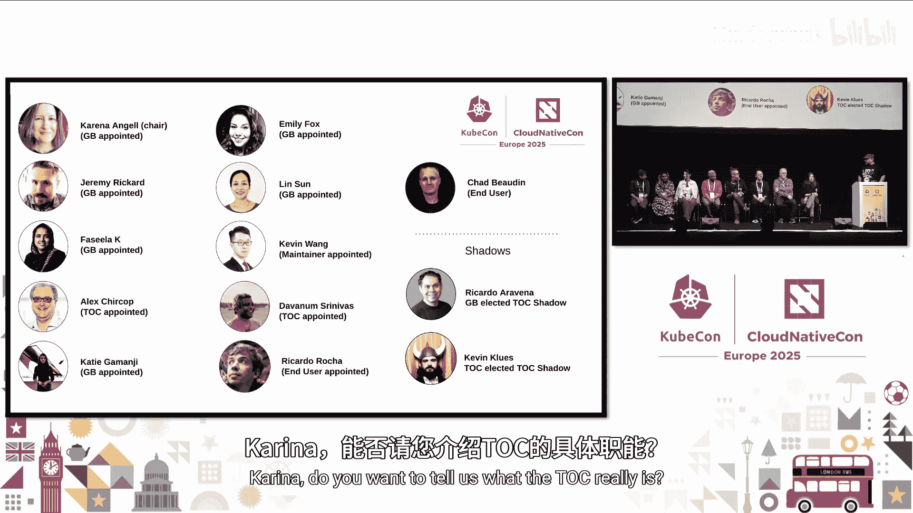

# KubeCon-+-CloudNativeCon-大会2025-｜-云原生计算-｜-可观测性-｜-Kubernetes-｜-Prometheus-p38-P38-Public-Technical-Oversight-Committee-(TOC)-Meeting---Moderated-by-Chris-Anis--BV1Cd32zDEBG_p38-

Hello， everyone and。Welcome to Friday， the Last day of KubCon and thank you for being here for this live technical Oversight committee meeting。

 which will really amount to a ask me Anything or ask the experts type of thing。

For those of you that don't know， the technicalnical Oversight Committee is one of the three top level governing bodies of the CNCF and is there to largely act as the steward of the projects and set the technical vision for the CNCF。

With that。Here are our members。If you want to。Do a little intros or pass around。Okay， hello。Hi。

 I'm Kariina Angel， I'm the current chair of the TOC and I work at Red Hat。Hi， I'm Alex Curel。

 and I work at Akaai。Hello， I'm Kevin Wan。 I work on multiple projects and very happy to be on the TUC。

😊，Hi， I am Jeremy Rickard， I am a Co chair of S releasease in Kubernetes， and I work at Microsoft。Hi。

 my nickname is Dis， I'm part of the Kubernetes community and I work at AWS。Hello， R。

 my name is Katie Amanji， and I work for Apple， and I am also part of the T or technical advisory group with Ricardo。

Hi， I'm Fasilla， part of the Itio community， and I work for Ericrickson。😊，Hi， I'm Ricardo。

 I work at CN， I'm also in the TOC and end user Techn Advisory Board。

I also want to highlight we have one of our newly elected TOC shadows here。Ricardo， want0。

They stand up and so many people can see it。The TOC shadows are a new thing for this term。

 that'll be。That are there to help the TOC sort of honestly completely take over their duties。

 but help out where needed， or if a TOC mightbra has to step down。

 one the shadows will be available to help。With that， I think we can get right into it。Kna。

 do you want to tell us what the TOC really is。

The TSC provides technical oversight over all the projects within the ecosystem。That includes。

Licensing， trademarks， technical oversight， I know many people have projects that have gone through the due diligence process or moved through the levels。

 so the TOC really looks at the technical specifics of the projects and ensures that most importantly。

 that they are viable for the end users who are going to be adopting the projects。

 including sustainability。Including making sure the releases are transparent。Yeah。All the good stuff。

 exactly。So what do you think is the？Biggest challenge to the TOC and the projects for the next。

 we'll say a couple years。And anybody else can also jump in。

 I know I'm looking at Ricardo and Katie over here。

I mean we yeah yeah some of the challenges from a technical standpoint we highlighted today as gaps within our ecosystem during the keynote and these are mostly well I'm gonna to mention them again for anyone who didn't have a chance to attend the keynote there are three main areas so we categorize them for a very specific reason because so one of the domain is around multicster management and observability so yes。

 it's challenging especially if we do it cross provider but observability challenging in multicster as well。

 so we hopefully hoping to bring people for example。

 from existing Dab delivery and observability together to cover some of these gaps so we're trying to have more across that collaboration for these。

dentBy identifying these gaps and by doing the restructuring of the tags as well so we have multiclassster management and observability the a one is around cost management and sustainability because we definitely focus around our cost spending but at the same time we need to think about our carbon footprint as well and these are groups that should work together and finally we have tooling around infrastructure provisioning and secret management and this has been a gap within our ecosystem when it comes to fully open source tooling for many years so we definitely want to kind of again bring people together from different groups and hopefully cover these this area as well。

I think one of the other focuses。Which is you know， becoming。

More and more important as the CNCF enters its ten year of existence and we had to Kubernetes birthday last year。

Is that。You know there are almost like two parallel focuses now there is the drive through innovation and you filling in some of the gaps that Katie was talking about and really good keynote this morning。

But there's also， how do we keep the health of the existing projects going and how do we make sure they're sustainable and they're healthy and they have the right amount of contributors。

 because， of course， the more sometimes the more mature a project gets。

 the less exciting it might be for some and therefore you know we have to kind of keep that momentum going as we go along。

Well with that， I know the TOC went through a few exercises this week to sort of set the vision and direction for the next year。

 would you like to care to share some of what you'd like to accomplish？And where things are going。

So one thing that we haven't done a great job of is really scaling the technical expertise that's in the community。

 we've had a lot of thetrition， burnout pandemic obviously hasn't helped and so right now we're going through restructuring of our technical advisory groups so that to help it scale and provide better guidance to the projects as they're coming through the maturity levels also you know applying to the CNCF this way。

One of the problems that we've really seen， you'll see that we still have a backlog for incubating and graduating projects。

 projects that would like to reach those levels。One of the biggest problems we've seen is that they are not ready。

 So once a due diligence has started， we find out that。

Maybe they didn't have technical expertise in certain areas where if they had guidance in those areas they would be at a point where we could graduate them to the next level。

 so that's something that will really be focusing on through this next year and again that's going on right now so after Co Khn if you're interested in applying to be a chair or a technical lead。

 please you know nominate yourself or nominate one of your peers。

 we really need technical expertise to be helping the projects。

I can add also the other thing we mentioned as well as this new idea of having initiatives in addition to the sub projectsjects and the tags and these are supposed to be timeco concrete deliverables and specific domain So this week has been extremely useful also to discuss on the possibilities and the ideas people are coming forward。

 we had really nice conversations about people are very advanced in doing things like cold recovery。

 disaster recovery and getting together and trying to standardized on best practices for that there were people like Lego and other automotive sectors that work have very concrete manufacturing plans and they have challenges exposing devices like PLC so this could also be an initiative to get them together and work on best practices for of deployment to help other end users doing similar things。

 So if you have ideas yeah we're all here。Come forward and propose one。

 It's open to any anyone to come forward and help out。

And just building on what Car said in the maintainer summit on Monday we had this amazing workshop and some of the ideas that we covered there as potential initiatives and projects。

We'll also be focused on helping better integration between the TOC and the end user tab and getting more feedback through that system and hopefully growing that community。

I thought that the maintaintainer Summit workshop was really cool to see all the energy that people had brought and thinking about new initiatives Oh can you tell us a little bit about the workshop？

So for the workshop， what we did， wait， who was there for the workshop， who was at maintainer Summit？

Yeah， thank you。Honestly， I'd rather hear from some of the audience members on what their experience was in the workshop if anybody wants to stand up and share。

TheMicrophone's right back there if people want to ask questions。Yeah。I know， right。

 there's audience participation there Gy。😀。Okay， it was fantastic， so we had the room full of people。

 we had about 11 tables， seriously we ended up having about eight to10 people per table and split up into different areas such as developer experience or operational resiliency or testing。

😊，Really workloads， right， And they're generating ideas on what initiatives could be Interoperability。

 We heard some great ones about。Test grid， wouldn't it be great if we could see test grid come out of Kubernetes right and have that be used to help projects？

You all were there。What are your favorite initiatives that came out of what were your favorites？

So I was working with a group of people focused on security and one of the things that came out。

 Well， actually， there were a couple of things。 One of them was around better automation around。

The self and joint assessments and to keep those reviewed and healthy and and current。

 And there was another initiative around how to get better dependencies。

Handle between projects for things like I see management and integrating swifty and into the ecosystem in a more fundamental way。

So one of the initiatives I joined the discussion is about how the project better kind of deal with or the downstream vendors。

 we have a lot of maintenanceers have met this issue like the user using through the project from vendor。

 they met some issue and went to the upstream community to raise the issue。

 but it turned out to be you know there's a lot of kind of breakpoint because the environment might very by different vendors。

 so the idea was that actually we can you know there are already some of the project has the conformance program so basically the initiative was discussing how we can more practical guideline also with maybe some of the tools to help more projects to set up their。

Conformance test suits。 and how can the or the project， when they are becoming more mature， mature。

 go through that to have their own conformance。I think that the。

The collection of things for me personally that were interesting were all the operational resiliency things because this is kind of near and dear to my heart our table。

 the way it kind of worked was a table would work on an idea and then pass it on for elaboration and the one that our table got passed was thinking about maybe producing a filter or something on top of the existing landscape themed more around personas so it would be a little bit easier to navigate and understand I thought that was kind of interesting。

What I really liked was everybody stayed till the very end。

And all the tables were like completely occupied like you know heads down talking to each other and that was really great to see and like me and Kaina were like okay watch for the energy levels to fall down and then well you twist and change what they are doing as you we never felt that you know the energy levels were flagging so it was really good to hear and see from everybody in the room and you know we really want them to continue to do the work and。

😊，And there were quite a few people who were like， do we really have to give our idea away to some other people。

 What are they going to do with it， Can we just refine it ourselves And so we had to assure them that it was a living document and they could continue to work on it。

 And so yeah， it was， you know， it was really good overall for me。 Thank you。😊。

I think Katie needs a microphone。チがす。Some technical issues。

 I think I just want to echo what Jim said because we had a great attendance the room was packed which is absolutely outstanding to see the tag groupboot is perhaps one of the biggest change we have done within the TUC and within the landscape in terms of how interactive different micro communitiesmunities within our landscape and seeing so much interest from folks and they want to discuss about it and perhaps they want to apply the new kind of initiative structure it is great like I think this kind of enthusiasm it is amazing and I really hope for everyone who has been there in the room and for everyone who is here in the room today for you to collaborate on this new initiatives with us and perhaps again I'm going to echo the message come be part of the leadership team be part of the be a tag chair or a tag lead is this kind of people we need at the moment and I'm not sure if the initiatives dogs are。

Available for the public， but because yeah we have some initiatives which are quite interesting as well。

 but I didn't think we're going to go for them because people will have access to them anyway。

 so I just wanted to echo the community enthusiasm。 I think that that was really。

Actually wonderful and beautiful in many ways。One other thing I wanted to mention about our table is。

Of course that was really nice and at the same time it was diverse so on our table we had people from Japan and Europe。

 also as well as US and all other places， many places actually so one thing that came up was about the time zone issues。

 what they are facing and also the language issues。

It's basically some people had the concern that they're not able to attend some of the meetings or not able to communicate properly in some of the meetings。

That is one thing， probably if we can see something about it， that would be nice。Yeah。

 I don't have much to add。 but just maybe， maybe when on my table， there。

 there were quite a lot of ideas。 I think that the most interesting part was to， to actually。

IPeople didn't want to pass their ideas forward， but actually receiving other people's ideas was was the most interesting。

 And you could see a different approach， like the first。The first round was kind of very everywhere。

 And then the second table looking at it， kind of like， okay， this makes sense。 This doesn't。

 And they kind of started making it a lot more structured。

 So I guess it's up to everyone now to look at them and， and really make them concrete。

 I think we have a lot to， to work on。はい。I just wanted to， because you can't。

Reemphasize or repeat call actions too often。It would be lovely to see more of the community that participated in the Mainer sumummit and obviously all your amazing people who have come to see us。

What are on about is to actually take a more active role in joining as and nominating yourselves or your colleagues。

Or other people in the community for tech leads and chairs， I think I think we really want to。

Increase the vibrancy of our community as we grow。I I have a question， how does one do that？

How does one get involved， I that your question awesome？Okay。

 so if you watch the TOC Repo right after KubCon， we'll put out the call to action。

 also in the TOC mailing list as well as the TOC Slack channel， so just CNncCF Slack。TOC。

So we'll add all the information there， initiatives will be put into the TOC repo so you'll start seeing them land there and then we'll have a project board for people who are interested in contributing。

to an initiative and remember you don't have to be part of a technical advisory group to help work on an initiative as you have time。

 we really want to see them as time bound， smaller pieces of work so that as you have time throughout the year。

 you can get engaged。Also， we'll be having another maintainer summit in Atlanta and we'll do a review of the work that has been done up until then。

 and I know we have another question， so go ahead。Hi。

 it was really great to be part of the maintaintainer summit for me was the first time。

It was the energy was really exciting， inspiring， so yeah。

 I hope there's more people in the crowd if they haven't participated in this kind of event that they go for it。

 my question is，😊，So， my。I'm coming from the perspective of the T environmental sustainability。

 which is being merged into the tag operational resilience and。How can we。

 So the next steps will include。Collaborating to write the charter goals and non goals。

 talk with the other tag communities that are going into this new tag and I know we're doing this for a few other tags。

For people who would like to be involved with this， what are kind of the interim。

Communication channels or goals or timelines that you'd like to share with us and suggest for us to get involved with。

So after KupCon will publish more of the timeline because we are in the process right now of redoing the repos。

 we're going to pull them all into central back into the TOC Repo and then provide instructions etctera there。

 so keep looking for those channels and we'll put a call out。

 we have been working with several of the current leadership。On that。So again。

We'll reach out to each tag， each current one， and then also any other community members。

Keep looking out for those channels for more information。But unfortunately。

 that's going to be after Coupcon。Which after today。But give us a couple weeks to get back on things。

 Yeah， thank you for that question。Does anyone else have any questions？Actually。

 how many people here have been through the moving levels process or involved with the project？

At least a couple。嗯。What would you say have been the biggest challenges you've seen when it comes to projects moving levels？

Those common things I've been talking a lot， Kevin， do you want to answer this one？

So my kind of observation and also experience for the project moving levels。

 especially a little bit before like we I think last year like we updated a lot about the template checklist to make it more clear for the project team to understand the criteria and but still I have seen some of the project。

First of all， is the， the answer are not that ready。 I mean， ideally， as N T UC or a reviewer。

 we would expect you give a some of the statement to the answer and as well as providing reference links to。

Prorovide that you you approve that you are really working on implementing what you said。

 like the open community governance mature release release process and how you deal with the security things。

 besides that， we also added like general technical review and demand specific technical review to kind of help evaluate I think from the technical perspective。

 the maturity of that project。 So the first of all。

 I would recommend for anyone kind of preparing the application or in process of the application try at least another round to take a look your application answers yeah。

I will add to that and thank you， Kevin。I'll add to that that another thing that we've seen are that。

Projects may not be thinking about security first， right， not thinking about their security hygiene。

How they're planning and we'll be going over a review of。

The current request that we're asking through the process and deduplicating。

 I know right now a lot is being asked to between the security assessments， the security audits。

 and we'll see what makes sense to be moved into the audits。

But I do see members of tax security here and they've been invaluable， so thank you。

'd like to help reduce that load。Want to add that so project should also be looking at。

Security first， right？I want to mention， perhaps in addition to all of this is。We have because yes。

 now our queue is actually shorter so we have a shorter response time and engagement with the projects。

 but what usually happens， unfortunately not usually sometimes happens is that the maintainers are not responsive after opening the PR for either incubation of graduation and it is crucial because the due diligence process is a collaboration between the TOC and the project maintainers and it's crucial to have that channel so if you open an issue or if you open APR for incubation of graduation。

 please be responsive this is the thing we are trying to help you to get to the next level and we need that kind of responsiveness back and I just want to kind of perhaps emphasize that because I know everyone。

Is very busy。 and things kind of can get very chaotic at all times。

 but that kind of channel communication is very important。 So be aware of that， please。

So one other thing that usually happens is people are on a deadline。

 we want to get the project out in terms for KubCon NA or Kubcon EU or like some internal deadline and so you know we try to do things but it's going to take us some time and we have projects in the pipeline so please be aware of that and the other thing that we usually end up as you know we have a lot of material that we've written down and there is a bunch of checklists and things like that but sometimes we really have to sit down in the projects and say。

Exactly what。Why we are asking them those questions or like why we are asking them to make those changes。

 you know， simple examples will be around like how do you think about the community versus your company and your product and like where do you draw the lines and so we really have to have that hard to heart talk with them？

And then they figure out okay， we are missing this in our governance， we are missing this here。

 maybe it reflects in like how we do our CICD artifacts or like how we provide support for something or the other right so and this is a recurring thing this is not like this has happened again and again where we've had to sit down with the folks in the different projects that are coming through and then make sure that they understand why we are asking them to do what we are asking。

And Ricardo you're one of the longest running TOC members it'd be nice to hear when don we have a little three minutes left and I don't want to Yeah we have questions so let's try to get through some of their questions quick I was wondering if the TOC has like any like success metric that they measure to see how how well they're doing like on a you know quarterly basis or something like that and like how do you guys like report on that thank you。

Who wants to take that one， it's usually how fast the projects are moving through the process。😊。

And it's moving a lot faster。嗯。Yeah， I think maybe， maybe there are two parts。 One is how。Fast。

 we are helping out the projects， which is。Shown， by the rate of moving levels。

 there are some metrics that we started very recently looking at。 I think Bob was making them。

 which are how long the projects are actually staying in the same level themselves。

Before applying to change level。 And this one is quite interesting as well， because they are。

Interconnected， but sometimes the projects need some help also to， to push them。

 I think that this is one of the metrics that will be very interesting to explore a bit more in detail in in this year as well。

ItMaybe maybe not necessarily a metric of success， but an indicator of success is that。

We are having time to refine our processes rather than just actually do the due diligence because previously most of the TSC time would be focused on revising sandbox inclusion applications。

 doing incubation and graduation due diligences and that's all we could do and that was our full time。

And because we have been focusing a lot on streamlining the processes。

 because we've been trying to be as clear as possible， we are trying to automate a lot of that。

 And just even like all of this。Forward looking that initiatives such workloads with the tagryboot and so on and kind of reshaping and thinking about what's happening in the future。

 I think this is a very good indicator of us scaling in terms of our workload and maybes a metric of success in that as well。

 maybe not quantifiable with numbers， but in the overall dynamic of how we engage with ecosystem。

 absolutely it is。We are just about at time， what's your question and we'll see if we can answer it question a relatively short one so when there is a project that has trouble completing some tasks or moving to a different level and you have to have this additional collaboration。

 additional conversation does it sometimes end up being a problem where the outcome wasn't defined like the why needs to be explained and what needs to happen but not necessarily what the desired outcome was and that turned out to be the reason why it didn't work out。

We have many examples。 all combinations are there， so we we do have to tell them what we are looking for。

 why we are looking for that and how we are going to。Typically。

 what we also tell them is like here is a set of things that we want you to think about and see where you all have to apply these things in different areas。

And also we want to see how it works in action right like don't just change or read me or a governance。

 m and then say you're done we want to see it how we are implementing it over the next three months or next six months。

And then with the evidence， we'll be able to like， you know， continue the conversation， so to say。

This kind of goes back to the last question about KPIs， it's hard to quantify。Oh。

 we're now like a minute over。Sos to follow up after yeah please come talk to us， I will thank you。

All right， well， thank you for being up here and thank you all questions thank you。

