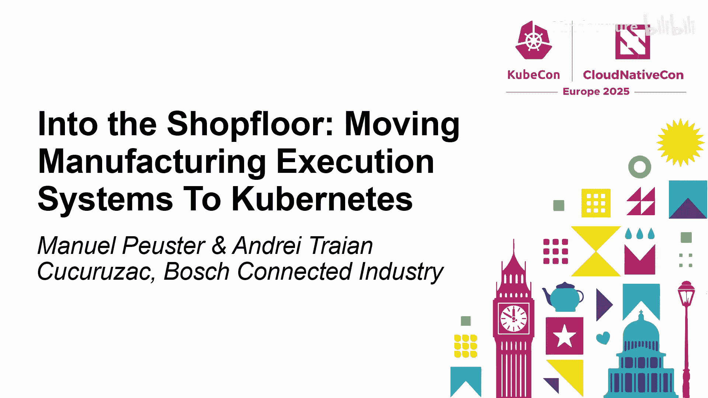
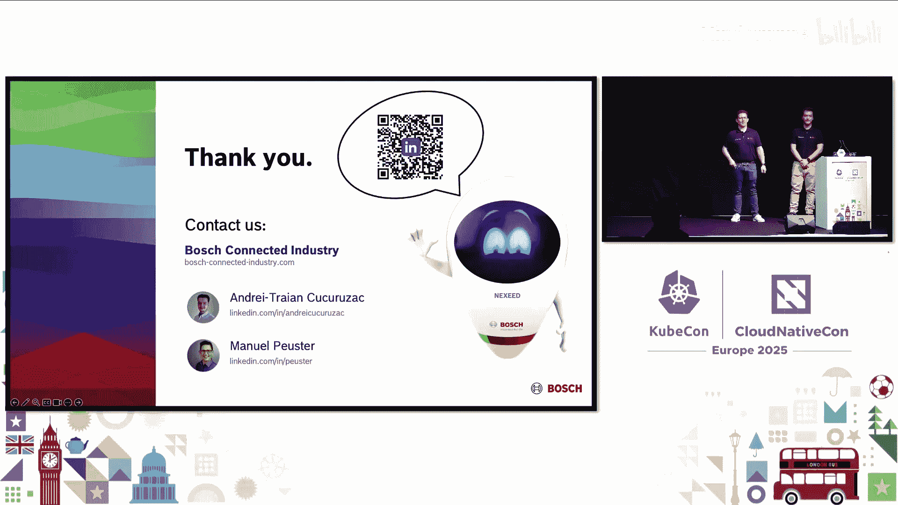
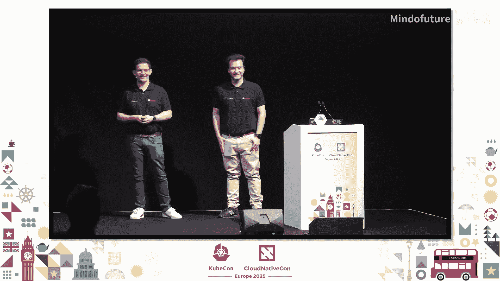

# KubeCon-+-CloudNativeCon-大会2025-｜-云原生计算-｜-可观测性-｜-Kubernetes-｜-Prometheus-p39-P39-Into-the-Shopfloor---Moving-Manufacturing-Execution-Syste...-Manuel-Peuster--BV1Cd32zDEBG_p39-

Hello， everybody。 Welcom to our talk about into the shop floor  moving manufacturing and execution systems to Kubernetes。

😊。

My name is Manuel Poyster。 I am with Boch connected industry。 I'm a senior Devops engineer there。

 and you might have heard of our company， Bosch。 We are a very large manufacturer based in Germany。

 and we are active in many different fields。 We are doing mobility solutions， industrial technology。

 We do energy and building technology， as well as customer goods。😊，Overall。

 we have more than 400000 employees worldwide， and we are having more than 400 plants that are producing our products in more than 60 different countries。

😊，And these plans typically look somehow like that here。 So it's a very complex system。

 as you could imagine， running in most cases，24，7。 And we， as Bosch connected industry。

 are a software provider within Bosch。 and we are focusing on industry 4。0 solutions。

 and especially we are providing a product which is a manufacturing execution system。 And for that。

 let me and over and introduce my colleague Andre， who will walk you through the details on what a manufacturing execution system is。

 and what it actually does。😊，Thank you， Manuel。 Ho everyone。 I'm Andre。

 and I work for Bos Connect the industrydu as a junior Devopps engineer。Al right， so。What is M S。

Maybe let's take a look at this picture。 We might find some clues。Yeah。

 we see some guys working here and there。EWe have a guy that is driving something that resembles the forklift over there。

Looks cool， right。But we don't understand much from it， right。Maybe let's take a deeper look。

Al right， see that little screen。 that it's something that we call end on life。

the worker is able to see on that screen how many parts will be created in his shift or if any parts has any malfunction。

😊，Let's move on。Yeah， moving to the guy that is driving the forklift that is actually called the Milron with some some help from another piece of software that we call intralogs。

 These guys are able to see on their dashboards where the next parts are needed to be delivered。😊。

Yeah， the big， mysterious glass books actually， here， the magic it's happening。 And here。

 small components become bigger parts and bigger parts become the drill you use at home or maybe the electric motor or other component in your car。

😊，And with another piece of software called Part traceability。

 we are able to see the traces of a park from the beginning when it is bored。

 and from the moment it leaves the factory gate。😊，All right， and yeah。

 we also have these cool guys moving around the factory moving parts from the warehouse to the shop floor area。

😊，These automated guided vehicles on short AGVs are controlled by another piece of software that we call AGVCC。

And for each plant， there is a map。 and this guy knows basically every corner of a factory。Allright。

 but。What if I tell you that all these pieces of software that you've seen。Are actually this。

Big group brother of of factory。 Thats the industry called M E S。 And， yes。

 we Boch created our own M S system， and it's called Nixed M E S。 based on this。

 to have a clear definition。A manufacturing execution system。 It's a software that monitors， manage。

 optimize production on the shop floor in real time。

 and it basically serves as a bridge between enterprise systems and shop operations。Alright， now。

 let's imagine that a factory， iss actually a human being。 and we place it in an MRI machine。

 what we would see inside。First， we see the compute and storage power。 That's the brain。

It basically just like a human brain。 These are processing decisions。 M E S relies on on this。

To manage the critical information。Moving on， we find the external systems。

 These are functioning as the circulatory system and exactly how blood carries oxygen and other nutrients to the organs。

😊，EThis system are distributing essential informations such as production orders or inventory data。

Moving on， we have the message brokers， and these are acting as as the nerves。

Similar to how nerves are sending signals throughout the body。

These message brokers ensure the communication across the factory。On another scan。

 and we have the industry protocols and the sensors。

These are acting as the senses and basically are collecting collecting real time input from the machinery。

 including temperatures， speed pressure。And so on。O， and finally， we have the shop for equipment。

 all kinds of machines， even those little AGVs that you've seen before。😊。

These are acting as the muscles， and these are executing the production test based on the MS instructions。

All right。You might already think， al right， this system， iss complex。

 How does these people manage to， to， to do all the stuff， too。Well， it is hard because。

These systems have highly individual configuration。And because each plant， even each production line。

 is different， it is hard to standardize。It's hard to replicate， scale and， and upgrade。Next。

 manual configuration。 Well， yeah， manual configuration is it's done at two levels。

 We have the the first level operations level， which is done by the Os guys。

 including setting up databases， network policies， use user permissions and so on。

 and we have the business logic level， which is done by the application engineers。

 These guys are basically responsible to create product recipes。😊。

And doing all kind of routing rules。Yeah， moving on deployment process。 Well。

 the deployment process is typically typically done on individual individually ordered Windows virtual machines。

 And this is making the process both slow and resource intensive。Yeah， in the end。

 deploymenting on MES takes a long time。 Also the manual changes increase the risk of misconfiguration。

 potentially leading to system failures。 and oh God its bad when these systems are going down。

Because when M E S goes down， production stops， workers are sending idle。 and basically。

 this translates to lost weighted materials， missed delivery deadlines， and， of course。

 millions in revenue slipping away。Alright， now， even if configuring and maintaining legacy M E S was a burden some。

We have to admit that for years， traditional M， E S have successfully powered manufacturing operations within Boch。

But with the rise of industry 4。0， that demands faster， more flexible， more scalable approaches。

We need to we also need to find a way to avoid the down times。 of course。 Yeah。

 we decided to stop pressing next， next and finish forever。

 And we took the classic Clift shift approach。We basically embraced cloud native transformation and building on top ofniced M E S。

 we started to develop the next phase， and exceeded IA S。😊。

A cloud capable design software that made the first steps in bringing this flexibility。

 scalability and efficiency to the shop floor。😊，But yeah， in the first phase。

 we just packed everything into containers。Basically， each M E S module became a set of containers。

 and now 30 different modules became 200 plus microservices。

We took all those microservices and deployed them in Linux machines。Basically， no。

 no fundamental changes， just containerized version of the already existing apps。

So we had minimal refactoring。 We just focused on the portability， rather than re detecting。

We had two approaches this time。 One was designed for the on premise environment。

 And the other one was。Was an early version that that threw us into the cloud world。

In the case of on premise situation。We， we had all these microservices。

 We needed to find a way to bundle them up。 So we used Docker composeos for that。

Deploying the microservice with Anible。And for the， for the cloud approach， basically。

 we used Enible to render the the Kubernetes manifest and deploy them， in the cloud。

But no matter the environment， we ended up with sequential and very slow deployments。Andend updates。

 and an update usually took us around 6 or 10 hours。Depending on the installed modules。

But years have passed。 And yeah， the city in our days looks like this。Nowadays。

 we have cloud and onprem that use the same deployment structure。

We went from sequential deployment with Nible to simultaneous。

Pyeline deployment of the microservs in multi cluster nodes in the case of cloud scenarios and in single node in case of on premise scenarios。

But in addition， as the glimpses into the future， we talked about building a local cloud。

We called it BMLP， and it stands for Bosch Manufacturing and Logistic Plaform。

You can think of it as an app store。But for factories。Yeah。

 and here are the things that are a bit different。Each factory has its microservices in a multi nodeode cluster。

 Everything gets centralized， and changes are applied automatically， using Argo。Yeah。

 now I would like my colleague Manuel to show you what the challenges and solutions we encountered along the way。

Yeah， thank you， Andre。😊，As mentioned， we now know how our system we are trying to operate looks like。

 right， And I'm now going to walk you through some lessons learned we had on the past to really make it more cloud native and bring it into the cloud。

Once we started with the lift and shift approach and basically packaged all our modules into different microservices。

 we immediately faced three different dimensions of complexity。

 The first dimension is quite specific to the manufacturing context。 As already mentioned。

 most of the plans and even the individual lines use individual configurations。😊。

That is something you do not always have in in the microservice world where you often deploy the same replica of the same thing。

That was a real challenge for us to support all those configuration and deployment parameters and reducing human errors。

 Of course， nobody would want to build a new plan just because we devkes。

 think we want to standardize our input values。 So that was the first challenge we were facing。

 The second one was not as a big challenge， right， Once you had packaged all your components。

 All your existing software。 We put it on Kubernetes。

 We had already some Kubernetes knowledge inside our team during that time。 So that part was easy。

 We added the missing components， deployed everything worked。The hard part then are the humans。

 actually， because， as you could imagine， our software solution is comprised of more than 30 different modules。

 Each module comprised again， of plenty of different microservices。😊，And as we would expect。

 each of these modules is built by an individual development team。 So we have a。

ASet of multiple development teams。 And inside those development teams， we have a very。

Unequally distributed knowledge of Kubernetes。 At that point in time。

 there were teams without any Kubernetes knowledge。And that， of course， for us。

 as a Devops platform team， Co the question。😊，How do we， how do we handle that。

 How do we ensure that the thing we are building is something we can easily deploy and operate at the end without putting too much burden to development teams and slow them down in their daily work。

So one decision that was done quite at the beginning was that we will package all the modules as individual helm charts。

The question here was， how do we do that？They is a naive approach that comes to mind at first。

 They are easy let each development team create their own handshot， lets them do whatever they want。

 They have a great level of flexibility， but there are some problems with that。

 It's hard to enforce any standards。 And because of the distributed knowledge within the teams。

The outcome might be not really what you would expect at the end。

The alternative approach would have been to say， okay， let's embrace some central teams。

 maybe the Dev of teams and let them be responsible to create all handm charts for all the individual modules。

It would work。 We would be able to enforce certain quality standards。

 People would be knowing what they are doing， and things would be great。 But， of course。

 in that case， we would have created a huge bottleneck in our organization。😊。

The central team would basically be a dependency for all other teams。

 and it would slow down our release cycles。So we opted for another approach。

 and that is really making use of the possibility to write library helm charts。

 And that is what we did and are doing till today。 We are implementing and creating a library helm chart。

 and we have the mandate for all the development teams to make use of that library helm chart。😊。

And the chart is designed in a way that everything that is rendered by these individual module hand charts is actually funneled through that library chart。

 And by that， we have a close control what developers are actually able to do and what they are able to render to our clusters。

 And that turned out to work very well for us。😊，Of course。If you have something like that。

You are thinking about how do we release these kind of things。

 And here we have really a special requirement， which might not be very common in the microice world。

 even though we are technically able to deploy individual services。

 we are still required also for external customers to bundle everything we do into one thing a release。

😊，And that is still possible。 even if you go with approach like that。

 you just create an umbrella helm chart and call that your release and basically use this as a final release artifact you would distribute internally and to your customers。

 So that part got be solved quite quickly。 We basically were able to fulfill this requirement。😊。

Having that， the question came up， who owns what， who is responsible for which parts， Of course。

 as expected， the module helm charts are owned by the module teams。 And what we then did。

 we embraced a couple of additional teams， which we call library teams。

 You could also call them DevOs teams， platform teams， as you like。 And those are the teams like us。

 who are owning the library chart， the umbrella chart and a couple of support and components。

 which are then bundled all together with a different modules coming in from the module teams。😊。

Between our teams， we have close collaboration。 Of course， we do knowledge exchanges。

 and that worked out to be a setup that works quite well for us。

 And that is the way how we are operating today。😊，If you go with this library helm chart approach。

 we had a big learning at the beginning。If you make a single hamm chart or library ham chart。

 such as central component within your overall deployment or within your overall product。

 then it's really important to understand and treat that library hand chart as a first class citizen。

It's not just some deployment code developed by some Devops team that is living on the site and does not need any special attention。

 That's wrong。 It's important。 It's basically deploying the entire system and can break the entire system and changes there have an effect to many different teams。

 So you have to embrace a full software development lifecycle for that component。

 you should make sure you are able to hand out a roadmap to the team So they know when which feature is expected to arrive in the library helm chart you should do some requirements management。

 maintain a backlog。 So everything you do for just every other software project。 And at the end。

 we embrace in our organization， the possibility that each development team could basically do pull requests and can contribute to that library handm chart just to accelerate the time when additional features are needed and to place things quicker in that central component。

😊，Talking about more about sorry， talking about a bit more about the technology behind it。

 So as mentioned， every module team has to use a library helm chart。 That is a mandate。

 And when now a development team wants to start their hem chart for their module。

 they basically start anybody would start with the helm chart。

 they create their chart Yal with the information like name and version， Nothing special there。

 but they only have to place one single template in their helm chart。

 And that single template typically only contains one line。

 That is a line that is calling the rendering function of that library helm chart and nothing else。

 And that is a single entry point to the library helm chart from which we could enforce then how the final resources will look like。

😊，Then， and that is a bit special。 The developers are basically required to put everything else they are wanting to express in the helm chart directly in the values file。

😊，That looks a bit uncommon， of course， But that had a a lot of benefits for us。

 We basically defined here a。Custom driven， opinionated data structure。

To which the module teams have to obey。And this opinionated data structure is helpful because we could abstract away quite some details from most of the development teams because I would not need them anyways。

For example， ingress definitions do not need to be explicitly expressed。

 They are building by default if they don't define anything else or don't overwride it。Still。

 this approach allows development teams to make use of all possible features you would have in a normal hand chart。

 It's just， they don't have to。 And that makes things quite easy and allows us to control a lot of things。

😊，Of course， it's uncommon to put everything in the value study ya of your module helm chart。

 but it has a second big benefit。 And that is schema validation。😊，We do schema validation a lot。

 and we do it on two levels。 On the one hand， the module teams are asked and required to place a schema file within their own module helm charts。

 Those schema files are typically used to do input parameter validation。

 So the development team exactly knows what they expect in a certain parameter。

 They could do a rex and check if the input is correct。😊，Then we have a second level。

 and that is the global schema， and that is maintained by us library chart team。

 And within this global schema， we are able to do some structural checking and really make sure that the overall data structure that is defined by the module teams is correct and fits to the current version of the library chart that turned out to be very helpful because people early notice if they do a mistake and their module chart or forget about some information they need to put in already during templating time and not only after the fact when things are deployed to some test system。

😊，Given all that， and you already saw the separation of concerns between development teams and operations or library chart teams。

We do the same for the data model itself。 So， as you could imagine。

 a lot of the modules are actually connected to some outside systems。

 be the database or message broker。And within our data model， we are requiring from the module teams。

 We basically have the separation of concerns。 Again。 we have this global level。

 which is a level that is typically filled in by the operator， for example， us。

That would contain information like connection details of a database server。

 port information and so on。 Then on the module level， the teams just express， O。

 my module needs either an MS SQl database or an Oracle database。 And those are just examples。

 could be anything else。And they enter additional requirements that are needed。 for example。

 database roles they would want to have。And we then make use of the hem templating to mix and match together this information。

And by that， rendering out the final deployment that is then automatically set up in a correct way to connect everything together。

But again， you have this separation of concerns。 Development team has one place to edit things。

 We have another place to edit things， and that separation worked quite well for us。😊。

We do we do similar things for different target environments， so we are deploying on public cloud。

 we are deploying on our Bosch manufacturing and logisticistic platform。

 but we also have a couple of edge deployments running on single node clusters and all that is supported by that single library chart via this kind of mechanism。

There are some cases in which module teams came to us and said， hey。

There is another module that has a similar parameter like we do。

 And we need to ensure they have the same settings。

 So we want to share configuration information between different modules， between subchars。

That is not。Possible out of the box with him， right， But if you make use of a small trick。

 you can still achieve that。Each hel chart。Or helm during templating has within the value files or within the values。

 this global dictionary and this global dictionary always is available to each of the subchars in a helm deployment。

On the other hand， it is possible that you are import data from a subchart to a parent chart。

So if you combine both of these things and simply say， hey。

 I use the trick that I import the data from subchar A into the global dictionary。

 I immediately immediately make it available to all other subchars within my deployment。 And by that。

 you can easily share information between the subchars in our case between the modules。😊，Of course。

 you need to take that a bit with care。 You are operating in one global name space。

Take that precaution。 It can， can go wrong， of course。Rather。

 if you look again on the approach to put so many things into the value files， you might think， okay。

 but how does then a module team actually do templating。

 They maybe want to do some string formatting or some easy templating functionalities in the environment variables。

That is true。 And we still allow our teams to do that。

 And we do that by simply adding the T PL function whenever it makes sense。

 So it is very common in our code base to see something like this year。

 a module hand chart within their value file。 They would again， have。😊。

Go tempemplating language written as part of a string。

 And then at the point in time where we render those environments。

We would call the templating function again， and execute their template。That has the benefit that we。

 as a library team， have control over where teams are allowed to template and we're not， which。

 again， comes in quite handy If you want to ensure quality across the board。So now。

 we only talked about helm。Rendering， tempemplating and deployments。 Of course。

 that is not everything。You cannot solve all problems with this。

 And we also noticed that quite early。 So we build a couple of custom operators。

 We have basically two classes of operators that we build for our system。

 They are infrastructure operators。 They are not too uncommon。

 And I think that is not really something very application specific in our case。

 They are managing databases， creating schemas and so on。

 So they are doing all kinds of infrastructure things and control that。😊。

And then there is the second individual operator that integrates with our custom build in identity and access management solution。

 which is part of our overall M E S solution and are ensuring that these different modules。

 once they are started， are registered correctly， that they have themissions to access the other modules。

😊，Exchange secrets and all these kind of things are fully automated using operators。 And by that。

 we do not need any manual intervention anymore when we deploy a system。So。

 lessons learned and summary。When you do a library heshot。

 which gets thousands and thousands of lines of templulating code。

Unit tests are your friend because everybody is using it。

 Every pack you introduce will affect everybody。 So the he unitist unit test plugin is really useful。

 And we make use of it a lot。😊，On the other hand。I told you we have to bundle everything as one helm chart。

 which means it becomes one helm release。 once you deploy it。

There you need to watch out for your helm for your helm state。

 and you might switch the helm backends because your state might might not fit anymore into your。

 into your secrets。In our case， a single instance of the system has about1。

5000 different Kubernetes resources。And then you hit this boundary of 1 MB， quite quickly。

On the other hand， we noticed also a lot of improvements coming from the open source community。

 A good example here is helm itself。 since we are doing templating on templating。

 on templating our helm templating became quite slow in former times。

 it was more than 100 seconds on a normal development laptop。 After the update to helm 3。14。

 the helm team actually improved the performance of the templating itself。

 And we saw a huge drop in the templating time might be a small thing for normal hem charts。

 But in our case， where we really may use a lot of this templating approaches。

 it really saved a lot of time。 And the templating drop to under 10 seconds。😊，And finally。

Switching to Kubernetes was a good decision for us。 Switching to him was a good decision for us。

 Overall， our deployment times dropped from hours or days to minutes。

 and we are now able to deploy such a manufacturing system within a few minutes。

 And it will just work。 Thank you very much。 And we would be open for questions now。😊。

So help yourself there has a microphone。

Hey guys， so I work at a company that also has some of these challenges to undertake。

 we as ever also a lot of VMs running Windows server。

But our main difficulty right now is what to do at the human level where there are no clear ownership of some of those legacy components that were in some of the sites and not at every site and now we don't know how to manage them and how to lift and shift them into our Kubernetes environment。

 so have you any insight on what was your approach。Yeah， that is a good question。

 And I think in general， a lot of companies might face that， right？

 there might be always this one old legacy system around that you cannot lift tension shift。

 And I think in those cases， you might have even to live with having it still in the Windows VM somewhere。

 because what else can you do right？ Either you switch to another solution to a full rewrite。

 which might not be taught possible because nobody knows how it works。

 one thing that comes to my mind on that， I was attending one of the sessions on Tuesday for Istio and they were announcing Istio on on Windows for example。

 And at the beginning， I was thinking okay， why， But maybe exactly this kind of cases might be a thing because there will be always a company with this one Windows V with running something and maybe in future。

 we will be。Able to connect those things more easy to our Kubereses clusters。 And by that。

 may be able to at least improve it。 But solving its hard without switching the solution。😊，Sure。

 thank you。You're welcome。Hello， so this， thank you for this talk。 It's very relevant to us。

 We saw a lot of parallels with your experience and our experience。 My question is。😊。

You mentioned about migrating legacy systems to Kubernetes and you basically containerized the systems first。

 then went to Kubernetes later。 My question is because we're trying to do the same when you're migrating like industrial control systems or similar aspects。

 they are built with a very different paradigm They expect they are running， they have all the state。

 they do their things so moving to Kubernetes means everything is ephemeral。

 everything has spin spin up a replica， delete replica。

 it can be deleted and relocated to a new worker node。

 So how do you do this migration which as you said there are dev teams with limited knowledge of Kubernetes so how do you make them reengineed the application to be cloud native instead of。

Being based on running and having all the state in one area。Yeah， good question。

 We know exactly what you mean， I guess， right， So one thing that needs to be noted here。

 we are a Boch connected industry。 We are actually the software providers who produce or right that software。

 right。 And as Andri mentioned， there was this decision to make the system more cloud native and。😊。

Since we had this decision in the organization， a lot of the components which have been running before on the Vms。

Have not only been lifted and shifted， but at points where it made sense also rewrites happen。

 So there are changes in the software itself。 It's not that the code base is one to one the same still。

 It is based on the old code based， but it's made more cloud native or possible。

 We are still not fully there。 And we are still as operation system。

 having challenges here and there， because not all workloads are as good as others in terms of failure tolerance and things like that。

 What we notice is really helpful， We do， for example， as an operations team or Devops team。

 we do regular Devops exchanges， which means some one of our engineer is joining on a bi vehicle basis。

 the different development teams and helping them with things where they struggle with be it a home chart。

 or being things like retries， implementing things correctly。 What can we do with our state。

 And I think that is really， again， one of these human problems。

 You need to go in there the people you have with the cloud knowledge need to go to these development teams and try to help them wherever possible。

 And once。😊，Learn about it。It's becoming much easier。 That is at least our experience。

 And then at some point， it will work。Thank you。Rebecca。Hello。

 my name is Sha Kenny and I'm here for BSF， which is the biggest chemical company in every scale every measurement。

 So we also challenged this， we also had the same challenges as you had with our manufacturing systems and one of the issues we had with our legacy system we partially well we actually start to introducing cube weird brano to connect to a legacy systems。

 have you ever thought of using that maybe for example。

 to access system that still use OCD and HA because nobody wants to migrate like 400 plants plant sides with like tens or 20 plants inside just because you push Kubernetes to the edge。

We are aware of the Cuwe project， but till now， if we have mixed workloads that we have something that still needs to remain on a VM。

 we typically keep those VMs there and just with the on-prem clusters and then do a direct connection to the rest of the software。

 So those VMs are not becoming part of the Kumernetes cluster itself， at least for now。Right。

 so so you don't want to push it really to the edge， but just close to the H your M systems。 Exly。

 it's close to the close to the edge， but not in the edge in the machine itself。 So to send it。

 Thank you very much。 It was a very interesting talk。 Yeah， thank you。 Very welcome。

You mentioned that you moved some of the modules into the。Public cloud。

 right on AK S clusters and such。 Yes， I was wondering what。Percentage of the M E。

 S in terms of functionality， you were able to move into the public cloud and how you ensure。

That the， the connection is reliable enough， fast enough。

 Are your plants connected via a private line to the， to the public lot or。Yeah， how do you do that。

Actually， our Boch plants itself are running entirely on the plush Bo on prem clouds。

 So they are centralized clouds。 They are cloud or local clouds within the plants。😊。

But the end the Azure offering， the public cloud offering that is offering a dedicated instance of the system that we offer to external customers。

 and there we mainly operate nonlatency， nonlatency sensitive modules。

 So functionalities that are not so sensitive to any latency。

 So not the line control things or things like that。 And by that。

 we have offering that can be utilized。 For example， to do shop love management and so on。

 within the cloud。 But that is not the part that is controlling the Bosch factory itself。😊，Thank you。

Thank you。Okay， if there's no other question。😊，Thank you again， thank you。

