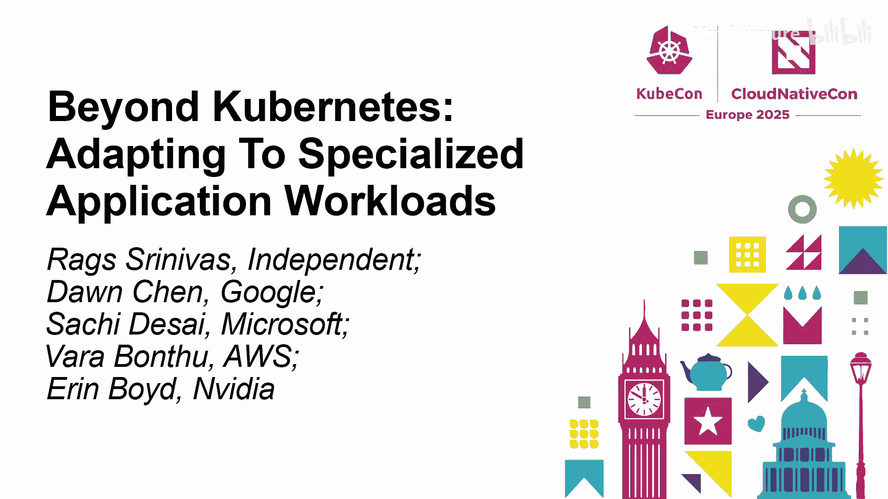
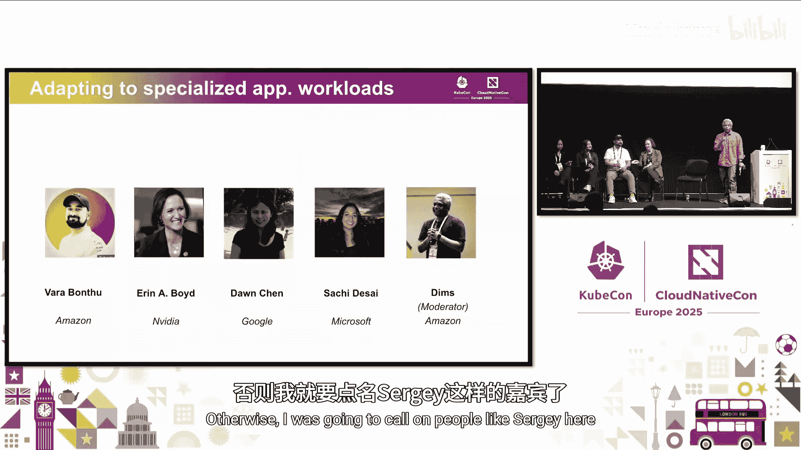
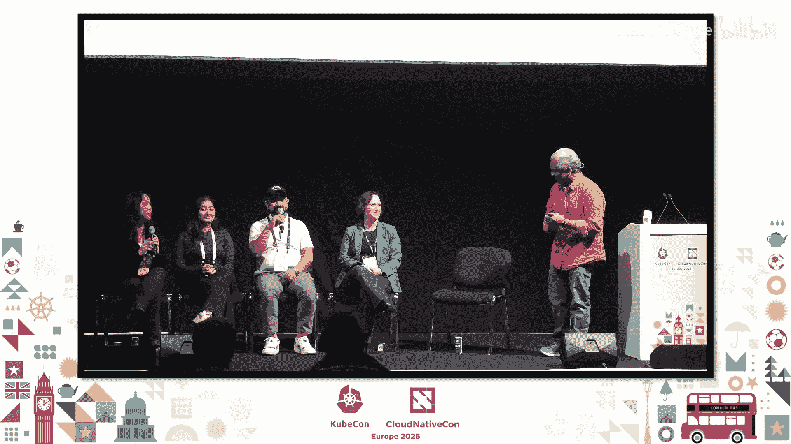

# KubeCon-+-CloudNativeCon-大会2025-｜-云原生计算-｜-可观测性-｜-Kubernetes-｜-Prometheus-p40-P40-Beyond-Kubernetes---Adapting-To-Spe...-Rags-Srinivas,-Dawn-Chen,-Sachi-Desai--BV1Cd32zDEBG_p40-

Hi， everyone。 We are today here talking about adapting Kubernetes to specialized application workloads and。

😊。

this is us。 who you know， let's start from the other end， Don。Please。

 would you like to introduce yourself My name is Dan。 I'm a software engineer from Google。

 I'm also the software engineer and tech lead since Kubernetes inception。

 currently I'm leading off the signaled community and less to be here and talking about the Kubernetes involvement for those specializedized of the worknots such as the AI machine learning workload and HC worknot。

Saache。Hi everyone， my name is Satchi Dessai， I'm a product manager on the Azure Kubernetes Service team and my focus area is AI。

 GPU HPC deployments onto AKS and Kubernetes as a whole。

 and I'm involved in the Kubernetes AI Toolchain operator CNCF Sandbox Project。What up。

It should be on hi everyone My name is Vara Btu I'm a principal open source specialist essay working with AWS my key focus areas are scaling data and MLl workloads on Kubernetes especially the Amazon EKS。

 so my strengths around building some data pipelines using Spar， Flink and trino。

 various of the data frameworks on Kubernetes and also building AML platforms on Kubernetes。

 looking for to speak to。Welcome my name is Aaron Boyd。

 I'm a senior director and distinguishued engineer at Nvidia super excited to be here I'm just thrilled to see how many people are here on a Friday like 10 years ago there might have been seven of us and you know we just went out for beer because like let's just go do that instead so great to see you all hope you've had an exciting Cecon I can't wait to hear your questions for the panel Yeah this is exciting you know we have the three hyper scales we have Nvidia what would do you want so how many of you already have AI workloads in production can you raise your hands。

😊，Quite a few。 And how many are you planning in the next few months。Okay， so that's much better。

 So let me open up。A warm up question to everybody， what is the state of art for your customers。

 Who wants to go first。What is the state of art for workloads in general and AIM all in specific。

I can go ahead and start so I think Nvidia has a really unique set of customers。

 We service like a ton of internal customers that are doing amazing AIML research， you know， from。😊。

Biological models to robotics， you know Ividia is obviously known for its presence in AI。

 but we're rapidly expanding to an external market understanding what customers are doing for training and inference and the workloads are expansive you know we have anything from hosting things like deepse to you using Nims and blueprints to go create your own models or augment models or do fine tuning and training so I would say we service a lot of customers with an extensive diverse set of workloads and you know as Don will get to eventually you know the hyperscales are pretty unique in that you know not only are we seeing the intersection between Kubernetes in AI we're really seeing the intersection of HPC and Kubernetes and how is that rapidly changing our landscape I think it's an exciting time to be here and I'd love to hear how many of you with your workloads and with your customers are experiencing the same thing。

Yeah， sure， at AWS， you have you know pretty much a lot of customers who are running their AML workloads on Kubernetes。

 which is Amazon EKS and the focus is in every vertical。

 mostly in automotive financials in every vertical supply chain。

 they're focusing on it and one of the biggest example is Amazon retail and where Amazon focused on building AI within the retail itself and which is showing example for a lot of these customers at AWS and they're leveraging a lot of these technologies within Kubernetes within Amazon EKS and the open source solutions that came out。

 building their AML platforms with all the capabilities of custom scheduling and auto scalinging and influencing and training and fine tuning with various set of tools that we're going。

Discussed soon。 But yeah。on Azure we see users along different paths or parts of their AI journey。

 so starting off just wanting to experiment with different models。

 conduct benchmarking and evaluate the performance starting off with serving models and doing inferencing workloads and then moving forward with tuning or conducting ragG as well to improve the performance and make it more context where in the context of their applications and of course then more advanced AI users that want to train their models。

 build them in-house from ground up when it comes to more security reasons。

 governance over their data etc， so we're looking to support them along that journey at whichever stage they're at and meet them where they are with their AI and I think we'll go into this a bit more in discussing the projects that we're involved in within the CNCF。

Google is a little bit special here。 We also have a lot of the mixed workload and also customer at the different stage。

 So from the training data processing preparation and to all those kind of the influence serving。

 and one of the special Google unique it is Google itself also have the hardware Google also have the T So customer came to Google and not just。

 they also have the TP for cost efficiency， all those kind of different reasons and also we also have the special things Google itself build those models and a lot came to Google ask for and all different of the all those kind of things。

 So one of the special things it is so internal of those training jobs not just third party of those kind of things and and some of it is already on the。

KE，Some is talking about the migrate or in on the path to the migrate of the Kubernetes and G K E。

 So that's kind of give us a unique of the perspective and how to we build of the standard of the hardware and uniform of the things and to support the user and also how to we build standard of the framework on top of Kubernetes and to support the different type of the customer things。

Thank you。 So let me start back from you， Don。You are you know。

 leading the efforts in signaled in Kubernetes for the things that everybody is going to use you know。

 soon， real soon now， like things like DRA A switching on some， some features like that。

 So like what。The Kubernetes is evolving to suit the AMl workloads。

 There is some work in progress last year in Paris and in Salt Lake City。

 we got everybody excited on like all the things that are coming out。

 So can you give us a status of like。😊，Where they are and， you know。

 what can we expect from the community and then on the side trying to figure out like how and when people can start using it。

 And also where does everybody think that Kubernetes needs to evolve beyond the current set of things that is in progress。

 That's good question。 So just like of the teams mentioned of the D And also earlier I mentioned that because Google special unique space。

 So then we realize about how to standardize the hardware it was a hardware to support air machine work node。

 it is really lead it right So this is after D is trying to standardize and build abstract representative to Kubernetes right So the Kubernetes managed and also schedule all those kind of workload。

 So there's a lot of progress making those kind of things。 and D is in the production。L stage。

 almost in that stage。 But we need figure out a lot of other issues。

 like how to migrate and how to build off the monitoring all those kind of things。

 when it still is to be， but。Besides about hardware， there's the higher end of the objects。

 and Kubernetes actually in the past， we start from the support of the web services and then evolve to support state side。

 and we don't do really good we try but because priority we didn't do good job on a lot of to support of the batch workload especially batch workload。

 complex batch workload and with their framework。 So we are looking。

 this is why there's a lot of customer scheduling and topology a while of the scheduling and and also top management and finding ground of the resource management request come to the Kubernetes community and everyday。

 So community actually build a lot of things likevolcano and also can schedule and also queue around of the Kubernetes in the Kubernetes ecosystem try to do the jobqueing try to do。

The file sharing and all those kind of things， but。

Because these kind of things we done a lot more and more and well the time。

 we realize actually we are missing off the primitives define the object to support those kind of things。

 right So for example， Kubernetes still today couldn't really support batch workload especially complex batch workload dependency right So the job of workflow and dependency how we are going to achieve that and alsoubernetes there's a lot of the core scheduleched or customer scheduling define about the group so we can do the scheduling because especially for training model training jobs。

 they really cry about or nothing about scheduling and also what it is how we fast detect of the hardware problem and then do the hard swap and and quick or smart repair about those failure GPU and TU all those kind of things actually is the new challenge for us So that we are exciting to work together is the community。

C。When Kubernetes starts making progress， how soon can you get it into Kato and what other things can you get it into either in the community or in the service。

 what are you thinking about。Yeah， great question when I think about where KaIdo fits into all of this more so with the name itself。

 so as a tool chain operator as a tool within your entire AI pipeline we see composable architecture so plugging it into the other tools that you're using for observability for checking your GPU node health for example。

 and overall making optimizations across the board for different workload deployments。

 so as Don was focusing on with regards to scheduling and batch workloads it's great to look at the changes that can be made in the CE scheduler framework for example。

 and their scheduler plugins that have been proposed as part of certain KEPs like gaining scheduling。

 coscheduling as well as topology aware scheduling plugins that can support the specific workload deployments not only just the deployment part but also long-run availability。

 so within KaIdo we're looking to just see and validate how these all work together。😊。

And another aspect to look at is node health and reliability。

You have these stateful AI enabled applications， not only do you want to have successful deployment。

 but for training， for example， you want to support it throughout the entire workload process so if there's any kind of interruptions due to changes in the GPU health。

 you want to be able to migrate that over， let's say to another node and continue on the process not lose all of the progress that was made in the first part and do that in a safe secure manner so that you can overall reduced costs because we know that GPUs can often be quite costly and have limited availability at times。

 so really supporting node reliability throughout the deployment process and considering different aspects of how that can affect your AI enabled applications。

So Verra， you are trying to integrate a bunch of these things into things that are useful to customers。

 You've， you know， done things like data on Kubernetes and things like that。

 So can you speak up about like， what do you。What do you face when you go to a customer and like what their challenges are and like how do you go around figuring out like what are the components that you need to put together for them to you know do the things that they need to do？

Yeah sure， so probably I might have to tell the little bit of history around before we get into the Kubernetes and so a lot of the batch workloads or AA workloads traditionally run on HPC or maybe some bunch of CPUs and in the past you use clusters like Hadoop for running USPA workloads。

 but。Since the Kubernetes has became more stateless to stateful over a period of time it's grown。

 it became more like an AA native platform for all AML workloads on Kubernetes。

 the main things are when Kubernetes introduce these PVPVCs with running the stateful workloads support for the distributed file systems like EFS and FSX and so on that help move a lot running these batch workloads and these frameworks like spark fl preno and even the AAML workloads。

Now they start to support two run Kubernetes by leveraging these features that Kubernetes offers。

 and there are a lot of operators that have been built over a period of time to simplify this journey so。

At AWS and you know through data Kubernetes we build a lot of patterns to show the customers how you can actually run high scale a lot scale spark workloads and Kubernetes or AMl training workloads on kubernetes right so to do that sometimes you need to think about a lot of things running these workloads on Kubernetes is pretty straightforward。

 but you need to start thinking about from the point that you want topack these workloads distributed workloads。

 you know the thing that you want to do is GP optimization and CP optimization and packing these workloads by running using custom basket dealers like Apache Uniorn walkcan or queue and you also need to consider the failover if something goes wrong can these distributed computing parts can recover from it So these are the aspects is's a common aspects that we hear from users in the customers and they also hit this scalability。

sues with the Kubernetes Kubernetes， we say it supports 5000，1000，15000 nodes。

 but with the stateless microservices， yes， answer is yes。

 but for stateful workloads like all these data workloads and AM AML workloads。

That changes for workload type to workload right there is some set of workloads like in batch can go up 2000 nodes。

 just because of the bursty nature of these workloads， but when it comes to AML workloads。

 you can scale up to maybe 2003000 and there's a lot of tuning that needs to be done in every aspect。

 but it changes based on the framework that you select。So。We we just， I think it is evolving a lot。

 and there are a lot of tools that are coming up， Caching techniques and basket schedule dealers and optimization of the GPUus using you know。

 fraction of GPUus and so on。 But there is still lot to be done in this space by the community。

 Thank you。 So there is a question to Er。 So as an industry leader， right。

You have to lead the industry。 You have to take us where you would like us to go。

 And people are also telling you， you know， this is what we want。

 So how do you balance the two and like， how do you think about like。You know。

 where do we put our resources， How do we prioritize requests， We， know。

 what does the future look like， You know， what do we want people to be doing five years down the line。

 How do you think about that。Great question， dims， so you know。

 I honestly think you'll see a lot more from Nvidia in terms of open source。

 you know the land thank you。The landscape is certainly changing。

 you know I've been an open source forever and part of the CNCF and you know I think we're investing both in our talent and our focus because we know as you know Sahu was indicating you know GPUs are precious and they're a resource that needs to be managed and you for us to be able to contribute and have the deep understanding and give that back to the community how they can easily manage and operate that is you know fundamental to all of our success and know we recognize that we're better together as a community and so you know I don't know exactly I can't point today but I'm on LinkedIn you can always reach out to me Im very open CNCF Sla Kubernetes Slack and you know I do want to hear about the use cases I want to hear about the pain I want to hear about how NviDdiaA is an industry leader can help solve these problems but there are quite a few actually open source projects in NviDdia that people probably aren't aware of there's one called Skyhope that allows you to。

Udate you know some of the nickel parameters on the fly for jobs that you're running to get better performance。

 we're going to be publishing a project called NV Sentinel， which looks at the node Health。

 it's not just good or bad it's in verying different states and we need to be able to work very closely with our cloud partners to be able to you know understand the node health get them back into service very quickly and you Nvidia is not on an island in this you know DGx cloud which is what I run the Kubernetes team there you know actively works with all the major cloud providers to provide both the technology and the hardware to make that possible So you know I think the tides are changing and I think you know just the relevance of AI within the Kubernetes community is obviously changing I think at Paris。

Almost every keynote mentioned something in AI。 and it was very different。

 It wasn't that bad this week。 It wasn't that bad this week， but。I'm thinking back I had。

 know a picture come up that was Kelsey and I at Kcon London nine years ago。

 and it was 100 people and I did a keynote about storage and I remember he was the moderator and he was like。

 I just don't think it's ever going to be stateful like you're wrong on this one， Aaron。So， you know。

 things change， and we have to evolve。 And this is also just part of our evolution。 Soundunds good。

 So I' let you go first this time。 What is one question you would like to ask the other panelists or。

 you know， a specific panelist。 pick one。😊，I mean， if I wasn't here， I'm a replacement moderator。

 just so you all know there was one more Shiniva who was supposed to be here。 So I'm the replacement。

 So and they were like， hey， we are just gonna to ask each other questions。 So this is your chance。

 I I guess I'd pose this to all the panelists。 Like， what can we do better， You know， to your point。

😊，You all are deeply involved， you're all helping customers like what can NviDdia do to help to be。

 you know not even more part of the community， but also just like。This is the paina feature requests。

Yeah。Sure。I'm looking at some of the pain points that customers came to me right so one of the common pain points that I noticed was especially for the training when they are running distributed training across multiple GPUs and they stream the data from various sources like S3 or other file systems but。

Asurcing the data， reading the data and and running the training workload takes a longer time because it's missing the caching capabilities。

 So for the training， it requires proper caching across all the nodes。

 and a lot of these customers are actually。Duplicating the data。

 the entire data set across the nodes to do this training。

 if there is any possibility around this of sharding the data and spreading across these nodes to optimize and also building a cache clusters。

 which simplifies this you know， whole training part。Anybody else wants to chime in？

I asked the request to India last year at the Paris。

 so I want to repeat three asks here and fulfill that just mention something when it is I ask for the faster detect of the GPU problem and hardware problem because often customer did the training。

 and after they have to do the human involvement validate and the model is correct， incorrect。

 all those kind of things。 there's no visibility and and that's with a lot of time and resource thanks there's a lot of improvement there。

 and another thing it is I ask last year， it is the sharing better sharing GPU GPU it is expensive and and how we are going to share So there share have a many way to share。

 but and also security what kind of additional isolation。to offer to share of the GPU。

 and I believe there's some solution we need work together and to move forward。

 So last1 I ask it is hard plug in GPU because GPU like GPU is expensive and special device so which means a lot of customer have to preserved physically attach of the GPU to the machines and once the reserve and that GPU cannot used that node also cannot be used So how we are going to dynamic plug attach of the GPU to the machine that can totally change about cloud and and how we as of the node so that's that's kind of the three things have been keep。

 Of course， Kubernetes community and also all of us like all the and。

 we work together and one of the things。You worry about it is because so many of the scheduler idea and so many CD propose to customize of the Kubernetes one of the concern is we don't evolve Kubernetes right So to standardize standardize a lot of things standardize D is standardized hardware device。

 and I hope we can also standardize about like workflow， maybe even not to that high level。

 but standardize about a group of the partss describe of the workflow。

 and so customized of the scheduler can work against those group in of we fragment of Kubernetes for different purpose。

 fragmentation sometimes actually okay because you customize for different industry needed。

 but that also is potential for the reduce of the efficiency reduce about the。Pform。

 all those kind of things。 And also it's not elastic for customer perspective。

 So that's kind of the things we need to work together and move forward。 before you ask。

 I'm going to ask people to start lining up if you have a question and the mic is right there and if there is nobody will just continue talking。

 So I hope。You know， you have questions and you know， line up so otherwise。O社区。Yes， yes。

 so what we see users trending towards is wanting to learn more about their AI HPPC workloads so using different monitoring and observability tools and there's a lot of interest around。

 for example， the NVIDdiaA DCGM exporter and looking for broader support of that tool maybe across different types of GPUs and compute that's introduced by NviIDdia。

 for example， maybe confidential GPUs and so forth。

 so just I would say like plugging in these tools together and allowing them to be seamlessly deployed monitoring observability using our kind of standards across Prometheus and Grfana。

 for example， and then easy integration into all the different cloud providers and I would say。😊。

Yeah， generally that's the main feature ask okay if nobody's coming to the mic I'm going good otherwise I was going call on people letge here I'm going to answer one of Don's requests just right out of the gate you know we just open sourced our run eye scheduler it's called Kai and it does have you know fractional GPU so you know I love that you mentioned like that there's a lot of schedulers going on it's really showing kind of the ubiquitous of what people are focused on so we're excited to be part of you know that of evolution as well。

Thank you。Please。Yes。Perfect， yes， I have a question。

 We were focusing very much on AI and ML L workloads， which are certainly very interesting。

 very hot topic right now。 but what I am interested is what challenges do you see in the context of Kubernetes for the workloads to integrate them。

Beside and beyond GVU workloads。 Excel question。 Who wants predict this。I can take yeah， yeah。

Besides GPU workloads and I think I'll start with the batch workloads if that makes sense right so the challenge traditionally on Hadoop clusters where you run a lot of these data processing frameworks as spark Flink and what notrino Hadoop clusters used to scale for thousands and thousands of nodes the traditionally works well but when you move to Kubernetes there is a lot of orchestration components which needs to work together to make it work for large scale workloads starting with distributed workloads like Spar requires gang scheduleuling right so which is something the Kubernetes you know default scheduleer does not support。

 but then the other scheduleuls evolve to make the gangkid possible and then optimization of the CPU so distributed computing heavily relies on the storage so how do you actually use the storage the way we used to use in HDFS like。

Common file system right so we came up with the PVPVCs like leveraging node level storage and also leveraging some distributed file storage and so on。

 So those are the areas where improved and Kubernetes and still there is a lot to be done in terms of the scale aspect because we notice when you run like 30000 parts or 50000 parts of these workloads and there is always a bottlenecks around its C and APA servers。

 it's just because the nature of the bursty workloads and puts a lot of stress on that CD so Kubernetes was never designed for that but now with this type of batch workloads and AMML workloads and there is a lot to be done in this space I mean in the end your data AI stuff has to be near where your existing stuff is right that's why we are trying to do this within Kubernetes thanks Fara we have one more question。

Hi， my question is more targeted towards NVDA but off free to chip in so I was thinking about what could be the future of the scientific community。

 the research community along with the open source community where perhaps we want as an informal group all gather together and do something with AI but we don't have the budget to go to a cloud provider and reserve cluster with some GPU nodes。

 so perhaps we all our gamers and have NVDA GPU at our home。

 how can we leverage the ability for the Kubernetes to work at the edge and take advantage of the processing of one of the contributors in that community to allocate some GPU time from their own machine and then all trained。

open source model before I'll just quickly answer one portion which is if you're part of any of the CNCF projects CNCF projects have access to cloud credits from everybody you know GKE AKS and so for example we run you know sanitity checks sanitity tests on all three providers for GPUs so you know please come join the community you will have access to some of these things but yes for individual researchers and research teams you know it might not be the right solution for it but you're welcome to talk to the CNCF staff there is various mechanisms where where CNCF makes things available。

And then I'll hand it over to Erin for the in side Des pretty much answered my exactly I would say No。

 I think it actually brings up an opportunity for us to collaborate more widely。

 We have a lot of research within Vdia， you know。Across the spectrum。 and so。

I'll look into it I mean that's all I'm sure you have research programs and scholarship programs and those kinds of things yeah I do but I think it's a great point and that is why the CNCF went to the cloud providers got credits。

 made sure that academics and new startups had the ability that they weren't constrained by getting compute right and also the cloud providers end up。

Not just in India， but also they do neuron and trainingium and other things， too。

 So all those things are available to the community as well。 Yeah， great question。 Thank you。

 Thank you。 Anyone else。Yes， Sergey， thank you。Okay， hello， I will ask you to predict the future。😊。

You beatep me it， dude。How do you see it going forward， Do you see。

 Do you think that we will have like Microsoft has like PC in every living room。

 we will have accelerator in every cluster。Or we will have people calling into some well known APIs。

 and like only few companies who provide serving and great models。 And second。

And I assume that you will answer first。 if you answer first。

 Do you think that I know all three clouds building their own accelerators and N VG have accelerator。

 Do you feel we will converge some time then accelerators will start doing。😊。

Will will be differentiated by capability， rather than by vendor name。

Absolutely and I think this goes actually beyond accelerators。

 I think this you know Barru made an excellent point is that you know the foundations of cloud computing you know are the threeleged stool their compute storage and networking we haven't had any questions in networking which I'm kind of shocked because a lot of these benchmarks are based on latency right and it's not just within the GPU so I mean I do think the evolution of that is like how do we do that well and how do we orchestrate that well and I think that's why Kubernetes is so important here in tying that infrastructure together beyond predicting the future of that now I'm not even to touch that question but I'll hand the mic off so everyone can take a chance at it。

We probably are out of time， but 10 seconds each。I did hear Microsoft mentioned in there so I just want to give my two cents。

 but as far as the future goes， I do see users wanting a single pane of glass across all of those main three categories。

 so when it comes to observability using different tools across GPU vendors or even wherever the accelerators are coming from being able to have more fine grain control and monitoring over all of those resources using a single tool or just creating standards across as well as for networking。

 so for RDMA over infinnnean or other approaches to like distributed networks。

 then how are we going to approach that and make that standard for different types of workloads not just AIML。

😊，Yeah sure just add to what such you said I think standardization is the main thing that now if you look at AI tools on Kubernetes。

 there are like a lot of tools and customers are struggling to understand which one to use it So things like anthropic launch these MCP or right standardization something like that within both training inference using GPs or maybe using inentia and training from accelerators。

 various other accelerators there should be a standardized way of accessing these accelerators and I think that's where the innovation that needs to be done。

 I think it will be done in future I guess Don has the last word。Yeah。

 just add what my partner said here。 and actually from my im of the world。

 I even have the proposal since last year and I want to standardize the different layer So we are already doing that hardware layer。

 and I want to standardize the scheduling layer， what kind of the new primitives to efficient of the standardize those kind of things and also I want to standardize about the auto scanning and build of the prims to need those workload。

 the customer scheduler right So for different type of the workload and different type of the batch workload。

 they give the signal to the infrastructure like cloud provider and GK AK and EK all those kind of things。

 they need scale autoscale of the node expand it of the and also VPA HPA。

 all those kind of work together。 and most of the。Important things。 What I want in my imagination。

 it is。 we can evolve all those batch workload or batch workload framework together。

 but preserve a lot of those good things especially of the U。 for example。

 earlier have the data scientists， one of the data scientists ask。

 I don't have the answer how you access the GPU TPU all those kind of things。

 But I want to preserve you still can use Sm and Sm API and and re API you familiar with and submit of your jobs and once you finish of this。

 you can using notebook and to do those those testing and an experimental。

 But once it is ready to deploy I hope that deployment it is common and standardized and all those kind of things。

 So we can decoup and the Kubernetes layer is the core and I can decoup of the rest of the workload detail management based on your lead。

And then send it to the Kubernetes that's kind of the my vision and also I've been pushed since a year ago and that's just want to share here we are out of time。

 lovely audience， thanks a lot， thanks for using Kubernetes。

 thanks for trying to use EM stuff on Kubernetes and giving us enough feedback as part of the Kubernetes project。

You know you'll see more stuff coming out， we have 133 coming out and then hopefully there stuff that you can switch on and try and yeah please give us more feedback and give us your use cases we'll hang around here for some time if you want to come chat with us Don thank you Sahi thank you Vara thank you Er thank you。

