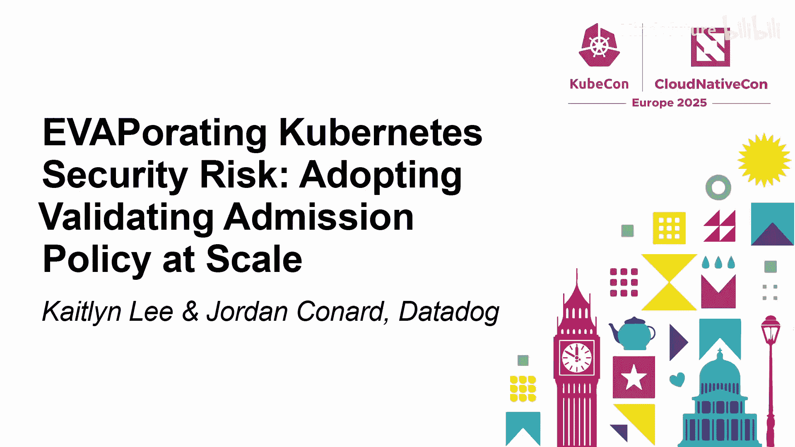
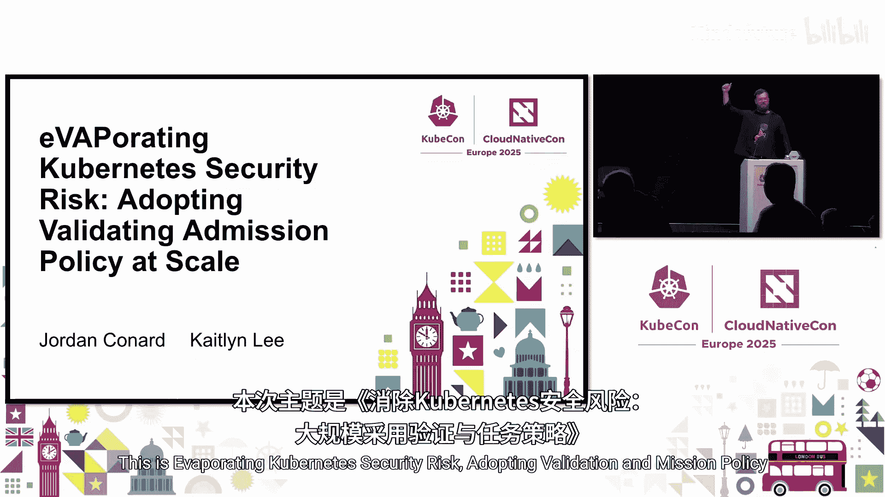
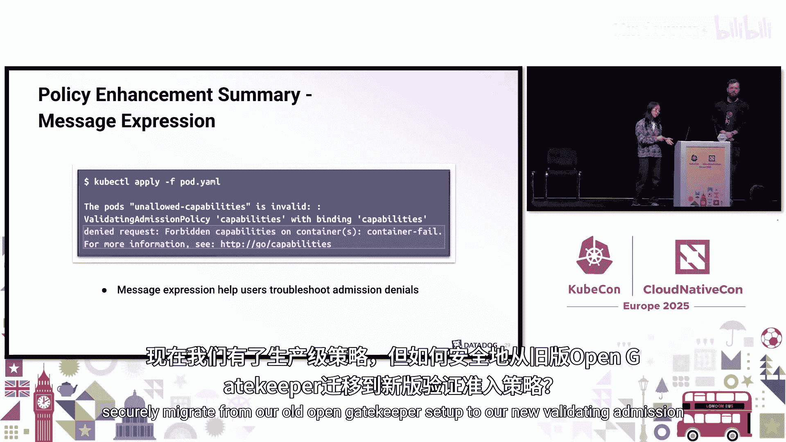
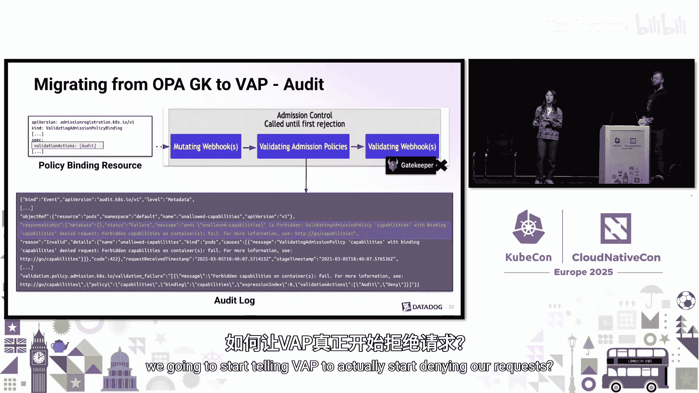
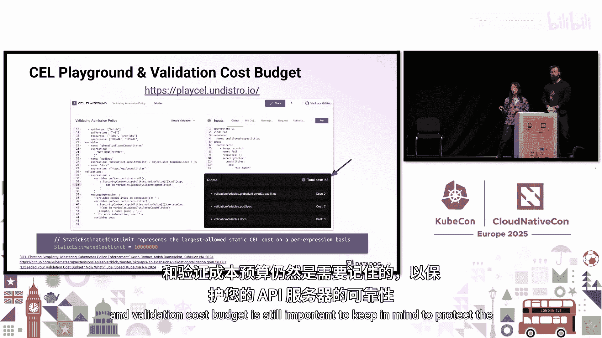
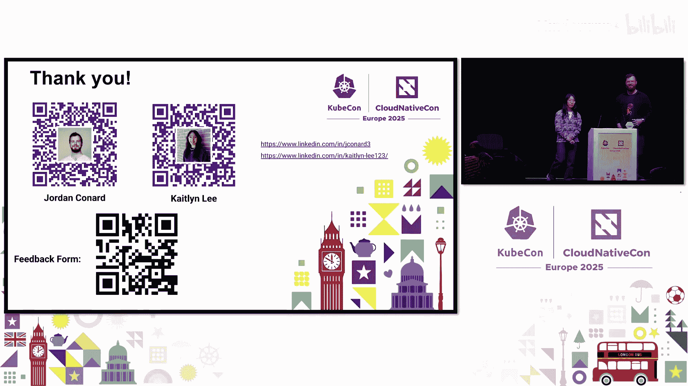
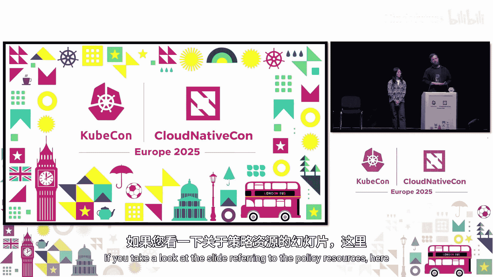
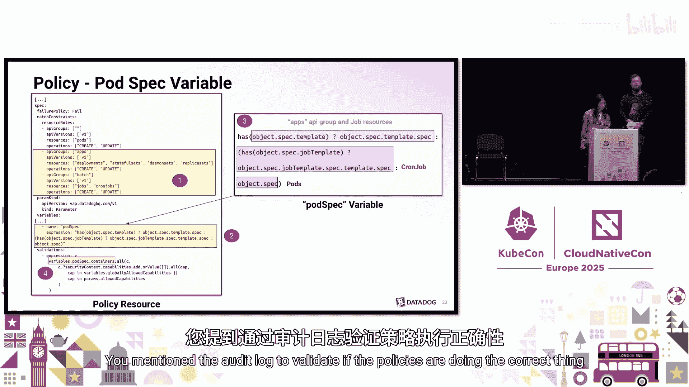
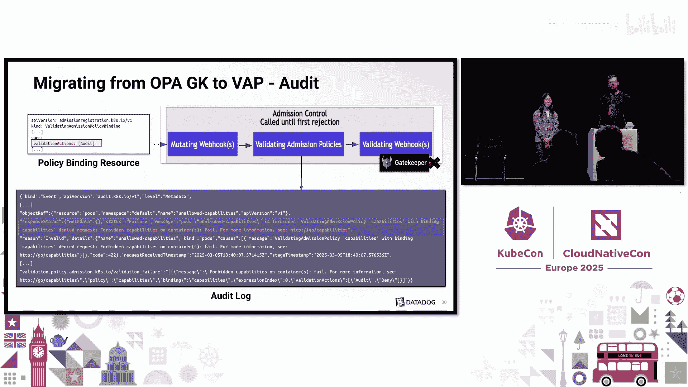

# KubeCon-+-CloudNativeCon-大会2025-｜-云原生计算-｜-可观测性-｜-Kubernetes-｜-Prometheus-p41-P41-EVAPorating-Kubernetes-Security-Risk---Adopting-Validating-Admission-P...-Ka--BV1Cd32zDEBG_p41-

H， hello。

Keepe gun。Thanks for saving the best talk for last。This is evaporating Kubernetes security risk。

 adopting validation and mission policy of scale。

My name is Jordan Connard， I'm a security engineer here at Datadog and I work on one of our compute teams helping secure our Kubernetes control plans and I'm Kaitn Lee。

 a software engineer also on the compute team here at Datadog I started on the control plan team and now I focus on our workload auto scaling but here at Datadog we've been working with validating admission policy for a little over a year now so today we wanted to come here and show you how you can take some tutorial policies and transform them into fully adopted validating admission policy at scale。

Quick overview of what we're going to talk about today。

 so we're going to start out just a little bit about what Kubernetes means at Datadog。

 then we'll transition into Datadog's history with admission control。

 kind of our motivations for migrating to validate admission policy。

We'll dive into one of our policies and kind of take it from what you might get out of the box in a tutorial into something that we feel is good enough to deploy out into production next we'll cover a few migration and monitoring strategies that we've used and finally we'll wrap up with some teasers to some day two operations and kind of next steps。

So for a little bit of background of Kubernetes here at Datadog， we have over 2。

000 employees in our engineering organization， we run multicloud with over 100 clusters， over 10。

000 nodes and over 100，000 pods， so every single one of our workloads runs on Kubernetes。

 so it's not just our infrastructure but also all of our platforms and all of our applications。

 so as such we need a granular and configurable set of security policies to match our heterogeneous workloads。

😊，And so Datadog's kind of history with admission policy starts around 2020 when pod security policies were being deprecated out of Kubernetes。

 we were looking for a replacement at the time and pod security and just wasn't going to be a great fit for us so around the time OpPA gatekeeper was kind of the goto default solution and the ecosystem at the time and that's ultimately what we began with。

Just a quick overview， OpPA gateatekeeper OpPA or open policy agent is a graduated CNCF project。

 it aims to be a general purpose policy engine， it primarily uses the Rego language to write and define its policies and Gatekeeper is the part of the project which kind of wraps the OpPA engine into a validating admission web hook。

So as of Kubernetes version 130， SG API machinery has a new feature out called validating admission policy。

 it's actually graduated to stable， so from the documentation validating admission policy offers a declarative in process alternative to validating admission web hooks so this means that VP validations or evaluated directly in the API server rather than as in admission webh like gateatekeeper furthermore。

 VAP's policies are written in the common expression language rather than Rego so if you'd like a little more background on VP and CEOL。

 we invite you to check out Anni Kevin's QCon NA 2024 talk。

So once Kan and I kind of got our hands on validing emission policy。

 we did a proof of concept and ultimately came to the conclusion that it would be a great fit for Datadog。

 we kind of came up with three main categories as to features that we really liked and ultimately you know the first one is just moving that from an external web hook to an entry process was going to save us a lot of operational complexity。

 it's going to reduce our cloud resources and cost and finally it was going to give us just a little bit better security posture by not running that external web hook。

Next， we really liked the CEO language， we see it being used increasingly across Kubernetes。

 things like validating fields and CRDs， it's also being used internally at Datadog in some developer tooling as well。

And finally， we really liked the namespace scope parameters that validating emission policy gives as a security engineer。

 it's great， it gives me an entire namespaces， security posture at a single glance。

 and it aligned really well with some of Datadog's existing kind of namespace ownership and R back boundaries。

Great， so once we've decided to migrate to validating a mission policy。

 one of the first things that we needed to do was actually take our existing policies and then translate them into validating mission policy。

So we wanted to share one of our policies with you today， our capabilities policy。

 this one's come with us all the way from our pod security policy days。

 and it very simply just restricts the added capabilities that a container can give to its security context。

So to get VP up and running we're going to need a few different components。

 so the first one is our validating admission policy resource。

 so you can see in box one that this policy is validating against the update and create requests of pod resources。

Down below in box two， you can see our validation expression written in the common expression language。

 so you can see that this expression only validates poOd resources and it will only pass poOd resources that do not have anything specified in the ad field of any of its containers security context。

😊，So in order to have this policy taken into effect。

 we're going to need to bind it to our namespaces。So we can do this by using a validating admission policy binding resource。

You can see in box3 that we've specified a namespace selector。

 so that means all of our namespaces will be bound to this policy by default。

 except if they explicitly include this exclusion label。

 so right now we have the ability to exclude entire namespaces from entire policies。

So you can see here an example pod that is attempting to add a capability within one of its container security contexts。

So this pod would actually be denied admission by our policy。

Sometimes we do have legitimate use cases for these capabilities and unfortunately with this current setup we don't have。

 it's not adequate enough for our needs， so right now it's either all or nothing。

 pods would either be denied admission from our policy for using any capability or they could be excluded from our policy but allowed to use all capabilities。

So yeah as a security engineer is clearly not a great security posture。

 we'd love to introduce some more flexibility into our policies before they actually go out into production to address these legitimate use cases and the first way we can do that is by adding a variable to our policy there in B One we've just called it globally allowed capabilities and this is simply just a list of capabilities that we think might not need additional security review before they're used in workloads。

Once we've got our variable defined there in box one。

 we can go ahead and reference it in our CL expression there in box2。

So to make our expression even more concise， we have replaced our former use of the hasS macros with CL optionalional field selection syntax。

 so that question mark operator。In conjunction with the do or value function seen in box 3。

 this allows us to substitute in a value in the event that a field we're tracking doesn't exist。

 so in our case we're substituting in an empty list。

So this allows us to check fields without having to check their existence every single time and thus making our expression a little more concise and also in this example。

 an empty list would in fact pass our validation and therefore admit a pod。

So globally allowed variables are a great start to add flexibility in our policy but we can go a step further validating a mission policy has a concept called parameter resources and this allows you to take basically any Kubernetes resource and inject some information from it into your policy this could be anything from a config map。

 something like a pod disruption budget。AtDadog， we made the decision to go ahead and create our own CRD。

 which packages all of our variables that we need for our policies there in B one you can see kind of the beginnings of our CRD and in B two an example resource created from the CRD which includes our allowed capabilities。

Once we've got our parameter resources defined and created。

 we need to tell our policy resource about it， so there in B3 we've added a Para kind field to our policy and we're specifying the API version and kind of our CRD。

Finally， we also need to tell the binding resource about which parameter to go and look up。

 and so we can add the parameter field there to go and look for our parameter resource。Finally。

 once the policy and the binding both know about our parameter resource。

 we are then free to add it in our CL expression there at the bottom in box five and our policy resource。

Ultimately， this gives us the flexibility to take a single policy and configure it differently across each namespace individual capabilities needs and their security requirements so right now we have a configurable policy。

 but it's only validating against pod resources。It's perfectly acceptable from a security standpoint。

 but it would be a better user experience if we could validate against higher level pod creating resources like deployments。

So that's exactly what we're going to do now you can see in B1 that we've expanded the scope of our policy to also validate the create and update requests of these higher levell pod creating resources such as deployments and crime jobs。

So you can see down below in box two， we've created a pod spec variable。

So we need this Pod spec variable because traditionally in VP。

 we would need an additional two validating of validation expressions to accommodate for these different resource kinds。

 and this is because all these resource kinds have different paths to their Pod spec。

So you can see we've enlarged this expression in B3。

 and we've expanded the scope to the apps API groups and job resources， Cr jobs， and pods in general。

So you can see that we use twoterernary conditionals to extract the pod spec from all these different kinds of resources。

And finally， down below in box4， we've replaced our formerly hard coded pod spec path with our new pod spec variable。

 so this allows us to use the same single validation expression to validate against all these different kinds of resources。

So with this prospect variable， we've been a little bit more friendly to our users。

 they're getting admission denials now from resources they might be more familiar with and might interact more directly with。

 but we can go even a step further and provide some helpful error messages to our users whenever they do have an admission denial。

And we can do that here with what's called a message expression。

 this is also a CL expression and it is attached to our actual policy validation expression and it's rendered and run whenever the associated validation expression denies admission to a workload。

You can see here in box2， we've also added an additional docs variable。

 which just has a hyperlink to some further information about our policy。

 so when we combine that with our message expression there in the bottom right。

 you can see that we are not only returning the actual container names which violate our policy。

 but also where our users might find more information about why the resource was denied。

Great so with all those enhancements we feel comfortable now deploying our policies out into production。

 so I just want to take a second and kind of summarize the enhancements that we've done so far。

 so at the beginning we had this bare bones kind of inflex policy and the first thing we did was we added this globally allowed capabilities variable to just give us that slightly bit more of flexibility。

We've also reduced the complexity of our policy by using CL optional types to make expressions more concise。

We've added even further flexibility by introducing namespace parameter resources。

 this allows us to take that single policy and configure it differently across each namespace depending on that namespace's security requirements and capabilities needs。

We've introduced a pod spec variable to allow our policy to validate multiple kinds of pod creating resources within a single expression。

And finally， we've given our users some helpful error messages to troubleshoot whenever they run into issues。

So now we have a production grade policy， but how are we going to safely and securely migrate from our old openPEC gatekeeper setup to our new validating admission policy setup？

So we can first do this by utilizing VAP's audit validation action。

 so you can see in the top left our policy binding resource and how we specify that so in audit VAP will log all policy violations to a specified audit log and if audit is the only validation action it won't actually deny requests at this time so this gives us some time to check the validity and behavior of our policies。

So you can see in the top right validating admission policies are evaluated before validating admission web hooks。

 which is where OpPPA gatekeeper runs， so when we're checking we will check the validity of our policies by first seeing all policy violations lo in VAP's audit and then subsequently denied admission by OpPPA gateatekeeper。

Consequently， we should also see that every single pod admission denial from OEC gateatekeeper has a matching policy violation in our VP audit log。

So to check that every single one of our policies that we've migrated from OpPA gatekeeper to VP are correct。

 we've made sure to create some unit end end to end tests to check every single one of our policies and make sure that they have matching behaviors so now that we're sure that our new policies are correct。

 how are we going to start telling VP to actually start denying our requests。

So once we're confident that VAP， all of our policies are ready to go。

 we can then add the deny configuration there in the top left to our binding resource and again。

 because validating the mission policy runs before validation web hooks in our admission control chain we will now start seeing admission denials come from validation admission policy before they ever get to gatekeeper。

 we can again confirm that our policies are correct and match our old gatekeeper policies by confirming we no longer see any admission denials within gatekeeper itself。

Once we're confident that this is the case， we're free to go ahead and decommission gatekeeper and complete our migration。

But now that we're done and validating a mission policy is now in the critical path。

 we need to make sure that it's running reliably and smoothly。So a few ways to do that， first all。

 we can take a look at some metrics that Kubernetes offers us。

 now that we've moved our emission control from an external web hook into our API server。

 the first thing we want to do is make sure that the API server is running running with good health and reliably and so two metrics that we can use to do that are the total number of policy checks and the duration those checks are taking。

So to further monitor that our validation expressions aren't causing havoc to our API servers。

 we can look at an additional two metrics provided to us by the API server。

 so these two at the bottom right concern CL compilation and evaluation duration。

So the caveat to these metrics is that they are aggregates of all CL expressions across your API server。

 so this doesn't just include the expressions in your policies。

 but also expressions used for CRD validation， even though these are aggregates。

 they do give you a general sense of how CL in general is affecting your API server。

But if you did want to pinpoint exactly which expressions may be causing you trouble。

 there are some great troubleshooting tools out there such as the CEL playground。

 so as you can see here we've input our validating admission policy and some test request objects。

So this tool allows us to kind of check the validity of our policy and of our expressions。😊。

On the bottom right side of our playground， you can see that it has a validation cost associated with it。

So the API server has a concept called the Validation Co Bu to protect itself from any runaway CL expressions。

So down below you can see there's a static estimated cost limit。

 which is the largest allowed static CL cost on a per expression basis。

And this is hard coded to 10 million。So as you can see on our playground。

 our capabilities policy that we showed today has costs associated with each one of its variables and above those you can see a total cost of the policy。

 so this total cost is a sum of all the cost of the variables and all of the expressions and message expressions。

So you can see our total cost of our policy today is relatively low in comparison to the hard coded 10 million。

 but validation cost is still something important to keep in mind。

 this is because your costs can exponentially increase especially with the use of nested and chain macros。

 so validation cost and validation cost budget is still important to keep in mind to protect the reliability of your API server。

So we kind of come to the end of the topics that we wanted to cover today。

 so I just wanted to kind of highlight and summarize what we've discussed so far。

 so at the beginning we talked a little bit about Datadog's kind of history with admission policy and some of our motivations for migrating to validation admission policy namely moving from that external web hook to an entry process next we stepped you through one of our policies to show you how we kind of took an out of the box tutorial and put it and evolved it to something that we feel comfortable deploying out into production。

 namely how we used variables to simplify our configuration。

 how we added parameters to increase flexibility into our policy and finally how we're helping our users troubleshoot whenever they run into issues。

Finally， after the migration， we showed you a few monitoring and metrics to keep an eye on to ensure your API server health and reliability。

So this might seem like a lot， but we've still got plenty to talk about。

 unfortunately we won't be able to cover all of this in our talk。

 but just wanted to leave you with some day two operations and some next steps that we've been thinking about and some ideas that you might be able to take back first of all。

 in our policy we were just talking about our main containers in our pods and pod creating resources。

 however， both ephemeral and in knit containers can also add capabilities to their security context。

 and so expanding the scope of our policies to cover these is something that we have to cover as well。

Further， adding flexibility into our policies at Datadog。

 we inject sidecars into many of our workloads， some of those sidecars might need additional capabilities and it would be kind of a lot of manual toil to go in and add those exclusions one by one。

 so we've added an additional parameter or an additional variable into our policies which basically maps a given container image name and an allowed list of capabilities to automatically allow admission to these sidecars。

We've been really happy using the EDE framework to run our end to end tests， like Caitlin mentioned。

 to ensure we're not regressing any of our policies and just to double check that what we're running locally and developing locally is what's actually happening out on our clusters。

I'm really excited about the self-service platform that we're developing internally at Datadog as API drivenve way for our end users to request exclusions。

 basically the contents of those parameter resources and be able to configure that and be able to request it themselves while getting a security review from us。

And finally， we've got some really cool ideas about how to prune and identify and prune un needed policy exclusions over time。

 workloads might change， namespaces might be abandoned and leaving those policy exclusions in place。

 just creates a little bit of a security risk， and so we've got some ideas on how to identify those and ultimately get rid of those。

That all being said， we're wrapping up if you to if you'd love to see more of this。

 please leave us a review， we'd love to present more on these topics later we are both available on LinkedIn if you'd like to connect and talk with us and we'd be happy to take any questions。

 thank you very much thank you。

This on yeah， hello thanks for your talk。 was great。 I have two questions。

 How do you reference other resources in the cluster in your policies。

 Do you just load those in as parameters or is there a better way。😊，Refer to the parameter resources。

 yes， exactly like if you want to write a cell policy that has some dependency on the value in another resource on the cluster。

Can you do that somehow right we don't have the slides back up yeah exactly if you take a look at the slide referring to the policy resources here you can specify the API version in kind of the resource that you want to look at and then actually add the path the spec path that you want there in the CL expression it didn't mention it explicitly but there in box4 there's a line to basically configure your policy what to do if that parameter doesn't exist in your namespace or is somehow yeah missing does that answer your question。

Okay， so yes， parameters are the right way to go for that。 Yeah Okay， wait。

 what was the other question， you mentioned the audit log to validate if the policies are doing the correct thing。

 Did you write a tool or a script to do that and is that open source。

Yeah， we kind of just parse our audit logs so for this audit log you can specify the path of the log so we just parse it and then also parse our open gatekeeper logs and just check that they have matching behavior。

Yeah， it was mostly just some in house scripting， but there's an advanced feature in validating a mission policy to add specific audit messages。

In tags and so that could be an easier way to kind of filter through some of the audit logs as well。

Okay， thank you。Hi there。Anything that you lost from moving from the web hooks to the other one。

 the admission policy？One of the things that was a bit of a struggle at first was just wrapping her head around CL logic。

It's quite a it's quite a declarative language where you know Reggo is a little bit more of a procedural language。

 so just getting her head around that paradigm shift was a little bit of a challenge and also not not necessarily having。

User defined functions within RCL expressions is something we were missing a little bit from the reco language。

Thank you。😊，Hi， first of all， great talk， we also quite heavily adopted validating mission policies quite a while ago and we did a very similar approach。

 but we started a bit earlier when they were way less powerful。And。My question would be。

 so I feel like testing this trend and test is quite cumbersome， or it's quite resource intensive。

 And we like do nightly builds on all regions all the time。And we。

 when we introduced them played around with trying to write unitists for validating emission policies themselves in some way。

 but。ve ungraceciousfully failed， and I just wanted to ask if you touched into that anyways。

 and maybe because honestly I learned a lot today， we're going to definitely go home and rewrite our policies if there's something happen in the space that made that easier if there's any movement in that direction。

Specifically about the unit test so I mean it's quite simple right it's basically defining a bunch of pod resources。

 some that passed the policies， some that fail and more or less just like rendering and applying the policies into a kind cluster and just trying to apply them via dry run j CTL and。

That's what we do we just had for。Open policy agent and policy previously like you can test Reggo itself in a unit test and I was just wondering if you played around like doing it in line without having the need for a kind cluster or any cluster or something Yeah it is a bit of a challenge and kind of what Caitlyn was mentioning with the CL playground that's kind of when we're starting to develop CL from scratch from nothing it's a lot of playing around in the CL playground。

Very similar experience。Hi from an application perspective that you want to kind of stay in line with a policy。

 I kind of want to be able to use policies like this as a li。 Is it possible to test。

My Yal against the policy at the client side， or would I have to basically say that but testluster applied to policies and then try to apply my Yal。

Yeah， that's a challenge， you know， getting kind of these warnings to application developers earlier in the development cycle。

 it's something we don't have a great answer for yet。

 but certainly are feeling some of the same pain and yeah if you've got any ideas。

 be happy to maybe brainstorm later。Okay， thank you very much anyway， it's a really good talk。

Thank you。

Okay， thanks very much， everyone。