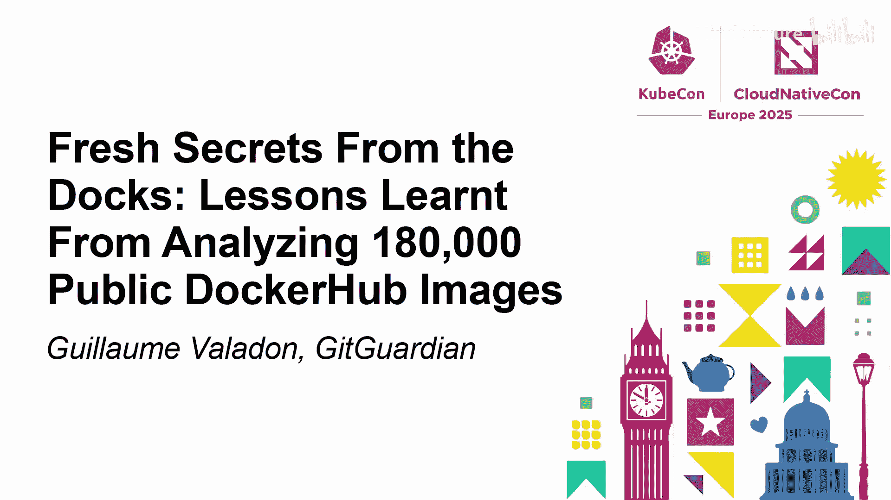
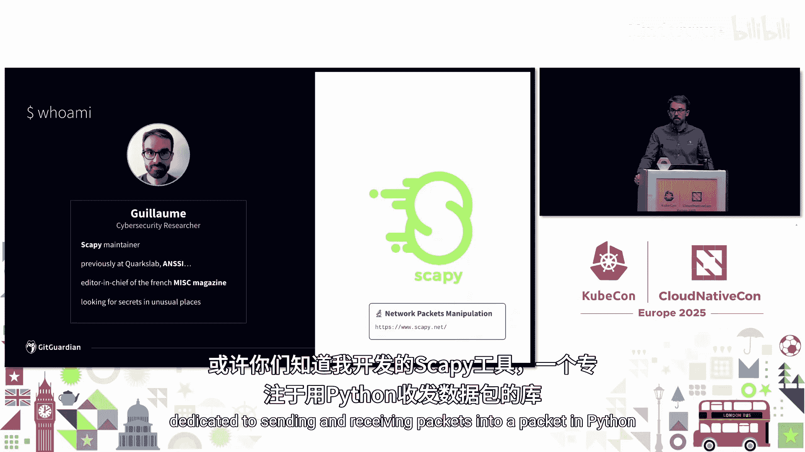
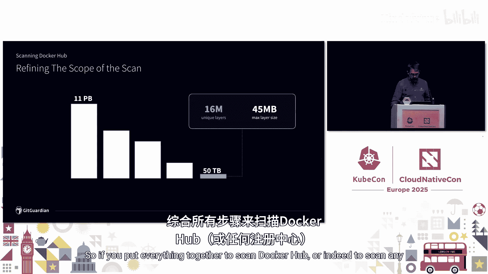
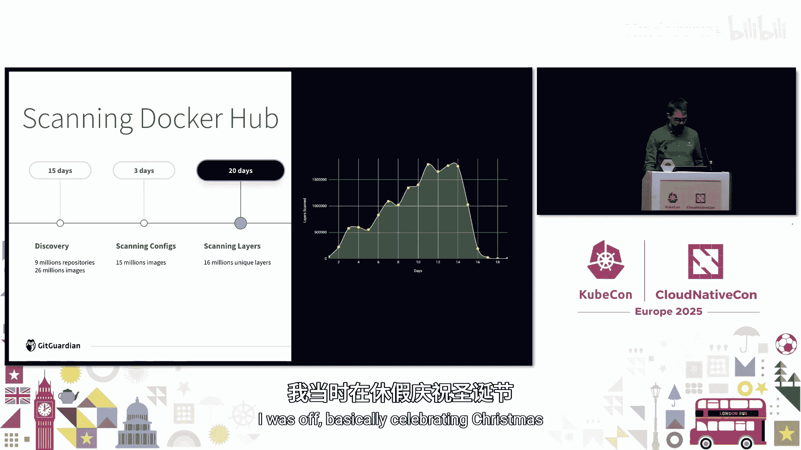
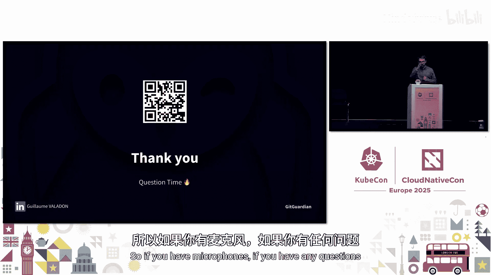

# KubeCon-+-CloudNativeCon-大会2025-｜-云原生计算-｜-可观测性-｜-Kubernetes-｜-Prometheus-p43-P43-Fresh-Secrets-From-the-Docks---Lessons-Learnt-From-Analyzing-180,000-Public--BV1Cd32zDEBG_p43-

I'm really happy to be here today。 Thank you for being here with me。 been。😊。

In the all and I've seen a lot of people living， so thanks a lot。 First owe you an apology。

 there is a typo in the title， as can indeed 50 million images。😊，A bit more than on the title。

 so I did some homework on the way to the conference。Wamai I'm Gum， French guy。

 used to be a network network guy， you might know a tool that I'm working on Sccappi。

 which is a Python library dedicated to sending and receiving packets into a packet in Python。

 and these days I'm doing security research for Gitgar， Gitgar that's a French company。

 which is doing secret detection， so at first obviously in Git and Gitthub。

🎼But not only to。That's a bit disturbing。Not only in code， but we do that in messaging systems。

 we do that in things like Slack， and our goal is to help customer identify secrets and remedia。😊。

Two weeks ago， we released a report called the Secrets Pro report。 And this three part it just。

 let's say。A summary of the discovery we do like every day with secrets， the crazy， crazy world。

 one of the information we like in this report is the fact that people tend to leak more secrets in private reies than in public ones so it tends to indicate that when people feel safe they will echocode secrets。

😊，You can get it online， it's free， there is no paywall no address。

 if you want to play with your product it's also free so you can just create an account。

 plug your Gitlaub， instance， Gitthub instance， and you will start scanning the secret for you。

But my goal today is indeed to have a look at。What can attackers do with secrets in the news attackers are looking for secrets in many things like by packages scrapping website for。

or in the past weeks attackers have been looking for secrets in Gi action logs with great success it seems that they managed to act into conbase or at least some con dependencies that's my focus today I want to behave as I did in the past as a pen tester or doing offensive security so what can attackers do with secrets in security like in many other fields where frameworks to define what we do one of them is attack that's a way to define attacker attack passs so today we' target component registries in that case Drcker Ebb we start with valid credentials indeed they are not。

Baalid in the sense that there are defaults， you don't need credential to talk to DockerA。

 so we have default credentials， then we get all of the registries to Docker images and then we scan for unsecured credentials so that's the target of today。

AndAn attacker， what you can do with a valid credential， for example， is a valid GCP account。

 it will connect to GCP。 It will create a new instance， for example。

 with a big GPU big CPU and you will start to do crypto mining， So basically it stealing your money。

 So that's something an attacker can do。 but an attacker they don't only go after。Cd credentials。

 they go after our data， so they look for credentials for databases， S3 buckets of course codes。

 and this can also for registries in the case of registries like PiipPe， Artfactory。

 DockerU or GitHub and Gitlab， one of the goal is to look for secrets。

 but also to perform some Sion attacks。Something that I forgot to explain that's what is a secret。

 a secret could be anything like a username， passwords， Cra keys。

 tokens that give you access to a system and give you access to the system as a regular user。

So we are looking and we are going after this kind of secret today。So first。

 let's have a look at the content of a Docker image。

 so my goal today is not to explain what is Docker is to explain what I will do later on when scanning secret。

So first， we start with the Docker file and the Docker will comment if you are using a bill kit。

So we build the image here the name is my name， Jeva s Kubcon。

And then we have the tag letters and you push that with Docker P into a registry。

 one of them is Docker Ebb and your image is stored within the registry into a repository so it's a bit like a Git repository stuff storing images and the target today is the pool operation and when you get an image without any authentication。

So let's take one more step and have a look at what is inside a Docker image。 So we start with the。

Do your file here， a really small， few instructions where have Ch copy， run， expose and of。

 and finally CMD instruction。And here， what you can see that some instructions have what I call a side effect on the final image。

 They create a layer。 So form will be a layer。Its name is  I'm going backward Sha 256 column CD27 and this name is indeed the ash of the content。

 so if two images they share the same home， the same base image they will also have the same layer with the same name。

😊，Layers that are also called blobs and the blob is just a table which is usually compressed with the GE。

Cooppi will create another layer， run will create another layer so we have three layers and finally there is some strange operation and Bill Kitty is doing that。

 it takes the Docker file， plain text and do some transformation。

 some that are unfortunate for secrets and then it will create another bb with a jazz and config。😊。

So in an image， we have layers config。 And on top of that， we have another document。

 which is called the manifest， which is。Let's call it a list of layers plus the complete file if you want to play with。

Any image content， I would recommend to install in a tool called Scoppiio， Sccopi is really great。

 you can get an image and get the blobs on your disk and start playing with your content。😊。

So basically scanning docker images for secrets is as easy as scanning Json files and files within tables。

And we have a tool for that at GiGian it's called JJ Shis you can install it on your laptop and JGS will scan do images in that example I just forgot AWS key in my Python code so here we have JJ Shiill thing that okay iPhone a key and it's invalid this validity thing is really important for attackers because they are only looking at secret that they can use。

So what is a validityd check so most of the time you take the secrets you test it against a known endpoint and then you check for the HTP status code so most of the time depending on D it could be a bit more complex but it works fine on the right here we have validate checks for two cases。

On top and in green， a valid Github token。And the answer is Dred， token is valid。

 and if it's invalid， we've got 401， so the invalid token。Indeed there is a short case。

 in the case you have for example a Gi enterprise which is only accessible with a VPN。

 so it's not possible to test it for a public IP address。

 so in that case the status that we have in our application is cannot check that kind of useful because it means the circuit might be valid it's not possible to know what to do。

😊，Next， so we scan one image， so what should we do to scan more images？And I'm on time， bit fast。

So the methodology is the following we have four simple steps I will skip these slides why because these steps the map to Docker registry API endpoints so first when you want to scan for secrets in a Docker registry you will look for。

😊，The repositories， youll use the catalog endpoint that will give you the list of all of the repositories。

Then for each repository， you will get the list of tags that's a second step。

First step for each tag and repository you will get the manifest。

 which is this J file describing the content of the image and then you will get from the manifest the blob for each layer and the block for the config and when you have the blobs you can scan for secrets。

When you have the blur， you also have other things and secrets。

 obviously you have the source code of the application or the compile version of the source code。

So that's for a regular registry， and doAbe is a bit slightly， slightly different。😊。

So why because it's not possible to use the catalog endpoint so it's not possible by default to enumerate the repositories which is not what we want there's a trick here the trick is to use the Docker web search and to use a keyword so we could use like wellknow keyword like production staging things like。

Will likely get you images with secrets。However there is another problem that when you use a keyword。

 the Docker web search only returns 10，000 results， so you need to do some tricks。

 for example enumeration like kind of Word you will start with AAA， AAB， AA， and so on。

 so here on the right side you have SQO， so the step we are at right now and the Docker web search is returning the list of reposory with SKO on the left part that the user name on the right part that let's call it the repository name。

And thats great takeson loss one day and you do it quietly and at that step you have one petabyte of data。

 that's huge， I don't know what to do with that， I don't have the money to store that。

 I don't have the time to scan for that， that's 9 million repositories， the first fact of the day。

 that the most used repository is called Docker 101 tutorial。

If you convert it two images that's almost 26 million images and as I said before only scan 15。

 so my goal is to go from 11 petabyte to something else， the target is 50terabyte。

 which is huge still but that I can manage。😊，The next step is to have a look at the tags。

So you retrieve the tags， it takes like two or three days using the endpoint that I presented before。

 so that's step number two。And this part is quite interesting， it showed that most of the layers。

 93% of them there are five layers or less five tags sorry or less。And that's what I used。

 I decided to only take。Replliitories with at most five tags so that the serone step。

 soone steps is roughly half of wet we before 6。5 petabytes that's 15 million images and the other fun fact of the day is that latest is the most used tag so the other fun fact that took me five days to find that not really kind of waste of time after that we have Vi 1。

 Vis 10 and so on that many version numbers。Next slide。There is a trick， not a trick。

 but some images are huge。 So this one is。170 GB。That's big。

 The first layer is 128 gig that's still big， that's a machine machine learning model。

 likely not containing any secret， so what I did next I say okay maybe they are big layers I don't want to scan them twice。

 let's deuplicate if you deuplicate you will get that。😊，44 million unique layer。

 the biggest one in the experiment was one for8 gigab， 148 gigab。

 it means that when I try to do the screenshot，The layout disappear。

 so from time to time you have layers and from time time they disappear。

And to get this number to get the layers， I had to get the conflict files。

To get the confi files from and the manifest takes approximately 10 days， quite a lot of time。

And the next thing， when you have confi file you can have a look at instructions。

 so we'll start here on the right， so on the right where the number of instruction run is the most used instruction。

 30% of the instruction are run instructions， then we off copy， CMD。

 add and star E means everything else expose。And three points and the other ones。

So that photo count for the size， so if you recall we have 48 petabyte at that stage。

 run that's 70% of the total 3。3 petabyte and indeed run layers are not really important most of the time you will see calls to APKAPT installation of software installation of Java SDK so what I decided to do is not to scan run layers。

Because that will exclude most of the volume。 I will focus only on copy and add and here the ideas to only have a look at。

Fileles that are copied into the final images。 So obviously， I'm likely missing some secrets by。

Not scanning run layers， and I will discuss that later on。

 we found tricks to actually identify the good layers without scanning everything。So if you do that。

 you go from a bit less than  one petabyte to 412 terabytes， that's 18 million unique layers。

 and we need still to do one more step to go to 50。

The trick here is to have a look at the add copy layer sizes and this graph is also interesting so in right here。

 the white color 99% of the layer are below2 megabytes， what I decided to do is take a smaller size。

 so what I did only，I have a look at layers smaller than 45 MBby that's 90% of the layer so at that stage we have 60 million unique layers with a max layer size 45 it's still 15 million images its just that I'm looking at less data。

So if you put everything together to scan Docker E or indeed to scan any registry。

 but DockerA is the biggest one。

It took me 15 days to do the discovery phase， so identifying the repositories and the images。

3 days to scan the con files with thean products，20 days to download and scan the layers。

 And here you have the。The curve which is more or less the speed of the scan over 20 days in the end it was Christmas time so I was off didn look at the experiment so it took like three days to complete that way super slow at the end I was off basically celebrating Christmas。

Okay， chart numbers， I know it's not always super fun to have a look at chart numbers。

 so I try to make a short version of that。First really important point before the numbers thats what we call a Gigar Sid detectors we have two types first the detector that well call specific and as an attacker I will go for that or as a pen tester I will go for the specific y because they belong to well the use sorry wellknown patterns and formats。

Usually they can be mapped to specific services and provider， Gitub， GCP， AWS and so on。

 and they may be automatically validated， which is the example I presented before for Gitthub we are able to identify a Github tool can and to check it or get an API。

 so maybe automatically validated why because the specific could be an open SSH private key and obviously it's difficult to know which host to connect to。

😊，And then on the other hand， we have genetic secret， genetic secret， they look around them。

We don't know the service or the provider and we like the context。

 so genetic secret are nuts are kind of difficult to automate， so I not think they are not great。

 but a human must have a look at them。😊，And I'm really lucky because at Gigar we have。

really great people， really great machine learning scientist and microly。

 they managed something really really cool， they took like these Gen Ses。

 they applied their own model and theyre able to categorize 13% of the Gen secret， which means that。

😊，Uually you don't know what to do with the threeC， but because of this model。

 we're able to know if it's， for example， a Microsoft El server login and password。

So I think it's really great， but that's out of the scope for today。

 So I'm going after specific and after valid。😊，诶。one information I need to give you the only information you need to take back home in English is this called a pie chart。

So I'm French， we call that to Cabonber。That's only information you need to take back on from Kcon。

 the camemo Ba the cheese。So 5% of the repositories they contain a secret that's in other words that's one out of 20。

 that's huge， first number， second number origin， most of the secret they come from layers。

 not from config。So several possibilities， I'm scanning way more files than layers。

 that choice is post attention is not super great， or people are not actually leaking any secret in Do of files。

Next slide， the best for attackers， 20% of these secrets， specific secrets， obviously are valid。

 that's huge， 100 southern secrets are valid to the Indoor。Not all detector equal。

 so this 100000 secret comes from 230 detector types。Obviously。

 some of them are not super interesting for attacker， open with O map API keys。

You can get the weather in London， New York， Tokyo， Paris do that a lot of time， it's not an attack。

 not Japan right。But as we will see in the next slide we have other more powerful types for attacker Canche airs really great again could mean that we manage to identify a Gitlab personal access token and we also manage to identify that the host is not reachable so these secrets are really interesting。

 especially for attacker in your internal network because they can use that to do lateral movement so they can go deeper and deeper。

😊，嗯。Tys typess 28% of the secret secret detectors are related to data storage。

 so for us at GiGd means databases， as free buckets and so on。Total this 28% that's10 than 40。

000 secrets， 13% are valid， that's a huge number again。

 and the second biggest category that' cloud provider。

 we have1 Red and K1ner read the000 sorry secrets and 50% are valid。

 so again in Docker E today you have a lot of critical secrets for many big companies。😊。

So I didn't tell why I'm doing that I'm doing responsible disclosure because as a security researcher that's my duty to report anything critical to companies and in the past four to five months I've been doing that I will not like give you names we have a blog post on that because from time to time people are really happy that we give them secrets and they put them on their wall of fame or we have a vity report but we are finding。

Secrets for big companies。The last。Graph， this one is just crazy。

60% of the valid secrets were lit before 2024。 So it means that the more like you wait。

 the more secret you find that。😊，Crazy， and for 2020， so five years ago。

Two000 secrets are still valid， so if you're able to grab them。You can attack someone。

 You can go deep in the architecture。 That's for me， this number of 2000 that's just insane。

And I'm seeing that every day yesterday I was having coffee， casual coffee at breakfast。

 I found a valid Github token that gave me access to a Kubernetes related open source project so it means that I'm able to do any kind of supply chain attack against project that's my breakfast like do that every day crazy stuff。

😊，So conclusion， docker pitfalls and takeaways。😊，诶。

I hope some of you will not believe the next slide。So first。

 I guess you know DoA remembers here that's a fake DoA file。

 but it's inspired by things that I've seen from Co do stuff run NPMCI and then remove NPMRC。

 so NPMRC was it to the DoA image with the copy instruction。😊，But the thing is。

 Nm L is not removed from the image。 is just remove when you actually。

Do Docker run and the file is still in the cop layer。 and if you get the cop layer， you get a secret。

 So this is a pattern that is not really frequent， but you can see it so Docker remembers。

Next point is more question my question is are people leaking or out secrets in Docker file I don't think so in practice there are really few outd secrets in Docker file so AR Mucopiio and GQ that's perfect tool to go fast and analyze Docker images and you can see that someone actually tried to do echo that's S3。

😊，Cent idea account secret， E clientary account secret into a file。 D square valid。

 And this pattern is not really seen really often。 So what is going on。

So let's have a look at the other pattern against Co and GQ。

So here we have a bunch of ag instructions on and here that's really again really crazy insane。

 leak the App conflicts as a result of Docker build。Strange， so let's have an example。

 This one was just crafted crafted for you on top we have。

But Docker file is really nice this Docker file no secret at all， the only bad stuff。

 let's put that way that the echo tests and in that case the password will be seen in your terminal at build time。

 which is let's say okay， just for the testing purpose。😊，Second phase。

 Do Ibu and we have the Bill Ag and for me it's perfectly fine， I've been doing security for years。

 15 years or more， I've been a developer before and everyone told me not to add code。

 everyone told me to use of variables to pass secret and from time it's not possible to use arguments so this looks fine I mean it's not aed。

😊，In the bottom what you have， thats let's call it a flat representation of the Json Config file。

 J is not really easy to put on slide so just a flat version and inside you have the secrets this when you wear f cuecon in arc。

 offlf and run layer。😊，So it means that Dr。 A Bill leaks secrets into the config。 This is just。

Insane。So what people do usually when they find incense stuff， they go， oh。

 it's too crazy and then they read the documentation。

There are the big warning build arguments and environment variables are inappropriate for passing secret to your build because they are exposedos in the final image instead use secret mounts or SSH mounts。

 which expose secrets to your build securely。😊，Don't do that。So don't use build art。 So what else。

 So that' after the came bear that the other thing you need to take back home， use Mount secret。

 But I think in the。Previous presentation they also discuss this best practice Mount Se the only drawback for me the the way you actually use it Mon type secret is not really easy to remember anyway on top a Docker file in the middle the new way and clean way to pass the secret dash dash secret So here we are mapping the honda variable to secret and the trick here ho is。

Around them， so every time you call the comment that a new secret in the cleaning two secret。

 just a trick to see if it works。And the bottom， you have the resulting J on conflict5。

 so no secret inside。 so that's the best way to do。Seeccrets are only accessible at real time。So。

 that's。I guess one of the men take away from this presentation。Next， another question。

What if people are actually doing such badtub that secrets are finally leaking in run layers。

So this is a fake example。 Obviously， no one will ever write that。 No one will ever。

Use run off and ready that into doO so that could be of Cont。 GS settingtting。pyY。

 any file storing credential that could be used by an application to do something else， for example。

 connect to a database。Okay， might work。So let's have a look， let's select Re。

 whatever kind of tool you use， and that's just a small example of real instruction in my data sets and actually people are using that to the last line here that's my fake example which is indeed real。

 people are doing that。In blue， do you know what what's the blue stuff？So that's a question for you。

What is the blue part？Okay， so blue out。So two slides ago， we discussed Mount secrets。

So Mount secrets can assign。A secret to a viable。And will also give you。

This pass around secret so here we have someone that is doing the best stuff in the Docker world to give a secret to an image at build time and at the same time it's echoing the secret in the end。

 so this is the worst thing ever， don't ever do that。😊，Please tell that to anyone you love。

 Don't ever do that。 The worst of。That's in the dataset。It's time to conclude。😊，Brief conclusion。

 I'm sorry， but you are probably leaking secrets。Maybe not you， maybe your friend。

 maybe someone in your company。And it's not because someone in your company is doing bad stuff。

 it's because it's difficult， it's difficult because there's a wide range of Docker pitfalls。

 and I know some people that have been doing Doca for years that they didn't know for this build a stuff。

So please audit your images for alic secrets， so obviously if you use our tool Gi garden will be。😊。

It will be good and be really happy my colleagues also。Do whatever you do you want to do。

 please count for secrets。 They are really bad stuff。

 If you are not technical and more into the it's called it the governance side， GRC， IO 2701， Sock2。

 whatever， please。Just try this year 2025 to have an exercise。

 Pre that someone in your company publicly leaked a secret。

Let's call it like the AWS Ho accounts and see it goes， can you revoke。

 can you identify the developer？What will happen that's a really good exercise and why scanning why doing exercise that because prevention。

 that's my guess is more effective than actually dealing with a leak and dealing with revocation。😊。

So that's the end of the talk， I have theque code， you can get the slides online if you have any question I will be around having a coffee and trying to have a water。

 so yeah you have a microphone here if you have any questions。

