# KubeCon-+-CloudNativeCon-大会2025-｜-云原生计算-｜-可观测性-｜-Kubernetes-｜-Prometheus-p44-P44-Container-Runtimes...-on-Lockdown---The-Hidden-Costs-of-Multi...-Lewis-Denha--BV1Cd32zDEBG_p44-

So we're going to talk about isolation today and why is isolation important Well， first of all。

 sometimes we can have a bit too much information so let's solve that out by isolating part of it and I'll pass you。

 Thank you everyone or hello or Kyota as they say I'm from New Zealand。 I'm so glad to be here。

 I'm thank you for all coming and I would like to isolate some workloads。

 So let's talk a bit about that。😊。

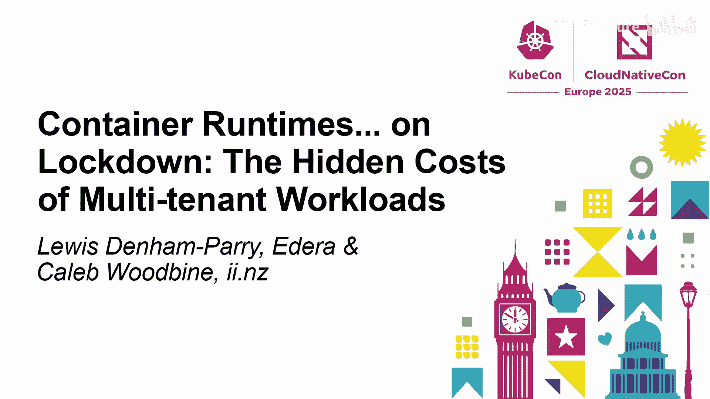

And hey everyone， my name is Lewis as you can see， I've got the most kickass flag in the world。

That's resembling up there down here。 resemble something different。

 Today is my first day of wearing a quiltilt， and I'm doing it in front of all of you。

 So I think I deserves a round of applause for the amount of fear I've had for the last four hours。😊。

We had to get one round of applause in our talk and the reason for this is because I'm an organizer for KTD Edinburgh。

 as CFP is open， yeah， we weren't allowed to upstage this conferences here by having it in London。

 So we've moved up north。 So please， CFP open。 We'd love to have you there， but we'll crack on。😊。

And by cracking on， I would like you all to stand if you can， for a moment。

 this is turning into Magistrate， No everyone has to stand， please， please， please， please。Yeah。

 look at everyone' standing， so much power。😊，Right。This room we're in today is on node。

This is for compute。 This could be the bay metal machine。

 It could be the instance in the cloud that you've never seen before。Now， looking here now。

 I can see pods because I can see groups of people that I know together。And also。

 its all of us together。 So you might not know people in this room before。

But the concept here is that the parts are different shapes and sizes。

We've got some pods for just have one person， and we've got pods forpe。

I'd say optimistically 20 people。😊，And we've got some pods that require additional resources。

 so I've got pods right up front here that need to interact with us because we need hope and help right now。

And then at the back of the room。 we've got like our ephemeral pad that of coming and going。

 Like some of the parts are off in the distance。 That's fine。 That's fine。

 But we've got more coming in。😊，Now， each of you there therefore， are containers。

 and within containers， we run processes， and processes are your beautiful minds with everything else going on there。

😊，So just for context， if you look around the room now， that's what it's like running on the cloud。

 That's what Kubernetes node is to me at this moment。Thank you so much for that。

 but if you could sit down， that'd be awesome。So there are a couple of people standing up。

 which I didn't tell you about。 Now， these are the malicious workloads that I had in this room。

 and I planted them on purpose。 whilst you were standing up， they were judging every part of you。

 If they weren't judging you， they were going through your backpack and they've taken all your swag that you've got the last two days。

来。These are my friends， by the way， lovely people。 thank you for trust here。

 but we wanted to show here that thank you。 yes， you' been here。 thank you。

 but we wanted to show you here。 You can sit now as well。 Thank you， friends。 Thank you。 thank you。

 We're all friends now， we're all friends。😊，But the point here is this is isolation。😡。

But's this isolation for me。 We're all here because we're running Kubernetes。

 We're running containers。 We're running workloads。

And we don't necessarily know where they're running。 We can't necessarily touch where it is。

 and that's okay。 but what's running next to you。So today what we're going to cover is an overview of what container runtimes are。

 the history， and you might recognize a few of the implementations。

 we're going to talk about the risks， so what are the risks of I mean。

 running workloads at all and what are the risks of using particular container runtimes。

 but the main thing that we want to cover here is awareness where we're not here to prescribe。

 you might have something that works better for you and we can all appreciate that。

Nor do we want to throw a shade because all of these ideas are actually really cool and we think they're quite valuable。

 so we're going to compare them and we're going to take a look at multitenancy as seen on TV and also we're going to figure out the right way to have that difficult conversation talking to your doctor about which container runtime is right for you。

Thank you。So as we said。Kubernetes is great， and it's an abstraction for us to understand and manage our infrastructure。

 Containers are also great， but I'm going to say that they're great at deploying to different environments。

😊，Our containers are just processes ultimately running side by side on some compute somewhere。

 This might not be a concern when you're thinking of Kubernetes。

 when your cluster is all the way up in the cloud， But in the cold LED light of a server room。

 it's a process。 And maybe we should start thinking about where this is and ultimately what's around it。

So what is a container runtime， We'll start with definitions to make sure we're all got a grounding base。

My one liner is it's when we provide a container image that we wish to run on some compute。

 The container runtime would start it and manage it accordingly。

I don't believe them to judge a container that they are running。

 They are just to work in this process。 They don't know if it's right or wrong to run a container。

 They just run it。So let's look a bit deeper。So V OCI stands for the Open container Initiative and they have V OCI runtime specification。

It specifies the interface that we use so we can select a runtime to use in our environments。

Pretty much everything I said in the last slide， but to be technical and to build on the interface face context。

 it's required to handle， create， start， kill， delete and many other commands。V Linux namespace。

 and this is where naming starts to get hard。 Naspaces， Kubernetes namespace， Linux namespace。

 use namespace， we've got a lot。 So the Linux namespace provides us with somethingming that feels like isolation。

 The runtime creates Linux namespaces such as appeared peer to mount and user， for example。😊。

C groups help us limit the resources being used， allowing us to prevent the noisy neighbor problem。

Sac Co and Na Bamer assist with a security postureure， our biocontainer。

it can what it can and can't do essentially。 And this is a form of like filtering ciscos or mandatory access controls。

So we need a file system for our containers and we mount from the compute or storage into our containers。

Now that we know what is happening when we run a container。

 let's talk about the different types of containers that we might run from a security context。

 and so I believe I got free or hopefully I got free， so we got untrusted code or an image。

Just a random image on the Internet。 And so this is someone else's code。Essential。

 we don't necessarily know who's made it or where it's been made or where it's been hosted。

There might be little to know attestations so like the origins of being able to find out what's happened there associated with this imageUltimately we don't know if we can trust the running image but then there is nothing much stopping us from doing so now if this is like a new contact to you。

 please check out salsa that can help you understand better how to start putting these security things in context。

Now。Has anyone seen this new acronym as a service before？Well， this one's by Jeed Salazar。

 so I want to give a massive shout of what remote code execution as a service， security tracks。

 so when we have remote code execution or rice。😊，It's usually a scary thing， it's usually terminal。

 that's a very bad dad joke。But the point here is when you run remote code execution as a service。

Remote code execution is where we can start to do bad things and we can like exfiltrate data。

 or we can start manipulating systems。But R as a service today is for a developer platform。

 so AI development is rapidly expanding and developers require hardware that isn't physically available to themselves on their laptops。

😊，SoComp such as Codeder and Gitpod， they offer a compute with an IDE。

 and nowadays this compute has GPUs， so you'll be able to take a container and run it there。

 but have access to the hardware。 that's right as a service today。

 and we need to be able to secure that。Now， this is most simple of a free。

 but arguably the most vital as well。 When we talk sensitive applications。

 it's not just your payment details。There have been data breaches in the past that have resulted in people's lives being at risk。

From a container standpoint， we might be putting all the best security that we have in place。

 and we might believe that we're doing a great job。😊，But if we go back to the processes being run。

 is there someone in this room who is just looking at our processes？Point being。

 tools can get a sofa， but implementation is also key。So personally。

 I love using signal to be able to communicate to my friends。

 but I get a bit concerned when a journalist has been added to our group chat。So。Oh。

 here we've got Grand Thoson container security postureures with Sha a kernelel and host Access。😊。

We're going to go into these two， but I grew up here in the UK。 and as part of my upbringing。

 I was taught that jungle is massive。Today I know that also kernel is massive。

And the kernel has a significant factor in security today as as anything sitting on top of that kernel will pass through that said kernel。

 So we need to be able to secure this as best as we can。

 But when the kernel is massive in size and importance。

 we have to be careful as any changes here could betri detrimentally impact on the performance。😊。

So hosts Access is the second part here and so at fiveam this morning when I was trying to think of this one。

 I wrote modern culture and then I'm referencing the matrix and I realized， oh God。

 but the point here is is the architect from the matrixtri is my concern here。😊。

With a God like Sis admin mode， they can access V where a container is running on and view all the processes。

When they're on your side， maybe that's okay， but what happens if someone has malicious intent and also do you even know who V Hammon is who's managing your commute。

 and I stress today that if you're using a service is your financial payment providing you enough trust on that person？

So taking of those concerns， let's get deeper into the weeds and attempt to group runtime classes by type。

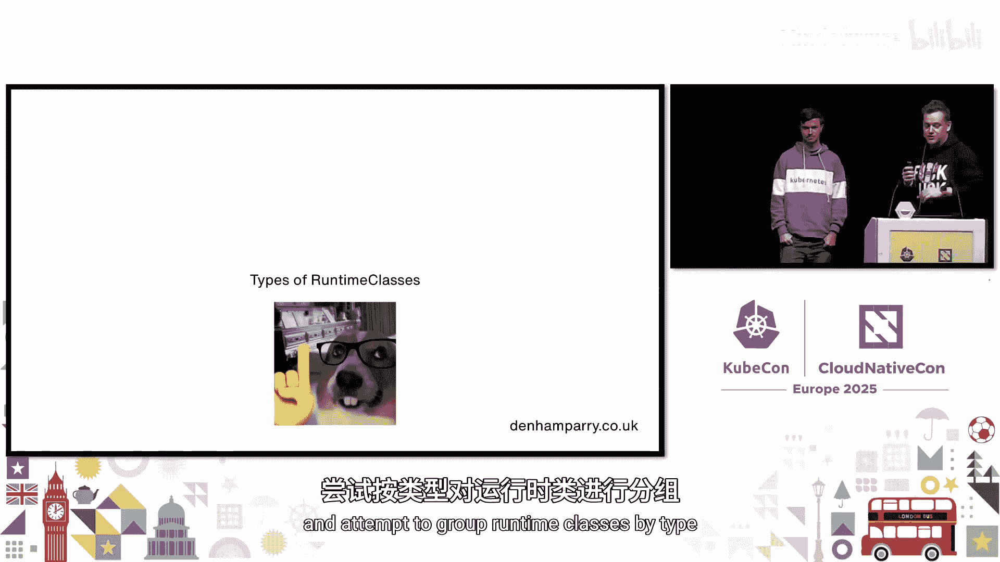

So we have the kernelnal type， and this is our standard type of runtime class。

 If you're running the cluster today and this is all brand new to you。

 you're probably falling into this category Exle runtime here would be Runi， container or cryo。😊。

Samboxing is achieved by basic Linux， namespaces and C groups， and as ubiquitous as it is。

 we see that they can run general purpose workloads。 If you check a cube color output。

 you'd expect to see the runtime class name as RunC native or Linux。😊，So moving on from that。

 and this is where we've seen advancements in the industry。

 and this advancement is going towards isolation towards multi tenancy and additional security。

So within this group， I'm putting G Visor Call containers and firecracker。

I will dive into voters throughout' talk。But this is where it starts to get complicated。

 I'm grouping these together as they are generally focused on isolation and isolation to put focus on multi tenantant workloads。

 but grouping them together does not mean that they are attempting to solve a problem the same way。

 To that， I'd also like to bring Aera infaix in this group。Now miscellaneous， and again， no shade。

 but this is my personal opinions。And to quote Caleb's friends from New Zealand。

 please be constructive with your feedback as I'm trying to as well。Wm。

 I still don't fully understand Wm， and that's probably a me thing。

 I know that there are good things to it， and I believe that they are secure。

 I just can't get my head around it， and I feel that I need to rebuild everything to utilize it。

For me， we have to meet people where they are at today， and sadly for me。

 I'm not where it was and needs me to be。😡，The other one that I put into M is running everything as separate VMs。

 This is an option。 Yes， but I wouldn't say this is Kubernetes to me。Yes。

 Kubernetes is scaling architecture， but Kubernetes is about efficiency as well if I'm paying for compute I should be using it for my workloads So isolation this way might be one of the best isolation options of the past。

 but this is at a financial cost of lost CPU memory and energy。

But let's not also forget that there is human cost here too。 managing another VM takes time away。

 and a single misconfiguration can cause significant issues。Okay。

We could just juggle thank you for that， Lewis。Yeah， so。Workload isolation， Who likes that。 Yep。

 few hands。 good。 let's talk about the history because I think there's a lot to be told about it。

 as Louisa just mentioned about having separate virtual machines historically， I mean。

 you probably still do this in some capacity， but you may wish to have a completely separate physical machine and。

Good for you。 doesn't work for all of us。 Chero， Yeah， any Chroute fans in here， Yeah， cool。

 love Chro。😊，Don't use it for anything that you need。Anyways。

 tout it has its place in things I think mostly these days it's used for like package building and stuff that's cool。

 nothing for production virtual machines great for rich isolation。

 there's heaps of good implementations of this that you're using whether you know it or not if you're using public cloud。

 virtual machines Cuubbut I love Cuubber just want to say that virtual machines cool also C groups so later along the line we had C groups introduced for providing some level of packing things into a box and then making our neighbors a little bit happier with not overflowing onto each other's processed runtimes out of Docker we had RunC which was eventually spun out of the project and because we have the open containers initiative and y you're all using RunC if you're not thinking about this。

😊，Let's talk about that。or Gvissor is an application level kernel that limits the Ss calls and various other things around like what disk access and stuff you may be able to have in your container。

 so Gvissor that's another one that's pretty popular it's quite good。

 one of the options you may wish to have bubble wrap， anyone running desktop Linux， yep， flatpack。

 flatpack uses bubble wrap， it's run C basically at least from an ideas。Standpoints。

 so bubble wrap just scopes down exactly what a desktop application will be needed。

 I mean it can be used for other purposes， you'll just find it in Flpack is a good takeaway there。

 CheU is a specific implementation of virtualization so CheU is pretty old project but it's been rigorously tested by I'm sure there's a few folks from various cloud providers in this room。

 I'd be surprised if there wasn't， you're probably using CheU。Alex C， that's a bit of a classic 1。

 It's a bit more niche these days I personally find， but it does have its place somewhere。

 It's a bit challenging to configure， but。It may work for you， that's cool。

We have microvems such as firererea and microvems are a great way to。

Put your application in a tiny box and say， use the kernel that's running inside of that tiny box。

 and then。You can't see anything else， you're inside the box， get in。

There's some excellent work happening over at confidentialial Comping， the Linux Foundation project。

 and this is a bit more handson， so you do require having access to things like special hardware and stuff like that and it also is really great because we care about at thisest stationations and proving the environment which I think is awesome。

 it is today， it is also a future， but yeah。

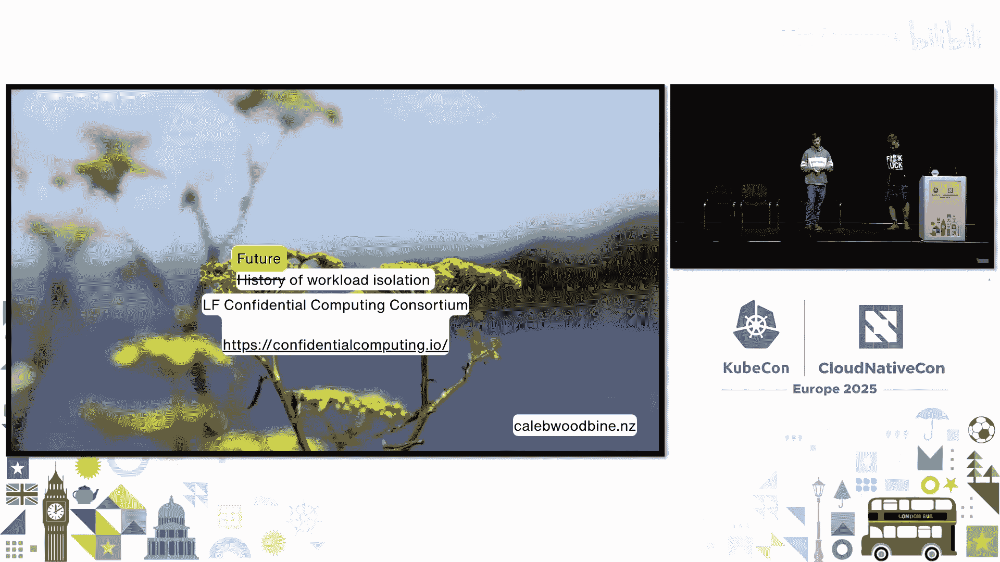

Look at that space Also， I'd like to hand it over to Lewis， talk about。So。

I previously worked at a place where we made images and I was there when Wolfie was founded by Ariariane。

 and so from the brilliant mind that is Ariarianne， who's CP Aerra， she's created a styylite。

So this is our version of bubblebble wrap， the difference is that it's much smaller than run C and it's fully written in rust。

 it's fully pragmatic and has rich APIs and it opinion needed for security and efficiency。😊。

And it's open source。 So it's easy for local sandboxing。 So we're keen for your feedback。

 So please check this out。

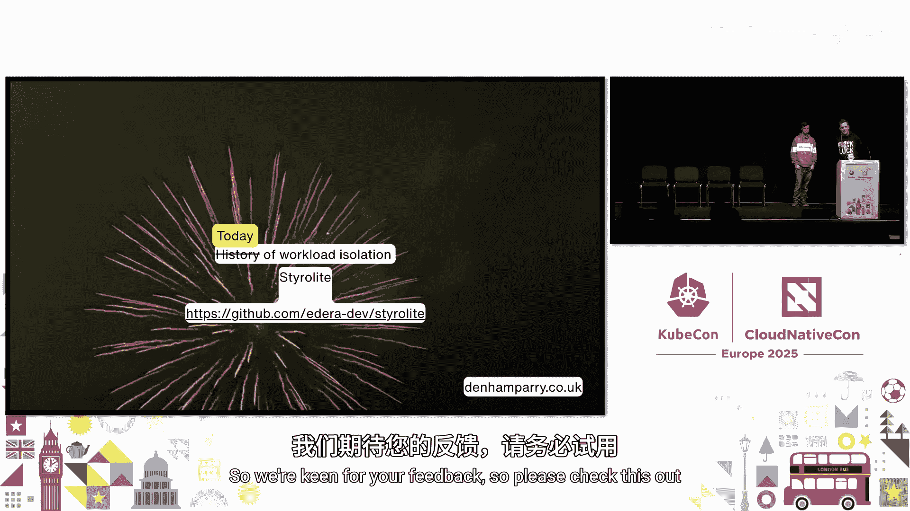

We'll share links to the slides as well after。 Let's work through the options that we just went through to see what we could be using today。

So back to Runni is a reference OI runtime used by darker Con and cryryo。

 it directly interfaces with a Linux kernel to run containers critical for understanding container isolation and breakout risks and regular cut target for security hardling and updates as well talk about with leaky vessel。

 and it uses a usernamespaces for rootless containers。Now moving on from that。

 we looked towards Cr or C Runcro， when you get on stage and you read the dos。

 but you don't know how to pronounce them crunchy， we'll go crunchy。

 Its a faster Eler OCI written time written in C。 It's ideal for modern workloads。

 faster low memoryory routeless support， and this is a great choice if you're optimizing for performance and kernel features。

😊，But then we're going to move on to Gvissor。 Now， traditional containers rely on them host Linux kernel for Cis calls。

 G Visor will intercept those calls and M lateates for Linux kernel behavior in the user space。

 drastic aally shrink in the attack surface。😊，The previous two runtime talk directly to the kernel so Gvissor is helping us out there and Gvissor containers talk to a fake kernel that decides what to allow this can provide stronger multitenant isolation that the previous two cannot but it can't solve the problem are the privileged container risks so privileged containers that's when we just remove all the security defaults and Gvisor can't help there the caveat for the wins here is that the cast and performance that we will talk about later on with our graphs。

Now， moving on to cat containers， so Kata uses KVM or kernel virtual machines under her to provide the isolation and implementation runs similar to run C。

The micro Vms available are QMU or firecracker and this was a default option for isolation within Kubernetes for some time in my honest opinion。

 but there is a higher overhead here running Qter than the previous mentioned options but I've yet to see someone who has easily implemented it within their cluster if you're here today please come and see me I'd love to talk to you so there's a barrier to entry in my opinion here and I want to state that cutter containers are solving a really difficult problem and complex problems like that it's just not as easy to implement to an end user again in my opinion but we're discussing this morning won't we Yes well personally I'm a very big fan of tele Linuxlinox and they have an incredible think image factory and all you need to do is check Qter containers and then it gives you installer which has exactly the operating system with CA and so that's my personal easiest way to get it up and running and yeah。

Go。Now if you're using WASM then I'm assuming you're using SpC and as I stated before。

 I'm not a WASM expert， so I'd appreciate if there's any misunderstandings here to be corrected by someone with more experience。

 I can see the implementation of this to be able to use our infrastructure to distribute WSM workloads on our clusters。

 but WASM can offer more effective workloads and offers a way to run WASM in a multi-tented environment for us here for me it's learning WASM and rebuilding my applications so that they can run on WASM and again if you're a WASM person。

 then this class might be less significant to you， but for me today I can't afford to time。Now。

 Cs box uses a Linux username space on all containers to assist with isolation。Now。

 this is coming towards a key theme of his talk is what is isolation？

I've spoken to people at this conference about this talk to say， what's your definition of isolation。

 And there's not been one consistent theme， We all think we've got isolation to an extent。

 but it's like， where are we all at。So to go to this and to quote there read me。

 and alternative runtime such as Ka andqubit， it does not use VMs， this makes it easier to use。

 which is a great win in my opinion。It can also run in cloud environments by avoiding acid visualization。

 Another key win， because if we're dependent on bare metal， Bay metal doesn't scale。

 and at the Kubernetes conference， we do require scale。But here's a key quote from they read Me。

Although it does not provide the level of isolation that Vm based runtime do。

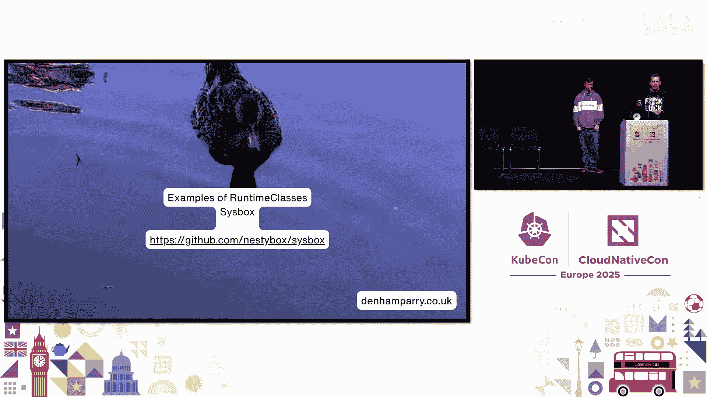

So we're still the same word isolation and so it's like VM isolate what is a VM isolation。

 What is a KVM isolate what is this isolation Now on their site there is a comparison chart available within their readmes but as I'll come into and I wont be more constructive of this and I hope I do have that option available to you in a moment。

 but I'd also like to mention Addera because we launched Edera protecttect1。

0 last week and is officially GaA。Ederero Pro was an amazing idea from our CTO Alexander。

 actually had about 60 months ago， and our implementation is both old and you。

 We're building off concepts of Zen， but we're writing it in rust。

 and we're creating zones that you can run on a type run in a type1 hypervisor。

 So there is no nest virtualization。 because with're so close to a compute。

 we can be as efficient as runtime that we grouped within the kernel type。😊。

Each zone has its own kernel， and our kernels are just distributed via OCI。

We now only monitor CPU memory and usage within a zone， but because we're so close to the metal。

 we can also see the actual energy usage of his own via Prometheus endpoint。

And we don't require specific hardware。 public cloud to bay metal。 You can run Ed eraa anywhere。

So breaking the sandbox and I'm now creating a new acronym apparently of ICU。😊。

These run times are fundamental to our classes working。

 so what could possibly go wrong while with great power comes great responsibility。

 being the interface between a desired state and an actual state can cause problems such as。

Noisy neighbors， Sarah from Madederra， she also gave a great talk oncur this week。😊，Ironically。

 Jonathan Perry has given a talk about noise neighbors right now。

 so I would recommend going to YouTube afterwards and having it on a playlist。

 but the concern for us here within isolation is if we're in isolation we can't see what's around us。

 but we're sharing resources So if there's another process that's taken all the resources so if there's someone here taking all the seats。

It's not ideal for the rest of us。嗯。Things to look out for here would be CPU， Mary and Io。 But again。

 I would defer to Jonathan's talk where you'll probably get more information。Now leaky vessels。

 so back last year in January， sneak。found four CVVEs， one of which was within Runi。

 and the issue here was allowed for lateral movement out of a container runtime because there default there was an issue there within the code that broke isolation。

So and we're talking about runtime constantly here。

 and that's because we're a pinch point of our systems， like everything has to go through here。

 So if you're able to exploit that risk， you're able to get around that node。Just to caveat。

 the fix of this was an update。 So as ever， it's a great reminder that we need to make sure that we're able to update and patch our code at all times。

😊，Ha， ha， Al。Let's bring multi tenancy into the mix with workload isolation here。

Who thinks Kubernetes namespaces is all you need， hands raised， yeah， yeah， okay， you can leave。

 I don't know。it's logical。 So we're putting it's like a folder who uses folders on their computer。

 Yeah， good。They're not to say anyways， moving on， we also have Linux namespaces so this is kind of like a different kind of box that sits in the kernel that you're able to have these specific like mounts and maybe the resource constraints and stuff so that's good but this requires root access which your container runtime does have so think like run C through container but then we have the rootless which would be through usernamespaces。

 but the problem here is that this violates the kernel self-protection what's the other word guidelines。

 that's the word I'm looking for so you can have user namespaces and be rootless。

 but it does reduce your security on your machine which might not be a problem but we're talking secure here。

You can have different nodes。Let's say in a totally made up scenario。

 you've got some compute environment that you're running for either some friends or customers or what。

 what have you。 And maybe your， you say a particular customer can have a particular node pull。

 That might be enough isolation for you。 That's cool。😊。

That's an option we also have network policies， this is in a different realm。

 but in the magical networking realm policies are useful for isolating who can talk to who that's great virtual cuid think of it like I want a VM when I say I want a pod and that works great that might be enough isolation for you there's some implementations out there for different cloud providers is V cluster is more of an API isolation historically I have heard through the wind that there's use of container runtimes to secure things these days but more of an API kind of thing so it's still running on the nodes alongside the other things let's talk about it in the wild so maybe you're gone on a big O hike and you want to see what container runtimes you might be looking on your chart for so yeah we have the C so think Github actions。

 Gitlab C the one that you're using but I haven't said that。😊，Great cloud providers。

 it's just multitenancy as a service。 that's it。 That's great surprise。

 We also have some hosted serverless。 So maybe you're using some cloud providers serverless。

 that's multitened K nativeative serving recently in 1。

60 and I think it was started supporting runtime class name configuration。

 So you can say anything that's running in my cluster through K nativeative will be using a specific container runtime by default or if I specify。

😊。

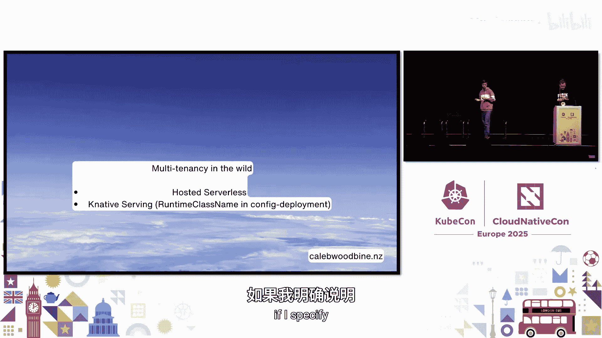

You may be using Google Cloud Run， Aos Lada， or Zo functionss。

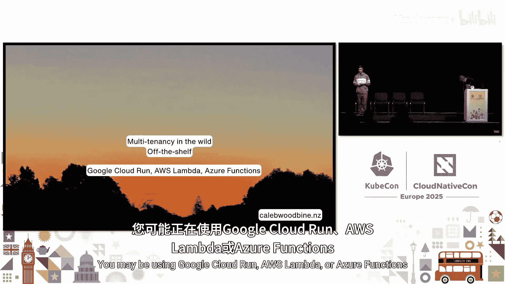

Multi tenancy。

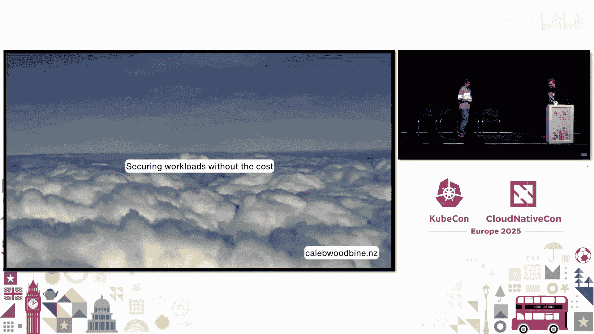

So there might be a cost。 You might decide， I want security。

But then what's the cost for that so often for container runtimes when we're wanting to have like a very isolated it's in its own using its own kernel and such things you need to have a VM so then you need nested virtualization and inside of that VM that's running a kernel blah。

 blah， blah it is expensive so you got to make sure that there's those things that are known the known unknowns with running other container runtimes and virtual machines some of you are probably very familiar with this sometimes you need hardware requirements。

 there can be specific hardware for running virtual machines or what have you so that that's one thing that do need to consider when you're actually deciding okay my doctor said container runtimes are right for me What I need to do is configure it so after it's installed on all my nodes because make sure that they're all the same I'm looking at you at the back。

Yeah。So you can do this either through Kubernetes container runtime classes。

 and this is very effective， but if you want to make it even more effective。

 you may wish to configure container or cryo or a container runtime that I haven't heard about。

So one idea that we've had is why not just not install RunC on your nodes？

Maybe use something that aligns it might be okay for you to use it， sure， but what if you decide。

 okay， I'm going to only run my applications with a secure container runtime。

I'll use that for everything。Cool so I'm going to go through these a little bit quick。

 but Marina Moore who's a researcher at Edera and also T security Cha。

 she's created well she's gone through and done performance。

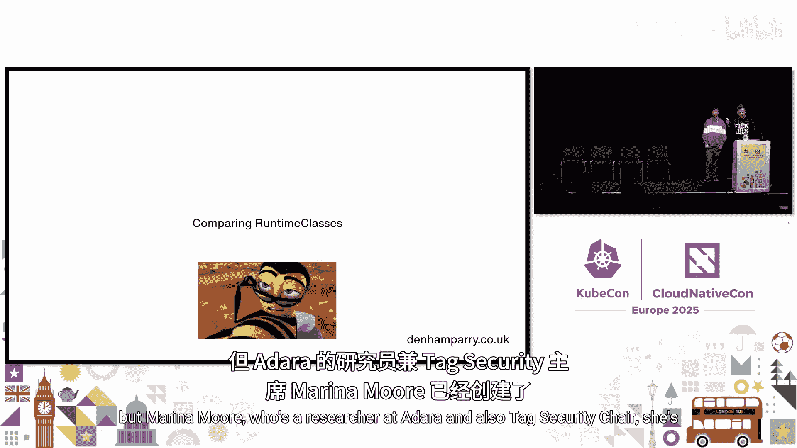

To check to see the comparisons that we have today。 and I'll make sure the slides are available。

 I've got lots here。 If you go to Audera dot dev， you'll be able to see them all。😊。

And essentially these change and on the left， you'll save higher or lower is better。

But these are all the considerations that we need to take into it as well。

 I know we're on a security track， but we also need to have efficiency and performance。

 and a point that we're trying to say here today is is that we want to see as an industry。

 we want to have efficient isolation whilst having the performance that we expect from the kernelal types。

And that's what we're starting to see today where we didn't have it yesterday。

 Now these are important things for me is just to be honest about your needs back to this isolation。

 I want to see something like salsa， but for isolation。

 I want to understand the different grades of isolation because if you're a startup and you're just doing something on the web you probably don't need secure isolation if you're a financial institute or healthcare provider or something I want to see level3 and I want it to be assessed。

 I want an independent person to assess in the places I can't get to to know that isolation is met。

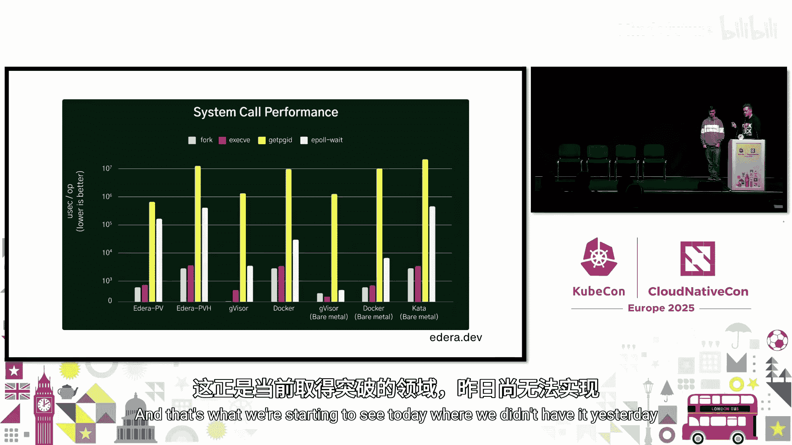

But for you be confident with your choices， but to do that。

 you need to know what your needs are and if it isn't the right thing。

 if you're just copying someone else， that's probably not right for you so you need to do that and for that then though。

 let's be open about it as well。As an industry， let's be open about how we're doing things。

 how we are implementing these things， because that can give other people advice as to how to proceed。

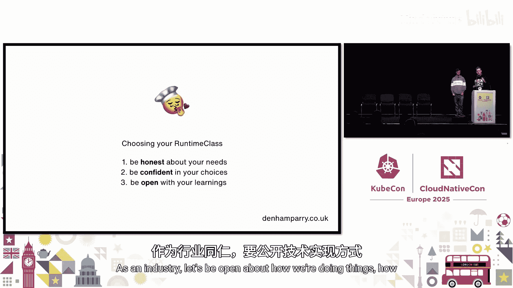

To that am I isolated to be open this is an open source project that we've done now as of yesterday we had some strong opinions on this from others and that's what we want because this is causing the discussions that I believe that we need。

 I want to have a tool that I can run in my infrastructure to tell me what level of isolation I have The problem is it's like a movie inception I don't know if I'm in a dream state I don't know if I'm still spinning there because that's what visualization should provide me but this tool is's a love letter to Jesse Frlls am I contained from 10 years ago when we have the problem of am am I in a VM or am I in a container this is supposed to be an educational tool to help us understand where we're at and I love to have your feedback on that This is a kind of feedback that it gives me a terminal。

 It's very simple and if this matters to you as it matters to me then Id love to have your contributions towards it。

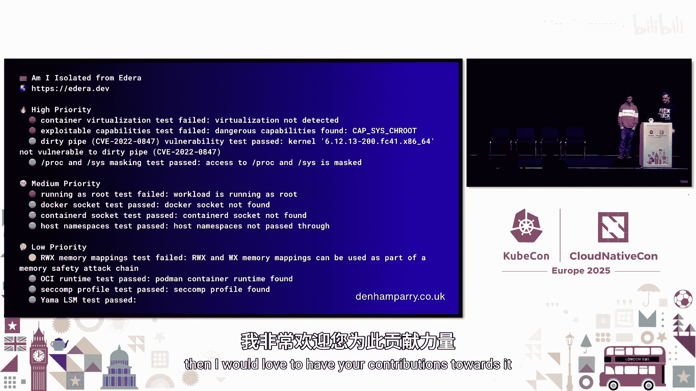

So our conclusion， yes。呃。Well， execution runtime， that's something that is hopefully at the front of your minds right now because we're talking about it to you that would make sense So yeah。

I very strongly believe that you should be considering having some kind of different runtime that isn't just run C。

 regardless of if you're doing multitenancy， but in the case of multitenancy。

 it's a very effective way to make sure that there aren't problems until there are then you sort that out。

 But there's less problems and the problems are different。😊，But yeah。

 let's provide isolation between our workloads and make sure that we are。Prioritizing security。

So in the last 50 seconds， things I've learned today were in a kilt that I've never done before。

First of all， you want to invest in the best underway that you have because I don't know how this is staying up right now。

 and I'm comparing that to run times because runtime are that low lying feature that we depend on so much but we don't necessarily give enough love to。

The second part is implementation of that。 We might have best technologies。

 but if we don't implement it right， thank you。 if we don't implement it right。

 then it doesn't matter。 And that's the thing I turned up to this conference。

 I have Rory Mc Scottish person say you're wearing the k back to front I shit you And so I had to go to the toilets and turn it around because I didn't implement it right。

 First of all， after 20 seconds of wearing this。 I realize I didn't have pockets。

 Ive heard so many people who are in this room right now who told me over and over again they don't have pockets on dresses or skirts。

 I felt that today。 I had to experience it to feel that。

 I'm so proud of the company where I'm at because we have three founding women。

 our CEO M is here today as well。 and I know that I'm part of a majority in this room but I can only support a change in the future that I want to see by supporting others and I'm incredibly proud of that but to all that。

 thank you for your time。😊。

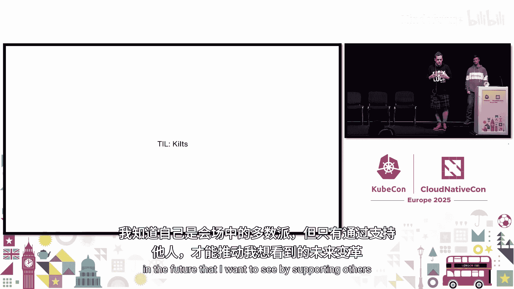