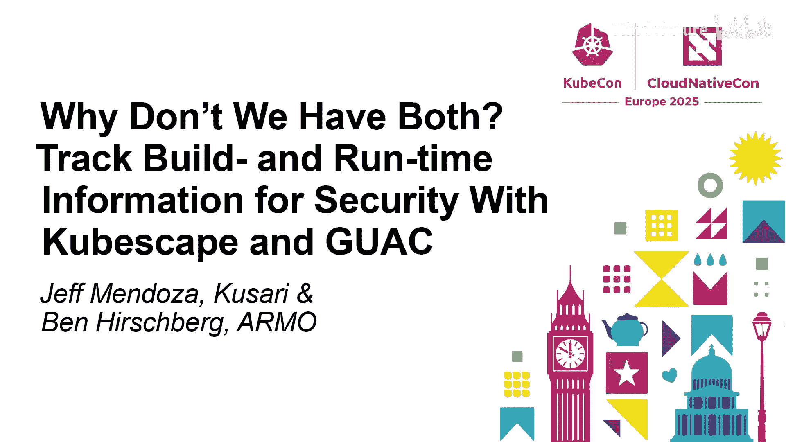
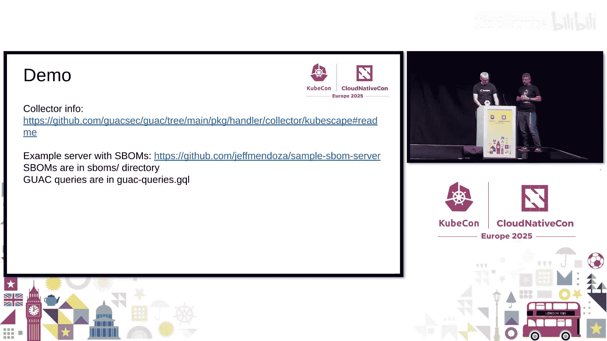
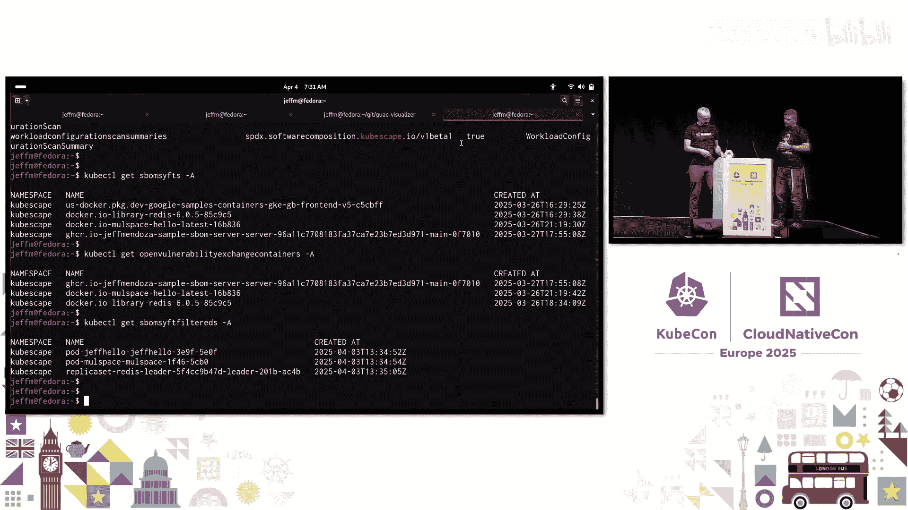
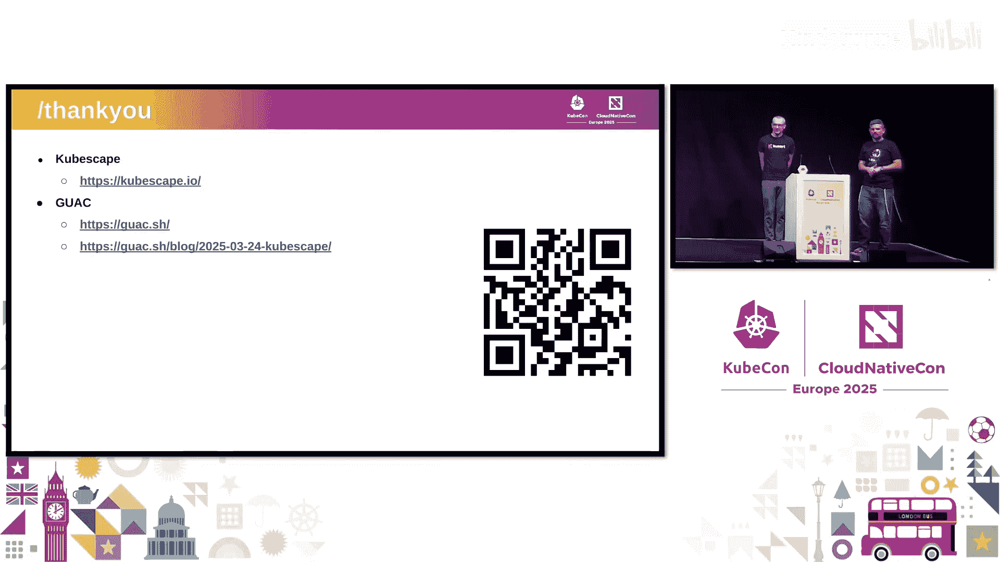
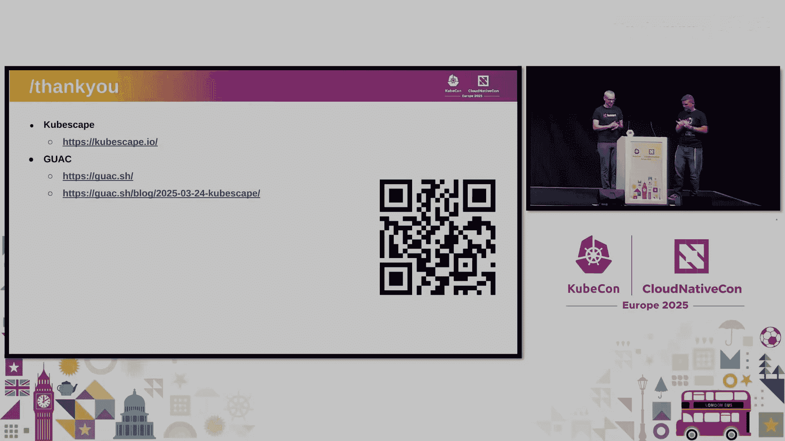

# KubeCon-+-CloudNativeCon-大会2025-｜-云原生计算-｜-可观测性-｜-Kubernetes-｜-Prometheus-p45-P45-Why-Don’t-We-Have-Both-Track-Build--and-Run-time-Information-for-S...-Jeff-M--BV1Cd32zDEBG_p45-

Hello， everyone。 Thanks for being here today。 My name is Jeff Mendoza。 Hey everyone， I am Ben。

 good to have everyone here today。😊。

Yeah， and we're here today to talk about both build time， runtime， SBOM。

 supply chain information in your clusters using both Coopsscape and Gk。Okay。

 a little background about myself， I'm a software engineer at Qsari。

 which is a software supply chain security startup， and I'm a maintainer of Gck。

 which is an Open SSF project， licensed Apache 2。0。

 so I'm also involved in a couple other Open SSF projects and also the clearly defined project。

So I said before， as I said before， I'm Ben， maintainer， one of the maintainers of Cuubbescape。

 which is we'll talk a little bit later about that。

 but it's a Kubernetes security platform and the CNCF incubating project。

 and I'm coming mostly from software engineering and the security product side of the industry。

Just a brief overview of the talk， we're going to talk a little bit about the two projects and then some exciting new features that have just launched in a demo。

Alright， so I'm gonna bring you all up to speed on Guk。 Guk stands for， it's a acronym。 You know。

 we like avocados and， and guacamole。 but it stands for a graph for Understanding artifact。😊，Now。

 I forgot what the C was composition。So what it is is a system that you bring up and it's at the core of it is a GraphQL API。

 but it pulls in all kinds of supply chain data from all kinds of sources or types of documents。

 primarily software bill of materials， SBOM， but also salsa attestations， scorecard scores。

 VX documents， things like that。And it brings it all into a system that you're able to use those GraphQL queries to drive insights about your entire supply chain。

 so if an SBOM just contains the contents of a single piece of software。

 you get all of those into one big graph and you start seeing the interconnection between all of your software。

The way you typically use it is at least up until now is you would have like a step in your build that would generate an SBM and then。

Ingest or， upload that SBOM into the Gac system that you're running。

To dive a little bit more into the different components that make up Guck what you see here in green is the core core project of Gck the database and assembler is what runs the API but there's a lot of other pieces that sit around it so for example the ingeter is what takes documents in and then hydrates the graph with all that turns the documents into nodes and edges that go into the graph and then we have these things called collectors and certifiers so a collector would be something that either watches for new data or goes out and like grabs data so a typical example is the file collector you know that's for SBOM files but other ones are collectors that can sit and look at like your Gitthub repo for when you have a new release I'm going to check to see if that has an SBM download that and then put that into Gck we also have。

Collectors for a number of other integrations like that。

 and then on the certifier side it's going to vulnerability sources like OSV。

dev to say it looks at the graph and says which packages are there and then it gets more information from those external sources。

 so vulnerabilities end up being added as nodes to the graph as well as like those scorecard scores I was talking about。

So here you see on the bottom going in are the different sources that those collectors are written for and that gets pushed up into the GAC system and then on the top are things that you can use to access all the information in the GraphQL API so there's of course GraphQL itself if you write queries say I'm interested in which package is connected to this package is connected to that vulnerability。

 things like that， we have a CLI to just answer some typical questions。

 a visualizer I'm going to show that a little bit later and then whatever your ideas are so I think in Paris there's a talk about Gk and OpPPA and to do policy for Kubernetes so there's a plugin for that as well。

Yeah， I think that's about it。O。So， few words about。嗯。My project， my project， my CNF project。

 but the project I'm maintaining。So Cuubesscape started like four years ago， the project。

 used to be it started as CLI for scanning Kubernetes。

 and live API and YO files for misconfigurations from security perspective it originally was re built upon open policy agent and implemented a lot of lot of controls。

 security controls frameworks and so on。And the project really fast evolved into a full fledged Kuberes security platform。

So both you can CuubbesSscapepe has a version of that can be installed as an operator in your Kubernetes cluster。

 and it covers quite lot things that you would need from a security perspective when managing a cluster and Kubernetes doesn't give you that out of the box。

You know we started from configuration scanning， we have Vulnerabilityity scanner。

 which is going to be I think the focal point of the discussion today。

 but beyond that we are doing we have an EBPF node agent that does a few quite a nice things like network policy proposal。

 second profile management， and beyond that anly based runtime detection and Cuubbescape in its different versions are available as I said as Kubberance operator as a CLI tool as a GitHub action as visual code plugin。

So the project went up to a great start， and today we have a lot love that we get back from the community and love contributions。

 love usage， which is like really， great as an open source project。😊。

So the thing I'm going to focus on today is our revolves around vnerability scanning and package management asBm。

 And here's our connection with Guac。So。So is there here anyone who is in his daily work does wound orbitity management hands up。

Yeah， is it fun， right， cool thing， Not very nice。 We love it。😊。

So one of the things we really like in our project is just to try to come towards the engineers towards the security person and try to solve things that you would need to do manually and solve them through different smart things。

And one of the major problems。That all of us are doing vulnerability management are more or less you know affected by is that we need to fix vulnerabilities。

 we need to scan for vulnerabilities we need to know we need to keep an updated log of what kind of packages we have in our environments where they are running and what vulner they have and we need to do it constantly and monitor this thing while the main issue with that is that although all of these vulnerabilities to some extent。

 there is some kind of conjuncture where where you could exploit them because otherwise they wouldn't be called vulnerabilities。

 in most of cases they are not leading not real threats to our environments in a Kubernetes cluster because of myriad reasons which I'm going to talk about a little bit later。

Here comes the reachability feature， reachability analysis in Cuubbesscape。

So we love other open source projects as well。 So when we went into the EBPF world。

 we decided to use Inor gadget， which is another great CNCF project in sandbox today。

 And the thing that we come up with is the following simple idea。😊，Today。

 when you take a Kubernetes workload， you can look at the ML file， see where the be。

 what the image that it is running， take this image。

 put into a scanner and get like hundreds of vulnerabilities instantly， which is like super annoying。

Now the problem is that all of these vulnerabilities， although they are there in the image。

 they are not actually loaded into the memory or not even used by the container during runtime。

This difference between saying whether vulnerability belongs to a software package that is being used during runtime or not was something that we felt that we could you know answer this question really simply and this led us to developing the reachability feature which where we are using EBPF monitoring of file activity in the containers in runtime in order to to say which software packages are touched by the runtime。

 so the way we are doing it is as you see here we are creating an asBm for the image that is running in a Kubernetes cluster we are using sift and gripe for this on the other hand we get the observability stream of file operations from inspector gadget and looking at the asBm and saying okay which package was touched。

During the runtime by the container and marking them as reachable。Or loaded。

This enables us to create a short list of AsBOM， an AsBOM。

 which is only includes those software packages that are being used by the container during runtime and remove all of those that are not。

So。Just some further explanation， Cuubbescape， we are big believers of open ended integrations and APIs。

 the way it works that the Cubescape operator component detects an image that we haven't seen in the cluster before。

 triggers an asBOM scanning through our component， the Cu bulleten。

Then the Kubulin scanned the image， created an as bomb based on what it saw in the image and stores it as a Kuberes custom resource。

This custom resource can be accessed by all of you and actually you will see that how it works。

 but in general， this custom this asbom is already the full asB。

 the nodegen with the EBPF data stream is able to mark every entry on this asBm as either something that we saw during runtime that' is executed and load an internet memory or something that hasn't been and therefore enables us to create a different object which we call the filter as bomb so you have two Kubernetes API object。

 you can access with your cube CTL and will you will be able to see the differences So whether whether this is helpful so usually like although this is not an updated graph。

 I like to show it because as you can see in the case of this redish example the number of vulnerabilities from around 15070 vulnerabilities which are all the vulnerability。

that are existing in all the software packaging inside the container during the run based on the runtime analysis are reduced to around 15 and this is like something around the nearly 90% noise reduction。

So in general I brought you like a few other examples， Postgres elasticastic search。

 you can see that only only just two thirds in these images are reachable of all the CVEs in other other examples which are actually like quite a good examples are you can see also that only just a part of the vulnerabilities are actually part of of software packages that are loaded into the memory。

 so over that time。We've been in contact， not especially with a graph finalal team。

 but a few other teams and us showing them the results。

 enabled them also to remove software packages that weren't in use and enabled them to improve。

And just last word， so in general in the general population we see at Armo of how much you can gain from this kind of filtering is between around from 70 to 90% in the general application population most of the time if you think about all those software all those images that contain based on base images that are like taking Ubu to- base image or redhead base image。

 so very bloated base images， gain of filtering is higher in case very slim container images usually this gain is somewhat smaller to。

Alright， so we have a great place to analyze supply chain data。

 We have some really great supply chain data。 So it only makes sense to get all of that cosscape S bombs and filtered S bombs into Guk。

 So it's it's what I was just describing here with the collector。

 I just wrote and released a coupscape collector for Gck just released last week。

 And a little bit about how that works is as Ben mentioned。

 Cosscape is putting all all the S bombs into the API server as custom resources。

 So the collector is just a simple Kubernetes client that watches the API server for those S bombs as they're there。

 and then automatically uploads them and ingests them into the Gac system that you have running。😊。

Pretty straightforward。So I kind of want to show like now what can we do that we have these different all these different S bombs in Guk and try to analyze them and see what the differences are and explore that so to do that i'm going to show kind of a demo or you know a little bit of an example application。

Before I show the example I do want to show here， so this is the cluster that I have running I have up at the top I've got like the regular S bombs there which are just the image the image scan or you know full image S bombs oh in the middle those are the Vex documents so those can go into Guk as well but I won't be exploring that right now and then at the bottom is the filtered S bomb objects。

And so to take a look at those， I'm going to use， I wrote a very quick sample you know application that let's say you have a server and a job right so this is go code。

 so both of these things live in one Git repository， they have one go mod。

 but the server and job like sharere code because it's one project。

 but they have different executables different binaries that get compiled so if we see here a packages on the right。

 I have a server and a job container actually separate ones that get built。

And for this example in the go mod， it has like gorilla and zero log， let's say。

 are two things that are used， but if we look at the packages or sorry the source code。

 the server is only using gorilla， it's not using zero log。And then the。The job is using zero log。

 but not gorilla。 So remember that as we go and look at the at the at the S bombs。So I have。

 I had already run the Guat collector that went and collected all the cubesscape S bombs。 But also。

 I have S bombs from a。Source code S bomb generator。

 And I also have an S bomb from a build time S bomb generator。

 and all of those have been put into Guk。 So normally， like I was saying， you know。

 you would do S bomb during your build。 So we have that plus the Cubescape image S bomb and then the Cuscape filtered S bombm。

So in Qk， I'm here in the playground where I can write GraphQL queries and just run them and explore the data。

 and I have a query here that's just all SBOs。And so I can look here and I can see that the file collector collected this result。

 SDX， and the file collector also collected this server CX。

But it's the Cuscape collector that collected all these other S bombs here that we're going to look for。

 So the first  one I'm going to look at， I have some more queries down here that。

Take a look at all the packages in an SBM。 and this is just to explore there's a lot more things that you can query and Guok。

 And so I'm going to use the ID of the source SBM。There to query and see which packages are in there。

And so this is a， this was， I generated this with OSD Scliber， and it has。

You know the transitive dependencies， but I see both zero log and gorilla here。

 So this is an SBM of your of your everything that's in your source repository it's basically like looking at your lock file or that go mod or that that what is it the。

The go shop file。嗯。So， but that's not， that's not。 Some of these things aren't being built into each each。

 each binary， right， the job and the and the， the。The job and the server had different stuff。

 So this was source。So I already saved the Is here from all the different S bombs that I've ingested。

 This is the build SBM I I D。 So I'm going to run that same query。

And look at the packages in there and here we see what we expect。

 so it's my sample server and it just has HTB Sop goilla so gorilla and the transit dependency So this again build SB is just going to be what actually goes into a build。

 what's going into a binary， something that's closer to what you're shipping so when you're building SBs。

 those are some things to think about。And then now I'm going to take a look at the image S bomb。

And query the packages in there。And the image SBm has， oh wait， I'm seeing I have Wolfy stuff。

 I have base layout and then of course all the go the go packages as well。

 not not zero log only the gorilla muck stuff that's built in and then the Wolfy packages like Sier certificates bundle and TZ data So and then this was this was I didn't actually run an SB generator on the image myself。

 This was the one that Coopsscape ran and put into the API server for me。Now。

 if I take a look at the filtered S bombM for。Let's see this was image。

If I take a look at the filtered S bomb for this， this sample server。

 it's not going to be much different because this sample server is using global go go。Binaries，'s。

 there's only one thing in in the whole whole S bomb。 So the filtered one is pretty much the same。

But I did import a。Filtered S bombm on a Debian based。Image from Cobesscape。

And let's run the query on that one。And so we see that， yeah， there's Debian packages here， Libs SL。

 Libbeie Linux， et cetera， but if you look through this whole thing， it's not very long。

 so there's only the stuff that's actually running is coming in the filtered SBM。

And then before getting back to the slides I just wanted to take a quick peek at the visualizer。

 this is the visualization of the graph。 it's kind of hard to look at all the little dots and things in the visualizer。

 so it's neat to show and say like hey this is the image and then here's this is all of the S bombs together so this isn't filtered this isn't just looking at one S bomb so this is the image and all the dependencies between say like go packages and these are the wolfie packages and then the occurrences of artifacts and eta etc ce。

All right， so I'm going to jump back to the slides and。By exploring all of those S bombs。

 there are some takeaways here。 There are some things that we've learned。 So again。

 source and repository S bombs are basically parsing the lock file。

 They're getting you everything in the repository。 So that might be also stuff that's important to you like Dev and test dependencies。

 but maybe they're not has high priority to you right。

 So things to think about with with stuff in there。

Your build SBM limits only the stuff that's being built into that executable something that you have that's being either during the build of your software。

 whether it's being compiled or if it's interpreted language。

 maybe there's some kind of dependency resolution that happens during the build that is not reflected in the source so but also if you have a build that's like maybe part of your CI for testing that may not be that may not be the exact same build that's what you're shipping to production。

 so that's something to keep in mind when you do when you take a look at build SBs。

And then imageS bombs scanning the container， again。

 you're getting you're not getting your devon test type of libraries or stuff that's being built that's in the repo that's not being built into the image。

 and then you're also getting all of the operating systems level stuff。

 and then this is much closer to what you're running in production， but again it its everything。

And then the filtered SBOM has been covered is only the binaries that are getting loaded into memory。

 so the very most important thing to take a look at and so I don't want to say pros and cons。

 but there's just different things in different SBOs and there are things that you have to know and when using something like Gac can help you kind of explore the SBs and see which packages have the right relationships to which SBOs or the ones that you're looking for。

So main takeaways there。And that brings us to the end Yeah first of all。

 thank you for all for attending you know I know this is the last presentation for you at this Cuecon and I was really impressed by you know the turnout so thank you very much for everyone and we'll really hope to see you also the next Cucons and maybe also you know either joining either of these projects as contributors or just giving us feedback we'll be happy to be in touch and we'll be happy to take questions there's a mic in the middle if you want to speak in the mic to ask questions I also have G stickers for after afterwards if you want one。

Go ahead。 Hi， thank you for the talk。 I have a question。

 does it matter when you query the filtered asperm。

 So is there a chance that the filter is missing some vulnerability。

So I can talk on the cubescape part。 So in the cubescape by default。

 we have default setting up for how long。We are monitoring a container。

 So when you start a container， it takes us。Like2，3 minutes to create the first filter De bomb。

 and we are like every 10 minutes afterwards。 we are if we we see something new we are updating。

 but after by default setting， I think is around three hours or6 hours。

 we are just stopping monitoring in order to reduce the CPU， you know load。

 although this is not a big load。 but having said that if mostly from our most of our experience after thing we didn't see in the first few hours。

 they are usually not really relevant。 but but again， this is something that you can customize。

Thank you。I， I just have a question on the runtime package detection。

 Is that 100% accurate or does it depend， Like， is it always definitely accurate that these are the only ones that are loaded during runtime or。

Is there some inaccuracy to that， So okay。So let me， Im putting my engineering hat on it。

There are like two inputs here， right， So one is the as bomb。 The second is the BPF data。

So in dash bomb， we are just as accurate as dash bomb generator is。 So we are using sift。

 Sift is rather。I， I really like the project。 It's， it's， it's a great project。 And it's one of the。

 you know， top notch you know， as bomb generators from images。😊。

So we might have like things that we don't discover during the creation of the AsB from the image and the other inaccuracy could come in theory from the EBPF data stream。

 So in the EBPF data stream。We'll see that which files are touched during the runtime。

 So either there is an opens call or an Xis call on them。嗯。In this case。

 there is a way that maybe the CPU is overloaded。And then we are missing some EBPF events。

 and missing E VPF events could lead to inaccuracy。

 And we are not marking some packages as loaded while they should be。Now， in that case。

 if I remember correctly， we stopped generating if we are missing EBPF events。

 we are stopping the filtering process because of inaccurate。

 and we don't want to create inaccurate objects。 but this barely happens like it it has to be like some really crazy thing going on in order to to not be able to process all the data and just like running out of the CPU limits we have and missing information。

 But there is like this distance， you know， possibility。 and you would get a log log information。

 you would be missing the filter as bomb in that case。Thank you。😊。

All right。 thank you very much。 Thank you very much， everyone。 Have a great weekend。😊。

